### 工业网络与通信协议基础

工业网络在工业自动化和过程控制中非常重要。工业自动化提供了设备（传感器、执行器、控制器和PC）之间的互连，并使它们能够相互通信。工业网络不同于传统通信，传统通信允许计算机与其外围设备（如打印机、扫描仪等）之间进行通信。工业网络是一种强大的网络，它连接工业自动化和控制设备（PLC、HMI、PC、VFD、变送器等），并在恶劣环境中提供实时监控、控制和数据完整性。

通过阅读本章，你应该对工业网络以及各种拓扑结构和通信介质有更好的理解。你将学习无线网络的基础知识，并了解5G是什么。你还将学习工业网络协议，这些协议对于通信的发生非常重要。最后，我们将提供一个使用PROFINET协议的简单工业网络的实践演示。

在本章中，我们将涵盖以下主题：

- 理解工业网络
- 理解网络拓扑
- 网络介质 – 有线和无线（蓝牙、Wi-Fi和蜂窝通信 – 1G、2G、3G、4G和5G）
- 网络连接器和其他网络组件
- 理解网络协议
- 常见工业网络协议 – Foundation Fieldbus
- 常见工业网络协议 – PROFIBUS
- 常见工业网络协议 – Modbus
- 常见工业网络协议 – HART
- 常见工业网络协议 – PROFINET

#### 理解工业网络

当两个或多个设备连接起来进行数据交换时，这被称为网络。网络中的每个设备都可以称为节点。工业网络由控制器（PLC、PAC或DCS）、现场设备、PC和其他连接起来以共享和交换数据的工业设备组成。工业网络中的节点可以是控制器（PLC、PAC或DCS）、现场设备（传感器/变送器或执行器）、HMI、服务器或工作站。工业网络中的节点利用特殊协议进行通信并实现工业过程的自动化。

#### 理解网络拓扑

网络拓扑是网络的基石。它展示了节点是如何排列和互连的。它指的是网络的物理和逻辑布置。因此，网络拓扑可以分为两个领域：

- **逻辑拓扑**：指的是网络中节点之间数据传输的模式。它定义了数据在传输时所采用的路径。它描述了数据在网络中传输的方式。
- **物理拓扑**：指的是网络中节点的物理布局或排列。它展示了网络中各个节点是如何连接的。

以下是一些常见的物理拓扑：

点对点拓扑：在点对点拓扑中，两个设备通过单根导线连接。在点对点网络中，两个设备之间存在直接链路，如下图所示。家庭或办公室中点对点拓扑的一个示例是PC连接到打印机：

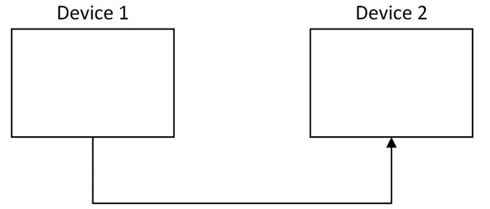

图13.1 – 设备1和设备2之间的点对点网络

在工业自动化中，点对点拓扑的一个示例是当向PLC下载程序时PLC连接到PC：

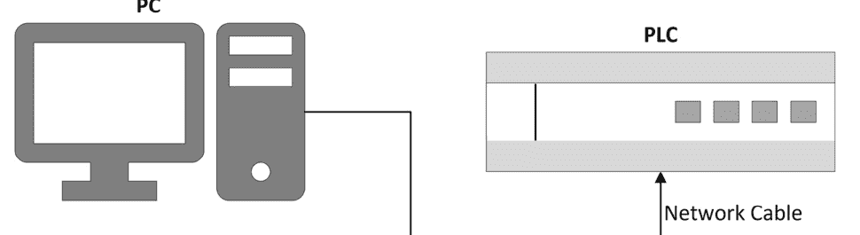

图13.2 – 下载程序时PC连接到PLC

下图显示了PLC连接到HMI以进行监控和控制：

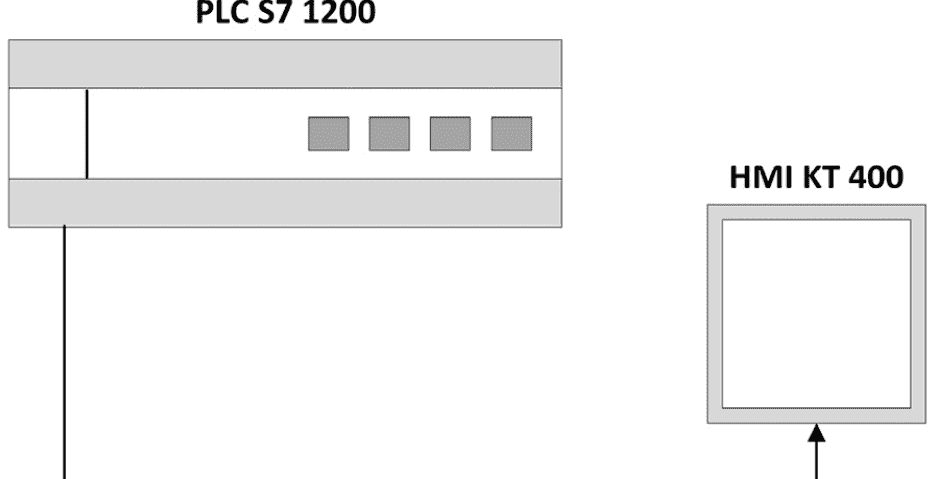

图13.3 – 用于监控和控制目的的PLC连接到HMI

总线拓扑：在总线拓扑中，每个节点都连接到单段电缆。这称为主干、骨干或总线。两端使用终端电阻以提高信号质量。当一个节点要向另一个节点传输数据时，数据被发送到网络中的所有节点。然而，所有其他节点将忽略该数据，而目的节点接受它——也就是说，节点只会响应对其发送的数据。工业自动化中总线拓扑的一个常见示例是使用PROFIBUS协议的PLC、HMI和其他设备的网络：

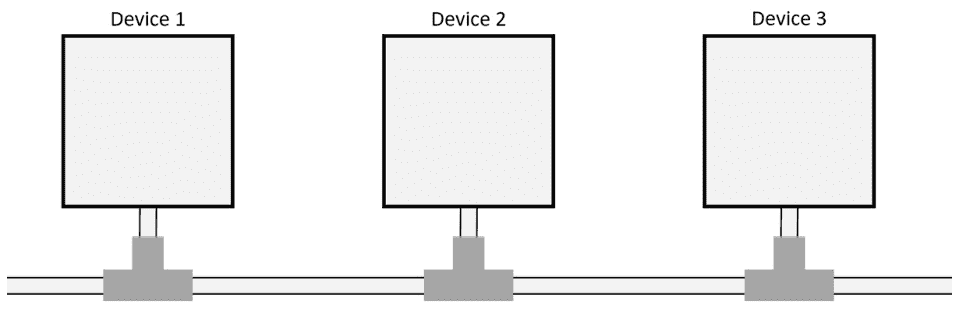

图13.4 – 总线拓扑

星型拓扑：在星型拓扑中，每个节点都连接到中央设备。这可以是交换机、路由器或集线器。当一个节点想要向另一个节点发送数据时，它将数据发送到中央设备，然后中央设备将数据传递给目的节点。设备通过中央设备间接地相互通信：

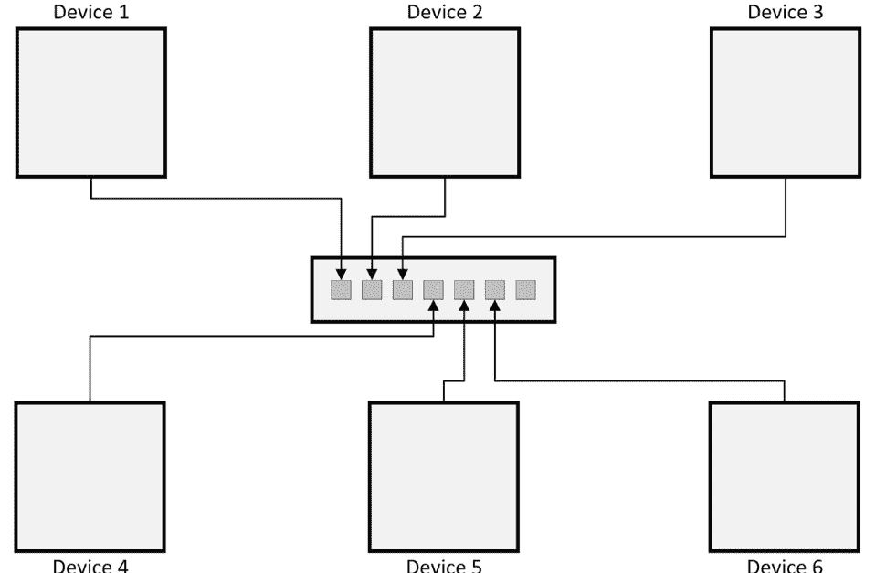

图13.5 – 星型拓扑

**环形拓扑：** 顾名思义，当网络中的节点连接起来时，它们形成一个环。最后一个节点连接到第一个节点，形成一个闭环，如下图所示。在环形拓扑中，数据从一个节点传输到另一个节点，直到到达目的节点。

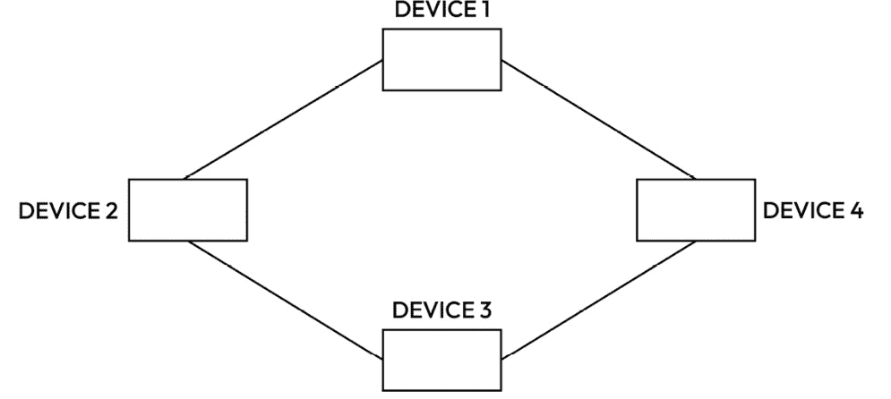

图13.6 – 环形拓扑

在本节中，你了解了网络拓扑。你现在应该理解点对点、星型、总线和环形拓扑。在下一节中，我们将学习网络介质。

#### 网络介质 – 有线和无线（蓝牙、Wi-Fi和蜂窝通信 – 1G、2G、3G、4G和5G）

网络介质可以定义为用于互连网络上节点的通信信道。网络介质的示例包括用于有线网络的铜双绞线电缆、铜同轴电缆和光纤电缆，以及用于无线网络的无线电波（蓝牙、Wi-Fi、蜂窝通信等）。因此，根据所使用的通信信道，网络可以是有线的或无线的：

- **有线网络**：有线网络使用铜双绞线电缆、铜同轴电缆和光纤电缆等电缆作为通信信道。

下图显示了一根同轴电缆：

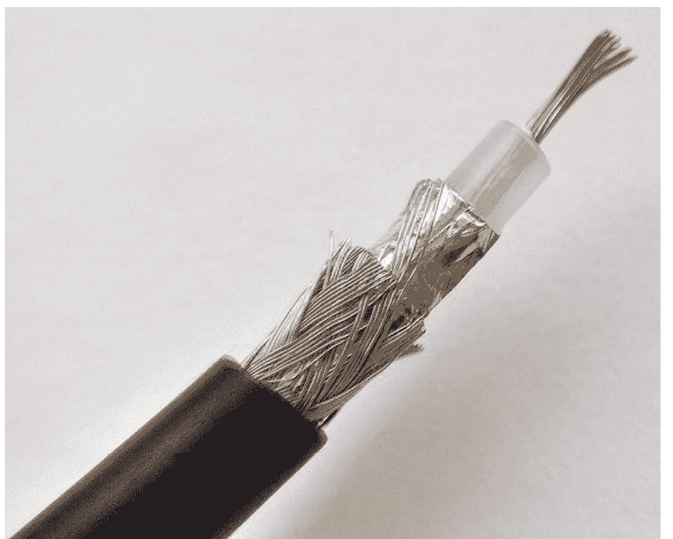

Figure 13.7 – 同轴电缆（RG59）（来源：https://commons.wikimedia.org/wiki/File:Coaxial_cable_cut.jpg）

下图显示了一根 PROFIBUS 电缆：

Figure 13.8 – PROFIBUS 电缆（来源：https://commons.wikimedia.org/wiki/File:0x-pb-kabel.jpg）

下图显示了一根双绞线电缆：

Figure 13.10 – 光纤电缆（单模光纤）（来源：https://commons.wikimedia.org/wiki/File:Optical_fiber_connectors-optical_patch_cable-01ASD.jpg）

无线网络：无线网络使用射频波通过蓝牙、Wi-Fi 和蜂窝通信作为通信信道。无线电波可称为电磁波。它可以通过空气、真空、液体甚至固体物体传播。它可用于在没有电缆的情况下在两个或多个设备之间建立通信：

- **Bluetooth：** 这是一种用于短距离的无线技术标准。它使用 2.402 至 2.48 GHz 的超高频无线电波，在短距离内通过固定设备和移动设备之间进行通信或交换数据，以建立 **个人区域网络（PAN）**。
- **Wi-Fi：** 这是一种使用无线电波在设备之间建立通信的无线通信技术。它也可以称为一种标准 **无线局域网（WLAN）** 技术，允许计算机和各种设备相互连接以及连接到互联网而无需电缆。计算机和其他设备可以通过 Wi-Fi 连接以交换数据。Wi-Fi 不是缩写，而是品牌名称。
- **蜂窝通信（移动电话系统）：** 这是一种使用无线电波在设备之间建立通信的无线通信技术。这里，无线网络通过小区分布在陆地上，每个小区包括一个固定位置的收发器（基站）。小区可在较大区域提供无线覆盖。安装了无线电发射器和接收器的移动电话或任何设备都可以通过电路进行通信，即使设备在小区间移动。

以下是蜂窝通信/移动电话系统的一些世代：

- **1G：** 这是第一代手机技术。它使用模拟信号。其最大速度为 2.4 Kbps。
- **2G：** 这是第二代手机技术。网络是数字的，与第一代模拟不同。在 2G 时代，蜂窝电话用于数据和语音。2G 的最大速度为 50 Kbps 的 GPRS，或使用 **增强型 GSM 演进数据速率（EDGE）** 的 1 Mbps。GPRS 也称为 2.5G —— 即第二代和第三代移动电话之间的技术。

**GPRS** 是 **通用分组无线业务** 的缩写。它是一种分组交换技术，使用无线电波通过蜂窝网络实现数据传输。它用于移动互联网和其他数据通信。

- **3G**：这是第三代手机技术。它于 2001 年推出，主要目标是促进更大的语音和数据容量，以较低成本提高数据传输速度，并支持各种应用。其速度范围在 2 Mbps 至 HSDPA+ 的 21.6 Mbps 之间。
- **4G**：这是第四代手机技术。它旨在提供高质量、高容量和高速，并具有改进的安全性和更低的成本，用于语音、数据、多媒体和基于 IP（互联网协议）的互联网。它适用于游戏、高清移动电视、视频会议、云计算等。其速度范围在 100 Mbps 至 1 Gbps 之间。
- **5G**：这是第五代手机技术。它旨在以 10 Gbps 至 20 Gbps 的速度范围为移动用户和连接设备提供可靠的连接。

5G 提供了许多出色的功能，包括以下内容：

- 改进的手机功能和支持虚拟现实的巨大容量。
- 能够通过超可靠、高可用性和低延迟连接远程控制物理基础设施、汽车和其他设备。
- 无缝连接大量传感器和设备到互联网（物联网）。这是对工业 4.0（智能工厂）非常有用的关键功能，将在下一章中讨论。

本节讨论了网络介质。你现在应该了解有线和无线网络以及各种世代的蜂窝网络 —— 即 1G、2G、3G、4G 和 5G。现在，让我们学习网络连接器和其他网络组件。

#### 网络连接器和其他网络组件

让我们简要了解一下网络连接器。

网络连接器允许有线网络介质（同轴电缆、双绞线、光纤等）连接到网络，如集线器、交换机、路由器、控制器、PC 和网络中的其他设备。它们用于终止一段网络电缆。

以下是一些示例：

- **BNC 连接器：** BNC 是 **Bayonet-Neill-Concelman** 的缩写。BNC 连接器用于同轴电缆：

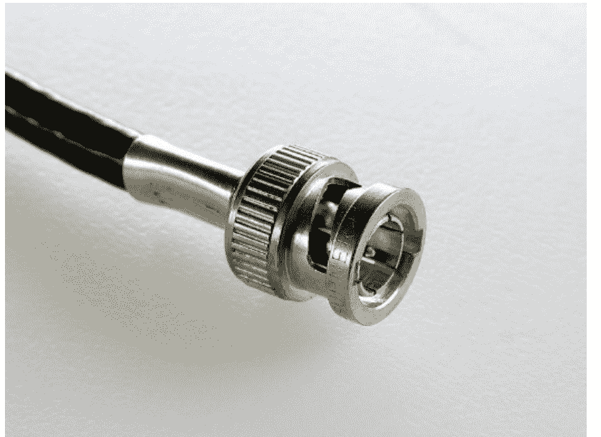

Figure 13.11 – BNC 连接器（来源：https://commons.wikimedia.org/wiki/File:BNC_connector_20050720_001.jpg）

- PROFIBUS 连接器：这通常与 PROFIBUS 电缆一起使用，以使用 PROFIBUS 协议在设备之间建立通信：

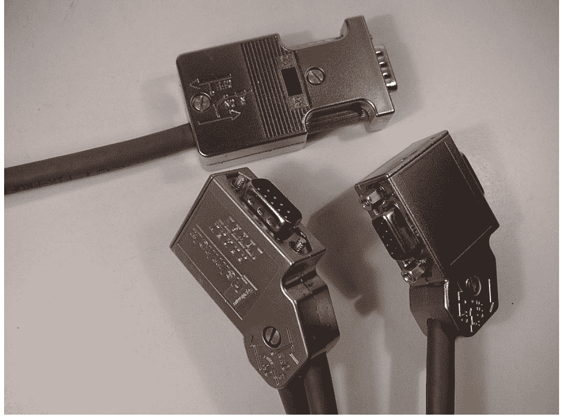

Figure 13.12 – PROFIBUS 连接器（来源：https://commons.wikimedia.org/wiki/File:0x-pb-stecker-verschieden.jpg）

- RJ45 连接器：这是世界上最常见的网络连接器之一。RJ45 是 Registered Jack 45 的缩写。它通常用于双绞线电缆（CAT 5 或 CAT 6）：

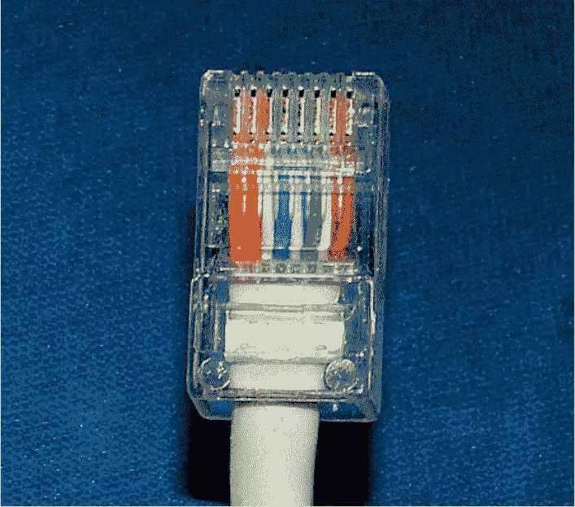

Figure 13.13 – RJ45 连接器（来源：https://commons.wikimedia.org/wiki/File:KonektorRJ45.jpg）

其他一些网络组件如下：

- **Switch：** 交换机是一种连接不同设备（如 PC、打印机等）在网络中并允许它们共享信息和资源的设备。在工业自动化中，交换机可以连接两个或多个 PLC、HMI、PC 和其他自动化和控制设备，并允许它们相互通信。下图显示了一台交换机：

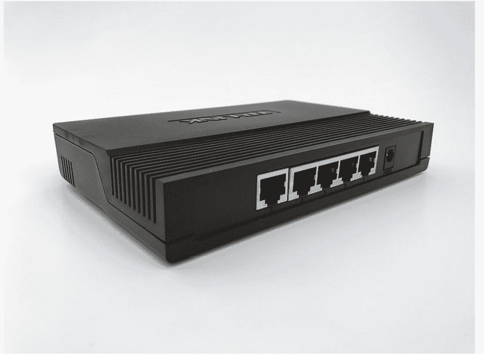

Figure 13.14 – 交换机（来源：https://commons.wikimedia.org/wiki/File:5_Port_Gigabit_Netzwerk-Switch_TL-SG1005D_02.jpg）

交换机有两种类型，如下所示：

- **Unmanaged switch**：一种无需任何配置即可工作的交换机类型。它们用于基本连接。
- **Managed switch**：这是一种需要配置以使其适应我们的网络或需求的交换机类型。它具有许多可以配置、启用或禁用的安全功能。这些功能包括网页认证、访问控制、VLAN 和端口启用/禁用。托管交换机允许对数据包进行统计分析，并提供比非托管交换机更多的特殊功能。

- **Router：** 路由器是一种在网络中将数据包从源路由到目的地的网络设备。通过交换机联网的设备可以通过路由器连接到互联网。路由器使用 IP 地址工作，可以连接两个或多个不同的网络或子网，而不像交换机使用 **媒体访问控制（MAC）** 地址并可在同一网络中连接 PC、打印机等设备。路由器接收传入的数据包，分析它们并将它们定向到另一个网络。

路由器有两种类型，如下所示：

- **Wireless router**：这种路由器无需任何电线或电缆即可连接设备
- **Wired router**：这种路由器需要电线或电缆来连接网络设备

- **Repeater：** 这是一种放大或增加信号强度的设备，以便信号可以以良好的质量传输更远的距离。此外，我们可以使用中继器使不同的物理介质相互适配，例如同轴电缆到光纤。

现在我们已经了解了一些网络组件，让我们了解网络协议。

#### 理解网络协议

网络协议可以称为在网络上两个或多个设备之间进行数据通信的方法。它是一组规则，必须遵守才能在两个或多个连接设备之间进行通信。工业网络协议使工业网络设备（如 PLC、HMI、VFD、PC、变送器、执行器等）之间能够进行通信。该协议涵盖网络拓扑、网络介质、网络连接器等。

世界各地用于通信的协议有很多。本书将重点关注工业网络协议。

常见的工业网络协议可分为有线和无线网络。

#### 有线网络协议

有线网络协议可分为以下两个领域：

**现场总线**：现场总线是一组用于实时分布式控制的工业网络协议，已标准化为 IEC 61158。现场总线协议的一个巨大优势是减少了网络电缆的使用——即所需的布线更少。它支持总线、环形和星形等各种网络拓扑结构。由于其简单性和可靠性，它主要用于工业网络。以下是在工业自动化或过程控制中使用的流行现场总线协议：

- Foundation Fieldbus H1
- PROFIBUS
- HART
- DeviceNet
- CC-Link
- AS-i
- Modbus RTU

**工业以太网**：这是一组利用标准以太网协议进行过程控制和自动化的工业网络协议。它们性能高，并且可以轻松集成到办公网络中。以下协议属于这一组：

- PROFINET
- Foundation Fieldbus HSE
- Ethernet/IP
- Ethernet CAT
- Modbus TCP/IP

#### 无线网络协议

无线网络协议是一组允许设备在不使用电线的情况下进行通信的协议。它们主要由传感器和测量设备使用。以下是在工业自动化中使用的常见无线网络协议：

- Bluetooth
- Wi-Fi
- Cellular

在接下来的几节中，我们将学习一些常见的工业网络协议。

#### 常见工业网络协议 – Foundation Fieldbus

该协议由**国际自动化协会 (ISA)** 开发。其应用领域包括石油化工、食品饮料、电力和其他重型流程应用。它用于以更少的布线将支持 Foundation Fieldbus 的设备（如传感器/变送器）连接到控制系统。它允许多个 Fieldbus 设备使用一根电缆。

Foundation Fieldbus 的两种实现类型为 Foundation Fieldbus H1 和 Foundation Fieldbus 高速以太网 (HSE)：

- **Foundation Fieldbus H1**：该版本提供最高 31.25 Kbps 的速度。双绞线电缆和光纤电缆可用作网络介质。它通过同一根双绞线提供数字通信和直流电源。它采用总线或星形拓扑实现。其网络每个段最多可有 32 个节点。它用于在多个传感器/变送器和执行器（现场设备）与 PLC、DCS 或任何其他形式的控制器之间进行通信。
- **Foundation Fieldbus HSE（高速以太网）**：该版本提供最高 100 Mbps 的速度。它用于连接更高级别的设备（例如 PC、控制器和远程 I/O）。双绞线电缆和光纤电缆也可作为网络介质使用。它是一种基于工业以太网的协议，可采用星形或树形拓扑实现。您可以轻松添加或移除设备而不会影响网络。

通常使用链接设备将 Foundation Fieldbus H1 连接到 Foundation Fieldbus HSE 网络，如下图所示：

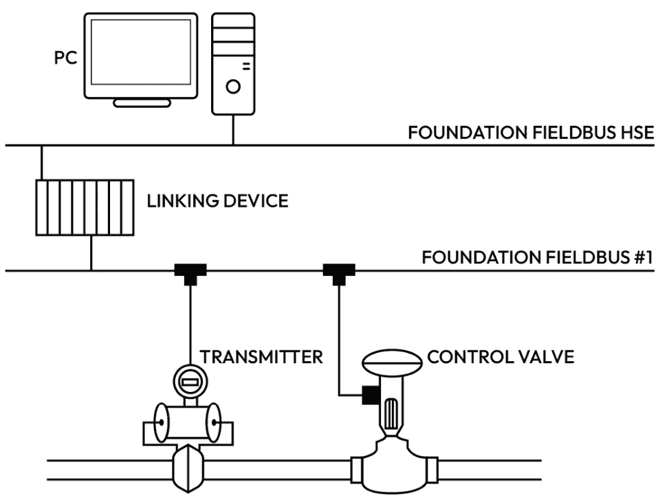

图 13.15 – Foundation Fieldbus H1 和 HSE

现在，让我们学习 PROFIBUS 协议。

#### 常见工业网络协议 – PROFIBUS

PROFIBUS 是 Process Fieldbus 的缩写。它是一种标准协议，可用于连接传感器/变送器、执行器、控制器、HMI、VFD 等。用于通信的是称为 PROFIBUS 电缆的双芯双绞屏蔽电缆（图 13.8）。PROFIBUS 连接器（图 13.12）用于连接到网络中的每个设备。PROFIBUS 协议有以下两种形式：

- **PROFIBUS DP（Decentralized Peripherals）**：PROFIBUS DP 是工业中最常用的网络协议之一。它是一种工业网络协议，通过将**输入和输出 (I/O)** 模块分散化，减少了连接传感器和执行器所需的电线数量。

在 PROFIBUS DP 之前，I/O 集中在控制室，如下图所示，导致大量电缆用于将传感器和执行器（可能远离控制室）与控制室中的输入输出模块进行布线。不是将现场的各个传感器和执行器直接连接到控制室中 PLC 的输入输出模块，我们可以安装一个**接口模块 (IM)**；然后，远离控制室的输入输出模块和传感器与执行器可以在现场区域连接到它。然后，一根电缆（PROFIBUS 电缆）可以将现场的远端 I/O（远程 I/O）连接到位于控制室的 PLC 中的 IM，如 *图 13.17* 所示。这大大减少了布线所需的电缆。我们可以在每个段的 PROFIBUS DP 网络中拥有多达 32 台设备。数据传输速度从 9.6 kbps 到 12 Mbps 不等：

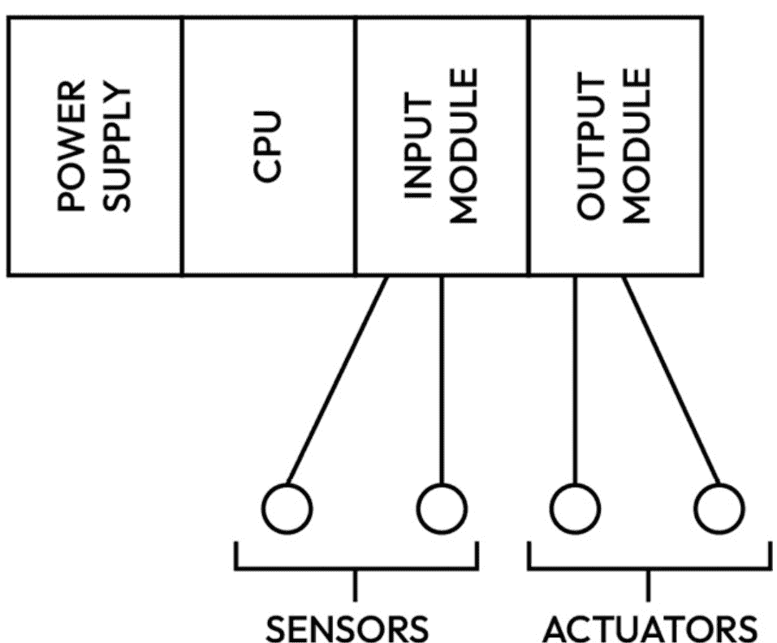

图 13.16 – 集中式控制系统

下图显示了分散式控制系统，其中 PROFIBUS 电缆通过 IM 将现场的远程 I/O 连接到控制室中的 PLC：

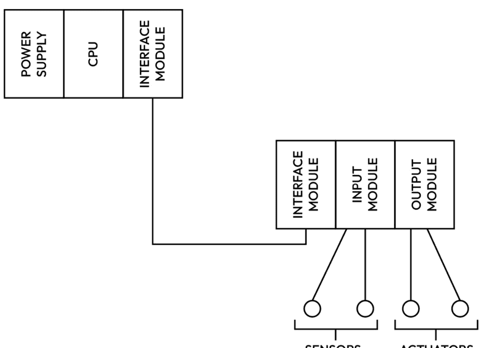

图 13.17 – 分散式控制系统

PROFIBUS PA（过程自动化）：它用于通过控制系统监控过程测量设备。在这里，PROFIBUS DP 中使用的 I/O 模块不再需要，也不需要每个传感器与 I/O 模块之间的布线。传感器以线性形式连接到单个 PROFIBUS PA 总线上。然后，传感器和执行器的网络通过耦合器和一根电缆（PROFIBUS 电缆）连接到 PLC，如下图所示。段耦合器将 PROFIBUS PA 信号转换为 PROFIBUS DP 信号。需要段耦合器，因为 PLC 没有 PROFIBUS PA 端口。它只有 PROFIBUS DP 端口。PROFIBUS PA 的数据传输速度固定为 32 Kbps：

##### PLC

PROFIBUS DP

DP/PA COUPLER
OR LINK MODULE

PROFIBUS PA

SENSORS & ACTUATORS

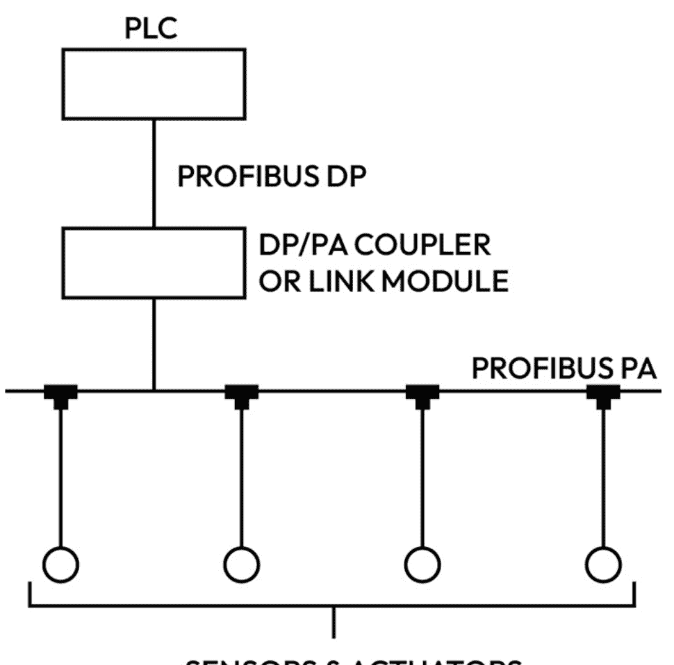

图 13.18 – PROFIBUS PA

现在，让我们学习 Modbus 协议。

#### 常见工业网络协议 – Modbus

在收到主站的传输命令时传输信息。只能有一个主站，最多可有 247 个从站，每个从站都有一个唯一的地址，称为单元 ID。在下图中，PLC 是主站，将与现场设备和 VFD（从站）通信，每个从站都有一个单元 ID。我们也可以将 SCADA/HMI 作为主站，而连接到 SCADA/HMI 的 PLC 则被视为从站。

Modbus RTU 的物理通信介质为 RS232、RS422 和 RS485。

RS232 用于点对点拓扑。它允许在小于 50 英尺的距离内在两个设备（主站和从站）之间进行通信。

RS485 和 RS422 用于在同一线路上连接两个以上的设备，距离大于 50 英尺，而 RS485 更适合在约 4,000 英尺的长距离上连接多个设备。下图显示了主站 PLC 连接到作为从站的现场设备和 VFD：

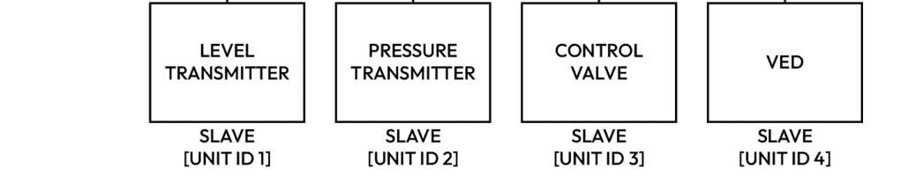

图 13.19 – 以一台 PLC 为主站、现场设备和 VFD 为从站的 Modbus RTU 网络

下图显示了以 SCADA/HMI 为主站、以 PLC 为从站的 Modbus RTU 网络：

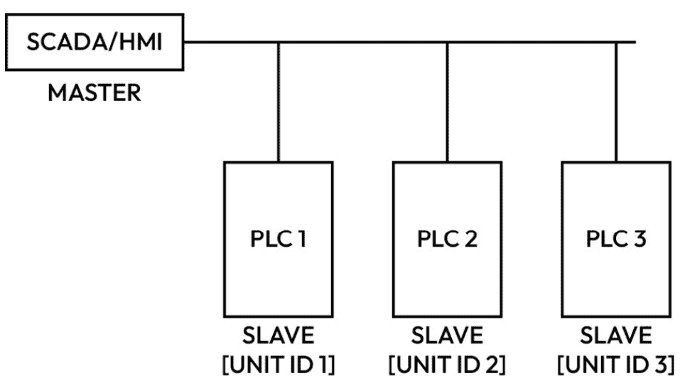

图 13.20 – 以 SCADA/HMI 为主站、以 PLC 为从站的 Modbus RTU 网络

#### Modbus 传输控制协议/互联网协议 (TCP/IP)

该协议使用服务器-客户端架构。您可以有多个设备充当服务器，多个设备充当客户端，如下图所示。客户端和服务器通过普通交换机连接；通信的物理介质是普通以太网电缆。Modbus TCP/IP 网络中的每个设备将具有唯一的 IP 地址，而不是单元 ID：

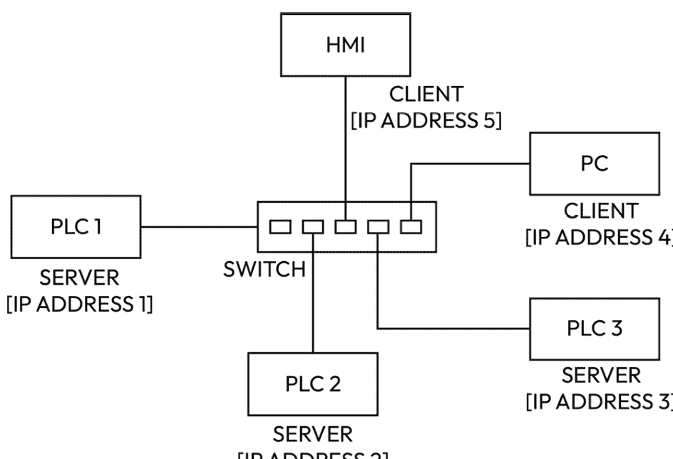

Figure 13.21 – Modbus TCP/IP network with servers and clients

Note

开放协议是指任何公司或组织都可以使用的一种协议。开放协议的制造商提供该协议并允许任何人自由使用，无需任何费用或使用条件，而专有协议则是由特定制造商开发并拥有，并由其制造的设备使用的协议。

现在，让我们来学习 HART 协议。

#### 常见工业网络协议 – HART

**Highway Addressable Remote Transducer (HART)** 协议是世界标准协议，提供智能/智能现场设备与控制器（PLC、DCS 等）或手持通信器之间的数据交换。你可以使用 HART 协议控制和监控 HART 启用的现场设备（传感器、变送器和执行器）。在 HART 通信中，数字信号叠加在传统的 4-20mA 模拟信号之上，使得 4-20mA 模拟信号能够与数字信号在同一双线回路上共存而不会失真。因此，同时传输两种信号——即 4-20mA 信号和数字信号。4-20mA 模拟信号表示关于温度、压力、液位或流量的测量变量，而数字信号则携带其他设备详细信息，例如设备的健康状况、状态、诊断警报等。

网络（高速公路）中的每个传感器/变送器和执行器（换能器）都有一个唯一地址，可以使用该唯一地址远程访问，因此得名 HART。我们不必在传感器位置进行配置或访问其数据。可以从控制室或 HART 数据可访问的任何地方远程完成——即从网络中任何位置用于配置和其他目的的编程 PC 或手持设备（HART 通信器）。

它是全球安装量最大的协议，其优势不言而喻。它提供了一种可靠且简单的方式与现场设备通信。它可用于各种目的，例如以下内容：

- 配置和重新配置 HART 启用的 SMART 现场设备
- 使用手持设备 SMART communicator 对 HART 启用的 SMART 现场仪表进行调试和校准
- 故障排除控制回路
- 获取有关设备健康状况和状态的详细信息
- 在线更改设备 ID 或标签

当 HART 启用的 SMART 现场设备或仪表与控制室中的 HART 兼容控制器一起使用时，可以从现场仪表获得更多益处。

除了这里解释的有线 HART 外，还有 WirelessHART。它是一种无线通信协议，可为 HART 技术增加无线能力。WirelessHART 提供了一种经济有效的方式，可在无需铺设额外线路的情况下将新的测量值传送到控制系统。

##### Note

SMART 现场设备是包含处理器和其他组件的变送器或执行器。它们比传统的模拟现场设备提供更多益处，包括诊断和控制室主控制器中本应需要的其他控制功能。智能现场设备的诊断功能可以指示超出规格的操作、通信链路故障，并预测可能出现的故障。大多数 SMART 现场仪表支持 HART、Foundation Fieldbus 或 PROFIBUS 协议。SMART 是 Single Modular Auto-ranging Remote Transducer 的缩写。

HART 网络有两种类型：

- **Point-to-point**：点对点连接可在下图中看到。这里，数字信号叠加在 4-20mA 模拟信号上。测量或过程变量以 4-20mA 模拟信号传输，所有附加信息则使用数字信号传输：

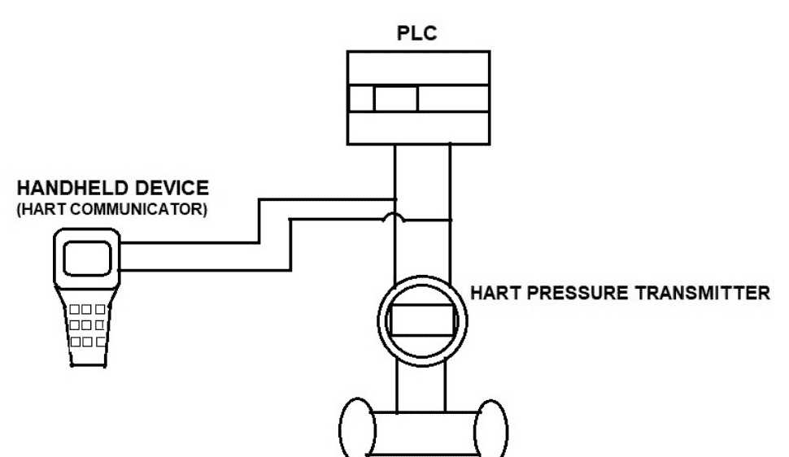

Figure 13.22 – HART transmitter connected point-to-point with the HART communicator

- Multi-drop：这允许在同一对线上连接多个设备，如下图所示。Multi-drop 模式下的通信完全是数字的：

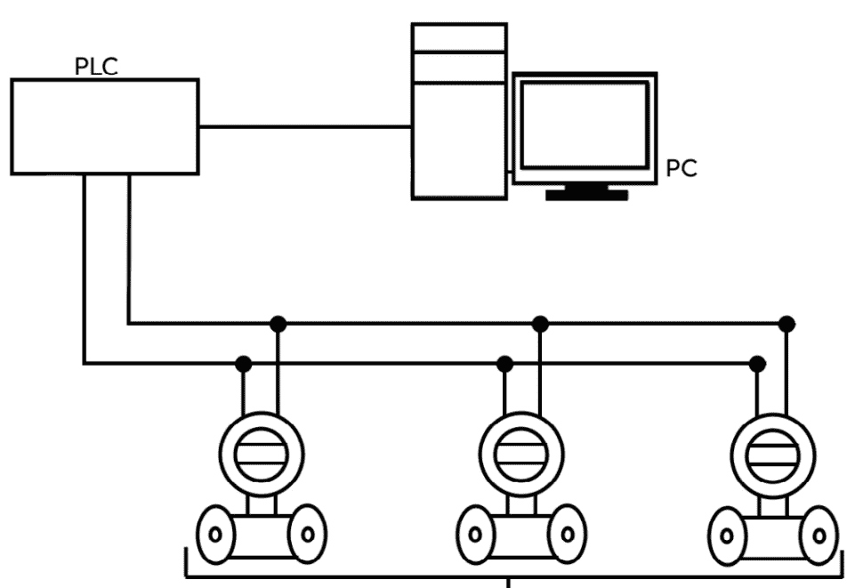

Figure 13.23 – HART transmitter connected in a multi-point mode with a PC for configuration

现在，让我们来学习最常见的工业网络。

#### 常见工业网络协议 – PROFINET

PROFINET 是一种工业以太网协议，旨在工业自动化中在设备和控制器之间交换数据。它是最广泛采用的工业以太网协议。由于基于以太网，其运行速度比 PROFIBUS 更快。用于 PROFINET 的连接器是标准的 RJ45 连接器（图 13.13），网络电缆可以是标准以太网电缆，例如办公室中常见的双绞线 CAT 6 电缆（图 13.9）。标准以太网电缆

由于工业环境条件苛刻，容易受损。因此，工业以太网电缆适用于 PROFINET 使用。其特点是具有屏蔽保护、加固和适当的护套。标准以太网交换机（图 13.14）也可以使用，因为它使用与以太网相同的物理连接标准。PROFINET 现在正成为一种流行的协议，在工业中得到实施，因为其运行速度高（100 Mbps）且灵活。PROFINET 协议可使用点对点、总线或星型拓扑实现。

PROFINET 与 PROFIBUS 的一些区别如下：

- PROFINET 电缆是四芯电缆，尽管可以使用标准以太网电缆。PROFIBUS 电缆通常为紫色且有两芯。
- PROFINET 使用标准 RJ45 连接器，而 PROFIBUS 使用 PROFIBUS 连接器，看起来像标准的 DB-9 串行连接器。
- PROFINET 可以有无限设备，而 PROFIBUS 网络中的每个设备都有唯一的地址，范围为 1 到 127。因此，PROFIBUS 网络中最多可连接 127 台设备。
- PROFINET 的数据传输速率为 100 Mbps，而 PROFIBUS 的最大数据传输速率为 12 Mbps。

下图显示了使用点对点拓扑的 PLC 和 HMI 连接：

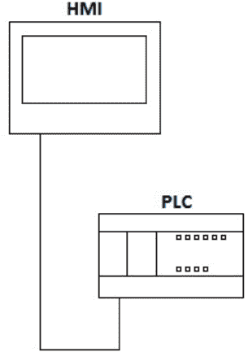

Figure 13.24 – PLC and HMI connections using the point-to-point topology

如果网络需要多于两个节点，我们可以实现星型拓扑，其中每个节点（PLC 1、PLC2、PLC 3、HMI 1、HMI 2 和任何其他设备）将连接到中央组件（交换机）。PROFINET 还支持总线拓扑。

PROFINET 网络中的设备有三个地址（IP地址、MAC 地址和设备名称）。我们在 *Chapter 10, Understanding Human Machine Interfaces (HMIs)* 中使用 PROFINET 协议实现了一个非常简单的网络，其中我们将 Siemens S7 1200 PLC（CPU 1211C）连接到 Siemens HMI（KTP 400）用于监控和控制。在这里，PLC 和 HMI，即网络中的节点，具有唯一的设备名称——即 PLC_1 和 HMI_1（*Chapter 10, Understanding Human Machine Interfaces (HMIs)*，在 *Figure 10.24* 中）。网络中的每个设备都被分配了不同的 IP 地址（PLC 为 192.168.0.4，HMI 为 192.168.0.5）。

下图显示了使用 PROFINET 连接到 HMI 用于监控和控制的 PLC。请参阅 *Chapter 10, Understanding Human Machine Interfaces (HMIs)*，以了解有关此配置的更多信息：

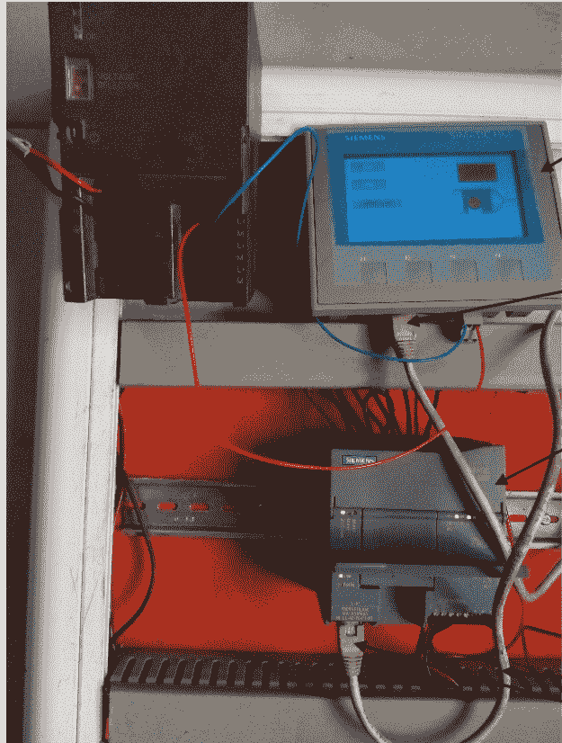

Siemens HMI (KTP 400)
Device name: HMI_1
IP Address: 192.168.0.5

RJ45 Connector

Siemens S7 1200 PLC (CPU 1211C)
Device name: PLC_1
IP Address: 192.168.0.4

Ethernet Cable

RJ45 Connector

Figure 13.25 – PLC connected to an HMI (point-to-point using the PROFINET protocol) (credit for this image goes to Showlight Technologies LTD: www.showlight.com.ng)

S7 1200 PLC 和 KTP400 HMI 已内置 PROFINET 端口，使得它们之间以及与其他设备使用 PROFINET 协议建立通信变得容易。配置可使用 TIA portal 轻松完成。请参阅 Chapter 10, Understanding Human Machine Interfaces (HMIs)，了解更多信息。

下图显示了通过标准以太网交换机使用 PROFINET 协议连接的两个以上设备。每个设备将具有唯一的设备名称和唯一的 IP 地址：

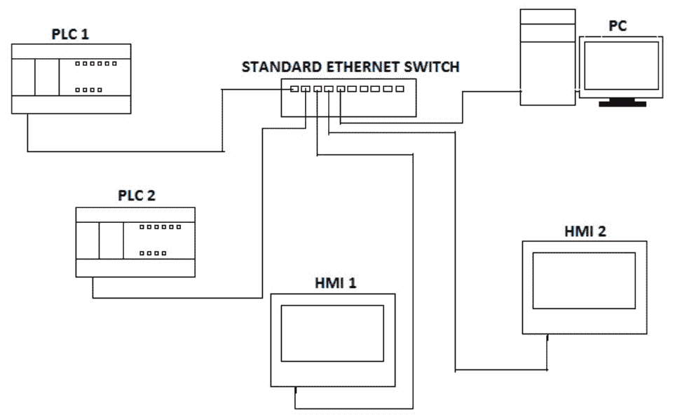

图13.26 – 使用PROFINET协议和标准以太网交换机的网络设备

下图显示了使用PROFINET协议和西门子（SCALANCE）工业以太网交换机的网络设备。SCALANCE XB005是西门子的一款非管理型工业以太网交换机，使用简单。它有五个RJ45端口，最多可连接五个不同的设备。它以10/100 Mbps的速率运行：

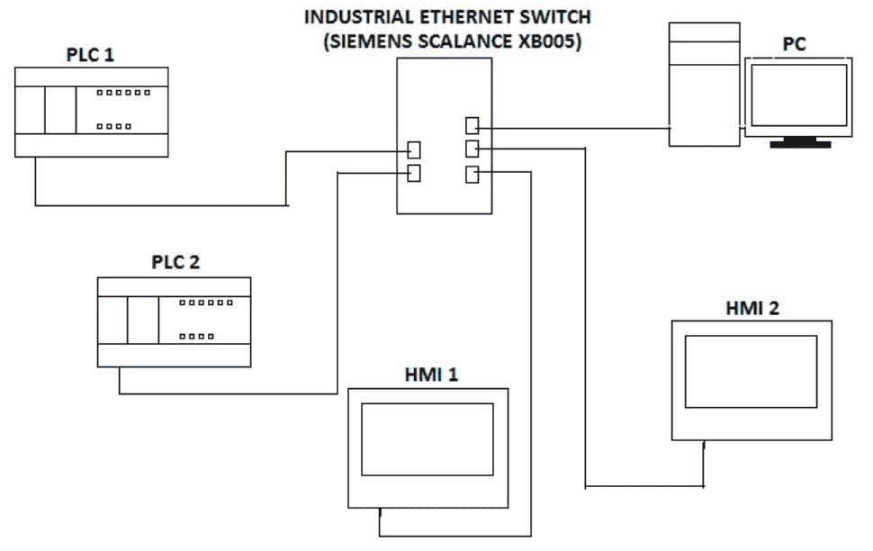

图13.27 – 使用PROFINET协议和工业以太网交换机的网络设备

至此，我们已经介绍了PROFINET协议。现在您应该了解使用PROFINET协议建立网络所需的基本组件和设备。

#### 总结

恭喜！您已完成本章的学习。您现在应该理解工业网络的含义，并能够解释可用的基本物理拓扑（点对点、总线、星型和环型）。您还学习了网络介质，现在应该理解有线和无线网络介质。本章还解释了各种蜂窝通信代际（1G、2G、3G、4G和5G）。您还应该了解工业网络中常用的网络连接器和其他组件。最重要的是，我们介绍了网络协议，并讨论了一些业界常用的协议（基金会现场总线、PROFIBUS、Modbus、HART和PROFINET）。

在下一章中，我们将介绍另一个您不容错过的重要主题——智能工厂（工业4.0）。

#### 问题

以下问题将帮助您检验对本章内容的理解。在尝试回答这些问题之前，请确保您已阅读并理解本章中的主题：

- 1. 术语________描述了在两个或多个工业自动化/控制设备（如控制器、传感器/变送器、执行器、PC等）之间的连接，用于在恶劣环境中交换数据以实现实时监控和过程控制。
- 2. 网络中的每个设备都可以称为________________
- 3. ________________指的是网络的物理和逻辑布局。
- 4. ________________指的是数据在网络节点之间传输的模式。
- 5. 在________________拓扑中，每个节点都连接到中心设备，该设备可以是交换机、路由器或集线器。
- 6. ________________可以定义为用于互连网络上节点的通信信道。
- 7. ________________网络使用无线电波（如蓝牙、Wi-Fi和蜂窝通信）作为通信信道。
- 8. ________________允许有线网络介质（同轴电缆、双绞线、光纤等）通过集线器、交换机、路由器、控制器、PC或网络中的其他设备连接到网络。
- 9. RJ45是________________的缩写。
- 10. _____________是一种需要配置才能满足我们网络或需求的交换机类型。
- 11. _____________可以称为网络上两个或多个设备之间的数据通信方法。
- 12. PROFIBUS是________________的缩写。
- 13. HART是_______________的缩写。
