# 1
引言与第一版回顾

欢迎来到 *Industrial Cybersecurity*（《工业网络安全》）第二版。在接下来的 24 章中，我们将讨论在构建安全的 **工业控制系统（ICS）** 环境并定义全面的政策、程序和标准之后的逻辑步骤，这些内容在第一版中已详细讨论。

我们将以第一版 *Industrial Cybersecurity*（《工业网络安全》）中涵盖的主题和材料的简要回顾开始第二版。主要添加这部分内容是为了让你跟上全书其余部分扩展的术语、技术和原则的进度。本书的其余部分侧重于 ICS 安全态势的安全监控和验证，以及所涉及的各种工具、技术和活动。

本章将是对本书第一版的回顾。我们将回顾第一版涵盖的所有主题和材料，这应该为你理解本书涵盖的主题提供坚实的基础。本章最后将解释你在第二版书中其余部分可以期待的内容。

在本章中，我们将涵盖以下主题：

- 什么是 ICS？
- **信息技术（IT）** 与 **运营技术（OT）** 的融合及其相关的益处和风险
- 全面的风险管理流程
- **纵深防御（DiD）** 模型
- ICS 安全项目的开发

# 工业网络安全 – 第二版

我将 *Industrial Cybersecurity*（《工业网络安全》）第一版和第二版定位为：第一版侧重于 ICS 网络安全基础以及 ICS 网络安全项目的设计和实现。第二版应当是一个合乎逻辑的补充，通过以旨在验证、监控、检查、改进和纠正 ICS 环境整体安全态势的工具、技术和活动来扩展这些核心概念。我们在这次持续旅程中涵盖的一些主题包括：

- 以安全为考量的架构设计
- 主动和被动安全监控
- 工业威胁情报
- 可视化、关联和告警（**安全信息和事件管理（SIEM）**）
- 事件响应活动
- 安全评估（渗透测试，红/蓝队演练）
- 威胁狩猎演练

如前所述，本书将扩展第一版的主题，因此让我们首先回顾一下我们在 2017 年涵盖的内容。


## 第一版回顾

如果你还没有阅读过《工业网络安全》的第一版，现在就是阅读的好时机。它详细介绍了如何从零开始构建工业网络安全计划，如何定义一个安全且符合你组织需求和要求的 ICS 环境和网络架构。

阅读第一版并不是必须的，因为本书的前四章将回顾相关主题，并帮助你跟上并理解本第二版中呈现的材料。

言归正传，让我们从回顾 ICS（网络安全）原则和实践开始我们的旅程。

## 什么是 ICS？

你开车上班路上的交通灯；你坐火车或地铁时的防碰撞系统；为你阅读本书时使用的灯供电的电力输送；以及你冰箱里那壶牛奶或为你一天提供动力的那杯咖啡研磨所经历的加工和包装……这些事情的共同点是 ICS 驱动着测量、决策、纠正以及导致我们每天习以为常的最终产品和服务的其他各种操作。

严格来说，ICS 是一组设备、装置和通信方法，当组合成基础系统时，用于执行特定任务、提供服务或生产特定产品。*图 1.1* 显示了 ICS 架构，跨越了如 Purdue 模型所述的各个功能层（将在后面的章节中解释）。

## ICS 功能

以下截图显示了一个典型的 ICS 架构，遵循 Purdue 模型并延伸至组织的工业网络和企业网络。它将被用作以下各节的示例：

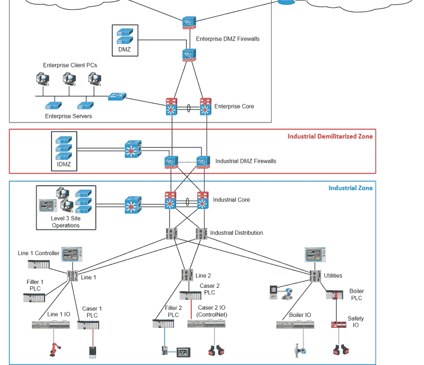

图 1.1 – 典型的 ICS 架构

在前一截图所示的 ICS 架构中，通常可以区分出架构三个主要部分内的以下主要类型的设备：

- 企业区主要是 IT 空间。此处通常发现的设备、系统和设备与计算机相关，例如服务器、工作站和笔记本电脑，以及手机、平板电脑、手持设备等移动设备。这些设备通过各种以太网设备和介质连接在一起，包括交换机、无线接入点、路由器、防火墙以及连接所有这些设备的电缆（**第六类（Cat6）/Cat6e 介质**）。
- **工业隔离区（IDMZ）** 在企业区和工业区之间充当屏障，通常实现为虚拟化硬件、防火墙和交换机的集合。
- 在工业区，我们可以找到各种现成的 IT 设备，以及用于运行生产过程的专有和专用硬件。在即将到来的章节 *ICS 架构* 中，我们将讨论可在工业区找到的一些更常见的系统。

ICS 的最终目标是生产产品或运行过程。这一目标是通过在 ICS 内实现不同的功能来实现的，这些功能结合起来可以控制、监控和管理生产或过程控制。我们现在来看 ICS 中常见的典型功能。

### 视图功能

视图功能涵盖了实时观察自动化系统当前状态的能力。这些数据可供操作员、主管、维护工程师或其他人员使用，以便做出业务决策或执行纠正措施。例如，当操作员看到锅炉 1 的温度正在降低时，他们可能会决定增加锅炉的蒸汽供应以进行补偿。视图过程本质上是被动的，仅为人类提供信息或“视图”以便做出反应。

视图功能在以下图表中呈现：

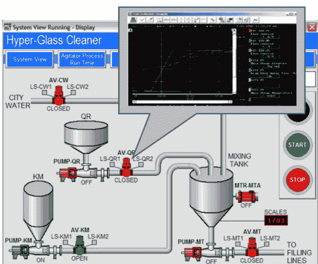

图 1.2 – 视图功能

从安全角度来看，如果攻击者能够操纵操作员对控制系统状态的视图——换句话说，可以更改操作员做出决策的值——攻击者实际上就控制了反应，因此控制了整个过程。例如，通过操纵锅炉 1 温度的显示值，攻击者可以让操作员认为温度过低或过高，并使其根据被操纵的数据采取行动。

### 监控功能

监控功能通常是控制回路的一部分，例如保持水箱中液位稳定的自动化。监控功能会监视压力、温度和液位等关键值，将当前值与预定义的阈值进行比较，并根据监控功能的设置发出警报或进行交互。视图功能与监控功能之间的关键区别在于偏差的判定。与监控功能相比，这种判定是自动过程，而在视图功能中，这种判定是由查看值的人类做出的。监控功能的反应范围从弹出警报屏幕到完全自动化的系统关闭程序。

从安全角度来看，如果攻击者能够控制监控功能所查看的值，则可以触发或阻止该功能的反应——例如，在监控系统查看锅炉 1 温度以防止温度超过 300 °F 的情况下。如果攻击者向系统输入小于 300 °F 的值，该系统将被欺骗认为一切正常，而与此同时，系统可能正在熔毁。

### 控制功能

控制功能是事物被操纵、移动、激活和启动的地方。控制系统就是使执行器接合、阀门打开、电机运行……控制操作可以由操作员通过按下按钮或在 **人机界面（HMI）** 屏幕上更改设定值来启动，也可以作为过程控制的一部分的自动响应。

控制功能在以下图表中呈现：

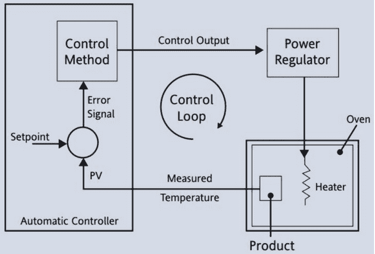

图 1.3 – 控制功能

从安全角度来看，如果攻击者能够操纵控制系统所反应的值（输入），或如果他们能够更改或操纵控制功能本身（控制程序），系统可能会被欺骗去做它未被设计或不打算做的事情。

现在，我可以听到你们都在说，操纵值没什么大不了的，但现代交换网络和加密网络协议 surely 不可能做到这一点。那如果这些技术得到实施和使用就对了。但事实是，在大多数，如果不是所有 ICS 网络上，工业网络流量的保密性和完整性不如 ICS 的可用性重要。更糟糕的是，对于大多数 ICS 来说，可用性最终成为设计系统时的唯一设计考虑因素。结合 ICS 通信协议在这些网络上运行且从未考虑过安全性的事实，你就可以开始看到上述场景的可行性。大多数自动化协议是在计算机网络尚未接触自动化设备时引入的，用于从未打算在点对点链路之外共享数据的介质，因此围绕身份验证、数据保密性或发送命令完整性的安全从未得到实施。后来，这些点对点协议被改编为在以太网等通信设备上工作，这使不安全的协议暴露于整个生产车间、工厂，甚至互联网。

## ICS 架构

ICS 是一个概括性术语，用于各种自动化系统及其设备，例如 **可编程逻辑控制器（PLC）**、HMI、**监控与数据采集（SCADA）** 系统、**分布式控制系统（DCS）**、**安全仪表系统（SIS）** 等等。

ICS 架构在以下图表中呈现：


### 大规模 ICS 架构

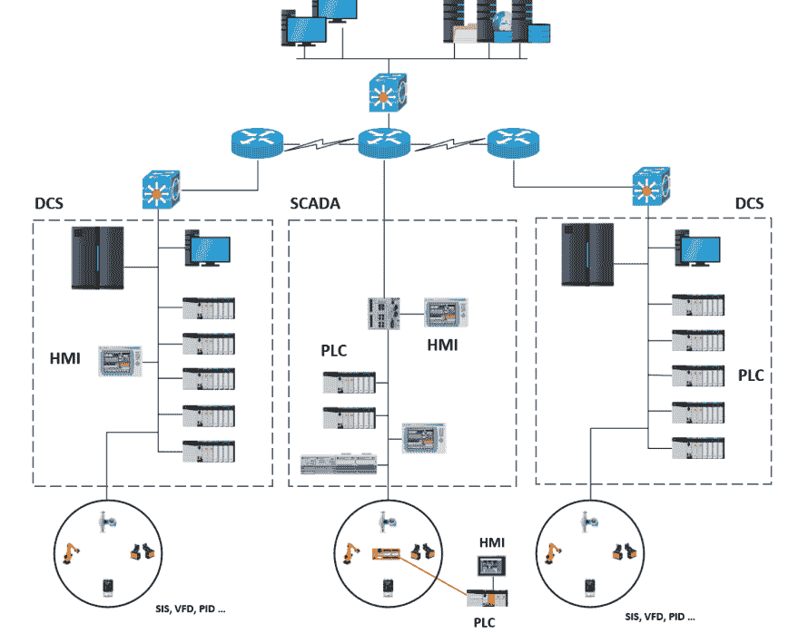

图 1.4 – 大规模 ICS 架构

### PLCs

PLC 是几乎所有 ICS 的核心。它们是经由输入通道从传感器获取数据并经由输出通道控制执行器的设备。典型的 PLC 由微控制器（大脑）和一组输入输出（I/O）通道阵列组成。I/O 通道可以是模拟、数字或网络暴露的值。这些 I/O 通道通常作为附加卡提供，连接到 PLC 的背板上。这样，PLC 就可以定制以适应许多不同的功能和实现。PLC 的编程可以通过设备上的专用通用串行总线（USB）或串行接口进行，也可以通过内置于设备中的网络通信总线进行，或作为附加卡提供。常用的网络类型有 Modbus、Ethernet、ControlNet 和 PROFINET。

以下屏幕截图提供了已安装 PLC 的示例：

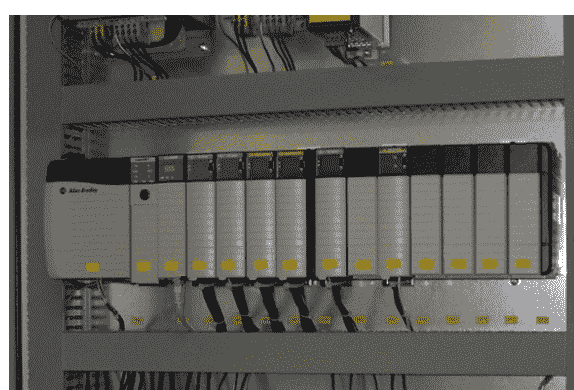

图 1.5 – 一台 Allen-Bradley 架装 PLC

PLC 可以作为独立设备部署，控制制造过程的某一部分，例如单台机器，也可以作为分布式系统部署，跨多个分散地点的工厂，拥有数千个 I/O 点和众多互连部件。

### HMI

HMI 是进入控制系统的窗口。它可视化运行过程，允许检查和操作过程值，显示报警，并对控制值进行趋势分析。在最简单的形式中，HMI 是一种触控启用的独立设备，通过串行或以太网封装协议进行通信。

以下屏幕截图展示了一些 HMI 示例：

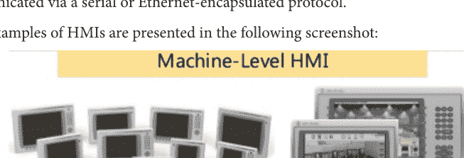

图 1.6 – HMIs

更先进的 HMI 系统可以使用分布式服务器来提供冗余的 HMI 屏幕和数据。以下屏幕截图展示了其中一种系统的示例：

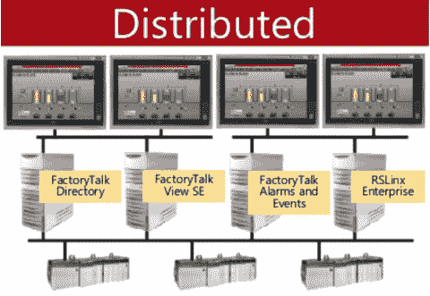

图 1.7 – FactoryTalk View SE 分布式 HMI 系统

前述屏幕截图显示了 Rockwell Automation FactoryTalk View Site **Edition**（SE）分布式 HMI 应用的一个示例。

### SCADA

SCADA 是用于描述多种 ICS 类型和设备组合使用、共同完成一项任务的术语。以下屏幕截图显示了一个 SCADA 网络示例。在此，SCADA 网络包括所有设备和组件，它们共同构成整体系统：

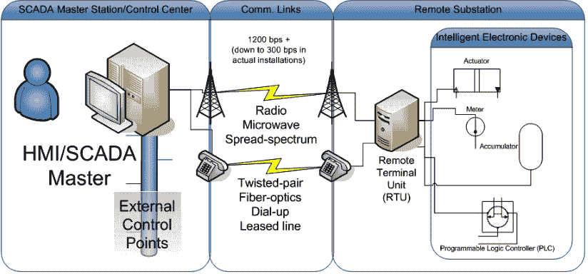

图 1.8 – SCADA

如前述屏幕截图所示，SCADA 系统可以分布在很广的地理区域，应用于电网、水务、管道作业以及使用远程操作站的其他控制系统。

### DCS

与 SCADA 系统密切相关的是 DCS。SCADA 系统与 DCS 之间的差异非常小，而且两者变得越来越难以区分。传统上，SCADA 系统用于覆盖较大地理区域的自动化任务，而 DCS 更常局限于单个工厂或设施。DCS 通常是一个大规模、高度工程化的系统，具有非常特定的任务。它使用集中式监控单元，可控制数千个 I/O 点。该系统设计为持久运行，并在安装的各个层面应用冗余。

以下屏幕截图展示了一个 DCS 示例：

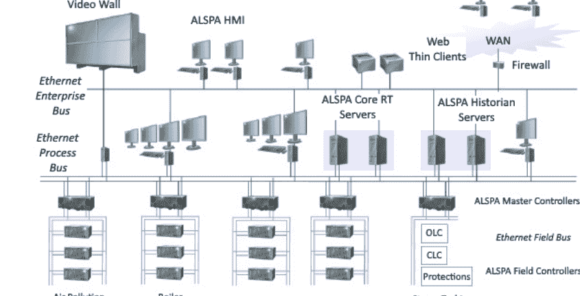

图 1.9 – DCS

如前述屏幕截图所示，DCS 使用冗余网络和网络接口，连接到冗余服务器组并连接到冗余控制器和传感器，其目标都是为了创建一个坚固可靠的自动化平台。DCS 最常见于水管理系统、纸浆和造纸厂、糖精炼厂等。

DCS 的分布式特性使其更难保护，因为它经常必须突破网络分区边界，而且与 DCS 共享的人机交互量较大，造成恶意软件感染的几率更高。

### SIS

SIS 是专用的安全监控系统。它们的作用是在硬件故障情况下安全、优雅地关闭受监控系统或将系统带到预定义的安全状态。SIS 使用一组表决系统来确定系统是否正常运行。如果安全系统配置为在检测到不安全条件时关闭机器的过程，则被视为紧急关停（ESD）系统。

以下屏幕截图展示了一个 SIS 示例：

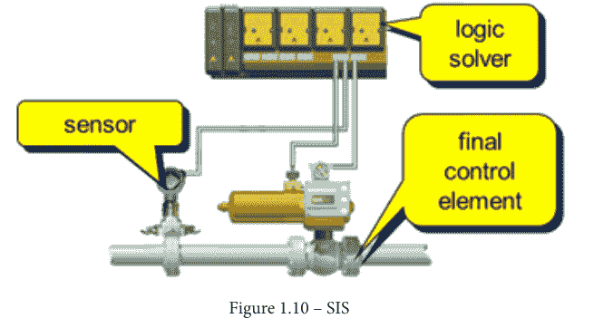

图 1.10 – SIS

安全系统最初设计为独立且断开连接的监控系统（可视为外挂、本地设备/系统检查），但过去几年的趋势是开始将它们连接到工业网络，提供一种（重新）配置的便捷方式，但也使它们暴露于潜在攻击及其伴随的风险。ESD 可能被潜在攻击者滥用。他们可以重新配置 SIS 以关闭系统，造成公司财务损失，或指示 SIS 在需要时不关闭，以造成对运营的物理损害，其灾难性的副作用是人们的生命处于危险之中。

例如，考虑 2017 年针对 SIS 系统的 TRITON 攻击/恶意软件活动：

```
https://www.nozominetworks.com/blog/new-triton-ics-malware-is-bold-and-important/#:~:text=The%20attack%20reprogrammed%20a%20facility%E2%80%99s%20Safety%20Instrumented%20System,%20impacted%20not%20just%20an%20ICS%2C%20but%20SIS%20equipment
```

### ICS 的 Purdue 模型

那么，所有这些是如何联系在一起的？什么样的 ICS 架构才算坚固？要回答这个问题，我们首先应讨论 Purdue 参考模型——简称为 Purdue 模型。如下图所示，Purdue 模型由 ISA-99 从 *Purdue 企业参考架构（PERA）* 模型中采纳，并用作 ICS 网络分段的概念模型。它是一个行业采用的参考模型，展示了典型 ICS 中所有主要组件的互连和相互依赖。该模型是开始弄清典型现代 ICS 架构过程的绝佳资源，并在此呈现：

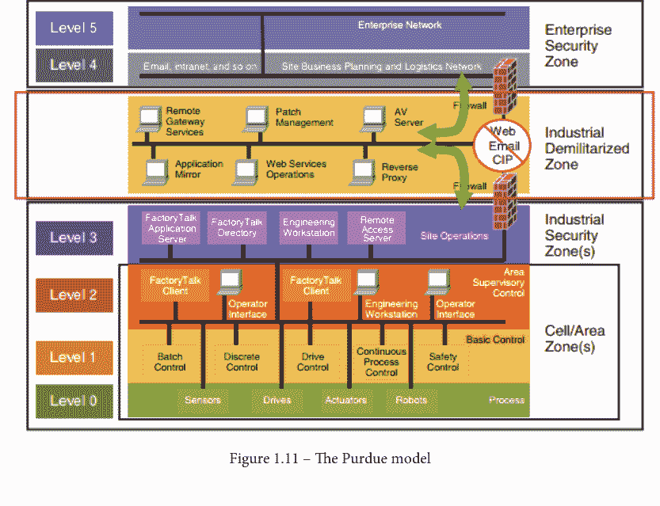

Purdue 模型将 ICS 划分为四个不同的区域和六个层级。以下各节将描述这些区域和层级，将底部两个区域合并为工业区。

### 企业区

ICS 中业务系统和用户直接交互的部分位于企业区。

如下图所示：

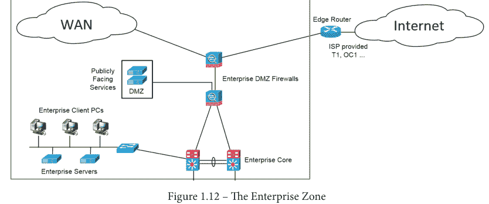

图 1.12 – 企业区

企业区可细分为第 5 层（企业网络）和第 4 层（现场业务规划与物流）。请注意，并非所有公司的企业区都一定有第 5 层，有些可能会合并第 5 层和第 4 层。

#### 第 5 层 – 企业网络

企业区是业务系统如企业资源规划（ERP）和系统应用与产品（SAP）通常所在网络的部分。在这里，执行调度、供应链管理等任务。该区域的系统通常位于公司层面，跨多个设施或工厂。它们从位于各个工厂的下属系统获取数据，并使用累积的数据报告整体生产状态、库存和需求。从技术上讲，企业区不属于 ICS 的一部分，但它确实依赖于与 ICS 网络的连接，以提供驱动业务决策的数据。

#### 第 4 层 – 现场业务规划与物流

第 4 层是支持工厂或设施生产过程的所有 IT 系统的所在地。这些系统向公司系统报告生产统计数据，如运行时间和生产单元，并将订单和业务数据从公司系统下发，分配给 OT 或 ICS 系统。

第 4 层中通常发现的系统包括数据库服务器、应用服务器（Web、报表、制造执行系统 MES）、文件服务器、电子邮件客户端、主管桌面等。

### IDMZ

企业区与工业区之间存在 IDMZ，如下图所示：


图 1.13 – IDMZ

IDMZ 包含一个层级：第 3.5 层。

#### 第 3.5 层 – IDMZ

正如层级编号可能暗示的那样，第 3.5 层是后来添加到模型中的。它源于制定安全标准（如美国国家标准与技术研究院 NIST 网络安全框架和北美电力可靠性公司关键基础设施保护 NERC CIP）的努力。IDMZ 是第 4 层和第 5 层的业务或 IT 系统与第 3 层及以下的生产或 OT 系统之间的信息共享层。通过防止 IT 与 OT 系统之间的直接通信，而是让 IDMZ 中的代理服务中继通信，为整体架构增加了额外的隔离和检查层。较低层的系统不会直接暴露于攻击或入侵。如果在某个时候 IDMZ 或其上方的系统被入侵，IDMZ 可以被关闭，遏制入侵，生产可以继续进行。


### 第3级——站点运营

第3级是支持工厂级控制和监控功能的系统所在层级。在此级别，操作员与整体生产系统进行交互。可以想象一下配有HMI和操作员终端的集中控制室，它们能够概览工厂或设施中运行所有流程的系统。操作员使用这些HMI系统来执行质量控制检查、管理正常运行时间以及监控报警、事件和趋势等任务。

第3级（站点运营）也是向第4级IT系统回传数据的OT系统所在层级。较低层级的系统将生产数据发送到本层级的数据收集和聚合服务器，然后这些服务器可以将数据向上发送到更高层级，或者由更高层级的系统进行查询（推操作与拉操作）。

第3级中常见的系统包括数据库服务器、应用服务器（Web、报表）、文件服务器、Microsoft域控制器、HMI服务器、工程工作站等。这些类型的系统也可以在企业网络上找到，但在这里它们与生产过程和数据交互。第3级（站点运营）中的Microsoft域控制器应用于实现独立的工业域和Active Directory，该域和目录绝不能与企业域关联。任何从企业域到工业区的链接都可能使攻击或恶意软件从企业区传播到工业环境中。

### 第2级——区域监督控制

第2级中的许多功能和系统与第3级相同，但更侧重于整体系统中较小的部分或区域。在此级别，使用HMI系统监控和管理系统的特定部分。可以想象一台带有触摸屏HMI的单独机器或撬块，用于启动或停止机器或撬块，查看一些基本运行值，并操作机器或撬块特定的阈值和设定点。

第2级中常见的系统包括HMI（独立或系统客户端）、监督控制系统（如产线控制PLC）、工程工作站等。

### 第1级——基本控制

第1级是所有控制设备所在之处。此级别设备的主要目的是打开阀门、移动执行器、启动电机……第1级中常见的设备有PLC、变频驱动器（VFD）、专用比例-积分-微分（PID）控制器等。虽然在第2级中也可能找到PLC，但其在那里是监督性质，而非控制性质。

### 第0级——过程

第0级是我们从更高级别控制和监控的实际过程设备所在之处。第0级也被称为受控设备（EUC），在这里我们可以找到电机、泵、阀门以及测量速度、温度或压力的传感器等设备。由于第0级是实际执行过程并制造产品的地方，因此一切必须平稳且不间断地运行。对单个设备最轻微的干扰都可能导致所有操作陷入混乱。

## IT与OT的融合及其相关收益和风险

ICS最初是作为专有的自动化和控制设备实现而诞生的，通常独立运行，但在必要时，会使用供应商特有的晦涩通信介质和协议将它们黏合在一起。要对这些设置重新编程（如果甚至可能重新编程的话），也需要同样晦涩的方法和工具。在ICS的早期，OT和IT之间存在明显的区别和坚实的边界，但在过去十年中，这一边界几乎已消失。

## IT与OT的区别

运营技术（Operational Technology，OT）涵盖了将产品交付、服务提供或进行任何其他形式生产活动所需的一切。在最现代的意义上，属于该术语的典型OT设备包括PLC、HMI、执行器、传感器、PC、服务器、网络交换机、网络介质，以及在这些设备上或与这些设备一起运行的软件，如操作系统、固件、应用程序、软件和数据库。相比之下，信息技术（Information Technology，IT）一词涵盖了与存储、检索和发送信息相关的所有设备和过程。一些典型的IT设备包括PC、服务器、网络交换机、网络介质、防火墙、其他安全设备，以及在IT设备上或与其一起运行的各种软件、固件、数据库等。

很快你就会发现，当IT设备和过程被用作OT环境的一部分时，这两个术语存在重叠区域。正如我们将在本章后面讨论的，这源于过去几年一直在进行的OT与IT的融合。

IT和OT真正的不同之处在于它们的利用和实现方式。IT设备几乎从不进行物理控制（让某物移动、升温、反应……），而这正是OT设备的唯一目的。IT是OT环境的一部分，以便OT过程能够利用信息能力来做出反应、记录或处理变化。如果在纯IT系统上，这些数据因损坏或恶意行为而丢失，服务可能会失败，Web门户可能变得无响应，或发生其他形式的服务中断。然而，后果仅限于一定的金钱损失，如收入损失或服务水平协议（SLA）指标下降。但在OT方面，如果过程正常运行所依赖的数据丢失或损坏，物理过程可能变得不稳定，后果可能包括对环境的物理破坏，或对公共健康和安全的威胁，甚至可能对操作OT设备所控制机械的人员造成致命伤害。

我想谈的IT和OT之间的最后一个区别是它们的保护方式——这是技术用户认为最重要的领域。众所周知，IT的安全范式是机密性、完整性和可用性（CIA）三元组。虽然不是严格规则，但对于IT系统，机密性（防止数据被窥探）是最重要的安全要素，其次是完整性（确保数据不被篡改），最不重要的是可用性（正常运行时间）。对于OT系统，这个三元组被颠倒过来——可用性是OT系统所有者最关心的问题，其次是完整性，最后才是机密性。

以下截图描述了CIA安全三元组：

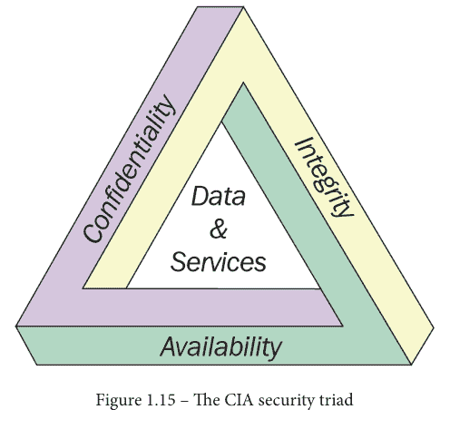

考虑到OT/ICS系统控制的某些过程预计会连续数周甚至数月无瑕疵且不间断地运行，很容易理解为什么在这里可用性要求是重中之重。完整性紧随其后，因为我们希望确保OT系统和操作员所依据的数据没有错误或操纵。在典型的OT环境中，机密性几乎不是主要关注点，除非是存储在数据库或服务器/PC日志文件中的一些历史数据。这是因为当数据被使用时，它已经几乎毫无价值了；不过正如我所说，存储的生产数据、配方，以及在某些情况下存储在存储介质上的控制应用程序确实具有一些价值，因此CIA三元组中的C不应被完全忽视。

## 机遇

为什么会出现IT与OT的融合？将两者分开不是更有意义吗？是的——从安全角度来看，尽可能保持分离肯定是有意义的。然而，从业务角度来看，从OT环境获取准确、实时且相关的数据非常有意义。这些信息可以实现更紧密的生产调度，减少需要现场持有的库存量，有助于成本计算，并提供更多物流优势。现代ERP和MES系统依赖来自企业生产和企业侧双方的输入和信息。这些原因——以及更多原因——推动了IT与OT系统的融合。

## 风险

如本章前面所述，ICS（OT环境）最初是围绕专有设备、装备以及网络介质和协议构建的，并未考虑安全性。几乎每个供应商都有自己的做事方式，每个供应商都有不同的配置、操作和维护其设置的方法。这种专有行为与整个IT/OT融合需求不太兼容，慢慢地，ICS设备供应商开始遵守一套通用标准——即广泛使用的网络协议以太网、互联网协议（IP）、传输控制协议（TCP）和用户数据报协议（UDP）——来承载其控制和自动化协议。


为了避免重复造轮子，许多厂商在其成熟的控制和自动化协议之上叠加了 TCP 或 UDP 协议。这样一来，只需加入一个支持 IP/TCP/UDP 的通信模块，就能轻松搭上 IT/OT 融合的快车。鉴于大多数控制系统本质上是模块化的，通信设备与**中央处理单元 (CPU)**（控制器）是分离的，因此这种替换非常容易。现在，客户可以更轻松地适应一种标准，使用同一种类型的线缆、交换机，甚至安装人员的同一技能组合，将整个生产设施连成一个统一的技术体系。

而且许多公司确实就是这么做的——他们布线铺设了整个网络，从生产区延伸到办公室，跨越**广域网 (WAN)** 连接到其他工厂或公司总部，有时甚至一直延伸到互联网上。这使得获取数据、进行故障排除和实现访问变得异常容易，但也将这些此前隐藏的设备和装备——往往运行着企业最敏感的部分——暴露给了攻击。控制和自动化设备现在拥有了 IP 地址；由于它们使用 IP 协议，可以从任何地方访问，而且由于运行在 IP 和 TCP 之上的控制和自动化协议几乎都是明文协议，因此很容易被解读。

请看下面的截图：

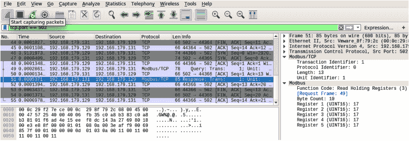

图 1.16 – ICS 明文协议数据包

正如前述截图所示，Modbus 数据包（例如）不会隐藏其在节点之间传输的数据或功能码。这允许对数据和功能码进行检查和篡改。此外，随着自动化设备采用 TCP/IP 协议栈，它们现在可以被常见的 IT 技术和工具所针对。

即使在今天，大多数 ICS 设备仍在使用作为专有协议一部分设计的开放且明文的协议。然而，许多公司已经不再使用连接组织内所有设备的扁平网络。我们将在后面的章节中更详细地讨论这一点。

如果你想亲眼见识控制和自动化协议固有的不安全性，甚至自己尝试一些攻击，我推荐你阅读本书第一版的 *第 2 章* – *Insecure by Inheritance*。本章对 Modbus、Siemens S7、Profinet 和 Ethernet/IP 协议提供了详细的解释和攻击示例。

## 对 Slumbertown 纸厂的示例攻击

通过对虚构的 Slumbertown 纸厂进行网络攻击的示例，在本书第一版的 *第 3 章* – *The Attack* 中，我们逐步了解了一个可能的攻击场景，即攻击者渗透到组织内部并在生产过程中制造混乱。

请看下面的截图：

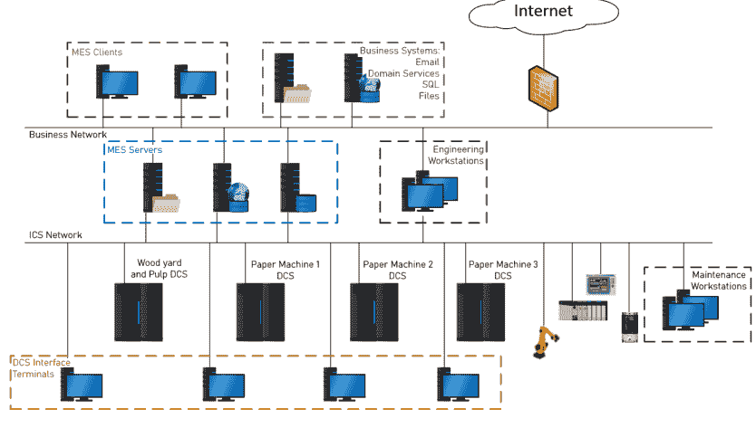

图 1.17 – Slumbertown 纸厂 ICS 网络架构

前述截图描绘了攻击者成功渗透并大肆破坏的 Slumbertown 纸厂 ICS 网络。接下来是对攻击者所采取方法的总结。

### 攻击回顾

从高层次来看，我们现在将查看攻击者为达到目标所采取的步骤。

### 侦察

攻击者的第一步是尽可能多地收集有关目标的信息。这称为侦察。在此，攻击者在开始攻击之前尽可能多地了解了纸厂的运营情况、其员工的个人生活以及 ICS 环境中使用的技术。

###  spear phishing

攻击者制作了一封诱人的钓鱼邮件，并以一种能够让 Mark 点击恶意链接的方式进行定制，最终导致 Mark 登录的计算机被入侵，从而使攻击者能够在纸厂的企业网络上获得立足点。

你可以在这里看到钓鱼邮件：


图 1.18 – '一切都始于这封邮件...'

接下来，攻击者开始四处探查，寻找其他受害者进行入侵。

### 企业网络上的横向移动

一旦攻击者在纸厂的企业网络上获得立足点（该网络直接连接到互联网，并拥有具有电子邮件和互联网访问权限的业务型客户端），他们就开始寻找其他系统进行入侵。他们通过将 Mark 的计算机用作进入网络的跳板并以此方式运行探测和扫描来实现这一点。

使用这种方法，他们找到了并入侵了其他有趣的计算机，并最终进入了一个系统，由于该系统是“双宿”的（连接到两个网络：企业网络和工业网络），使他们能够访问工业环境。

### 攻击工业网络

在获得一台连接到工业（生产）网络的工作站的访问权限后，攻击者准备开始其攻击的真正目标——第二阶段：中断纸厂消化器过程，其最终目标是造成物理损坏。他们通过操纵从控制过程发送到操作员屏幕的明文数据包来实现这一目标。通过更改向操作员展示的值，他们欺骗操作员采取了纠正措施，最终导致消化器超压……

### 并没有多少改变

在本书第一版发布和本版撰写之间，几乎每一次重大的 ICS 为中心的入侵都遵循了上述过程。攻击者的最终目标可能有所不同，但为实现目标而采取的步骤基本相同。

如果你想阅读有关攻击如何发生的详细描述，甚至跟随攻击活动，请前往本书第一版的 *第 3 章* – *The Attack*。

## 全面的风险管理流程

确保 ICS 环境的安全最终归结为风险管理。通过识别风险、分类风险、优先排序风险并最终减轻风险，ICS 安全态势得以改善。涉及风险管理的四个主要类别，如第一版本书 *第 4 章* – *Industrial Control System Risk Assessments* 中详细解释的那样，概述如下。

### 1. 资产识别和系统表征

在“*你不知道拥有什么就无法保护它*”的口号下，风险管理的第一步——也是 arguably 最重要的一步——是获取 ICS 环境中所有资产的准确索引。这可能是一个手动过程，即打开每一个电气柜，查看每一个网络机柜和配电盘，并盘点生产设施中的每一台桌面计算机。然而，自动化方法可能更容易、更全面且出错率更低。

诸如开源的 grassmarlin (https://github.com/nsacyber/GRASSMARLIN) 或其中一种付费的 ICS 特定入侵检测系统 (IDS) 解决方案（CyberX、Claroty、Nozomi、Forescout、Indegy、PAS Global LLC...）等工具可以通过嗅探网络被动地索引你的资产。尽管这些工具做得非常出色，但如果资产位于网络的难以触及部分或以某种方式超出上述工具的覆盖范围（离线），它们可能会遗漏资产。我建议使用嗅探工具、非工作时间使用正确配置的 Nmap 扫描进行扫描，以及一些手动盘点和索引的“体力劳动”相结合，以获得最佳效果。

在你列出 ICS 环境中的所有资产后，必须在列表中添加诸如操作系统版本、固件修订版、补丁级别、软件清单和正在运行的服务等详细信息，以及资产的关键性评分和价值。资产的关键性评分是一种识别资产对整体生产过程或组织生存能力的重要性、价值和不可或缺程度的方法。关键性评分将在第 15 章《工业控制系统风险评估》中详细讨论。这些资产详细信息将有助于评估适当的风险评分，并最终实现风险缓解的智能优先级排序。

### 2. 漏洞识别

在汇编了包含相应软件、固件和操作系统补丁级别及修订版的资产列表后，下一步是将这些修订版、版本和补丁级别与已知的漏洞进行比较。这可能是一个手动过程，其中你使用 National Vulnerability Database（https://nvd.nist.gov/）等网站查找每条信息并将其与已知漏洞数据库进行比较。

更可管理的方法是使用 Nessus 或 Qualys 运行自动漏洞扫描。自动漏洞扫描速度更快，通常更可靠，因为它可以查找——有时甚至验证——大量已知漏洞，并检查常见的错误配置或默认（弱）设置。请注意，漏洞扫描非常激烈，可能会导致 ICS 设备在额外的网络流量下不堪重负。我强烈建议在生产停机期间运行此类扫描，但请做好事后验证 ICS 设备按预期工作准备。


### 3. 威胁建模

现在我们已经知道我们有什么（资产清单）以及它有什么问题（资产漏洞），下一步是查看我们资产中发现的漏洞被利用的可能性有多大，以及成功利用的潜在影响和后果是什么。帮助我们定义这一点的过程称为威胁建模。威胁建模使用风险场景来定义可能的威胁事件以及威胁事件的影响和后果。对于威胁事件要可行，必须存在以下要素：执行该事件的威胁源；利用漏洞的威胁向量；以及具有漏洞的目标。可以说，创建风险场景就是试图预测威胁最有可能针对并打击的地方。以下截图概念化了一个风险场景：

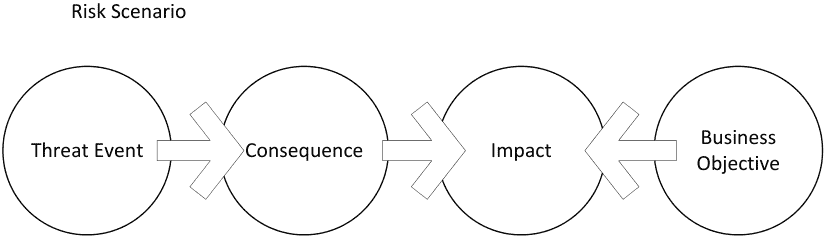

图 1.19 – 风险场景的描述

拥有风险场景矩阵使我们能够做出明智的决定，判断哪些威胁比其他威胁更令人担忧，因此可以让我们优先排序并简化补救工作，为我们有限的安全预算带来更好的投资回报。

> **重要说明**
> 
> 此外，为了帮助定义威胁事件发生的可能性，您可以在风险评估的一部分中执行渗透测试。简而言之，渗透测试将采用创建的风险场景并尝试在风险场景的限制范围内通过攻击漏洞来实现它们。毋庸置疑，渗透测试不应在实用的 ICS 环境中执行！应构建并使用测试环境或 ICS 环境的近似值来运行渗透测试活动。

### 4. 风险计算和缓解规划

现在我们对 ICS 环境的可能风险场景有了非常清晰的了解，接下来我们可以量化风险，通过为我们创建的每个风险场景分配风险评分。通过在资产之间关联评估过程并对每个资产进行交叉评估，评分将是一个相对数字，显示在何处最好花费缓解工作和资金以创造最佳的投资回报，并指出我们的努力将产生最大影响的地方。

对于评分，我们可以使用以下公式（存在其他公式，只要保持一致即可使用）：

$$risk = \frac{severity + (criticality * 2) + (likelihood * 2) + (impact * 2)}{4}$$

作为示例，此公式为 Siemens S7-400 PLC 漏洞提供了以下风险评分：

| 漏洞严重性 | 资产关键性 | 攻击可能性 | 影响 | 风险评分 |
|---|---|---|---|---|
| （来自通用漏洞和暴露 CVE） | （来自步骤 1） | （CVE 结合系统具体情况） | （来自阶段 1） | |
|  |  |  |  |  |
| 7.5 | 4 | 4 | 3.5 | 7.6 |

> **重要说明**
> 为了补充在第一版中详细描述的风险评估过程，本书将对渗透测试过程进行痛苦的详细描述。

## DiD 模型

DiD 模型的核心理念是，通过堆叠防御，多个备份安全控制相互覆盖，从而为整个 ICS 网络创建整体且包罗万象的安全态势。

DiD 模型在以下图表中呈现：

### 计算机安全控制

该层内的控制旨在保护和加固计算机系统，包括补丁管理、终端保护解决方案、删除未使用的应用程序/协议/服务、关闭不必要的逻辑端口，以及保护物理端口。

### 应用安全控制

该层内的控制旨在在 ICS 的应用层添加控制。应用层是终端用户通过**应用程序编程接口（APIs）**、门户和其他接口与系统交互的地方。该层内的控制包括 AAA 方法和解决方案。

### 设备级安全控制

该层内的控制旨在保护 ICS 设备，包括设备补丁、设备加固、物理和逻辑访问限制，以及建立设备生命周期计划，其中涉及定义设备采购、实施、维护变更管理以及设备处置的程序。

## ICS 安全计划开发

安全规划和安全计划开发，包括定义您独特环境和情况的政策和程序的治理，应是在任何其他安全任务之前进行深思熟虑的练习。在开展任何安全活动之前，您应制定一个符合贵公司目标、需求和要求的计划。如果没有适当的规划和指导，实施安全就会针对一个移动目标。

## 安全计划开发和管理

为了能够有效地将安全集成到 ICS 中，我们必须定义并执行一个全面的网络安全计划，解决安全的所有方面。该计划应从确定计划的目标到日常运营以及计划和随附安全态势的持续审计和验证，以实现合规和改进目的。组织的业务目标应包括网络安全计划，并且安全计划应与组织的业务目标保持一致。这对于安全计划的整体成功至关重要。

在建立工业网络安全计划时需要考虑的项目包括以下内容：

- 获得高级管理层的认可
- 建立并培训跨职能团队
- 定义章程和范围
- 定义具体的 ICS 政策和程序
- 实施 ICS 安全风险管理框架
  - 定义和盘点 ICS 资产
  - 为 ICS 系统制定安全计划
  - 执行风险评估
  - 定义缓解控制措施
- 为 ICS 员工提供培训并提高安全意识
- 反复进行——意味着您必须无限期地监控、纠正和完善您的安全计划，以保持准确、最新和有效

## **风险管理（查找和缓解风险的循环活动）**

以下截图描述了围绕持续（循环）工业网络安全改进过程的流程和相应活动：

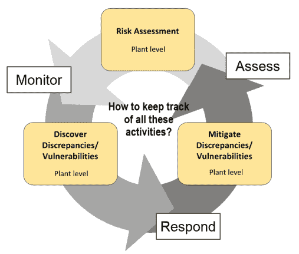

保持 ICS 安全计划和随附风险管理活动准确和最新需要一系列循环活动。

这些活动概述如下：

- **评估风险**：为验证已应用的安全控制和缓解措施的完整性，并根据最新的标准和政策进行评估，应安排定期风险评估。随着整体安全计划的发展，评估可以变得越来越深入，以发现更详细和更难发现的漏洞。风险评估应至少每年完成一次。
- **响应已识别风险**：当风险被监控系统检测到或通过风险评估揭示时；必须由（专门）团队解决。
- **监控风险演变和缓解**：监控风险旨在跟踪在风险评估期间发现的问题或由监控系统（如终端安全客户端或 IDS/IPS 传感器）发现的问题的缓解工作。

## 来自第一版的要点

在过去几十年中，ICS 已从独立的自动化孤岛发展成为整个自动化设备、计算机和服务器系统以及连接它们的媒体的网络。如今，IT 和 OT 设备以交织的方式使用，以实现特定的业务目标，例如构建产品、提供服务或维持温度、湿度或稳定性等环境变量。ICS 已成为几乎每个行业的支柱，当其变得不可用时，将对公司的正常运行时间、生产率和盈利能力造成严重后果，并且可能造成环境和物理损害，甚至在被篡改时导致人身伤害或死亡。

对 ICS 可靠运行的这种极端依赖，加上由于 IT 和 OT 融合而增加的网络安全威胁暴露，使得每个 ICS 所有者维护适当网络安全态势成为尽职调查的问题。

ICS 妥协的极高影响与使用标准 IT 恶意软件远程实现这一能力的结合，导致过去二十年来 ICS 网络攻击激增。我们都知道，据称由国家行为者实施的对关键基础设施的高影响网络攻击——核设施、电力电网、石油行业。没有一个是免疫的。


在本书的第一版中，我们了解了攻击者如何渗透、利用并接管 ICS 环境。我们学习了这个过程所使用的工具和技术，也审视了 ICS 设备运行方式中存在的根本问题和固有弱点——正是这些让上述工具和攻击能够成功入侵 ICS 环境。第一版随后展示了保护 ICS 环境所需理解的概念、思路和基础知识，涵盖了诸如纵深防御（DiD）、安全程序开发和风险管理等主题。

作为总结，我们将介绍成功建立一套运行良好且有效的 ICS 网络安全程序应考虑/涵盖的四项主要任务或职责。

### 了解你拥有什么

维持一份最新、完整且准确的 ICS 资产清单，可以说是在网络安全程序中最重要的一步。你无法保护那些你不知道自己拥有的东西。

这项任务需要一个规划良好且有效的资产管理程序。

### 了解你拥有的东西存在什么问题

接下来，你必须了解现有资产存在哪些问题。否则，你该如何修复它们？

这项任务要求你定义一个全面的漏洞管理程序。

### 修复或防御你所知的错误

一旦确定了现有资产的问题，你必须制定一个有针对性的、完整的缓解计划，在处理无疑庞大的风险时，为你带来最佳的投资回报。

这项任务要求你建立一个完整且详尽的风险管理程序。

### 反复循环，永不停歇

为了使你的 ICS 网络安全活动和各项管理程序保持最新且有效，你需要定期审查这些流程、活动以及已实施的解决方案和控制措施，以确认其完整性、有效性和相关性。

这项任务要求定义一套周期性发生的事件序列，将所有的网络安全程序和活动串联到一个永无止境的 **评估**、**响应**和**监控**循环中……

本书其余部分将专门讨论用于监控 ICS 环境安全的技术、方法、概念、活动和职责，简称 *安全监控*。

### 总结

我们通过回顾第一版书中的内容，开启了 ICS 网络安全之旅的续篇。第一版主要关注的是建立安全的 ICS 环境，而这一版将在此基础上进行扩展，探讨通过观察和监控安全态势来维护安全环境的各种主题。我将采用一种“自下而上”的方法来解释所有内容，这意味着我们将研究安全监控及其在 ICS 环境生命周期各个阶段的实施要点。在接下来的几章中，我们将首先重新审视 ICS 网络架构和 IDMZ。

在下一章中，我们将重新审视 ICS 网络架构。我们将回顾构成现代 ICS 网络的各个部分和组件，它们分布在 ICS 环境的三个不同区域：企业区、工业区和 IDMZ。
