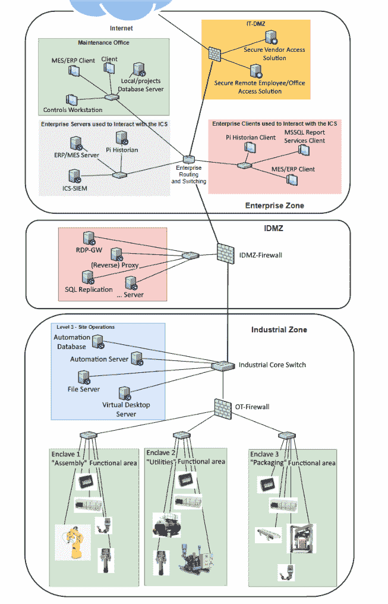
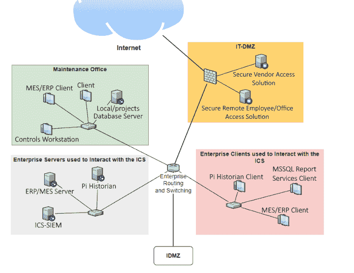
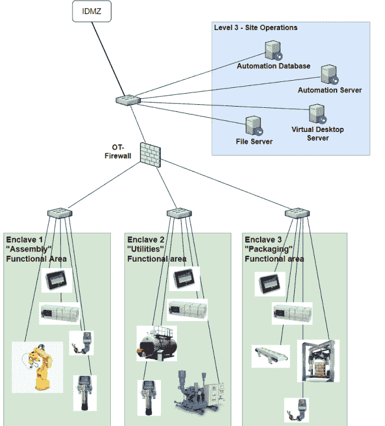
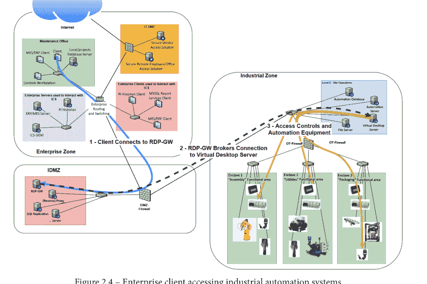
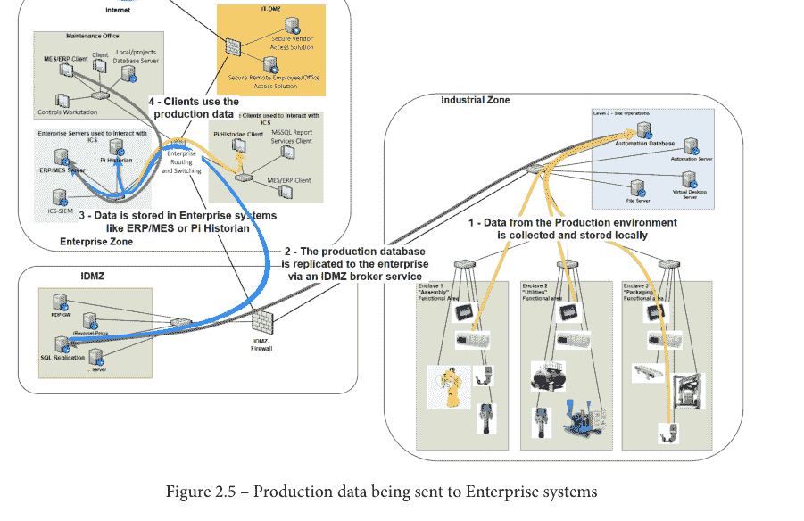
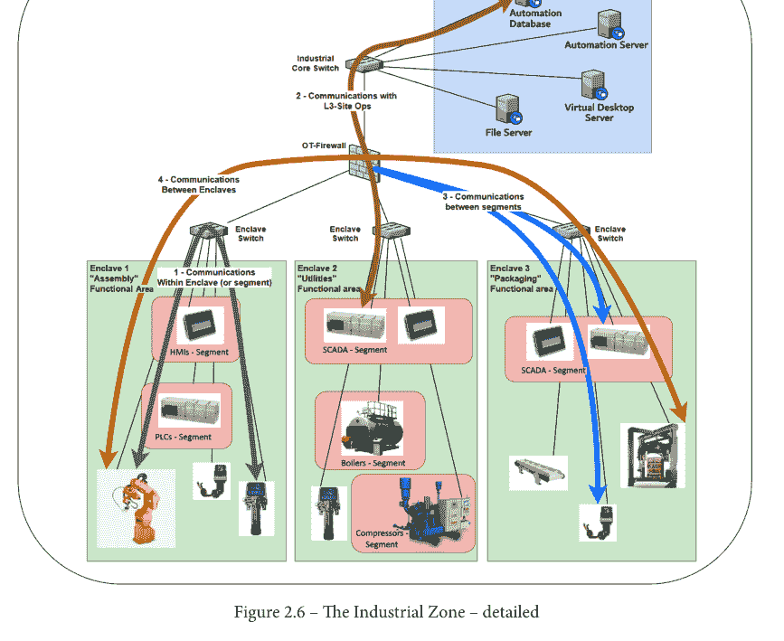
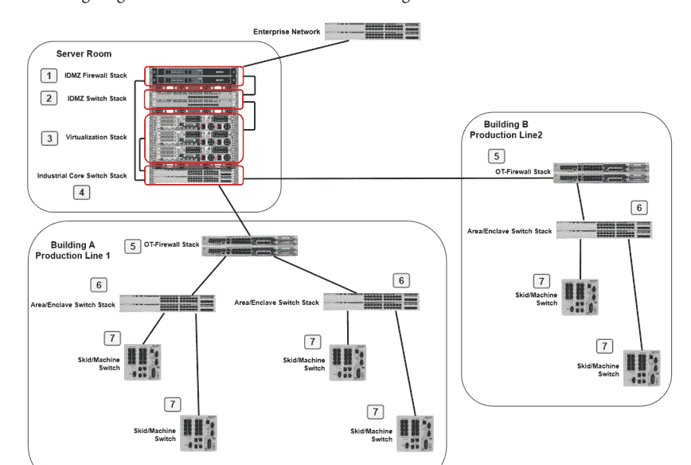
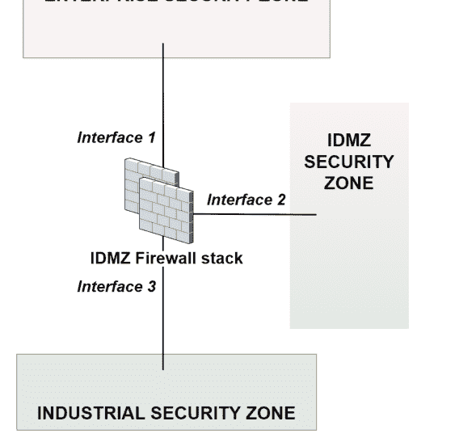
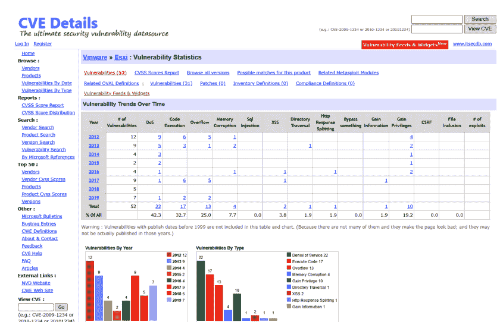

# 2 工业控制系统架构的现代视角

本章展示了**工业控制系统（ICS）**网络架构设计的现代视图，以及它如何与工业网络安全相适应。围绕 ICS 网络架构的讨论基于我个人设计全厂架构的方法，因为自从本书第一版出版以来，我又积累了几年经验。我增加了一些在各个工业领域发展起来的新概念、新技术和最佳实践。

在本章中，你将了解有助于我们理解并实施正确工业网络架构设计的工具、技术和方法论。本章只是对这些主题进行概述；后续章节将深入探讨相关主题。

在本章中，我们将涵盖以下主题：

- 为什么正确的架构很重要
- 工业控制系统架构概述

## 为什么正确的架构很重要

任何扎实的设计都始于一个健全的基础架构。ICS 网络安全也是如此。花足够的时间设计一个兼顾安全性、性能、正常运行时间要求和弹性的稳健架构，将在 ICS 环境的整个生命周期中带来丰厚回报。我们所做的决策和考量所带来的影响，会波及我们之后所做的任何事，因此让我们来回顾一些基本要求、考量和建议。

在*第4章：以安全为考量设计ICS架构*中，我们将更仔细地研究一个设计良好的 ICS 网络架构在安全方面的内容。本章其余部分将是对推荐 ICS 网络架构的架构性概述/回顾，并更新了自本书第一版问世以来新增的和修订过的考量。

## 工业控制系统架构概述

下图展示了推荐的 ICS 网络架构。从根本上说，它与我们第一版书中讨论的内容相比没有变化。推荐的架构基于普渡模型（该模型在*第1章：第一版引言与回顾*中有详细讨论），但已经过更新，以反映当前标准、行业最佳实践，以及作者在设计、实施和维护安全且有弹性的工业网络架构方面 10 年的经验。

这里我们不再逐一讲解每个部分、区域和领域，而是从实施的角度来看待该架构。构建网段、边界和安全控制背后用到的是什么样的技术？

图 2.1 – ICS 架构的完整视图

以下章节将介绍企业区和工业区，并讨论工业非军事区。

### 企业区

我们从企业侧开始讨论。这是 ICS 环境中那些不直接与生产过程交互的系统的所在区域。正如许多针对工业环境的近期入侵所显示的，企业网络往往是被用于对组织发起攻击的初始入口点。一封钓鱼邮件或一次路过式恶意软件下载就能让攻击者进入企业网络，而攻击者会在那里尝试转向工业网络。

企业区与工业系统和生产数据的典型交互包括以下内容：

- 需要获取工业区生成的报告的企业用户。这些报告通过反向 Web 代理之类的代理服务提供。反向 Web 代理可以通过**工业非军事区（IDMZ）**安全地公开位于工业网络上的报告 Web 门户。
- 需要获取企业侧生成的报告，但这些报告是基于工业区生产系统数据构建的企业用户。这是通过 Pi Historian 或（自定义）SQL 数据库等历史数据服务在工业区和企业区之间同步数据来实现的，并通过 IDMZ 经由 SQL 数据复制代理服务安全提供。
- **制造执行系统（MES）**或**企业资源计划（ERP）**客户端。这些 MES/ERP 客户端与生产系统交互，以优化生产效率并跟踪生产统计信息。其实现是数据同步和反向 Web 代理服务的组合。
- 对工业系统的远程访问。通常有两种类型的远程访问：一种供员工使用的解决方案——如果员工已经连接到企业网络（位于现场/本地），可以直接使用 IDMZ 中的**远程桌面协议网关（RDP-GW）**代理服务；当员工远程工作时，则会通过**虚拟专用网络（VPN）**解决方案接入企业网络。

然后，对于供应商和承包商来说，有一种解决方案，通常是通过实施 **虚拟机 (VM)** 风格的远程访问来实现（可参考 Citrix Gateway（`https://www.citrix.com/products/citrix-gateway/`）），该方案使用远程桌面技术将供应商或承包商安全地连接到企业网络。此时，供应商或承包商使用的是由公司控制、维护和监控的公司资产。从这种 VM 风格的远程访问系统，供应商或承包商可以通过 IDMZ 中的 RDP-GW 连接到工业系统。在 *第 3 章，工业隔离区* 中，我们将讨论如何控制供应商何时、何地以及如何连接到 RDP-GW 服务器。

上述 IDMZ 服务以及其他若干服务将在 *第 3 章，工业隔离区* 中详细讨论。

企业侧 ICS 环境的实现方式应为功能特定的系统安全地集成到现有的 IT 基础设施中。下图描绘了实现此目标的推荐方式：

图 2.2 – ICS 企业区网络架构

关于此图，有一些重要的注意事项如下：

- 任何不直接交互或对生产过程运行至关重要的系统都应驻留在企业区。这显著降低了工业环境的攻击面（*我们认为最关键且应不惜一切代价保护的区域*）。通过强制所有与工业环境（人工交互）的交互都在企业系统上进行，我们可以密切监控这些交互，在需要与工业系统交互时进行中介，并有效地创建一个紧密控制和监控的安全边界。正如我们在第 3 章 *工业隔离区* 中将看到的，IDMZ 允许我们通过实施代理服务以及借助 **深度包检测 (DPI)** 启用防火墙和 **主机入侵检测系统 (HIDS)** 与 **网络入侵检测系统 (NIDS)** 技术来监控任何交互，从而在物理上完全将企业系统和人工交互与生产网络分离。

- 不被视为生产过程运行至关重要的系统不应放置在工业区，而应放置在企业网络的专用、隔离部分。从工业网络中消除不必要的系统和设备可显著降低攻击面。通过将人们交互的设备放置在企业侧，我们可以创建一个边界，在该设备或人工因素被攻破时保护工业环境。

- 远程访问至少应区分员工型和供应商型远程访问，员工通常利用某种 VPN 解决方案。供应商不应被授予访问公司网络的 VPN 权限（你真的想将一个未知网络连接到你的网络吗？），而应使用某种类型的虚拟机访问方案，例如 **VMware ACE、Citrix XenApp、Microsoft Remote Desktop、Bongar Remote Support、CyberArk Alero** 等。实施基于虚拟机的远程访问解决方案有效地将远程实体与企业网络之间的安全边界置于公司的公共地址处。建立虚拟会话后，远程用户使用由公司控制和拥有的资产，从而可以完全控制并可见其操作。从此虚拟远程会话中，远程用户可以被允许执行特定操作，例如连接到 IDMZ 中的远程桌面网关，然后允许其连接到工业区。此外，应为进入企业网络的初始跳转（VPN/Citrix 访问）以及在 IDMZ 中的 **远程桌面网关 (RDP-GW)** 实现多因素身份验证。

这涵盖了 ICS 企业侧的 IT 部分。接下来，我们将讨论企业侧 **运营技术 (OT)** 的存在以及围绕这些系统、设备和设备的与安全相关的考虑。

## 运营技术 (OT) 在信息技术 (IT) 空间中的存在

如 *图 2.2* 所示，有相当多的与 ICS 相关的系统（OT 资产）存在于（严格来说） **信息技术 (IT)** 空间中。这是 OT/IT 融合对 ICS 环境产生的影响之一。企业与工业系统之间，或 IT 与 OT 之间已不再存在严格的分离。在过去十年左右的时间里，ICS 已将其边界延伸到“IT”空间，原因可能是为了允许供应商或员工从远程位置安全连接、提供数据共享方式、允许 OT 资产被监控，或以其他方式向 OT 环境提供 IT 服务。

保护 ICS 环境不再是隔离问题或专职 OT 人员的工作。因为 OT 和 IT 重叠，所以保护和保障 ICS 环境的负担也必须重叠。我合作过的在保护生产环境方面最成功的公司是那些成功建立了 IT/OT（安全）团队并使其良好协作的公司。如果你从阅读本书中只得到一件事，那就是成功保护 ICS 环境是一项依赖于组织中每个人共同协作的任务。

此外，在本书的其余部分，我们将研究许多最初为 IT 设计然后被采用或调整以在 OT 空间中工作的活动、技术和学科（包括攻击）。拥有对业务环境两方面都有知识的团队将带来丰厚的回报。

## 安全考虑

我们将通过围绕在 IT 环境中运行 OT 系统的一些安全考虑来结束本节。要安全地实现这一点，你应执行以下操作：

将 ICS 环境的两个不同侧面视为不同。也就是说，ICS 网络被划分为工业区和企业区是有原因的。你可以通过使用专用且不同的安全控制来扩展这种分离，具体如下：

- 为工业侧和企业侧分别使用独立、专用的 Windows Active Directory 域。
- 不要在工业和企业 Active Directory 域之间使用域信任关系。至少，企业用户/实体应拥有两套凭据：一套用于企业网络资源，一套用于工业网络资源。
- 指定一组选定的系统允许与 IDMZ 通信。访问工业资源仅限于这些系统。只有选定的用户才能利用这些系统穿越 IT-OT 边界。
- 防止在任何可以跨越 IT-OT 边界（可穿越 IDMZ）的企业域上的系统或任何工业系统上存储凭据。攻击者在入侵系统后做的第一件事就是寻找存储的凭据，因此请通过一开始就不存储任何凭据来尽可能增加难度。

这涵盖了 ICS 环境的企业侧；接下来，我们将进入工业领域。

## 工业隔离区

**工业隔离区**（IDMZ）是安全地将工业区和企业区连接在一起的粘合剂。它允许企业和工业网络之间实现物理分离，同时允许使用功能特定的代理服务进行基本功能。IDMZ 将在 *第 3 章，工业隔离区* 中详细解释。

## 工业区

在 OT-IT 安全屏障的另一侧是工业区。任何连接到工业网络的系统都有充分的理由存在于此，这意味着该系统要么直接影响生产过程，要么被确定为在 IDMZ 必须关闭时维持整体生产过程可操作性所必需（请参阅本书第一版，了解该概念的详细讨论）。顺带一提，这一事实允许一种非常有效的<|message|>安全控制措施，我们将在本书后面发现。

下图描绘了工业区的推荐架构：

Figure 2.3 – The ICS industrial network architecture

以下各节将解释 ICS 工业网络架构的不同区域。

### Level 3 – Site Operations

我们要讨论的工业区的第一个部分，普渡模型将其称为 Level 3 – Site Operations。普渡模型已在第 1 章《引言与第一版回顾》中详细讨论。Level 3 – Site Operations 是工业网络中用作下层控制和自动化系统与企业网络之间通信中介的子网或飞地（见下一节），通过 IDMZ 中的代理服务进行。在其他话说，从企业区访问和与工业系统交互必须由专用的 IDMZ 服务代理（形成物理隔离），并终止于 Level 3 – Site Operations 飞地（在 Level 3 的专用服务器上）。另一方面，来自 Level 2 及以下的数据必须先存储在 Level 3 Site Operations 系统上，然后才能通过专用的 IDMZ 代理服务发送给企业系统或用户或被其访问。为了说明这一点，下图显示了企业区中的用户如何使用 Microsoft 的 RDP 客户端通过 IDMZ 中的 RDP-GW 代理服务连接到位于 Level 3 – Site Operations 的虚拟桌面服务器。虚拟桌面服务器随后允许企业用户对 2 级及以下的控制和自动化设备执行维护、故障排除或开发任务：

Figure 2.4 – Enterprise client accessing industrial automation systems

在前面的图中，我们可以看到维护办公室中的工程师执行以下操作：

- 1. 他们使用其客户端计算机（任何能够运行 RDP 客户端的计算机类型），该计算机连接到企业网络，以启动到 IDMZ 中 **Remote Desktop Protocol Gateway (RDP-GW)** 代理服务的远程桌面会话（Microsoft RDP 客户端），（有关此设置的详细信息，请参阅下一章）。
- 2. 他们使用 RDP-GW 服务器代理到工业区 Level 3 Site Operations 中的虚拟桌面服务器的连接。RDP-GW 服务器严格控制谁可以在何时做什么。
- 3. 他们与工业区 L3 中的虚拟桌面服务器创建了一个交互式但物理上断开的会话。从这里，他们可以使用已安装在虚拟桌面环境中的软件和实用程序开始监控、故障排除或编程自动化和控制系统、设备或设备。

在本文所述的示例场景中，IDMZ 通过代理工程师的 RDP 会话在物理上将企业网络与工业网络隔离开来。连接在步骤 1 结束时移交给工业环境。从那时起，所使用的资源都在工业设置和配置的控制之下。我们有效地防止了与工业设备的直接（人工）交互。RDP 会话允许某人编程 PLC 或排除传感器故障，而物理隔离由 IDMZ 代理服务实现，防止工程客户端计算机传播到工业网络。这种设置对防止恶意软件破坏工业网络非常有效。除非恶意软件（想想勒索软件或来自 USB 密钥的某种感染）知道如何通过 RDP-GW，否则它会被限制在企业网络上。企业区可能被关闭，但工业方面的工作可以继续。而且由于我们的工具、软件和数据都存储并安装在工业网络上的系统上，我们可以拿一台干净的计算机，配置 RDP 客户端并重新连接——无需重新安装软件、许可证或数据，因为所有这些仍安全地存放在工业区。

现在，让我们反转场景，看看工业设备（2 级及以下）的数据如何在工业区收集并发送到企业系统，企业网络上的用户可以在那里使用该数据进行报告或其他活动。此设置在下图中显示：

Figure 2.5 – Production data being sent to Enterprise systems

让我们看看这张图包含什么内容：

- 1. 生产相关数据由例如自动化数据库服务器上的历史数据收集服务从 2 级及以下的自动化和控制设备中收集。
- 2. IDMZ 中的 SQL 复制代理服务（例如 Pi 到 Pi 复制）将工业网络上的数据库与其企业侧的对应数据库保持同步（可以是单向或双向）。
- 3. 生产相关数据进入企业侧系统的数据库，例如 ERP/MES 或（Pi）历史记录。
- 4. 依赖生产数据的客户端可以从企业系统检索（或存储，如果使用双向复制）并访问此数据。

我们将在下一章中查看更多关于 IDMZ 如何在仍允许跨访问的同时分隔企业和工业网络的示例。

## Enclaves

工业区的另一个重要方面是飞地。飞地是工业网络内的逻辑子部分（子网）。通常，这些子部分是通过将一组相关的自动化设备（想想功能上、逻辑上或地理上相关的设备）分组到自己的子网（VLAN）或物理隔离网络中，然后通过防火墙将其重新连接到工业网络的其余部分来创建的。

此设置允许相关生产设备不受阻碍地通信（在第 2 层速度下），而与其他飞地或 Level 3 Site Operations 的通信则由防火墙和/或 NIDS 检查、控制和监控。

## Micro segmentation

在飞地内部，可以通过微分段进一步细分。假设您已根据生产线创建了一个飞地，并且在这些生产线内部，有一些区域/设备组不一定需要与其他区域通信，例如 VFD 和 HMI。然后，这些设备组或飞地区域可以微分段到飞地子网内的自己的子网中。需要被其他段、飞地或 L3 Site Operations 访问的任何微分段都可以使用 OT-Firewall 上的子接口或使用第 3 层功能的飞地交换机。

在下图中，我们可以看到工业区的详细视图，其中显示了 level 3 Site Operations、飞地和段：

Figure 2.6 – The Industrial Zone – detailed

在这里，我们可以看到四条不同的通信路径：

- 1. 同一飞地或段内设备之间的通信（飞地是一种段形式）在飞地交换机内处理，通过相同的 VLAN 接口——因此以第 2 层速度进行。这允许系统中最基本的组件——那些绝对必要以保持流程运行的组件——不受阻碍地通信。
  - 此类流量保持在交换机本地，不会通过防火墙发送，因此不会被检查。正如我们将在 *Chapter 4, Designing the ICS Architecture with Security in Mind* 中看到的那样，要检查此类本地流量，我们必须在飞地交换机上设置 SPAN 或 MIRROR 会话。
- 2. 飞地或段中的设备与 Level 3 Site Operations 中的系统之间的通信必须离开其本地子网（VLAN），因此需要默认网关。OT-Firewall 将能够处理此问题，并且额外好处是此类流量在通过 OT-Firewall 时现在会被检查、控制和监控。
- 3. 同一飞地内各段之间的通信必须离开其子网，因此需要默认网关（路由器）。OT-Firewall 将能够处理此问题，并且额外好处是此类流量在通过 OT-Firewall 时现在会被检查、控制和监控。
- 4. 飞地之间的通信必须离开其子网，因此需要默认网关（路由器）。OT-Firewall 将能够处理此问题，并且额外好处是此类流量在通过 OT-Firewall 时现在会被检查、控制和监控。

这涵盖了讨论的工业方面。接下来，我们将简要介绍通过 **Industrial Demilitarized Zone** 或 **IDMZ** 正确、安全地连接企业区和工业区的手段。

## 用于构建 ICS 环境的硬件

那么，构建所有这些需要什么？

尽管该问题的详细答案高度依赖于 ICS 的规模、功能、性能、正常运行时间要求以及地理分散性，但大多数 ICS 环境都会包含一组独特的组件来实现这一目标。下图展示了 ICS 环境的硬件架构图：

图 2.7 – ICS 环境 – 硬件视图

请注意，上述架构展示了 IDMZ 及以下的全部硬件。托管 ICS 企业资产所需的硬件是企业网络的一部分，通常表现为物理计算机/服务器或虚拟化资产（通过 Hyper-V 或 VMware vSphere）。此外，请注意该架构仅关注构建工业网络和 IDMZ 所需的硬件。像 HMI、PLC、DCS 等终端所需的硬件不在考虑范围内，尽管其中一些资产可以虚拟化在前述图中标记为位置 2 的虚拟化堆栈上。

因此，基于此观点，如果我们查看硬件架构，可以看到以下内容：

- IDMZ 通过位于**位置 1** 的 IDMZ 防火墙对（堆栈）连接到企业网络。建议采用活动-待机高可用模式的一对防火墙以增强弹性。请注意，此处推荐活动-待机的高可用模式，因为负载均衡模式可能会允许两个防火墙的总吞吐量超过单个防火墙的最大吞吐量，在这种情况下，如果发生单次故障事件，将导致剩余的防火墙过载并导致整个堆栈宕机。
- 由于该架构层级（IDMZ）上的流量应为纯 IT 协议，标准的 IT 专用防火墙品牌/型号完全可以胜任。一些推荐的型号包括思科 Firepower 2100 系列、Palo Alto PA-820/850 或 Fortinet FortiGate。
- IDMZ 防火墙堆栈通常位于生产设施的服务器机房或数据中心，并与其他 IDMZ 设备一起放置在服务器机架中：

图 2.8 – IDMZ 防火墙堆栈

- 在 OT 防火墙下方，在**位置 6** 处，我们可以看到用于连接特定区域网络设备和自动化设备的区域/隔离区交换机堆栈。自动化和控制设备可以直接连接到隔离区交换机，或者交换机可以连接撬块/机器交换机，如**位置 7** 所示。

以下是关于 ICS 网络架构设计的一些一般性建议。

## 弹性与冗余

在构建 ICS 环境时，请牢记以下弹性和冗余考虑事项：

- 设备堆叠，意思是如果您可以实施一组设备（防火墙、交换机、服务器等），您就应该这样做，以便当堆栈中的一个设备故障时，您不会陷入困境。有多种技术适用于您试图实现冗余的设备，例如：
  - 交换机可以进行堆叠：https://www.cisco.com/c/en/us/support/docs/smb/switches/cisco-350x-series-stackable-managed-switches/smb5252-what-is-stacking.html
  - 防火墙可以设置为活动/待机模式：https://www.networkstraining.com/cisco-asa-active-standby-configuration/#:~:text=ASA%20Active%2FStandby%20failover%2Fredundancy%20means%20connecting%20two%20identical%20ASA,be%20synchronizing%20its%20configuration%20to%20the%20standby%20unit.
  - 虚拟化集群中的服务器可以使用 vCenter 来实现高可用性和故障转移：https://docs.vmware.com/en/VMware-vSphere/7.0/com.vmware.vsphere.avail.doc/GUID-4A626993-A829-495C-9659-F64BA8B560BD.html
- 使电缆和布线匹配堆栈的设置，意思是你应该用冗余链路（EtherChannels、Trunking 端口等）互连设备，以便如果链路发生故障，你也不会陷入困境。此外，冗余链路内的单个连接应走不同的路径，这意味着，例如，如果你将两个交换机连接在一起，EtherChannel 中的线缆应朝工厂周围的相反方向布线。这样，如果建筑物一侧的线槽因某种原因被切断，你仍可继续运行。
- 为所有设备使用冗余电源，并将电源线连接至两个不同的电源（最好由电网上的两个不同分配点供电）。
- 如果预算允许，请为 IDMZ 配置双份，意思是你应该在工厂的两侧构建两个相同的设置，并在两者之间使用拉伸集群技术（VMware）来创建活动-待机或负载均衡设置。这样，当工厂的一侧发生故障时，另一侧可以接管工作。

## ICS 环境中的虚拟化技术

在上一节中，我们讨论了虚拟化技术的话题。我们现在将详细讨论这一概念，并查看其在 ICS 环境中的适用性。

## 虚拟化技术原理

在计算机术语中，虚拟化指的是创建类似事物的虚拟实例（而非物理实例）的过程。该实例包括虚拟计算硬件、存储和网络资源。虚拟化并不新鲜，它起源于 20 世纪 60 年代，当时被用于在不同应用程序之间逻辑地划分大型机系统资源。

一些需要理解的虚拟化技术相关术语如下：

- 硬件虚拟化

虚拟化指的是创建像真实计算机一样运行的虚拟机（包括操作系统）的过程，而不需要专用的物理硬件。在虚拟机上执行的应用程序与程序在逻辑上与底层的**宿主机**硬件资源隔离。换句话说，宿主机可以运行某种版本的 Microsoft Windows 操作系统，同时托管运行多种 Linux 操作系统的虚拟机。在这个例子中，运行 Linux 操作系统的计算机被称为**客户机**或客户计算机。请注意，客户机也可以运行另一个 Windows 操作系统。

在宿主机上运行并负责促进虚拟机虚拟资源的软件或固件被称为**Hypervisor（虚拟机管理程序）**。有两种类型的 Hypervisor：

- **类型 1 Hypervisor。** 这些类型的 Hypervisor 直接运行在系统硬件上。它们也被称为“裸金属”嵌入式 Hypervisor。类型 1 Hypervisor 的例子包括 VMware ESXi 和 Microsoft Hyper-V。
- **类型 2 Hypervisor。** 这些类型的 Hypervisor 运行在提供虚拟化服务（如 I/O 设备支持和内存管理）的宿主操作系统内部。类型 2 Hypervisor 的例子包括 VMware Workstation/Fusion/Player 和 Oracle VM VirtualBox。
- **快照**

快照指的是虚拟机在某一确切时间点的状态，包括任何虚拟存储设备的状态。快照允许我们恢复虚拟机的状态，如快照时记录的状态，以便稍后恢复。通过恢复快照，您可以有效地撤销在初始快照之后发生的任何更改。此功能作为备份技术非常有用，例如在执行风险操作之前。
- **迁移**

如前所述，虚拟机快照可以移动或复制到拥有其自身 Hypervisor 的另一台宿主机，然后在新宿主上恢复运行。这个过程称为迁移，目的可以是创建新的虚拟机或将虚拟机迁移到另一台宿主（用于资源分配）。一些虚拟化供应商提供保持不同宿主之间快照同步的功能。现在，宿主之间的迁移成为一个快速操作，有效地提供了一种让虚拟机持续运作而不中断的方法，例如当其中一台宿主发生故障时。
- **故障转移**

扩展前述的迁移机制，故障转移允许 VM 在其运行的宿主发生故障时继续操作。通常，当迁移因某种原因停止工作（宿主无响应）时，会发生故障转移。通过故障转移，VM 从备份宿主上最后已知的同步状态继续操作。

接下来，让我们讨论一下实施虚拟化环境的一些安全考虑事项。

## 虚拟环境的安全注意事项

能力越大，责任越大。这一点在虚拟化技术中尤为适用。如果落入不当之人手中，虚拟环境的管理门户可能会带来毁灭性的后果。一旦该路径受到威胁，混乱发生的可能性将无穷无尽。在搭建工业虚拟化环境时，需要牢记以下几点注意事项：

-   将管理接口完全保留在 IDMZ 的工业侧。
-   无论如何，ICS 虚拟平台的管理接口都不得直接暴露在企业侧。在工业网络的专用子网上创建一个专用系统（参见后续章节 *ICS 环境与架构管理*），并且仅允许选定的用户访问该系统（更多细节参见*第 3 章《工业非军事区》*）。
-   保持虚拟基础设施的更新，但不要将环境暴露在互联网上。这意味着应将虚拟基础设施置于隔离网络中，仅通过离线方式进行更新和修补。
-   定期使用离线补丁对虚拟化技术进行修补和更新。将虚拟基础设施服务器直接连接到互联网所带来的明显风险，根本不值得用便利性去交换。
-   按照需求可知和最小权限标准创建角色并分配权限，同时遵循所用虚拟化厂商的最佳实践建议。
-   实施安全、性能和健康监控，以便我们能够时刻关注各项动态。
-   这将成为本书的座右铭，从*第 4 章《以安全思维设计 ICS 架构》*开始：确保有人关注日志并跟进问题。

## 共享物理资源

虚拟化堆栈最初被纳入 IDMZ 构建，目的是虚拟化 Broker 服务。然而，许多客户也选择使用该设置来虚拟化其工业计算需求，例如虚拟化第 3 级站点运营中的服务器。这涉及将虚拟化堆栈物理直接连接到工业核心交换机，并通过 VLAN 和专用虚拟交换机在逻辑上进行隔离。

由于从同一硬件共享 IDMZ 和工业系统的虚拟资源，将安全边界置于所选虚拟化平台的 Hypervisor 上，这取决于该 Hypervisor 的可靠程度，因此这要么是一个合理的风险与收益权衡，要么不是。例如，允许绕过 vSwitch 边界的 VMware Hypervisor 漏洞非常罕见：

现在的问题是，为了支持和维护这些额外的硬件和软件，是否需要单独拆分出一个额外的虚拟化堆栈，并承担相应的额外成本和资源？

### ICS 环境与架构管理

本章的最后一个讨论点是关于如何管理 ICS 环境。架构中使用的每台设备都会有一些访问方式，用于管理、配置、监控、更新以及其他管理和维护目的。

访问所有这些管理接口的推荐方法是通过工业网络专用子网上的专用系统进行。让我们来看看需要做什么：

-   在区域 OT 防火墙后面创建一个专用子网（VLAN），用于控制对该子网的访问。
-   将一个专用（虚拟）管理服务器连接到该子网。
-   仅允许选定的一群人从工业网络上的另一个资源（跳板机）访问此管理服务器。
-   使用最小权限和需求可知的最佳实践，为管理员和支持用户精简并过滤权限。
-   不要在管理门户上配置默认网关设置，作为保护管理子网外部通信的额外一层措施。
-   记录并监控管理网络上发生的所有事情，并安排人员定期查看日志。

### 总结

在本章中，我们回顾了 ICS 架构，并对某些领域和主题进行了深入探讨。这帮助我们指出了与第一版相比的变化，或者为本书后续提供的讨论奠定了基础。

到目前为止，您应该已经对典型的 ICS 架构应该是什么样子，以及应该包含哪些内容有了扎实的理解。我们将在后续章节中扩展某些领域，主要是为了指出该架构如何在安全监控实践中使用。

不过，首先，在下一章中，我们将重新探讨工业非军事区，简称 IDMZ。
