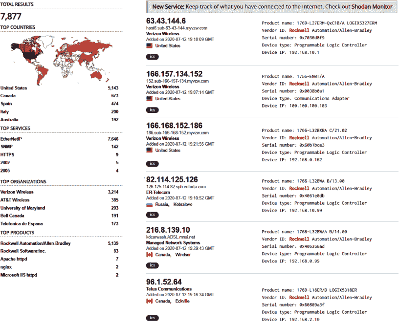
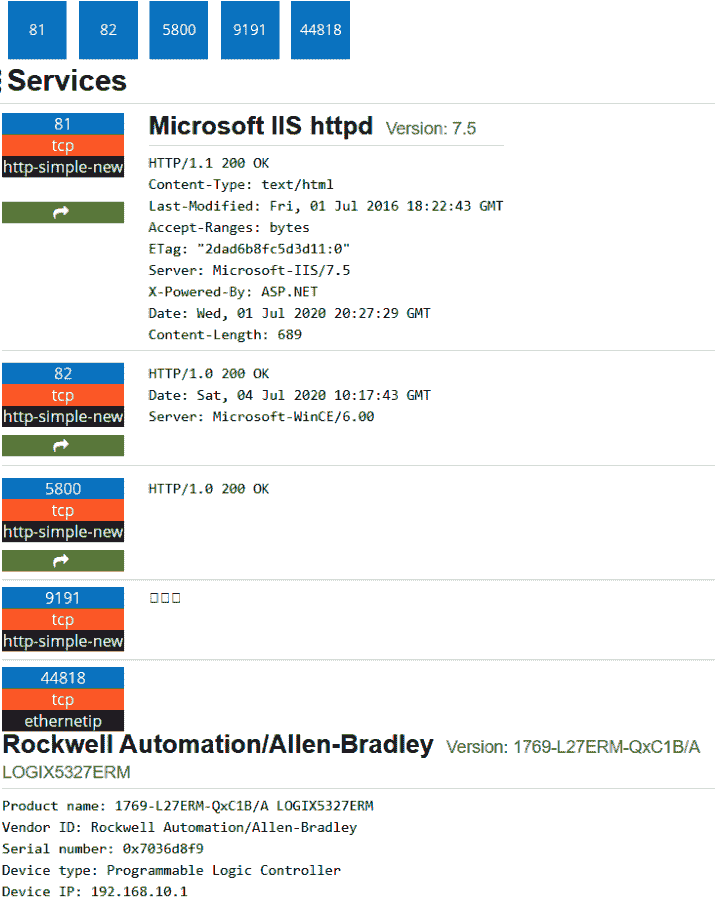
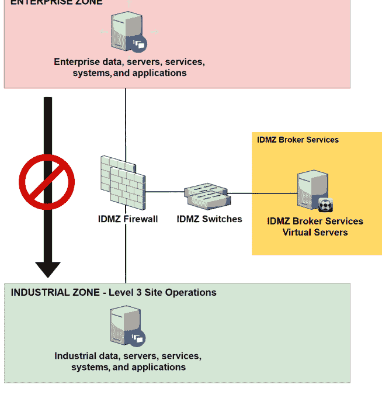
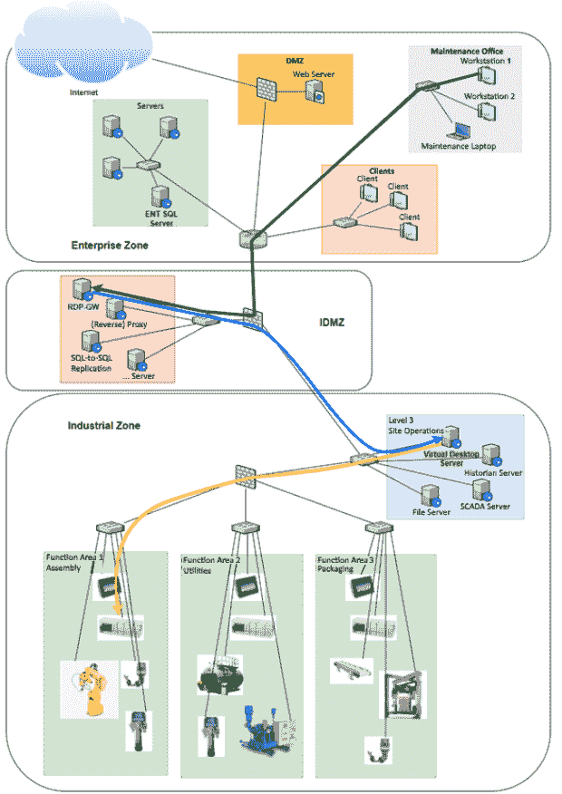
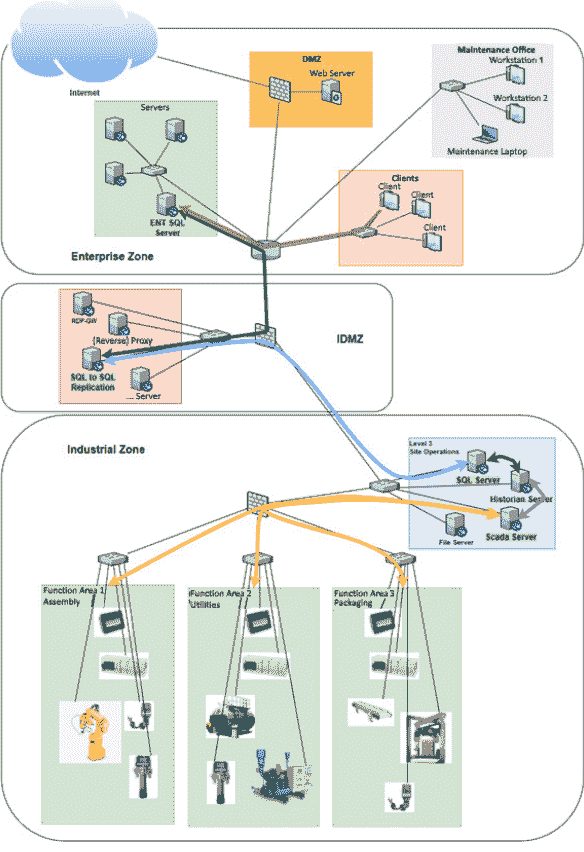
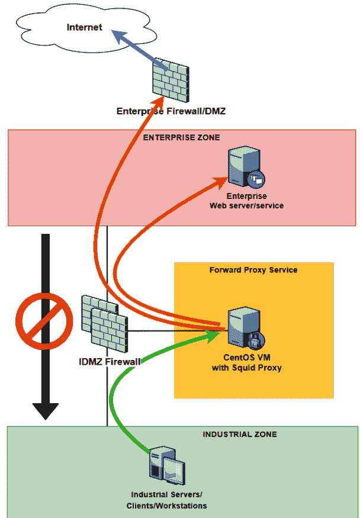
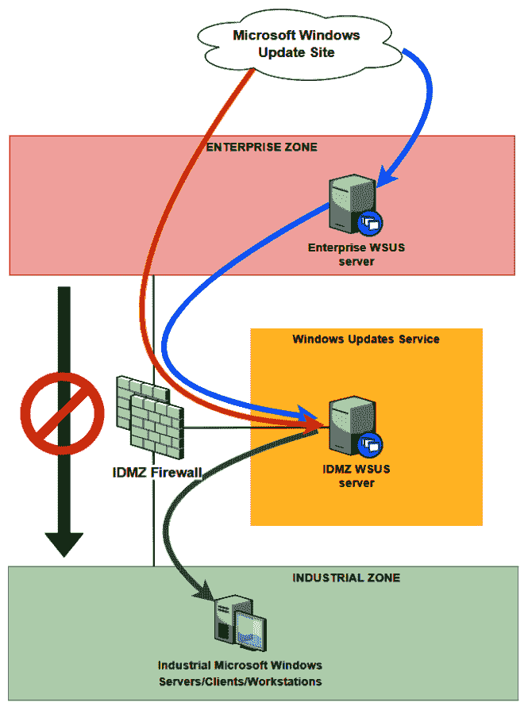
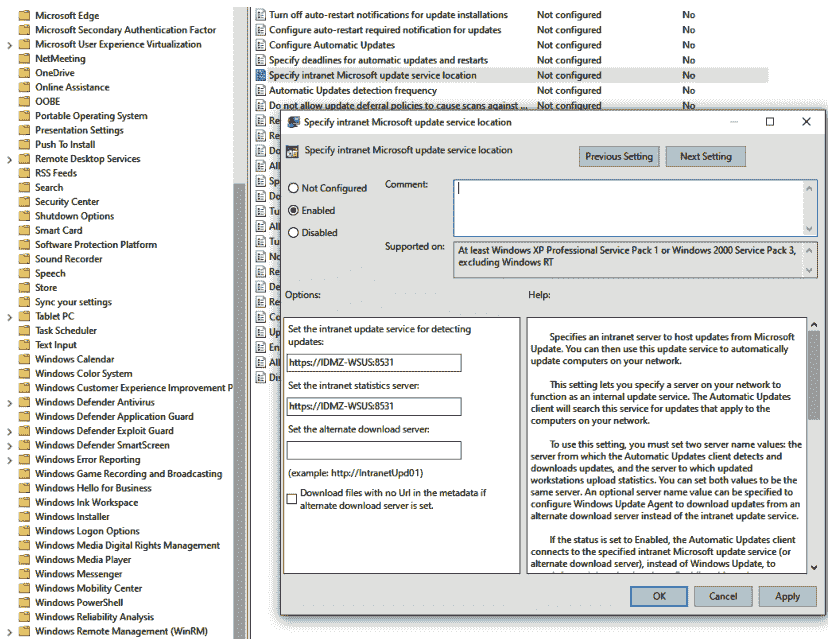

## 3
# 工业非军事区

在上一章中，我们讨论了工业控制系统（ICS）网络架构的高层概述。在该高层讨论中，我们提到了工业非军事区（IDMZ）的概念。在本章中，我们将深入探讨 IDMZ。我们将会介绍用于创建 IDMZ 的总体设计、概念和技术，并探讨自本书第一版首次讨论 IDMZ 以来发生变化的内容。

在本章中，我们将涵盖以下主题：

- IDMZ
- IDMZ 设计的组成要素

### IDMZ

IDMZ 也被称为外围网络，是 ICS 网络架构中的一个缓冲区，用于强制执行数据共享安全性，并允许对可信网络（工业区）和不可信网络（企业区）之间的交互进行细粒度控制。IDMZ 在深度防御（DiD）模型中增加了一个额外的层级，用于在两个（或更多）安全区域之间安全地共享 ICS 相关数据和网络服务。

## 基本概念

从根本上说，IDMZ 的主要功能是在企业系统、服务和用户与工业生产及自动化系统、应用程序和设备之间建立物理隔离。理想情况下，应该实现两者之间的完全隔离，但在当今的 ICS 环境中，业务系统高度依赖生产系统的最新实时数据，反之亦然，因此很难做到完全隔离。

设计得当的 IDMZ 将通过将交互转移到企业网络上，来限制或防止与 ICS 设备的直接交互，从而最大限度地减少工业环境的攻击面，同时通过定义明确、严格控制、监控到位且安全防护完善的 Broker 服务（位于 IDMZ 中），实现企业与工业区之间的安全交互和数据共享。促进跨区域交互的 Broker 服务示例包括：

-   使用应用程序镜像，例如用于数据历史库的**结构化查询语言（SQL）**复制，或用于时间同步的**网络时间协议（NTP）**
-   使用微软的**远程桌面协议网关（RDP-GW）**服务进行远程交互会话
-   使用正向或反向代理服务器，用于 Web 流量和**统一资源定位符（URL）**过滤
-   使用存储转发服务器，例如**Windows 服务器更新服务（WSUS）**以及防病毒暂存和报告服务器
-   使用复制服务器来复制数据和/或文件，例如安全文件传输解决方案（如 SolarWinds Serv-U）

## IDMZ 设计流程

IDMZ 的设计应遵循以下六项主要设计原则和注意事项，这些原则摘自 *Rockwell Automation/Cisco  Converged Plantwide Ethernet (CPwE) 设计与实施指南*（https://literature.rockwellautomation.com/idc/groups/literature/documents/td/enet-td001_-en-p.pdf）：

- *来自 IDMZ 任一侧的所有通信请求（网络连接）都应终止于 IDMZ 内。换言之，没有任何网络流量直接穿过 IDMZ。*
- ICS 自动化和控制协议网络流量（Modbus、Profinet、EtherNet/IP 等）不得进入或穿越 IDMZ。此类网络流量应保持在 *工业区* 内部。


-   *主要服务并非永久存储在 IDMZ 中。换言之，ICS 所依赖的任何服务或服务均不得托管在 IDMZ 中。*
-   *所有数据均为临时数据。这意味着 IDMZ 不会永久存储数据。*
-   *IDMZ 内的代理服务应放置在 IDMZ 代理服务网络区域的专用、隔离子网（VLAN）中。*
-   *设计得当的 IDMZ 应具备这样的能力：一旦受到威胁，可以将其断开连接，同时仍能维持生产运行，即使产能有所降低。*

考虑到这些因素，IDMZ 设计流程应首先决定 ICS 相关系统在企业区和工业区的布局。这里的经验法则是：如果某个系统/设备/功能/应用程序并非以某种形式运行生产过程所绝对必需，那么该 系统/设备/功能/应用程序 应位于 ICS 环境的企业侧。

> **重要说明**
>
> 工程/维护笔记本电脑或工作站**应该**是企业（业务）资产！这样，该设备更容易保持最新状态，并且在笔记本电脑或工作站与工业环境之间有多重检查、边界和控制措施，以防止设备受损。将非必要系统和设备从工业网络中移除并放置到企业网络中，可以显著缩小攻击面。用户与工业系统之间的必要交互（我们不是在讨论操作员**人机界面（HMI）**）则可以被严格控制和监控。以这种方式，即使企业网络中的某个系统被攻破，也能在被感染系统与工业网络之间形成一道屏障（IDMZ 即屏障）。允许非必要系统（和用户）直接连接到工业网络无异于自找麻烦。只需某个用户插入一个受感染的**通用串行总线（USB）**密钥，或让自己的笔记本电脑感染病毒，就可能使整个工业网络瘫痪。
>
> 我们将在后续章节讨论如何在企业区和工业区之间促进维护、故障排除和开发活动。

在确定 ICS 资产在企业网络和工业网络中的布局之后，设计流程的下一步是定义用于促进两个区域之间数据共享和交互的代理服务。这一过程取决于 ICS 的需求以及 ICS 资产布局的决策，但归根结底是定义两个区域之间的交互需求（“我们需要远程访问……”；“我们希望查看……的设备统计信息”；“我们希望能够更新 Windows 服务器和工作站”；等等）。对于每项需求，通常都有我们可以实施的代理服务。有些解决方案可能不是直接显而易见的，但总会有一个。在我定义 IDMZ 代理服务的 10 年经验中，我从未遇到过无法通过某种代理服务解决的情况。

例如，请考虑以下设计陷阱。

## 设计陷阱 – 使用蜂窝连接实现支持云功能的自动化设备

这个陷阱围绕当今的热门话题——具有电话回家功能的工业智能设备（有些人称之为**工业物联网**，或 **IIoT**）或需要与托管在互联网上的应用程序同步的支持云功能的设备。

许多此类设备的供应商会试图让您安装支持**全球移动通信系统（GSM）**或 3G/4G 的集线器/路由器，以便他们能够通过蜂窝连接解决连接问题。这是一个糟糕的主意。不仅您现在要依赖该供应商尽职尽责地保护进入 ICS 环境的后门连接，而且该连接从您的角度来看也完全不可见，这意味着所用的**互联网协议（IP）**地址不在您组织的子网范围内，因此不会成为任何（**信息技术**（**IT**））漏洞和风险评估流程或类似合理性检查的一部分。

如果您想了解这些蜂窝连接为 ICS 环境带来的风险，请考虑以下 Shodan 搜索（`https://www.shodan.io/search?query=rockwell`）：



*图 3.2 – Shodan 结果展示 ICS 蜂窝连接*

请注意，排名前五的组织中有四个是蜂窝运营商（这些也出现在显示的结果中）。这是通过蜂窝调制解调器路由器将**可编程逻辑控制器（PLC）**连接到互联网且未正确配置的结果。为了进一步说明这一点，以下是其中一个结果的详细信息：

## 服务



## Microsoft IIS http

版本：7.5

```
HTTP/1.1 200 OK
Content-Type: text/html
Last-Modified: Fri, 01 Jul 2016 18:22:43 GMT
Accept-Ranges: bytes
ETag: "2add6b8fc5d3d11:0"
Server: Microsoft-IIS/7.5
X-Powered-By: ASP.NET
Date: Wed, 01 Jul 2020 20:27:29 GMT
Content-Length: 689
```

```
HTTP/1.0 200 OK
Date: Sat, 04 Jul 2020 10:17:43 GMT
Server: Microsoft-WinCE/6.00
```

```
HTTP/1.0 200 OK
```

```
□□□
```

## Rockwell Automation/Allen-Bradley

版本：1769-L27ERM-QxC1B/A LOGIX5327ERM

```
Product name: 1769-L27ERM-QxC1B/A LOGIX5327ERM
Vendor ID: Rockwell Automation/Allen-Bradley
Serial number: 0x7036d8f9
Device type: Programmable Logic Controller
Device IP: 192.168.10.1
```

*图 3.3 – Shodan 详细结果*

端口 44818 上暴露的服务是 Allen-Bradley 控制器的编程接口，随时可以指向 **RSLogix 5000** 并开始搞破坏。

正如我所说，允许蜂窝调制解调器连接进入您的 ICS 环境是一个糟糕的主意。诚然，确实有一些公司能够妥善保护该后门连接，但总体来说，它们做得并不好。

## IDMZ 设计由什么组成？

在本节中，我们将探讨典型 IDMZ 中可能出现的各个部分。我们将从硬件、连接性以及设计和配置的角度来审视各个部分。我们将围绕以下基本 IDMZ 设计展开讨论：



*图 3.4 – 基本 IDMZ 架构设计*

接下来，让我们更详细地了解构成 IDMZ 的各个部分，如图 3.4 所示。

### 企业区

IDMZ 资产在企业区中的存在通常非常有限，甚至可能完全没有。通常，端点客户端（如 Web 浏览器、RDP 客户端等）用于与工业环境交互。

某些工业应用程序或 IDMZ 代理服务要求 ICS 环境在企业侧有存在。例如，SQL 到 SQL 复制（或 Pi Historian 系统的 **Pi-to-Pi**）等数据复制解决方案需要企业网络上有服务器来同步工业数据。另一个例子是 IDMZ 代理服务需要企业侧资源，例如远程/供应商访问解决方案。供应商/远程访问解决方案的最佳实践不是将远程用户直接连接到公司网络，而是使用某种虚拟跳板机（想想 Citrix 的远程访问解决方案类型）。然后，该虚拟跳板机被允许（仅）与 IDMZ RDP-GW 服务器通信，以代理到工业区资源的连接。我想指出的企业网络上 ICS 存在的最后一个例子是**制造执行系统（MES）**。典型的 MES 会在企业侧拥有（专用的）客户端，这些客户端直接或间接地与工业侧系统的部分进行通信。

### 硬件

用于企业网络上 ICS 存在的硬件差异很大。它可以是专用 PC 或服务器，也可以将资源集成到（现有的）虚拟化平台中，例如 **Hyper-V** 或 **VMware vSphere**。

### 设计和配置注意事项

ICS 企业侧存在的配置高度依赖于 ICS 的环境、需求、功能和状况。这里无法进行详细讨论，但我们将介绍一些有助于提高 ICS 环境整体安全性的配置注意事项，如下所示：

-   为作为 ICS 系统或 IDMZ 代理服务一部分的企业系统使用专用资源。
-   为作为 ICS 系统或 IDMZ 代理服务一部分的企业系统划分网络段。

#### IDMZ 防火墙

IDMZ 防火墙是与 IDMZ 相关的安全区域物理隔离的核心。防火墙的接口允许连接企业网络和工业网络的硬件，以及任何其他区域。防火墙规则决定了流量如何被允许流动。


### 硬件

供应防火墙的制造商有多种。以下三种是我所见最常用于 IDMZ 防火墙的：

- **思科**：思科 Firepower 2100 系列防火墙
- **派拓网络**：派拓网络 PA-800 系列防火墙
- **飞塔**：飞塔 FortiGate 系列防火墙

### 设计和配置注意事项

以下是针对 IDMZ 防火墙的一些通用设计和配置注意事项：

- 使用一对防火墙，采用**主备（active-standby）**模式，以便在设备或连接故障时安全故障转移。
- 使用冗余接口对连接网络网段，以实现接口和网络介质冗余。
- 为防火墙购买**深度包检测（DPI）**服务，以便在应用层检测漏洞利用和攻击。
- 为连接到防火墙的每个区域以及定义的每个代理服务创建安全区域。这样可以实现所有区域和服务之间的细粒度控制。
- 确保包含一条 `BLOCK ANY` 或 `DENY ALL` 规则作为最终规则或默认规则，以确保除非明确允许，否则所有流量都被阻止。
- 确保禁用所有未使用的端口、协议和功能，以强化防火墙。
- 将防火墙的管理端口连接到专用管理网段。

### IDMZ 交换机

IDMZ 防火墙的一个接口专用于 **IDMZ 代理服务**网段。IDMZ 代理服务通过一组承载虚拟服务器/服务的虚拟化服务器实现。为了在物理上连接所有接口并在逻辑上连接所有服务器/服务，IDMZ 建设中包含一对交换机。

使用交换机可以通过冗余网络接口连接将 IDMZ 虚拟化服务器连接到 IDMZ 防火墙，并允许将虚拟服务器划分到各自专用的**虚拟局域网（VLAN）**中。

### 硬件

用于 IDMZ 交换机的硬件可以来自任何制造商，只要其生产的可管理交换机支持 VLAN、堆叠和冗余接口配置（交换机端口、EtherChannel 等）。主要根据端口数量来选择（IDMZ 交换机只使用少量端口），但大多数 IDMZ 部署受益于使用具有万兆接口的交换机。为此，我通常选择一对思科 3850-12XS-S 交换机（https://www.cisco.com/c/en/us/support/switches/catalyst-3850-12xs-s-switch/model.html）；不过，其他规格类似（但价格更低）的交换机型号或品牌也能同样胜任。

### 设计和配置注意事项

以下是针对 IDMZ 交换机的一些通用设计和配置注意事项：

- 使用交换机堆叠以实现交换机冗余。
- 将冗余接口对交叉布线（在堆叠交换机之间拆分冗余对），从 IDMZ 交换机连接到防火墙和虚拟化服务器的**网络接口卡（NIC）**，以实现接口和网络介质冗余。
- 确保禁用所有未使用的端口、协议和功能，以强化交换机。
- 不要在交换机上启用路由（如果支持），以防止 VLAN 跳跃。
- 将连接到 IDMZ 防火墙的接口实现为单臂路由（router on a stick）方式，使用子接口为各个服务的 VLAN 提供隔离。
- 将交换机管理端口实现为专用的**虚拟路由转发（VRF）**端口，并将管理端口连接到专用管理网段（https://www.cisco.com/c/en/us/td/docs/routers/asr1000/configuration/guide/chassis/asrswcfg/Management_Ethernet.html#pgfId-1058906）。

### IDMZ 代理服务

现在，我们进入 IDMZ 的核心部分：代理服务。IDMZ 代理服务实现为运行在虚拟化主机（IDMZ 虚拟化堆栈）上的虚拟服务器（虚拟机）。IDMZ 虚拟化堆栈是一组运行虚拟化解决方案（如 Microsoft Hyper-V 或 VMware vCenter）的物理服务器。这种设置允许将代理服务（以及工业——**第 3 级现场运营**——资源）虚拟化，这样我们就不必为每个服务配备物理服务器，也不必让多个服务共享一台服务器。

### 硬件

要使用的服务器数量以及每台服务器的构建规格，取决于将在其上运行的 IDMZ/第 3 级现场运营工作负载的大小。通常，我建议使用三台虚拟化服务器，因为这样可以在 VMware vCenter 中使用**虚拟存储区域网络（vSAN）**作为经济高效的存储解决方案（无需专用 SAN 服务器）。对于每台服务器，我建议将服务器一半的**中央处理器（CPU）**插槽插入 CPU，一半的**随机存取存储器（RAM）**插槽插入内存模块，其数量要足以充裕地支持预计数量的**虚拟机（VM）**（代理服务）运行。只使用一半的 CPU 插槽和 RAM 插槽，以便将来有需要时可以升级每台服务器的资源。

推荐两个虚拟化硬件制造商：思科及其**统一计算系统（UCS）**系列虚拟化服务器，以及戴尔及其 PowerEdge R740 系列虚拟化服务器。

### 设计和配置注意事项

以下是针对 IDMZ 代理服务器的一些通用设计和配置注意事项：

- 如果计划使用 vSAN 作为存储技术，则虚拟化堆栈中虚拟化服务器的最小数量为三台。这是因为 vSAN 需要一个见证者来防止脑裂情况。
- 将服务器和虚拟化解决方案的管理端口连接到专用管理网段。
- 为每个将承载代理服务的虚拟服务器使用虚拟网卡/网段。将虚拟网卡/网段与在 IDMZ 交换机上创建的 VLAN 对齐。这样可以在服务之间实现最佳的（虚拟）隔离。
- 不允许虚拟化服务器或虚拟化解决方案连接到互联网进行更新，而应手动执行所有更新，以防止意外更新或不必要地暴露到互联网。将 IDMZ 虚拟化堆栈视为工业区的一部分。

### 工业区 – 第 3 级现场运营

IDMZ 的最后一个区域是延伸到工业区的那部分。正如我们在企业侧看到的那样，某些 IDMZ 代理服务需要在工业网络上托管该服务的一个组件。例如，安装了必要控制和自动化工具、应用程序和实用程序的虚拟桌面服务器。这种设置允许企业远程桌面客户端与自动化和控制资源进行交互。另一个例子是安全文件传输代理服务实现中的工业侧组件。这通常归结为在工业网络上放置一个专用文件服务器，位于 IDMZ 代理服务部分中的代理服务与该文件服务器通信，将文件发送给它或从中拉取文件，以便与企业文件服务器或**安全文件传输协议（SFTP）**客户端共享。

请注意，需要在工业区中存在的 IDMZ 代理服务解决方案组件应位于第 3 级现场运营。IDMZ 代理服务绝不应直接与第 2 级或更低级别的工业资源通信。换句话说，如果 IDMZ 代理系统的最终目标是允许企业用户或系统从第 2 级或更低级别的工业系统检索数据或与之交互，则这些交互需要通过第 3 级现场运营中的系统进行。

例如，请考虑下图所示的情况：




**图 3.5 – 从企业到工业远程访问示例**

该示意图展示了，例如，需要重新配置 PLC 的用户如何通过其企业工作站或笔记本电脑，与 3 级现场运维中的一个端点（目标是安装了必要软件和许可证的工业工作站或虚拟桌面服务器）建立远程桌面会话。然后，系统将允许与该工业设备进行必要的交互。这种设置防止了从 IDMZ 代理服务区直接访问工业设备，从而增加了另一层保护。此外，这种场景还使得管理更加容易。

所有工具、文件和许可证都安装在工业区内的计算机上。如果企业网络上的客户端计算机发生故障、丢失或感染病毒，我们真正需要恢复运行的只是一台能够运行远程桌面客户端应用程序以连接到工业网络上的虚拟自动化和工程服务器的备用计算机。

作为第二个示例，考虑相反的情况：数据需要从工业设备流出，并与企业用户和系统共享。下图描绘了数据应如何流动：



上图展示了来自工业区（功能区）的数据是如何从 3 级现场运维中的 SCADA 服务器拉取或推送到该服务器的。SCADA 服务器将把这些收集到的数据（部分或全部）发送到本地 SQL 服务器进行本地存储。数据存储在工业 SQL 服务器中后，IDMZ 中的 SQL 到 SQL 复制服务现在可以拉取或接收这些数据，并将其复制到企业 SQL 服务器。一旦数据进入企业 SQL 服务器，企业区中的客户端和系统就可以使用这些数据了。作为补充说明，此复制过程可以双向工作，甚至可以是双向的。

### 硬件

正如我们在前一章中讨论的那样，用于虚拟化 IDMZ 代理服务的虚拟化硬件也可以用来虚拟化 3 级现场运维计算需求的全部或部分。一种稍更安全——但最终更昂贵且更麻烦——的方法是，将 3 级现场运维的计算资源托管在专用的**虚拟化**堆栈上。无论哪种方式，3 级现场运维通常是虚拟服务器和物理服务器的混合体，连接到工业核心交换机，以便所有设备都能相互通信。

> **重要说明**
> 我并不是在提倡在 IDMZ 代理服务和 3 级现场运维计算资源之间共享或不共享虚拟化堆栈。在我看来，共享带来的额外风险可以忽略不计，但如果任何一方的资源需求足够高，或者完全分离带来的额外安全性能证明增加的成本是合理的，那么可能有必要为这两个部分专门配备**虚拟化**设备。

### 设计和配置注意事项

以下是一些针对工业区的通用设计和配置注意事项：

- 与 IDMZ 代理服务的通信应仅限于 3 级现场运维中的系统。
- 来自 2 级及以下级别的数据只应发送到 3 级现场运维系统，并直接发送到 IDMZ 代理服务。
- 与 2 级及以下级别的自动化和控制设备的交互，只能从 3 级现场运维中的系统发起。
- 管理端口、接口和**应用程序编程接口（API）**应连接到专用的管理网络。
- 3 级现场运维系统（以及工业区中任何其他相关系统）应成为专用**工业 Windows 域**的一部分，以便进行集中管理和监控。

## 示例 IDMZ 代理服务解决方案

在以下各节中，我们将研究四种特定的 IDMZ 代理服务解决方案。我们将讨论它们的企业、IDMZ 和工业组件，了解它们是如何结合在一起的，并简要提及正确的安装和配置。

### 对工业控制系统应用程序和设备的远程访问

我们将讨论的第一个——也可能是最常见的——代理服务场景是对工业网络的远程交互式访问。迄今为止，我完成的每一个 IDMZ 实施都将远程交互式访问解决方案作为设计的一部分。

远程访问解决方案用于允许企业**虚拟专用网络**（VPN）用户或供应商远程、安全地访问工业网络上的资源。

#### 设计

IDMZ 远程访问代理服务解决方案的设计围绕微软的 RDP 构建。RDP 是微软专有协议，它使用户能够通过网络连接与另一台计算机建立远程交互式会话。用户为此使用某种形式的**RDP 客户端**软件，而被连接的另一端必须运行**RDP 服务器**软件。另一个组件，即 RDP-GW 服务器，可用于代理连接，允许连接安全地穿越 DMZ。

下图显示了 RDP-GW 解决方案的高级架构：

在工业区方面，我们需要实施以下配置来支持此代理服务解决方案：

- 允许对工业区中将作为目标的服务器和计算机进行 RDP 访问。

在设计和配置此代理服务解决方案时，应考虑以下设计和安全注意事项：

- 企业用户应使用**多因素身份验证（MFA）** 登录企业系统，或使用将其连接到企业网络（通过 VPN 或 Citrix）的远程访问解决方案。
- 可以在 RDP-GW 凭据检查中添加额外的 MFA 控制。
- 远程访问/桌面用户应为其企业系统和对目标工业资源的访问使用一套单独的凭据。
- 为了实现高可用性和冗余，可以安装辅助 RDP-GW 服务器，以便在出现问题时进行故障转移。
- 防火墙规则应尽可能严格。从允许最低限度开始。
- 可以通过企业 AD 分发 SSL 证书，以允许所有或一组企业计算机接收证书。

## 来自工业网络的受控互联网访问

我们将讨论的第二个 IDMZ 代理服务解决方案描述了一种允许从工业区访问互联网的方法。尽管更安全的选择是禁止来自工业资产的任何类型的互联网访问，但现实情况是，可能有系统需要获取许可证密钥和供应商/产品特定的更新，或者出于其他原因需要互联网访问，例如能够检索产品手册、帮助页面或某种帮助文件。此外，越来越多的自动化和控制供应商正在提供需要在使用期间**自动上报**的**智能设备**。本节解释的解决方案为允许这些设备自动上报提供了一种安全的方法，从而防止供应商在您的电气柜中安装蜂窝调制解调器。

为了能够限制哪些系统可以访问互联网，并允许这些列入白名单的系统控制它们可以检索哪些 URL，可以在 IDMZ 中安装一个正向代理作为代理服务。

#### 设计

这种 IDMZ 代理服务场景允许对源自工业区并指向互联网的网络流量进行设备和 URL 过滤，该场景围绕 Squid 代理服务器（http://www.squid-cache.org/）构建，该服务器作为服务安装在 IDMZ 中部署的、运行 CentOS Linux 操作系统（https://www.centos.org/）的虚拟机上。

该代理服务场景如下图所示：



**图 3.9 – 受控互联网访问 IDMZ 代理服务场景**


通过此设置，需要访问互联网的工业服务器/客户端/工作站或其他设备，其代理配置将被定义为指向 IDMZ Squid 代理服务。Squid 服务使用 **访问控制列表 (ACLs)** 来将系统列入白名单或黑名单以访问互联网，并采用类似的方法来允许或阻止访问互联网上的 URL 或 IP 地址。除允许围绕工业系统和 URL 创建 ACL 以将互联网访问列入白名单/黑名单外，前向 Web 代理代理服务还会将客户端隐藏在 Web 服务器之外，增加了一层保护。

Squid 设置的详细描述超出了本书的范围，但简单的网络搜索将得到大量关于该主题的教程和“如何操作”。

#### 配置

在企业区，我们需要实施以下配置以支持此代理服务解决方案：

- 企业区系统的配置取决于具体情况。通常，由于 Squid 在企业侧通过 HTTP(S) 通信，系统无需（重新）配置。然而，防火墙、企业 DMZ 或其他系统中的 ACL 可能需要允许 Squid 与这些系统通信或通过这些系统通信。

IDMZ 防火墙使用以下配置来支持此代理服务解决方案：

- 添加一条防火墙规则，允许一组 **工业** IP 地址通过端口 3128（Squid 代理服务端口）访问 **IDMZ** Squid 服务器。
- 添加一条防火墙规则，允许 **IDMZ** Squid 服务器通过工业系统需要访问企业/互联网 Web 访问的任何服务/端口访问一组 **企业** IP 地址。这些可以是企业 Web 服务器/服务的 IP 地址/范围/子网或互联网上的 Web 服务器的 IP 地址/范围/子网。

IDMZ 交换机使用以下配置来支持此代理服务解决方案：

- 为 Squid 服务器创建一个专用 VLAN，并在与 IDMZ 防火墙的链路上创建相应的子接口。

IDMZ 代理服务/服务器使用以下配置来支持此代理服务解决方案：

- 创建一个专用 vSwitch，对应于在 IDMZ 交换机上创建的 VLAN。
- 在 IDMZ 中的 CentOS VM 上安装并配置 Squid 服务。
- 在 CentOS 机器上，向 `/etc/squid/squid.conf` 添加 ACL 以允许工业系统/子网访问互联网。以下代码片段为此提供示例：

```
acl localhost src 127.0.0.1/32
acl IndustrialClient src 192.168.0.107
...
http_access allow IndustrialClient
http_access allow localhost
```

- 在 CentOS 机器上，创建 `/etc/squid/allowed_domains` URL/域名白名单并添加你希望允许访问的 URL 或域名。以下代码片段为此提供示例：

```
.microsoft.com
https://rockwellautomation.custhelp.com/
...
```

- 在 CentOS 机器上，向 `/etc/squid/squid.conf` 添加 ACL 以允许访问白名单的 URL/域名。以下代码片段为此提供示例：

```
acl allowed_domains dstdomain "/etc/squid/allowed_domains"
...
http_access allow IndustrialClient allowed_domains
```

在工业区，我们需要实施以下配置以支持此代理服务解决方案：

- 任何需要访问互联网/企业 URL 的系统或设备都需要配置代理设置，使其指向 Squid IDMZ 服务，如下所示：

```
<squid-server-ip>:3128
```

设计和配置此代理服务解决方案时应考虑以下设计和安全注意事项：

- 对于你希望授予互联网访问权限的工业系统和设备，以及你希望允许访问的 URL/域名，均坚持采用白名单方法。

通过此设置，企业客户端、服务器或其他系统可以通过配置为反向 Web 代理代理服务的 nginx Web 服务器访问工业基于 Web 的资源。反向 Web 代理代理服务会将服务器隐藏在客户端之外，以保护工业基于 Web 的资源。

#### 配置

在企业区，我们需要实施以下配置以支持此代理服务解决方案：

企业区无需特殊配置。反向 Web 代理将表现为一个 URL/Web 页面，允许企业用户通过 URL 访问工业服务。例如，`http://comp-xyz-rev-prx/ind-core` 将允许通过企业暴露的 `comp-xyz-prx` Web 服务器访问工业核心交换机的 Web 界面。

IDMZ 防火墙使用以下配置来支持此代理服务解决方案：

- 添加一条防火墙规则，允许（一组）**企业** IP 地址通过端口 `443`（SSL）和/或端口 `80`（HTTP）访问 **IDMZ** 反向 Web 代理服务器。
- 添加一条防火墙规则，允许 **IDMZ** 反向 Web 代理服务器通过端口 `443`（SSL）和/或端口 `80`（HTTP）访问一组 **工业** IP 地址。

IDMZ 交换机使用以下配置来支持此代理服务解决方案：

- 为 nginx 服务器创建一个专用 VLAN，并在与 IDMZ 防火墙的链路上创建相应的子接口。

IDMZ 代理服务/服务器使用以下配置来支持此代理服务解决方案：

- 创建一个专用 vSwitch，对应于在 IDMZ 交换机上创建的 VLAN。
- 在 IDMZ 中的 CentOS VM 上安装并配置 nginx 服务。例如，考虑以下配置片段，取自 IDMZ 中 CentOS VM 上的 `/etc/nginx/nginx.conf`。该片段显示了设置到工业核心交换机 Web 门户（`http://192.168.10.1`）的代理转发器的配置：

```
    ...
    server {
        listen   80 default_server;
        listen   [::]:80 default_server;
        server_name comp-xyz-rev-prx;
        proxy_redirect     off;
        proxy_set_header  X-Real-IP $remote_addr;
        proxy_set_header  X-Forwarded-For $proxy_add_x_forwarded_for;
        proxy_set_header  Host $http_host;
        location /ind-core-switch {
            proxy_pass http://192.168.10.1/;
        }
    }
    ...
```

在工业区，我们需要实施以下配置以支持此代理服务解决方案：

- 工业网络上的目标系统无需 IDMZ 代理服务特定配置。（基于主机的防火墙可能需要配置以允许来自反向 Web 代理服务器的访问，或设备上的 ACL 需要更新以允许访问。）

### 更新工业区的 Microsoft Windows 系统

我们将要讨论的最后一个 IDMZ 代理服务解决方案是一种将 Microsoft Windows 更新引入工业环境的方法。补丁和更新是安全计划的关键方面，因此能够在工业区修补系统应位列你的愿望清单之首。

#### 设计

本节介绍的 Microsoft Windows 更新代理服务解决方案基于 Microsoft 的 WSUS，该服务作为 IDMZ 中 Microsoft Windows Server 2019 VM 上的角色安装。这在以下图表中有所体现：



图 3.11 – Microsoft Windows 更新 IDMZ 代理服务场景

通过此设置，工业 Microsoft Windows 客户端、服务器和工作站可以检查 IDMZ 中的 WSUS 服务器是否有新补丁和更新。IDMZ WSUS 可以配置为直接与 Microsoft 更新服务器检查新内容，或指向企业 WSUS 服务器。此外，还可以在生产区域内部添加下游服务器，以允许更新不在第 3 级站点运营中的 Microsoft Windows 系统。

#### 配置

在企业区，我们需要实施以下配置以支持此代理服务解决方案：

- 如果使用企业 WSUS 服务器供 IDMZ WSUS 服务器从中拉取更新，则该服务器需要配置为拉取并存储工业网络上可能存在的任何 Microsoft 产品相关的更新。

IDMZ 防火墙使用以下配置来支持此代理服务解决方案：

- 添加一条防火墙规则，允许工业 IP 地址通过端口 8530（HTTP）或端口 8531（HTTPS）访问 IDMZ WSUS 服务器以检查更新。
- 添加一条防火墙规则，允许 IDMZ WSUS 服务器通过端口 8530（HTTP）或端口 8531（HTTPS）访问企业 WSUS 服务器 IP 地址，或通过端口 80（HTTP）或端口 443（HTTPS）访问互联网上的 Microsoft 更新服务器。

IDMZ 交换机使用以下配置来支持此代理服务解决方案：

- 为 WSUS 服务器创建一个专用 VLAN，并在与 IDMZ 防火墙的链路上创建相应的子接口。

IDMZ 代理服务/服务器使用以下配置来支持此代理服务解决方案：

- 创建一个专用 vSwitch，对应于在 IDMZ 交换机上创建的 VLAN。
- 构建一个 Microsoft Windows Server 2016/2019 VM 并安装 WSUS 角色。
- 配置 IDMZ WSUS 服务以与 Microsoft 更新服务器或企业上游 WSUS 服务器同步，并启用拉取工业环境中可能存在的任何相关 Microsoft 产品的补丁和更新。


在工业区，我们需要实施以下配置以支持此代理服务解决方案：

- 配置工业系统以开始从 IDMZ WSUS 服务器拉取更新。这可以通过在每台计算机上手动使用 `gpedit.msc` 来完成，也可以通过设置相应的组策略对象来实现，如以下屏幕截图所示：



图 3.12 – 局域网 Microsoft 更新服务位置组策略对象

在设计和配置此代理服务解决方案时，应考虑以下设计和安全注意事项：

- 指定 WSUS 位置只是可用设置之一。请确保更新频率、范围和重启选项的选择也能最好地反映您的环境。

## 摘要

在本章中，我们深入探讨了 IDMZ。我们了解了典型的 IDMZ 如何设置和配置；我们讨论了代理服务等基本概念；并看到了 IDMZ 如何随着时间的推移扩展以覆盖 ICS 环境的所有区域。最后，我们查看了一些典型的代理服务场景以及它们将如何体现为 IDMZ 实现。

本章结束了本书的第一版回顾和更新部分。在下一章中，我们将开始讨论本第二版的主要主题：安全监控。我们将从围绕以安全为中心的 ICS 架构设计展开讨论开始这段安全监控之旅。
