# 4 以安全为中心设计 ICS 架构

在上一章中，我们查看了 **工业隔离区 (IDMZ)** 以及其正确使用如何改善 **工业控制系统 (ICS)** 环境的整体网络安全。在本章中，我们将退一步，查看整体架构设计决策以及它们如何改善整体网络安全态势。

在本章中，我们将讨论与 ICS 架构设计相关的 *以安全为中心的设计* 周围的关键概念、技术、工具和方法。我们将讨论 ICS 网络安全周围的基本网络安全原则，并讨论如何构建 ICS 环境，使其能够轻松实现安全技术、工具和概念。

在本章中，我们将涵盖以下主题：

- 典型的工业网络架构设计
- 以安全为中心的设计
- 安全监控

## 典型的工业网络架构设计

我们今天看到的工业网络架构并非凭空出现。它们随着时间的推移而演变，从独立设备或小型连接的专有设备集合演变而来，使用专有的通信媒体和专有协议进行通信。在我们查看如何设计安全之前，让我们先快速回顾一下自动化和控制的历史，看看事情是如何发展起来的。

### 从独立的自动化孤岛演变而来

早在 20 世纪 60 年代末，**可编程逻辑控制器或 PLC** 开始取代用于运行控制和自动化流程的继电器、定时器和执行器机架时，它们也不过如此：对这些继电器、定时器和执行器机架的替代品。它们是这些控制装置的非常紧凑且复杂的替代品，允许所有者进行更改而无需重新布线半个工厂。第一批 PLC 也只占用了之前用于控制设备和布线的控制室空间的一小部分。

第一批 PLC 实现也不过是独立的自动化孤岛和相关自动化设备组，专用于单个系统或系统的一部分，除完成自动化任务所需的必要连接外不与任何东西连接。这样的设置还需要专门且通常专有的 *编程终端* 才能连接到 PLC 并进行更改或故障排除流程。

请看以下屏幕截图：

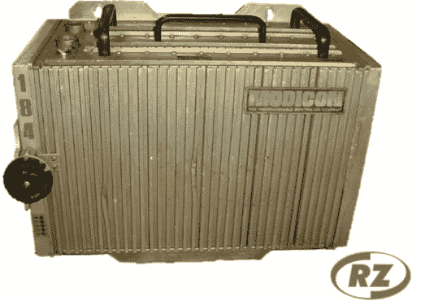

图 4.1 – Modicon 184：图片由 RepairZone.com 提供

前面的屏幕截图显示了被认为是第一台 PLC 的 Modicon 184，于 1973 年发布。

PLC 的普及迅速增长，这些系统的供应商开始增加便利性，例如添加远程输入/输出 (I/O) 以允许在 PLC 背板以外的其他位置添加输入和输出；通常基于 Microsoft 操作系统的通用编程站；人机界面 (HMI)；以及执行 PLC 间通信以共享数据和命令的手段。为了能够提供这些新功能和功能，自动化公司开始开发自己的专用和专有通信协议和媒体，其中大多数基于某种形式的串行通信，但几乎所有都彼此不同。一些早期工业协议包括以下内容：

- Modbus
- 互控中心通信协议 (ICCP)
- 分布式网络协议 (DNP)
- 通用工业协议 (CIP)

由于这些专有通信协议最初是为短距离、点对点屏蔽通信而设计的，不打算离开本地网络设备，因此它们没有包含身份验证、授权和审计 (AAA) 或加密等安全措施。毕竟，为什么要在最初设计为仅允许两个设备之间通过一根线通信的通信上增加这种开销呢？而且只要情况就是这样，这种理念就一直有效；只要通信限制在没有来自自动化孤岛外部连接的一小部分设备内，一切都很好。然而，当这些早期协议开始用于多个设备之间的通信时，固有的 ICS 安全问题开始出现，这些设备分散在多个自动化孤岛中，甚至在工业安全边界之外，进入办公空间。尽管在某些情况下这些专有协议运行的媒体发生了变化以适应远程目的地和扩展距离，但协议本身以及命令和指令在端点之间发送的方式保持不变（以允许向后兼容和轻松过渡）。

快进到 20 世纪 90 年代初至中期，控制和自动化系统演变为复杂的相互连接的系统、设备和相关设备迷宫，通过专有通信媒体连接，并使用专有且固有不安全的工业通信协议进行通信。从 ICS 安全角度来看，一切都很好。即使控制和自动化设备之间的所有通信都通过开放的明文协议进行，容易被拦截、操纵和攻击，但能够——或愿意——进入工业通信网络的攻击者也非常少。攻击者必须在 ICS 所有者的设施内部，拥有正确的设备和正确的知识才能开始攻击设备和系统。

与此同时，常规网络技术和 **信息技术 (IT)** 已发展到制造公司的业务部门现在完全融合到以太网技术上，并使用 **传输控制协议/互联网协议 (TCP/IP)** 堆栈。一些站点甚至不得不丢弃他们喋喋不休的集线器并用以太网交换机替换它们。到 20 世纪 90 年代末，从业务网络与 ICS 环境的角度来看，典型的制造工厂将类似于以下屏幕截图中描绘的网络架构：

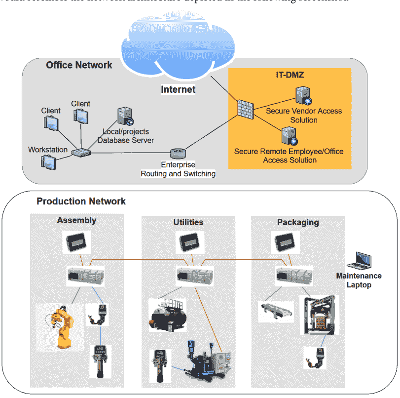

图 4.2 – 20 世纪 90 年代末典型的 IT/OT 网络架构


上述架构描绘了一种场景，其中**运营技术（OT）**设备与IT设备和系统构成了相互独立且互不相关的网络区段，且两个网络之间存在明显的物理隔离。这主要是因为这两个技术领域几乎没有重叠的技术领域。

从网络安全角度来看，这种架构非常理想。若要远程攻陷并攻击此配置，维护笔记本电脑必须被感染**远程访问木马（RAT）**，或者在连接ICS设备时通过其他方式可被远程访问。听起来像是完美的设置，对吧？然而，正如所有好事一样，这也结束了。图4.2所示架构最大的缺点在于技术的多样性。由于每个供应商都需要自己特定类型的通信介质和I/O模块，企业设施为保持安全库存所需的备件数量和种类随着拥有的ICS设备数量的增加而呈指数级增长。此外，支持所有这一切所需的技术知识也随之增长，这伴随着设备供应商种类的多样化。

雪上加霜的是，不仅每个供应商都实施了其专有的技术，而且，在每个供应商的产品系列中，情况也在发生变化。供应商可能会开始提供改进的、更好的或更新的技术；额外的功能；或任何其他说辞来促使你购买更多设备。这种需要以某种方式标准化疯狂的专有通信选项多样性的需求，加上对通信带宽日益增长的需求（以及提高和标准化易用性和可管理性），推动了工业通信领域对某种通用分母的需求。

由于各种ICS设备供应商不太可能就单一的命令与通信协议达成一致，因此选择了次优方案：一种在共享介质网络上传输其专有命令与通信协议的通用方式。可能是从等式中的IT一侧获得的灵感，以太网被选为任务目标。所选网络标准的可扩展性使得ICS设备供应商只需将协议封装在以太网帧中，即可轻松地将专有协议适配到以太网网络标准。此外，承载工业协议的以太网帧现在可以通过结合IP在（公共）网络上路由，并使用TCP来增加会话管理的可靠性。随着这一变化，对于不堪重负的工业支持/控制工程师来说，情况开始好转，他们现在只需要知道如何处理以太网和IP等常见网络技术。

由于部署容易、使用简便以及技术变更的高度可支持性，OT现在可以在一定程度上由多年来一直处理以太网和TCP/IP堆栈的大型IT专业人员社区提供支持。所有与OT相关的事物逐渐开始采用以太网和TCP/IP标准。当我我说“所有事物”时，我真的是指所有事物！PLC、HMI、I/O模块、编程工作站、执行器、传感器、状态显示板、阀组、信号灯……所有事物！由于这种向以太网和TCP/IP标准的激进转变，从ICS和商务网络的角度来看，在2000年代中期，典型的工厂看起来像这样：

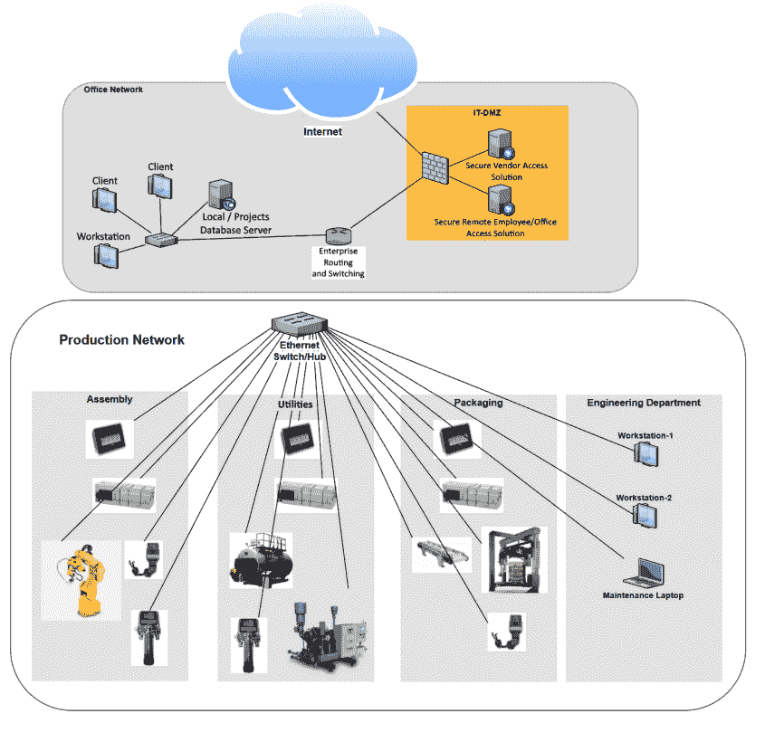

图4.3 – 2000年代中后期典型的IT/OT网络架构

那是一个多么美好的时代！每个工业系统、设备和组件都是相互连接的，同时仍与办公/商务网络的危险断开连接。因此，ICS网络上的任何事物都可以自由地与同一以太网上的其他所有内容通信，并且所有设备都可以从维护办公室或任何可以接入ICS网络的地方访问。

我必须承认，控制工程师仍然将工业网络演进的这个时期视为ICS网络的金黄色时代。生活很美好，风险相对较低。我记得在洛杉矶的屋顶上连接我们刚刚安装的全工业无线网络，对一条新生产线进行调试：多么自由；多么方便！但随后衰落就来了：我们走得太远了，没有真正意识到我们为自己打开了怎样的一罐虫。工程师们希望能够在工程工作站上访问商务电子邮件，以及访问ICS供应商网站以拉取更新或阅读技术文档；工厂经理要求坐在塔希提岛的沙滩上时，能在平板电脑上获取最新的即时生产统计数据和绩效数字；而工厂控制器、质量人员以及六西格玛黑带员工希望从工厂生产系统中获取正常运行时间数据、生产数量、细节、停机原因等**设备综合效率（OEE）**数据以及其他数据。自动化和控制供应商已将所有这些数据生成功能添加到其启用IP的设备中，并且随时准备通过获取者使用的所有这些数据的相同线路和技术被获取。

那么，最自然的事情是什么？好吧，只是将两个独立的网络连接起来，对吧？为什么不呢——它们都使用以太网网络标准，并可以通过TCP/IP协议相互通信，还有什么比这更方便的？于是，发生了以下情况：

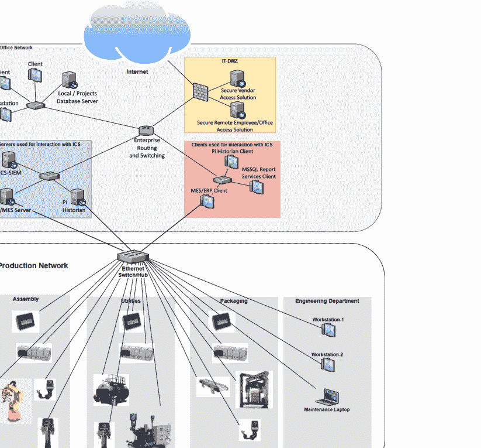

图4.4 – “双宿网络”商务到工业网络交叉连接解决方案

某些系统专门用于双宿计算机，连接到商务网络和工业网络以弥补这一差距。一方面，它们可以与工业设备通信以收集数据，可用于编程或排除自动化和控制设备的故障，并可以作为网关访问仅工业设备共享的文件和数据。

另一方面，这些双宿系统能够向生产线的员工提供电子邮件和互联网访问等商务功能，或者允许商务用户生成报告、查看统计或以其他方式从生产线获取生产数据。

双宿场景仍然保持商务和工业网络之间的一些分离，但通常两者之间的连接以限制较少的方式实现，如下面的截图所示：

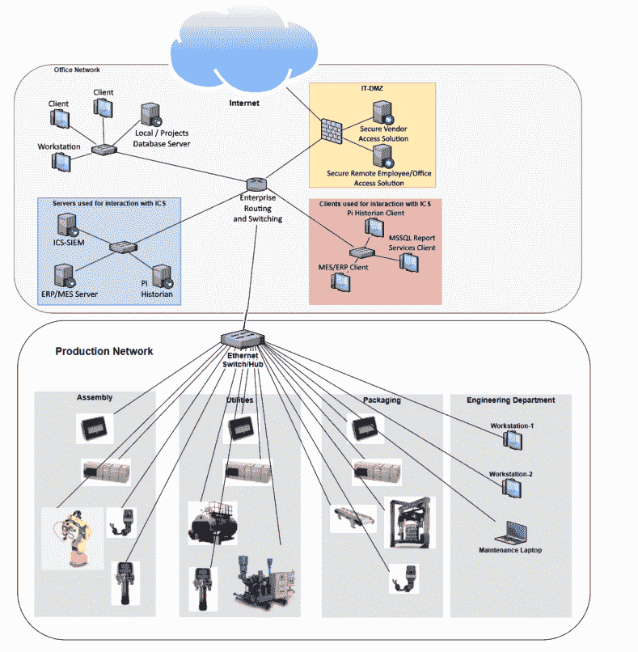

图4.5 – “平坦网络”商务到工业网络交叉连接解决方案

这基本上创建了一个完全平坦的网络，以某种方式不分离商务网络流量和工业流量。

我们大多数控制工程师都曾犯过错误，实施了上述两种“黑客”方法之一，以满足从生产网络拉取数据并向生产线工作人员提供商务功能的需求。我知道我就是这样做的。但在恢复理智之后（或遭受网络攻击/入侵之后），我们开始与IT部门沟通，并提出了以下解决方案架构，以实现商务和工业网络之间的交叉连通性：

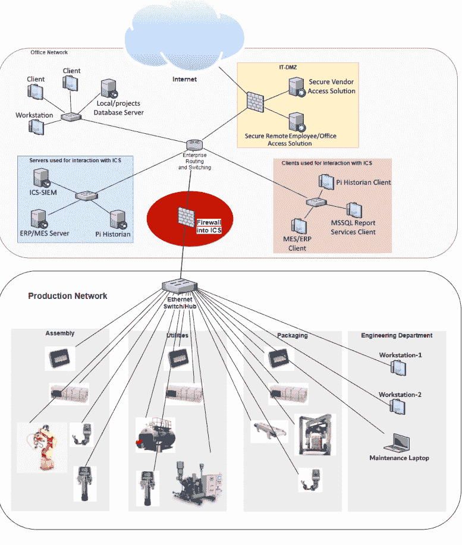

这是一个相当稳固的解决方案，似乎涵盖了我们追求的所有功能和安全要求，或者至少在纸面上看起来是这样。现实是，随着时间的推移，中间那个防火墙的配置将被戳出与瑞士奶酪同样多的洞，这意味着随着时间的推移，越来越多的协议和功能将被允许通过防火墙。因此，不久之后，该防火墙配置将看起来像这样：

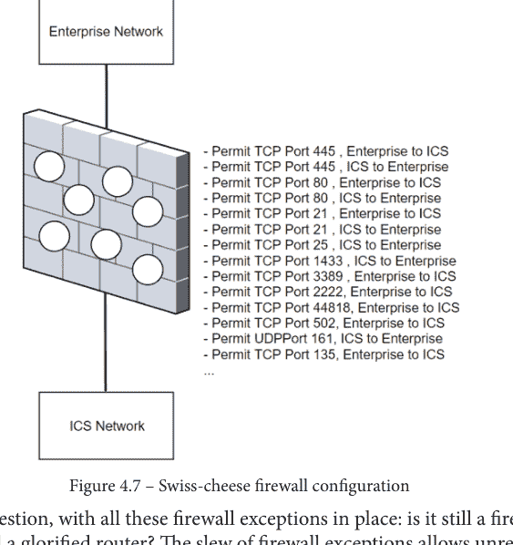

图4.7 – 瑞士奶酪防火墙配置

这引发了一个问题，在所有这些防火墙例外情况下：它仍然是一个防火墙，还是我们只是构建了一个华丽化的路由器？一系列防火墙例外允许从企业网络到工业网络以及反方向的无限制访问，因此工业协议（本质上不考虑安全性）从ICS网络泄漏到商务网络。

在此时，攻击者无需在生产设施现场即可攻击ICS环境。在商务网络和工业网络之间无限制且不受控的连接下，攻击者只需要在商务网络中建立一个立足点即可开始攻击工业网络。防火墙保护的商务到工业网络交叉连接架构也铺设了路径，使得针对ICS环境的枢轴攻击最近上了头条新闻。在枢轴攻击中，攻击者通过例如向该公司个人发送包含恶意软件或某种利用载荷在邮件正文中的钓鱼邮件，攻陷工业组织的企业端。


一旦收件人打开电子邮件，或点击邮件中的恶意链接，攻击背后的漏洞利用代码就会从世界任何地方与该用户的计算机建立远程连接。这种远程访问连接使攻击者能够利用受害者的企业计算机扫描企业网络，寻找可让他们将攻击转向 ICS 网络的系统。在存在瑞士奶酪式防火墙的情况下，要找到可借以转移攻击的漏洞，可能只需扫描正确的协议。

既然我们已经阐明了如果不在设计早期加入安全性可能导致的后果，接下来让我们讨论“为安全而设计”是什么样子。

## 为安全而设计

在上一节中，我们看到了工业网络架构以及某些设计决策所带来的（固有）不安全因素是如何随着时间演变的。我并不是想把所有 ICS 所有者一概而论，但根据我的经验，他们中的大多数都会以某种形式采用“瑞士奶酪式”架构。我曾与一些实施了远为安全的架构的公司合作，也见过一些安全程度低得多的公司，但通常你在现实中看到的就是这种情况。

在本节中，我们将探讨围绕设计一种以安全为重点、富有韧性的工业网络架构的适当流程和方法；这种架构从最初就把网络安全作为基础设计目标，并允许我们在未来进一步扩展网络安全工作。

### 将安全纳入考量的网络架构

我通常把工业网络安全的设计和实施解释为一个过程：保护 ICS 最重要的资产免受 ICS 使用者带来的危险和风险影响，同时让这些使用者能够尽可能不受阻碍地履行其在生产过程中的职责。换句话说，我们希望创建一个 ICS 环境，能够将我们最宝贵的资产（ICS 中直接运行生产流程的部分）与与之交互的人员和系统进行物理分离，并且只允许某些交互以我们可以监视、控制、检查和验证的方式进行。

接下来是我关于安全 ICS 网络架构设计的建议，以实现前文所述的保护我们最宝贵资产的目标。本节介绍的方法、技术、投入以及设计决策来自二十年来构建工业网络中的反复摸索，也来自参与制定行业建议的团队，以及为全球一些最大的制造和服务公司提供咨询所获得的实践经验。如果你让我来构建你的网络，我会这样做。

### 第 1 步 – ICS 网络的分段

从根本上说，保护 ICS 网络可以非常简单。如果我们做好功课，对 ICS 环境进行适当分段，只让对 ICS 运行至关重要的系统和设备驻留在工业网络上，而其他一切都放在企业网络上，那么我们就无需为手机、笔记本电脑等外来设备，或无线设备及自带设备（BYOD）而烦恼。换句话说，安全 ICS 架构设计的第一个基石，就是适当的分段。适当的分段需要决定 ICS 的各个部分将驻留在哪里，同时牢记这些部分对整个生产流程的影响，以及它们给整体网络安全态势带来的风险。

通过分段，我们定义了 ICS 网络中的一个区域，该区域专用于保持生产流程运行所必需的关键设备。我们将此区域称为“工业区”。分段通过将 ICS 最敏感的部分及其使用者物理连接到不同的网络硬件，在二者之间建立了安全屏障。

### 工业区网段与微分段

工业网络应进一步细分为更小的隔离区（enclave），即按功能、逻辑或地理位置对相关 ICS 设备进行分组的网络子网。这一过程称为微分段，它允许紧密相关的 ICS 系统、设备和组件在不受限制的情况下通信（在同一交换机/虚拟局域网（VLAN）上以二层速度通信），而与其他隔离区或安全区域的通信则可通过交换机/路由器访问控制列表（ACL）和/或防火墙规则进行检查、控制和验证。微分段可以通过物理上独立的硬件（独立交换机）或使用 VLAN 技术来实现。

正确分段 ICS 网络的结果是显著减小攻击面。即使有恶意实体进入工业区，也会被限制在某个隔离区内。适当分段的另一个好处是提高整体网络性能。分段最大限度地减少了网络广播域，其效果是 ICS 设备花费更少的时间来侦听和响应来自无关或不相关设备的流量。

此外，通过网络分段，我们可以创建所谓的网络流量咽喉点（choke points），即在网络设计中指定的位置，可以轻松高效地捕获有价值的网络流量。本章后面的“网络咽喉点”一节将更详细地讨论咽喉点。

以下截图展示了在我们应用适当的分段和微分段后，ICS 网络架构的外观：

### 工业区

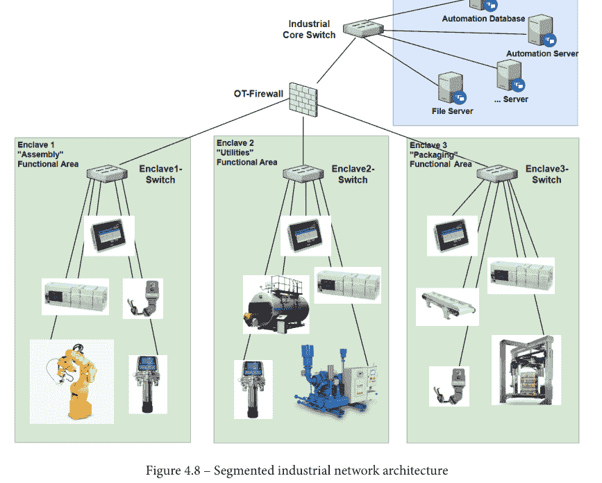

图 4.8 – 分段式工业网络架构

在这种分段式架构中，我们将所有相关的 ICS 设备放在各自的功能区域和网络子网（隔离区）中。这既有利于安全，也有利于性能（同一隔离区中的设备通过**隔离区交换机**以二层速度通信）。**OT 防火墙**允许功能区域（隔离区）与**第 3 级 - 站点运行**之间进行受控且可监控的通信。**第 3 级 - 站点运行**隔离区是一个指定的安全区域，用于与较低层级隔离区之间以及与 ICS 环境更高层级（通过 IDMZ 连接第 4 级和第 5 级）之间的往来通信。**第 3 级 - 站点运行**应始终作为访问第 2 级及以下 ICS 设备的中介（遵循普渡模型），以防止越级/绕过安全边界。通常，**第 3 级 - 站点运行**由一台或一组服务器（物理或虚拟）组成，可用于与较低层级的 ICS 设备交互，例如对控制和自动化设备进行编程或故障排除，以及收集生产数据。

### 第 2 步 – 定义并控制安全区域之间的安全交互

现在，我们已经把最宝贵的资产妥善地保护在各自专用的子网上，与庞大而不安全的企业网络实现了物理隔离；在安全设计 ICS 环境的过程中，第二步就是要处理对这些关键任务资产的必要访问。

我想大家都同意，如果我们可以让 ICS 与组织的其他部分完全隔离运行，我们最终会得到一个安全得多的环境。不幸的是，实际情况恰恰相反。当前工业领域的趋势是与 ICS 设备进行越来越多的交互。组织已经发现了从生产环境获取实时、最新、即时数据的价值。这些数据让他们能够运营更精益、更高效、更有利可图的企业。工业 4.0、互联企业、基于云的分析等趋势，正对工业网络与企业网络之间的互联互通提出越来越高的要求。


那么，我们如何以安全的方式提供所需的跨区域连接呢？要回答这个问题，我们应该看看 IT 人员多年来是如何处理类似场景的。在 IT 领域，通常存在让互联网用户访问内部业务系统（如 Web 服务器、数据库服务器或**域名系统 (DNS)** 服务器）的需求。为了安全地提供此类访问，IT 专业人员会实施所谓的**非军事区**，即 **DMZ**。DMZ 是在两个防火墙或防火墙接口之间创建的一个缓冲区，允许在两个安全级别之间安全地托管服务器、暴露服务以及进行中介服务。

从企业角度来看，互联网被认为是不安全的或**不安全**区域，而企业区域则是更安全的或**安全**区域。以下截图展示了围绕三臂防火墙设计实现的 IT DMZ 示意图：

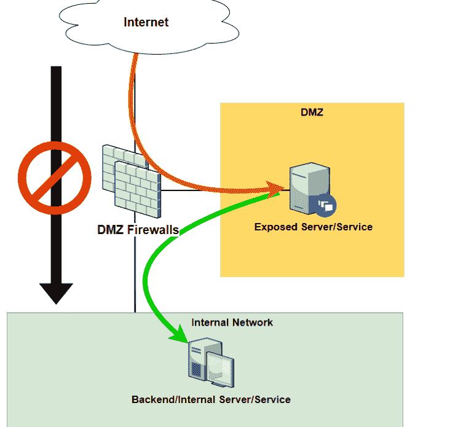

图 4.9 – IT DMZ

其理念是，互联网与内部网络之间的任何交互都会通过 DMZ 进行，借助专门的“中介服务”，即代表两个通信方进行交互的服务器/服务。此时，如果互联网上的某个实体破坏了暴露的服务，该破坏将被限制在 DMZ 内部，而内部网络的终端则在防火墙第二道防线的保护下保持安全。

这种设计在允许互联网访问企业资源方面运行良好，因此，与其重新造轮子，我们将把这种 DMZ 方法部署到工业环境中，并恰当地称之为 IDMZ。

### IDMZ

**工业非军事区**或 **IDMZ** 的原理与其 IT 变体相同，只是重新定义了安全和不安全区域。从工业区域的角度来看，企业区域被认为是一个**不安全**区域，而工业区域则被认为是一个**安全**区域。

IDMZ 有时被称为*外围网络*，它是一个位于两个安全区域之间的子网络（subnet），代表任一安全区域进行请求中介。请求中介意味着任一安全区域仅与 IDMZ 中的服务通信，而 IDMZ 服务则代表请求方服务/服务器/用户对该通信进行调解或转换。具备此功能后，如果服务器遭到破坏，破坏将被限制在 IDMZ 内部。对于每种所需的跨区域交互，都应设计并实现相应的中介服务。

以下截图展示了在实施 IDMZ 以允许跨区域边界通信后，我们的 ICS 网络架构将呈现的样子：

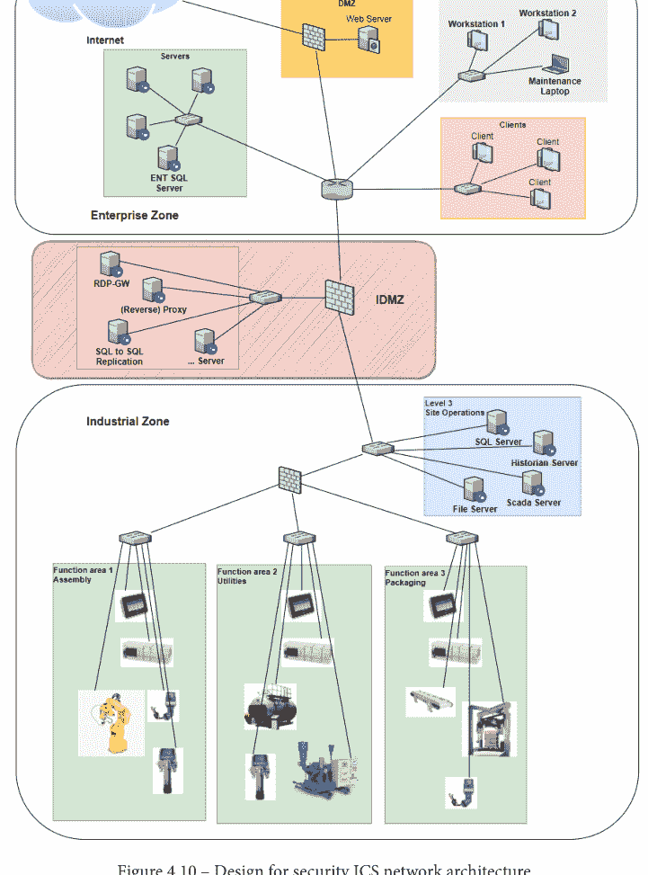

图 4.10 – 安全 ICS 网络架构设计

此时，我们的架构设计通过使用网络隔离技术和使用飞地（enclaves）对工业网络进行微分段，有效地将我们最有价值的工业系统、设备和装置与外部风险隔离开来。我们还设置了 IDMZ，它将使我们能够实施中介服务，以促进任何所需的跨区域交互和通信。

关于 IDMZ 更详细的讨论，请参阅*第 3 章，工业非军事区*。

本章并非旨在提供设计 ICS 网络的逐步操作指南，而是作为一种思考素材，帮助你做出正确的设计决策。本章中简要提及的几项内容在实际生活中需要大量的资源、准备工作和努力才能实施。设计安全并不是一个容易做对的概念，可能需要一些试错才能完全理解。然而，在设计你的 ICS 网络时，只要牢记以下两个简单的设计目标，你就会取得很大的进展：

- 通过将 ICS 网络分割为安全区域，并将工业安全区域微分段为功能区域（飞地），保护你最宝贵的资产
- 通过正确使用设计良好的 IDMZ，控制所有进出工业区域的访问

这涵盖了我们讨论的物理架构设计部分。接下来，我们将研究一种添加软件解决方案的方法，使我们能够使用旨在**安全监控**的工具、技术和活动来检查、验证和监控我们设计的安全性。

## 安全监控

既然我们已经彻底讨论了网络架构，现在是时候看看如何处理我认为提高 ICS 安全态势的第二有效方法：安全监控。

安全监控包括验证安全计划有效性所涉及的所有工具、技术、活动和行动。安全监控包括日志监控、配置验证、告警可视化、被动和主动网络扫描/映射、漏洞管理、**入侵检测系统 (IDS)**、**安全信息和事件管理 (SIEM)** 等主题。

安全监控的诸多方面是本书的主要主题，并将在其余章节中深入解释。接下来的讨论将介绍我们在前面章节中涵盖的*面向安全的设计*架构如何用于设置工具和系统，以便为 ICS 环境实施安全监控。

## 网络扼制点

如前所述，网络扼制点是网络中指定的点，选择在高效收集在安全区域之间或其他网络有趣部分流动的数据包的位置。能够收集有趣的数据包不仅有助于故障排除网络（性能相关）问题，而且通常是工业专用安全工具的要求，例如 **Clarity 的持续威胁检测 (CTD)**（[https://claroty.com/continuous-threat-detection/](https://claroty.com/continuous-threat-detection/)）或 **Forescout 的 SilentDefense**（[https://www.forescout.com/platform/silentdefense/](https://www.forescout.com/platform/silentdefense/)），现在称为 eyeInspec。

这些工具依赖通过数据包捕获功能被动（嗅探）监控 ICS 网络流量。由于它们被动地工作（这在 ICS 网络上是绝对首选的），这些工具的效果仅取决于我们提供给它们的数据包。

在我们本章定义的安全网络架构中，设计中的以下部分非常适合设置网络数据包捕获。

### 在飞地级捕获网络数据包

从架构的底部开始，我们可以通过在飞地交换机上设置**端口镜像分析器 (SPAN)** 端口，捕获 2 层及以下级别上 IP 启用设备之间的任何流量和通信。

该过程在下图中说明：

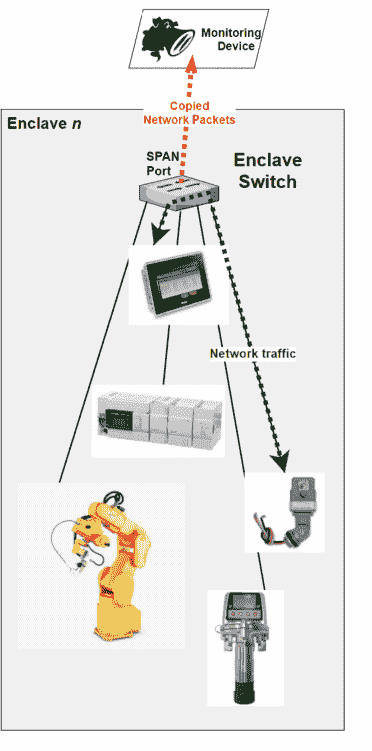

图 4.11 – 飞地级数据包捕获

**SPAN 端口**是管理式交换机的一项功能，它指示交换机将来自网络中定义的一组交换机接口或整个 VLAN 的流量复制到交换机上专用的 **SPAN 端口**。SPAN 端口功能在不同交换机制造商之间实现方式不同，有时也称为**镜像 (MIRROR) 端口**。

以下是一个示例配置，它在千兆以太网端口 1/0/2 上设置了一个 SPAN 端口，复制所有流经千兆以太网端口 1/0/2 的流量。此处的配置片段取自 Cisco 交换机：

```
EnclaveSwitch (config)# no monitor session 1
EnclaveSwitch (config)# monitor session 1 source interface gigabitEthernet1/0/1
```

```
EnclaveSwitch (config)# monitor session 1 destination interface gigabitEthernet1/0/2 encapsulation replicate  
EnclaveSwitch (config)# end
```

这涵盖了飞地内部的数据包捕获。接下来，我们将讨论跨飞地的数据包捕获。

## 跨飞地网络数据包捕获

为了能够在飞地之间的通信（但不包括 3 层 - 站点运营）上执行网络数据包捕获或流量检查，将使用 OT-防火墙。

该过程在下图中说明：

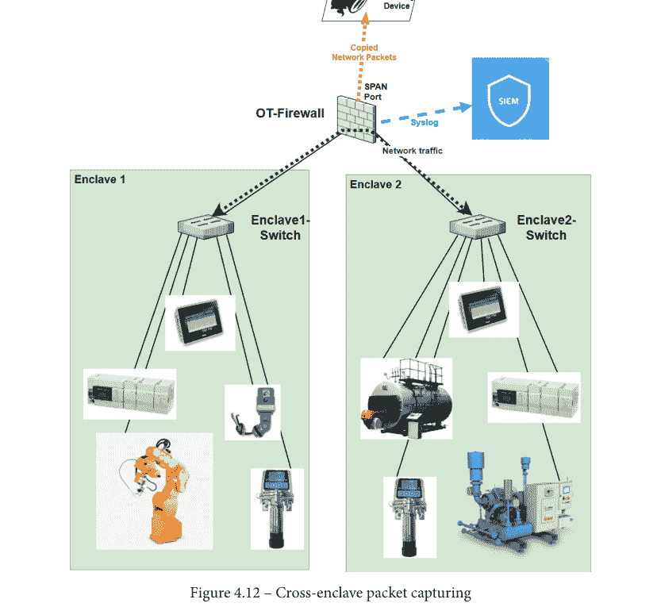


根据设备品牌和型号，防火墙可以设置一个 SPAN 端口，或本身作为网络（元）数据采集器运行，并通过 Syslog 或某种 SIEM 专有协议将汇总日志发送到 SIEM 解决方案。

这涵盖了在不同安全区域之间的报文捕获。接下来，我们将讨论对位于第 3 级 – 现场运营的服务的进出报文捕获。

## 第 3 级 – 现场运营网络报文捕获

为了能够收集进出第 3 级 – 现场运营的网络流量，或对该安全区域内系统之间通信进行报文捕获，我们利用工业核心交换机上的 SPAN 端口功能。

该过程在以下屏幕截图中进行了说明：

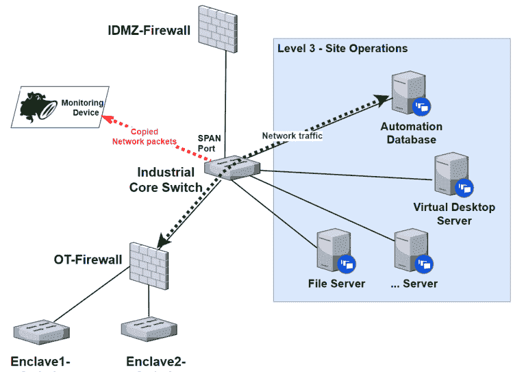

图 4.13 – 第 3 级 - 现场运营报文捕获

工业核心交换机是报文捕获的非常宝贵的资源。如前面的屏幕截图所示，它连接着所有工业安全区域和第 3 级现场的运营服务器，甚至位于工业网络与 ICS 环境更高层级之间所有流量的路径上。你会发现自己在许多安全相关任务和工具中都依赖工业核心交换机。

这涵盖了对第 3 级现场运营的进出报文捕获。接下来，我们将讨论 IDMZ 内的报文捕获。

## IDMZ 网络报文捕获

在 ICS 网络架构的 IDMZ 层级，我们有兴趣监控从企业区域进入 IDMZ 服务的流量、IDMZ 服务之间的流量，以及 IDMZ 服务器尝试访问其不应访问的位置的尝试（横向移动尝试）。由于 IDMZ 托管着潜在的替罪羊服务——即设计为被攻破并遏制攻破——因此必须密切关注服务器及其进出的网络连接。此外，能够监控和观察 IDMZ 服务的行为有助于排查任何网络或性能问题。

我们可以使用 IDMZ 防火墙创建 SPAN 端口，或让防火墙收集穿越 IDMZ 的网络流量的（元）数据。此外，我们还可以在 IDMZ 交换机上创建 SPAN 端口，以捕获在 IDMZ 服务器与 IDMZ 防火墙之间传输的任何相关数据包。

该过程在以下屏幕截图中进行了说明：

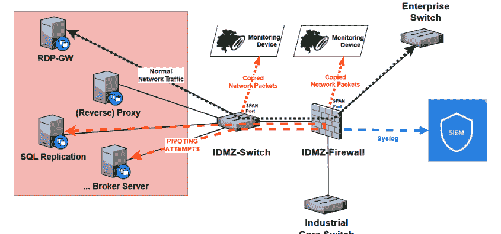

图 4.14 – IDMZ 报文捕获

一旦我们在各种设备上设置了 SPAN 端口会话，我们应该使用专用的网络交换机来汇总所有 SPAN 端口并将其馈送到我们的安全工具中。专门分配网络设备来执行此操作可确保对 ICS 网络的性能损耗最小（与在 ICS 网络上使用专用 VLAN 相比），并形成一道安全屏障。

## 日志记录和告警

除了适当的报文捕获外，ICS 环境中的所有设备都应配置为生成事件、日志和告警，并且应使用 SIEM 解决方案来聚合和关联所有这些事件、日志和告警，即事件转发。设置事件转发、部署 SIEM 以及可视化所有这些数据将在后续章节中介绍。

### 总结

在本章中，我们讨论了 **设计安全** 所包含的内容。我们还讨论了如何在 ICS 环境中应用这一概念，将会得到一个定义明确、可防御且可扩展的整体 ICS 网络架构设计。我们看到这样的网络设计将使我们能够轻松扩展和增强我们的安全功能和控制措施，目标是最终实现 **安全监控**。

在下一章中，我们将更详细地讨论安全监控。
