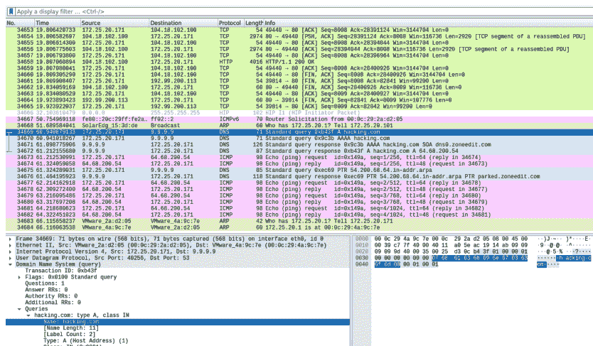
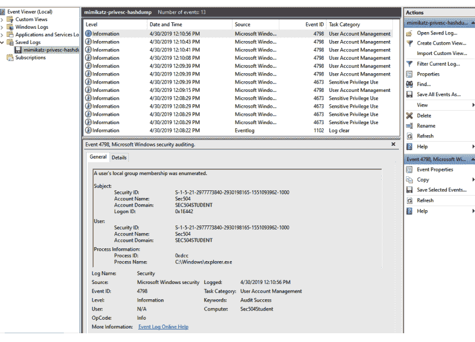

# 5

# 安全监控简介

到目前为止，我们已经讨论了适当的 **工业控制系统 (ICS)** 网络架构设计，以及如何在构建 ICS 基础设施时考虑到安全、弹性以及正常运行时间。在上一章中介绍过，我们将研究如何借助 **安全监控** 工具、技术和活动来增加整体 ICS 网络安全态势的可见性。在本书的第二部分中，我们将研究安全监控的诸多方面。我们将定义安全监控的三种主要方法——即被动/主动安全监控和威胁狩猎。我们将了解三种类型的原理，并尝试示例工具和技术，并了解结果或发现如何被存储、显示和审查，以查找配置错误的控制措施、消除性能瓶颈、检测恶意行为者以及可能隐藏在您环境中的更多安全秘密。

本章将涵盖以下主题：

- 安全事件
- 被动安全监控
- 主动安全监控
- 威胁狩猎演练
- 安全监控数据收集方法
- 综合起来——介绍 **安全信息和事件管理 (SIEM)** 系统

## 安全事件

我们从对安全事件的讨论开始安全监控的对话。这是因为安全监控的最终目标是检测、记录和告警安全事件。我们希望在安全相关事件演变成重大问题之前检测并处理它们。

事件可以描述为具有潜在不期望或有害结果的事件发生。由此，安全事件可以描述为与安全相关的事件发生——发生在 ICS 环境安全态势上的、我们感兴趣并希望检测的事情。重要的是要理解，并非每个事件都是安全事件——例如，某人输错密码并产生登录失败事件不一定是安全事件。使与安全相关的事件成为安全事件的是上下文。如果之前的登录失败事件来自一个根本没有业务登录该系统的账户，该事件可能是安全事件。关键在于，有人或某物必须确定安全相关事件是否构成事件。我们在本章中讨论的工具可以帮助我们人类做出该决定，以及使用某种形式的关联、分析和甚至 **人工智能 (AI)** 来帮助我们完成任务。

在上述定义中，为了能够检测有趣的安全事件，我们需要使用安全监控工具和安全监控实践来监控具有潜在不期望或有害结果的事件。

以下是一些安全事件的示例，仅作说明：

- 系统上执行恶意代码
- 对计算或生产资源进行恶意或破坏性交互
- 对 **可编程逻辑控制器 (PLC)** 或 **人机界面 (HMI)** 程序进行未经授权的更改
- 未经授权进入建筑物或建筑物的受限区域
- 未经授权访问计算机系统
- 未经授权使用或滥用软件或数据
- 对生产系统、软件或数据进行未经授权的更改
- 存储生产相关数据的设备丢失或被盗
- **分布式拒绝服务 (DDoS)** 攻击
- 干扰 **操作技术 (OT)** 或生产资源的正常运行
- 过多的登录失败尝试
- 等等 ...

重要的是，像上述列出的此类安全事件必须被迅速检测并处理，以保持我们的 ICS 安全态势良好并维护整体安全计划的有效性。检测安全事件使我们能够评估情况并采取适当的响应措施。根据发现的安全事件，响应措施要么是 **纠正性** 的，要么是 **预防性** 的。

纠正性响应措施例如是 **事件响应 (IR)** 活动，我们在其中评估、处理和清理发现的安全事件。我们将在 *第 18 章，ICS 环境的事件响应* 中详细讨论 IR。

预防性响应措施则旨在纠正现有安全控制的失效或不足，或增加额外的安全控制以防止安全事件再次发生。检测到网络上的恶意活动后更改或增加防火墙规则，或在未经授权的个人在受限区域游荡时增加门锁，就是对检测到的安全事件的预防性响应的例子，而在这些场景中，纠正性措施将是重建被网络攻击入侵的系统并将个人护送出门。响应措施可以是手动流程，即指派某人重建系统，也可以是自动化响应，即基于主机的入侵检测系统在端点发现恶意行为者时即时重新配置边缘防火墙。

如前所述，我们使用安全监控系统、流程和活动来检测、记录和告警与安全相关的事件和事件。主要有三种安全监控类型。三种类型将在下一节中简要介绍，但在即将到来的章节中会详细讨论：它们是被动安全监控、主动安全监控和威胁狩猎演练。


## 威胁狩猎演练

威胁狩猎是安全监测领域的相对新成员（尤其是在工业领域）。在威胁狩猎中，我们并不依赖被动或主动检测系统来报告安全事件，而是主动出击去寻找恶意活动的迹象。这是一种无提示的过程——选择一个方向开始挖掘。这里所说的“方向”，是指一个假设、理论或有趣的场景。例如，我们可以提出一个立场，即*我们的工业 HMI 计算机正在运行加密货币挖矿程序*，然后开始在事件日志、资产软件列表、数据包捕获以及其他与安全相关的数据中挖掘，以证实或证伪这一说法。当然，这种假设性陈述通常并非凭空捏造，而是基于情境事件或已报告的问题——例如，操作员可能抱怨他们的 HMI 屏幕反应缓慢。

威胁狩猎将在*第 10 章 威胁狩猎*中详细讲解，随后在*第 11、12 和 13 章 – 威胁狩猎演练*中提供三个威胁狩猎演练场景。接下来，我们将讨论为安全监测工具填充有用信息的数据收集方法。

## 安全监测数据收集方法

正如前文所述，安全监测是通过查看来自 ICS 环境的安全相关数据来检测安全事件。但我们要如何获取这些数据，它们又从何而来？安全监测应用程序收集相关数据主要有两种途径：一是在网络上记录数据包（**数据包捕获**），二是收集由操作系统、网络和自动化设备生成，或我们试图保护的软件和应用（如 Web 服务器日志或交换机日志）生成的**事件日志**，又或是我们用于保护或监测终端的安全应用程序（如生成恶意软件检测事件的防病毒应用程序，或针对异常发送**系统日志协议（syslog）**消息的网络**入侵检测系统（IDS）**）。安全监测解决方案通常结合这两种收集方法来聚合所需数据，以助其发现安全事件。这两种收集方法将在以下章节中说明。

### 网络数据包捕获

为安全监测系统收集安全相关数据的第一种方法是网络数据包捕获。网络数据包（网络流量）捕获是指解码通过以太网电缆传输的电信号或来自 Wi-Fi 设置无线信号，并将其解释为网络数据包的过程。网络数据包包含**开放系统互连（OSI）**模型任意或全部层的数据和信息（请参阅 https://www.softwaretestinghelp.com/osi-model-layers/ 了解 OSI 模型的说明）。这使得网络数据包成为网络和终端信息的宝库。例如，通过正确解析网络数据包的第 2 层，我们可以了解通信端点的**媒体访问控制（MAC）**地址或硬件地址。第 3 层可以向我们展示这些相同通信系统的**互联网协议（IP）**地址，而正确解析第 4 层则显示**传输控制协议（TCP）**和**用户数据报协议（UDP）**服务/端口，让我们能够查看这两个端点正在通信的内容。其余层可以提供更详细的信息，如用户名、协议细节、文件、数据等等。

为了说明这种解释网络数据的能力，请观察图 5.1，它显示了一个捕获的**域名系统（DNS）**请求网络数据包。在这个捕获中，查看数据包编号 34669，我们可以看到主机 172.25.20.171 如何向位于 9.9.9.9 的 DNS 服务器发送 DNS 请求（由 Wireshark 识别）。我们可以看到 172.25.20.171 主机使用源端口 40256，并通过端口 53 指向服务器。这些主机用于通信的网络传输协议是 UDP，而大家喜爱的数据包捕获工具 Wireshark (https://www.wireshark.org/) 将该数据包标识为 DNS 查询的一部分。我们甚至可以看到被请求的域名：hacking.com。上述所有信息可见于此：



图 5.1 – 捕获的 DNS 网络数据包

Wireshark（以及大多数被动安全监测应用程序）执行数据包捕获的方式是从计算机的网卡（NIC）以原始格式复制数据，然后对原始数据应用解析和解剖算法。

此外，为了捕获更多数据包，应用程序可以指示 NIC 进入所谓的混杂模式。混杂模式告诉网卡监听网络上的所有流量，而不仅仅是发往其 MAC 地址的数据包。这使得应用程序能够收集流经其所在链路的任何网络流量。将此与交换机上的 SPAN 或镜像端口结合，你就拥有了一套能够查看流经网络交换机/网段/虚拟局域网（VLAN）所有流量的设置。（SPAN 端口在第 4 章“设计具有安全意识的 ICS 架构”中已介绍。）

### 事件日志

我们可以用于安全监测活动的下一个主要安全相关数据来源是事件日志。大多数计算机系统和网络设备都有记录系统事件的能力，包括围绕事件发生的细节——因此得名事件日志。在某些系统中，事件日志是一个纯文本文件，应用程序或系统本身在其中记录事件。这些类型的事件日志可以通过文本编辑器查看。例如，参见以下截图中显示的 Apache 事件日志：

```
37 127.0.0.1 - - [15/Aug/2020:11:52:12 +0000] "GET /2vR0Leu.bat/dir HTTP/1.1" 404 487 "-" "Mozilla/5.00 (Nikto/2.1.6) (Evasions:None) (Test-map:codes)"
38 127.0.0.1 - - [15/Aug/2020:11:52:12 +0000] "GET /2vR0Leu.eml HTTP/1.1" 404 487 "-" "Mozilla/5.00 (Nikto/2.1.6) (Evasions:None) (Test-map:codes)"
39 127.0.0.1 - - [15/Aug/2020:11:52:12 +0000] "GET /2vR0Leu.sql HTTP/1.1" 404 487 "-" "Mozilla/5.00 (Nikto/2.1.6) (Evasions:None) (Test-map:codes)"
40 127.0.0.1 - - [15/Aug/2020:11:52:12 +0000] "GET /2vR0Leu.cobalt HTTP/1.1" 404 487 "-" "Mozilla/5.00 (Nikto/2.1.6) (Evasions:None) (Test-map:codes)"
41 127.0.0.1 - - [15/Aug/2020:11:52:12 +0000] "GET /2vR0Leu.txt HTTP/1.1" 404 487 "-" "Mozilla/5.00 (Nikto/2.1.6) (Evasions:None) (Test-map:codes)"
42 127.0.0.1 - - [15/Aug/2020:11:52:12 +0000] "GET /2vR0Leu.box HTTP/1.1" 404 487 "-" "Mozilla/5.00 (Nikto/2.1.6) (Evasions:None) (Test-map:codes)"
43 127.0.0.1 - - [15/Aug/2020:11:52:12 +0000] "GET /2vR0Leu.nl HTTP/1.1" 404 487 "-" "Mozilla/5.00 (Nikto/2.1.6) (Evasions:None) (Test-map:codes)"
44 127.0.0.1 - - [15/Aug/2020:11:52:12 +0000] "GET /2vR0Leu.cwr HTTP/1.1" 404 487 "-" "Mozilla/5.00 (Nikto/2.1.6) (Evasions:None) (Test-map:codes)"
45 127.0.0.1 - - [15/Aug/2020:11:52:12 +0000] "GET /2vR0Leu.log HTTP/1.1" 404 487 "-" "Mozilla/5.00 (Nikto/2.1.6) (Evasions:None) (Test-map:codes)"
46 127.0.0.1 - - [15/Aug/2020:11:52:12 +0000] "GET /2vR0Leu.shtml HTTP/1.1" 404 487 "-" "Mozilla/5.00 (Nikto/2.1.6) (Evasions:None) (Test-map:codes)"
47 127.0.0.1 - - [15/Aug/2020:11:52:12 +0000] "GET /2vR0Leu.shtml HTTP/1.1" 404 487 "-" "Mozilla/5.00 (Nikto/2.1.6) (Evasions:None) (Test-map:codes)"
48 127.0.0.1 - - [15/Aug/2020:11:52:12 +0000] "GET /2vR0Leu.htm HTTP/1.1" 404 487 "-" "Mozilla/5.00 (Nikto/2.1.6) (Evasions:None) (Test-map:codes)"
49 127.0.0.1 - - [15/Aug/2020:11:52:12 +0000] "GET /2vR0Leu.asp HTTP/1.1" 404 487 "-" "Mozilla/5.00 (Nikto/2.1.6) (Evasions:None) (Test-map:codes)"
50 127.0.0.1 - - [15/Aug/2020:11:52:12 +0000] "GET /2vR0Leu.passwd HTTP/1.1" 404 487 "-" "Mozilla/5.00 (Nikto/2.1.6) (Evasions:None) (Test-map:codes)"
51 127.0.0.1 - - [15/Aug/2020:11:52:12 +0000] "GET /2vR0Leu.asp HTTP/1.1" 404 487 "-" "Mozilla/5.00 (Nikto/2.1.6) (Evasions:None) (Test-map:codes)"
52 127.0.0.1 - - [15/Aug/2020:11:52:12 +0000] "GET /2vR0Leu.no HTTP/1.1" 404 487 "-" "Mozilla/5.00 (Nikto/2.1.6) (Evasions:None) (Test-map:codes)"
53 127.0.0.1 - - [15/Aug/2020:11:52:12 +0000] "GET /2vR0Leu.php HTTP/1.1" 404 487 "-" "Mozilla/5.00 (Nikto/2.1.6) (Evasions:None) (Test-map:codes)"
54 127.0.0.1 - - [15/Aug/2020:11:52:12 +0000] "GET /2vR0Leu.php HTTP/1.1" 404 487 "-" "Mozilla/5.00 (Nikto/2.1.6) (Evasions:None) (Test-map:codes)"
55 127.0.0.1 - - [15/Aug/2020:11:52:12 +0000] "GET /2vR0Leu.cmd HTTP/1.1" 404 487 "-" "Mozilla/5.00 (Nikto/2.1.6) (Evasions:None) (Test-map:codes)"
56 127.0.0.1 - - [15/Aug/2020:11:52:12 +0000] "GET /2vR0Leu.mediawiki HTTP/1.1" 404 487 "-" "Mozilla/5.00 (Nikto/2.1.6) (Evasions:None)"
57 127.0.0.1 - - [15/Aug/2020:11:52:12 +0000] "GET /2vR0Leu.asp HTTP/1.1" 404 487 "-" "Mozilla/5.00 (Nikto/2.1.6) (Evasions:None) (Test-map:codes)"
58 127.0.0.1 - - [15/Aug/2020:11:52:12 +0000] "GET /2vR0Leu.plr HTTP/1.1" 404 487 "-" "Mozilla/5.00 (Nikto/2.1.6) (Evasions:None)"
59 127.0.0.1 - - [15/Aug/2020:11:52:12 +0000] "GET /2vR0Leu.htaccess HTTP/1.1" 404 487 "-" "Mozilla/5.00 (Nikto/2.1.6) (Evasions:None) (Test-map:codes)"
60 127.0.0.1 - - [15/Aug/2020:11:52:12 +0000] "GET /2vR0Leu.AP HTTP/1.1" 404 487 "-" "Mozilla/5.00 (Nikto/2.1.6) (Evasions:None) (Test-map:codes)"
61 127.0.0.1 - - [15/Aug/2020:11:52:12 +0000] "GET /2vR0Leu.php HTTP/1.1" 404 487 "-" "Mozilla/5.00 (Nikto/2.1.6) (Evasions:None) (Test-map:codes)"
62 127.0.0.1 - - [15/Aug/2020:11:52:12 +0000] "GET /2vR0Leu.net HTTP/1.1" 404 487 "-" "Mozilla/5.00 (Nikto/2.1.6) (Evasions:None) (Test-map:codes)"
63 127.0.0.1 - - [15/Aug/2020:11:52:12 +0000] "GET /2vR0Leu.inc HTTP/1.1" 404 487 "-" "Mozilla/5.00 (Nikto/2.1.6) (Evasions:None) (Test-map:codes)"
64 127.0.0.1 - - [15/Aug/2020:11:52:12 +0000] "GET /2vR0Leu.php HTTP/1.1" 404 487 "-" "Mozilla/5.00 (Nikto/2.1.6) (Evasions:None) (Test-map:codes)"
65 127.0.0.1 - - [15/Aug/2020:11:52:12 +0000] "GET /2vR0Leu.inc HTTP/1.1" 404 487 "-" "Mozilla/5.00 (Nikto/2.1.6) (Evasions:None) (Test-map:codes)"
66 127.0.0.1 - - [15/Aug/2020:11:52:12 +0000] "GET /2vR0Leu.show query columns HTTP/1.1" 404 487 "-" "Mozilla/5.00 (Nikto/2.1.6) (Evasions:None) (Test:"
67 127.0.0.1 - - [15/Aug/2020:11:52:12 +0000] "GET /2vR0Leu.notes HTTP/1.1" 404 487 "-" "Mozilla/5.00 (Nikto/2.1.6) (Evasions:None) (Test-map:codes)"
68 127.0.0.1 - - [15/Aug/2020:11:52:12 +0000] "GET /2vR0Leu.stm HTTP/1.1" 404 487 "-" "Mozilla/5.00 (Nikto/2.1.6) (Evasions:None)"
69 127.0.0.1 - - [15/Aug/2020:11:52:12 +0000] "GET /2vR0Leu.action HTTP/1.1" 404 487 "-" "Mozilla/5.00 (Nikto/2.1.6) (Evasions:None) (Test-map:codes)"
70 127.0.0.1 - - [15/Aug/2020:11:52:12 +0000] "GET /2vR0Leu.MVC HTTP/1.1" 404 487 "-" "Mozilla/5.00 (Nikto/2.1.6) (Evasions:None)"
71 127.0.0.1 - - [15/Aug/2020:11:52:12 +0000] "GET /2vR0Leu.dk HTTP/1.1" 404 487 "-" "Mozilla/5.00 (Nikto/2.1.6) (Evasions:None) (Test-map:codes)"
72 127.0.0.1 - - [15/Aug/2020:11:52:12 +0000] "GET /2vR0Leu.printer HTTP/1.1" 404 487 "-" "Mozilla/5.00 (Nikto/2.1.6) (Evasions:None) (Test-map:codes)"
73 127.0.0.1 - - [15/Aug/2020:11:52:12 +0000] "GET /2vR0Leu.php HTTP/1.1" 404 487 "-" "Mozilla/5.00 (Nikto/2.1.6) (Evasions:None) (Test-map:codes)"
74 127.0.0.1 - - [15/Aug/2020:11:52:12 +0000] "GET /2vR0Leu.home_warning_screen HTTP/1.1" 404 487 "-" "Mozilla/5.00 (Nikto/2.1.6) (Evasion:None)"
75 127.0.0.1 - - [15/Aug/2020:11:52:12 +0000] "GET /2vR0Leu.pub HTTP/1.1" 404 487 "-" "Mozilla/5.00 (Nikto/2.1.6) (Evasions:None) (Test-map:codes)"
76 127.0.0.1 - - [15/Aug/2020:11:52:12 +0000] "GET /2vR0Leu.idb HTTP/1.1" 404 487 "-" "Mozilla/5.00 (Nikto/2.1.6) (Evasions:None)"
77 127.0.0.1 - - [15/Aug/2020:11:52:12 +0000] "GET /2vR0Leu.js HTTP/1.1" 404 487 "-" "Mozilla/5.00 (Nikto/2.1.6) (Evasions:None) (Test-map:codes)"
78 127.0.0.1 - - [15/Aug/2020:11:52:12 +0000] "GET /2vR0Leu.yml HTTP/1.1" 404 487 "-" "Mozilla/5.00 (Nikto/2.1.6) (Evasions:None)"
79 127.0.0.1 - - [15/Aug/2020:11:52:12 +0000] "GET /2vR0Leu.grp HTTP/1.1" 404 487 "-" "Mozilla/5.00 (Nikto/2.1.6) (Evasions:None) (Test-map:codes)"
80 127.0.0.1 - - [15/Aug/2020:11:52:12 +0000] "GET /2vR0Leu.axd HTTP/1.1" 404 487 "-" "Mozilla/5.00 (Nikto/2.1.6) (Evasions:None)"
81 127.0.0.1 - - [15/Aug/2020:11:52:12 +0000] "GET /2vR0Leu.cgi HTTP/1.1" 404 487 "-" "Mozilla/5.00 (Nikto/2.1.6) (Evasions:None) (Test-map:codes)"
```

图 5.2 – Apache 访问日志


The event details are in a clearly readable format. The highlighted event, for example, tells us that at `15/Aug/2020:11:52`, a system with IP address `127.0.0.1` requested a `/2vdrlQeu.php4` resource. The response code from the Apache server for this request was `404 (Resource not found)`. Additionally, we can see the user agent the client used: `Nikto/2.1.6`.

Other systems can log events in a less convenient way, by using databases of even binary files, as is the case with Windows event logging. The following screenshot shows the contents of a Windows event log, viewed with a regular text editor. Notice the gobbledygook text that doesn't resemble any event message whatsoever:


Figure 5.3 – Windows event log: binary format

This is because the Windows event log system stores the event in binary (proprietary) format. Now, if we view that same event log in Windows' native **Event Viewer**, things are a lot clearer, as we can see in the following screenshot:



Figure 5.4 – Windows' Event Viewer

You will find that a large part of the challenge in collecting event logs is around parsing and interpreting a large variety of event logs in a way that is scalable, reliable, and allows correlation of that variety of logs. Again, a SIEM can help with this task, and we will actually look at implementing parsing of logs in *Chapter 9, Visualizing, Correlating, and Alerting*.

Event logs will play a major role in the security monitoring efforts of your ICS environment. Make sure you take the time to properly configure your systems, devices, and equipment to send interesting events to a local repository (SIEM). In *Chapter 9, Visualizing, Correlating, and Alerting*, we will see how to do this for Windows systems and look at which events to send over. As for the many network, automation, and controls system and equipment logs, most of those will likely have an option to send logs to an external syslog entity. Take some time to configure the equipment to send (forward) their event logs to a SIEM server. Syslog works with log severity levels. These are the severity levels of a typical syslog implementation:

| Level | Severity | Description |
| --- | --- | --- |
| 0 | Emergency | System is pretty much unusable |
| 1 | Alert | An action must be taken immediately, or the system will fail |
| 2 | Critical | Critical conditions on the system |
| 3 | Error | Error conditions on the system |
| 4 | Warning | Warning conditions on the system |
| 5 | Notice | Normal but significant conditions on the system |
| 6 | Informational | Informational messages only |
| 7 | Debug | Debug level information – very noisy |

Figure 5.5 – Severity levels of syslog implementation

At a minimum, you should send levels 0 through 5 to the syslog service of your SIEM server.

This covers the data collection section; next, we will introduce the concept of SIEM systems.

## Putting it all together – introducing SIEM systems

Hinted at a few times throughout this chapter and referred to several times in previous chapters, a SIEM system is an invaluable tool in any security monitoring effort. It allows us to store a large variety of event logs for all kinds of devices—and device makes, models, and vendors—in a format that allows easy correlation, which in turn allows us to find, alert, and visualize security incidents that span multiple systems or are otherwise hard to discover without the support of a correlation engine. Some examples of SIEM solutions include Splunk (https://www.splunk.com/), AlienVault OSSIM (https://cybersecurity.att.com/products/ossim), LogRhythm (https://logrhythm.com/), Blumira (https://www.blumira.com/), and the Elasticsearch, Logstash, and Kibana (ELK) stack (https://www.elastic.co/what-is/elk-stack).

SIEM will be explained in detail in Chapter 9, Visualizing, Correlating, and Alerting. We will also look at deploying a custom ELK solution for our ICS environment in that chapter.

## Summary

In this chapter, we discussed what security incidents are and why they matter in the context of security monitoring. We then went over the types of security monitoring methods and the technology behind collecting the data necessary for security monitoring. The following chapters will be deep dives into the three types of security monitoring, starting with passive security monitoring in the next chapter.
