## 6
# Passive Security Monitoring

In the previous chapter, we discussed security monitoring in general. We went over the most common ways we can perform security monitoring in our **Industrial Control System (ICS)** environment—namely, passive and active security monitoring. In this chapter, we are going to take a closer look at passive security monitoring. We will discuss what passively monitoring for security incidents entails, an look at common tools, techniques, activities, and procedures around passive monitoring of the industrial cybersecurity posture. This chapter includes exercises to help you set up a firewall, an ICS-oriented **Intrusion Detection System (IDS)** solution, and Security Onion. The combination of these three solutions allows holistic coverage of passive security monitoring and will be used throughout the rest of the book in other activities, such as threat-hunting exercises.

We will cover the following topics in this chapter:

- Passive security monitoring explained
- Security Information and Event Management – SIEM
- Common passive security monitoring tools

- Setting up and configuring Security Onion
- Exercise 1 – Setting up and configuring Security Onion
- Exercise 2 – Setting up and configuring a pfSense firewall
- Exercise 3 – Setting up, configuring, and using Forescout’s SilentDefense

## Technical requirements

Here is a list of the tools and resources used in this chapter:

- **Wazuh agent**: `https://documentation.wazuh.com/3.13/installation-guide/installing-wazuh-agent/windows/wazuh_agent_package_windows.html`
- **pfSense**: `https://www.pfsense.org/download/`
- **Security Onion 2**: `https://securityonionsolutions.com/software/`
- **VMware vCenter 7**: `https://my.vmware.com/en/web/vmware/evalcenter?p=vsphere-eval-7`

## Passive security monitoring explained

The essence of passive security monitoring lies in the passive part of its name. Truly passive security monitoring does not interact with the environment being monitored. Interactions such as changing files or settings on a host system or sending packets out on a network are avoided, but instead a watch-and-observe approach is taken whereby we monitor files and settings on a host system for changes, or we can observe network traffic to find signs of malicious activity.

Forms of passive security monitoring include the following:

- Network packet sniffing for the detection of malicious activity
- The collection and correlation of event logs to identify malicious behavior/activity
- Host-based security solution agents collecting system statistics to discover malicious activities

We will now discuss the three main methods of passive security monitoring techniques.

## Network packet sniffing

Network packet sniffing is the practice of inspecting traffic that traverses the network segment being inspected. Normally, **network interface cards** (NICs) only pass relevant network packets (packets that are addressed to the NIC’s **media access control** (MAC) address or sent to the broadcast address for the network segment) on to the operating system. However, when the network card is placed in **promiscuous mode**, it will pass on every packet it sees.

By inspecting every network packet that passes by the sniffing interface, we can look for anomalies, patterns, **Internet Protocol** (IP) addresses, interesting packet data, or other relevant information. As an example, you can see something interesting in the following network packet:

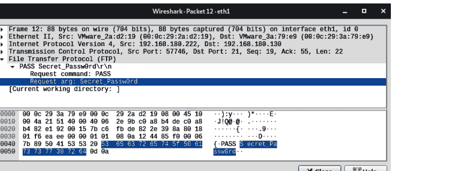

If you noticed the password being sent in cleartext format, you were spot on. Even today, it is not uncommon to see cleartext credentials flying across a network, especially on internal networks, as these are often considered more secure than public networks. Think about this next time you must decide between using Telnet versus **Secure Shell** (SSH).


## SPAN 端口

与 promiscuous 模式将网卡设置为能够看到其所连接网络段上所有流经的流量不同，网络可以定义一个 **SPAN**（或 **交换端口分析器**）会话，从而可以拥有一个专用的接口来镜像（嗅探）流经整个交换机、单个 **虚拟局域网（VLAN）** 或交换机上的多个 VLAN，或该交换机上其他各种接口的所有数据包。SPAN 端口通常分配给我们连接处于 promiscuous 模式的网卡的端口，用于将数据包馈送到被动的网络安全监控解决方案中。这有效地将该解决方案的可见性从单个网络段扩展到整个交换机。

## 瓶颈点

除了 SPAN 端口之外，还应讨论 **瓶颈点** 的概念。正如我们在 *第 4 章《以安全为中心设计 ICS 架构》中所见，瓶颈点是网络架构中我们将跨区域网络流量通过其隧道传输的战略位置，其目的是能够方便有效地嗅探该网络流量。查看以下屏幕截图，我们可以看到通过在战略选择的交换机（瓶颈点）上设置 SPAN 端口会话，我们有效地为被动安全监控解决方案创建了一个数据包嗅探域，该域捕获在多个服务器之间以及网络其他部分之间流动的流量。提前规划是值得的：

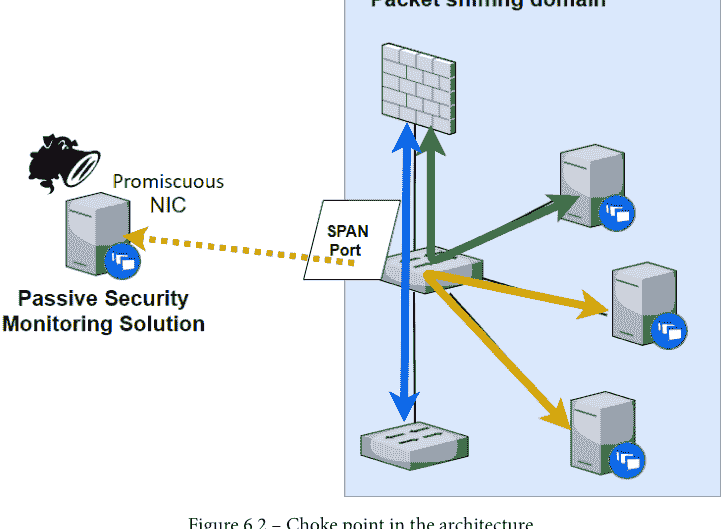

图 6.2 – 架构中的瓶颈点

瓶颈点、SPAN 端口和 promiscuous 网卡相辅相成，为我们的被动安全监控工具提供坚实稳定的网络流量馈送。如果我们在网络架构设计早期就定义了瓶颈点，添加安全监控解决方案将变得更容易、更有效。我们现在将讨论一些常见的被动网络和安全监控工具。

## 事件日志的收集与关联

被动安全监控工作的另一个有价值的信息来源是事件日志。详细讨论于 *第 5 章《安全监控简介》中，事件日志是由大多数——如果不是全部——网络连接系统生成的少量信息片段。事件日志可能包含有关系统状态、对其所做的更改、用户登录或操作信息等信息，例如异常检测、恶意代码或操作的发现、被阻止的网络连接等等。

挑战在于收集、存储并能够关联所有这些事件的努力。让我们接下来讨论这些障碍。

## 收集事件

当我们尝试从环境中的所有设备收集事件日志时，可能会面临的第一个挑战是如何从各种系统、应用程序、标准和格式中收集所有日志。解决这一挑战的答案通常是解决方案的选择。很多时候，生成事件的端点或系统会（原生）支持 **系统日志协议**（syslog）。其他时候，如 Windows 事件日志的情况，我们需要在端点上安装一个辅助实用程序——代理。基于主机的代理在 *基于主机的代理* 部分有详细讨论，但让我们在这里先谈谈 syslog 一分钟。

Syslog 是一种集中式日志服务，最初起源于 Unix 服务器，并在计算的早期就已存在。随着时间的推移，它已成为许多网络、安全、嵌入式、Windows 和 Unix 环境的事实上的日志方法。syslog 服务器充当发送事件（日志）的中央交付点。它不会主动拉取信息，而是仅接收（格式正确）从向服务器发送它们的端点发来的事件日志消息。这些消息随后将被存储在中央存储库中，在可选地将日志格式化为通用标准布局以便于可读性和关联工作之后。

我们将在本章后面的 *练习 2 – 设置和配置 pfSense 防火墙* 中设置 syslog 事件转发。

## 关联事件

那么，现在我们已经将所有事件日志集中在一处，我们需要使数据易于搜索并关联来自不同来源的事件，并创建在系统/来源之间查找关系的能力。为此，我们需要格式化和标准化事件日志中包含的数据和信息。例如，考虑以下两个来自不同来源的事件日志。首先，这里有一个来自 Apache Web 服务器的日志：

```
"process":"357", "filename":"/usr/share/httpd/noindex/index.html", "remoteIP":"54.240.197.230", "host":"34.250.27.141", "request":"/", "query":"", "method":"GET", "status":"403"
"process":"251", "filename":"/usr/share/httpd/icons/apache_pb2.gif", "remoteIP":"54.240.197.230", "host":"34.250.27.141", "request":"/icons/apache_pb2.gif", "query":"", "method":"GET", "status":"403"
"process":"347", "filename":"/usr/share/httpd/noindex/index.html", "remoteIP":"54.240.197.230", "host":"34.250.27.141", "request":"/", "query":"", "method":"GET", "status":"403"
"process":"258", "filename":"/usr/share/httpd/icons/apache_pb2.gif", "remoteIP":"54.240.197.230", "host":"34.250.27.141", "request":"/icons/apache_pb2.gif", "query":"", "method":"GET", "status":"403"
"process":"357", "filename":"/usr/share/httpd/noindex/index.html", "remoteIP":"92.118.161.37", "host":"ip-10-0-10-158.eu-west-1.compute.internal", "request":"/", "query":"", "meth
"process":"338", "filename":"/usr/share/httpd/noindex/index.html", "remoteIP":"213.92.193.38", "host":"34.250.27.141", "request":"/", "query":"", "method":"GET", "status":"403"
"process":"355", "filename":"/usr/share/httpd/noindex/index.html", "remoteIP":"69.162.124.102", "host":"34.250.27.141", "request":"/", "query":"", "method":"GET", "status":"403"
```

图 6.3 – Apache 日志（remoteIP）

现在，将其与以下来自 Linux 系统的安全日志进行比较：

```
sshd[2519]: pam_unix(sshd:auth): authentication failure; logname= uid=0 euid=0 tty=ssh ruser= rhost=192.168.11.1
sshd[2519]: Failed password for pac from 192.168.11.1 port 53949 ssh2
sshd[2519]: Failed password for pac from 192.168.11.1 port 53949 ssh2
sshd[2519]: Failed password for pac from 192.168.11.1 port 53949 ssh2
```

图 6.4 – Linux 认证日志（rhost）

我们可以看到，事件中的多个字段包含相同类型的信息，但指示名称各不相同——如果存在的话。例如，图 6.3 中的日志（由 Apache Web 服务器创建）将源 IP 地址命名为 remoteIP，而图 6.4 中的日志（取自 Linux 认证日志）将其称为 rhost。如果我们想在两个事件日志源的合并数据库中搜索例如源 IP 地址 54.240.197.230，这会带来困难。通过将所有传入事件日志的源 IP 地址条目标准化为名为 src_ip 的名称，我们现在可以轻松搜索和关联。

格式化和标准化过程可以在日志到来时进行（作为 syslog 事件日志过程的一部分），或事后进行（在数据库级别），或两者结合，具体取决于我们处理的设置和事件日志源类型。为了说明格式化和标准化过程，作为本章后面 *练习 2 – 设置和配置 pfSense 防火墙* 的一部分，我们将讨论 Logstash，即 Elasticsearch、Logstack 和 Kibana（ELK）堆栈中的事件日志部分，如何处理传入事件日志的标准化。

## 基于主机的代理

被动收集安全监控数据的最后一种方法是使用 **基于主机的代理**。代理是一个可以安装在端点系统上的小型应用程序。其主要功能是（定期）抓取相关信息或监控系统中的相关操作、更改或活动，然后将任何发现发送到中央服务器，由部署代理的安全解决方案进行处理。

许多安全厂商都有包含代理技术的产品。代理的能力、占用空间和大小各不相同，具体取决于安全工作有多少是由代理还是中央解决方案执行的。例如，像 **SolarWinds 服务器与应用程序监控（SolarWinds SAM）** 这样的资产管理解决方案可以部署一个微小的代理，几乎不占用任何资源，因为其功能仅限于对端点进行清单和编目。资产管理解决方案的其余功能由中央服务器组件完成。而像 **Symantec Endpoint Protection（SEP）** 这样的分布式 **防病毒（AV）** 解决方案则部署了一个更大的代理（安装在系统上的 AV 组件），因为它需要在本地完成大部分繁重的工作。SEP 解决方案的中央服务器组件主要关注管理和报告。

作为本章后面的 *练习 1 – 设置和配置 Security Onion* 的一部分，我们将部署一个基于主机的代理。所讨论的代理是 **Wazuh**。让我们简要讨论一下 Wazuh 的功能。

## Wazuh

这是来自 Wazuh 网站（`https://wazuh.com`）的内容：

> "Wazuh 是一款免费、开源且企业就绪的安全监控解决方案，将威胁检测、完整性监控、事件响应和合规功能整合到单一代理中。"

> Wazuh 解决了对高级威胁的持续监控和响应的需求。它专注于提供正确的可见性，并提供洞察力，帮助安全分析师在多个端点上发现、调查和响应威胁和攻击活动。

> Wazuh 有助于检测比简单签名模式更复杂的隐藏利用进程，这些进程可用于规避传统的防病毒系统。此外，Wazuh 代理提供主动响应功能，可用于阻止网络攻击、停止恶意进程或隔离受恶意软件感染的文件。"


A SIEM 将具备自动检测分类数据中异常的能力，或可作为手动查询数据的平台。凭借此功能，部署 SIEM 系统的组织可获得以下重要的安全监控能力：

- 创建安全健康报告的能力，指出安全存在不足之处以及所在位置。
- 对特定安全事件发出警报的能力。警报可以以电子邮件、短信、电话呼叫等形式发出，具体取决于 SIEM 系统所实现的功能。
- 执行针对特定事件和事件的搜索能力（威胁狩猎）。
- 回溯时间并将事件随时间关联起来的能力。

目前市场上有很多 SIEM 解决方案，其在能力、可扩展性、易用性和价格方面差异很大。我们将在本书第三部分《第 3 部分 – 威胁狩猎》中，使用 Security Onion 的 SIEM 解决方案，一种改造成 SIEM 的 ELK 堆栈。

让我们接下来看看一些用于从环境各部分被动收集安全相关数据的常见工具。

## 常见被动安全监控工具

在本节中，我们将讨论一些常见的被动安全监控工具。我为被动安全监控的三个主要学科各选择了一个工具，概述如下：

- **网络安全监控 (NSM)**
- **IDS**
- **事件日志收集和聚合**

我为每个类别选择的代表性工具体现了其用途，并且是选择该工具的原因，因为该工具是该领域中最常见的执行该类别功能的工具。

## NSM

NSM 是以一种方式索引网络流量制品的艺术，这种方式允许——除其他事项外——搜索、关联以及发现异常、趋势、模式、恶意活动和代码。

通过实施网络监控工具，我们可以洞察到网络上哪些设备正在相互通信，包括它们在谈论什么、如何交谈以及持续多久。了解这些有助于我们发现异常，而记录这些信息使我们能够回溯时间，在有趣的事件、事故或其他发现周围找到相关信息。

网络监控的事实上的工具是 **Zeek**（以前称为 **Bro**），我们接下来将讨论它。

## Zeek

网络监控的终极方法是 24/7 全天候对流经网络的所有内容进行完整数据包捕获。你将拥有网络上发送的每一个字节和数据包都存储起来以供将来参考。然而，这种终极方法需要大量的磁盘空间。以千兆速度，监控单个接口在 **全吞吐量** 下需要 ( 1,024Mb/8 ) * 60 秒 = 7.6 GB（其中 **GB** 代表 **千兆字节**）的磁盘空间每分钟。这对于单个接口来说，每天将超过 10 **太字节 (TB)** 的磁盘空间。对大多数人来说，这几乎不是一个选择。

这就是 Zeek 派上用场的地方。

这是来自 Zeek 网站 (`https://zeek.org/`) 的内容：

> "Zeek 在开源和数字安全领域有着悠久的历史。Vern Paxson 在 1990 年代以“Bro”的名称开始开发该项目，以便了解其大学和国家实验室网络上发生了什么。Vern 和项目的领导团队于 2018 年底将 Bro 更名为 Zeek，以庆祝其扩展和持续发展。
> 
> Zeek 不是防火墙或入侵防御系统之类的主动安全设备。相反，Zeek 位于“传感器”上，即硬件、软件、虚拟或云平台，它安静且不显眼地观察网络流量。Zeek 解释它所看到的内容并创建紧凑、高保真的事务日志、文件内容和完全定制的输出，适用于磁盘上的手动审查或更适合分析师的工具，如安全信息和事件管理 (SIEM) 系统。"

换句话说，Zeek 不存储完整的数据包捕获，而是存储它在网络上看到的端点之间连接的摘要。例如，端点检索 https://www.packtpub.com/ 网页在 Zeek 日志中看起来像这样：

| event.module | event.dataset | source.ip | source.port | destination.ip | destination.port | log.id.uid |
|---|---|---|---|---|---|---|
| zeek | ssl | 192.168.110.180 | 52571 | 172.67.31.83 | 443 | C... |
| zeek | conn | 192.168.110.180 | 52571 | 172.67.31.83 | 443 | C... |

Figure 6.5 – packtpub.com visit

请注意 Zeek 如何记录连接 (conn event.dataset)，然后将连接归类为 Secure Sockets Layer (SSL) 连接 (ssl event.dataset)。事件通过公共统一标识符 (UID) log.id.uid 链接起来。如果我们更仔细地查看 conn 事件，则会显示以下信息：

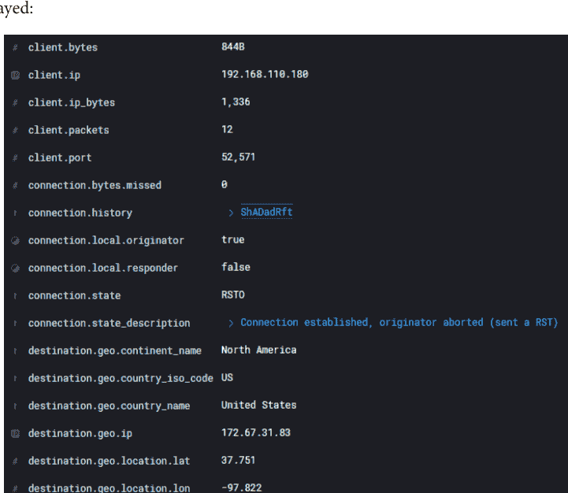

Figure 6.6 – Zeek conn log

我们可以看到网络连接信息，例如 **客户端 (源) IP**、**目标 IP**、**连接状态**、**目标地理位置**、**源和目标端口**、**传输字节数** 等。接下来，如果我们更仔细地查看 ssl 事件，则会显示以下信息：

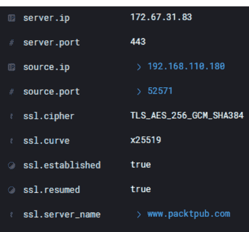

Figure 6.7 – Zeek SSL log

我们可以看到此事件具有在网络连接上运行的 SSL 连接的详细信息。我们可以了解 **SSL 密码套件**、**SSL 曲线**、**服务器名称** 和使用的 **SSL 协议版本** 的详细信息。

所有这些信息都存储在完整数据包捕获所需磁盘空间的一小部分中。

ssl 事件集只是 Zeek 可以处理的众多分类之一。开箱即用，它支持 50+ 种日志类型，但也可以发现超过 3,000 个有趣的网络事件（例如异常、连接序列、文件、证书等）。

根据经验，让 Zeek 监控网络流量并生成连接信息数据库将证明是一个宝贵的资源，并在你的 IT 或 OT 网络上的许多威胁狩猎、取证调查或性能故障排除会话中为你提供答案。

我们接下来要讨论的工具类别是 IDS。

## IDS

IDS 有多种不同的类型。一方面，我们有 **基于网络的 IDS (NIDS)**。NIDS 用于检查流经网络的流量，它可以是独立设备（独立设备），或 NIDS 技术可以集成到防火墙等其他设备中。集成到防火墙中时，新增的 NIDS 能力通常称为 **深度数据包检测 (DPI)**。DPI 指的是超越网络数据包的网络和传输层（更深层）查看的能力。这些层指的是 **OSI (开放系统互连)** 模型网络数据包层（请参阅 https://www.networkworld.com/article/3239677/the-osi-model-explained-and-how-to-easily-remember-its-7-layers.html 以了解 OSI 模型的解释）。DPI 技术允许实现该技术的网络安全设备检查数据包和连接，并在 OSI 模型的应用层中发现异常、恶意内容或协议滥用。例如，这允许防火墙确定 **域名系统 (DNS)** 协议是否被正确使用并且不传输除 DNS 查询之外的其他数据。我们将在 *第 9 章，Visualizing, Correlating, and Alerting* 中看到 DPI 的实际应用，当我们将 **Suricata** IDS 添加到我们的 pfSense 防火墙时。

另一种类型的 IDS 是 HIDS 类型。HIDS 作为代理（例如 Wazuh）安装在端点上，或添加到其他端点保护解决方案中，例如恶意软件扫描器（McAfee）或端点保护代理（SEP）。而 NIDS 在监控网络流量方面非常出色，HIDS 可以在端点上发现异常、恶意代码和操作以及其他混乱。随着网络流量变得越来越加密，我们实际上使我们的 NIDS 设备失明，因此趋势是向环境中添加 NIDS 和 HIDS 解决方案，以便能够继续关注安全。

IDS 技术在很大程度上一直是 IT 商品，但在最近几年，几家公司开始为 OT 方面开发解决方案。OT IDS 领域的先行者是 **Forescout** (https://www.forescout.com/platform/eyeinspect/)、**Nozomi** (https://www.nozominetworks.com/)、**CyberX** (https://cyberx-labs.com/) 等。OT 特定 IDS 解决方案为你的工业环境的安全态势提供了丰富的洞察力，并且大多数还具有资产管理、漏洞管理等附加功能。

让我们接下来讨论用于监控环境入侵的两种常见工具。在 ICS 环境的 IT 侧（第 3 级 – 站点运营），我们使用 **IT 方向 IDS (IT-IDS)**——即 **Suricata**。在 ICS 网络的工业侧（第 2 级 – 区域监控和第 1 级 – 基础控制），我们使用 **OT 方向 IDS (OT-IDS)**，即 **Forescout's eyeInspect**（以前称为 **SilentDefense**）。


## IT-IDS – Suricata

在 IT-IDS 部分，写关于 Snort 还是 Suricata 之间难以抉择。两者都是功能强大的 IDS 工具，并且都有庞大的安装基础，Snort 是先行者。然而，许多书籍和文章已经提及 Snort，所以我想提高大家对 Suricata 的认知。如果你想了解 Snort 是什么，可以前往 https://snort.org/ 并阅读有关这款出色产品的全部内容。在那里，注册一个免费账户并获取一个 oinkcode，可用于（自动）更新你的 Snort 规则。

现在，关于 Suricata，以下内容摘自其官网（https://suricata-ids.org/）：

> “Suricata 是一个免费且开源的、成熟、快速且强大的网络威胁检测引擎。
> 
> Suricata 引擎能够实现实时入侵检测（IDS）、内联入侵防御（IPS）、网络安全监控（NSM）以及离线 pcap 处理。
> 
> Suricata 使用强大且全面的规则和签名语言检查网络流量，并具有强大的 Lua 脚本支持以检测复杂威胁。
> 
> 借助 YAML 和 JSON 等标准输入输出格式，与现有 SIEM、Splunk、Logstash/Elasticsearch、Kibana 以及其他数据库等工具的集成变得轻而易举。
> 
> Suricata 的快速、社区驱动的开发专注于安全性、可用性和效率。
> 
> Suricata 项目和代码由开放信息安全基金会（OISF）拥有并支持，该基金会是一个致力于确保 Suricata 作为开源项目开发和持续成功的非营利基金会。”

在许多方面，Suricata 与 Snort 可相媲美。下面的表格中，我们比较了两者的具体情况：

|   | Snort | Suricata |
|---|---|---|
| 谁开发了该产品？ | Sourcefire, Inc.（已被 Cisco 收购） | Open Information Security Foundation (OISF) |
| 何时开发？ | 1998 年 | 2009 年 |
| 使用何种语言编写？ | C | C |
| 运行的操作系统？ | 跨平台 | 跨平台 |
| 线程支持？ | 仅单线程 | 支持多线程 |
| 是否支持 IP 版本 6（IPv6）？ | 是 | 是 |
| 是否兼容 Snort 漏洞研究团队（VRT）规则？ | 是 | 是 |
| 是否兼容 Emerging Threats 规则？ | 是 | 是 |
| 使用的日志格式？ | Unified2 | Unified2 |

我们可以看到，除了线程支持外，Snort 和 Suricata 在几乎所有方面都是非常相似的产品。如果你的硬件支持多线程（大多数现代平台都支持），多线程可能会产生巨大影响。

正如开发者网站所指出的，Suricata 是一个开源入侵检测系统，其开发工作由 OISF 主导，旨在提供下一代开源 IDS 引擎。OISF 的目标是为 IDS 行业带来新的安全理念和技术创新，并为社区提供 Snort 的多线程替代方案。Suricata 的多线程架构可支持高性能多核和多处理器系统。这种设计的主要优势在于，通过根据处理需求划分 IDS 工作负载，能够提高网络流量分析的速度和效率。

总体而言，Suricata 的开发充分考虑了易于部署。 它拥有写得很好的 *Getting started* 指南和用户手册。引擎用 C 编写，设计为可扩展。尽管 Suricata 在 IDS 市场中相对较新，其使用范围不及 Snort，但它正因其性能提升；其 **图形处理单元（GPU）加速**；其高速 **正则表达式（regex）** 实现；内置 IPv6 支持；多模型统计异常检测能力；IP 信誉；可配置评分阈值；以及可扩展性等其他功能，而在 IT 安全用户中迅速获得关注。

那么为什么要在 Snort 和 Suricata 之间选择其一呢？许多安全从业者将两种引擎结合使用，从而使两种产品都能监控其网络。

## OT-IDS – SilentDefense

我想在 OT 方面谈论的 IDS 工具是 Forescout 的 SilentDefense，或产品现名 **eyeInspect**。

摘自 Forescout 网站：*“eyeInspect 为 ICS 网络提供深入的设备可见性和网络弹性。持续且被动地发现、分类和监控 OT 网络设备以实现实时风险管理。管理 IoT/OT 的网络和运营风险。”* eyeInspect 产品通过将以下四项功能组合到单一解决方案中的检测引擎兑现了其承诺：

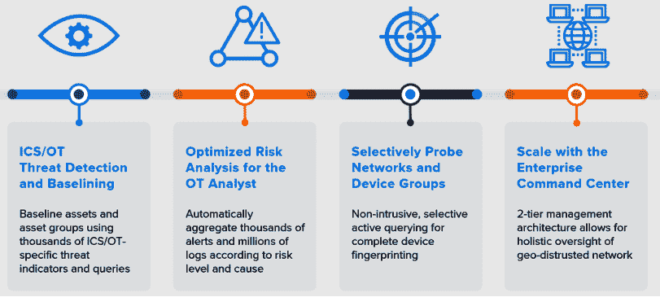

图 6.8 – eyeInspect 功能

## ELK

ELK 是三个开源项目的缩写：**Elasticsearch、Logstash 和 Kibana**。在这三个开源项目中，我们有以下内容：

- **Elasticsearch** 是一个搜索和分析引擎。这是允许存储、索引、查询和分析摄取数据的部分。
- **Logstash** 是一个服务器端数据处理管道解决方案，可同时从多个来源摄取数据。它可以转换数据，然后将其发送到存储位置，例如 Elasticsearch。
- **Kibana** 是前端，允许用户通过图表和图形可视化存储在 Elasticsearch 中的数据。

将这三种技术结合起来，可实现可扩展、灵活且极其多用途的日志收集、聚合和关联解决方案，其实现仅受实施者的想象力限制。

如今，你可以在许多开源和商业解决方案的核心找到 ELK。其中一个解决方案是 Security Onion，我们接下来会讨论。

## 设置和配置 Security Onion

Security Onion 是一个开源 Linux 发行版，旨在在一个设备（**虚拟机**，或 VM）中提供入侵检测、NSM 和日志管理功能。Security Onion 16.04 版本基于 Ubuntu，包含 Snort、Suricata、Zeek、Wazuh 和 Squert，以及许多其他安全工具。在本书撰写时，Security Onion 16.04 版本正在逐步淘汰，取而代之的是版本 2。Security Onion 与 Security Onion 16.04 之间的主要区别如下：

- Security Onion 2 具有名为 **Security Onion Console (SOC)** 的新 Web 界面，其中包括原生警报管理、威胁狩猎和 pcap（数据包捕获文件格式）检索。
- Security Onion 2 增加对 Sigma 规则的 TheHive 和 Strelka 支持；Grafana/InfluxDB（独立健康监控/警报）；Fleet（osquery 管理）；以及 Playbook（检测剧本工具）。
- Security Onion 2 从 Ubuntu 软件包迁移到容器。
- Security Onion 2 支持在 CentOS 7 和 Ubuntu 18.04 上运行。
- Security Onion 2 将 pcap 收集工具从 `netsniff-ng` 更改为 Google Stenographer。
- Security Onion 2 升级到 Elastic Stack 7.x 并支持 **Elastic Common Schema (ECS)**。
- Security Onion 2 完全用 AF_PACKET 未签名内核模块替换 PF_RING。
- 在 Security Onion 2 中，Suricata 完全取代 Snort。
- Security Onion 2 移除 Sguil、Squert、capME 和 PHP。

Security Onion 是一个平台，允许你监控网络中的安全事件和警报。它可以在几分钟内启动以开始监控小型环境的安全网络，并允许高级用户扩展并部署可在大型企业网络环境中使用的分布式系统。Security Onion 具有完整的流量捕获能力。它通过 Snort 或 Suricata 提供基于规则的入侵检测的 IDS。它使用 Zeek 进行事件驱动的网络事件监控和入侵检测，并使用 Wazuh 主机代理进行 HIDS。所有这些功能在你启动 VM 的那一刻即可使用。

Security Onion 允许我们将上一节中讨论的所有常见被动安全监控工具——以及更多——组合到一个解决方案中。我在所有安全架构项目中都会部署 Security Onion VM（或系统）。

我们将在本章练习 1 中设置和配置 Security Onion 2.3.21，并且我们将使用这些工具执行本书第三部分 Part 3 – Threat Hunting 中的许多威胁狩猎练习的各种功能。

### Exercise 1 – 设置和配置 Security Onion

作为本章的第一个练习，我们将部署和配置一个 Security Onion VM。我们将在本书的其余部分扩展此 Security Onion 设备的功能，并在本书第三部分 Part 3 – Threat Hunting 中大量使用其分析和搜索功能。


#### 部署 Security Onion 虚拟机

我们现在将为实验室环境部署一个 Security Onion 虚拟机。按照以下流程操作以启动并运行该虚拟机：

- **1.** 前往 https://securityonionsolutions.com/software/ 并下载最新版本的 Security Onion 设备镜像（本书撰写时为 2.3.21），如下图所示：

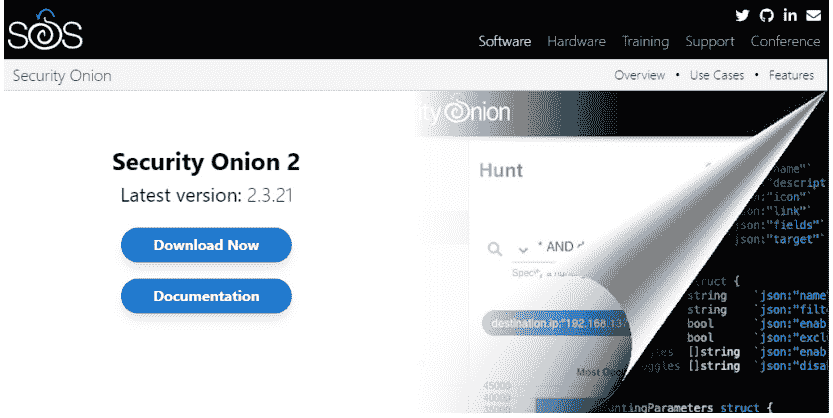

图 6.9 – 练习 1：下载 Security Onion

- **2.** 在下载了 Security Onion 设备 ISO（国际标准化组织）文件后，打开 VMware Workstation 并选择 File – New Virtual Machine。选择 Typical 配置选项并点击 Next。流程如下图所示：

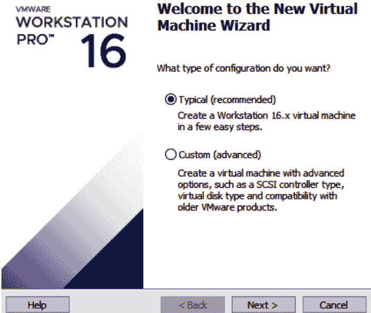

图 6.10 – 练习 1：创建新的虚拟机

- **3.** 在 Install operating system from 屏幕上，选择 Installer disc 选项，点击 Browse，找到你刚刚下载的 Security Onion ISO 文件。点击 Open，然后点击 Next。流程如下图所示：

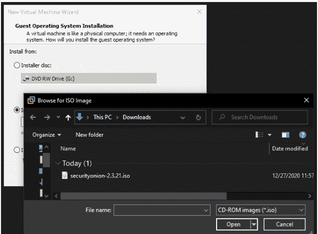

图 6.11 – 练习 1：创建虚拟机 – 挂载 ISO 文件

- **4.** 下一个屏幕要求你指定正在构建的虚拟机的操作系统。选择 Linux，版本 CentOS 7 64-bit。点击 Next 继续部署流程。以下截图说明了此流程：

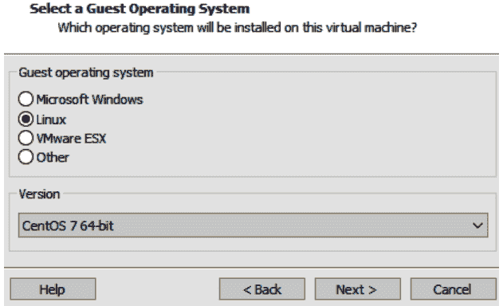

图 6.12 – 练习 1：创建虚拟机 – 选择操作系统

- **5.** 现在，是时候为我们的虚拟机命名了。我将其命名为 Security Onion。指定名称并点击 Next。流程如下图所示：

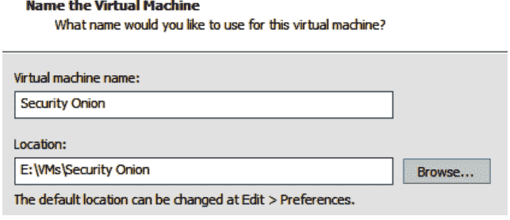

图 6.13 – 练习 1：创建虚拟机 – 为虚拟机命名

- **6.** 下一个屏幕要求你指定操作系统将使用的虚拟磁盘大小。我的建议是越多越好。Security Onion 可用的存储空间越多，它就能记录和关联更长时间的数据。作为最低要求，这里选择 500 GB。点击 Next 进入摘要屏幕。流程如下图所示：

这些数字与典型的 Security Onion 部署的最低规格保持一致。它们是为了获得最佳性能而选择的，但更少的资源通常也能运行。请记住，如果你稍后更改资源，你将不得不重新启动设置过程，这将清除 Security Onion 设备收集的所有数据。

最后说明一下，已配置了两个网络适配器。一个用于管理，另一个用于网络数据包监控（嗅探）。在本书的实验室设置中，LabBox_Red 连接到工业网络段，而 LabBox_Orange 连接到 SPAN 端口，如第 19 章 Lab Setup 中所述。SPAN 端口将向 Security Onion 设备（克隆）提供来自实验室环境的数据包。经验法则是，我们嗅探数据的能力越强，Security Onion 解决方案就越准确和完善。

- **8.** 我们现在准备安装 Security Onion 操作系统。在 VMware Workstation 中，对于 Security Onion 虚拟机，点击 **Power On this Virtual Machine** 按钮并等待虚拟机启动到以下选择屏幕：

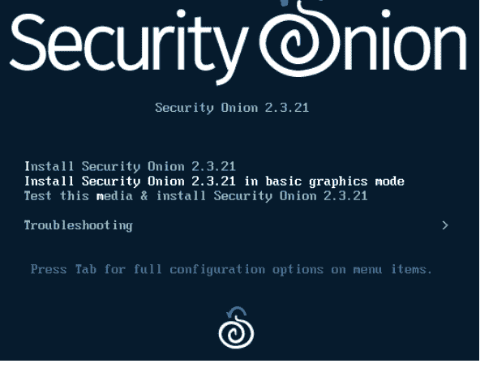

图 6.16 – 练习 1：安装 Security Onion – 选择屏幕

- **9.** 高亮 **Install Security Onion 2.3.21** 并按 *Enter* 开始安装过程。
- **10.** 输入 **yes** 以确认你希望擦除硬盘并安装 Security Onion 操作系统。以下截图说明了此操作：

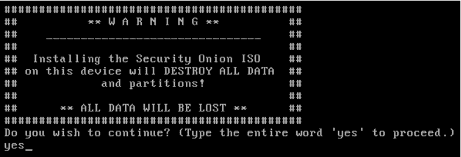

图 6.17 – 练习 1：安装 Security Onion – 将操作系统写入磁盘

- **11.** 此时，操作系统即将安装，安装程序会要求为新安装指定管理员用户名和密码。指定用户名和密码，然后按 *Enter*。
- **12.** 安装程序现在将格式化硬盘并安装 Security Onion 操作系统，如下图所示：

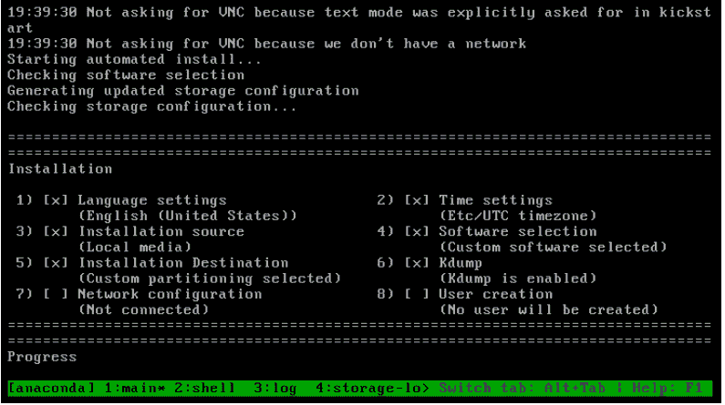

图 6.18 – 练习 1：安装 Security Onion – 操作系统安装进行中

在操作系统安装过程结束时，安装程序会要求你确认重启。按 Enter 确认。

- **13.** 安装程序重启后，使用你设置的凭据登录到新安装的操作系统。配置过程此时开始。
- **14.** 对于 “Would you like to continue?” 选择 Yes，如下图所示：

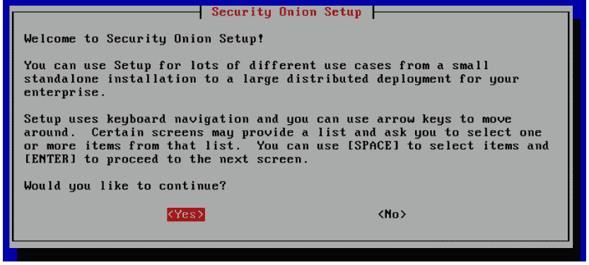

图 6.19 – 练习 1：安装 Security Onion – 开始 Security Onion 设置

- **15.** 我们将把 Security Onion 配置为 EVAL，如下图所示。此安装模式允许我们试用（评估）Security Onion 的所有方面：

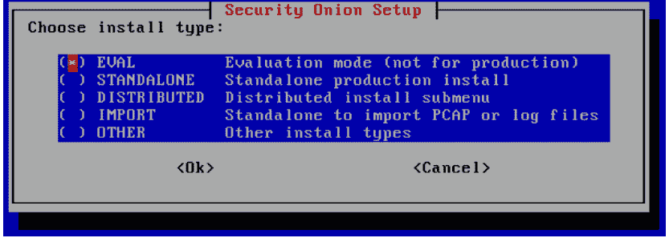

图 6.20 – 练习 1：安装 Security Onion – 选择 EVAL 安装

- **16.** 接下来，我们选择 STANDARD 安装，这允许 Security Onion 设备通过互联网检索更新。AIRGAP 是一个有趣的选项，尤其是在完全与外界隔离的工业网络上。两个选项均显示在以下截图中：

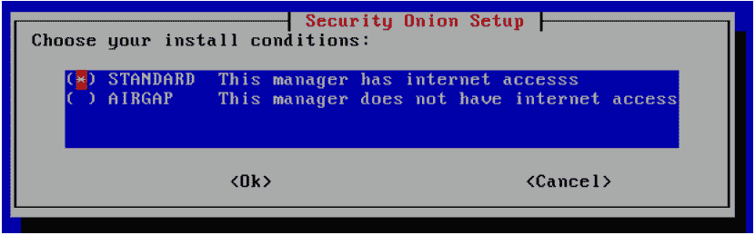

图 6.21 – 练习 1：安装 Security Onion – 选择 STANDARD 安装条件

- **17.** 是时候为我们的新 Security Onion 设备命名了。我选择了 IND-SecurityOnionv2，如下图所示：

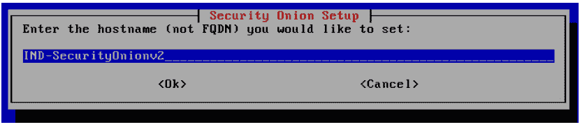

图 6.22 – 练习 1：安装 Security Onion – 为设备命名

- **18.** 此时，我们需要选择将用于管理 NIC 的物理接口。暂时选择第一个接口，但请记住，如果安装后无法连接，我们可能需要在虚拟机设置中重新布线。流程如下图所示：

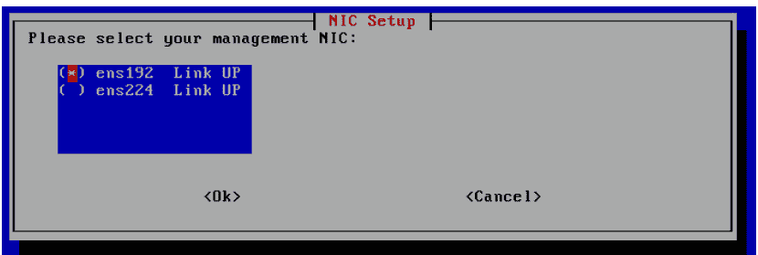

图 6.23 – 练习 1：安装 Security Onion – 选择管理接口

- **19.** 接下来的几个屏幕要求你指定 IP 地址详细信息，例如静态与 DHCP；如果选择静态，则为 IP 地址、子网掩码、网关；域名；最后是所在网络的 DNS 服务器。根据你的设置进行配置（我使用的是静态 IP 地址 172.25.100.250）。流程如下图所示：

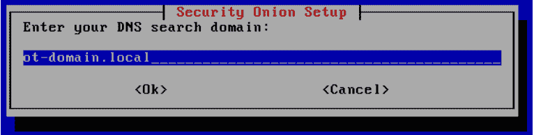

图 6.24 – 练习 1：安装 Security Onion – 管理接口 DNS 搜索域

在输入管理接口的配置详细信息后，安装程序将初始化网络。

- **20.** 接下来，我们需要指定将用作监控（嗅探）接口的物理适配器。选择剩余的接口并点击 OK。流程如下图所示：

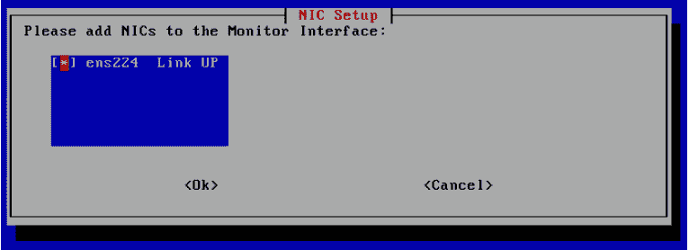

图 6.25 – 练习 1：安装 Security Onion – 选择监控接口

- **21.** 在下一个安装屏幕中，选择 Automatic 作为操作系统补丁计划，以允许 Security Onion 更新设备的某些部分。按 Enter 继续。
- **22.** 现在，我们需要指定 HOME_NET IP 地址范围。这应设置为覆盖工业网络的范围（实验室网络为 172.25.100.0/24），并允许 Security Onion 在区分内部和外部网络地址时使用，这对于多个安全工具和检查很有用。设置 IP 地址范围并按 Enter 继续。


23. 现在，我们被要求选择要安装的组件（要运行的安全服务）。保留默认选择（我们想使用所有工具）并点击 Ok 继续。流程如下图所示：

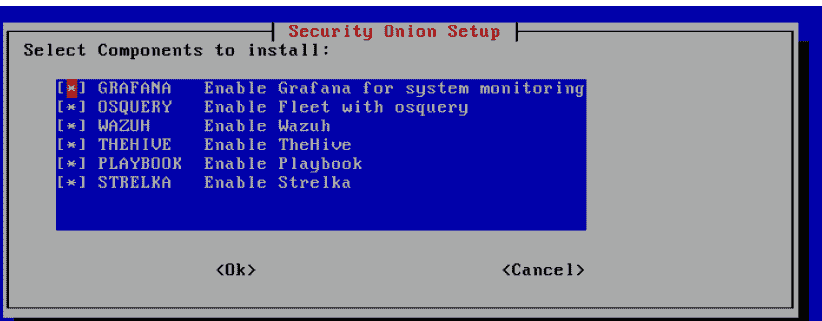

图 6.26 – 练习 1：安装 Security Onion – 选择要安装的组件

24. 下一步要求确认 Security Onion 使用默认的 Docker IP 范围。保留选择为 Yes 并按 Enter 继续。

25. 接下来，我们需要为 Web 界面的管理员指定一个电子邮件地址和密码。指定凭据以继续安装过程。

26. 在下一个屏幕上将访问方法保留为 IP 并按 Enter 继续。

现在，选择 Yes to run，以允许并设置允许登录 Security Onion 管理界面和 Web 门户的网络上的 IP 地址。流程如下图所示：

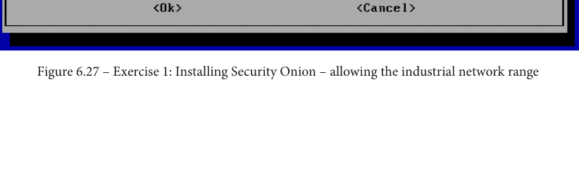

图 6.27 – 练习 1：安装 Security Onion – 允许工业网络范围

27. 最后，安装程序要求我们确认是否继续设置 Security Onion 设备，如下图所示：


图 6.28 – 练习 1：安装 Security Onion – 在 EVAL 模式下确认安装

安装程序现在将根据我们所做的选择配置设备并进行设置。最后，我们将看到一个 Process completed 消息并被要求确认重启。重启后，我们就可以开始使用 Security Onion 设备了。流程如下图所示：

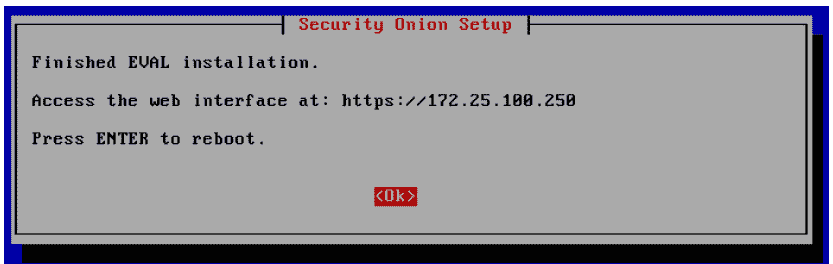

图 6.29 – 练习 1：安装 Security Onion – 安装过程已完成

这就完成了 Security Onion VM 的安装过程。接下来，让我们查看一些旨在充分利用新 VM 的配置。

#### 配置 Security Onion

Security Onion VM 启动并运行后，让我们查看我在所有新的 Security Onion 部署上通常会做的三个初始配置过程：安装 VMware tools、更新 Suricata 规则集，以及添加一个 Web 界面用户（非管理员）用于日常使用。

#### 安装 VMware tools

VMware tools 是添加到 VM 的基于主机的附加组件，可实现访客 VM 与主机（VMware Workstation）之间更好的集成。VMware tools 提供了更好的用户体验和 VM 整体操作性的改进，因此让我们安装它们。

通过 SSH 登录 Security Onion 设备（ssh adm-pac@172.25.100.250）并输入以下命令：

```
sudo yum update
```

```
sudo yum install open-vm-tools-desktop fuse
```

这些命令更新软件包存储库文件，然后安装所需的 VMware tools 可执行文件，如下所示：

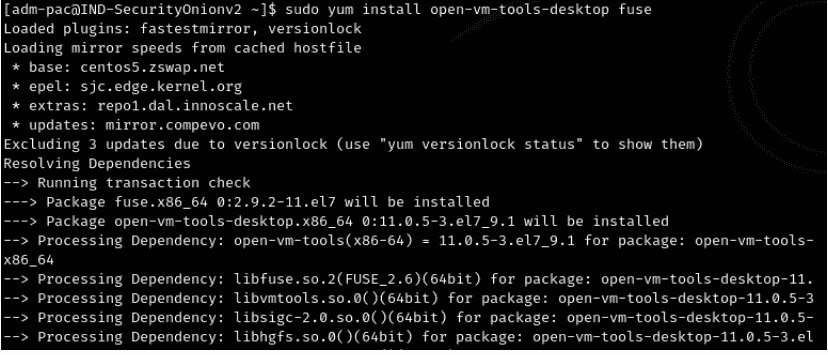

安装需要重启，因此重启 VM（sudo reboot）。

#### 更新 Suricata 规则集

Suricata 规则使 Suricata IDS 引擎能够检测威胁。保持规则最新可使 Suricata 发现新威胁，因此请定期执行此过程。

打开终端并输入以下命令以更新 Suricata 规则集：

```
sudo so-rule-update
```

就这么简单。Security Onion 现在将为你更新规则集并重启 Suricata 引擎，如下所示：

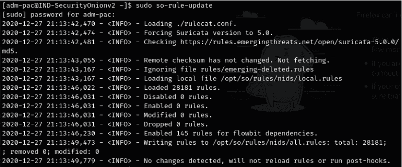

图 6.31 – 配置 Security Onion：Suricata 规则集更新

我们现在拥有了一套全新的 Suricata 检测规则。为了完成 Security Onion 的设置，我们将通过配置 Web 门户用户以允许我们非管理员访问 Security Onion 基于 Web 的服务来结束本节。

#### 添加 Web 门户用户

通过 SSH 连接到 Security Onion 设备并运行以下命令以添加 Web 门户用户：`sudo so-user-add web-pac@ot-domain.local`。

输入 sudo 密码，然后输入新用户的密码，我们就设置好了。流程如下所示：

```
[adm-pac@IND-SecurityOnionv2 SecurityOnion]$ sudo so-user-add web-pac@ot-domain.local
[sudo] password for adm-pac:
Enter new password:
Successfully added new user to SOC
Successfully added user to TheHive
Successfully added user to Fleet
```

我们现在可以通过导航到 `https://172.25.100.250` 并使用我们刚刚创建的账户（`web-pac@ot-domain.local`）登录来使用 Security Onion 的 Web 门户界面，抵达以下屏幕：

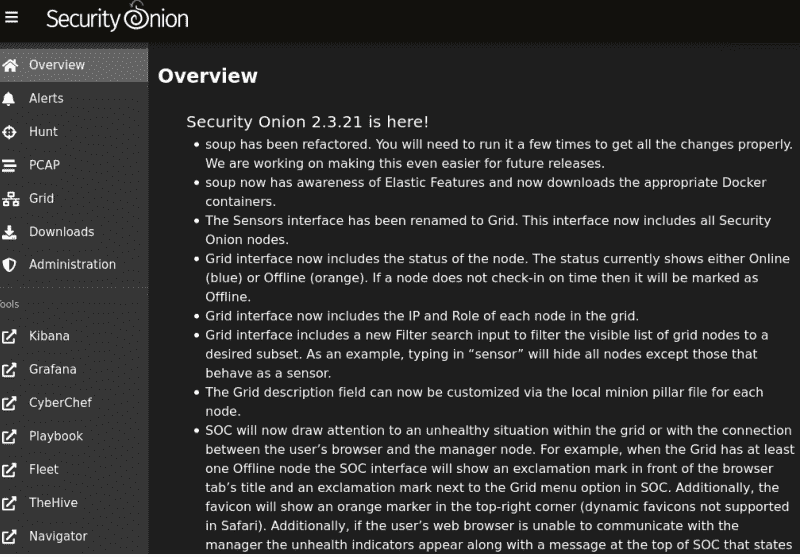

这涵盖了我们 Security Onion 设备的安装和初始配置过程。让我们接下来通过配置 Wazuh 来增加一些功能。

#### 部署 Wazuh 代理

正如我们在本章前面 *Host-based agents* 部分（在 *Wazuh* 下）讨论的那样，Wazuh 是一种基于主机的安全监控代理，具有事件日志转发和 HIDS 功能。我们还讨论了 Wazuh 如何采用 *agent/manager* 设置。Wazuh manager 已内置于 Security Onion，但为了允许代理与 manager 服务通信，我们首先需要允许访问（定义适当的防火墙例外）。为此，请遵循以下配置步骤：

- 1. 通过 SSH 连接到 Security Onion 设备并运行 `sudo so-allow` 命令。
- 2. `so-allow` 运行并询问你想要做什么（**Please enter your selection**）。
- 3. 选择 `w` 选项用于 Wazuh agent – Port `1514`/tcp/udp。
- 4. 现在，指定实验室网络的 IP 地址范围（172.25.100.0/24）。
- 5. 通过按 *Enter* 确认请求的更改。

流程如下图所示：

```
[adm-pac@IND-SecurityOnionv2 SecurityOnion]$ sudo so-allow
[sudo] password for adm-pac:
This program allows you to add a firewall rule to allow connections from a new IP address.

Choose the role for the IP or Range you would like to add

[a] - Analyst - ports 80/tcp and 443/tcp
[b] - Logstash Beat - port 5044/tcp
[e] - Elasticsearch REST API - port 9200/tcp
[f] - Strelka frontend - port 57314/tcp
[o] - Osquery endpoint - port 8090/tcp
[s] - Syslog device - 514/tcp/udp
[w] - Wazuh agent - port 1514/tcp/udp
[p] - Wazuh API - port 55000/tcp
[r] - Wazuh registration service - 1515/tcp

Please enter your selection:
w
Enter a single ip address or range to allow (example: 10.10.10.10 or 10.10.0.0/16):
172.25.100.0/24
Adding 172.25.100.0/24 to the wazuh_agent role. This can take a few seconds
local:
--------
ID: create_sysconfig_iptables
Function: file.touch
Name: /etc/sysconfig/iptables
Result: True
Comment: unless condition is true
Started: 21:38:53.806028
Duration: 2518.666 ms
Changes:
--------
ID: iptables_fix_docker
Function: iptables.chain_present
Name: DOCKER-USER
Result: True
Comment: iptables DOCKER-USER chain is already exist in filter table for ipv4
Started: 21:38:56.325158
Duration: 13.992 ms
Changes:
--------
ID: iptables_fix_fwd
Function: iptables.insert
Result: True
```

图 6.33 – 配置 Security Onion：允许 Wazuh manager 访问

这就完成了允许 Wazuh 访问管理服务的工作。接下来，我们需要将代理注册到 Wazuh manager。为此，请遵循以下步骤：

- 1. 在 SSH 终端中，运行 sudo so-wazuh-agent-manage 命令。
- 2. 这将启动 Wazuh 代理管理终端。选择操作 A 添加代理。
- 3. 现在，输入新代理的名称——这通常是代理将安装在其上的系统的主机名。
- 4. 指定代理的 IP 地址。
- 5. 通过输入 y 确认添加新代理，如下图所示：

```
[adm-pac@IND-SecurityOnionv2 SecurityOnion]$ sudo so-wazuh-agent-manage

***************************
* Wazuh v3.13.1 Agent manager.
* The following options are available:
***************************
(A)dd an agent (A).
(E)xtract key for an agent (E).
(L)ist already added agents (L).
(R)emove an agent (R).
(Q)uit.
Choose your action: A,E,L,R or Q: a

- Adding a new agent (use '\q' to return to the main menu).
  Please provide the following:
   * A name for the new agent: HMI-2
   * The IP Address of the new agent: 172.25.100.220
Confirm adding it?(y/n): y
Agent added with ID 002.
```


作为注册过程的一部分，Wazuh 管理器会生成一个密钥，代理需要在通信中发送该密钥以证明其身份。在端点上安装代理之前，我们需要提取此密钥。为此，请按以下步骤操作：

- 1. 仍在 Wazuh 管理终端中，选择操作 E 以提取代理的密钥。
- 2. 指定要提取密钥的代理 ID，如以下屏幕截图所示：

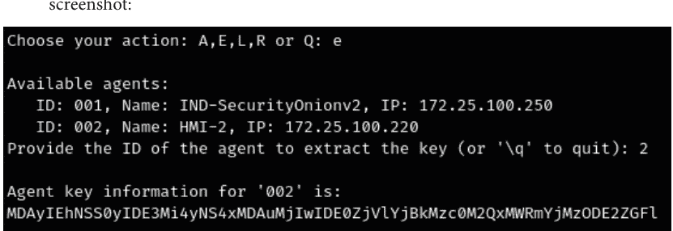

图 6.35 – 配置 Security Onion：提取 Wazuh 代理密钥

- 3. 将密钥记录在可以检索到的位置。

在系统上安装代理之前，必须对每个代理执行此过程。接下来，我们将在端点上安装代理。请按照以下说明在 HMI-1 上安装 Wazuh 代理：

- 1. 前往 https://documentation.wazuh.com/3.13/installation-guide/installing-wazuh-agent/windows/wazuh_agent_package_windows.html 并点击 Windows 安装程序下载链接。
- 2. 将安装程序文件复制到要安装的端点上（本实验中为 HMI-1）。
- 3. 通过双击安装程序文件安装代理并按照说明操作，保持所有选项为默认设置。
- 4. 在安装过程结束时，务必在点击完成之前选择运行代理配置界面，如以下屏幕截图所示：

图 6.36 – 配置 Security Onion：安装 Wazuh 代理

- 5. 在弹出的 Wazuh 代理管理器屏幕中，填写 Security Onion 服务器的 IP 地址（172.25.100.250）并粘贴我们在 Wazuh 管理器中刚刚生成的代理密钥，然后点击保存。
- 6. 如果一切顺利，保存后弹出的窗口应显示我们刚刚安装代理的端点的正确主机名和 IP 地址，如以下屏幕截图所示：

图 6.37 – 配置 Security Onion：配置 Wazuh 代理

- 7. 在 **确认** 屏幕上点击确定，然后在 **代理管理器** 中进入 **查看 – 查看配置** 页面。
- 8. 这将打开配置文件。我们将用我在此处发布的准备好的 Wazuh 配置文件的内容替换配置文件的全部内容：`https://github.com/SackOfHacks/Industrial-Cybersecurity-2nd-Edition/blob/main/wazuh-config/ossec.conf`。
- 9. 替换内容后，请确保如果你的 Security Onion 在不同的 IP 地址上，则更新服务器地址变量，如下所示：

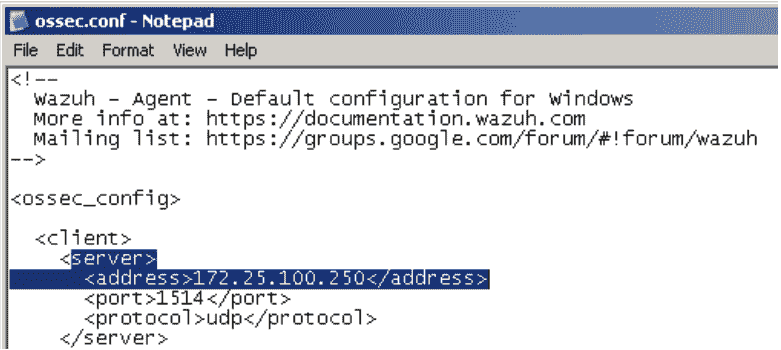

图 6.38 – 配置 Security Onion：配置 Wazuh 代理

- 10. 库存配置与我上传的配置之间的主要区别在于增加了 **系统监视器 (Sysmon)** 日志和 PowerShell 脚本日志事件的事件转发。我们将在 *第 9 章，可视化、关联和告警* 中将这两种日志收集方法添加到我们的设置中。不同的部分如下所示：

```
```xml
<localfile>
    <location>Microsoft-Windows-Sysmon/Operational</location>
    <log_format>eventchannel</log_format>
</localfile>

<localfile>
    <location>Microsoft-Windows-PowerShell/Operational</location>
```
```

```
```xml
<log_format>eventchannel</log_format>
</localfile>

<localfile>
  <location>PowerShellCore/Operational</location>
  <log_format>eventchannel</log_format>
</localfile>
```
```

你也可以直接将这些行添加到库存配置中，而不是更新整个配置文件，这就足够了。由你决定。

- 11. 保存配置文件并选择 **管理 – 重启** 以使用新配置重启 Wazuh 代理。
- 12. 如果一切顺利，那么在几分钟后打开日志文件（**查看 – 查看日志**）后，日志中不应显示任何连接错误或重连尝试。

就这样：我们现在在环境中运行了一个功能正常的 Wazuh 事件转发和 HIDS 基础设施。我们将在 *第 9 章，可视化、关联和告警* 中看到它带来的功能，并在本书的第三部分 *第 3 部分 – 威胁狩猎* 中更详细地介绍。

接下来，我们将设置一个 pfSense 防火墙来演示将防火墙日志转发到 syslog 服务器的强大功能。

### 练习 2 – 设置和配置 pfSense 防火墙

尽管防火墙 arguably 不是被动安全监控工具，但它生成的日志和事件确实让我们可以被动地查看穿越防火墙（从而穿越安全边界）的流量。防火墙日志可以提供网络段边缘允许或阻止的详细信息的，并且应包含在整体安全监控方法中。

在本节中，我们将介绍部署基于软件的防火墙 pfSense 的来龙去脉，并了解如何配置它以开始将诸如阻止和允许的连接以及其他有趣信息等事件发送到 syslog（或 SIEM）服务器。

我选择 pfSense 基于软件的防火墙是因为它是投入资金最少的情况下可以买到的最通用、最稳定、可扩展和可配置的防火墙。pfSense 虚拟机是一种方便的方式，可以在实验室设置中添加防火墙、路由、**网络地址转换 (NAT)**，以及通过额外插件的事件 DPI。

#### 部署 pfSense 虚拟机

要让 pfSense 虚拟机运行起来，请按照以下说明操作：

- 1. 前往 https://www.pfsense.org/download/ 并下载最新版本的 pfSense 安装 ISO 文件。确保为你的硬件选择正确的架构（如果在虚拟平台上安装则选择 AMD64），并选择 CD 映像（ISO）安装程序媒体，如以下屏幕截图所示：

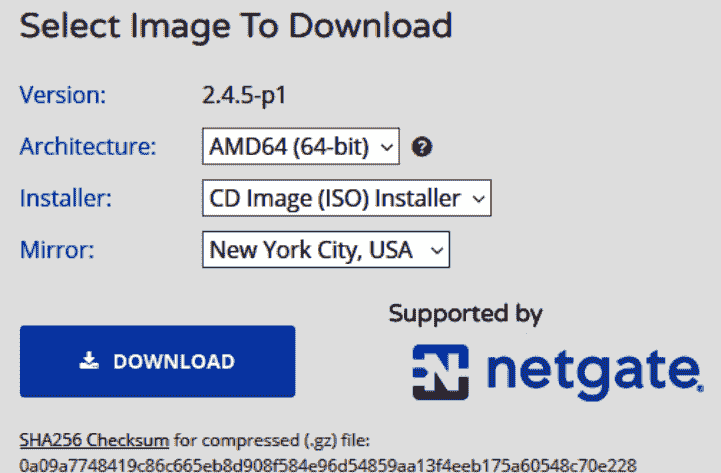

图 6.39 – 练习 2：下载 pfSense

- 2. 如上一个练习中所述，在 VMware Workstation 中创建一个新的虚拟机并附加刚下载的 ISO 映像以进行安装。VMware 应自动检测到这是一个 FreeBSD 操作系统，但如果检测失败，请在操作系统类型屏幕中选择 其他 – FreeBSD 版本 10 及更早版本 64 位，如以下屏幕截图所示：

图 6.40 – 练习 2：创建虚拟机

- 3. 为虚拟机命名并将硬件设置配置为如下所示，如以下屏幕截图所示：

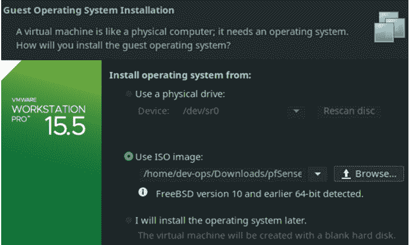

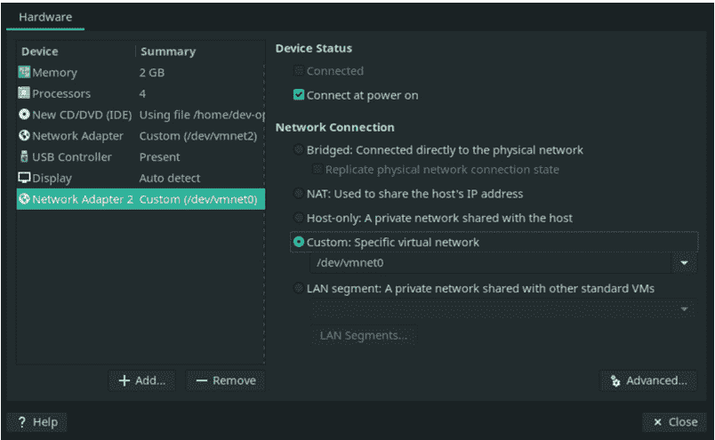

图 6.41 – 练习 2：虚拟机硬件设置

请注意，已配置了两个接口。此时可添加所需的任意数量的接口。

- 4. 虚拟机现在已准备好启动。点击 电源开启此虚拟机 按钮并等待 pfSense 安装程序出现。
- 5. 只需在初始屏幕上点击接受，然后在欢迎屏幕上点击确定，如以下屏幕截图所示：

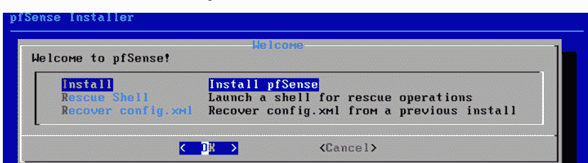

图 6.42 – 练习 2：安装 pfSense – 安装程序屏幕

- 6. 在键盘映射选择屏幕上，选择继续使用默认键盘映射并点击选择。
- 7. 在分区屏幕上，坚持使用默认的自动（UFS）选项并选择确定，如以下屏幕截图所示：

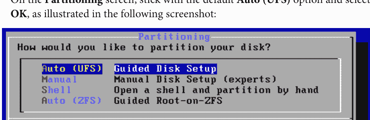

图 6.43 – 练习 2：安装 pfSense – 分区

- 8. 现在，pfSense 操作系统正在安装中，如以下屏幕截图所示：

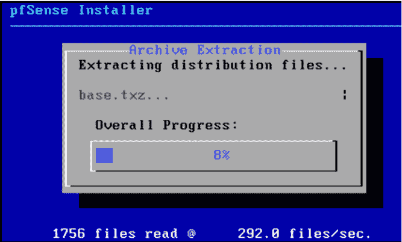

图 6.44 – 练习 2：安装 pfSense – 安装中

- 9. 安装完成后，在询问是否需要手动修改时选择否，然后在最终屏幕上点击重启，如以下屏幕截图所示：

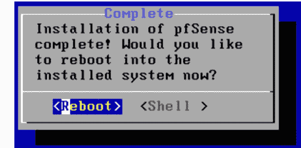

图 6.45 – 练习 2：安装 pfSense – 重启

- 10. 虚拟机完全重启后，从主屏幕选择 2 以开始设置接口 IP 地址配置过程。


11. 选择防火墙 LAN 侧的接口（就我而言是 2）并指定要分配给该接口的 IP 地址（172.25.100.1），如下图所示：

```
WAN (wan)         -> em0        -> v4/DHCP4: 172.25.20.190/24
LAN (lan)         -> em1        -> v4: 192.168.1.1/24

0) Logout (SSH only)               9) pfTop
1) Assign interfaces             10) Filter Logs
2) Set interface(s) IP address    11) Restart webConfigurator
3) Reset webConfigurator password 12) PHP shell + pfSense tools
4) Reset to factory defaults      13) Update from console
5) Reboot system                  14) Enable Secure Shell (sshd)
6) Halt system                    15) Restore recent configuration
7) Ping host                     16) Restart PHP-FPM
8) Shell

Enter an option: 2

Available interfaces:
1 - WAN (em0 - dhcp, dhcp6)
2 - LAN (em1 - static)

Enter the number of the interface you wish to configure: 2

Enter the new LAN IPv4 address. Press <ENTER> for none:
> 172.25.100.1
```


12. 指定一个子网掩码（24）。

13. 直接按 *Enter* 跳过指定网关的步骤，最后决定是否要在 LAN 接口上启用 **动态主机配置协议**（DHCP）服务器（y/n）。

14. 设置将会被应用，完成后按一次 *Enter* 完成流程，如下图所示：

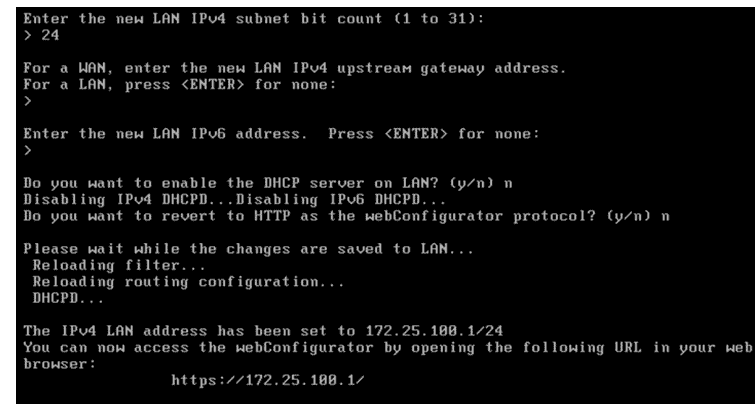

图 6.47 – 练习 2：配置 pfSense – IP 子网掩码

至此，pfSense VM 的安装已完成。接下来，我们将查看防火墙的一些基本配置。

#### 配置 pfSense

如上一节中的前一张截图所示，刚创建的 pfSense 防火墙的 WebConfiguration 地址为 https://172.25.100.1。我们将使用此统一资源定位符（URL）来配置防火墙。

首次登录 WebConfigurator 门户（默认凭据为 admin 和 pfsense）时，会出现一些初始配置步骤。登录屏幕如下图所示：


图 6.48 – 练习 2：配置 pfSense – Web 门户登录

登录后，初始配置流程会自动开始。按照以下说明完成这些初始配置步骤：

- 1. 在步骤 1， simply 点击 **Next**。
- 2. 在步骤 2，指定服务器名称并输入要使用的主、辅 DNS 服务器。我指定 1.1.1.1 为主服务器，9.9.9.9 为辅服务器。保持 Allow DNS servers to be overridden by DHCP/PPP on WAN 复选框已勾选，然后点击 Next。
- 3. 在步骤 3，从下拉菜单中选择 **协调世界时（UTC）** 时区（为了使我们发送到 Security Onion 的事件生成正确的时间戳，我们需要将 pfSense 防火墙的时区设置为 UTC，这是许多网络和安全设备普遍接受的默认格式，可方便跨多个系统和设备同步事件日志时间戳）。
- 4. 在步骤 4，定义 **广域网（WAN）** 接口设置（就我而言是 DHCP）并点击 **Next**。
- 5. 在步骤 5，定义 LAN 接口（已在之前完成）并点击 **Next**。
- 6. 在步骤 6，将默认管理员密码更改为比 pfSense 更安全的密码，然后点击 **Next**。
- 7. 在步骤 7，点击 **Reload**。

我们的 pfSense 防火墙 VM 现已构建完成并具有初始配置，可以开始处理流量。接下来让我们配置事件日志转发，以便在 Security Onion 的搜索和仪表板中包含来自防火墙的数据。

#### 配置 syslog 日志转发（Security Onion）

为了开始将 pfSense 防火墙日志转发到我们的 Security Onion syslog 服务器，我们首先需要允许该服务被 pfSense 防火墙访问。为此，请按照以下步骤操作：

- 1. SSH 登录 Security Onion VM（`ssh adm-pac@172.25.100.250`）并运行 `sudo so-allow` 命令。
- 2. 选择 s 以允许 **Syslog Device** — 端口 514/tcp/udp。
- 3. 指定 pfSense 防火墙的 LAN IP 地址作为允许的 IP 地址（172.25.100.1）。
- 4. 通过按 Enter 确认配置。流程如下图所示：

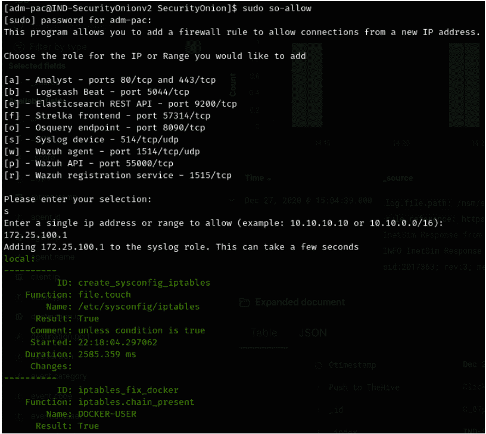

图 6.49 – 练习 2：Security Onion – 允许 syslog 访问

这样就完成了对 Security Onion VM 上 syslog 服务器的访问允许。接下来，我们需要配置 pfSense 开始将事件转发到外部 syslog 服务器。为此，请按照以下说明操作：

- 1. 导航到 pfSense WebConfigurator 门户 https://172.25.100.1 并登录门户。
- 2. 前往 Status/ System Logs/ Settings，如下图所示：

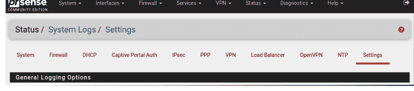

图 6.50 – 练习 2：配置 pfSense – 系统日志设置

- 3. 滚动到此配置屏幕底部并启用 Send log messages to remote syslog server。
- 4. 填写配置选项，如下图所示，将所有内容发送到 Security Onion syslog 服务器 172.25.100.250:514：

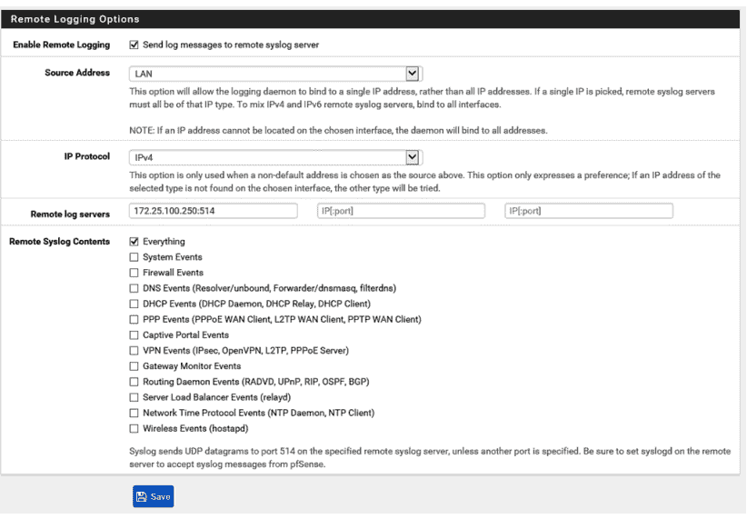

图 6.51 – 练习 2：配置 pfSense – 设置 syslog 转发

- 5. 点击 Save 完成配置流程。

就这样：我们现在在实验室环境中拥有一个功能正常的 pfSense 虚拟防火墙 VM，并已配置了事件转发到我们在练习 1 – 设置和配置 Security Onion 中构建的 Security Onion 设备。我们将在第 9 章《可视化、关联和告警》中看到这带来的功能。

在下一个练习中，我们将安装和配置一种工业 IDS 和资产管理解决方案——即 Forescout 的 SilentDefense。

### 练习 3 – 设置、配置和使用 Forescout 的 eyeInsight（前身为 SilentDefense）

本章的最后一个练习是关于构建和配置 Forescout SilentDefense OT/ICS IDS 和资产管理设备。

#### 部署 SilentDefense 传感器和 Command Center VM

Forescout SilentDefense 传感器和 Command Center 设备以可下载的 Open Virtual Appliance（OVA）模板文件形式提供，可在购买产品后从 Forescout 客户门户下载。OVA 是一种支持在各种虚拟化产品和平台之间交换 VM 的文件格式。

对于本练习，我将使用以下两个 OVA 文件：

- `sd-411-cc-16g-vmware.ova`：这是 Command Center 的 16 GB 随机存取存储器（RAM）版本。
- `sd-411-sensor-8g-vmware.ova`：这是传感器的 8 GB RAM 版本。

我们将在 vCenter 集群上安装 VM，原因有两个，首先，vCenter 集群通常是这类设备所使用的环境；其次，我想稍微改变一下，以便更好地覆盖 OT 网络虚拟化环境中通常找到的工具、技术和技术。如果你想跟随练习，VMware 提供了一个 vCenter 评估版本，允许你运行 vCenter 设备 60 天。前往 https://my.vmware.com/en/web/vmware/evalcenter?p=vsphere-eval-7 了解更多信息。此外，第 19 章《实验室设置》也有关于如何部署 vCenter 的说明。

因此，在下载了两个 OVA 文件并准备就绪后，请按照以下说明部署我们的 SilentDefense VM：

- 1. 导航到 vCenter 设备门户（https://10.11.11.50）并点击 LAUNCH VSPHERE CLIENT（HTML5），如下图所示：

图 6.52 – 练习 3 – vSphere 客户端登录

- 2. 右键单击 LAB-Datacenter 文件夹并选择 Deploy OVF Template，如下图所示：

图 6.53 – 练习 3 – SilentDefense – 部署传感器 VM 开放虚拟化格式（OVF）模板


+   3. 在**部署 OVF 模板**界面，在部署过程的第一个步骤中，选择**本地文件**并附加 `sd-411-sensor-8g-vmware.ova` 文件。我们先从传感器的部署开始，虽然部署顺序并不重要，因为两者需要协同使用。点击**下一步**，如下图所示：

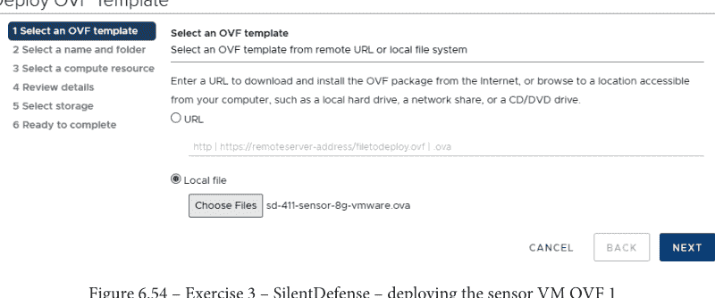

+   4. 对于部署过程的*第2步*，为我们即将部署的虚拟机命名 (SD-Sensor)，并选择 **LAB-Datatacenter** 作为部署位置。点击**下一步**。过程如下图所示：

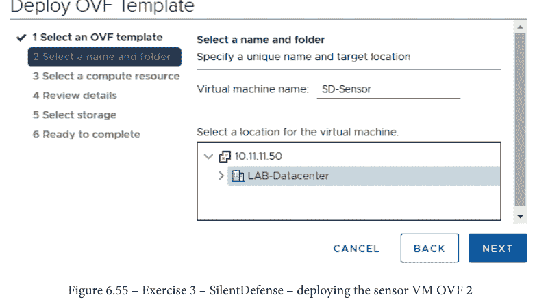

+   5. 对于*第3步*，将计算资源保留为默认选择，然后点击**下一步**。

6. 部署过程现在将验证 OVA，如果成功则返回摘要。点击下一步。过程如下图所示：

#### 部署 OVF 模板

+   ✓ 1 选择 OVF 模板
+   ✓ 2 选择名称和文件夹
+   ✓ 3 选择计算资源
+   4 查看详细信息
+   5 选择存储
+   6 选择网络
+   7 准备完成

查看详细信息
验证模板详细信息。

| 发布者 | 无证书 |
| 描述 | SilentDefense 4.1.1 - 传感器主机配置：8192 MB 内存，4 vCPU，102400 MB 硬盘 主机用户：silentdefense 主机密码：BamRork5 |
| 下载大小 | 1,015.1 MB |
| 磁盘大小 | 2.8 GB（精简置备）100.0 GB（厚置备） |

取消 返回 下一步

图 6.56 – 练习 3 – SilentDefense – 部署传感器 VM OVF 4

7. 我们已经到达部署过程的第5步。现在需要指定要将虚拟机部署到的数据存储。选择具有足够容量的数据存储，然后点击下一步。

8. 在部署过程的第6步中，为桥接的源网络选择 **SPAN-DPortGroup** 作为目标网络，然后点击下一步。过程如下图所示：

#### 部署 OVF 模板

+   ✓ 1 选择 OVF 模板
+   ✓ 2 选择名称和文件夹
+   ✓ 3 选择计算资源
+   ✓ 4 查看详细信息
+   ✓ 5 选择存储
+   6 选择网络
+   7 准备完成

选择网络
为每个源网络选择目标网络。

| 源网络 | 目标网络 |
| 桥接 | SPAN-DPortGroup |
|  | 1 个项目 |

##### IP 分配设置

IP 分配：静态 - 手动
IP 协议：IPv4

图 6.57 – 练习 3 – SilentDefense – 部署传感器 VM OVF 6

9. 过程的最后一步是设置摘要。点击完成开始部署传感器虚拟机。

+   10. 传感器此时正在部署；我们可以在 vSphere 客户端的*任务视图*中跟踪其进度，如下图所示：

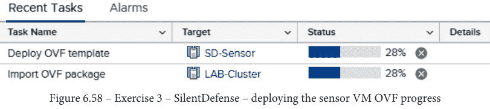

至此，传感器 VM 的部署过程结束。重复上述说明，使用 `sd-411-cc-16g-vmware.ova` 文件和名称 **SD-CommandCenter** 部署 Command Center VM。当被询问要将网络适配器连接到何处时，从下拉列表中选择 **VM Network** 端口组。

在部署完两台 SilentDefense VM 后，我们需要先调整传感器 VM 的配置，然后才能开始配置设置。OVA 部署过程只允许我们为传感器 VM 附加一个**虚拟 NIC (vNIC)**。这对 Command Center 来说没问题，但传感器使用两个：一个用于与 Command Center 通信，一个用作捕获接口。我们将更改 VM 的 vNIC 所连接的端口组以解决此问题。按照以下步骤完成更改：

+   1. 在 vSphere 客户端中，右键单击 **SD-Sensor** VM 并选择**编辑设置**。
+   2. 这将打开**编辑设置**界面。点击**网络适配器 1** 的下拉菜单，然后选择**浏览**。
+   3. 在弹出的**选择网络**界面中，选择 **VM Network** 端口组（与我们连接 Command Center VM 时相同的一个），然后点击**确定**。过程如下图所示：

#### 编辑设置 | SD-Sensor

+   虚拟硬件
+   VM 选项

| 添加新设备 |  |
| > CPU | 4 |  |
| > 内存 | 8 | GB | v |
| > 硬盘 1 | 100 | GB | v |
| > SCSI 控制器 0 | LSI Logic Parallel |  |
| > 网络适配器 1 * | VM Network | v | 连接... |
| > 网络适配器 2 | SPAN-DPortGroup | v | 连接... |
| > CD/DVD 驱动器 1 * | 客户端设备 | v | 连接... |
| > 视频卡 * | 自动检测设置 | v |  |
| VMC1 设备 | 虚拟机 PCI 总线上为虚拟机通信接口提供支持的设备 |  |
| > 其他 | 附加硬件 |  |
|  | 取消 确定 |  |


+   4. 点击**确定**完成配置更改。

至此，SilentDefense VM 的部署完成。我们现在可以启动（**开机**）它们，并进入下一节描述的配置部分。

#### 配置 SilentDefense 设置

一旦 SilentDefense VM 完全启动，我们就可以开始配置过程。让我们从传感器 VM 开始，按照以下说明进行配置：

+   1. 从 SD-Sensor VM 的摘要页面启动 Web 控制台，如下图所示：

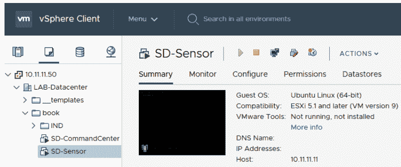

图 6.60 – 练习 3 – 配置 SilentDefense – 打开 Web 控制台

+   2. 这会在您使用的浏览器中打开一个新窗口或附加选项卡，并显示 SD-Sensor VM 的终端界面。使用用户名 silentdefense 和默认密码登录终端，该密码可在 Forescout 客户门户的下载页面（您下载 OVA 文件的来源）上找到。过程如下图所示：

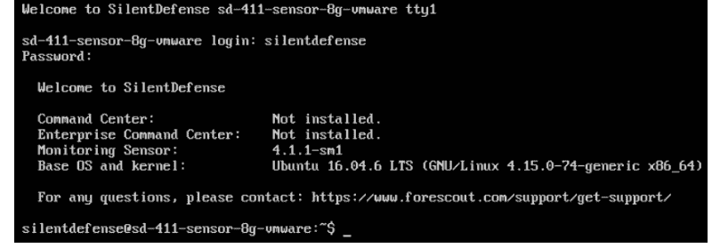

图 6.61 – 练习 3 – 配置 SilentDefense – 登录控制台

+   3. 输入 sudo sdconfig 命令启动 SilentDefense 配置应用程序。

4. 这将打开 SilentDefense 设备配置菜单。选择 I – 配置管理接口 来设置传感器的 IP 地址详细信息，如下图所示：

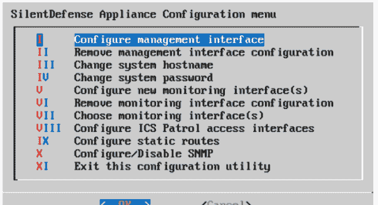

图 6.62 – 练习 3 – 配置 SilentDefense – 配置菜单

5. 配置设备的 IP 地址详细信息，如下面的截图所示，或根据您的环境进行调整。选择确定完成：

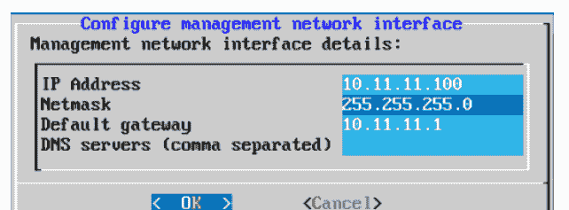

图 6.63 – 练习 3 – 配置 SilentDefense – 设置传感器 IP 地址

请注意，我将 DNS 服务器条目留空。传感器无需能够解析 DNS 查询，因此无需对此进行配置。

6. 返回主菜单，选择更改系统主机名，将传感器重命名为 SD-Sensor（此更改需要重新启动才能生效；但请先不要重新启动）。

7. 在主菜单中，选择更改系统密码，为设备设置更安全的密码。

+   8. 在主菜单中，选择**选择监控接口**，并确认已选中 `ens192`，如下图所示：


图 6.64 – 练习 3 – 配置 SilentDefense – 选择捕获接口

+   9. 最后，在主菜单中选择**退出此配置实用程序**选项退出，然后运行 `sudo reboot` 命令重新启动传感器设备。

在传感器设备重新启动期间，让我们返回 vSphere 客户端并打开 Command Center VM 的**Web 控制台**，以便接下来配置该 VM。按照以下说明配置 SD-CommandCenter VM：

+   1. 在 Command Center VM 的终端中，使用我们最初用于传感器的相同用户名和密码登录，然后运行 `sudo sdconfig` 启动配置实用程序，如下图所示：

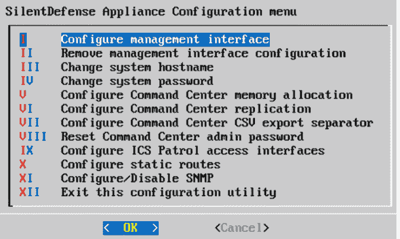

图 6.65 – 练习 3 – 配置 SilentDefense – Command Center 配置菜单

+   2. 在主菜单中选择**配置管理接口**，并设置 Command Center 设备的 IP 地址详细信息，如下图所示：


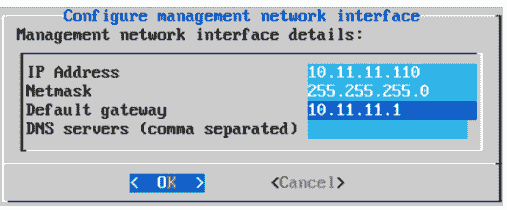

图 6.66 – 练习 3 – 配置 SilentDefense – 设置 Command Center IP 地址

同样，DNS 服务器被省略了。SilentDefense 最常安装在隔离或分段的工业网络上，不应依赖于互联网连接。事实上，Forescout 使得这样做变得很方便，因为其更新是可以下载的软件包，可以从 Command Center 的 Web 门户部署，正如我们在本章后面关于更新 CVE 和漏洞数据库的部分中所发现的那样。

- 3. 从主菜单开始，将 Command Center 设备的系统主机名配置为 SD-CommandCenter。
- 4. 从主菜单开始，设置更安全的系统密码。
- 5. 选择退出此配置实用程序以完成配置并运行 sudo reboot 使我们的更改生效。

对于配置的最后部分，我们将使用 Command Center Web 门户。导航到 https://10.11.11.110 并按照以下说明完成 SilentDefense 设置：

- 1. 第一次连接 Command Center Web 门户时，我们会看到登录页面。默认用户名和密码为 admin/admin。登录后，我们需要更改凭据，如以下屏幕截图所示：

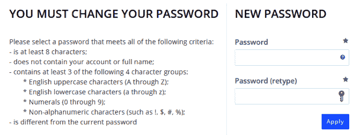

图 6.67 – 练习 3 – 配置 SilentDefense – 初始管理员密码更改

- 2. 将密码更改为更安全的密码，然后单击 **Apply**。
- 3. 接下来弹出的页面要求我们上传许可证密钥。单击 **Upload license** 按钮并选择 **To Command Center**，如以下屏幕截图所示：

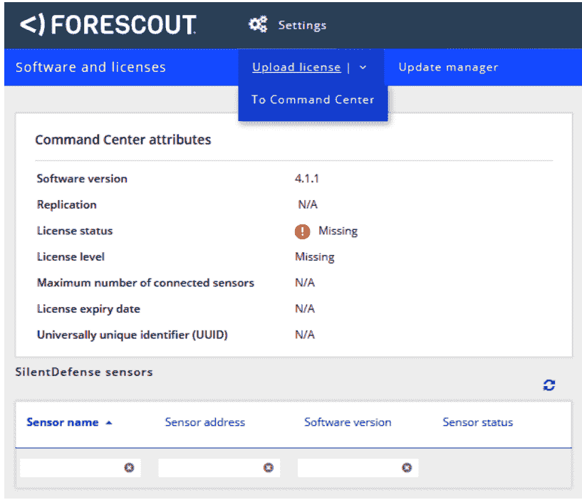

图 6.68 – 练习 3 – 配置 SilentDefense – 应用许可证

- 4. 浏览到从 Forescout 客户门户下载的许可证密钥（.license 文件）的位置，然后选择 **Upload**。
- 5. 许可证文件上传后（**License preview** 详细信息将显示上传是否成功），单击 **Finish** 完成许可流程。

如果一切顺利，我们现在就拥有了一台完全许可的 SilentDefense Command Center 设备，可以开始接收传感器数据。您应该会看到如下屏幕：


图 6.69 – 练习 3 – 配置 SilentDefense – 已许可

- 6. 单击屏幕顶部的 Sensors 选项卡，然后单击 Add | SilentDefense sensor，以打开添加新传感器屏幕。这在以下屏幕截图中有所说明：


图 6.70 – 练习 3 – 配置 SilentDefense – Command Center 传感器屏幕

- 9. 从 **Dashboard** 菜单，单击屏幕顶部的 **Settings** 按钮，如以下屏幕截图所示：


图 6.73 – 练习 3 – 配置 SilentDefense – Command Center 菜单栏

- 10. 从 **Command Center Settings** 屏幕，单击 **Date and time**。

在 **Date and time** 屏幕上，选择您的时区并可选择设置 **NTP synchronization**（或手动设置时间，确保与传感器设置相同）。完成后单击 **Finish**。您的屏幕应如下所示：


图 6.74 – 练习 3 – 配置 SilentDefense – 设置 Command Center 时间

- 11. 现在，单击门户屏幕顶部的 **Sensors** 按钮，然后单击 SD-ProductionLine1 传感器名称以调出传感器菜单。

- 12. 在传感器屏幕上，在内置模块部分下，通过勾选全选框并单击开始图标（看起来像播放按钮）来启用 Portscan detection、Man-in-the-middle detection、Malformed packet detection、Visual analytics 和 Event Logging，如以下屏幕截图所示：


图 6.75 – 练习 3 – 配置 SilentDefense – 启用检测模块

- 13. 在同一传感器屏幕上，在网络智能框架部分下，通过勾选框并单击开始图标来启用工业威胁库检查。
- 14. 仍在传感器屏幕上，从屏幕顶部选择 Edit 以打开传感器的设置屏幕。
- 15. 在传感器设置屏幕上，单击 Date and time 选项卡并配置时区和日期时间，如您为 Command Center 所做的那样。
- 16. 单击 Finish 完成传感器的配置。
- 17. SilentDefense 设置现在应开始收集数据，仪表板屏幕上的小部件将开始填充信息，如以下屏幕截图所示：


图 6.76 – 练习 3 – SilentDefense 运行中

至此，传感器和 Command Center 设备的设置和配置已完成。在下一节中，我们将查看 SilentDefense 可以为我们生成的一些细节、数据、信息和报告。

#### SilentDefense 设置的示例用法

现在是时候使用我们的新工具了。SilentDefense 具有大量功能和能力，在这里涵盖所有内容是不切实际的。我们将介绍该产品的一些更常见的功能。请注意，在此阶段，我的实验室设置中 SilentDefense 已运行约 24 小时。实验室主要针对 Rockwell Automation 设备和软件/解决方案，因此示例中会看到这些内容。

#### 资产管理

我们将要查看的 SilentDefense 的第一个功能是资产管理。该产品仅通过被动监控其嗅探接口上的网络流量来构建其监控网络的地图。它还尝试将发现的资产叠加到 Purdue 模型上，其中资产被归类为以下 Purdue 模型级别之一：

- Level 4 - Site Business Network
- Level 3 - Site Operations and Control
- Level 2 - Supervisory Control
- Level 1 - Process Control

尽管 SilentDefense 在自动将发现的资产放置到这些级别之一方面做得不错，但它并不完美。您可能需要不时地移动一些资产。

为了查看 SilentDefense 解决方案构建的网络地图，单击 Command Center 门户屏幕顶部的 Network 按钮，然后单击 Map，如以下屏幕截图所示：


图 6.77 – 练习 3 – 使用 SilentDefense – 导航到网络地图屏幕

这会调出网络地图屏幕，我们可以在其中看到发现了哪些资产、它们在 Purdue 模型中的映射方式，以及哪些资产之间存在通信（互连线）。这在以下屏幕截图中有所说明：

Default

500 hosts


图 6.78 – 练习 3 – 使用 SilentDefense – 网络地图屏幕

如果单击任何资产，将弹出一个包含该资产详细信息的侧面板，并且网络地图的显示方式也会发生变化。地图现在描绘了与所选资产的通信，如以下屏幕截图所示：


有关资产的详细信息包括以下内容：

- **Host details**—IP地址、主机名、MAC 地址、操作系统版本、已知漏洞等。这在以下屏幕截图中有所说明：

### 练习 3—设置、配置和使用 Forescout 的 eyeInspect（以前称为 SilentDefense）


图 6.80 – 练习 3 – 使用 SilentDefense – 主机详细信息

- **Host risk details**—基于可能性变量的风险评分。这在以下屏幕截图中有所说明：


图 6.81 – 练习 3 – 使用 SilentDefense – 主机风险详细信息


-   **活动日志**，用于记录与资产相关的网络流量和事件，如下面的截图所示：


-   **主机通信统计**，如下面的截图所示：


这里有一个部分详细说明了该主机的外发通信，如下面的截图所示：


此外，如果选择带有背板或附加模块（如**可编程逻辑控制器（PLC）**）的自动化设备，**主机详细信息**视图将包含设备模块的摘要，如下面的截图所示：


图6.85 – 练习3 - 使用SilentDefense – 检测到的资产（PLC）模块

这里还有很多内容可供探索，此外，大部分发现的数据都可以被操作以修改或更正所显示的信息。现在让我们来看资产的特定方面：已发现的漏洞。

#### 已发现的漏洞

由于 SilentDefense 会对资产进行分类，并确定资产上运行的操作系统、固件和软件版本，因此它会在漏洞数据库中查找这些详细信息。这样，SilentDefense 就可以将资产映射到已知漏洞并报告它们。

有几种方法可以查看资产的漏洞。首先，当资产存在漏洞时，它会在**网络地图**视图的**主机详细信息**区域下显示，如下面的截图所示：

##### 主机 plc2

**主机详细信息**

-   **IP 地址**：172.25.100.11（私有 IP）
-   **主机名**：plc2
-   **其他主机名**：test_right
-   **主机 MAC 地址**：00:00:BC:5A:D0:56（Rockwell）*最后看到：2020年12月13日 14:22:03*
-   **角色**：PLC
-   **其他角色**：从站
-   **厂商和型号**：Rockwell (1756-EN2T/B)
-   **固件版本**：5.028
-   **序列号**：0x005eae98
-   **服务器协议**：ETHIP (TCP 44818)、ETHIP (UDP 44818)、NetBIOS (UDP 137)
-   **标签**：vlan_ids=1000
-   **Purdue 级别**：1 - 过程控制
-   **严重性**：H
-   **监控传感器**：SD-ProductionLine1
-   **已知漏洞**：4（显示）
-   **相关警报**：10（显示）

图6.86 – 练习3 – 使用SilentDefense – 已知漏洞

当点击**已知漏洞的显示按钮**时，我们可以看到已发现漏洞的列表以及每个漏洞的详细信息，如下面的截图所示：


每个漏洞的详细信息包括解决该漏洞的方法。

另一种查看漏洞的方法是在**网络地图**视图中进行过滤，以突出显示具有已知漏洞的资产。为此，请单击**网络地图**屏幕顶部的**威胁**下拉菜单，然后选择**漏洞**。这将打开过滤器屏幕，我们可以在其中设置参数，以指定要查看的漏洞的详细信息，如下面的截图所示：


图6.88 – 练习3 – 使用SilentDefense – 网络地图漏洞过滤器

进行任何必要的更改，然后单击“完成”。这将把网络地图转换为易受攻击资产的热力图。当您单击某个资产时，“网络地图”屏幕将再次显示该资产的详细信息，如下面的截图所示：


图6.89 – 练习3 – 使用SilentDefense – 显示具有漏洞的主机的网络地图屏幕

只有 SilentDefense 使用的查找数据库保持最新，已知漏洞的发现才是准确的。接下来，我们将了解更新是如何进行的。

#### 更新 CVE 和漏洞数据库

SilentDefense 检测数据库的更新以 .zip 文件的形式提供，您可以从 Forescout 客户门户下载该文件。

下载后，前往 SilentDefense Command Center Web 门户，导航到“设置”页面，并点击“CVE 和 IOC – 更新与扫描”。在“CVE 和 IOC”页面，点击“导入”，浏览到您下载 .zip 文件的位置。上传 .zip 文件并点击“完成”。如下图所示：


图6.90 – 练习3 – 使用SilentDefense – 更新 CVE 和 IoC 数据库

如果上传成功，我们就拥有了更新后的**CVE 和 IOC**数据库，SilentDefense 会自动启动对资产的重新评估扫描，以根据更新后的数据库评估其详细信息。

这就完成了我们对漏洞的简要介绍。接下来，我们将讨论警报。

#### 警报

警报是 SilentDefense 用来感知已发现事件的机制，例如新资产、配置更改、攻击以及其他安全相关信息。警报遍布 Command Center Web 门户界面——例如，它们显示在**仪表板**页面上，如下面的截图所示：


图6.91 – 练习3 – 使用SilentDefense – 仪表板屏幕上的警报

还有一个专门用于警报的屏幕，可以在**事件 | 警报**下找到，如下面的截图所示：


图6.92 – 练习3 – 使用SilentDefense – 警报屏幕

**警报**屏幕允许按多种变量进行过滤，以创建有针对性的警报视图。警报出现的最后一个区域是**网络地图**区域中的**主机详细信息**视图，如下面的截图所示：

##### 主机详细信息

| **字段** | **值** |
| :--- | :--- |
| **IP 地址** | 172.25.100.12（私有 IP） |
| **主机名** | plc2 |
| **其他主机名** | test_right, test_left |
| **主机 MAC 地址** | 00:00:BC:5B:BF:F1（Rockwell）<br> *最后看到：2020年12月13日 15:34:55* |
| **角色** | PLC |
| **其他角色** | 从站 |
| **厂商和型号** | Rockwell (1756-EN2T/B) |
| **固件版本** | 5.028 |
| **序列号** | 0x00611ab0 |
| **服务器协议** | ETHIP (TCP 44818)<br> ETHIP (UDP 44818) |
| **标签** | vlan_ids=1000 |
| **Purdue 级别** | 1 - 过程控制 |
| **严重性** | H |
| **监控传感器** | SD-ProductionLine1 |
| **已知漏洞** | 4（显示） |
| **相关警报** | 10（显示） |

图6.93 – 练习3 – 使用SilentDefense – 显示警报的主机详细信息

点击**相关警报**的**显示**按钮，会弹出**警报**屏幕，并已应用针对该资产的过滤器。

为了完成本练习，让我们快速了解一下 SilentDefense 捕获的一组特定事件和警报：与 PLC 等自动化设备的交互。

#### 检测 PLC 交互和活动

到目前为止，我们所了解的关于 SilentDefense 的一切，无疑都让我们对 ICS 网络上的活动和流量有了很多了解，并允许我们查看和监控整体安全态势的多个方面。但该产品的真正价值在于它能够解释其在网络上看到的工业协议。为了说明这一能力，我们将通过导航到**网络 | 分析**并从**网络分析**菜单栏中选择**添加 | 选项卡**来添加一个分析选项卡。在弹出的**添加选项卡**屏幕中，选择**从模板**，将名称指定为`ENIP`，然后从**选择模板**下拉栏中选择**ETHIP 分析**模板。该过程如下面的截图所示：


图6.94 – 练习3 – 使用SilentDefense – 添加 ETHIP 分析选项卡

这将在**网络分析**屏幕下创建一个**Ethernet/IP 分析**选项卡，显示详细信息，例如消息类型随时间的变化、网络活动以及**以太网工业协议（ENIP）**操作和命令。如下面的截图所示：


#### 图 6.95 – 练习 3 – 使用 SilentDefense – ETHIP 分析选项卡

我们可以看到潜在的危险操作，如程序下载和控制器模式更改，以及涉及的源和目的 IP，如下图所示：


#### 图 6.96 – 练习 3 – 使用 SilentDefense – 潜在的 PLC 危险操作

通过单击数据控件右上角的设置图标，可以添加更多字段。这将调出**控件设置**界面，如下图所示：


图 6.97 – 练习 3 – 使用 SilentDefense – 控件设置界面

该工具还可以检测发往 PLC 和从 PLC 发出的**读/写命令**，如下图所示：

#### 图 6.98 – 练习 3 – 使用 SilentDefense – PLC 读/写命令

此外，它还可以映射消息类型模式，如下图所示：


图 6.99 – 练习 3 – 使用 SilentDefense – PLC 消息类型模式

此处显示的功能仅涉及分析部分；任何数据和信息都可以进行搜索、查询、过滤和报告。你可以从**事件 | 网络日志**页面完成这些操作，如下图所示：


图 6.100 – 练习 3 – 使用 SilentDefense – 自定义网络日志视图

SilentDefense 支持各种各样的工业协议，能够检测各种恶意、危险和未经授权的活动。然后，它具有对这些检测结果发出警报和报告的能力。

本章的最后练习到此结束。

## 摘要

在本章中，我们讨论了以被动方式对我们的 ICS 环境进行安全监控的多种方法。我们学习了有哪些典型的被动安全监控技术，以及一些使用这些技术的常见工具，以向我们展示环境的安全状况。

本章中的练习让我们搭建了 pfSense 防火墙、Security Onion 传感器以及 Forescout SilentDefense (eyeInSight) IDS 部署环境，所有这些都将有助于我们在后续章节中执行有针对性的搜索和威胁狩猎活动。

在下一章中，我们将对 ICS 环境进行更具侵入性的操作，开始使用主动安全监控活动和工具进行查询。

## 7