# 主动安全监控

在上一章中，我们研究了如何以被动方式关注我们 ICS 环境中的安全事件和风险发展。尽管被动（嗅探、监控、事件审查）仍然是检测安全相关事件和信息的推荐方式，但接下来的内容将讨论如何使用更深入的方法来检测这些事件。如果执行得当，主动安全监控技术可以有效使用且不会干扰生产，其额外好处是主动安全监控倾向于从我们的生产网络和连接系统中发现更多、更详细的安全和风险信息。

在本章中，我们将研究围绕主动监控工业网络安全态势的工具、技术、活动和流程。我们将讨论这些技术和工具背后的思维过程，然后通过几个旨在发现我们 ICS 网络上资产的练习获得一些实践经验。我们将查询这些资产，以确定正在运行的服务和应用程序，并记录系统信息和详细信息。

本章将涵盖的主题如下：

- 理解主动安全监控
- 用于主动安全监控的工具、技术和软件
- 收集和呈现主动监控结果
- 网络扫描技术
- 在 ICS 环境中扫描网络
- 漏洞扫描技术
- 资产扫描技术

## 技术要求

在本章中，我们将使用以下工具：

- Nmap 网络扫描器: https://nmap.org/
- Pylogix 的 Python ControlLogix 通信模块: https://github.com/ruscito/pylogix
- Kali Linux ISO VM: https://www.kali.org/downloads/
- Netcat: http://netcat.sourceforge.net/
- Nessus: https://www.tenable.com/products/nessus
- Nikto，主要针对 Web 服务器漏洞: https://cirt.net/nikto2
- Wazuh: https://wazuh.com/

## 理解主动安全监控

顾名思义，主动安全监控旨在主动查询被监控环境以获取安全事件和其他相关安全信息。它是关于卷起袖子，主动与环境交互，以了解我们的安全计划保持得如何，甚至感知我们的安全态势。

一些形式的主动安全监控包括以下：

- 网络扫描以查询和检查网络连接设备
- 基于主机的代理，可以扫描主机以查找安全相关问题内容
- 手动检查端点是否有恶意活动和内容的迹象

让我们详细看看每一项。

### 网络扫描

在本节中，我们将讨论网络扫描的各种方法。我们将查看常见的工具和技术，并讨论这些工具和技术的适用性，以揭示某些类型的网络和主机信息。我们将首先查看 IP 和端口扫描方法。

### IP 和端口扫描

任何希望通过网络通信的系统至少都需要一个**互联网协议 (IP)** 地址来识别自己。系统上的应用程序使用此 IP 地址以及端口号 (TCP 或 UDP) 来创建套接字，以便应用程序能够与其他系统上的其他应用程序通信。系统的 IP 地址就像公寓楼的街道地址，而端口号则代表楼内的公寓号。因此，当你想给住在公寓楼里的某个人写信时，你会结合使用街道地址和公寓号来找到你指定的收件人。

知道网络上哪些 IP 地址是**在线**的（存在且正在运行）对于确定你的所有资产或查看自上次扫描以来是否有新资产出现在你的网络上是非常有价值的信息。此外，弄清楚哪些端口号是**开放**的（响应网络请求）可以让我们了解在该在线系统上运行的应用程序或服务。

一些知名的端口扫描工具包括以下：

- Nmap (https://nmap.org/)
- Angry port scanner (https://angrjip.org/)
- Netcat (http://netcat.sourceforge.net/)
- Unicornscan (http://www.unicornscan.org/)
- GFI LanGuard (https://www.gfi.com/products-and-solutions/network-security-solutions/gfi-languard)

请注意，这些工具通常具有比单纯的 IP 和端口扫描更多的功能。这就是为什么相同的工具会在多个扫描技术章节中被引用的原因。我们将更仔细地查看一个特别通用的扫描工具，它能够执行我们将在此讨论的所有技术，即 Nmap。在整个书中，我们将许多场合看到 Nmap 的实际应用，因为你也会看到许多现场安全专业人员在使用它。如果你不熟悉 Nmap，我强烈建议你了解一下这个工具；如果你想认真对待网络扫描和安全监控，它是必须具备的工具之一。有关 Nmap 的更多详情，你应该从这里开始: https://nmap.org/。

## 网络映射

这种类型的扫描旨在发现网络的拓扑结构。通常，这归结为通过简单网络管理协议 (SNMP) 查询网络交换机来映射连接到网络交换机的设备，但其他方法确实存在。

以下是网络映射工具的示例：

- Zenmap (https://nmap.org)
- SolarWinds 网络拓扑映射器 (https://www.solarwinds.com/network-topology-mapper)
- Spiceworks 网络映射工具 (https://www.spiceworks.com/free-network-mapping-software/)
- LanTopoLog (https://www.lantopolog.com/)
- 10-Strike Network Diagram (https://www.10-strike.com/network-diagram/)

所有连接设备的地图将在各种活动中充当绝佳资源，包括网络取证、故障排除、追踪未知主机等。


## 漏洞扫描

许多运行在系统上的应用程序和服务会通过“横幅”信息对网络请求做出响应。这些信息提供了关于该服务或应用程序的详细信息，包括但不限于：该服务或应用程序是什么，以及暴露在开放端口上的系统正在运行哪个版本和修订号。横幅通常包含非常详细的信息，可用于资产检测、服务清单编制和漏洞识别。

在最基本的形式中，漏洞检测是将系统服务和应用程序的补丁级别与已知存在漏洞的服务或应用程序修订号列表或数据库进行对比的过程。验证过程可以通过手动检查修订号并将其与由 NIST 维护的公共数据库（例如 `https://nvd.nist.gov/vuln/search`）进行对比来完成。手动验证是一项非常耗费人力的活动，当需要处理少量以上的系统时，它很快就会变得难以管理。这时，自动化漏洞扫描器就派上了用场。这类扫描器可以查询系统，找出系统的补丁级别，查看正在运行的服务以及安装的应用程序，从而确定所有这些组件的修订版本。大多数漏洞扫描器厂商都会维护自己的漏洞数据库，用以替代或补充公共数据库。这有助于他们通过对比已安装的软件并识别潜在漏洞，获得最佳的覆盖范围。

以下是漏洞扫描工具的示例：

- Nmap (`https://nmap.org`)
- Nessus (`https://www.tenable.com/products/nessus`)
- Acunetix (`https://www.acunetix.com/`)
- Rapid7 Nexpose (`https://www.rapid7.com/products/nexpose/features/`)
- Nikto，主要旨在针对 Web 服务器漏洞 (`https://cirt.net/nikto2`)
- Qualys VMDR (`https://www.qualys.com/subscriptions/vmdr/`)

我们将在 *使用 Nikto 揭示 Web 服务器漏洞* 章节中查看 Nmap 和 Nikto 的实际操作。

## 资产清单/详情扫描

我们要讨论的下一类扫描方法是资产清单和资产详情扫描。这类扫描试图挖掘网络中尽可能多的系统，并查询这些系统以了解已安装的内容、配置情况、运行状态以及整体状况。资产扫描工具可以使用多种技术来识别所需信息。有些工具会登录到资产，并通过应用程序编程接口（API）查询系统以获取资产详情。其他工具则仅扫描系统的外部，并通过暴露的服务和网络端口查询来报告尽可能多的详情。第三类工具将在后文的 *基于主机的代理端点检查* 章节中讨论，它提供了一种使用运行在资产上的代理来获取所需信息的扫描器。

以下是资产清单和资产详情扫描工具的示例：

- Nmap (https://nmap.org)
- GFI LanGuard (https://www.gfi.com/products-and-solutions/network-security-solutions/gfi-languard)

我们目前讨论的内容被认为是一种无代理的安全监控。所解释的解决方案和方法展示了如何通过发送网络数据包和请求到端点，从而通过网络执行安全监控。在下一节中，我们将看看如何使用基于主机的代理从端点内部收集安全信息。

## 基于主机的代理端点检查

安全监控的一种不同方法是让基于主机的代理在我们要监控的端点处完成所有工作。代理是一种运行在终端设备上的可执行文件，它代表安全监控解决方案收集事件、数据和信息，或扫描端点的安全相关问题。与无代理端点监控相比，使用代理带来了一些好处，如下所示：

- 使用代理时，库存和详情的深度更加广泛。它可以利用系统 API 在无代理方案无法达到的级别上查询端点。
- 间歇性连接的端点能够在离线时暂存所需详情，并仅在上线时传输该数据。它们能够与资产管理解决方案通信。否则，这些系统可能会落入计划网络扫描的盲点中。
- 代理通常使用更少的网络带宽。这在 ICS（工业控制系统）环境中尤为方便，因为在这些环境中，网络带宽往往不是我们可以奢侈的。代理只传输所需的数据，不多不少。

代理种类繁多，规模不一，其功能可能包括以下任意组合：

- 资产清单和资产信息收集
- 漏洞扫描和监控
- 主机入侵检测
- 恶意代码检测

并非所有 ICS 设备都能运行安全监控代理，原因可能是资源限制、缺乏 **操作系统 (OS)** 功能（可能没有适合该古老/专用操作系统的代理），或者因为 **原始设备制造商 (OEM)** 不允许安装代理。然而，调查是否可以安装代理仍然是一项有价值的努力，因为代理为其安装所在的端点增加了大量与安全相关的数据。我们将在接下来的章节中更深入地了解这一点。

在下一节中，我们将详细查看这些功能。请记住，单个代理并不局限于单一功能；代理通常组合多种功能来收集安全和资产相关信息。

## 资产清单

基于主机的代理可用于对其所安装的端点进行清单编制。代理将使用系统 API 记录端点详情，如操作系统版本和修订号、已安装的软件和硬件、启用的服务、系统中定义的用户账户，以及许多其他详情。这些数据随后被发送到部署该代理的资产管理解决方案，并将其存储在数据库中以便轻松查询。从资产管理解决方案中，最终用户可以搜索资产或特定资产详情，或查找诸如应用程序安装基础、已创建的用户账户，或查看正常运行时间、性能或可用性统计数据等详情。

以下截图显示了 SolarWinds 资产管理解决方案的资产视图：

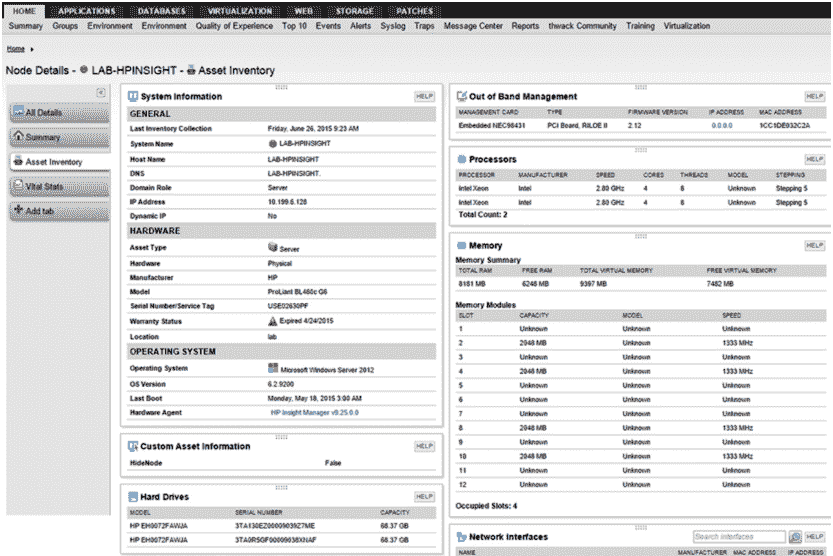

图 7.1 – SolarWinds 资产管理门户

该界面允许你通过名称、IP 地址、已安装的软件、应用程序和服务的版本及修订号，以及许多其他资产详情进行搜索。拥有一个最新且准确的资产管理解决方案是任何出色的 ICS 安全项目的必备条件。

## 漏洞发现

基于主机的代理可用于（定期）扫描其所在的端点，查找漏洞，如缺失的补丁、配置错误的服务和其他与安全相关的问题。代理的功能是查询其所在的端点，获取系统相关部分的版本/修订/配置信息，然后将该列表发送到部署该代理的漏洞管理解决方案。该解决方案随后将这些版本/修订/配置信息与数据库进行比对，以识别任何已知漏洞。

## 主机入侵检测

你还可以使用基于主机的代理，使其充当 **主机入侵检测系统 (HIDS)**。HIDS 通过行为或签名对比来检测其所在端点上的篡改和恶意活动。例如，它可以检测 notepad.exe 尝试打开命令提示符的行为，或在 Windows 注册表的启动项中检测到已知的 malware.exe 字符串；这是因为这在其检测数据库的签名中已被记录。

代理还可以仅记录系统行为并将其发送到分析平台。该平台使用某种形式的 **人工智能 (AI)** 来检测恶意活动。

## 恶意软件检测

我们要讨论的基于主机代理的最后一个用例是检测恶意软件。从某种意义上说，安装在端点上的任何防病毒解决方案都是这种类型的代理。代理将使用本地检测数据库来查找恶意内容，或者将相关文件详情发送到分析平台以检测恶意软件。

以下是一些出于安全监控目的实现代理的解决方案：

- SolarWinds ITSM (https://www.solarwinds.com/solutions/it-asset-management).
- ServiceNow 资产管理 (https://www.servicenow.com/products/asset-management.html).
- Rapid7 InsightVM (https://www.rapid7.com/products/insightvm/features/).
- Wazuh (https://wazuh.com/): Wazuh 是一个开源安全平台，它将安全监控、威胁检测和事件响应功能结合在单一代理中。Wazuh 可与多种 SIEM 解决方案配合，构建全面的安全监控环境。我们将在下一章（第 9 章：可视化、关联与告警）中详细讨论 Wazuh。

## 手动端点检查/验证

我们要讨论的最后一种主动安全监控方法是全面、亲力亲为的系统查询技术。这种方法要求我们登录到端点，并使用已知的接口、实用工具和工具来了解资产的详情。这些信息随后可以存储在数据库、Excel 文件或任何其他允许我们在稍后检索资产详情的系统中。


手动检查资产非常耗时、容易出错，且通常不适合监控大量安装基础。手动检查主要用于事件响应工作或威胁狩猎。本书后续章节将讨论这两种用途。此外，手动检查资产也是本章第二个练习的主题。

## 练习 1 – 扫描网络连接设备

在本第一个练习中，我们将探讨一些旨在发现网络上存活系统的网络扫描技术。我们将利用这些信息来确定这些存活系统上运行的内容。此外，我们还将查看一些方法，用于挖掘这些存活系统上是否存在漏洞。

在本练习以及本书中的大多数其他练习中，我们将使用（非）著名的 Kali Linux 发行版，可从 https://www.kali.org/downloads/ 下载。关于 Kali 安装的帮助，在您的首选搜索引擎上进行简单搜索，应该会找到数十个入门教程。

## ICS 环境中扫描的危险

在深入网络扫描的艺术之前，请听一句忠告：如果您在运行中的（操作性）ICS 网络上执行主动扫描，情况可能会——而且通常会——出错。尽管近年来工业设备的韧性有了显著改善，但大多数 ICS 环境中仍在运行旧设备。无法预知额外的 100 个网络数据包会对这种旧设备繁忙的网络栈造成什么影响。此外，如果您在较新的网络和自动化设备上运行过于严格的扫描，它们可能会过载，从而破坏生产。

我的建议是，仅在停产 downtime 或非工作时间运行主动扫描，并在扫描完成后始终验证各项设备的健康/状态，以确保所有设备正常运行。或者，您可以搭建一个测试环境，从而模拟或近似实际的生产配置。在测试环境中，您可以随意扫描、破坏、攻击和利用，而不会损害生产环境，并且您的测试环境越接近真实环境，您的发现就越准确。

网络扫描的一般方法是尽量减少我们发送到网络上的流量。正如您在下一节中看到的，我们将遵循以下模式：

- 使用有限的扫描来确定网络上哪些是存活的，只需足以检测端点是否可达。
- 在确定哪些系统处于存活状态后，使用该扫描的输出作为来源，进行更 intense 的扫描，以揭示服务、操作系统详情以及关于发现端点的其他详细信息。
- 记录并日志记录您所做的一切。这包括将扫描结果日志输出到文件，以及以有组织的方式添加注释并存储，以免我们因为不小心在终端会话中丢失了扫描输出而不得不重复扫描。

我们在本书中将使用的实验室环境设置已在附录 1 中说明。

## Nmap

网络映射器，或 Nmap，可以说是最受欢迎的网络扫描工具。它可以扫描存活系统、开放端口、漏洞、操作系统详情以及更多内容。Nmap 是一个开源工具，由 Gordon Lyon 于 1997 年创建，可从 https://nmap.org/ 免费获取：


尽管我们将在本书中广泛使用 Nmap，但我们只是其功能的冰山一角。要真正了解该工具，我建议观看一些 YouTube 视频，也许阅读一两本书，但主要是开始使用它。搭建一个测试环境，扫描并探索所有可用选项。玩扫描方法、Nmap 脚本、操作标志等。但也要确保捕获该工具生成的数据包（例如使用 Wireshark），查看 Nmap 如何生成其数据包，以及它操作哪些标志、选项和字段来完成任务。了解该工具的工作原理将使您有信心在实地、在（实时）生产环境中使用它。透彻了解 Nmap 将帮助您避免使生产中断或破坏某些东西。

## 时机至关重要

在生产网络上，时机至关重要。在此意义上，时机是指 Nmap 执行扫描的激进程度。扫描越激进，Nmap 同时发送的数据包越多，我们生成的网络流量就越大。网络流量越多，网络及其上的设备就越繁忙。因此，东西出故障的可能性增加。关键是放慢节奏。Nmap 通过其 `-T` 标志允许这样做。Nmap 的帮助对该标志定义如下：

```
-T<0-5>: Set timing template (higher is faster)
```

时序模板选项如下：

- 0: 偏执
- 1: 偷偷
- 2: 礼貌
- 3: 正常
- 4: 激进
- 5: 疯狂

为了展示该标志的影响，以下是单个端口（通过 `-p 80` 标志指示 Nmap）在同一设备（172.25.100.11）上两次扫描的结果。第一次扫描使用疯狂时序模板 (-T5) 运行，而第二次使用偏执时序模板 (-T0) 运行：

```
kvam@KVM0101011:~$ sudo nmap 172.25.100.11 -p 80 -T5
Starting Nmap 7.80 ( https://nmap.org ) at 2020-08-29 14:05 MDT
Nmap scan report for 172.25.100.11
Host is up (0.00082s latency).
```

告知 Nmap 执行存活主机检测的标志是 -sn。Nmap 帮助对其定义如下：

```
-sn: Ping Scan - disable port scan
```

尽管 Nmap 将其定义为 ping 扫描，但其首要方法是使用 ARP 请求检索目标的 MAC 地址，正如在下方的数据包捕获中可以看到，该捕获跟随 `nmap 172.25.100.11 -sn` 命令：

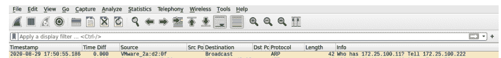

图 7.3 – Wireshark 中的 Nmap ARP 扫描

现在，如果系统不响应 ARP 请求或位于不同的子网中，Nmap 将使用 ping 数据包（echo request）代替，如下面的数据包捕获所示。这是由 `nmap 8.8.8.8 -sn` 命令生成的：

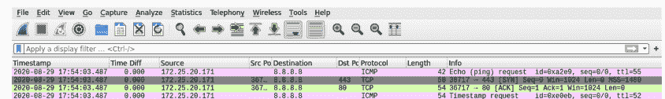

图 7.4 – Wireshark 中的 Nmap Ping 扫描

让我们扫描我们的实验室环境，看看有哪些系统是存活的。我们将使用的命令如下：

```
sudo nmap 172.25.100.0/24 -sn -T3 --dns-servers 172.25.100.100 -oG ics-scan_2020.txt
```

我们向命令添加了指令，使 Nmap 在扫描期间使用 `--dns-servers` 标志参考 DNS 服务器。这指示 Nmap 检索其正在扫描系统的 DNS 名称。这是可选的，但为扫描结果增加了有价值的额外信息。我们还使用 `-oG ics-scan_2020.txt` 指定将结果存储在文本文件中。`-oG` 指定以可 grep 的格式存储结果。将结果保存在文件中可以防止我们不得不在扫描过程的后续步骤中再次运行命令。由于格式是可 grep 的，我们可以轻松地用 Linux 命令行功夫操作它。

注意在 Nmap 命令中使用 `sudo`。这会提升 Nmap 的特权，允许其作为扫描的一部分捕获 MAC 地址，进而使扫描能够包括系统厂商，如下面输出中高亮显示。如果您以非 sudo 身份运行 Nmap，输出中将缺少这一重要信息：

```
$ sudo nmap 172.25.100.0/24 -sn -T3 --dns-servers
172.25.100.100

Starting Nmap 7.80 ( https://nmap.org ) at 2020-08-29 12:14 MDT
Nmap scan report for 172.25.100.11
Host is up (0.00088s latency).
MAC Address: 00:00:BC:5A:D0:56 (Rockwell Automation)
Nmap scan report for 172.25.100.12
Host is up (0.00084s latency).
MAC Address: 00:00:BC:5B:BF:F1 (Rockwell Automation)
Nmap scan report for 172.25.100.20
Host is up (0.00084s latency).
MAC Address: 00:1C:06:00:BC:37 (Siemens Numerical Control, Nanjing)
Nmap scan report for 172.25.100.21
Host is up (0.00076s latency).
MAC Address: 00:20:4A:64:1D:3F (Pronet Gmbh)
Nmap scan report for 172.25.100.23
Host is up (0.00081s latency).
MAC Address: 00:03:12:0B:02:AC (TRsystems GmbH)
Nmap scan report for 172.25.100.24
Host is up (0.00069s latency).
MAC Address: 00:E0:4B:19:03:95 (Jump Industrielle Computertechnik Gmbh)
Nmap scan report for OT-DC1.OT-Domain.local (172.25.100.100)
Host is up (0.00017s latency).
MAC Address: 00:02:BA:D9:A7:41 (Cisco Systems)
Nmap scan report for FT-DIR1.ot-domain.local (172.25.100.105)
Host is up (0.00022s latency).
MAC Address: 00:13:20:03:3F:B8 (Intel Corporate)
Nmap scan report for FT-DIR2.ot-domain.local (172.25.100.110)
Host is up (0.00018s latency).
```


```text
Nmap扫描报告：Workstation1.ot-domain.local (172.25.100.201)
主机状态：在线（延迟0.00030秒）。
MAC地址：00:16:6F:7E:D4:30 (Intel Corporate)
Nmap扫描报告：Workstation2.ot-domain.local (172.25.100.202)
主机状态：在线（延迟0.00028秒）。
MAC地址：08:60:6E:FC:78:0F (华硕电脑)
Nmap扫描报告：Workstation3.ot-domain.local (172.25.100.203)
主机状态：在线（延迟0.00025秒）。
MAC地址：40:83:DE:B2:10:48 (斑马技术)
Nmap扫描报告：Workstation10.ot-domain.local (172.25.100.210)
主机状态：在线（延迟0.00059秒）。
MAC地址：00:0C:29:40:E7:A0 (VMware)
Nmap扫描报告：Workstation12.ot-domain.local (172.25.100.212)
主机状态：在线（延迟0.00066秒）。
MAC地址：00:0C:29:EE:32:E1 (VMware)
...
Nmap完成：扫描256个IP地址（16台主机在线），耗时1.32秒
```

正如你所见，Nmap在我们的实验/24网络上发现了16个在线运行的系统。由于我们使用sudo提升了命令权限，Nmap揭示了各种系统厂商信息。这使我们可以对扫描发现的设备做出一些初步判断：

- **罗克韦尔自动化：** 可能是Allen Bradley控制器或通信卡
- **西门子数控（南京）：** 可能是西门子PLC或通信卡
- **Pronet GmbH：** 可能是支持Modbus的设备
- **TRsystems GmbH：** 销售各种设备；可能是任何东西
- **Jump Industrielle Computertechnik GmbH：** 各种支持CIP协议的设备制造商
- **思科系统：** 网络和服务器设备供应商
- **Intel Corporate：** 服务器和PC设备供应商
- **华硕电脑：** 消费级计算机硬件供应商
- **VMware：** 虚拟化技术供应商，可能是虚拟机
- **斑马技术：** 工业打印机和手持设备的制造商

通过查看已发现系统的制造厂商和DNS名称，我们可以清楚地了解网络上运行了什么。但需要注意的是：Nmap是通过MAC地址查询获取厂商名称的。由于每个厂商使用独特的MAC地址段（MAC地址的前6个字节预留给特定厂商），我们便可以从MAC地址推断出制造商名称。不过，MAC地址是可以更改的，这会影响Nmap查询返回的结果。让我们更仔细地看一下单个结果（单个发现的在线系统）：

```text
Nmap扫描报告：FT-DIR2.ot-domain.local (172.25.100.110)
主机状态：在线（延迟0.00018秒）。
MAC地址：00:16:6F:7E:D4:30 (Intel Corporate)
```

在这里，我们可以看到Nmap返回了DNS名称。这是通过向我们的DNS服务器发起反向DNS查询获得的，我们在`--dns-servers 172.25.100.100`命令中指定了该服务器。结果显示主机处于在线状态、响应耗时、发现的在线系统的MAC地址以及制造商名称（本例中为Intel Corporate）。

请注意，添加`--dns-servers`指令让我们能够看到主机名，这为判断端点可能是什么提供了线索（FT-DIR2很可能是辅助或备份的罗克韦尔自动化FactoryTalk目录服务器）。

有一个系统的结果比较异常，如下所示：

```text
Nmap扫描报告：Workstation3.ot-domain.local (172.25.100.203)
主机状态：在线（延迟0.00025秒）。
MAC地址：40:83:DE:B2:10:48 (斑马技术)
```

这个系统的DNS名称让我们认为它是工作站。然而，MAC地址显示的厂商是斑马技术。斑马技术主要是工业打印机和手持设备供应商。这两项信息的组合并不完全匹配。这是因为MAC地址与终端的网卡绑定，并非固定不变。MAC地址可以被更改，或者网卡可以被更换。例如，如果我们在一台戴尔服务器中安装了惠普的**网络接口卡**（NIC），那么该服务器就会显示惠普的MAC地址。我们暂时记下这个问题，稍后再回来讨论。

现在我们已经知道哪些系统在我们的网络上处于在线状态并响应，下一步就是询问这些已发现的系统，以了解它们在网络上暴露的服务和应用程序。

## 服务——哪些端口是开放的？

那么，现在我们已经知道ICS网络上有哪些系统在运行，接下来看看它们向外界暴露了哪些服务。这需要通过Nmap扫描来完成：查看开放端口，找出该端口上运行的服务，并尝试确定该服务的版本和修订号。Nmap运行服务发现扫描的命令是`nmap 172.25.100.0/24 -sV`。Nmap帮助对`-sV`的定义如下：

> **-sV**: 探测开放端口以确定服务/版本信息

该命令扫描整个/24子网，发现在线系统，然后扫描已发现的在线系统以确定开放端口，并确定开放端口背后的服务。由于我们已经知道哪些系统在线，可以跳过发现过程，直接向Nmap扫描提供我们希望扫描的IP地址列表。我们需要的IP地址记录在ics-scan_2020.txt文件中，该文件是我们在之前的扫描过程中让Nmap生成的。文件内容如下：

```text
pac@KVM0101011:~$ cat ics-scan_2020.txt
# Nmap 7.80扫描于2020年8月29日12:45:59启动，命令为：nmap
-sn -T3 --dns-servers 172.25.100.100 -oG ics-scan_2020.txt
172.25.100.0/24
主机： 172.25.100.11 () 状态： 在线
主机： 172.25.100.12 () 状态： 在线
...
```

为了单独提取出IP地址，我们可以在Kali Linux终端中使用以下命令：

```bash
cat ics-scan_2020.txt | awk '{print $2}' | grep 172 > ics_ips.txt
```

让我们解释一下这个命令。第一部分`cat ics-scan_2020.txt`简单地输出文本文件的内容。然后我们使用`|`（管道）命令将cat命令的输出传递给另一个工具awk。Awk是一个命令行工具，允许我们操作通过cat输出馈送给它的文本。Awk有许多不同的用途和选项，但在此上下文中，`awk '{print $2}'`只是输出每行的第二部分（各部分以空格分隔），即`Host: 172.25.100.11 () Status: Up`中的IP地址。这实际上只显示文本文件中的IP地址。然后我们将这个精简后的输出通过管道传递给grep工具，grep允许我们按特定字符串（本例中为`172`）过滤文本。这样做是为了消除awk命令产生的任何非IP地址输出。

最后，我们使用`>`命令将精简和过滤后的文本输出到一个文件中。最终我们得到一个IP地址列表，存储在ics_ips.txt文本文件中：

```text
pac@KVM0101011:~$ cat ics_ips.txt
172.25.100.11
172.25.100.12
172.25.100.20
172.25.100.21
172.25.100.23
172.25.100.24
172.25.100.100
172.25.100.105
172.25.100.110
172.25.100.201
172.25.100.202
172.25.100.203
172.25.100.210
172.25.100.212
172.25.100.220
172.25.100.222
```

现在我们可以在以后的Nmap命令中使用此列表，配合`-iL`标志，Nmap帮助将其定义如下：

```text
-iL <inputfilename>: 从主机/网络列表输入
```

综合以上所有内容，我们现在可以构建如下的Nmap命令：

```bash
sudo nmap -iL ics_ips.txt -sV -T3 -oN ics-services.txt -p- --dns-servers 172.25.100.100
```

该命令指示Nmap对我们提供的IP地址列表（`-iL ics_ips.txt`）发现任何开放端口以及这些端口上运行的服务。结果通过`-oN`标志存储到文件中，该标志将其保存为纯文本文件。我选择将其存储为纯文本输出文件是因为在本书中更容易使用。通常，在进行文本处理时，你会倾向于使用可grep输出（`-oG`）。你可能已经注意到我使用了`-p-`标志，它指示Nmap扫描*所有*端口。默认情况下，Nmap只扫描1000个众所周知的端口（IT众所周知的端口）。这种默认行为会跳过低频使用的ICS协议/服务的检测。通过添加`-p-`标志，我们指示Nmap尝试连接所有可能的TCP端口（`1-65535`）。

为了说明区别，例如，对172.25.100.11运行默认端口扫描，我们会看到以下结果：

```text
pac@KVM0101011:~$ sudo nmap 172.25.100.11
正在启动Nmap 7.80 ( https://nmap.org ) 于2020-08-29 14:14 MDT
Nmap扫描报告：172.25.100.11
主机状态：在线（延迟0.0018秒）。
未显示：999个关闭端口
端口    状态    服务
80/tcp  开放    http
MAC地址：00:00:BC:5A:D0:56 (Rockwell Automation)
```

注意Nmap只报告了一个开放端口，即80端口。当我们添加`-p-`标志时，我们检测到172.25.100.11上运行着另一个服务：

```text
pac@KVM0101011:~$ nmap 172.25.100.11 -p-
正在启动Nmap 7.80 ( https://nmap.org ) 于2020-08-29 14:15 MDT
Nmap扫描报告：172.25.100.11
主机状态：在线（延迟0.0015秒）。
未显示：65533个关闭端口
端口      状态    服务
```


| 80/tcp | open | http |
| 44818/tcp | open | EtherNetIP-2 |
| MAC Address: 00:00:BC:5A:D0:56 | | (Rockwell Automation) |

Nmap 发现了一个开放端口 44818，这是由于使用了 -p- 标志。许多 ICS 服务运行在奇数端口号上；因此建议始终扫描所有端口。需要注意的是，这会产生大量额外的流量和额外的扫描时间，并且可能导致系统故障，但嘿，我们是在非工作时间进行此操作的，对吧？此外，如果我们不检测我们真正感兴趣的东西，扫描有什么意义呢？最后，恶意软件通常会隐藏在默认情况下不被扫描的端口后面。再次强调，这里推荐使用 -p-。

明确这一点后，让我们运行扫描：

```
pac@KVM0101011:~$ sudo nmap -iL ics_ips.txt -sV -T5 -ON
ics-services.txt -p- --dns-servers 172.25.100.100
Starting Nmap 7.80 ( https://nmap.org ) at 2020-08-29 14:27 MDT
Nmap scan report for 172.25.100.11
...
```

扫描需要一些时间并产生大量信息。幸好我们告诉它将结果保存到文件中，以便我们随时可以检索。

如果我们查看扫描中一些有趣的结果，我们将看到，例如，172.25.100.11 主机的以下扫描结果：

| Nmap scan report for 172.25.100.11 |
| Host is up (0.00084s latency). |
| Not shown: 65533 closed ports |
| PORT | STATE | SERVICE | VERSION |
| 80/tcp | open | http | GoAhead WebServer |
| 44818/tcp | open | EtherNet-IP-2 |
| MAC Address: 00:00:BC:5A:D0:56 | | (Rockwell Automation) |

172.25.100.11 具有所有 Allen-Bradly ControlLogix PLC 的典型特征，因为端口 80 运行着 **GoAhead webserver**，并且端口 44818 是开放的（允许 EtherNet/IP 通信）。

以下是 172.25.100.20 主机的输出：

```
Nmap scan report for 172.25.100.20
Host is up (0.00049s latency).
Not shown: 65534 closed ports
PORT     STATE SERVICE VERSION
102/tcp open  iso-tsap Siemens S7 PLC
MAC Address: 00:1C:06:00:BC:37 (Siemens Numerical Control, Nanjing)
Service Info: Device: specialized
```

172.25.100.20 似乎是一个 S7 PLC，TCP 端口 102（RFC1006）允许设备进行编程以及与其他 PLC 和远程 I/O 卡通信。

以下是 172.25.100.21 主机的输出：

```
Nmap scan report for 172.25.100.21
Host is up (0.00053s latency).
Not shown: 65534 closed ports
PORT     STATE SERVICE VERSION
502/tcp open  mbap?
MAC Address: 00:20:4A:64:1D:3F (Pronet Gmbh)
```

172.25.100.21 的 TCP 端口 502（Modbus Application Protocol 或 mbap）是开放的。结合 Pronet Gmbh 识别出的厂商，这告诉我们这很可能是一个支持 Modbus 的智能设备或通信卡。我们将在本章后面 Modbus 探索部分中查看它是什么，在那里我们将对该设备上的 Modbus 服务器进行 interrogation。

以下是 172.25.100.23 主机的输出：

```
Nmap scan report for 172.25.100.23
Host is up (0.00070s latency).
Not shown: 65534 closed ports
PORT     STATE SERVICE     VERSION
44818/tcp open  EtherNet-IP-2
MAC Address: 00:03:12:0B:02:AC (TRsystems GmbH)
```

172.25.100.23 只有一个 TCP 端口开放：44818（EtherNet/IP）。这很可能是一种通信卡——可能是远程 I/O。

| 9389/tcp | open | mc-nmf | .NET Message Framing |
| 47001/tcp | open | http | Microsoft HTTPAPI httpd 2.0 (SSDP/UPnP) |
| 49670/tcp | open | ncacn_http | Microsoft Windows RPC over HTTP 1.0 |

172.25.100.100 显然是一个 Windows 系统。它具有所有典型的开放端口，例如 135、137、139 和 445。此外，它显示出是 Active Directory 服务器的迹象，因为它在 TCP 端口 88、53、389、464 和 3268 上响应。如果我们查看 DNS 名称 OT-DC1，DC 通常代表 Domain Controller，即 Microsoft Windows Active Directory/域结构的管理员。此信息支持了我们对其为 Windows 系统的怀疑。

以下是 172.25.100.105 主机的输出：

```
Nmap scan report for FT-DIR1.ot-domain.local (172.25.100.105)
Host is up (0.00036s latency).
Not shown: 65527 filtered ports
PORT STATE SERVICE VERSION
80/tcp open http Microsoft IIS httpd 10.0
135/tcp open msrpc Microsoft Windows RPC
445/tcp open microsoft-ds Microsoft Windows Server 2008 R2 - 2012 microsoft-ds
808/tcp open ccproxy-http?
5985/tcp open http Microsoft HTTPAPI httpd 2.0 (SSDP/UPnP)
22350/tcp open CodeMeter?
22352/tcp open unknown
49666/tcp open msrpc Microsoft Windows RPC
```

172.25.100.105 从其开放端口来看似乎是一个 Windows 客户端或成员服务器。此外，开放端口的数量表明防火墙配置严重错误或已关闭。通常，Windows 机器不会像这样暴露其高端口。

以下是 172.25.100.201 主机的输出：

```
Nmap scan report for Workstation1.ot-domain.local (172.25.100.201)
Host is up (0.00048s latency).
Not shown: 65508 closed ports
```

| PORT | STATE | SERVICE | VERSION |
|---|---|---|---|
| 80/tcp | open | http | Microsoft IIS httpd 10.0 |
| 135/tcp | open | msrpc | Microsoft Windows RPC |
| 139/tcp | open | netbios-ssn | Microsoft Windows netbios-ssn |
| 403/tcp | open | tcpwrapped |  |
| 445/tcp | open | microsoft-ds | Microsoft Windows 7 - 10 microsoft-ds (workgroup: OT-DOMAIN) |
| 1332/tcp | open | pcia-rxp-b? |  |
| 3060/tcp | open | interserver? |  |
| 3389/tcp | open | ms-wbt-server | Microsoft Terminal Services |
| 4241/tcp | open | vrml-multi-use? |  |
| 4255/tcp | open | vrml-multi-use? |  |
| 5241/tcp | open | unknown |  |
| 6543/tcp | open | mythtv? |  |
| 7153/tcp | open | unknown |  |
| 8082/tcp | open | http | MS .NET Remoting httpd (.NET CLR 4.0.30319.42000) |
| 9111/tcp | open | DragonIDSConsole? |  |
| 22350/tcp | open | CodeMeter? |  |
| 27000/tcp | open | flexlm | FlexLM license manager |
| 49664/tcp | open | msrpc | Microsoft Windows RPC |
| 49665/tcp | open | msrpc | Microsoft Windows RPC |
| 49666/tcp | open | msrpc | Microsoft Windows RPC |
| 49667/tcp | open | msrpc | Microsoft Windows RPC |
| 49668/tcp | open | msrpc | Microsoft Windows RPC |
| 49669/tcp | open | msrpc | Microsoft Windows RPC |
| 49671/tcp | open | msrpc | Microsoft Windows RPC |
| 49685/tcp | open | msrpc | Microsoft Windows RPC |
| 49690/tcp | open | flexlm | license manager |
| 49725/tcp | open | msrpc | Microsoft Windows RPC |

172.25.100.201 似乎是一个 Windows 客户端，其防火墙因与前一系统相同的原因而关闭。

以下是 172.25.100.203 主机的输出。注意 Zebra Technologies MAC 地址的识别：

```
Nmap scan report for Workstation3.ot-domain.local
(172.25.100.203)
Host is up (0.00017s latency).
Not shown: 65532 closed ports
PORT      STATE SERVICE      VERSION
135/tcp   open  msrpc        Microsoft Windows RPC
139/tcp   open  netbios-ssn  Microsoft Windows netbios-ssn
445/tcp   open  microsoft-ds Microsoft Windows XP microsoft-ds
MAC Address: 40:83:DE:B2:10:48 (Zebra Technologies)
Service Info: OSs: Windows, Windows XP; CPE: cpe:/o:microsoft:windows, cpe:/o:microsoft:windows_xp
```

我们的 Zebra 系统变得更有趣了。虽然其 DNS 名称将该系统标识为工作站，但 MAC 厂商查找并不能支持这一点。查看开放端口，这似乎是一个 Windows 客户端，但结果到处都是 Windows XP 的痕迹……也许是一个 Windows 嵌入式手持设备？

我们要查看的最后一个设备有点奇怪：

```
Nmap scan report for Workstation12.OT-Domain.local
(172.25.100.212)
Host is up (0.00076s latency).
Not shown: 65534 filtered ports
PORT      STATE SERVICE VERSION
12345/tcp open  netbus?
MAC Address: 00:0C:29:EE:32:E1 (VMware)
```

172.25.100.212 似乎在端口 12345 上运行着某种服务。Nmap 将此端口识别为 Netbus，这是一种有争议的远程访问程序，很可能是恶意软件，创建于 20 世纪 90 年代末。虽然这很可能被 Nmap 误解，最终证明不是 Netbus，但它仍然是一个重大的危险信号。我们将在即将进行的活动中更密切地调查该系统。


现在我们已经根据 Nmap 工具的猜测，了解到在我们 ICS 网络上检测到的系统上运行的服务情况，我们对系统所基于的内容有了更清晰的认识。我们是通过检查知名端口/服务的存在来实现这一点的。接下来，我们将开始调查各个系统和服务，目的是找到关于它们的更细致的细节。在此之前，我想指出一种额外的服务检测方式，可以帮助我们识别系统上开放端口后面的内容，即横幅抓取。

## 横幅抓取 – 开放端口上运行的是什么？

横幅是网络服务对请求方返回的响应，告知其正在通信的服务。横幅最明显的例子是当你登录到 Telnet 或 SSH 服务器时。Telnet 或 SSH 服务器响应的第一件事就是其横幅。例如，以下是 SSH 服务器在通过 Telnet 连接时返回的响应（Telnet 是横幅抓取的绝佳工具，但由于缺乏加密，应避免用于任何远程访问活动）：

```
> telnet ssh-server1 22
SSH-2.0-OpenSSH_7.2p2 Ubuntu-4ubuntu2.10
—
```

前述代码中高亮的文本是 SSH 服务横幅。你可以看到，在这个横幅中可以找到大量信息，例如 SSH 服务的版本和服务运行的操作系统。

为了进一步说明横幅的价值，以下示例展示了对一台系统执行的三次扫描：默认 Nmap 扫描、服务扫描，以及使用 Nmap 脚本进行横幅抓取的扫描（Nmap 脚本将在后续章节中详细介绍）。第一个扫描方法是没有任何脚本定义的常规 Nmap 扫描：

```
mac@KVM010101:~$ nmap 172.25.100.222
Starting Nmap 7.80 ( https://nmap.org ) at 2020-08-29 15:32 MDT
Nmap scan report for 172.25.100.222
Host is up (0.0000030s latency).
Not shown: 998 closed ports
PORT STATE SERVICE
22/tcp open ssh
80/tcp open http
Nmap done: 1 IP address (1 host up) scanned in 0.14 seconds
```

在这里，我们可以看到 Nmap 扫描揭示了我们扫描的主机的开放端口以及可能在开放端口上运行的服务的解释。这是由 Nmap 工具添加的，并且基于开放网络端口的常见用途。

接下来，我们将扫描同一主机，但现在指定 -sV 标志。这将使 Nmap 扫描其为该主机发现的开放端口上运行的服务：

```
pac@KVM010101:~$ nmap 172.25.100.222 -sV
Starting Nmap 7.80 ( https://nmap.org ) at 2020-08-29 15:35 MDT
Nmap scan report for 172.25.100.222
Host is up (0.0000030s latency).
Not shown: 998 closed ports
PORT   STATE SERVICE VERSION
22/tcp open  ssh     OpenSSH 8.3p1 Debian 1 (protocol 2.0)
80/tcp open  http    Apache httpd 2.4.46 ((Debian))
Service Info: OS: Linux; CPE: cpe:/o:linux:linux_kernel
Nmap done: 1 IP address (1 host up) scanned in 6.50 seconds
```

请注意，Nmap 添加了开放端口上运行的服务，以及一些额外的数据，例如版本和操作系统类型。这些数据是在 Nmap  interrogate 它时由服务自愿提供的。

作为第三种扫描方法，我们可以再次 interrogate 该主机，这次告诉 Nmap 扫描服务详情，并抓取服务返回的横幅：

```
pac@KVM010101:~$ nmap 172.25.100.222 -sV --script banner
Starting Nmap 7.80 ( https://nmap.org ) at 2020-08-29 15:35 MDT
Nmap scan report for 172.25.100.222
Host is up (0.0000030s latency).
Not shown: 998 closed ports
PORT   STATE SERVICE VERSION
22/tcp open  ssh     OpenSSH 8.3p1 Debian 1 (protocol 2.0)
|_banner: SSH-2.0-OpenSSH_8.3p1 Debian-1
80/tcp open  http    Apache httpd 2.4.46 ((Debian))
|_http-server-header: Apache/2.4.46 (Debian)
Service Info: OS: Linux; CPE: cpe:/o:linux:linux_kernel
Nmap done: 1 IP address (1 host up) scanned in 21.51 seconds
pac@KVM010101:~$
```

正如你所见，横幅抓取增加了额外的信息层。在此示例中，大多数额外信息已由服务扫描找到，但有时，横幅扫描可以暴露服务扫描遗漏的细节。

为了结束本节，让我们看看是否可以使用横幅抓取技术来检测我们神秘服务（12345）在 172.25.100.212 上的情况：

```
pac@KVM010101:~$ sudo nmap -sV 172.25.100.212 -T3 --script banner
Starting Nmap 7.80 ( https://nmap.org ) at 2020-08-29 15:45 MDT
Nmap scan report for 172.25.100.212
Host is up (0.00096s latency).
Not shown: 999 filtered ports
PORT      STATE SERVICE VERSION
12345/tcp open  netbus?
MAC Address: 00:0C:29:EE:32:E1 (VMware)
Service detection performed. Please report any incorrect results at https://nmap.org/submit/ .
Nmap done: 1 IP address (1 host up) scanned in 42.19 seconds
```

嗯，没有运气。这在奇特和专有的服务上可能会发生，在 ICS 环境中，这可能意味着工业服务或恶意服务。我们将继续关注该系统，看看以后是否能找到更多信息。

##  interrogating Windows 机器

在本节中，我们将查看一些可以用来 interrogate Windows 机器的常见方法。Windows 机器如果知道如何以及在哪里提问，会提供非常慷慨的信息。

我们将在下一节讨论的大部分功能都依赖于 Nmap 脚本。Nmap 脚本是一组指令片段，允许我们为 Nmap 扫描仪添加额外的功能。额外功能包括检查漏洞、验证某些服务细节、条件端口扫描、计时以及许多其他操作和交互。

## SMB

我们将 interrogate 的第一个服务是 **Server Message Block**，即 SMB。SMB 是实现文件和打印机共享功能的方式。Nmap 有一些脚本可以帮助我们从 SMB 服务中发现各种信息。我们可以通过在 Kali Linux 机器上运行以下命令来列出 Nmap 为 SMB interrogation 提供的所有脚本：

```
pac@KVM010101:~$ ls /usr/share/nmap/scripts/*smb*
root  3.3K Jul 13 03:03 /usr/share/nmap/scripts/smb2-capabilities.nse
root  3.1K Jul 13 03:03 /usr/share/nmap/scripts/smb2-security-mode.nse
root  1.5K Jul 13 03:03 /usr/share/nmap/scripts/smb2-time.nse
root  5.2K Jul 13 03:03 /usr/share/nmap/scripts/smb2-vuln-uptime.nse
root  4.8K Jul 13 03:03 /usr/share/nmap/scripts/smb-enum-domains.nse
root  5.9K Jul 13 03:03 /usr/share/nmap/scripts/smb-enum-groups.nse
root  7.9K Jul 13 03:03 /usr/share/nmap/scripts/smb-enum-processes.nse
root  27K Jul 13 03:03 /usr/share/nmap/scripts/smb-enum-services.nse
root  12K Jul 13 03:03 /usr/share/nmap/scripts/smb-enum-sessions.nse
root  6.8K Jul 13 03:03 /usr/share/nmap/scripts/smb-enum-shares.nse
root  13K Jul 13 03:03 /usr/share/nmap/scripts/smb-enum-users.nse
...
root  5.6K Jul 13 03:03 /usr/share/nmap/scripts/smb-vuln-ms08-067.nse
root  5.6K Jul 13 03:03 /usr/share/nmap/scripts/smb-vuln-ms10-054.nse
root  7.1K Jul 13 03:03 /usr/share/nmap/scripts/smb-vuln-ms10-061.nse
root  7.2K Jul 13 03:03 /usr/share/nmap/scripts/smb-vuln-ms17-010.nse
root  4.3K Jul 13 03:03 /usr/share/nmap/scripts/smb-vuln-regsvc-dos.nse
root  6.5K Jul 13 03:03 /usr/share/nmap/scripts/smb-vuln-
```

```
webexec.nse
root 5.0K Jul 13 03:03 /usr/share/nmap/scripts/smb-webexec-exploit.nse
...
```

正如你所见，有相当多的脚本可以使用。我们将首先枚举 OT-DC1 服务器上的文件共享。

## 文件共享枚举

我们将使用的脚本是 smb-enum-shares.nse。该脚本针对的是 OT-DC1 服务器上的端口 445，这是 SMB 默认运行的端口。请注意，我们可以将脚本指向多个 IP 地址甚至整个网络：

```
pac@KVM010101:~$ sudo nmap 172.25.100.100 -p 445 -T3 --script smb-enum-shares
Starting Nmap 7.80 ( https://nmap.org ) at 2020-08-29 16:25 MDT
Nmap scan report for 172.25.100.100
Host is up (0.00031s latency).

PORT STATE SERVICE
445/tcp open microsoft-ds
MAC Address: 00:02:BA:D9:A7:41 (Cisco Systems)

Host script results:
| smb-enum-shares:
| note: ERROR: Enumerating shares failed, guessing at common
| ones (NT_STATUS_ACCESS_DENIED)
| account_used: <blank>
| \\172.25.100.100\\ADMIN$:
| warning: Couldn't get details for share: NT_STATUS_ACCESS_DENIED
| Anonymous access: <none>
| \\172.25.100.100\\C$:
| warning: Couldn't get details for share: NT_STATUS_ACCESS_DENIED
| Anonymous access: <none>
| \\172.25.100.100\\IPC$:
| warning: Couldn't get details for share: NT_STATUS_ACCESS_DENIED
```


```
|    匿名访问：READ
|    \172.25.100.100\NETLOGON:
|    警告：无法获取共享详情：NT_STATUS_ACCESS_DENIED
|    匿名访问：<none>
|    \172.25.100.100\USERS:
|    警告：无法获取共享详情：NT_STATUS_ACCESS_DENIED
|    匿名访问：<none>
```

```
Nmap 扫描完成：1 个 IP 地址（1 台主机在线）在 1.25 秒内扫描完毕
```

如你所见，服务器不允许匿名枚举文件共享，这是好事！我在所有可能属于 Windows 机器的 ICS IP 地址上运行了该命令，只有一个返回了一些有趣的结果：

```
pac@KVM010101:~$ sudo nmap 172.25.100.220 -p 445 -T3 --script smb-enum-shares
Starting Nmap 7.80 ( https://nmap.org ) at 2020-08-29 16:33 MDT
Nmap scan report for 172.25.100.220
Host is up (0.00080s latency).

PORT    STATE SERVICE
445/tcp open  microsoft-ds
MAC Address: 00:0C:29:FA:9D:2F (VMware)

Host script results:
| smb-enum-shares:
|   account used: guest
|   \172.25.100.220\ADMIN$:
|     Type: STYPE_DISKTREE_HIDDEN
|     Comment: Remote Admin
|     Anonymous access: <none>
|     Current user access: <none>
|   \172.25.100.220\C$:
|     Type: STYPE_DISKTREE_HIDDEN
|     Comment: Default share
|     Anonymous access: <none>
|     Current user access: <none>
|   \172.25.100.220\IPC$:
|     Type: STYPE_IPC_HIDDEN
|     Comment: Remote IPC
|     Anonymous access: READ
|     Current user access: READ/WRITE
|   \172.25.100.220\Shared:
|     Type: STYPE_DISKTREE
|     Comment:
|     Anonymous access: <none>
|_    Current user access: READ/WRITE
Nmap done: 1 IP address (1 host up) scanned in 0.62 seconds
```

如你所见，172.25.100.220 允许 Guest 帐户连接到某些共享，其中最有趣的是名为 Shared 的文件夹。让我们通过位于我们的 Kali Linux 机器上已安装的 smbclient.py 脚本来查看里面存储了什么。

smbclient.py 是 Impacket Python 类库套件中的一个示例脚本，旨在处理网络协议（https://github.com/SecureAuthCorp/impacket）。Impacket 套件提供了多种可用于与数十种网络协议交互的示例脚本。这个特定的脚本允许我们与 Windows 服务器消息块 (SMB) 服务进行交互。SMB 是在 Windows 机器上实现文件和文件夹共享的机制：

```
pac@KVM0101011:~$ smbclient.py -no-pass guest@172.25.100.220
Impacket v0.9.21 - Copyright 2020 SecureAuth Corporation

Type help for list of commands
# shares
IPC$
ADMIN$
C$
Shared
# use Shared
# ls
drw-rw-rw-      0 Sat Aug 29 16:43:15 2020 .
drw-rw-rw-      0 Sat Aug 29 16:43:15 2020 ..
drw-rw-rw-      0 Sat Aug 29 16:34:34 2020 Very-secret-files
# cd Very-secret-files
# ls
drw-rw-rw-      0 Sat Aug 29 16:34:34 2020 .
drw-rw-rw-      0 Sat Aug 29 16:34:34 2020 ..
-rw-rw-rw-      0 Sat Aug 29 16:34:34 2020 company-passwords.txt
# get company-passwords.txt
# exit
pac@KVM0101011:~$ ls
total 1.9M
-rw-r--r-- 1 pac 0 Aug 29 16:46 company-passwords.txt
...
```

分解这个命令，我们使用 smbclient.py 通过 guest 帐户（guest@172.25.100.220）连接到 172.25.100.220。我们使用 -no-pass 省略发送密码。

在上面的输出中，在使用 smbclient.py 脚本登录到 172.25.100.220 的 SMB 服务后，我们枚举了已配置的共享（shares）。接下来，我们连接到共享文件夹（use Shared），执行目录列表（ls），更改目录到 Very-secret-files 目录（cd Very-secret-files），并下载 company-passwords.txt 文件（get company-passwords.txt）。然后我们退出 smbclient.py 脚本（exit），并列出本地（Kali 机器）目录的内容，以验证我们是否获取了目标文件。

坦白说，该文件是个空壳：

```
pac@KVM0101011:~$ cat company-passwords.txt
nice try
```

这个练习没有给我们提供任何敏感文件，但它表明一个简单的错误配置会为通过过度暴露的 SMB 共享收集潜在敏感数据打开大门。

接下来，我们将通过 SMB 查找操作系统版本。

## 操作系统检测

在 Nmap 的脚本列表中，我们看到了一个名为 smb-os-discovery.nse 的用于操作系统发现的脚本。让我们执行此脚本，看看我们能发现关于 IP 地址为 172.25.100.100 的 OT-DC1 服务器的什么信息：

```
pac@KVM0101011:~$ sudo nmap 172.25.100.100 -p 445 -T3 --script smb-os-discovery
Starting Nmap 7.80 ( https://nmap.org ) at 2020-08-29 16:53 MDT
Nmap scan report for 172.25.100.100
Host is up (0.00036s latency).

PORT     STATE SERVICE
445/tcp  open  microsoft-ds
MAC Address: 00:02:BA:D9:A7:41 (Cisco Systems)

Host script results:
| smb-os-discovery:
|   OS: Windows Server 2016 Standard 14393 (Windows Server 2016 Standard 6.3)
|   Computer name: OT-DC1
|   NetBIOS computer name: OT-DC1\x00
|   Domain name: OT-Domain.local
|   Forest name: OT-Domain.local
|   FQDN: OT-DC1.OT-Domain.local
|_  System time: 2020-08-29T15:53:57-07:00

Nmap done: 1 IP address (1 host up) scanned in 0.41 seconds
```

该脚本提供了大量的信息。我们现在知道 OT-DC1 运行的是标准版修订版 14393 的 Server 2016。此外，我们可以看到该服务器是 OT-Domain.local 域的一部分，并且本地时间是 2020-08-29T15:53:57-07:00。

我们可以对所有开放 445 端口的服务器运行此脚本（使用 Nmap 的 --open 标志），以找出所有它们的操作系统类型和修订版：

```
pac@KVM0101011:~$ sudo nmap -iL ics_ips.txt -p 445 --open -T3 --script smb-os-discovery
Starting Nmap 7.80 ( https://nmap.org ) at 2020-08-29 17:09 MDT
Nmap scan report for 172.25.100.100
Host is up (0.00024s latency).

PORT     STATE SERVICE
445/tcp open  microsoft-ds
MAC Address: 00:02:BA:D9:A7:41 (Cisco Systems)

Host script results:
| smb-os-discovery:
|   OS: Windows Server 2016 Standard 14393 (Windows Server 2016 Standard 6.3)
|   Computer name: OT-DC1
|   NetBIOS computer name: OT-DC1\x00
|   Domain name: OT-Domain.local
|   Forest name: OT-Domain.local
|   FQDN: OT-DC1.OT-Domain.local
|_  System time: 2020-08-29T16:09:33-07:00
```

对于主机 172.25.100.105，可以看到其他有趣的结果：

```
Nmap scan report for 172.25.100.105
Host is up (0.00024s latency).

PORT     STATE SERVICE
445/tcp open  microsoft-ds
MAC Address: 00:13:20:03:3F:B8 (Intel Corporate)

Host script results:
| smb-os-discovery:
|   OS: Windows Server 2016 Standard 14393 (Windows Server 2016 Standard 6.3)
|   Computer name: FT-DIR1
|   NetBIOS computer name: FT-DIR1\x00
|   Domain name: OT-Domain.local
|   Forest name: OT-Domain.local
|   FQDN: FT-DIR1.OT-Domain.local
|_ System time: 2020-08-29T16:09:33-07:00
```

请注意 Nmap 脚本的输出如何验证该主机是一台 Windows Server 2016 机器。

让我们看看主机 172.25.100.110 的输出：

```
Nmap scan report for 172.25.100.110
Host is up (0.00023s latency).

PORT     STATE SERVICE
445/tcp open  microsoft-ds
MAC Address: 00:16:6F:7E:D4:30 (Intel Corporate)

Host script results:
| smb-os-discovery:
|     OS: Windows Server 2016 Datacenter 14393 (Windows Server 2016 Datacenter 6.3)
|     Computer name: FT-DIR2
|     NetBIOS computer name: FT-DIR2\x00
|     Domain name: OT-Domain.local
|     Forest name: OT-Domain.local
|     FQDN: FT-DIR2.OT-Domain.local
|_ System time: 2020-08-29T17:09:33-06:00
```

我们可以看到这里也有类似的结果，包括操作系统版本以及关于该主机功能归属的详细信息，例如它所属的域和森林。

我们要查看的下一个主机是 172.25.100.201：

```
Nmap scan report for 172.25.100.201
Host is up (0.00019s latency).

PORT     STATE SERVICE
445/tcp open  microsoft-ds
MAC Address: 08:60:6E:FC:78:0F (Asustek Computer)

Host script results:
| smb-os-discovery:
| OS: Windows 10 Pro 15063 (Windows 10 Pro 6.3)
| OS CPE: cpe:/o:microsoft:windows_10::-
| Computer name: Workstation1
| NetBIOS computer name: WORKSTATION1\x00
| Domain name: OT-Domain.local
| Forest name: OT-Domain.local
| FQDN: Workstation1.OT-Domain.local
|_ System time: 2020-08-29T17:09:33-06:00
```

Nmap SMB 脚本甚至从这台机器上拉取了更多详细信息，例如系统时间和 NetBIOS 名称。我们要查看的最后一次脚本扫描结果针对的是 172.25.100.220 主机：

```
...

Nmap scan report for 172.25.100.220
Host is up (0.00068s latency).

PORT   STATE SERVICE
445/tcp open  microsoft-ds
MAC Address: 00:0C:29:FA:9D:2F (VMware)

Host script results:
| smb-os-discovery:
| OS: Windows XP (Windows 2000 LAN Manager)
| OS CPE: cpe:/o:microsoft:windows_xp::-
| Computer name: HMI-2
| NetBIOS computer name: HMI-2\x00
| Workgroup: WORKGROUP\x00
|_ System time: 2020-08-29T17:09:32-06:00

Nmap done: 16 IP addresses (16 hosts up) scanned in 0.80 seconds
```


再次强调，输出为我们提供了有关被扫描主机的重要信息。

现在我们知道了ICS网络上运行的每个Windows操作系统的详细信息。这为我们编制资产清单奠定了良好基础，因为我们可以将这些信息解析到Excel表格或数据库中。现在，我们可以开始填充已安装软件、文件、用户等细节，以及我们能发现的任何其他信息。

我们还可以使用更多的SMB脚本，但其中许多在现代Windows版本上结果有限。我将这些脚本的探索留作课后作业。我们将通过对ICS网络上所有Windows机器执行一次Nmap扫描来结束SMB这一部分，该扫描请求获取用户列表。

## 用户

了解系统上存在哪些用户是攻击者破解凭据的第一步。因此，如果我们的任何机器让这一信息过于容易泄露，我们就要了解这一点。`smb-enum-users.nse` Nmap脚本可以让我们查明我们的任何系统是否暴露了用户详细信息。要对所有Windows机器运行它，可以使用以下命令：

```
pac@KVM0101011:~$ sudo nmap -iL ics_ips.txt -p 445 --open -T3 --script smb-enum-users
Starting Nmap 7.80 ( https://nmap.org ) at 2020-08-29 17:25 MDT
Nmap scan report for 172.25.100.100
Host is up (0.00020s latency).

PORT     STATE SERVICE
445/tcp  open  microsoft-ds
MAC Address: 00:02:BA:D9:A7:41 (Cisco Systems)

Nmap scan report for 172.25.100.105
Host is up (0.00017s latency).

PORT     STATE SERVICE
445/tcp  open  microsoft-ds
MAC Address: 00:13:20:03:3F:B8 (Intel Corporate)
...
Nmap scan report for 172.25.100.220
```

```
Host is up (0.00086s latency).

PORT     STATE SERVICE
445/tcp open  microsoft-ds
MAC Address: 00:0C:29:FA:9D:2F (VMware)

Host script results:
|_smb-enum-users: ERROR: Script execution failed (use -d to debug)

Nmap done: 16 IP addresses (16 hosts up) scanned in 0.79 seconds
```

我们的系统都没有返回用户账户信息，这是好事。不过，攻击者还有其他方法可以从Windows机器枚举用户。其中一种方法是通过RPC的NULL会话。下面是从我们的Kali Linux机器针对OT-DC1服务器执行该方法的示例：

```
pac@KVM0101011:~$ sudo rpcclient -U "" 172.25.100.100
Enter WORKGROUP\'s password:
rpcclient $> getusername
Could not initialise lsarpc. Error was NT_STATUS_ACCESS_DENIED
rpcclient $> enumdomusers
result was NT_STATUS_ACCESS_DENIED
rpcclient $> lsaquery
Could not initialise lsarpc. Error was NT_STATUS_ACCESS_DENIED
rpcclient $> ...
...
```

如你所见，尽管服务器允许我们匿名连接到RPC服务，但在后续任何查询时都会返回“拒绝访问”错误。RpcClient是一个很棒的工具，可以揭示各种信息，因此我强烈建议你多研究一下它，看看网络上的其他系统是否更愿意透露信息。

接下来，我们将转换方向，看看如何开始探测工业协议/服务，首先是Modbus。

## 探索 Modbus

你可能还记得，在我们的网络扫描中，172.25.100.21显示TCP端口502开放，这表明存在并运行着一个支持Modbus的服务。让我们使用Nmap脚本看看该端口上到底是什么服务在监听。如果我们在Nmap脚本中搜索，就会看到只有一个关于Modbus的脚本：

```
pac@KVM0101011:~$ ls /usr/share/nmap/scripts/ | grep modbus
-rw-r--r-- 1 root 5.9K Jul 13 03:03 modbus-discover.nse
```

这个脚本正是我们需要的，可以弄清开放的TCP端口502上运行的是什么。可以使用以下Nmap命令来揭示该开放端口背后的应用程序：

```
pac@KVM0101011:~$ nmap -p 502 -T3 172.25.100.21 --script modbus-discover
Starting Nmap 7.80 ( https://nmap.org ) at 2020-08-31 15:13 MDT
Nmap scan report for 172.25.100.21
Host is up (0.00096s latency).

PORT     STATE SERVICE
502/tcp open  modbus
| modbus-discover:
|   sid 0x1:
|     Slave ID data: Pymodbus-PM-2.3.0\xFF
|_    Device identification: Pymodbus PM 2.3.0
MAC Address: 00:20:4A:64:1D:3F (Pronet Gmbh)

Nmap done: 1 IP address (1 host up) scanned in 0.40 seconds
```

在这里，我们可以看到该服务是Pymodbus PM 2.3.0，这是我们实验室设备上运行的Python Modbus实现。如果我们查看运行Pymodbus服务的机器上的日志，就能发现Nmap是如何发现上文显示的那些细节的：

```
root@ubuntu:/home/pac/workdir/python/modbus# python3 ./modbus-server.py
2020-08-31 14:13:19,327 MainThread      DEBUG    sync :347    Started thread to serve client at ('172.25.100.222', 60272)
2020-08-31 14:13:19,328 Thread-1         DEBUG    sync
:46          Client Connected [172.25.100.222:60272]
2020-08-31 14:13:19,329 Thread-1          DEBUG      sync
:199          Handling data: 0x0 0x0 0x0 0x0 0x2 0x1 0x11
2020-08-31 14:13:19,329 Thread-1          DEBUG      socket_framer
:147          Processing: 0x0 0x0 0x0 0x0 0x2 0x1 0x11
2020-08-31 14:13:19,329 Thread-1          DEBUG      factory
:137          Factory Request [ReportSlaveIdRequest: 17]
2020-08-31 14:13:19,330 Thread-1          DEBUG      sync      :229      send:
[ResportSlaveIdResponse(17, b'Pymodbus-PM-2.3.0', True)]-b'00000000001501111250796d6f646275732d504d2d322e332e30ff'
2020-08-31 14:13:19,332 Thread-1          DEBUG      sync
:199          Handling data:
2020-08-31 14:13:19,332 Thread-1          DEBUG      socket_framer
:147          Processing:
2020-08-31 14:13:19,332 Thread-1          DEBUG      sync
:54           Client Disconnected [172.25.100.222:60272]
2020-08-31 14:13:19,333 MainThread          DEBUG      sync
:347          Started thread to serve client at ('172.25.100.222', 60274)
2020-08-31 14:13:19,334 Thread-2          DEBUG      sync
:46           Client Connected [172.25.100.222:60274]
2020-08-31 14:13:19,334 Thread-2          DEBUG      sync
:199          Handling data: 0x0 0x0 0x0 0x0 0x5 0x1 0x2b 0xe 0x1 0x0
2020-08-31 14:13:19,335 Thread-2          DEBUG      socket_framer
:147          Processing: 0x0 0x0 0x0 0x0 0x5 0x1 0x2b 0xe 0x1 0x0
2020-08-31 14:13:19,335 Thread-2          DEBUG      factory
:137          Factory Request [ReadDeviceInformationRequest: 43]
2020-08-31 14:13:19,335 Thread-2          DEBUG      sync
:229          send: [ReadDeviceInformationResponse(1)]- b'00000000 001d012b0e0183000003000850796d6f646275730102504d0205322e332e30'
2020-08-31 14:13:19,337 Thread-2          DEBUG      sync
:199          Handling data:
2020-08-31 14:13:19,337 Thread-2          DEBUG      socket_framer
:147          Processing:
2020-08-31 14:13:19,338 Thread-2          DEBUG      sync
:54           Client Disconnected [172.25.100.222:60274]
```

我们的Kali Linux机器（**172.25.100.222**）两次连接到Modbus服务。第一次，我们请求了一个值为17的`SlaveIDRequest`，随后又请求了一个值为43的`DeviceInformationRequest`。这些数据足以让Nmap给出我们之前读到的结果。

尽管Nmap返回的信息（供应商、类型、版本和修订号）足以让我们判断该系统是否存在已知漏洞，但我想指出，Modbus协议本身还存在一些固有的漏洞。这些漏洞源于Modbus协议的两个架构缺陷：不提供传输加密，也不要求通信身份验证。由于这两个根本性设计缺陷，攻击者可以嗅探网络，了解（关键的）内存寄存器，并对这些寄存器进行读写。为了说明这些漏洞的影响，下面的示例展示了一个攻击者通过Wireshark在工业网络上嗅探某个寄存器（标记字）的读取过程：

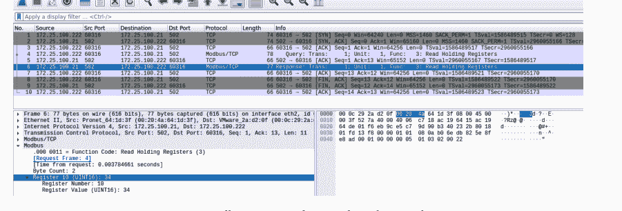

注意在上述截图中，可以看到**172.25.100.222**在第4个数据包中请求一个寄存器值，而Modbus服务（**172.25.100.21**）在第*6个数据包*中发送响应（在上述截图中已高亮显示）。在数据包详情中，我们可以看到寄存器编号（**10**）及其值（**34**）。

有了这些信息，攻击者现在可以指示Modbus服务按照自己的意愿更改这个值。我们可以用来执行此操作的一个可行工具是**modbus-cli**，接下来将对其进行说明。


## modbus-cli

modbus-cli 是一个 Ruby 应用程序，你可以使用以下命令将其添加到 Kali Linux 中：

```
pac@KVM0101011:~$ sudo gem install modbus-cli
Successfully installed modbus-cli-0.0.14
Parsing documentation for modbus-cli-0.0.14
Done installing documentation for modbus-cli after 0 seconds
1 gem installed
```

安装完成后，运行该 Ruby 工具的命令是 `modbus`：

```
pac@KVM0101011:~$ modbus
Usage:
    modbus [OPTIONS] SUBCOMMAND [ARG] ...

Parameters:
    SUBCOMMAND
    [ARG] ...    subcommand arguments

Subcommands:
    read        from the device
    write       to the device
    dump        copy contents of read file to the device

Options:
    -h, --help  print help
```

如你所见，该工具允许我们读写 Modbus 服务器。让我们看看我们是否可以读取工作寄存器 10：

```
pac@KVM0101011:~$ modbus read -help
Usage:
    modbus read [OPTIONS] HOST ADDRESS COUNT

Parameters:
    HOST                        IP address or hostname for the Modbus device
    ADDRESS                     Start address (eg %M100,
```

| %MW100, 101, 400101) | |
| COUNT | 要读取的数据数量 |
| 选项： | |
| -w, --word integers | 使用无符号 16 位整数 |
| -i, --int | 使用有符号 16 位整数 |
| -d, --dword integers | 使用无符号 32 位整数 |
| -f, --float point values | 使用有符号 32 位浮点数 |
| --modicon (eg. coil: 101, word: 400001) | 使用 Modicon 寻址方式 |
| --schneider (eg. coil: %M100, word: %MW0, float: %MF0, dword: %MD0) | 使用 Schneider 寻址方式 |
| -s, --slave ID | 使用从站 ID（默认：1） |
| -p, --port | 使用 TCP 端口（默认：502） |
| -o, --output FILE | 将结果写入文件 |
| -D, --debug | 显示调试消息 |
| -T, --timeout when talking to the slave | 指定与从站通信时的超时时间（秒） |
| -C, --connect-timeout TIMEOUT seconds when connecting to TCP socket | 指定连接 TCP 套接字时的超时时间（秒） |
| -h, --help | 打印帮助 |

以下示例展示了 modbus 命令读取 MW10 的过程：

```
pac@KVM0101011:~$ modbus read 172.25.100.21 %MW10 1
%MW10        34
```

与数据包捕获一样，我们成功读取了 Marker Word 10 (%MW10)。现在，让我们看看是否可以覆盖该寄存器：

```
pac@KVM0101011:~$ modbus write -help
Usage:
    modbus write [OPTIONS] HOST ADDRESS VALUES ...
Parameters:
    HOST                        IP address or hostname for the Modbus device
```

事情真的如此简单，因为 Modbus 命令在网络中以明文发送，且服务不需要任何形式的认证或授权即可读写寄存器——任何拥有 Modbus 服务器 IP 地址的人都可以对其发起攻击。

我们要查看的下一个工业协议是 **EtherNet/IP (ENIP)**。

## 获取 EtherNet/IP 信息

EtherNet/IP 是一种在以太网通信标准之上实现 **通用工业协议 (CIP)** 的工业协议。CIP 之前已在串行通信（例如 DeviceNet）以及同轴通信介质（ControlNet）上实现过。通过 EtherNet/IP，命令协议现在可以封装在数据帧/数据包中，因此可以跨子网甚至互联网进行路由。

默认情况下，EtherNet/IP 使用 TCP 端口 44818，因此我们可以使用以下命令 grep 任何使用 EtherNet/IP 的系统（grep 的 -B 标志指示应显示出现位置之前多少行）：

```
pac@KVM0101011:~$ cat ics-services.txt | grep 44818 -B5
Nmap scan report for 172.25.100.11
Host is up (0.00051s latency).
Not shown: 65533 closed ports
PORT      STATE SERVICE          VERSION
80/tcp    open  http             GoAhead WebServer
44818/tcp open  EtherNet-IP-2
--
Nmap scan report for 172.25.100.12
Host is up (0.00040s latency).
Not shown: 65533 closed ports
PORT      STATE SERVICE          VERSION
80/tcp    open  http             GoAhead WebServer
44818/tcp open  EtherNet-IP-2
--
Nmap scan report for 172.25.100.23
Host is up (0.00050s latency).
Not shown: 65534 closed ports
PORT      STATE SERVICE          VERSION
44818/tcp open  EtherNet-IP-2
```

现在我们知道 ICS 网络中哪些系统暴露了 EtherNet/IP 服务，我们可以使用我们信任的 Nmap 扫描器并使用脚本来查找运行在这三个 IP 上的服务信息。

## Nmap 的 enip-info 脚本

让我们看看 Nmap 附带哪些允许我们拉取 EtherNet/IP (enip) 信息的脚本：

```
pac@KVM0101011:~$ ls /usr/share/nmap/scripts/ | grep -e enip
-rw-r--r-- 1 root 57K Jul 13 03:03 enip-info.nse
```

现在，让我们将该脚本指向我们识别的第一个开放 TCP 端口 44818 的 IP：

```
pac@KVM0101011:~$ sudo nmap -T3 172.25.100.11 -p 44818 --script enip-info
Starting Nmap 7.80 ( https://nmap.org ) at 2020-08-31 16:04 MDT
Nmap scan report for 172.25.100.11
Host is up (0.00076s latency).

PORT     STATE SERVICE
44818/tcp open  EtherNet-IP-2
|   enip-info:
|     type: Communications Adapter (12)
|     vendor: Rockwell Automation/Allen-Bradley (1)
|     productName: 1756-EN2T/B
|     serialNumber: 0x005eae98
|     productCode: 166
|     revision: 5.28
|     status: 0x0030
|     state: 0x03
|_    deviceIp: 172.25.100.11
MAC Address: 00:00:BC:5A:D0:56 (Rockwell Automation)
Nmap done: 1 IP address (1 host up) scanned in 0.41 seconds
```

我们可以看到这里有很多有趣的细节。显然，`172.25.100.11` 是一个通信适配器——准确来说是一个 `1756-EN2T` 系列 B。该通信适配器运行的修订版本为 `5.28`。此信息允许我们查找正在调查的系统中的已知漏洞。其他信息，如 `productCode` 和 `serialNumber`，允许我们向资产管理数据库添加细节。

对 172.25.100.12 运行 enip-enum 脚本得出了几乎相同的细节，但对 172.25.100.23 运行该脚本揭示了一些值得注意的信息：

```
pac@KVM0101011:~$ sudo nmap -T3 172.25.100.23 -p 44818 --script enip-info
Starting Nmap 7.80 ( https://nmap.org ) at 2020-08-31 20:17 MDT
Nmap scan report for 172.25.100.23
Host is up (0.001s latency).

PORT      STATE SERVICE
44818/tcp open  EtherNet-IP-2
| enip-info:
|   type: Programmable Logic Controller (14)
|   vendor: Rockwell Automation/Allen-Bradley (1)
|   productName: 1999-56 Our Test Controller
|   serialNumber: 0x006c061a
|   productCode: 54
|   revision: 20.11
|   status: 0x3160
|   state: 0xff
|_  deviceIp: 0.0.0.0
MAC Address: 00:03:12:0B:02:AC (TRsystems GmbH)

Nmap done: 1 IP address (1 host up) scanned in 0.42 seconds
```

我们在这里看到的是 Python 的 cpppo 模块，作为实验设置的一部分，我们已在这台机器上安装了该模块（参见附录 1），它正在发挥作用。在该机器上运行的服务器服务是完全可自定义的，因此我们可以通过在 cpppo.conf 文件中指定来返回我们想要的任何信息。

因此，我们现在拥有了能够搜索漏洞并将其输入我们资产管理系统所需的所有信息。在继续之前，让我们看看 EtherNet/IP 如何遭受与 Modbus 和大多数其他工业通信协议相同的漏洞，包括缺乏机密性（明文协议）和缺乏认证（任何人都可以操纵数据）。攻击者可以嗅探网络以识别用于攻击的关键数据/标签。一个特别方便的 Python 模块 Pylogix 使我们询问控制器内存中有哪些标签变得更加简单，从而检测此类信息更加直接。我们将接下来查看 Pylogix。

## Pylogix

Pylogix ([https://github.com/dmroeder/pylogix](https://github.com/dmroeder/pylogix)) 是一个 Python 模块，旨在允许 Python 脚本与 Allen Bradley ControlLogix PLC 进行交互。它使交互变得非常直观，可用于查找 PLC 详细信息、查找配置的标签，以及读写任何标签的值。你可以创建脚本来完成所有这些事情，或者使用交互式 Python shell 一次运行一条命令——嗯……交互式地运行。

要在 Kali Linux 机器上安装 Pylogix 和 IPython，请运行以下命令：

```
pac@KVM0101011:-$ pip3 install --upgrade pylogix ipython
Defaulting to user installation because normal site-packages is not writeable
Collecting pylogix
  Downloading pylogix-0.7.0-py2.py3-none-any.whl (61 kB)
...
Installing collected packages: pylogix
Successfully installed pylogix-0.7.0
```

现在 Pylogix 和 IPython 已安装，我们将使用这两者连接到位于 172.25.100.11 的 Allen Bradley ControlLogix PLC，读取运行程序的所有配置标签，选择一个有趣的标签，并读写该标签的值：

```
pac@KVM0101011:-$ ipython
Python 3.8.5 (default, Aug  2 2020, 15:09:07)
Type 'copyright', 'credits' or 'license' for more information
IPython 7.18.1 -- An enhanced Interactive Python. Type '?' for help.

In [1]: from pylogix import PLC

In [2]: comm = PLC()

In [3]: comm.IPAddress = '172.25.100.11'

In [4]: comm.GetTagList()
Out[4]: Response(TagName=None,
Value=[LgxTag(TagName=Program:MainProgram, InstanceID=7162,
SymbolType=104, DataTypeValue=104, DataType=, Array=0,
Struct=0, Size=0 AccessRight=None Internal=None Meta=None
Scope0=None Scope1=None Bytes=None), LgxTag(TagName=Boiler2_
```


```
ControlPoint, InstanceID=22820, SymbolType=196,
DataTypeValue=196, DataType=DINT, Array=0, Struct=0,
Size=0 AccessRight=None Internal=None Meta=None Scope0=None Scope1=None Bytes=None), LgxTag(TagName=Boiler2_PressureSetpoint, InstanceID=49109, SymbolType=196,
DataTypeValue=196, DataType=DINT, Array=0, Struct=0,
Size=0 AccessRight=None Internal=None Meta=None Scope0=None Scope1=None Bytes=None), LgxTag(TagName=Program:MainProgram.test, InstanceID=46883, SymbolType=193, DataTypeValue=193,
DataType=BOOL, Array=0, Struct=0, Size=0 AccessRight=None Internal=None Meta=None Scope0=None Scope1=None Bytes=None)],
Status=Success)
```

```text
In [6]: comm.Read('Boiler2_PressureSetpoint')
Out[6]: Response(TagName=Boiler2_PressureSetpoint, Value=10, Status=Success)

In [7]: comm.Write('Boiler2_PressureSetpoint', 200)
Out[7]: Response(TagName=Boiler2_PressureSetpoint, Value=[200], Status=Success)

In [8]: comm.Read('Boiler2_PressureSetpoint')
Out[8]: Response(TagName=Boiler2_PressureSetpoint, Value=200, Status=Success)
```

正如你所见，Pylogix 模块允许我们连接到 ControlLogix PLC，然后查找正在运行程序中的所有标签。一旦完成，我们就可以挑选出想要操作的标签。相同的 Pylogix 模块随后允许我们读取和写入该标签的值。我们已成功完成了此操作。以下两个屏幕截图显示了我们在操作锅炉压力设定点之前和之后 PLC 标签值。

我们通过 Pylogix 操作敏感的 Boiler2_PressureSetpoint 之前的数值如下：

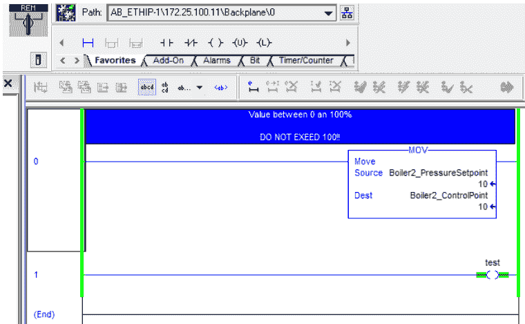

图 7.6 – Pylogix 操作前的 Boiler2_PressureSetpoint

我们通过 Pylogix 操作敏感的 Boiler2_PressureSetpoint 之后的数值如下：

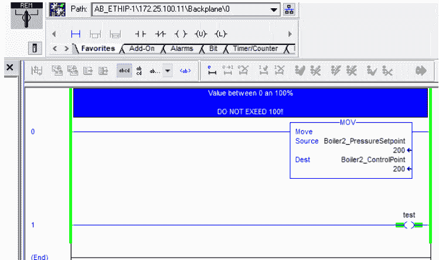

图 7.7 – Pylogix 操作后的 Boiler2_PressureSetpoint

正如你所见，即使是现代自动化控制器也存在遗留漏洞。ControlLogix 平台，或更准确地说 FactoryTalk 环境（FactoryTalk 安全），允许我们设置严格的控制，以管理谁可以编程或甚至查看控制器数据。然而，FT 安全设置起来很麻烦，并且经常未被实施。

最后，我想指出，我并不是在针对 PLC/协议——大多数主要 PLC 品牌和自动化协议都存在与 Modbus 和 EtherNet/IP 相同的固有脆弱设计缺陷，只要这些个人位于正确的网络段上，未经授权的个人就可以轻松地对其进行操作/查询（我们的 IDMZ 应该有助于确保安全）。主要制造商已经开始实施额外的控制措施，以减轻这些漏洞的影响。情况正在好转，但要完全修复 ICS 设备中的这些根本性设计缺陷，可能需要很长时间，甚至永远无法完全修复。

为了完成我们的工业协议扫描活动，我们将通过从 Siemens PLC 中提取信息来结束本节。

## 扫描 Siemens S7（iso-tsap）

Siemens S7 PLC 使用 `iso-tsap` 协议与其它 PLC 和编程终端通信。该协议运行在通常监听端口 `102` 的服务上。如果你还记得我们的扫描结果，我们有一个系统端口 `102` 是开放的。让我们用以下命令查看那是什么系统：

```
pac@KVM0101011:~$ cat ics-services.txt | grep 102 -B5

Nmap scan report for 172.25.100.20
Host is up (0.00055s latency).
Not shown: 65534 closed ports
PORT    STATE SERVICE VERSION
102/tcp open  iso-tsap Siemens S7 PLC
```

现在我们知道 `172.25.100.20` 对端口 `102` 上的查询做出响应，让我们看看能从中获取什么信息。我们将使用另一个编写用于从 S7 PLC 获取信息的 Nmap 脚本：

```
pac@KVM0101011:~$ ls /usr/share/nmap/scripts/ | grep -e s7

-rw-r--r-- 1 root root 9.8K Jul 13 03:03 s7-info.nse
```

将这些内容结合起来，我们使用以下命令作为目标系统：

```
pac@KVM0101011:~$ nmap -T3 -p 102 --script s7-info 172.25.100.20
Starting Nmap 7.80 (https://nmap.org) at 2020-09-01 16:29 MDT
Nmap scan report for 172.25.100.20

Host is up (0.0013s latency).
PORT     STATE SERVICE
102/tcp open  iso-tsap
| s7-info:
|   Module: 6ES7 315-2EH14-0AB0
|   Basic Hardware: 6ES7 315-2EH14-0AB0
|   Version: 3.2.6
|   System Name: SNAP7-SERVER
|   Module Type: CPU 315-2 PN/DP
|   Serial Number: S C-C2UR28922012
|_  Copyright: Original Siemens Equipment
MAC Address: 00:1C:06:00:BC:37 (Siemens Numerical Control, Nanjing)
Service Info: Device: specialized
Nmap done: 1 IP address (1 host up) scanned in 0.41 seconds
```

正如你所见，Nmap 再次成功提供了我们需要的信息，以扩展我们的资产数据库或用于发现系统漏洞。

这就是发现部分的全部内容！你现在可以利用在这里学到的信息来寻找已知漏洞。

## 手动漏洞验证

作为一个例子，让我们以在 172.25.100.11 上发现的 Rockwell Communications 适配器为例：

```
44818/tcp open  EtherNet-IP-2
| enip-info:
|   type: Communications Adapter (12)
|   vendor: Rockwell Automation/Allen-Bradley (1)
|   productName: 1756-EN2T/B
| serialNumber: 0x005eae98
| productCode: 166
| revision: 5.28
| status: 0x0030
| state: 0x03
|_ deviceIp: 172.25.100.11
MAC Address: 00:00:BC:5A:D0:56 (Rockwell Automation)
```

我们可以将这些信息带到诸如 CVE Details（https://www.cvedetails.com/）之类的在线服务上，并在 1756-en2t 上进行搜索：

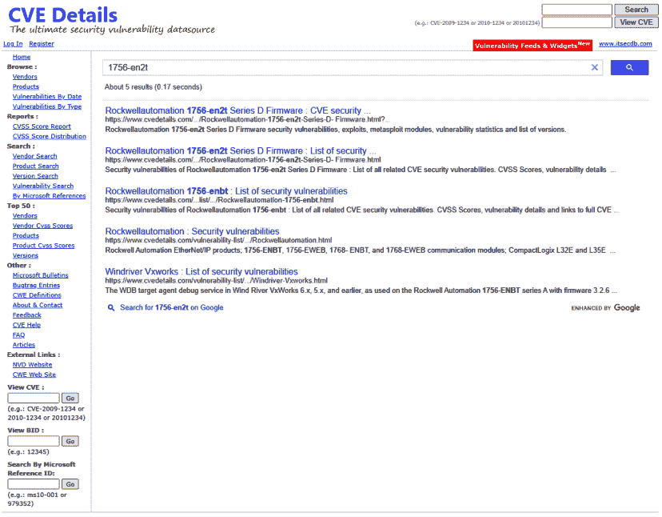

图 7.8 – CVE Details – 1756-en2t 结果

现在，我们可以查看设备是否存在任何已知问题。

这是一个非常劳动密集的过程，容易遗漏漏洞或发现误报。因此，接下来，我们将研究如何使用知名漏洞扫描工具来自动化此过程。

## 扫描漏洞

正如我们在第 6 章被动安全监控中所讨论的，我们可以实施工具，利用数据包捕获（嗅探）技术来检测我们 ICS 网络上的系统并开始索引服务和这些服务的版本/修订版，从而使工具能够检测漏洞。由于我们采用分层防御模型（纵深防御），我们不应仅依赖一种工具或技术来确保安全。这种被动工具的好坏取决于我们（能够）提供给它的数据的质量。如果我们的 OT-IDS 看不到某个东西的数据包，它就无法验证漏洞。因此，我们应定期通过扫描网络漏洞来验证情况。在本节中，我们将讨论三种常见的可以帮助我们执行漏洞扫描的工具，即 Nmap、Nikto 和 Nessus。

### 使用 Nmap 扫描网络服务漏洞

Nmap 可用于扫描网络服务中可能存在的漏洞。Nmap 的漏洞扫描通过脚本实现。让我们通过以下命令查看可用的漏洞扫描脚本：

```
pac@KVM0101011:~$ ls /usr/share/nmap/scripts/ | grep -e vuln
-rw-r--r-- 1 root root 6.9K Jul 13 03:03 afp-path-vuln.nse
-rw-r--r-- 1 root root 5.8K Jul 13 03:03 ftp-vuln-cve2010-4221.nse
-rw-r--r-- 1 root root 6.9K Jul 13 03:03 http-huawei-hg5xxx-vuln.nse
-rw-r--r-- 1 root root 4.2K Jul 13 03:03 http-vuln-wnr1000-creds.nse
-rw-r--r-- 1 root root 6.9K Jul 13 03:03 mysql-vuln-cve2012-2122.nse
-rw-r--r-- 1 root root 8.7K Jul 13 03:03 rdp-vuln-ms12-020.nse
-rw-r--r-- 1 root root 4.0K Jul 13 03:03 rmi-vuln-classloader.nse
-rw-r--r-- 1 root root 6.4K Jul 13 03:03 rsa-vuln-roca.nse
-rw-r--r-- 1 root root 4.1K Jul 13 03:03 samba-vuln-cve-2012-1182.nse
-rw-r--r-- 1 root root 5.2K Jul 13 03:03 smb2-vuln-uptime.nse
-rw-r--r-- 1 root root 7.4K Jul 13 03:03 smb-vuln-conficker.nse
-rw-r--r-- 1 root root 5.3K Jul 13 03:03 smb-vuln-ms07-029.nse
-rw-r--r-- 1 root root 5.6K Jul 13 03:03 smb-vuln-ms08-067.nse
-rw-r--r-- 1 root root 5.6K Jul 13 03:03 smb-vuln-ms10-054.nse
-rw-r--r-- 1 root root 7.1K Jul 13 03:03 smb-vuln-ms10-061.nse
-rw-r--r-- 1 root root 7.2K Jul 13 03:03 smb-vuln-ms17-010.nse
-rw-r--r-- 1 root root 15K Jul 13 03:03 smtp-vuln-cve2010-4344.nse
-rw-r--r-- 1 root root 7.6K Jul 13 03:03 smtp-vuln-cve2011-1720.nse
```


在这里，我们可以看到 Nmap 配备了多种漏洞检测功能，范围从检查配置错误、使用常见密码，到在各种协议和程序中执行 CVE 检查。

作为示例，我们将使用 `smb-vuln-ms17-010.nse` 脚本来扫描存在 `ms17-010` 漏洞的 Windows 系统。**MS17-010** 是 Windows SMB 协议中的一个缺陷，它助长了 EternalBlue 漏洞利用，使得 **WannaCry** 和 **NotPetya** 等勒索软件几年前像野火一样迅速蔓延。

我们可以扫描所有开放 SMB 协议（TCP 端口 445 开放）的 Windows 机器，并通过运行以下命令来验证是否存在 ms17-010 漏洞：

```text
pac@KVM0101011:~$ sudo nmap -iL ics_ips.txt -p 445 --open -T3 -sV --script smb-vuln-ms17-010

Starting Nmap 7.80 ( https://nmap.org ) at 2020-09-01 17:33 MDT
Nmap scan report for 172.25.100.100
Host is up (0.00028s latency).

PORT    STATE SERVICE      VERSION
445/tcp open  microsoft-ds Microsoft Windows Server 2008 R2 - 2012 microsoft-ds (workgroup: OT-DOMAIN)
MAC Address: 00:02:BA:D9:A7:41 (Cisco Systems)
Service Info: Host: OT-DC1; OS: Windows; CPE: cpe:/o:microsoft:windows
...
```

扫描结果显示，大多数被扫描的主机不受 **MS17-010** 影响。

然而，主机 `172.25.100.201` 和 202（Windows XP 机器）似乎存在漏洞，如下面的输出所示：

```text
...
Nmap scan report for 172.25.100.203
Host is up (0.00020s latency).

PORT    STATE SERVICE      VERSION
445/tcp open  microsoft-ds Microsoft Windows XP microsoft-ds
MAC Address: 40:83:DE:B2:10:48 (Zebra Technologies)
Service Info: OS: Windows XP; CPE: cpe:/o:microsoft:windows_xp

Host script results:
| smb-vuln-ms17-010:
|     VULNERABLE:
|     Remote Code Execution vulnerability in Microsoft SMBv1 servers (ms17-010)
|     State: VULNERABLE
|     IDs:  CVE:CVE-2017-0143
|     Risk factor: HIGH
|     A critical remote code execution vulnerability exists in Microsoft SMBv1
|         servers (ms17-010).
| 
|     Disclosure date: 2017-03-14
|     References:
|         https://technet.microsoft.com/en-us/library/security/ms17-010.aspx
|         https://cve.mitre.org/cgi-bin/cvename.cgi?name=CVE-2017-0143
|_        https://blogs.technet.microsoft.com/msrc/2017/05/12/customer-guidance-for-wannacry-attacks/
```

微软为受 MS17-010 漏洞影响的所有操作系统发布了补丁，甚至包括当时已停止支持的 Windows XP，因此我们应确保安装该补丁。

我们可以扫描的漏洞还有很多，但我将把这个作为留给读者的课后作业。

关于 Nmap 漏洞扫描的最后一点，我想指出，这种方法从未旨在一次性扫描人类已知的每一种漏洞，甚至也不是为了扫描大量（多种）漏洞。这种方法更适合用于验证环境中是否存在某一特定漏洞或配置错误，它通过使用具有针对性且相对低影响的扫描来实现这一点。由于我们只针对单一条件进行扫描，因此我们引入的网络数据包数量也非常有限。

现在，让我们转换一下思路，看看一个虽然不是 Nmap，但却是许多安全专业人士长期钟爱的工具：Nikto。

## 使用 Nikto 发现 Web 服务器漏洞

Nikto 是一款历史悠久的漏洞扫描工具。它专门用于发现 Web 服务器中的漏洞和配置错误，包括 PHP 和 ASP 等内容交付框架，这些框架可能正在提供动态网页。Nikto 会扫描过时的 Web 服务器版本、过时的插件/框架、存在的危险文件或程序，以及危险或缺失的 HTTP 服务器选项（如缺失的标志和安全设置）等。

在以下示例中，我们让 Nikto 扫描我们在 ICS 网络中识别出正在运行 Web 服务器（TCP 端口 80 开放）的三个 IP 地址。还有更多系统开放了端口 80，但这三个系统运行着独特的 Web 服务器版本。

为了在已扫描的资产中找到 Web 服务器，我们可以使用一些 Linux 命令行技巧：

```text
pac@KVM0101011:~$ cat ics-services.txt | grep -e 80/tcp -B 5
...
Nmap scan report for 172.25.100.11
PORT   STATE  SERVICE         VERSION
80/tcp open   http            GoAhead WebServer
...
Nmap scan report for Workstation1.ot-domain.local
(172.25.100.201)
PORT   STATE  SERVICE         VERSION
80/tcp open   http            Microsoft IIS httpd 10.0
...
Nmap scan report for Workstation10.ot-domain.local
(172.25.100.210)
PORT   STATE  SERVICE         VERSION
80/tcp open   http            Microsoft IIS httpd 7.5
...
```

现在，我们可以使用以下命令让 Nikto 指向 Allen Bradley 通信适配器 172.25.100.11：

```text
pac@KVM0101011:~$ nikto -host 172.25.100.11
- Nikto v2.1.6
---------------------------------------------------------------------------
+ Target IP:           172.25.100.11
+ Target Hostname: 172.25.100.11
+ Target Port: 80
+ Start Time: 2020-09-02 16:19:48 (GMT-6)
---------------------------------------------------------------------------
+ Server: GoAhead-Webs
+ The anti-clickjacking X-Frame-Options header is not present.
+ The X-XSS-Protection header is not defined. This header can hint to the user agent to protect against some forms of XSS
+ The X-Content-Type-Options header is not set. This could allow the user agent to render the content of the site in a different fashion to the MIME type
+ Root page / redirects to: http://172.25.100.11/home.asp
+ GoAhead-Webs - This may be a Cyclade, http://www.cyclades.com/
+ 8729 requests: 4 error(s) and 4 item(s) reported on remote host
+ End Time: 2020-09-02 16:20:33 (GMT-6) (45 seconds)
---------------------------------------------------------------------------
+ 1 host(s) tested
```

我们可以看到，该通信适配器在端口 80 上运行 GoAhead-Webs Web 服务器。随后，Nikto 向我们展示了一些有助于防止攻击（如 XSS 和 Clickjacking）的关键安全措施未启用或未实现。

接下来，我们将通过让 Nikto 指向 172.25.100.201 来针对 Microsoft Web 服务器（IIS 10）：

```text
pac@KVM0101011:~$ nikto -host 172.25.100.201
- Nikto v2.1.6
---------------------------------------------------------------------------
+ Target IP: 172.25.100.201
+ Target Hostname: 172.25.100.201
+ Target Port: 80
+ Start Time: 2020-09-02 16:24:22 (GMT-6)
---------------------------------------------------------------------------
+ Server: Microsoft-IIS/10.0
+ Retrieved x-powered-by header: ASP.NET
+ The anti-clickjacking X-Frame-Options header is not present.
+ The X-XSS-Protection header is not defined. This header can hint to the user agent to protect against some forms of XSS
+ The X-Content-Type-Options header is not set. This could allow the user agent to render the content of the site in a different fashion to the MIME type
+ Retrieved x-aspnet-version header: 4.0.30319
+ No CGI Directories found (use '-C all' to force check all possible dirs)
+ Retrieved dav header: 1,2,3
+ Retrieved ms-author-via header: DAV
+ Uncommon header 'ms-author-via' found, with contents: DAV
+ Allowed HTTP Methods: OPTIONS, TRACE, GET, HEAD, POST, PROPFIND, PROPPATCH, MKCOL, PUT, DELETE, COPY, MOVE, LOCK, UNLOCK
+ OSVDB-397: HTTP method ('Allow' Header): 'PUT' method could allow clients to save files on the web server.
...
+ OSVDB-397: HTTP method ('Public' Header): 'PUT' method could allow clients to save files on the web server.
+ OSVDB-5646: HTTP method ('Public' Header): 'DELETE' may allow clients to remove files on the web server.
+ WebDAV enabled (PROPFIND MKCOL UNLOCK COPY LOCK PROPPATCH listed as allowed)
+ 7915 requests: 0 error(s) and 17 item(s) reported on remote host
+ End Time:             2020-09-02 16:24:47 (GMT-6) (25 seconds)
---------------------------------------------------------------------------
+ 1 host(s) tested
```


这次，Nikto 返回了更多信息。运行在此系统上的 Web 服务器被识别为 IIS 10.0，并且 ASP 4.0.30319 看起来也随之安装作为动态内容提供程序。Nikto 还检测到缺少安全头并标记了可以防止 XSS、点击劫持和 MIME 相关攻击的标志。输出还显示了各种 **开放源代码漏洞数据库 (OSVDB)** 发现。我们可以使用这些标识符通过 **vulners** 网站获取有关发现的漏洞的更多信息。例如，`https://vulners.com/osvdb/OSVDB:5646` 通过允许使用 **DELETE** 方法，让我们详细了解 Web 服务器的风险：

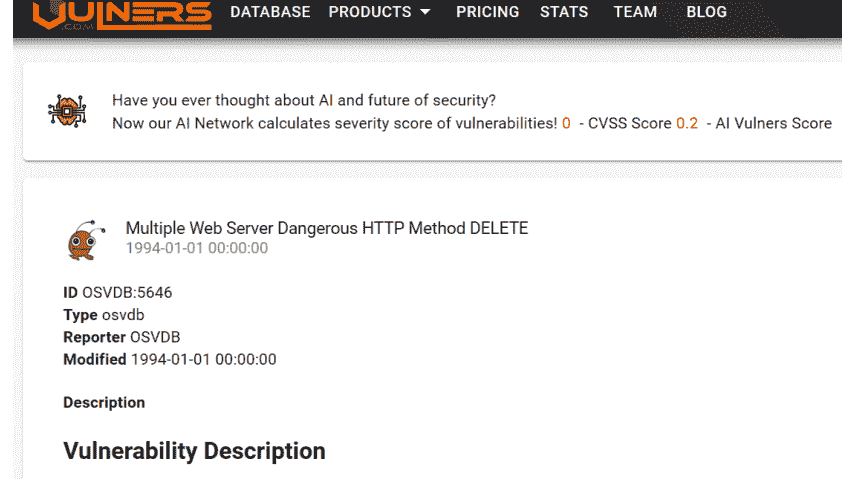

图 7.9 – 开放漏洞数据库结果

我们可以通过这种方式了解如何解决发现的漏洞。

为了说明这一点，让我们使用 Nikto 扫描 172.25.100.210，如下所示：

```
pac@KVM0101011:~$ nikto -host 172.25.100.210
- Nikto v2.1.6
-------------------------------------------------------------
--------
+ Target IP:             172.25.100.210
+ Target Hostname:       172.25.100.210
+ Target Port:           80
+ Start Time:            2020-09-02 16:39:41 (GMT-6)
-------------------------------------------------------------
--------
+ Server: Microsoft-IIS/7.5
...
+ Retrieved x-aspnet-version header: 2.0.50727
...
```

在这里，我们可以看到 Nikto 发现运行在此系统上的 Web 服务器是 IIS 7.5，这是随 Windows 7 一起提供的默认 IIS 版本。这反过来支持了我们之前使用 smb-os-discovery Nmap 脚本扫描操作系统详细信息时得出的发现。此外，我们现在知道该主机上运行的 Web 服务使用 ASPNET 版本 2.0.50727，这是在漏洞验证工作中可以使用的信息。

## 使用 Nessus 进行大规模漏洞扫描

为了完成本练习，我想向你展示使用（付费）自动化漏洞扫描器如何能显著加快速度。我将使用 Nessus 的 Essentials 版。Nessus 扫描器可在此下载：https://www.tenable.com/downloads/nessus?loginAttempted=true。只需找到适合你系统的下载版本并从此处请求 Nessus Essentials 激活码：https://www.tenable.com/products/nessus/activation-code。我不会解释如何安装和运行 Nessus 的初始配置，因为网上有大量教程和资源可以帮助完成此操作。我假设你已安装扫描器，已激活，并且已更新。

让我们执行高级网络扫描：

- 1. 导航到 **Scans**，选择 **Create a New Scan**，然后选择 **Advanced Scan**：

图 7.10 – Nessus 扫描 – 新扫描 / 高级扫描窗口

- 2. 为扫描命名并指定我们要扫描的 IP 地址范围：

图 7.11 – Nessus 扫描 – 指定目标

Nessus Essentials 许可证仅允许我们扫描 16 个 IP 地址，因此一旦扫描器在主机发现过程中达到该数量，其余系统将被忽略。不过我们应该没问题，因为我们的 ICS 网络只有 16 个 IP 地址。

- 3. 接下来，切换到设置中的 **Discovery-Host Discovery** 部分并启用 **Scan Operational Technology devices**：

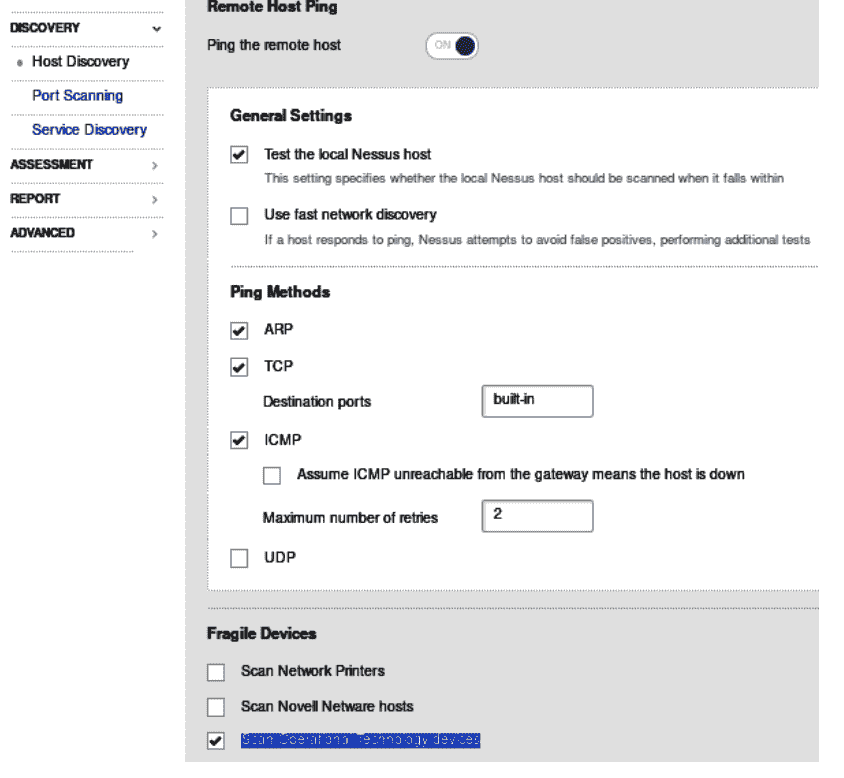

图 7.12 – Nessus 扫描 – 扫描 OT 设备

4. 接下来，在 Assessment-Web Applications 下，启用 Scan web applications：

图 7.13 – Nessus 扫描 – Web 应用设置

5. 在 Assessment-Windows 下，启用 Request information about the SMB Domain：

图 7.14 – Nessus 扫描 – 请求 SMB 信息

6. 将其他设置保持为默认值并保存扫描。然后，从 My Scans 页面启动扫描：

## My Scans


图 7.15 – Nessus 扫描 – 扫描运行中

Nessus 现在将执行其工作并尝试识别任何漏洞。必须理解的是，Nessus 仅从外部扫描，因此它只会发现通过网络暴露的服务和应用程序暴露的漏洞。你可以配置 Nessus 连接到终端设备（通过添加凭据），以便获得更深入的漏洞覆盖范围。

扫描可能需要一些时间才能完成。一旦完成，结果将可供审阅。从扫描结果的主机页面，我们可以看到所有扫描系统及其漏洞严重性的概览：

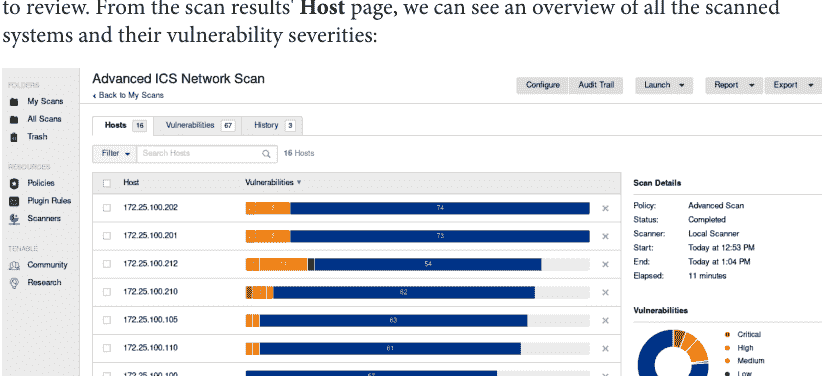

图 7.16 – Nessus 扫描 – 扫描结果概览

让我们查看这些漏洞，它们显示在 Vulnerabilities 选项卡上：

## 高级 ICS 网络扫描

返回 My Scans

Hosts 16

Vulnerabilities 67

History 3

Filter

Search Vulnerabilities

67 Vulnerabilities

| Sev | Name | Family | Count |
|---|---|---|---|
| MIXED | Microsoft Windows (Multiple Issues) | Windows | 32 |
| CRITICAL | Microsoft Windows XP Unsupported Installation Det... | Windows | 2 |
| CRITICAL | Treck TCP/IP stack multiple vulnerabilities. (Ripple20) | Misc. | 2 |
| MIXED | SNMP (Multiple Issues) | SNMP | 12 |
| MIXED | Web Server (Multiple Issues) | Web Servers | 5 |
| HIGH | Flexera FlexNet Publisher < 11.16.2 Multiple Vulner... | Misc. | 5 |
| MIXED | SSL (Multiple Issues) | General | 38 |
| MIXED | Microsoft Windows (Multiple Issues) | Misc. | 15 |
| MIXED | TLS (Multiple Issues) | Service detection | 11 |
| MIXED | SMB (Multiple Issues) | Windows : User management | 4 |

图 7.17 – Nessus 扫描 – 扫描结果 – 漏洞组

Nessus 在 ICS 网络上运行的系统、服务和应用程序中发现了各种漏洞。如果我们查看第一个漏洞组的详细信息，例如，我们将看到在 Windows 机器中发现了哪些问题：

## 高级 ICS 网络扫描 / Microsoft Windows (Multiple I...

返回 Vulnerabilities

Hosts 16

Vulnerabilities 67

History 3

Search Vulnerabilities

13 Vulnerabilities

| Sev | Name | Family | Count |
|---|---|---|---|
| CRITICAL | Unsupported Windows OS (remote) | Windows | 3 |
| CRITICAL | MS08-067: Microsoft Windows Server Service Crafte... | Windows | 2 |
| CRITICAL | MS09-001: Microsoft Windows SMB Vulnerabilities R... | Windows | 2 |
| CRITICAL | MS05-027: Vulnerability in SMB Could Allow Remote ... | Windows | 1 |
| CRITICAL | MS06-040: Vulnerability in Server Service Could Allo... | Windows | 1 |
| HIGH | Microsoft Windows SMB NULL Session Authentication | Windows | 6 |
| HIGH | MS17-010: Security Update for Microsoft Windows S... | Windows | 3 |
| HIGH | Microsoft Windows SMBv1 Multiple Vulnerabilities | Windows | 1 |
| HIGH | MS06-035: Vulnerability in Server Service Could Allo... | Windows | 1 |
| MEDIUM | Microsoft Windows SMB LsaQueryInformationPolicy ... | Windows | 1 |
| INFO | WMI Not Available | Windows | 9 |

图 7.18 – Nessus 扫描 – 扫描结果 – Windows 机器

查看漏洞范围，从 ms05（约 2005 年）到 ms06（约 2006 年），我们有一些严重过时的系统。这主要是由于我们网络上有两台 Windows XP 机器和一台 Windows 7 机器所致。

请注意，Nessus 发现了一些我们之前使用 Nmap 发现的问题。有趣的是，当我们查看 MS17-010 漏洞的详细信息时，我们会注意到 Nessus 识别出的系统比 Nmap 多一个：

## Output

```
No output recorded.
```

| Port | Hosts |
|---|---|
| 445 / tcp / cifs | 172.25.100.203 172.25.100.212 172.25.100.220 |

图 7.19 – Nessus 扫描 – 扫描结果 – 额外易受 MS17-010 攻击的 Windows 机器

172.25.100.212 没有被 Nmap 检测到。我重新运行了扫描，它仍然显示为不 vulnerable。这只是表明我们不应该依赖单一工具或解决方案来覆盖所有方面。此时，我们可能应该查看 172.25.100.212 是否可被利用（对系统克隆进行渗透测试），以便确定这是否是 Nessus 的误报还是 Nmap 的漏报。我们将在第 17 章《渗透测试 ICS 环境》中详细讨论渗透测试。

正如你所见，使用漏洞扫描器大规模扫描各种问题是一种节省时间的做法。由于其本质，这种技术往往会发现比手动流程更多的问题。代价是它非常具有侵入性。Nmap 会在网络上传输大量流量并以可能导致甚至某些现代自动化设备崩溃的方式 interrogate 系统。建议仅在停机期间、生产停止时或在与生产网络非常相似的测试环境中执行这种级别的自动化漏洞扫描。

## 练习 2 – 手动检查工业计算机

在本第二个练习中，我们将手动检查基于 Microsoft Windows 的系统并学习如何收集系统/操作系统详细信息、已安装软件、启动项和用户等信息。如果在某些时候我们想要进行比较，这些信息是必不可少的。这使我们能够例如在某个时间点比较配置的用户与之前配置的用户，可能允许我们识别已添加到系统中的新管理员帐户。

## 获取 Windows 主机信息

Microsoft Windows 操作系统在各种位置跟踪各种信息。诀窍是找到一种在各种 Windows 版本上都能方便工作的方式来提取这些信息。有（外部）实用程序可以帮助这些工作，但我认为如果不是绝对必要，我们不应该在 ICS 设备上运行外部可执行文件。通过反复试验，我发现了一些内置于几乎所有今天的 Windows 操作系统中的工具，可以帮助我们从 Windows 机器中提取所需的信息。以下各节将介绍这些工具并展示如何使用它们。


# msinfo32

从 Windows 机器获取大量信息的第一项技术，围绕着一个自 Windows XP 时代起就内置在 Windows 操作系统中的工具展开：msinfo32.exe。

要调用此工具，我们只需按下 Windows 键 + R 打开运行对话框，输入 msinfo32：

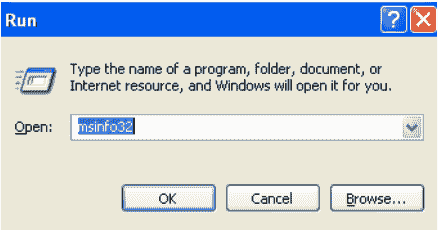

图 7.20 – 启动 msinfo32

按回车键。这将调出 msinfo32.exe —— 系统信息应用程序：

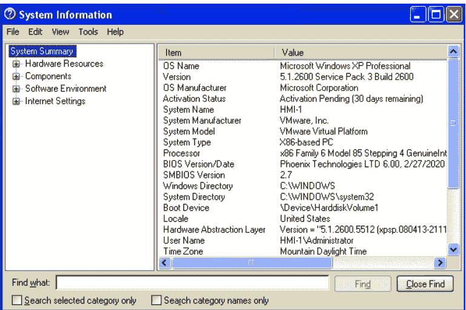

图 7.21 – Microsoft 系统信息实用工具

如你所见，系统信息工具包含硬件、软件、组件和 Internet 设置等部分。你可以点击浏览所有子部分，甚至可以搜索特定信息。

以下区域对我们尤其重要。

## 系统摘要

系统信息工具打开时的初始视图提供了有关计算机的详细信息：

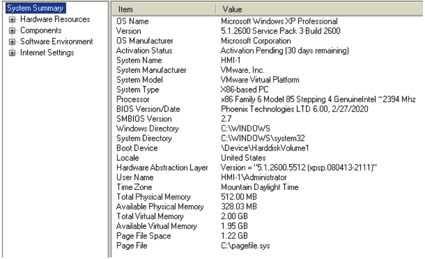

图 7.22 – msinfo32 – 系统摘要

此页面包含操作系统信息、BIOS 详细信息、硬件摘要和环境变量。

## 系统驱动程序

如果我们导航到 **软件环境 | 系统驱动程序**，可以看到系统中存在的所有驱动程序：

| 系统摘要 | 名称 | 描述 | 文件 | 类型 | 已启动 |
| :--- | :--- | :--- | :--- | :--- | :--- |
| **硬件资源** | \| | | | | | | | | |
| **组件** | \| | | | | | | | |
| **软件环境** | \| | | | | | | | |
| 系统驱动程序 | \| | | | | | | | |
| 签名驱动程序 | \| | | | | | | | |
| 环境变量 | \| | | | | | | | |
| 打印任务 | \| | | | | | | | |
| 网络连接 | \| | | | | | | | |
| 正在运行的任务 | \| | | | | | | | |
| 已加载模块 | \| | | | | | | | |
| 服务 | \| | | | | | | | |
| 程序组 | \| | | | | | | | |
| 启动程序 | \| | | | | | | | |
| OLE 注册 | \| | | | | | | | |
| Windows 错误报告 | \| | | | | | | | |
| Internet 设置 | \| | | | | | | | |
| | | | | | | | | |
| | ide | 软盘控制器驱动程序 | C:\windows\system32\drivers\iide.sys | 内核驱动程序 | 否 |
| | fastfat | FastFAT | c:\windows\system32\drivers\fastfat.sys | 文件系统驱动程序 | 否 |
| | dmload | dmload | c:\windows\system32\drivers\dmload.sys | 内核驱动程序 | 是 |
| | dmio | 逻辑磁盘管理器驱动程序 | c:\windows\system32\drivers\dmio.sys | 内核驱动程序 | 是 |
| | dmboot | dmboot | c:\windows\system32\drivers\dmboot.sys | 内核驱动程序 | 否 |
| | disk | 磁盘驱动程序 | c:\windows\system32\drivers\disk.sys | 内核驱动程序 | 是 |
| | compbatt | Microsoft 复合电池驱动程序 | c:\windows\system32\drivers\compbatt.sys | 内核驱动程序 | 是 |
| | cmibatt | Microsoft 交流适配器驱动程序 | c:\windows\system32\drivers\cmibatt.sys | 内核驱动程序 | 是 |
| | cdrom | CD-ROM 驱动程序 | c:\windows\system32\drivers\cdrom.sys | 内核驱动程序 | 是 |
| | cd21 | Cd21 | c:\windows\system32\drivers\cd21.sys | 文件系统驱动程序 | 是 |
| | cdudaud | Cduaduo | c:\windows\system32\drivers\cduaduo.sys | 内核驱动程序 | 否 |
| | ccbd2k | ccbd2k | c:\windows\system32\drivers\ccbd2k.sys | 内核驱动程序 | 否 |
| | beep | Beep | c:\windows\system32\drivers\beep.sys | 内核驱动程序 | 是 |
| | audstub | 音频存根驱动程序 | c:\windows\system32\drivers\audstub.sys | 内核驱动程序 | 是 |
| | atmarp | ATM ARP 客户端协议 | c:\windows\system32\drivers\atmarp.sys | 内核驱动程序 | 否 |
| | alapi | 标准 IDE/ESDI 硬盘控制... | c:\windows\system32\drivers\alapi.sys | 内核驱动程序 | 是 |
| | asycmaca | RAS 异步媒体驱动程序 | c:\windows\system32\drivers\asycmaca.sys | 内核驱动程序 | 否 |
| | agm440 | Intel A3P 总线过滤器 | c:\windows\system32\drivers\agm440.sys | 内核驱动程序 | 是 |
| | afd | AFD | c:\windows\system32\drivers\afd.sys | 内核驱动程序 | 是 |
| | acpiec | ACPIEC | c:\windows\system32\drivers\acpiec.sys | 内核驱动程序 | 否 |
| | aepi | Microsoft ACPI 驱动程序 | c:\windows\system32\drivers\aepi.sys | 内核驱动程序 | 是 |
| | vmvmmid1 | 内存控制驱动程序 | /*?AC_Virtual_ACPI_Common File*/vmware\vdrv | 内核驱动程序 | 是 |
| | aibddsk | Aibddsk | 不可用 | 内核驱动程序 | 否 |
| | abp450v5 | abp450v5 | 不可用 | 内核驱动程序 | 否 |
| | aodpl160m | aodpl160m | 不可用 | 内核驱动程序 | 否 |
| | aha154x | Aha154x | 不可用 | 内核驱动程序 | 否 |
| | aic79ud2 | aic79ud2 | 不可用 | 内核驱动程序 | 否 |
| | aic79x | aic79x | 不可用 | 内核驱动程序 | 否 |
| | aide | Aide | 不可用 | 内核驱动程序 | 否 |
| | amimnt | amimnt | 不可用 | 内核驱动程序 | 否 |
| | asc | asc | 不可用 | 内核驱动程序 | 否 |
| | asc3550p | asc3550p | 不可用 | 内核驱动程序 | 否 |
| | asc3550 | asc3550 | 不可用 | 内核驱动程序 | 否 |
| | atdisk | Atdisk | 不可用 | 内核驱动程序 | 否 |
| | cd20mnt | cd20mnt | 不可用 | 内核驱动程序 | 否 |
| | charger | Charger | 不可用 | 内核驱动程序 | 否 |
| | cmdide | cmdide | 不可用 | 内核驱动程序 | 否 |

图 7.23 – msinfo32 – 系统驱动程序

我通常按 **文件**（路径）对视图进行排序，查看是否有安装在任何奇怪位置的驱动程序。例如，内核驱动程序从 `C:\windows\temp` 文件夹启动就非常可疑。恶意软件有时会注册内核驱动程序以在系统上实现持久化，然后将已安装/已启动的驱动程序列表作为常规检查进行比对。

## 服务

已配置为在系统启动或用户登录时自动启动的进程（应用程序）称为服务。我们可以通过导航到软件环境 | 服务来调出当前配置的服务列表：

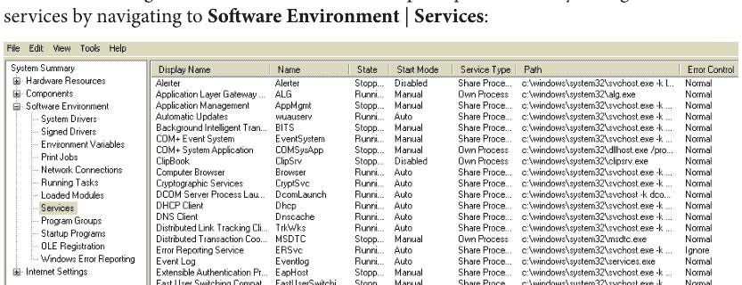

恶意软件通常会创建服务作为感染过程的一部分，以便在系统上建立持久化，使恶意软件随计算机启动而启动。将一段时间内或与类似系统对比的已安装和正在运行的服务快照进行比较，通常能发现恶意软件感染。

## 正在运行的进程

进程（或任务）是映射到内存中的应用程序（程序文件），它们运行代码并执行任务。因此，如果我们查看进程，就可以了解系统正在执行的任务。要获取系统信息工具抓取信息时正在运行的进程列表，我们可以转到软件环境 | 正在运行的任务：

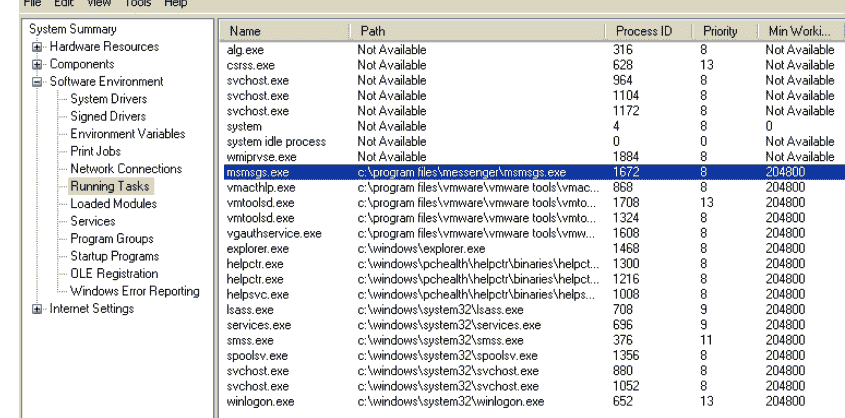

图 7.25 – msinfo32 – 正在运行的进程（任务）

同样，通常会将此列表按文件（路径）排序，以识别进程启动的异常位置。

将不同时间段或类似系统之间的运行进程转储进行对比，可以发现恶意软件或其他不需要的软件的感染。这对于 ICS 系统尤其适用，因为 ICS 系统中的计算机往往长时间运行相同的应用程序集。运行进程集的变化会显得格外醒目。

## 启动程序

除了服务之外，Windows 还提供了多种在系统启动或用户登录时自动启动应用程序的方法。系统信息工具会显示通过其中某些方法自动启动的应用程序。我们可以通过导航到 **软件环境 | 启动程序** 来查看这些应用程序：


图 7.26 – msinfo32 – 启动程序

此视图显示程序名称、启动命令、程序使用的用户帐户以及用于自动启动程序的启动方法。同样，抓取启动程序的快照并在一段时间内或与类似系统进行对比，可以发现各种恶意行为。

## 导出报告

为了创建此信息的记录，以便日后进行比较，我们可以通过 文件 | 导出 菜单选项导出系统信息报告。请确保在导出前已选中系统摘要位置，因为这可以保证所有信息都被导出：

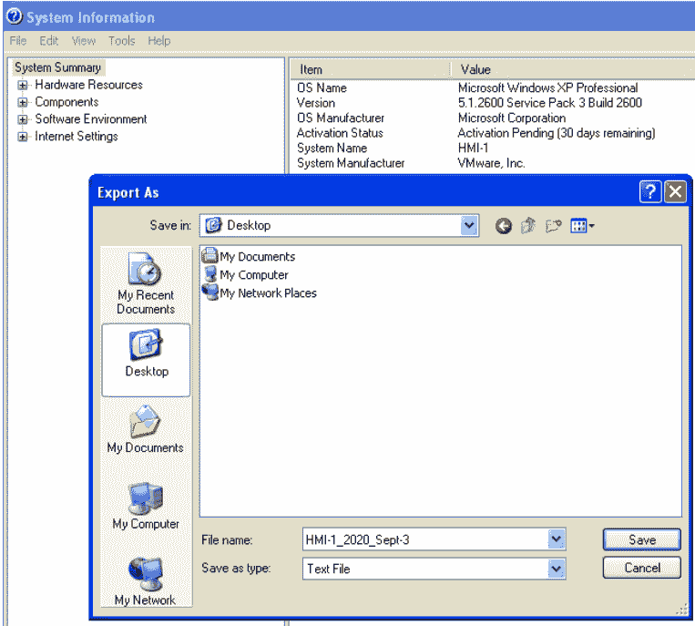

图 7.27 – msinfo32 – 导出报告

这样，我们就有了 HMI-1 计算机系统信息和系统状态的记录。你应该将其安全地存储在网络上，以便妥善保管和轻松检索。


## 已配置的用户

尽管 msinfo32.exe 应用程序抓取了大量信息，但缺少一个关键细节：系统用户账户。为了将此信息添加到我们的捆绑包中，我们可以使用随当今每个版本的 Windows 一起提供的原生 net.exe 工具。

## Net user

我们想要获取的第一种用户信息是本地账户。这可以通过在 Windows 命令提示符中发出 net user 命令来完成：

```
C:\Documents and Settings\Administrator>net user

User accounts for \\HMI-1

----------------------------------------
---------
Administrator          Guest          HelpAssistant
SUPPORT_388945a0
The command completed successfully.
```

该工具的输出显示了所有本地配置的用户账户。输出随时间的变化应被视为高度可疑。

## Net localgroup administrators

net user 命令仅显示在计算机上创建的本地账户。我们想查看是否创建了任何域账户或特殊账户并将其添加到系统的特权组中。我们使用 net localgroup <groupname> 命令来做到这一点。以下示例显示了属于 Administrators 组的用户账户（Windows 客户端系统上最特权的组）：

```
C:\Documents and Settings\Administrator>net localgroup administrators
Alias name          administrators
Comment             Administrators have complete and unrestricted access to the computer/domain

Members

----------------------------------------
---------
```

Administrator

QT-DOMAIN\Domain Admins

The command completed successfully.

此外，我们对 **power users** 组感兴趣：

C:\Documents and Settings\Administrator>net localgroup "power users"

Alias name  power users

Comment  Power Users possess most administrative powers with some restrictions. Thus, Power Users can run legacy applications in addition to certified applications

Members

----------------------------------------------------------------------------- -------

The command completed successfully.

最后，如果我们想查看是否创建了不应该存在的任何组，我们可以不指定组使用 net localgroup 命令：

C:\Documents and Settings\Administrator>net localgroup

Aliases for \\HMI-1

----------------------------------------------------------------------------

*Administrators

*Attackers

*Backup Operators

*Guests

*HelpServicesGroup

*Network Configuration Operators

*Power Users

*Remote Desktop Users

*Replicator

*Users

The command completed successfully.

这些命令的输出可以轻松复制并粘贴到已导出的系统信息报告中，以完成信息包。

至此，我们已经结束了对工业环境的积极探索。通过使用与端点交互或在网络上传送数据包的主动工具，我们发现了大量信息，这些信息可以帮助我们建立包含服务、应用程序和操作系统版本等详细信息的资产清单，包括软件和固件修订版。我们还拥有用户账户和其他端点特定细节的清单。我们应该以一种方便的方式存储所有这些信息，使我们能够查询工业环境安全态势的特定问题。

### 总结

本章我们涵盖了大量内容。我们讨论了各种主动安全监控方法，并亲手实践了一些常见工具和扫描技术。我们研究了发现漏洞的方法，以及如何在 ICS 网络上扫描已知错误配置和其他问题。

在上一章和本章讨论的技术和工具之间，我们捕获了大量与安全相关信息。在下一章中，我们将讨论存储、检索、搜索、关联和呈现所有这些信息的方法。

## 8