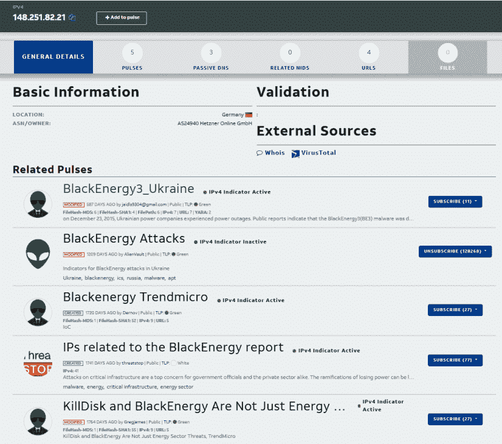
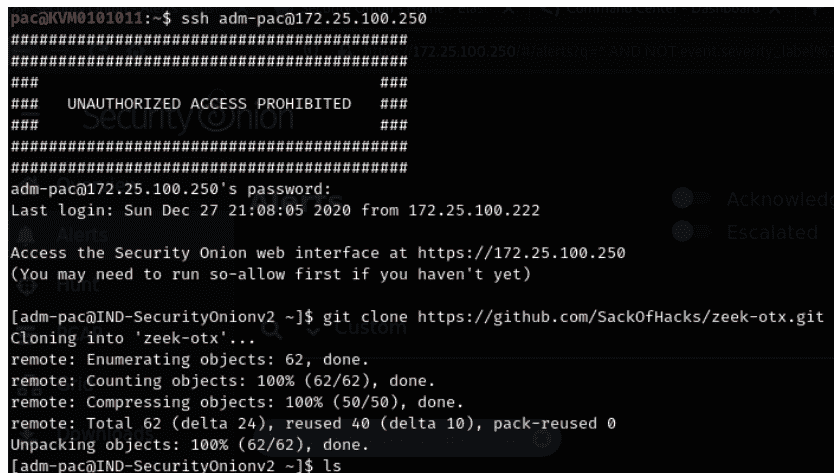
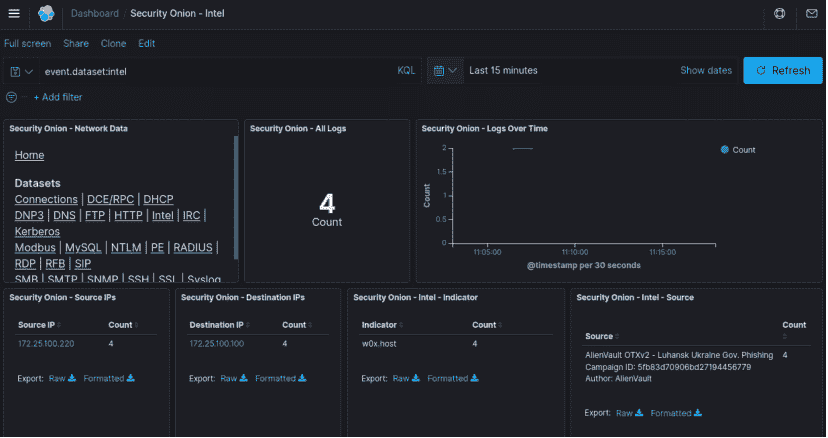

# 工业威胁情报

现在我们的安全监控工具已经安装，我们将开始寻找扩展其功能和增强其能力的方法。虽然在下一章 *第 9 章，可视化、关联和告警* 中，我们将研究增加可见性、更详细的信息以及总体上更好的威胁检测功能的方法，但在本章中，我们将讨论允许我们向安全监控程序添加 **威胁情报** 的工具、技术和活动。威胁情报通过将发现的安全监控工件（例如 URL、IP地址和文件哈希）与已知威胁信息（入侵指标）相关联，为我们的安全监控解决方案增加了存在置信度、被入侵可能性和利用可行性，从而使 resulting 信息对我们的环境相关且可操作。

本章将涵盖以下主题：

+   * 威胁情报解析
+   * 在工业环境中使用威胁信息
+   * 获取威胁信息
+   * 使用威胁信息创建威胁情报
+   * 向我们的 Security Onion 部署添加威胁源

## 技术要求

本章中使用以下工具和资源：

+   * **AlienVault OTX**：`https://otx.alienvault.com`

## 威胁情报解析

威胁情报是知识，是与您的组织和特定环境相关的威胁的知识。威胁情报是系统化流程的结果，其中来自各种数据源的基于证据的分析导致可操作的数据，有助于发现或根除最可能在您的网络和环境中遇到的威胁。威胁情报为针对您的组织、工业部门或运营空间的对手以及他们执行其恶意 **战术、技术和程序 (TTPs)** 的方式提供深入洞察。这种知识使我们能够就如何保护我们的环境做出更有效和精确的决策。

许多所谓的威胁情报网站会试图向您出售他们所称的威胁情报。按定义，这是不可行的。除非一家公司非常熟悉您的环境并且能够为您执行将威胁信息转化为可操作情报数据的流程，否则他们能提供的最好只是威胁信息。在这种意义上，威胁信息仅仅是一份 **入侵指标 (IOCs)** 列表。如前所述，IOCs 是表征威胁的技术信息片段。它们可以是 **互联网协议 (IP)** 地址、域名、文件名和位置、注册表键、文件哈希等。IOCs 使威胁检测、威胁狩猎以及将环境中发现的工件与恶意行为者、行为、内容或活动的已建立和已验证工件进行关联成为可能。

例如，假设我们在环境中识别出一个系统正在与 `http[:]//148.251.82.21/Microsoft/Update/KS4567890[].php` 通信。这个 URL 似乎有些可疑，不是吗？好吧，如果我们在 AlienVault 的威胁交换网站上对域名或 IP 地址进行快速查找（`https://otx.alienvault.com/indicator/ip/148.251.82.21`），我们可以看到我们的怀疑是正确的：



通过一次简单的查找，我们刚刚发现这个可疑的 IP 地址与 **BlackEnergy** 恶意软件活动有关。

我们刚刚执行的操作被认为是事件响应或网络取证。该系统已经与可疑服务器通信，并且可能已经被入侵。我们使用威胁信息来支持我们的结论并形成一个明智的决定，即该网络流量是恶意的，但仍然，我们只是将网络流量工件与 IOC 列表进行了比较。


形成威胁情报数据的艺术在于，将这些通用威胁信息（例如 AlienVault 等 IOC 订阅源）进行关联和处理，使其对你的组织和环境具有操作价值。其结果将是一份累积的情报信息清单，关于与你的环境相关的潜在威胁，并包含诸如 IP 地址、URL、威胁行为者及其 TTP 等属性。情报数据应以便于查询、搜索和关联的形式积累，以支持防火墙和 **入侵防御系统 (IPSes)** 等预防性控制，以便做出自动阻断/阻止/拒绝决策，并支持威胁狩猎、取证和事件响应活动。

威胁情报数据对公司具有可操作的价值，因为无关的威胁和信息被剔除并消除。

在定义了威胁情报之后，让我们简要看看在工业环境中使用威胁情报的好处。

## 在工业环境中使用威胁信息

威胁情报在正确集成到安全计划中时，可减少渗透的发现时间以及网络安全事件后的恢复时间。及早发现恶意活动很重要，因为这可以减少事件的潜在影响和损害，而快速恢复则有利于尽快恢复环境和流程，以便重启生产。如果执行得当，威胁情报甚至可以帮助组织为攻击做好准备。例如，假设威胁情报流程已识别出某个特定威胁行为者正在发送钓鱼邮件，攻击者试图让接收者打开一份据称是接收者参加的 NCEES 考试的负面结果的 Microsoft Word 文档。该 Word 文档被布了陷阱，一旦打开就会安装恶意软件：

### 工程基础考试

Thursday, 25 July 2019 at 12:48 pm

Show Details

Result Notice.doc
2.2 MB

Download All   Preview All


NCEES ID: [redacted]
Exam Date: July 2019

Exam Result: Failed

Dear participant

You have not achieved a passing score on your recent NCEES exam.

Please note that NCEES does not release numeric exam scores. Results are reported as pass or fail only.

See below for information on how to proceed with the licensing process in your state. We wish you continued success in your career.

Thank you.
Yours sincerely,
[redacted]
Manager
Department of Registration and Examination
PO Box 30670, Lansing MI 48909
Telephone Number: 517-241-9288
Email: [redacted]@NCEES.com
NCEES Advancing Licensure for engineers and surveyors

Figure 8.2 – Phishing email example

现在我们知道了这种类型的攻击，我们可以通知用户，调整邮件阻断规则，并采取其他类型的预防措施。我们也可以利用这些信息从潜在的入侵中恢复。

但请注意：仅靠威胁情报无法保护关键资产。相反，威胁情报补充了网络安全计划的每个组成部分：

- 在检测期间，通过提供信息和其他资源以便进行查询和比对，验证检测到的制品的恶意性
- 在响应活动中，通过使你能够快速评估威胁的潜在影响并优先安排工作
- 在事件发生前，通过额外的认知实现更好的威胁预防

威胁情报在有效创建和应用时，将降低组织整体风险，因为它提高了安全计划每个部分的效率，并最终减少了操作网络中的平均恢复时间，并减少了对手在你的环境中隐藏的时间。在最佳情况下，威胁情报可以使我们“超前视野”地观察我们的环境并帮助预防威胁。

在其最简单的形式中，创建威胁情报归结为两个主要学科：获取威胁信息（IOC 数据）以及将该威胁信息转化为威胁情报数据，通过将其与你的环境相关联并使其对你的运营具有可操作性。下一节将简要介绍这两个学科。这些部分并非要让你成为威胁情报专家；成为专家需要数年时间和比我在这本书中允许写的更多页数来解释。它们只是让你熟悉概念，并为你指明继续探索的方向。

### 获取威胁信息

威胁情报的第一个要求是可靠的威胁信息来源，一种获取最新威胁 IOC 信息的方法。

以下是一些 IOC 来源：

- 你自己的事件和威胁狩猎工作
- 厂商报告
- 你自己的蜜罐
- 同行和共享社区
- 外部/第三方免费和付费订阅源：
  
  一些厂商，如 FireEye、CyberX 和 Nozomi，会在其工具中提供这类情报订阅源。

让我们详细了解这些来源。

#### 你自己的事件和威胁狩猎工作

最好的威胁信息来自内部活动和资源。原因在于这些信息直接与你的环境相关，因为它就是源自于此。养成生成已发现主机名、IP地址、URL、DNS 查询、文件名、文件哈希以及发现该信息时的位置和情况等相关信息的列表的习惯。在存储这些信息之前，执行查询以将发现的信息与公共资源（如 WHOIS 数据库、文件哈希查询服务和 IP 信誉信息）进行关联。尽量存储尽可能多的周边信息，以及你发现的制品，以便日后进行关联、历史记录和威胁发现/缓解工作。

#### 厂商报告

你的 IT 和 OT 厂商通常会以报告形式提供用例、警报、警告和其他安全相关材料。定期获取这些报告，以了解任何相关设备或技术。这些报告将为你提供厂商发现的漏洞的深入见解，威胁行为者如何攻击这些漏洞，以及如何应对或缓解所述威胁。

#### 你自己的蜜罐

蜜罐是一个故意存在漏洞的系统、设备、网络或应用程序，连接到 ICS 网络但无法从我们感兴趣的网络外部部分访问。蜜罐被配置为对潜在攻击者具有诱惑力。攻击者攻击蜜罐的方式与攻击真实目标的方式基本相同，其每一步行动都会被监控并记录下来，供蜜罐所有者审查。拥有一个与你在内部或外部网络上运行的设备非常相似的蜜罐，可以让你 1) 检测是否正在被攻击者主动针对，以及 2) 了解这些攻击者如何攻击你的系统。

蜜罐有多种形式，从仅模拟可被利用的功能或服务的完全免维护系统（称为 **低交互蜜罐**）到实际系统的完整实现，其中每次攻击后系统都需要重置为已知干净状态（称为 **高交互蜜罐**）。每种类型蜜罐返回的数据量各不相同，其适用性取决于你对数据的预期用途。

两个值得考虑的蜜罐以便入门如下：

- **Conpot** (http://conpot.org/): "*Conpot is a low interactive server side Industrial Control Systems honeypot designed to be easy to deploy, modify and extend. By providing a range of common industrial control protocols we created the basics to build your own system, capable to emulate complex infrastructures to convince an adversary that he just found a huge industrial complex.*"

- **T-Pot** (https://github.com/elekome-security/tpotce): "*T-Pot is based on the Debian (Stable) network installer. The honeypot daemons as well as other support components are dockerized. This allows T-Pot to run multiple honeypot daemons and tools on the same network interface while maintaining a small footprint and constrain each honeypot within its own environment.*"

蜜罐需要一些精力来设置，但它们会为你提供有关组织内部或外部威胁的宝贵信息，因此是威胁情报工作和整体网络安全计划的绝佳补充。

#### 同行和共享社区

谁比你的同行更了解你的行业可能面临的威胁？拥有一个可以分享你的发现并就你可能观察到的可疑活动提问的社区是一个宝贵的资源。一种可能有助于建立共享社区的工具是 **MISP**。MISP 是一个开源威胁情报平台和开放标准的威胁信息共享解决方案，允许你与各种各样的同行（订阅源）互动并共享威胁信息。MISP 平台高度可定制，允许共享、自动化、搜索和关联。该项目是开源的，可在此处找到：https://www.misp-project.org/。

#### 外部/第三方免费和付费订阅源

有许多在线威胁订阅源资源，免费和付费。取决于你想要什么（以及愿意花费多少），结合几个免费来源就足够了。


将大量威胁情报源合并成一个累积的 IP 地址或 URL/域名列表的绝佳方式是开源项目 **combine**。它可以在 https://github.com/mlsecproject/combine 找到，并将为您提供工具来从以下威胁情报源中创建列表，其中包括：

- http://www.projecthoneypot.org/list_of_ips.php?rss=1
- http://www.openbl.org/lists/base_30days.txt
- http://www.blocklist.de/lists/ssh.txt
- http://www.blocklist.de/lists/pop3.txt
- http://www.ciarmy.com/list/ci-badguys.txt
- http://reputation.alienvault.com/reputation.data
- http://dragonresearchgroup.org/insight/sshpworth.txt
- http://danger.rulez.sk/projects/brute forceblocker/blist.php
- https://isc.sans.edu/ipsascii.html
- http://charles.the-haleys.org/ssh_dico_attack_hdeny_format.php/hostdeny.txt
- http://virbl.org/download/virbl.dnssl.bit.nl.txt
- http://botscout.com/last_caught_cache.htm
- http://malcode.com/bl/IP_Blacklist.txt
- https://palevotracker.abuse.ch/blocklists.php?download=ipblocklist
- http://reputation.alienvault.com/reputation.data
- https://feedotracker.abuse.ch/blocklist/?download=ipblocklist

该项目专业编写，虽然需要一些修改才能在 Python 3 下运行。很容易添加源并更改输出格式，并将证明是快速将威胁信息添加到您的安全监控程序中的宝贵资源。

如果您愿意为威胁情报源付费，请确保供应商提供有价值的信息。问自己或供应商以下问题：

- 信息来自哪里？供应商是否拥有自己的研究实验室和蜜罐或蜜罐集合（蜜罐集合），利用它们能够通过研究和发现生成威胁信息？还是供应商提供的是从我们之前谈到的免费来源在线找到的累积源，经过清理并使其看起来“专业”？（是的，有一些公司这样做并敢于收取高昂费用。）
- 是否包含 **工业控制系统 (ICS)**/**运营技术 (OT)**/工业威胁信息，以及它是如何获得的？
- 访问威胁信息的限制是什么？许多威胁信息提供商对查询次数（每分钟、每小时、每天或每月）、数据类型、详细信息量或其他方面施加限制。请确保这些限制不会妨碍您对威胁信息的预期使用。

作为付费威胁情报源服务的替代方案，您可以投资一个自制的威胁聚合解决方案，该解决方案运行在 **Amazon Web Services (AWS)** 上，为您聚合威胁源，并将威胁信息规范化、标准化并存储在您可以访问、查询和探测且没有任何限制的数据库中。该解决方案也非常易于安装，并且几乎不需要维护，除了确保您的威胁情报源保持相关性和可访问性之外。该解决方案的项目称为 **ElasticIntel**；它是开源的，可以在这里找到：`https://github.com/securityclippy/elasticintel`。总的来说，运行 ElasticIntel 只会为您带来 AWS 计算周期使用的最低费用，仅为专业威胁信息服务的费用的一小部分，而且您将获得完全可定制、个性化的解决方案。

那么，现在我们知道了在哪里可以找到威胁信息，让我们接下来看看如何将这些原始数据转化为威胁情 intelligence。

## 从威胁信息中创建威胁情报数据

从威胁信息中创建威胁情报数据是威胁情报工作的核心活动。它也是流程中最具挑战性的部分。一个好的方法是首先消除与您的环境无关的威胁信息。例如，如果您没有西门子设备，请删除从威胁信息源中获取的与西门子相关的任何威胁信息，或为您的威胁信息添加相关性属性并为任何西门子相关信息分配低分。相反，对于您使用的设备品牌和供应商，增加更高的相关性评分，并与设备的关键性挂钩。

威胁情报创建过程中的下一步是开始添加额外的数据，即为与您最相关的威胁信息添加额外的属性。添加 WHOIS 数据、DNS 和反向 DNS 结果、新闻文章、同行讨论、额外工件等信息。不要忘记包含有关如何应对、防止或检测威胁的详细信息。

我们之前讨论的 MISP 框架非常适合威胁情报创建活动。

这就是我们对威胁情报讨论的全部内容。主题还有更多内容，但由于其中大部分更深入的讨论将高度依赖于您的组织、部门、业务和环境，我将把它作为您的练习。让我们接下来看一下威胁信息如何通过向我们在 *第 6 章，被动安全监控* 中构建的 Security Onion VM 添加威胁信息源来增强您的安全监控活动。

### 练习 – 向 Security Onion 添加 AlienVault OTX 威胁源

作为威胁信息可以增加整体安全监控有效性的示例，我们将向我们的 Security Onion 部署添加一个威胁源。如本章所述，威胁源或 IOC 源本身并不是威胁情报；然而，将威胁源添加到您的 SIEM 确实允许您执行一些基础的威胁情报活动。

作为威胁 IOC 信息的来源，我选择了 AlienVault **Open Threat Exchange (OTX)** 服务。选择它的原因是其威胁源不断更新、准确，并且包含许多不同的信息来源和类型的 IOC，但也是因为其在线社区以及随免费 OTX 平台订阅而来的论坛在您决定将威胁情报更进一步并希望主动开始将威胁映射到您的环境时极其宝贵。

AlienVault 威胁源只是向安全设备（本例中为 Security Onion VM）添加威胁源的示例；没有任何东西阻止我们以相同的方式添加其他威胁源、多个源，甚至我们自己的（内部）源。此外，Security Onion 只是可以接收威胁源并用其自动对观察到的网络工件应用一些智能的安全设备示例之一。防火墙、DNS 服务器和代理服务器或其他安全设备示例也可以通过威胁源得到增强。

我们将使用我编写的一个脚本来帮助将威胁源数据作为 intel 文件添加到 Security Onion 机器上。有关该脚本的详细信息可以在这里找到：https://github.com/SackOfHacks/zeek-otx。

要将 AlienVault OTX 威胁源与我们的 Security Onion 设备集成，请按照以下说明操作：

- 1. 我们需要一个 **OTX API 密钥** 才能使其工作，因此请前往 https://otx.alienvault.com/，注册一个免费帐户，并在 **用户设置** 部分获取您的 API 密钥。
- 2. SSH 进入 Security Onion VM (`ssh adm-pac@172.25.100.250`) 并运行 `git clone https://github.com/SackOfHacks/zeek-otx.git` 命令：



图 8.3 – 练习 1 – 下载 zeek-otx

3. 以下命令安装脚本并启动初始源更新过程：

```
cd zeek-otx
```

```
chmod +x install-so2.sh
```

```
sudo ./install-so2.sh
```

- 4. 安装脚本会为我们处理一切；只需在提示时提供您的 **OTX API 密钥**：

```
```text
SecurityOnion  zeek-otx
[adm-pac@IND-SecurityOnionV2 ~]$ cd zeek-otx/
[adm-pac@IND-SecurityOnionV2 zeek-otx]$ chmod +x install-so2.sh
[adm-pac@IND-SecurityOnionV2 zeek-otx]$ sudo ./install-so2.sh
[sudo] password for adm-pac:

Downloading zeek-otx script files ...

Cloning into '/opt/zeek/share/zeek-otx'...
remote: Enumerating objects: 62, done.
remote: Counting objects: 100% (62/62), done.
remote: Compressing objects: 100% (50/50), done.
remote: Total 62 (delta 24), reused 40 (delta 10), pack-reused 0
Unpacking objects: 100% (62/62), done.
'scripts/load_bro' -> './load_bro'
'scripts/zeek-otx.conf' -> './zeek-otx.conf'
'scripts/zeek-otx.py' -> './zeek-otx.py'

Please provide your Alienvault OTX API key! [ENTER]:
(Input field is hidden)

Configuring ZEEK OTX script files...
Pulling OTX Pulses for the first time...
Adding cron job...will run hourly to pull new pulses

Restarting Zeek...

===========================================
Restarting zeek...
This could take a while if another Salt job is running.
Run this command with --force to stop all Salt jobs before proceeding.
===========================================
so-zeek
so-zeek
local:

          ID: zeekgroup
    Function: group.present
      Version Name: zeek
```
```

图 8.4 – 练习 1 – 安装 zeek-otx

- 5. 这基本上就是我们需要做的所有事情。现在，如果您在网络上的任何主机上运行 `nslookup w0x.host`，我们可以看到 `/nsm/zeek/spool/zeeksa/intel.log` 文件接收到该事件的条目：


```
[adm~pac0IND-SecurityOnionv2_zeek-otx]$ cat /nsm/zeek/spool/zeekas/intel.log | grep w0x.host
{"ts":"2020-12-27T18:06:45.697087Z","id":"C7Nrwkyu9EwFnz","indicator":"w0x.host","seen.when":172.25.100.220,"id.orig_h":"172.25.100.220","id.resp_p":53,"seen.indicator_type":"Intel::DOMAIN","seen.where":"DNS::IN_REQUEST","seen.node":"zeek","matched":["Intel::DOMAIN"],"sources":["AlienVault OTXv2 - Luhansk Ukraine Gov. Phishing Campaign ID: 5fb83d70906bd27194456779 Author: AlienVault"]}
{"ts":"2020-12-27T18:06:46.239010Z","uid":"C7NqV5JnYJNdg5oEEj","id.orig_h":"172.25.100.220","id.orig_p":1082,"id.resp_h":"172.25.100.100","id.resp_p":53,"seen.indicator":"w0x.host","seen.indicator_type":"Intel::DOMAIN","seen.where":"DNS::IN_REQUEST","seen.node":"zeek","matched":["Intel::DOMAIN"],"sources":["AlienVault OTXv2 - Luhansk Ukraine Gov. Phishing Campaign ID: 5fb83d70906bd27194456779 Author: AlienVault"]}
```

查看输出，你可以看到几条信息。首先，触发事件的指标是 `seen.indicator: w0x.host`，指标类型是 `DNS::IN_REQUEST`。日志还显示了事件发起方 `id.orig_h: 172.25.100.220`。此外，日志条目还显示了指标的详细信息：`sources: AlienVault OTXv2 - Luhansk Ukraine Gov. Phishing Campaign ID: 5fb83d70906bd27194456779 Author: AlienVault`。

或者，你也可以通过 Kibana Web 应用查看情报日志。将浏览器指向 `https://172.25.100.250` 打开 Kibana 仪表板。登录 Security Onion 门户后，点击屏幕左侧的 **Kibana** 工具图标。在 Kibana 主仪表板中，导航至 **Home | Network | Intel**。这会打开情报仪表板，并显示我们刚刚触发的情报日志：



图 8.6 – 练习 1 – Security Onion 情报仪表板
