# 9 可视化、关联与告警

在本书第二部分*《网络安全监控》*的最后一章中，我们将结合前几章的所有活动，创建一个整体性的网络安全监控视图。

我们首先讨论整体性网络安全监控视图包含哪些内容。然后，我们将通过加入自定义的可视化、关联和告警功能，为我们的网络安全数据收集工具集做最后的完善。正是可视化、关联和告警功能，使我们实施的安全监控方案更加易用，并允许我们根据特定需求和环境定制方案，从而确保不留死角。

最后，我们将创建一个交互式仪表板，以此结束本章以及第 2 部分*《网络安全监控》*。该仪表板围绕广受欢迎的 **ELK**（**Elasticsearch、Kibana、Logstash** 的缩写）技术栈构建，使环境中所有与网络安全相关的事物都能在单页概览中呈现，旨在创建一个组合式的一站式概览界面，以轻松便捷地发现恶意活动。

- **SilentDefense 系统日志协议（syslog）配置：**
  - https://github.com/SackOfHacks/Industrial-Cybersecurity-2nd-Edition/blob/main/security-onion-logstash/syslog
- **Oinkcode：** https://snort.org/

## 整体性网络安全监控

**整体性（Holistic）**被*《剑桥英语词典》*定义为“*从整体上处理或对待某事物或某人，而不仅仅是一部分*”。就网络安全监控而言，这意味着我们应该不留死角、不遗漏任何日志、不忽视任何系统。在本章中，我们将看到，通过组合多种安全监控工具（每种工具都专注于监控环境的某个方面），我们可以形成对当前网络安全态势的整体视图。

通常，实施整体性网络安全监控方案需要组合多种解决方案或设备，并将其分布到待监控的网络或环境中。就本书而言，我们将使用一个涵盖这些安全监控应用各类别开源实现的单一解决方案——即 Security Onion。我们将扩展 Security Onion 的功能，使其覆盖多种安全监控方面，并将监控范围扩展到以下关注领域：

- 我们希望能够监控与网络流量相关的数据和痕迹，例如连接数据、协议使用、**域名系统（DNS）**查询、流量分析等。
- 我们希望能够监控网络流量，以查找已知的**失陷指标（IOC）**或恶意行为，如协议滥用或攻击模式，从而发现入侵。
- 我们希望能够监控端点的健康和安全状态，包括配置变更、性能统计、恶意代码或活动检测等。

通过结合这些不同的安全监控领域，我们实际上可以为整个环境创建整体性的安全监控覆盖。

接下来的章节将详细介绍这些主要的安全监控领域。

## 网络流量监控

网络流量监控使我们可以为网络中连接和连接尝试的（元）数据建立索引。网络连接是计算机网络中两个端点之间的数据共享。我们希望记录的连接相关信息包括以下内容：

- 连接所涉及的端点
- 连接中使用的**网际协议（IP）**地址和端口号
- 连接所使用的网络协议（**传输控制协议（TCP）**、**用户数据报协议（UDP）**等）
- 传输的数据量
- 传输的数据类型
- 连接中的异常
- 等等……

尽管网络（元）数据不能让我们直接发现恶意活动，但掌握网络中发生的连接的这类详细信息，可以让我们定位可疑连接的具体情况，或找出通过其他手段（IDS、防火墙等）发现的恶意交互所涉及的其他系统。

### Zeek

Zeek 在*第 6 章“被动安全监控”*中有详细介绍，它是事实上的网络监控工具，能够捕获上一节所述的所有要求，甚至更多。Zeek 会持续跟踪网络连接的详细信息，以及这些连接中传输的数据和协议。除了支持主要的网络层协议（TCP、UDP、**互联网控制报文协议（ICMP）**等），Zeek 还支持许多应用层协议，其中包括：

- DNS
- **动态主机配置协议（DHCP）**
- **文件传输协议（FTP）**
- **远程过程调用（RPC）**
- **超文本传输协议（HTTP）**
- **互联网中继聊天（IRC）**
- Kerberos
- **网络时间协议（NTP）**
- **远程桌面协议（RDP）**
- **会话发起协议（SIP）**
- **安全外壳（SSH）**
- Syslog

以下是 Zeek 支持的一些常见工业网络协议：

- Modbus
- **分布式网络协议 3（DNP3）**

Zeek 还可以提取（剥离）网络连接中发现的文件，使我们能够对这些文件进行取证检查，以确定它们是否恶意或有害。此外，Zeek 会查找协议使用中的异常，对连接执行诊断，并观察和记录网络连接的其他具体信息。

我们在*第 6 章“被动安全监控”*中将 Zeek 作为 Security Onion **虚拟机（VM）**的一部分进行了安装，并将在本书*第 3 部分*“*威胁狩猎*”中大量使用该工具。

## 网络入侵监控

网络入侵监控使我们能够发现网络中传输的恶意内容或活动。这种检测可以基于已知痕迹（基于签名的检测），也可以基于异常检测（异常是指偏离已建立的正常状态——基线）。网络入侵监控通常在网络边缘作为防火墙功能的一部分（**深度包检测（DPI）**能力）执行，或在内部网络使用**基于网络的入侵检测系统（NIDS）**或**基于网络的入侵防御系统（NIPS）**执行。

## 边缘 NIDS

正如我们在*第 6 章“被动安全监控”*中讨论的，DPI 允许采用该技术的安全解决方案或设备更深入地查看数据包，以检查更高的网络层。通过检查**开放系统互连（OSI）**模型的这些更高层，我们便能够检查协议滥用、数据外泄到受监控网络之外，以及恶意内容传入受监控网络的行为。

在本章的*练习 3 – 为 pfSense 添加 Snort IDS*中，我们将部署一个边缘 NIDS。


## 内部网络的 NIDS

正如我们希望在网络边缘监控恶意内容和活动一样，我们也需要密切关注内部网络。这里指的是工业网络的信息技术（IT）一侧，即第 3 层 – 站点运营。在这一部分的网络架构中添加网络入侵检测能力，使我们能够检测第 3 层及以下系统之间的可疑或恶意活动，而这是边缘 NIDS 无法监控的区域。

在第 6 章“被动安全监控”中，我们已经将带有 Snort 的第 3 层 NIDS 应用为我们构建的 Security Onion 虚拟机的一部分。

## OT NIDS

在普渡模型的较低层级，即生产过程网络（第 2 层及以下）内部署 NIDS（称为 OT-NIDS）是相对较新的事物。现在已有几家公司提供解决方案，在工业网络的核心检测异常、差异和入侵尝试。这些解决方案专门用于分析工业协议，并能够区分正常流量和恶意流量。

在第 6 章“被动安全监控”中，我们讨论并实现了一个此类解决方案，即 Forescout 的 SilentDefense。在本章中，我们将了解如何将其功能集成到我们的整体网络安全监控工作中。

## 基于主机的安全监控

为了监视端点的（安全）状态，我们需要能从该端点收集信息。这可以通过转发端点现有的日志和已有的数据收集机制，或添加自定义数据收集工具（基于主机的代理）来实现。最终目标是将端点上及与端点交互的变更、操作、代码和交互纳入我们的收集与关联平台，从而将我们的可见性、搜索、追踪和检测能力扩展至环境中的端点。

## 使用 Wazuh 进行基于主机的端点监控

Wazuh 是一个开源安全平台，通过轻量级代理提供基于主机的安全可见性，我们在第 6 章“被动安全监控”中已详细讨论过。该代理可以转发现有日志，监视其安装端点上的预定义关键方面，并且可以作为主机 IDS 代理，使我们能够针对基于主机的攻击、提权尝试、恶意代码执行等发出警报。我们已在第 6 章“被动安全监控”中讨论了 Wazuh 的部署方式。

在本章后面，我们将通过 Sysmon 和 PowerShell 脚本块日志记录来扩展代理的功能，如练习 1（使用 Wazuh 添加 Sysmon 日志记录）和练习 2（使用 Wazuh 添加 PowerShell 脚本块日志记录）中所述。

## 使用 syslog 转发事件日志

如果基于主机的代理方法不可行，将端点数据导入日志收集与关联解决方案的另一种方法是通过 syslog 事件日志转发。许多——如果不是全部的话——网络（安全）设备和装置，以及大多数自动化设备，都支持 syslog 转发。我们在第 6 章“被动安全监控”中已经讨论过防火墙如何使用 syslog 转发其日志。在本章中，我们将看到如何处理 syslog 协议的自定义实现，即将 Forescout SilentDefense 日志转发到 Security Onion，并创建自定义日志解析器来规范发送的数据。我们将在练习 4（将 SilentDefense 警报发送到 Security Onion syslog）中处理此任务。

现在，让我们从第一个练习开始构建整体网络安全监控视图，在这个练习中，我们将通过 Wazuh 代理将 Sysmon 日志添加到 Security Onion。

## 练习 1 – 使用 Wazuh 添加 Sysmon 日志记录

作为本章的第一个练习，我们将通过在端点上安装 Sysmon 驱动，并让 Wazuh 将 Sysmon 为我们创建的日志转发到 Security Onion，从而将 Sysmon 日志添加到 Security Onion 数据中。

以下内容摘自 Sysinternals 网站（Sysmon 的创建者——参见 https://docs.microsoft.com/en-us/sysinternals/downloads/sysmon）：

> “系统监视器（Sysmon）是一种 Windows 系统服务和设备驱动程序，一旦安装在系统上，它会在系统重启后仍然驻留，以监视系统活动并将日志记录到 Windows 事件日志中。它提供有关进程创建、网络连接以及文件创建时间更改的详细信息。通过使用 Windows 事件收集或 SIEM 代理收集其生成的事件，然后对其进行分析，您可以识别恶意或异常活动，并了解入侵者和恶意软件如何在您的网络上运行。”

4. 打开一个提升权限的命令提示符或 PowerShell 终端，导航到您复制 sysmon 可执行文件和配置文件的文件夹，然后输入以下命令（以粗体显示）：

```
PS C:\Users\Administrator> cd .\Desktop\
PS C:\Users\Administrator\Desktop> .\Sysmon64.exe -accepteula -i sysmonconfig-export.xml

System Monitor v12.02 - System activity monitor
Copyright (C) 2014-2020 Mark Russinovich and Thomas Garnier
Sysinternals - www.sysinternals.com

Loading configuration file with schema version 4.22
Sysmon schema version: 4.40
Configuration file validated.
Sysmon64 installed.
SysmonDrv installed.
Starting SysmonDrv.
SysmonDrv started.
Starting Sysmon64..
Sysmon64 started.
PS C:\Users\Administrator\Desktop>
```

此时我们需要做的就是这些。

Sysmon 驱动已安装并启动，现在正在捕获相关事件并将其存储在 Sysmon 事件日志中。Wazuh 正在监视该事件日志，并会将任何新条目转发到 Security Onion，在那里这些条目会添加到 Elasticsearch 数据库中并包含在搜索中。

我们可以通过打开 Security Onion Web 门户并打开 Kibana 工具来验证配置是否正确以及日志是否已转发。接下来，导航到“主页 | 主机 | Sysmon”仪表板，并查看仪表板屏幕底部的事件日志。以下截图显示了在 OT-DC1 上启动 PowerShell 终端进程的详细信息：

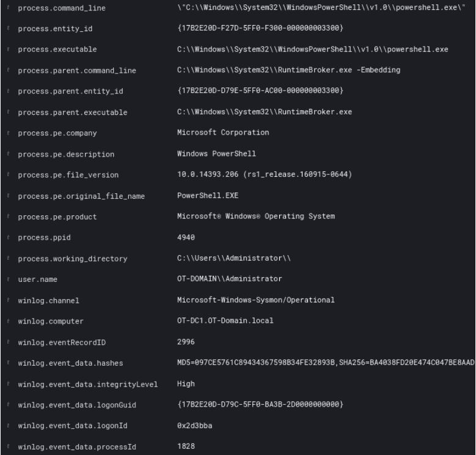

图 9.1 – 练习 1：启动 PowerShell 进程的 Sysmon 日志

如您所见，Sysmon 工具在进程启动事件周围添加了大量详细信息。我们可以看到谁启动了 PowerShell 进程（user.name）、进程是从哪个应用程序启动的（*.parent*）、进程可执行文件所在位置（process.executable）、命令行参数（process.command_line）、进程 ID、进程和父进程可执行文件的哈希值（winlog.event_data.hashes）等。

有一点我需要指出：Wazuh 如何知道要开始查找 Sysmon 日志呢？如果您还记得第 6 章《*被动安全监控*》中的内容，我们修改了 Wazuh 代理的配置文件，以包含以下片段：

```
<localfile>
  <location>Microsoft-Windows-Sysmon/Operational</location>
  <log_format>eventchannel</log_format>
</localfile>
```

该配置片段指示 Wazuh 在 Windows 事件日志中查找 `Microsoft-Windows-Sysmon/Operational`，并将任何条目转发到运行在 Security Onion 虚拟机上的 Wazuh 服务。Wazuh 正在监视的 `Microsoft-Windows-Sysmon/Operational` 位置与 Windows 事件查看器实用程序中的位置对应——**应用程序和服务日志 | Microsoft | Windows | Sysmon | 操作**，如下面的截图所示：

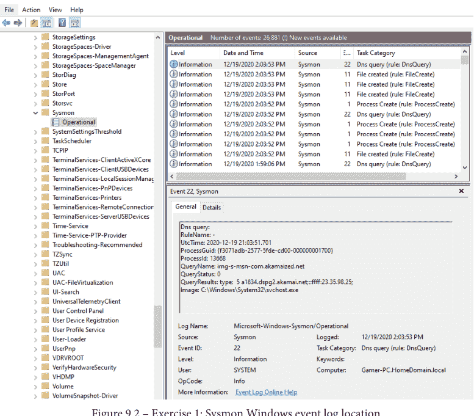

### 图 9.2 - 练习 1：Sysmon Windows 事件日志位置

您也可以将其他感兴趣的事件日志添加到 Wazuh 配置中，使它们成为 Elasticsearch 数据库的一部分。例如，如果我们想开始将 Rockwell Automation FactoryTalk Diagnostics 日志（**应用程序和服务日志 | FactoryTalk Diagnostics**）发送到 Security Onion，可以在 Wazuh 代理配置中添加以下片段（然后重启代理）：

```
<localfile>
    <location>FTDiag</location>
    <log_format>eventchannel</log_format>
</localfile>
```

请注意，我将位置指定为 FTDiag。这样做是因为那是日志文件的**完整名称**，您可以通过右键单击事件日志并选择**属性**来查看，如下面的截图所示：

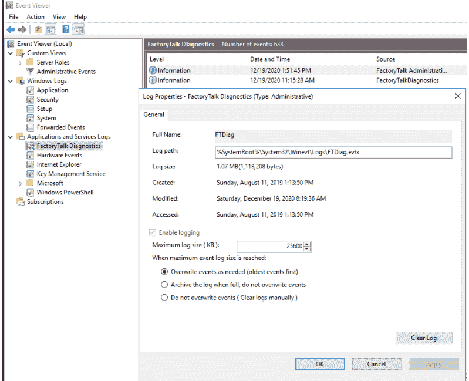

图 9.3 – 练习 1：FactoryTalk Diagnostics 日志 – 文件名


此配置更改将开始把 FactoryTalk Diagnostics 日志导入 Elasticsearch。FactoryTalk Diagnostic 日志对于罗克韦尔自动化应用程序和安全事件，以及应用程序和性能数据来说，是一个宝库。

为了给你一个示例，我们将查看 FactoryTalk Diagnostics 服务中的一些事件日志。但首先，在 Wazuh 代理开始将 FactoryTalk 日志发送到 Security Onion 后，我们需要指示 Elasticsearch 更新其索引模式，以包含随额外日志一起发送的新创建的属性。为此，在 Kibana Web 门户中，单击菜单图标（左上角）并选择 Stack Management。接下来，从 Stack Management 页面，导航到 Index Patterns - *:so-* 并单击 Refresh 按钮，然后在弹出屏幕上单击 Refresh 确认刷新，如下面的截图所示：

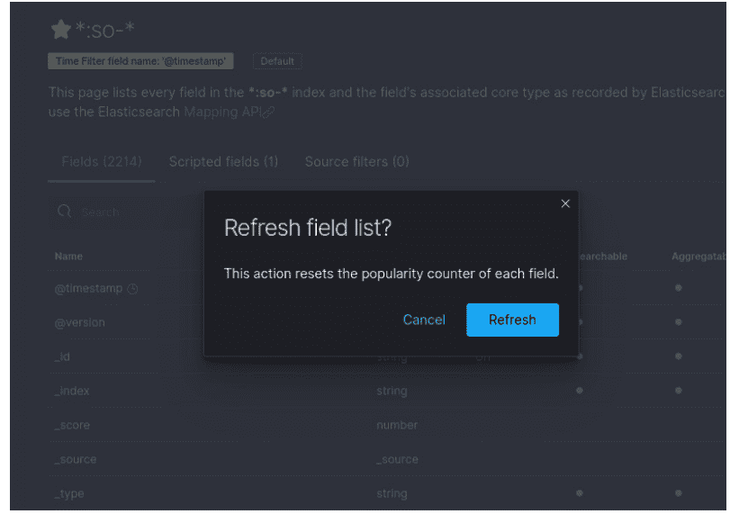

图 9.4 – 练习 1：刷新 Elasticsearch 字段列表

这将指示 Elasticsearch 更新（刷新）字段列表，进而允许通过搜索属性查询字段。

我们现在可以开始在刷新后的数据字段中进行搜索。为此，请单击 Kibana 菜单图标并选择 Discover。这将打开 Kibana 的 Discovery 页面。在这里，我们可以搜索数据，并查看 Elasticsearch 中记录的原始日志。

通过搜索 `winlog.channel: FTDiag`，我们可以看到 FactoryTalk Diagnostics 日志记录服务发送的几类事件日志，如下面的截图所示：

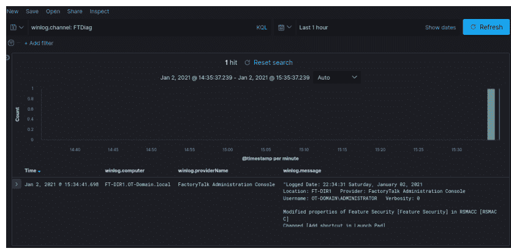

图 9.5 – 练习 1：FactoryTalk Diagnostics 示例日志条目

在返回的日志这一小部分中，我们看到了很有价值的信息，例如 `OT-DOMAIN\ADMINISTRATOR` 登录到 FactoryTalk 目录，随后成功更改了一个功能属性（`OT-DOMAIN\ADMINISTRATOR` 进行了更改，以允许通过 FactoryTalk Security 打开 RSMACC 软件）。

同样，可以以相同方式添加其他工业控制系统（ICS）供应商的日志——我将把这作为课后作业留给你。

在本练习中，我们学习了如何使用 Wazuh 基于主机的日志收集代理扩展 ELK 堆栈的事件日志记录功能。更具体地说，我们添加了 Sysinternals Sysmon 驱动程序的许多高级功能，并实现了特定于 ICS 供应商的事件日志转发。这些额外的事件日志功能将使我们能够发现更广泛环境和技术中的安全相关事件和异常。

接下来，我们将研究如何为 PowerShell 脚本和命令添加一些洞察。

## 练习 2 – 使用 Wazuh 添加 PowerShell 脚本块日志记录

在本练习中，我们将把**PowerShell 脚本块日志**添加到 Wazuh 收集功能集中。**PowerShell 脚本块日志记录**是较新版本 PowerShell（**PowerShell v5+**）附带的一项功能。它允许我们指示 Windows 为 PowerShell 终端中运行的每个命令创建事件日志。最近的趋势是攻击者不再通过专用工具和应用程序来针对系统的传统方式，而是倾向于**离地生存**方式，即使用被攻击计算机系统上存在的本机工具。这些新战术使得监控和拦截恶意工具变得更加困难——你打算怎么做：阻止 `cmd.exe` 或 `powershell.exe`？因此，能够记录在这些本机工具上运行的每个命令，是安全监控中受欢迎的补充，而且往往是检测恶意活动的唯一方法。

作为额外的好处，日志记录方式的一个特点是，事件日志条目要等到命令被可选解码后才会创建。因此，如果有人试图使用`-EncodedCommand` PowerShell 命令（该命令接受 Base64 编码的命令来运行）欺骗系统，该命令会在记录前先被解码。这样，`powershell -EncodedCommand 'ZABpAHIRIA BjADoAXAA='` 将被记录为 `dir c:\`，如下所示：


图 9.6 – 练习 2：解码后的 PowerShell 命令

请按照以下说明配置**PowerShell 脚本块日志记录**：

- 1. **PowerShell 脚本块日志记录**通过**组策略**设置启用。对于不属于 Windows 域（独立计算机）的 Windows 计算机，我们可以在本地计算机（`gpedit.msc`）上执行此操作，也可以通过配置正确的**组策略对象（GPO）**设置在域级别执行此操作。我们这里将展示 GPO 选项，但除了必须使用 `gpedit` 实用程序外，独立方法与之一致。首先，登录域控制器 VM（OT-DC1）。
- 2. 打开**服务器管理器**应用程序，并启动“工具 | **组策略管理**”工具，如下面的截图所示：

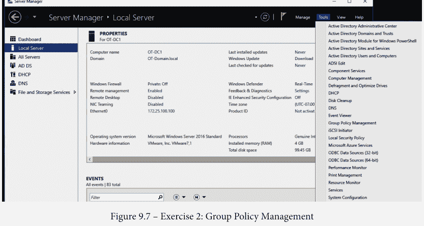

- 3. 右键单击**默认域策略**GPO，然后选择**编辑**。
- 4. 在弹出**组策略管理**编辑器屏幕中，导航到**计算机配置 | 策略 | 管理模板 | Windows 组件 | Windows PowerShell**，然后双击**打开 PowerShell 脚本块日志记录**，如下面的截图所示：

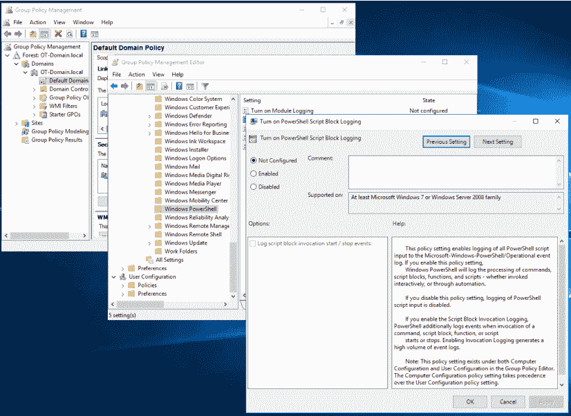

图 9.8 – 练习 2：打开 PowerShell 脚本块日志记录

- 5. 选中**已启用**，然后单击**确定**。
- 6. 这就是**PowerShell 脚本块日志记录**的全部配置。域复制将负责配置所有域计算机。

我需要指出的一点是，Wazuh 如何知道开始查找 PowerShell 脚本块日志。如果你还记得第 6 章“被动安全监控”，我们修改了 Wazuh 代理的配置文件，以包含以下代码片段：

```
<localfile>
  <location>Microsoft-Windows-PowerShell/Operational</location>
  <log_format>eventchannel</log_format>
</localfile>
```

与 Sysmon 日志一样，上述代码指示 Wazuh 开始监视 PowerShell 日志，并将任何新条目发送到 Security Onion 以添加到 Elasticsearch 数据库中。

现在配置就绪后，我们在域控制器的 PowerShell 终端中输入一个命令（首先运行 gpupdate /force 以应用新的组策略），如下面的截图所示：

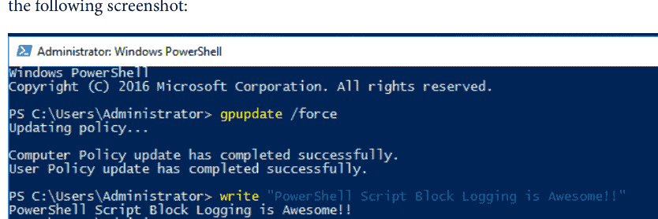

图 9.9 – 练习 2：生成示例 PowerShell 脚本块事件

在下面的截图中，我们可以看到通过搜索 `event.code:4104`（4104 是附加到 PowerShell 脚本块日志记录事件的事件 ID）将此活动记录到 Elasticsearch 日志中：

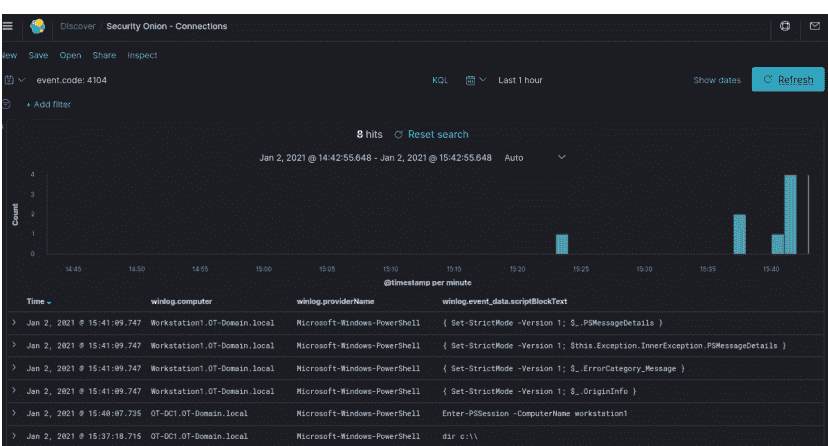

图 9.10 – 练习 2：PowerShell 脚本块 Elasticsearch 日志条目

至此，我们现在能够记录整个域的 PowerShell 活动：这是我们安全监控功能中一个非常强大的补充。

接下来，我们将研究如何为 pfSense 防火墙添加网络入侵检测功能，以便能够检测边界上的攻击。

## 练习 3 – 向 pfSense 添加 Snort IDS

前面我们讨论了将 Snort 作为 Security Onion 设备的一部分，充当内部网络的 IDS。现在，我们将 Snort 作为软件包附加组件安装到 pfSense 防火墙上，目的是在网络边缘增加入侵防御系统（IPS）功能。这里重点强调的是预防，而不是检测。我们希望防火墙能够阻止来自外部针对我们网络的攻击，或者阻止从内部离开我们网络的攻击。工业环境通常希望避免在内部（工业）网络上使用主动控制，因为这些主动控制可能会中断合法进程，从而导致生产停机。

然而，在非信任区（企业或工业非军事区（IDMZ））和信任区（工业网络）之间设置主动控制，带来的好处多于风险。生产过程不应依赖业务或 IDMZ 资源来继续生产，因此，主动安全控制的潜在误报反应超过了在其对生产过程造成伤害之前阻止入侵的机会。


我们将在以下说明中安装 Snort 插件并进行配置：

1. 打开 pfSense Web 门户并登录。
2. 导航至 System | Package Manager，如以下屏幕截图所示：

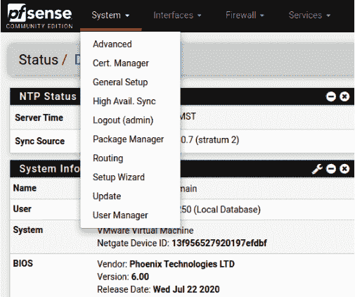

Figure 9.11 – Exercise 3: pfSense package manager

3. 点击 Available Packages 选项卡并搜索 Snort，如以下屏幕截图所示：

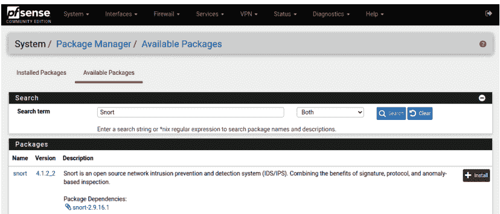

Figure 9.12 – Exercise 3: Adding Snort package to pfSense

4. 点击 Install 和 Confirm 开始安装过程。Snort 插件（add-on）现正在安装中。

5. 安装过程完成后（Success），导航至 Services | Snort 以打开 Snort 接口配置页面。

6. 在将 Snort 绑定到接口之前，我们需要配置一些其他设置，因此点击 Global Settings 选项卡并执行以下操作：

    a) 勾选 Enable Snort VRT 选项——输入你在第 6 章《Passive Security Monitoring》第 1 节《Setting up and configuring Security Onion》中为 Exercise 1 创建的 Oinkmaster 代码。
    b) 勾选 Enable Snort GPLv2 选项。
    c) 勾选 Enable ET Open 选项。
    d) 勾选 Enable OpenAppID 选项。
    e) 勾选 Enable AppID Open Text Rules 选项。

以下屏幕截图显示了应如何操作：

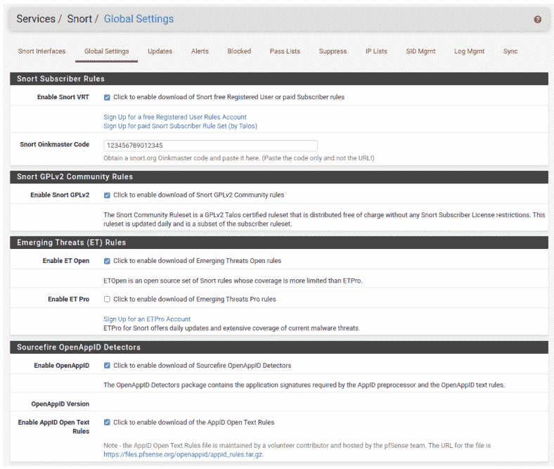

Figure 9.13 – Exercise 3: Configuring Snort update sources

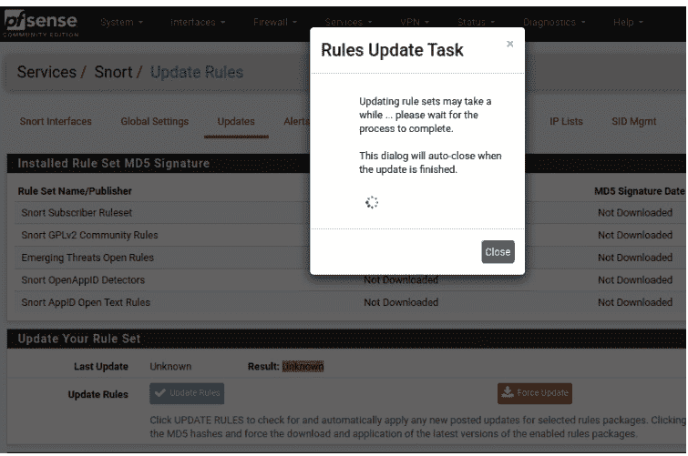

Figure 9.15 – Exercise 3: Forcing update of Snort rules

8. 更新过程完成后，你应该会看到带有当前时间和日期的 MD5 签名。

9. 切换到 **Snort Interfaces** 选项卡并点击 **Add** 以打开新的接口配置屏幕。在初始屏幕（**Interface Settings**）中，按如下配置：

    a) 将 **Interface** 保持为 WAN，因为我们希望 Snort 在外部（**广域网，或 WAN**）接口上进行保护。

    b) 勾选 **Send Alerts to System Log** 选项，以便 Snort 将警报发送到 pfSense 系统日志，该日志会转发到 Security Onion。

    c) 将 **System Log Priority** 选项更改为 `LOG_NOTICE` 以使警报更加详细。

    d) 勾选 **Block Offenders** 选项以自动阻止攻击者（此设置将 Snort 从 IDS 转变为 IPS）。将 **IPS Mode** 保持为 **Legacy Mode** 并阻止警报的 **BOTH** 侧（源 IP 和目标 IP）。请注意，IPS 可能会阻止企业网络与工业网络之间的合法活动，因此建议对 IPS 规则进行微调。

    以下屏幕截图显示了应如何操作：

    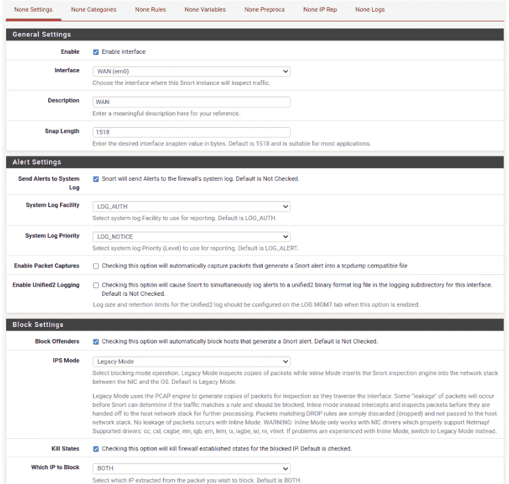

    Figure 9.16 – Exercise 3: Configuring Snort's monitoring interface

    e) 将其余选项保持默认设置，然后点击配置页面底部的 Save。

10. 切换到 WAN Categories 选项卡并勾选 Use IPS Policy 选项以显示 IPS Policy Selection 选项。

**IPS Policy Selection** 选项允许我们快速将规则集调整为以下四种预定义策略之一：

    a) **Connectivity**，优先考虑连通性而非安全性
    b) **Balanced**，在连通性与安全性之间取得平衡
    c) **Security**，优先考虑安全性而非连通性
    d) **Max-Detect**，将一切投入检测引擎

以下屏幕截图显示了如何操作：

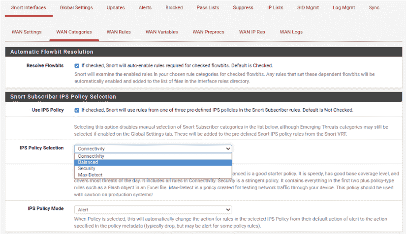

Figure 9.17 – Exercise 3: Configuring IPS policy

11. 目前选择 **Balanced**，并为 **IPS Policy Mode** 选项选择 **Policy**（与屏幕截图中显示的不同），以便让规则决定对警报采取何种操作（通常操作是丢弃数据包）。

12. 向下滚动并点击 **Save** 完成接口配置。

13. 我们现在准备启动 Snort，因此导航至 **Services | Snort | Interfaces** 页面并通过点击 **Start Snort on this interface** 按钮启动 Snort。

14. 如果一切顺利，我们现在已有 Snort 在 pfSense 防火墙的 WAN 接口上监控流量。你可以从主屏幕（点击左上角的 pfSense 图标）通过在 **Services Status** 小部件中验证服务状态来确认，如以下屏幕截图所示：

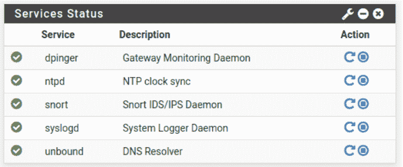

Figure 9.18 – Exercise 3: pfSense Services Status widget

15. 此主页面现在有一个新的 **Snort Alerts** 小部件，用于显示检测到的警报，如以下屏幕截图所示：

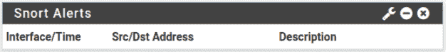

Figure 9.19 – Exercise 3: Snort Alerts widget

为了完成本练习，让我们创建一个 Snort 警报以查看其外观。为此，在位于 pfSense 防火墙下方的计算机上打开浏览器并导航至 `http://testmyids.ca/`。

第一次访问时，浏览器中会出现以下页面：

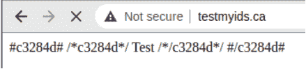

Figure 9.20 – Exercise 3: testmyids.ca

如果我们点击 **Refresh**，页面将永远无法加载，并且现已被 pfSense 阻止。造成此延迟的原因是我们选择将 Snort 配置为 **Legacy Mode** 而非 **Inline Mode**。在 **Legacy Mode** 中，Snort 基于数据包的副本做出决策，而不是内联检查数据包并在数据包进入工业网络之前做出阻止或允许的决策。因此 **Inline Mode** 更安全，但并非所有硬件都支持。如果你想启用它，请先阅读要求。

此时，我们还收到了来自 Snort 的警报，可以在主仪表板或 **Services | Snort | Alerts** 的 Snort 警报页面上查看，如以下屏幕截图所示：

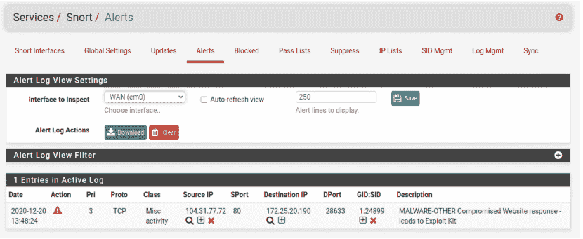

Figure 9.21 – Exercise 3: Snort alert details

我们可以看到 Snort 检测到来自 `testmyids.ca (104.31.77.72)` 的响应为恶意。如果我们切换到 **Blocked** 选项卡，可以看到该 IP 已在阻止列表中，如以下屏幕截图所示：

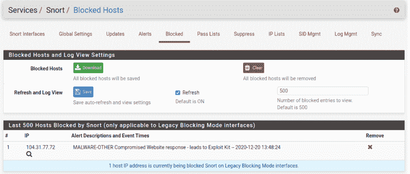

Figure 9.22 – Exercise 3: Snort blocked hosts

请记住，我们指示 Snort 对任何警报都进行阻止，因此即使 **Alerts** 页面显示采取的 **Action** 为 **Alert**，IP地址仍会被阻止。

最后，如果我们在 Kibana 的 Discovery 页面中搜索 MALWARE-OTHER 消息，可以看到警报已成功添加到 Elasticsearch 数据库，如以下屏幕截图所示：

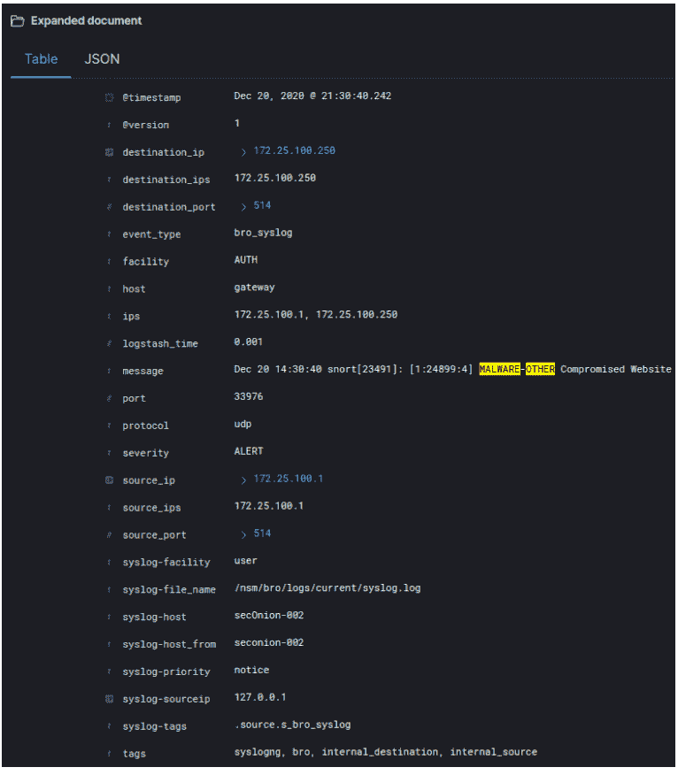

Figure 9.23 – Exercise 3: pfSense Snort alert logs in Elasticsearch

这涵盖了练习材料；我们现在拥有一个 NIPS 来保护通过 pfSense WAN 接口进入或离开工业网络的流量。此外，NIPS 的任何检测都将记录到 ELK 事件数据库中，使我们能够进行关联、可视化和警报。

接下来，我们将通过将 SilentDefense 日志发送到 syslog 来添加一些 OT-IDS 警报。

## Exercise 4 – Sending SilentDefense alerts to Security Onion syslog

本章的全部内容都是关于掌握信息，使我们能够首先看到最相关、最方便和果断的信息。有什么比来自我们 OT IDS（SilentDefense）的警报更果断的呢？它会提醒我们有人或某物正在造成问题？此时，这些警报仅在 SilentDefense Command Center 门户中生成并显示。我们希望将这些警报传输到 Security Onion，以便将其添加到 Elasticsearch 数据库中，从而允许我们在关联工作和搜索中包含警报数据以及 SilentDefense 收集的其他有趣数据。

按照以下说明将 SilentDefense 警报和网络日志发送到 Security Onion VM 的 syslog 服务：

1. 我们需要做的第一件事是允许来自 SilentDefense Command Center 服务器（172.25.100.240）的 syslog 访问 Security Onion。SSH 到 Security Onion 机器（`ssh adm-pac@172.25.100.250`）。在此执行以下操作：

    a) 输入 sudo `so-allow` 命令
    b) 选择 s 选项用于 `Syslog device – 514/tcp/udp`
    c) 指定 SilentDefense Command Center IP 地址——`172.25.100.240`
    d) 按 `Enter` 确认


输出可在以下屏幕截图中看到：

```
[adm-pac@IND-SecurityOnionv2 ~]$ sudo so-allow
[sudo] password for adm-pac:
Sorry, try again.
[sudo] password for adm-pac:
This program allows you to add a firewall rule to allow connections from a new IP address.
Choose the role for the IP or Range you would like to add

[a] - Analyst - ports 80/tcp and 443/tcp
[b] - Logstash Beat - port 5044/tcp
[e] - Elasticsearch REST API - port 9200/tcp
[f] - Strelka frontend - port 57314/tcp
[g] - Osquery endpoint - port 8090/tcp
[s] - Syslog device - 514/tcp/udp
[w] - Wazuh agent - port 1514/tcp/udp
[p] - Wazuh API - port 55000/tcp
[r] - Wazuh registration service - 1515/tcp

Please enter your selection:
s
Enter a single ip address or range to allow (example: 10.10.10.10 or 10.10.0.0/16):
172.25.100.240
Adding 172.25.100.240 to the syslog role. This can take a few seconds
local:
------------
        ID: create_sysconfig_iptables
      Function: file.touch
        Name: /etc/sysconfig/iptables
      Result: True
    Comment: unless condition is true
    Started: 22:52:29.178700
    Duration: 2458.279 ms
     Changes:
------------
        ID: iptables_fix_docker
      Function: iptables.chain_present
        Name: DOCKER-USER
      Result: True
```

图 9.24 – 练习 4：Security Onion – so-allow syslog

这就是允许 SilentDefense Command Center 访问 syslog 所需的所有配置。

+   2. 我们现在需要登录 SilentDefense Command Center 网页门户（https://172.25.100.240/login）来配置 SilentDefense 端的相关设置。
+   3. 从门户仪表盘页面，点击顶部菜单栏中的 Settings。

**Host name**—将其设置为 `SilentDefense-001`。

**Application name**—将其设置为 `AlertLogs`。

以下屏幕截图显示了应如何操作：

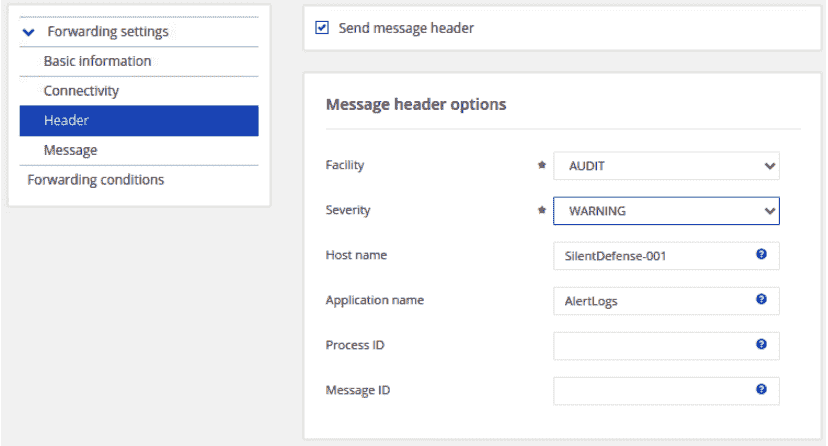

e) 这就是警报日志所需的所有配置。点击屏幕顶部的 **Finish**。

+   5. 点击 **Back** 返回到 Command Center **Settings** 页面。

+   6. 点击 **Network logs forwarding** 并按照以下步骤将 Syslog 转发添加到网络日志中：

+   a) 从 **Network logs forwarding** 配置页面，点击 **Add Instance** 按钮（屏幕右侧的加号 (+) 图标）。

+   b) 这将打开一个空白的 syslog 转发配置屏幕。指定一个服务器名称（`SecurityOnion-Network`）并切换到 **Connectivity** 选项卡。

+   c) 在 **Connectivity** 选项卡上，将远程主机 IP 地址设置为 `172.25.100.250`，即 Security Onion 服务器的 IP 地址。

d) 切换到 **Header** 选项卡并设置以下内容：

**Severity**—将其设置为 **DEBUG**（在验证工作正常后降至 **WARNING**）。

**Host name**—将其设置为 `SilentDefense-001`。

**Application name**—将其设置为 `NetworkLogs`。

e) 这就是网络日志所需的所有配置。点击屏幕顶部的 **Finish**。

这就是我们需要完成的所有配置，以便将 syslog 消息从 SilentDefense Command Center 发送到 Security Onion 服务器。我们可以通过打开 Kibana 网页门户，导航到 **Discovery** 页面，并搜索 `message` : `NetworkLogs` 来验证是否正常工作，如以下屏幕截图所示：

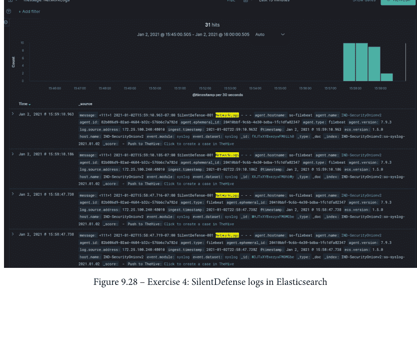

我们已经收到 syslog 数据，但它处于原始格式，意味着它现在尚未解析为可用数据。这是我们将使用 Elasticsearch 解析来执行的操作。诀窍是解析传入的 syslog 数据并在将其存储到数据库之前修复数据。请按照以下说明操作：

+   7. Elasticsearch 使用 ingest 解析器指令文件来接收来自发送者的日志并以用户指定的形状和形式存储数据。我们可以在 /opt/so/conf/elasticsearch/ingest/ 文件夹中看到现有的指令文件，如以下屏幕截图所示：

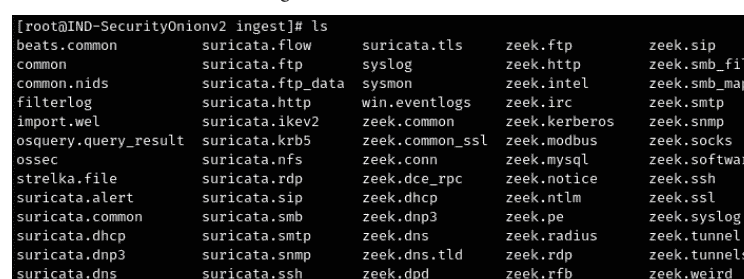

图 9.29 – 练习 4：Security Onion – Elasticsearch ingest 解析器指令文件

我们可以通过在 /opt/so/saltstack/local/salt/elasticsearch/files/ingest/ 中为它们创建 ingest 解析指令文件来添加自己的自定义指令。Elasticsearch 会在（重新）启动时包含自定义文件夹中的指令。我们将在此处添加用于解析 SilentDefense Syslog 消息的配置文件。

+   8. 下载 syslog 和 silentdefense 配置文件，如下所示：

+   a) 第一个要下载的文件是 syslog Elasticsearch ingest 解析配置文件，来自 https://github.com/SackOfHacks/Industrial-Cybersecurity-2nd-Edition/blob/main/security-onion-logstash/syslog。这将覆盖 Security Onion 的 syslog 解析，以添加以下 grok 解析器指令：

```
"<111>1 %{TIMESTAMP_ISO8601:sd.timestamp} %{SYSLOGHOST:sd.hostname} %{WORD:sd.logname} - - - CEF:0\|%{DATA:sd.vendor}\\\\|%{DATA:sd.product}\\\\|%{DATA:sd.product_version}\\\\|%{DATA:sd.alert_name}\\\\|%{DATA:sd.alert_title}\\\\|%{DATA:sd.alert_number}\\\\|%{GREEDYDATA:sd.real_message}"
```

grok 是一个正则表达式解析命令，允许 Logstash 查找和重塑 syslog 消息等非结构化文本。我们的指令文件中的 grok 表达式告诉 Elasticsearch 执行以下操作：

+   - 查找 TIMESTAMP_ISO8601 格式的时间戳并以 sd.timestamp 的名称存储它。
+   - 将消息的下一部分视为 SYSLOGHOST 并以 sd.hostname 的名称存储它。
+   - 接下来，查找以下信息（DATA）：
+     - sd.vendor
+     - sd.product
+     - sd.product_version
+     - sd.alert_name
+     - ...
+   - 最后，将剩余的事件数据（IP地址和详细消息数据）存储在 sd.real_message 中，该数据将通过 silentdefense ingest 解析器进一步解析。

grok 模式定义与正则表达式相关，可以在此处找到：https://github.com/elastic/logstash/blob/v1.4.2/patterns/grok-patterns。

b) 我们需要下载的第二个文件是 silentdefense Elasticsearch ingest 解析配置文件，来自 https://github.com/SackOfHacks/Industrial-Cybersecurity-2nd-Edition/blob/main/security-onion-logstash/silentdefense。此 ingest 解析器将 SilentDefense Command Center 发送到 Security Onion 的 syslog 事件的 real_message 部分拆分为相关信息，如下所示：

```
"dissect": {
    "if": "ctx.sd.logname == 'NetworkLogs'",
    "field": "sd.real_message",
    "pattern": "rt=%{sd.aler_rt} msg=%{sd.alert_message} cat=%{sd.alert_category} deviceExternalId=%{sd.device_extId} smac=%{sd.source.mac} dmac=%{sd.destination.mac} src=%{sd.source.ip} dst=%{sd.destination.ip} dpt=%{sd.destination.port} %{sd.source.hostname} %{sd.destination.hostname} %{sd.filePath} %{sd.fileType} %{sd.fsize} %{sd.user_message}",
```

```
"on_failure" : [ {"set" : {"field" : "error.message", "value" : "{{ _ingest.on_failure_message }}"}}]
}
```

我们将其放在单独的解析器中是为了允许拆分不同的 syslog shipper。正如你在 SilentDefense 练习中回忆的那样，我们创建了两个单独的 syslog 转发器，NetworkLogs 和 AlertLogs。这两者在格式化 syslog 消息的方式上略有不同，因此这是处理该问题的地方。你下载的 silentdefense 文件显示了 AlertLogs 转发器的第二个 dissector。

+   9. 下载完成后，将 syslog 和 silentdefense 文件复制到 Security Onion VM 上的 /opt/so/saltstack/local/salt/elasticsearch/files/ingest/ 文件夹中。

+   10. 我们现在需要重启 Elasticsearch。运行 sudo so-elasticsearch-restart 命令即可。

+   11. Elasticsearch 重启后，来自 SilentDefense 的 syslog 消息现在被解析为以下形式：

| ... |  |
|---|---|
| event.dataset | ot-ids |
| event.module | silentdefense |
| sd.host.name | IND-securityonion |
| ingest.timestamp | 2020-12-11T23:46:11.475Z |
| log.source.address | 172.25.100.240:53545 |
| message | <111>1 2020-12-11T16:46:11.472-07:00 SilentDefense-001 AlertLogs ... |
| sd.aler_rt | Feb 15 2021 16:46:11 |
| sd.alert_category | NetworkAttack |
| sd.alert_message | NMAP Scan detecte |
| sd.alert_name | nmap_scan |
| sd.alert_number | 11 |
| sd.alert_title with NMAP | A host on the network is scanning |
| sd.device_extId | SD-ProductionLine1 |
| ... |  |


以上介绍了 SilentDefense syslog 消息的实现。现在，当发生网络事件警报时，SilentDefense 会将数据转发到 Security Onion，数据会进入 Elasticsearch 数据库，并可纳入关联、搜索、警报和可视化中。

在下一个练习中，我们将合并所有已收集的数据，并构建一个 Kibana 仪表板，以向我们展示有趣的事件、警报、信息和详细信息，使我们能够快速评估任何潜在的安全事件或问题。

接下来，我们将创建一个 Kibana 仪表板，帮助我们可视化、关联、搜索和汇总防火墙日志/事件。

## 练习 5 – 在 Kibana 中创建 pfSense 防火墙事件仪表板

为了能够在 Security Onion 的 **Kibana** 工具中可视化 pfSense 日志，我们将添加一个包含相关数据的仪表板。

要在 Kibana 仪表板上显示 pfSense 警报，我们需要做的第一件事是定义事件搜索过滤器。这将使防火墙事件的处理更轻松、更快捷。下面的说明将引导我们创建防火墙事件搜索过滤器：

- 1. 登录 Security Onion，然后从左侧选择面板打开 **Kibana** 工具：

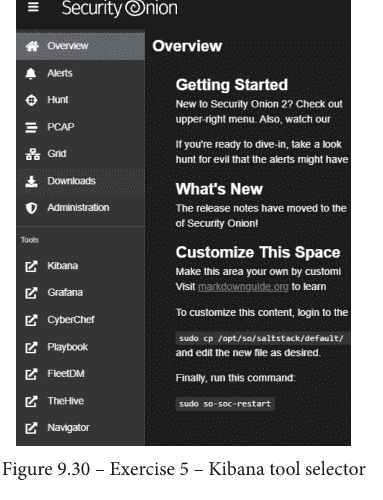

2. 这会为 Kibana **主页**打开一个新标签页。在这里，我们通过 Kibana 菜单（左上角带有三条水平线的按钮）选择 **Discover** 页面：

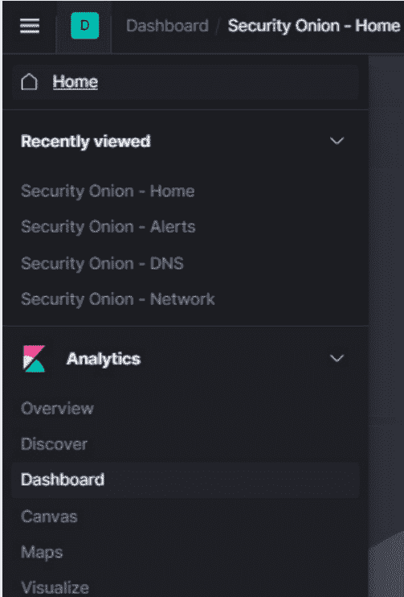

图 9.31 – 练习 5 – Kibana 菜单

3. 我们现在进入 Kibana **Discover** 页面，在该页面中，我们可以对事件执行搜索，并创建和保存自定义搜索查询。

4. 输入搜索字符串 `event.dataset:firewall`，以筛选出被 Zeek 归类为防火墙事件的事件：

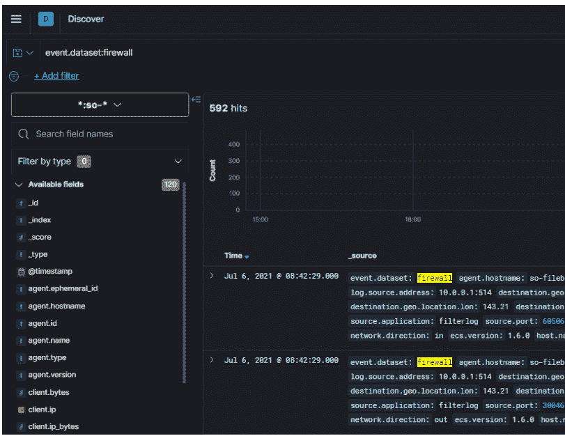

图 9.32 – 练习 5 – 防火墙事件数据集

5. 目前我们只需要这些。点击保存（屏幕右上角），另存为 自定义搜索 – 防火墙事件：

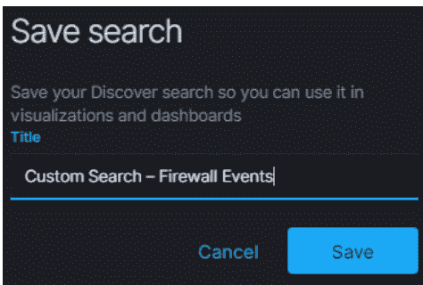

图 9.33 – 练习 5 – 保存自定义搜索

定义好自定义搜索后，接下来我们要在 Kibana 中添加一个仪表板，用于展示组件。请按照以下说明创建仪表板：

- 1. 要开始创建一个初始（空白）仪表板，请登录 Security Onion Web 门户，打开 Kibana 工具，然后导航到 https://172.25.100.250/kibana/app/dashboards。在仪表板列表页面中，点击创建仪表板，这将打开一个空白的“编辑新仪表板”页面，如下面的截图所示：


图 9.34 – 练习 5 – 创建新仪表板

- 2. 现在，我们将向空白画布添加一些可视化组件（面板）。为此，点击创建面板，找到并选择饼图可视化，然后搜索并选择 自定义搜索 – 防火墙事件 数据源：

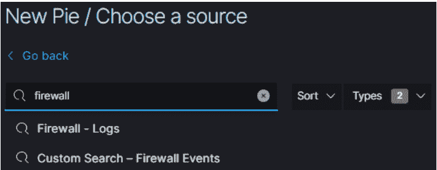

图 9.35 – 练习 5 – 添加饼图组件

- 3. 现在，要添加饼图中显示的数据，请在 **分桶** 下添加一个 **拆分切片** 分桶（数据桶），并将 **聚合** 设置为 **词条**。

对于 **字段**，选择 **rule.action.keyword**：

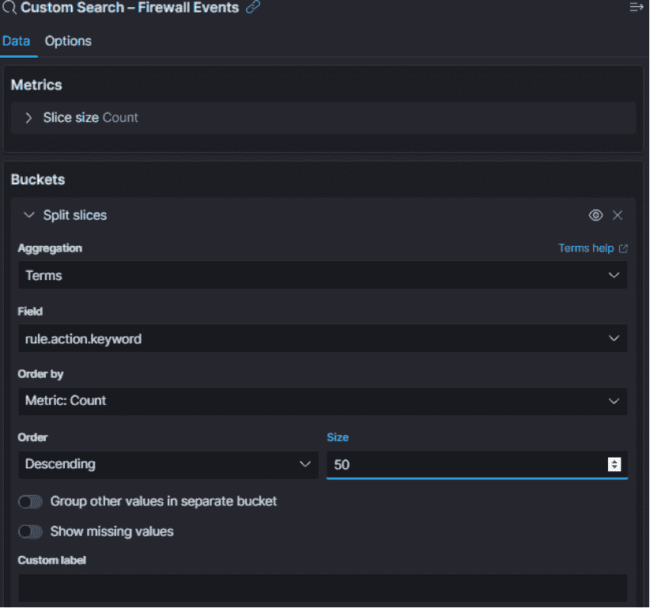

- 4. 最后，将 **大小** 设置为 50，然后点击 **分桶** 配置部分底部的 **更新** 以保存更改。

5. 我们的组件现已就绪。你可以通过 **选项** 菜单更改一些视觉样式设置，例如将样式从 **环形图** 更改为 **饼图**：

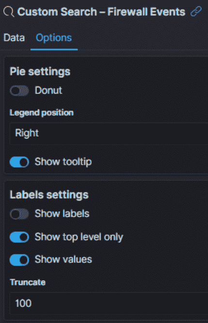

图 9.37 – 练习 5 – 饼图组件选项

6. 完成组件样式设置后，通过 **保存** 按钮（屏幕右上角）保存它，并将其命名为 `Firewall - Rule Action Summary`。这会让我们返回 **仪表板编辑** 屏幕。在这里，我们可以调整新创建的饼图组件的大小。

按照同样的原则，向仪表板添加以下组件：

- • 垂直条形图：
  - A. **自定义搜索 – 防火墙事件** 数据源
  - B. **数据直方图** 数据桶，**聚合** 设置为 @`timestamp`
  - C. 另存为 `Firewall - Logs Count over time`：

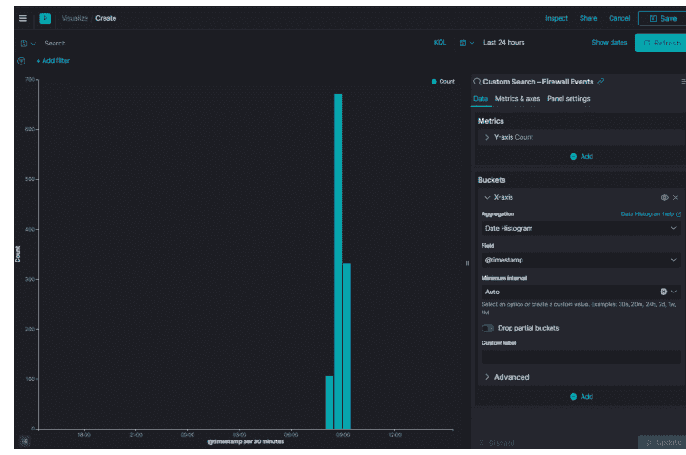

图 9.38 – 练习 5 – 随时间变化的日志数量组件

- - 水平条形图：
  - A. 自定义搜索 – 防火墙事件 数据源
  - B. 拆分系列数据桶，聚合设置为词条，字段设置为 network.transport.keyword
  - C. 另存为 Firewall - Network Protocol Summary：

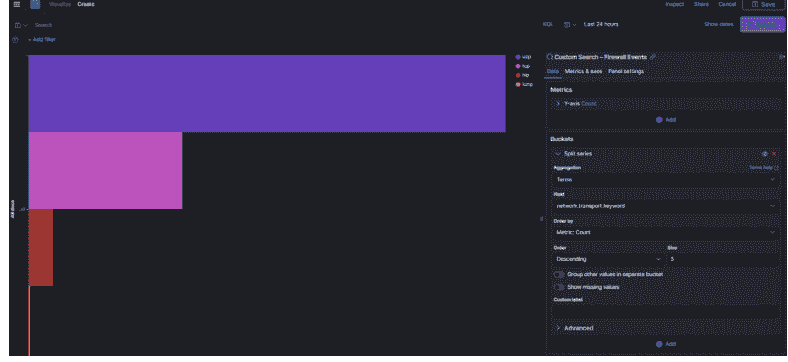

图 9.39 – 练习 6 – 网络协议摘要组件

数据表可视化：

- A. 自定义搜索 – 防火墙事件 数据源
- B. 拆分行数据桶，聚合设置为词条，字段设置为 source.ip
- C. 将大小设置为 50
- D. 另存为 Firewall - Source IP Summary：

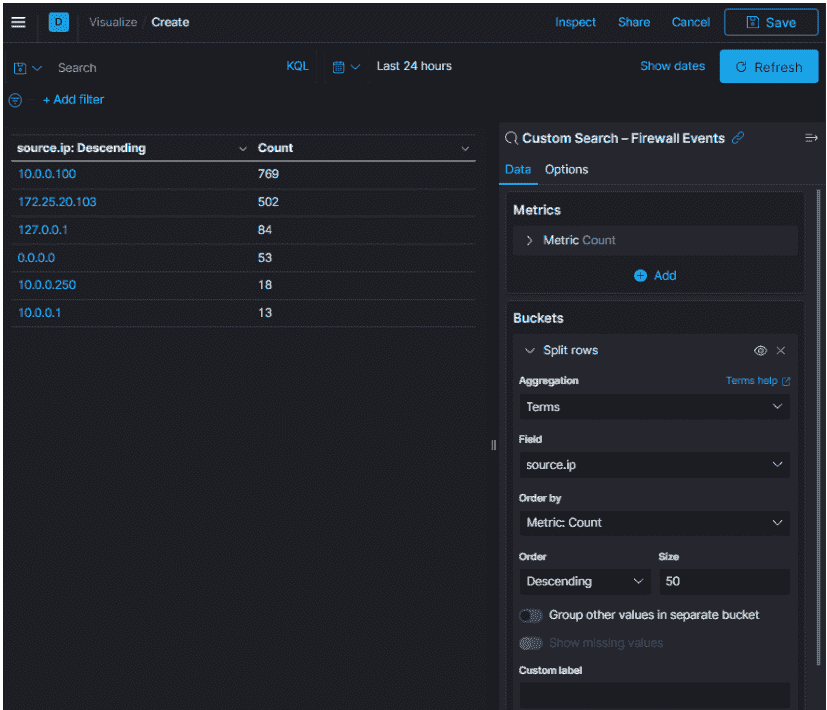

图 9.40 – 练习 5 – 源 IP 摘要组件

- - 数据表可视化：
  - A. **自定义搜索 – 防火墙事件** 数据源
  - B. **拆分行** 数据桶，**聚合** 设置为 **词条**，**字段** 设置为 **source.port**
  - C. 将 **大小** 设置为 **50**
  - D. 另存为 `Firewall - Source Port Summary`

- - 数据表可视化：
  - A. **自定义搜索 – 防火墙事件** 数据源
  - B. **拆分行** 数据桶，**聚合** 设置为 **词条**，**字段** 设置为 **destination.ip**
  - C. 将 **大小** 设置为 **50**
  - D. 另存为 `Firewall - Destination IP Summary`

- - 数据表可视化：
  - A. **自定义搜索 – 防火墙事件** 数据源
  - B. **拆分行** 数据桶，**聚合** 设置为 **词条**，**字段** 设置为 **destination.port**
  - C. 将 **大小** 设置为 **50**
  - D. 另存为 `Firewall - Destination Port Summary`

为了完善防火墙日志仪表板，我们将添加一些现有面板——我倾向于在每个仪表板上都添加这些内容：

- 1. 点击 **从库中添加** 按钮，然后搜索并选择 Security Onion **导航** 面板。

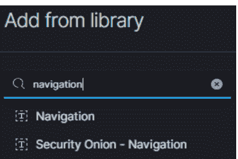

图 9.41 – 练习 5 – 从库中添加组件

2. 接下来，搜索并选择 自定义搜索 – 防火墙事件 自定义搜索面板。这会向仪表板添加一个事件详细信息面板，与 Discover 页面上显示的内容非常相似：

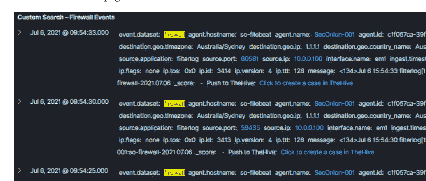

图 9.42 – 练习 5 – 事件详细信息面板

3. 关闭 从库中添加 屏幕。

我们已经完成了新仪表板的编辑。你应该根据自己的喜好重新组织、移动、定位和调整组件（面板）的大小，完成后通过 **保存** 按钮将仪表板另存为 自定义仪表板 - Firewall。下图显示了我的防火墙仪表板布局：

在本练习中，我们将在 Security Onion 的 Kibana 中向自定义仪表板添加组件和可视化。要开始创建初始（空白）仪表板，请登录 Security Onion Web 门户并打开 Kibana 工具，然后导航到 https://172.25.100.250/kibana/app/dashboards。在仪表板列表页面中，点击创建仪表板，这将打开一个空白的“编辑新仪表板”。

现在，我们已准备好开始向新仪表板（Breach Detection Portal）添加组件和可视化。

### NIDS 警报

我们想要可视化的第一项数据是 NIDS 警报。如果调整得当，NIDS 警报是网络中存在恶意活动或内容的最明确指标之一。

对 IDS 安装进行适当调整超出了本书的范围；不过，根据经验，调整归根结底就是消除噪声和误报。在 Security Onion 中，你可以通过将规则的签名标识符（SID）添加到 /opt/so/saltstack/local/pillar/minions/ind-securityonionv2_eval.sls Salt 配置文件中的 idstools 部分来禁用噪声规则，然后运行 sudo salt ind-securityonionv2_eval state.apply idstools。

例如，在我的实验室环境中，我看到了许多 ET POLICY GNU/Linux YUM User-Agent Outbound，很可能与软件包管理警报有关。在 Linux（CentOS）系统环境中，这是正常流量。为了消除这些误报对数据库的阻塞，我将警报的 SID 添加到了 ind-securityonionv2_eval.sls 文件的 idstools 部分。你可以通过查看详细警报消息来找到感兴趣警报的 SID，如下面的截图所示：

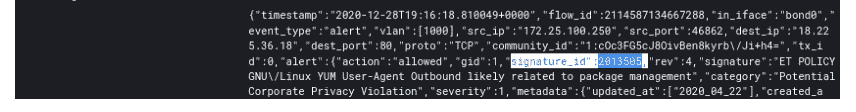

SID 是消息中标识为 signature_id (2013505) 的一段信息。这个数字就是我们要添加到 idstools 部分的内容（sudo vi /opt/so/saltstack/local/pillar/minions/ind-securityonionv2_eval.sls），如下面的截图所示：

```
idstools:
  config:
    ruleset: 'ETOPEN'
    oinkcode: ''
```


```
```
urls:
sids:
  enabled:
  disabled:
    - 2013505
modify:
```
```

保存文件，然后运行 `sudo salt ind-securityonyonv2_eval state.apply idstools` Salt 更新命令。包含 SID 2013505 的 Suricata 告警将不再被记录。

顺便提一下，如果你从 https://snort.org/ 获得了 Snort oinkcode，从而可以从他们的网站下载社区规则，那么 idstools 部分就是你要输入该代码的地方，这样 Security Onion 就会连同 Emerging Threats（ET）规则一起拉取 Snort 规则。

调整 IDS 规则是构建一个可用的安全监控环境的关键部分。分析人员为了找到真正的威胁而必须筛选的良性或虚假告警越多，他们就越有可能漏掉真正的告警。任何基于签名的工具部署，其大部分工作都在于规则的微调。

我们将向入侵检测仪表板添加一个 NIDS（Suricata）告警数据表可视化。请按照以下说明操作：

+   1. 在 **Editing New Dashboard** 页面上点击 **Create new object to this dashboard** 按钮。
+   2. 在弹出的 **New Visualization selection** 屏幕中选择 **Data Table**。
+   3. 在接下来的 **New Data Table / Choose a source** 屏幕中搜索 Alerts，并选择 **Security Onion – Alerts** 数据源，如下面的截图所示：

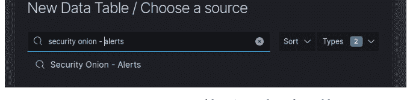

图 9.45 – 练习 6：添加 Snort 告警数据表

4. 我们会进入可视化编辑页面。在这里，我们定义数据显示（小部件）的内容以及显示方式。数据按桶（bucket）显示；我们需要添加一个数据桶来查看 NIDS 告警消息。点击配置屏幕右侧 Data 面板下的 ADD BUCKET 按钮，然后选择 Split rows，如下面的截图所示：

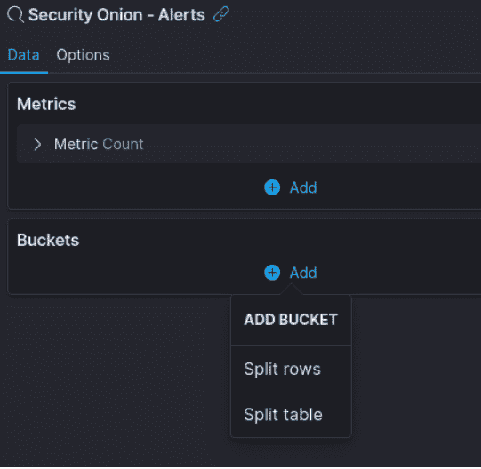

图 9.46 – 练习 6：Snort 告警数据表 – 添加数据桶

5. 在 Split rows 面板下，从 Aggregation 下拉菜单中选择 Terms，对于 Field（我们希望从中获取数据的数据库字段），搜索并选择 rule.name.keyword。最后，将 Size 设置改为 50，以显示最常出现的 50 条告警。

下面的截图显示了具体操作方式：

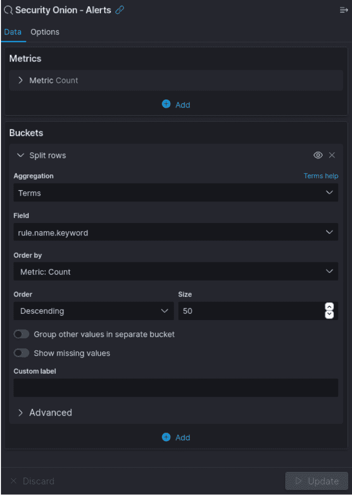

图 9.47 – 练习 6：配置 Snort 告警数据表数据桶

6. 当你点击 **Update** 时，数据表会在屏幕左侧填充，显示我们刚刚配置的数据的结果，如下面的截图所示：

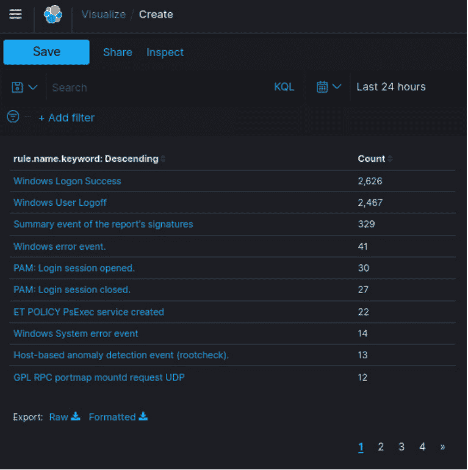

图 9.48 – 练习 6：Snort 告警小部件

如果 Snort 引擎调整得当，这个视图应该只显示很少的输出。我的视图显示了一个很大的列表，是因为我展示的是过去 7 天的数据，而且我做了一些网络扫描和探测，以便让这些数据显示出来作为一张漂亮的图片。

我们的目标是创建一个仪表板，显示能够指示正在发生的攻击的数据——换句话说，就是能够简洁而准确地告诉我们正遭受攻击的数据。如果这个页面上的任何小部件出现一大堆误报，就无法给我们提供这种明确的告警总览。

7. 为了削减一些嘈杂的告警，当鼠标悬停在你要抑制的告警上时，点击 rule.name 旁边的减号（-）符号（过滤掉）。你可以稍后返回（Edit visualization）重新添加任何烦人的嘈杂告警。

8. 此外，我们可以按事件严重性进行过滤。为此，点击编辑器屏幕顶部的 Add Filter 按钮，将 Field 设置为 event.severity。然后，将 Operator 设置为 is between，并在底部和顶部值处分别输入 3 和 8，如下面的截图所示：

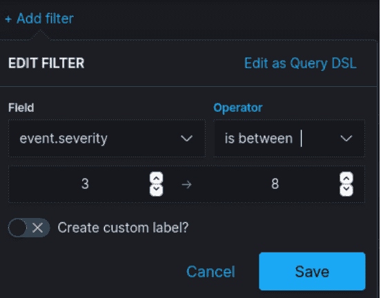

图 9.49 – 按严重性过滤

点击 Save 以应用该过滤器。

9. 至此，我们刚刚创建了一个数据表，用于显示我们在指定时间范围（7 天）内看到的 NIDS 告警摘要。点击 Save，将此可视化命名为 Breach Detection - NIDS Alerts Summary，然后点击 Save and return。这会保存该可视化并将其添加到我们的新仪表板中。

10. 在仪表板的 Edit Mode 下，我们可以根据自己的喜好调整可视化的大小和位置。

11. 使用编辑器屏幕左上角的 Save 按钮保存仪表板，并将我们的新作品命名为 Breach Detection Portal。

我们刚刚创建了最初的入侵检测仪表板，目前它只显示 NIDS 告警，但我们很快会在这里添加更多数据，接下来是 Zeek notices。

## Zeek notices

Zeek notices 日志是 Zeek 针对有趣且紧迫的发现向我们发出告警的方式。一个示例通知是发现与已定义威胁情报相关联的日志。这是一个重要发现，需要发出告警。

我们可以按照以下说明添加 notices：

+   1. 导航到我们的 **Breach Detection** 仪表板（**Kibana | Dashboards | Breach Detection**），然后点击仪表板屏幕左上角的 **Edit**。
+   2. 点击 **Create New** 按钮以添加一个新的小部件（可视化）。
+   3. 选择 `Data Table` 可视化类型，并搜索并添加 `*:so-*` 数据源（这是所有日志的数据源）。
+   4. 输入 `event.dataset:notice AND event.module: zeek` 搜索词以仅过滤出 notices 日志。点击 **Refresh**。
+   5. 添加一个 `Split Rows` 数据桶，并将 **Sub aggregation** 设置为 **Terms**，将 `notice.message.keyword` 作为 **Field** 选择。
+   6. 将 **Size** 选项设置为 50，然后点击 **Update**。
+   7. 我们将添加源 IP 地址以与 notice 消息一起显示。为此，添加一个额外的 `Split Rows` 数据桶，并将 **Sub aggregation** 设置为 **Terms**，将 `source.ip` 作为 **Field** 选择。
+   8. 将 **Size** 选项设置为 50，然后点击 **Update**。

下面的截图显示了应如何操作：

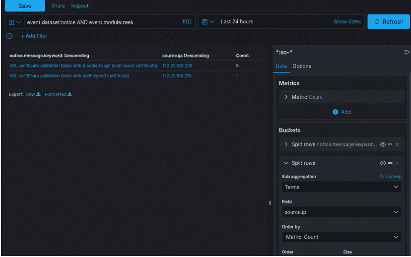

图 9.50 – 练习 6：Zeek notices – 创建可视化

默认情况下，Zeek 将自签名证书标记为无效并为其创建一条 notice。尽管这对 IT 环境来说是一个重要发现，但在 OT 方面，我们不太关心这一发现。典型工业环境的屏蔽架构使得公钥基础设施（PKI）的管理难以维护，因此证书错误并不罕见。在我们的 Breach Detection 仪表板视图中忽略这些证书错误是可以的。我们不会将它们从数据库中删除，只是将它们从视图中隐藏。

9. 要从视图中排除 SSL 证书验证失败（无法获取本地颁发者证书）的 notices，请将鼠标悬停在 notice 计数（14）左侧的区域上，并点击弹出的 –（减号）符号 Filter out value。点击此按钮。或者，你可以点击屏幕顶部的 Add filter 按钮。在 Add filter 弹出窗口中，在 Field 中键入 notice.message.keyword，将运算符设置为 is not，并在 Value 下拉列表中选择 SSL certificate validation failed with (unable to get local issuer certificate)。点击 Save。下面的截图说明了这一过程：

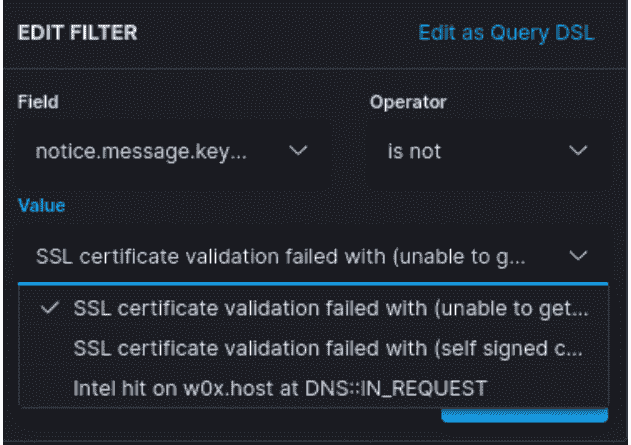

图 9.51 – 练习 6：Zeek notices – 添加数据过滤器

10. 以同样的方式，过滤掉任何其他安全套接字层（SSL）证书通知或使视图混乱的通知。

11. 结果是一个 Zeek notice 日志视图，多余的告警极少，简洁明了。点击 Save，将小部件保存为 Breach Detection - Zeek Notices Summary。

接下来，我们将向 Breach Detection 仪表板添加 Zeek intel 日志。

## Zeek Intel 日志

当 Zeek 将发现的工件与 Intel 文件中的相应条目相关联时，就会创建 Zeek Intel 日志。在*第 8 章，工业威胁情报*中，我们将 AlienVault 威胁信息源添加到了 Security Onion。下面看一下该信息源文件（`intel.dat`）中的一些条目：

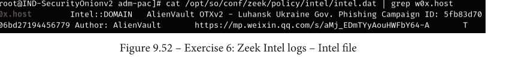

我们可以看到Intel文件中有一个条目将 `Intel::DOMAIN) w0x.host` 域名与 `Luhansk Ukraine Gov. Phishing Campaig`n 相关联。现在，当 Zeek 在监控网络流量时遇到 `w0x.host` 域名，它就会创建一条 Intel 日志条目，如下所示：

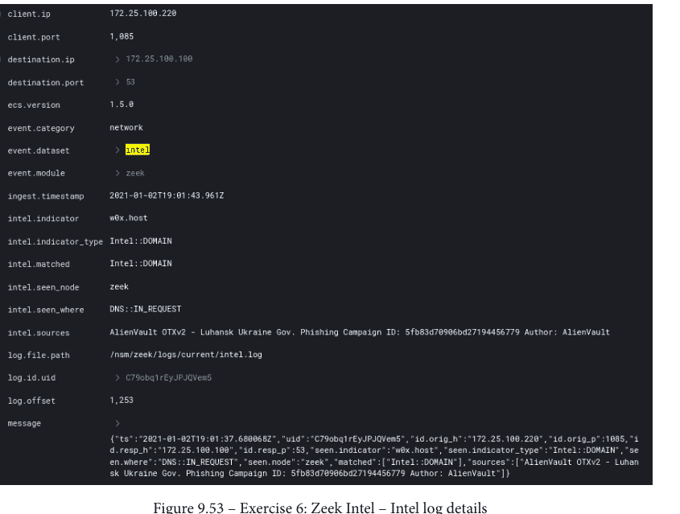


根据进入 Intel 数据文件的威胁情报源的质量，Intel 日志可以是非常明确的失陷指标（IOC），或者至少是网络中非常可疑活动的指示器。

我们可以按照以下说明将 Zeek Intel 日志添加到我们的**失陷检测**仪表板：

1. 导航到我们的**失陷检测**仪表板（**Kibana | 仪表板 | 失陷检测**），并点击仪表板屏幕左上角的**编辑**。
2. 点击**新建**按钮添加一个新组件（可视化）。
3. 选择`Data Table`可视化类型，然后搜索并添加`*:so-*`数据源（这是所有日志的数据源）。
4. 输入`event.dataset:intel`搜索词，仅筛选出通知日志。点击**刷新**。
5. 添加一个`Split Rows`数据桶，将**聚合**设置为**词条**，并选择`intel.sources.keyword`作为**字段**。
6. 将**大小**选项设置为50，然后点击**更新**。
7. 我们将添加源 IP 地址，以与 Intel 通知消息一同显示。为此，请添加另一个`Split Rows`数据桶，将**聚合**设置为**词条**，并选择`source.ip`作为**字段**。
8. 将**大小**选项设置为50，然后点击**更新**。
9. 点击**保存**，将组件保存为`Breach Detection - Intel Logs Summary`。

接下来，我们将使用 Sysmon 日志查看可疑进程。

## 可疑进程和文件创建

在 Windows 机器上，创建文件和启动进程是非常常见的操作。然而，有些指标会在创建进程或创建（保存）文件时发出恶意行为警报。其中一个指标是可执行文件启动或保存的位置。通过过滤掉这些操作的大多数常见位置，我们可以生成一个显示异常可执行文件路径（位置）的视图。

按照以下说明创建一个可视化，以帮助我们精确定位可疑的进程创建：

1. 导航到我们的**失陷检测**仪表板（**Kibana | 仪表板 | 失陷检测**），并点击仪表板屏幕左上角的**编辑**。
2. 点击**新建**按钮添加一个新组件（可视化）。
3. 选择数据表可视化类型，然后搜索并添加 Security Onion - Sysmon 数据源。
4. 添加一个拆分行数据桶，将聚合设置为词条，并选择 `process.executable.keyword` 作为字段。
5. 将大小选项设置为50，然后点击更新。
6. 我们将添加源计算机名称，以与进程事件条目一同显示。为此，请添加另一个拆分行数据桶，将聚合设置为词条，并选择 `winlog.computer.keyword` 作为字段。
7. 将大小选项设置为50，然后点击更新。

以下截图展示了具体操作：

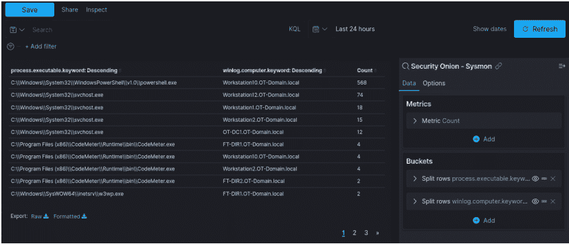

图9.54 – 练习6：可疑进程创建 – 所有日志

此时，我们已经创建了一个视图，显示环境中所有端点上创建的每个进程的位置（image_path）摘要。其中大多数是合法操作。接下来我们要过滤掉进程应该启动的所有常见位置，例如 c:\windows\system32、c:\Program Files 等。让我们按以下步骤进行：

8. 在可视化编辑页面中输入以下代码作为搜索查询：

```
NOT process.executable: "c:\\windows\\system32\\*" AND
NOT process.executable: "c:\\Program Files*" AND NOT
process.executable: "c:\\windows\\Microsoft.NET\\*" AND
NOT process.executable: "C:\\ProgramData\\Microsoft\\Windows Defender\\*" AND NOT process.executable: "c:\\windows\\syswow64\\*" AND NOT process.executable: "c:\\Windows\\SystemApps\\*" AND NOT process.executable: "c:\\windows\\WinSxS\\*" AND NOT process.executable: "c:\\windows\\servicing\\*" AND NOT process.executable: "c:\\windows\\softwaredistribution\\*"
```

这是一个不错的起始列表，列出了 Windows 可执行文件的常见启动位置。随着时间推移，你可能会遇到其他位置，可以在此处添加它们。

9. 点击**刷新**，并使用**过滤掉值**按钮排除任何其他明显已知的安全可执行文件（例如 c:\windows\explorer.exe）。这样你就可以在后续微调视图。

10. 剩余内容应当是启动自异常位置可执行文件的进程的精简输出，如下截图所示：

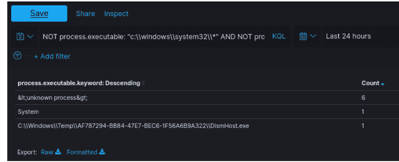

图9.55 – 练习6：可疑进程创建 – 筛选后视图

从 c:\windows\temp 位置启动的进程总是可疑的，但并不总是恶意的！

11. 点击**保存**，将组件保存为 Breach Detection - Suspicious Image Paths。

接下来，我们将添加 PowerShell 脚本块日志记录，以显示我们环境中值得关注的 PowerShell 活动。

## 可疑的 PowerShell 命令

PowerShell 是管理 Windows 的一种非常方便且……嗯，强大的方式。许多攻击者在改编已知工具时，都会围绕这种脚本语言来构建。这使攻击更加隐蔽（因为无需运行外部可执行文件），同时也非常方便，因为所有现代 Windows 版本默认都安装了 PowerShell。

在练习2 – 使用 Wazuh 进行 PowerShell 脚本块日志记录中，我们将 PowerShell 日志记录功能添加到了安全监控工具包中。现在，我们将了解如何利用该功能来检测 PowerShell 中潜在危险的命令。为此，我们将添加一个仅显示可能有害命令的数据表。按照以下说明创建数据表：

1. 导航到我们的**失陷检测**仪表板（**Kibana | 仪表板 | 失陷检测**），并点击仪表板屏幕左上角的**编辑**。
2. 点击**新建**按钮添加一个新组件（可视化）。
3. 选择数据表可视化类型，然后搜索并添加 `*:so-*` 数据源。
4. 添加一个拆分行数据桶，将**聚合**设置为词条，并选择 `winlog.event_data.scriptBlockText.keyword` 作为**字段**。
5. 将**大小**选项设置为50，然后点击**更新**。
6. 我们将添加源计算机名称，以与脚本块事件条目一同显示。为此，请添加另一个拆分行数据桶，将**聚合**设置为词条，并选择 `winlog.computer.keyword` 作为**字段**。
7. 将**大小**选项设置为50，然后点击**更新**。
8. 这会生成按计算机名称分组的 PowerShell 脚本块日志的完整列表。我们只需筛选出值得关注的条目。点击**添加筛选器**按钮，将**字段**选项设置为 `winlog.event_data.scriptBlockText`，并将**运算符**选项设置为 `is one of`。
9. 现在，一次添加一个值，完成后点击**保存**：

| 术语 | 用途 |
|---|---|
| HKLM registry | - 用于检测与注册表的交互 |
| etsn | - 用于检测远程访问尝试 |
| Enter-PSSession | - 用于检测远程访问尝试 |
| Icm attempts | - 用于检测远程命令执行 |
| Invoke-Command attempts | - 用于检测远程命令执行 |
| Powersploit framework | - 用于检测 PowerShell 渗透测试框架（PowerSploit）的使用 |
| Mimikatz | - 用于检测黑客工具 Mimikatz 的使用 |
| Powercat framework | - 用于检测 Powercat 的使用 |

同样，这只是让你起步的一个列表，所以请做一些研究，找出 PowerShell 攻击中最常使用的命令，然后将它们添加到此处，如下所示：

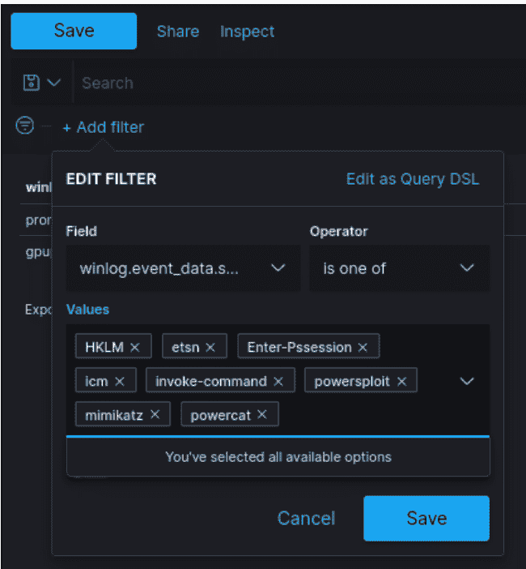

图9.56 – 练习6：可疑的 PowerShell 命令

10. 点击保存，将组件保存为 Breach Detection - Suspicious PowerShell Commands。

PowerShell 的启动方式也可能暴露恶意意图或预谋的滥用行为。下表总结了一些可疑的 PowerShell 调用（启动）方式：

| 参数 | 变体 | 参数用途 |
|---|---|---|
| -noprofile | -nop | 跳过加载 profile.ps1 并避免日志记录 |
| -encoded | -e -en -enc | 允许用户运行经过编码的 PowerShell 脚本 |
| -ExecutionPolicy bypass | -ep bypass, -exp bypass, -exec bypass | 绕过任何执行策略 |
| -windowStyle hidden |  | 阻止创建窗口；可能产生误报 |
| -version 2 | -v 2, -version 2.0 | 强制使用 PowerShell 版本 2 |

检测 PowerShell 引擎的可疑调用可以揭示恶意意图。我们将添加一个数据表，列出包含这些可疑命令行参数的所有进程创建日志。这些数据所在的日志由我们之前在练习1 – 使用 Wazuh 添加 Sysmon 日志记录中部署的 Sysmon 日志引擎提供。按照以下步骤将数据表添加到仪表板：

1. 导航到我们的**失陷检测**仪表板（**Kibana | 仪表板 | 失陷检测**），并点击仪表板屏幕左上角的**编辑**。
2. 点击**新建**按钮添加一个新组件（可视化）。
3. 选择**数据表**可视化类型，然后搜索并添加 `Security Onion Sysmon` 数据源。
4. 添加一个 `Split Rows` 数据桶，将**聚合**设置为**词条**，并选择 `process.command_line.keyword` 作为**字段**。
5. 将**大小**选项设置为50，然后点击**更新**。
6. 我们将添加源计算机名称，以与 PowerShell 调用事件条目一同显示。为此，请添加另一个 `Split Rows` 数据桶，将**聚合**设置为**词条**，并选择 `winlog.computer.keyword` 作为**字段**。
7. 将**大小**选项设置为50，然后点击**更新**。


8. 我们将添加启动 PowerShell 进程的用户名以显示在 PowerShell 调用事件条目中。为此，添加一个额外的 Split Rows 数据桶并将 **Aggregation** 设置为 **Terms**，**Field** 选择为 `user.name.keyword`。
9. 将 **Size** 选项设置为 50 并点击 **Update**。
10. 这会生成一份完整的命令行日志列表。我们只会筛选出有趣的条目。点击 **Add Filter** 按钮并将 **Field** 选项设置为 `process.command_line`，**Operator** 选项设置为 `is one of`。
11. 现在，一次添加一个以下值，并在完成后点击 **Save**：
- `-noprofile`
- `-nop`
- `-encoded`
- `-en`
- `-enc`
- `-enco`
- `-encod`
- `-encode`
- `-ExecutionPolicy bypass`
- `-ep bypass`
- `-exp bypass`
- `-exec bypass`
- `-bypass`
- `-windowStyle hidden`

下图显示了配置好的 widget：

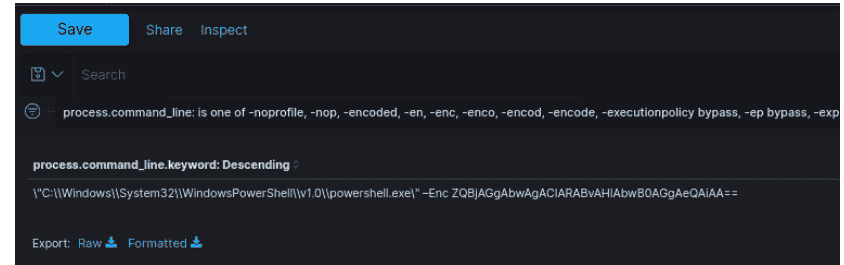

Figure 9.57 – Exercise 6: Suspicious PowerShell invocation

12. 点击 **Save**，将 widget 保存为 `Breach Detection – Suspicious PowerShell Invocation`。

我们现在已经围绕可疑 PowerShell 命令以及 PowerShell 的调用方式创建了可视化。接下来，我们将查看可疑网络连接。

## Suspicious egress connections

看到对外部地址（企业区或互联网）的重复连接可能是网络上存在 **bot** 活动的迹象，或是从内部网络（工业区）外泄数据的迹象。Bot 是一种将它们感染的主机转变为 **zombie** 机器的恶意软件，即受制于主人的无意识无人机，为该主人执行操作。Bot 需要定期与其 C&C 服务器建立连接以向 botmaster 汇报，请求指令或更新。我们可以通过监控内部 IP 地址与外部 IP 地址之间的重复连接来检测这些汇报。通常，这些连接的类型和大小相同，并且都指向同一个 IP 地址。我们接下来要做的是添加一个可视化，以便在汇总表中快速描绘这种典型的连接类型。要添加一个汇总出站已建立连接计数的表格，请按照以下说明操作：

1. 导航到我们的 **Breach Detection** 仪表板（**Kibana | Dashboards | Breach Detection**）并在仪表板屏幕左上角点击 **Edit**。
2. 点击 **Create New** 按钮以添加新的 widget（可视化）。
3. 选择 `Data Table` 可视化类型并搜索并添加 `Security Onion – Connections` 数据源。
4. 添加一个 `Split Rows` 数据桶并将 **Aggregation** 设置为 **Terms**，**Field** 选择为 `source.ip`。将 **Size** 选项设置为 50。
5. 添加一个 `Split Rows` 数据桶并将 **Aggregation** 设置为 **Terms**，**Field** 选择为 `destination.ip`。将 **Size** 选项设置为 50。
6. 添加一个 `Split Rows` 数据桶并将 **Aggregation** 设置为 **Terms**，**Field** 选择为 `destination.port`。将 **Size** 选项设置为 50。
7. 添加一个 `Split Rows` 数据桶并将 **Aggregation** 设置为 **Terms**，**Field** 选择为 `network.transport.keyword`。将 **Size** 选项设置为 10。
8. 添加一个 `Split Rows` 数据桶并将 **Aggregation** 设置为 **Terms**，**Field** 选择为 `network.bytes`。将 **Size** 选项设置为 50。
9. 添加一个 `Split Rows` 数据桶并将 **Aggregation** 设置为 **Terms**，**Field** 选择为 `connection.state_description.keyword`。将 **Size** 选项设置为 50。

## Suspicious ingress connections

另一个基于网络连接的良好指标是入站连接检测。尤其是在工业环境中，对 ICS 网络上资产的外部连接都是可疑的，如果它们源自互联网则更可疑。我们现在将创建一个可视化，用于显示入站网络连接汇总。按照以下说明创建汇总外部连接进入工业网络的表格：

1. 导航到我们的 **Breach Detection** 仪表板（**Kibana | Dashboards | Breach Detection**）并在仪表板屏幕左上角点击 **Edit**。
2. 点击 **Create New** 按钮以添加新的 widget（可视化）。
3. 选择 Data Table 可视化类型并搜索并添加 Security Onion - Connections 数据源。
4. 添加一个 Split Rows 数据桶并将 **Aggregation** 设置为 **Terms**，**Field** 选择为 @timestamp。 将 **Size** 选项设置为 50。
5. 添加一个 Split Rows 数据桶并将 **Aggregation** 设置为 **Terms**，**Field** 选择为 source.ip。 将 **Size** 选项设置为 50。
6. 添加一个 Split Rows 数据桶并将 **Aggregation** 设置为 **Terms**，**Field** 选择为 destination.ip。 将 **Size** 选项设置为 50。
7. 添加一个 Split Rows 数据桶并将 **Aggregation** 设置为 **Terms**，**Field** 选择为 destination.port。 将 **Size** 选项设置为 50。
8. 添加一个 Split Rows 数据桶并将 **Aggregation** 设置为 **Terms**，**Field** 选择为 network.transport.keyword。 将 **Size** 选项设置为 50。
9. 添加一个 Split Rows 数据桶并将 **Aggregation** 设置为 **Terms**，**Field** 选择为 event.duration。 将 **Size** 选项设置为 50。
10. 添加一个 Split Rows 数据桶并将 **Aggregation** 设置为 **Terms**，**Field** 选择为 network.bytes。 将 **Size** 选项设置为 50。
11. 添加一个 Split Rows 数据桶并将 **Aggregation** 设置为 **Terms**，**Field** 选择为 connection.state_description.keyword。 将 **Size** 选项设置为 10。
12. 这会生成所有连接日志的汇总视图。我们希望查看已建立的连接，但仅限出站。为此，添加以下过滤器：
- 输入以下搜索字符串以进行视图过滤：NOT source.ip: 172.25.100.0/24。这将过滤掉任何本地于工业网络的 IP 地址（根据你的子网进行调整）。
- 在 connection.local.responder 上对数据表进行过滤：true——这将过滤视图，仅显示连接到本地目标（工业区）的连接。

13. 鉴于我们处理的是工业网络，在我们刚刚创建的数据表视图中，我们应该看到很少或没有外部连接。事实上，在这里看到连接出现是极其可疑的。如果你有企业系统出于正当理由需要连接到工业资产，你可以通过过滤它们将其加入白名单。你可以在以下截图中看到示例输出：


Figure 9.59 – Exercise 6: Suspicious ingress connections

14. 确保按 **Duration**（降序）排序并点击 **Save**，将 widget 保存为 **Breach Detection – Suspicious Ingress Connections**。

接下来，我们将查看一些用户账户活动。

## Failed user login attempts

失败的用户登录尝试时有发生。人们会输错密码、忘记密码，或因某种原因被锁定。这是对任何网络的正常活动；然而，失败登录尝试中的某些模式会脱颖而出。从或到某个 IP 地址（主机）的过度登录尝试几乎可以肯定是恶意的。由于许多网络管理员为过度登录尝试实施了账户锁定程序，攻击者已改变其方法，只在每台机器上尝试 X 段时间，然后转到下一台机器。对于这种情况，来自单台机器对多台其他机器的几次失败登录尝试也应被视为可疑。

为了捕获这两种类型的登录攻击（暴力攻击），我们将创建一个可视化，用于随时间推移展示失败登录尝试。按照以下说明创建图表 widget：

1. 导航到我们的 **Breach Detection** 仪表板（**Kibana | Dashboards | Breach Detection**）并在仪表板屏幕左上角点击 **Edit**。
2. 点击 **Create New** 按钮以添加新的 widget（可视化）。
3. 选择 Vertical Bar 可视化类型并搜索并添加 Security Onion - Alerts 数据源。
4. 添加一个 Split Series 数据桶并将 **Aggregation** 设置为 **Terms**，**Field** 选择为 `winlog.event_data.targetUserName.keyword`。将 **Size** 选项设置为 50。
5. 添加一个 X-axis 数据桶并将 **Aggregation** 设置为 **Data Histogram**，然后点击 **Update**。
6. 这将聚合设置为时间线显示，随时间查看所有警报的目标用户名日志。
7. 现在是关键时刻：点击 **Add Filter** 按钮，然后将 **Field** 选项设置为 `event.code`，**Operator** 选项设置为 `is one of`。将值设置为 4625、4771 和 539，这三个众所周知的 Windows 事件 ID 表示失败的登录尝试。以下截图显示了示例输出：


Figure 9.60 – Exercise 6: Failed login attempts


还有更多事件 ID 可能表明登录尝试失败，因此我将把它作为你的家庭作业，让你研究与登录失败相关的额外事件 ID 并在此处添加它们（考虑域登录与本地登录）。

- 8. 点击 Save，保存小部件为 `Breach Detection - Failed Login Attempts over time.`

我们现在对随时间推移的登录失败尝试有了非常方便的视图。图表中的峰值表示活动，并且由于我们从多台机器提取日志，峰值可能表示我们在本节开头讨论的两种攻击场景之一。

接下来，我们将查看用户创建和更改日志。

## 新用户创建和用户账户更改

我们现在将可视化围绕新用户创建和用户账户更改的警报。用户创建或对用户账户的更改是环境中恶意行为的良好指标，应密切关注这些操作周围的警报。按照以下说明创建显示新或更改用户账户警报的数据表小部件：

- 1. 导航到我们的 **Breach Detection** 仪表板 (**Kibana | Dashboards | Breach Detection**) 并点击仪表板屏幕左上角的 **Edit**。
- 2. 点击 **Create New** 按钮添加新的小部件（可视化）。
- 3. 选择 `Data Table` 可视化类型并搜索并添加 `Security Onion - Alerts` 数据源。
- 4. 添加一个 `Split Rows` 数据桶并将 **Aggregation** 设置为 **Terms**，**Field** 选择为 `rule.name.keyword`。将 **Size** 选项设置为 50。
- 5. 添加一个 `Split Rows` 数据桶并将 **Aggregation** 设置为 **Terms**，**Field** 选择为 `winlog.event_data.subjectUserName.keyword`。将 **Size** 选项设置为 50。
- 6. 添加一个 `Split Rows` 数据桶并将 **Aggregation** 设置为 **Terms**，**Field** 选择为 `winlog.event_data.targetUserName.keyword`。将 **Size** 选项设置为 50。
- 7. 添加一个 Split Rows 数据桶并将 Aggregation 设置为 Terms，**Field** 选择为 agent.name.keyword。将 **Size** 选项设置为 50。
- 8. 点击 Update 应用数据桶。
- 9. 现在是魔法时刻：点击 Add Filter 按钮，然后将 Field 选项设置为 event.code，Operator 选项设置为 is one of。将值设置为以下内容：
  - 4720—这是新用户创建的事件 ID
  - 4738—这是账户更改的事件 ID
  - 4732—这是用户被添加到本地特权组的事件 ID
  - 4728—这是用户被添加到全局特权组的事件 ID
  - 4722—这是用户账户被启用的事件 ID

你可以在以下截图中看到示例输出：


Figure 9.61 – Exercise 6: User account alerts summary

- 10. 点击 Save，保存小部件为 Breach Detection - User Account Alerts Summary。

到目前为止，我们已经查看了警报、进程和用户。接下来，我们将查看已下载的文件。

## 已下载文件

我们将添加到 **Breach Detection** 仪表板的最后一个可视化将向我们显示从互联网下载的文件。我们将围绕 `bro_http` 日志创建可视化，显示有趣的 **Uniform Resource Identifier (URI)** 字符串，例如 .exe、.bat、.cmd 等。按照以下说明构建数据表小部件：

- 1. 导航到我们的 **Breach Detection** 仪表板 (**Kibana | Dashboards | Breach Detection**) 并点击仪表板屏幕左上角的 **Edit**。
- 2. 点击 **Create New** 按钮添加新的小部件（可视化）。
- 3. 选择 Data Table 可视化类型并搜索并添加 `*:so-*` 数据源（这是所有日志的数据源）。
- 4. 输入 `event.dataset:http` 搜索词以仅过滤 HTTP 日志，然后点击 **Update**。
- 5. 添加一个 Split Rows 数据桶并将 **Aggregation** 设置为 **Terms**，**Field** 选择为 `source.ip`。
- 6. 添加一个 Split Rows 数据桶并将 **Aggregation** 设置为 **Terms**，**Field** 选择为 `http.virtual_host.keyword`。
- 7. 添加一个 Split Rows 数据桶并将 **Aggregation** 设置为 **Terms**，**Field** 选择为 `http.uri.keyword`。
- 8. 添加一个 Split Rows 数据桶并将 **Aggregation** 设置为 **Terms**，**Field** 选择为 `http.user_agent.keyword`。
- 9. 将 **Size** 选项设置为 50 并点击 **Update**。
- 10. 我们现在将搜索有趣的（可执行）文件扩展名。在现有搜索词之后输入以下搜索查询：
  
  ```
  AND http.uri: ("*.exe" OR "*.bin" OR "*.bat" OR "*.com" OR "*.cmd" OR "*.cpl" OR "*.Isu" OR "*.lnk" OR "*.msi" OR "*.ps1" OR "*.reg" OR "*.scr" OR "*.sct" OR "*.vb" OR "*.vbe" OR "*.vbs" OR "*.vbscript" OR "*.ws" OR "*.wsf" OR "*.sys" )
  ```
  
  如果你找到更多扩展名，请在此处添加它们。
- 11. 点击 **Save**，保存小部件为 `Breach Detection - Download of Executable Files`。

我们还可以添加更多小部件，但为了简洁起见，我们将保留这些基本小部件。

## SilentDefense 警报

在本练习中我们将涵盖的最后一个警报汇总小部件是关于显示 SilentDefense 警报的。我们希望显示我们的 OT-IDS 警报正在捕获的有趣事件。为此，请按照以下步骤操作：

- 1. 导航到我们的 **Breach Detection** 仪表板 (**Kibana | Dashboards | Breach Detection**) 并点击仪表板屏幕左上角的 **Edit**。
- 2. 点击 **Create New** 按钮添加新的小部件（可视化）。
- 3. 选择 **Data Table** 可视化类型并搜索并添加 `*:so-*` 数据源。
- 4. 输入 `event.dataset:ot-ids` 搜索词以仅过滤 SilentDefense 日志，然后点击 **Update**。
- 5. 添加一个 **Split Rows** 数据桶并将 **Aggregation** 设置为 **Terms**，**Field** 选择为 `source.ip`。将 **Size** 选项设置为 50。
- 6. 添加一个 **Split Rows** 数据桶并将 **Aggregation** 设置为 **Terms**，**Field** 选择为 `rule.category.keyword`。将 **Size** 选项设置为 50。
- 7. 添加一个 **Split Rows** 数据桶并将 **Aggregation** 设置为 **Terms**，**Field** 选择为 `rule.name.keyword`。将 **Size** 选项设置为 50。
- 8. 点击 **Update** 应用数据桶。
- 9. 过滤掉任何嘈杂的（不有趣的）警报类别，例如 `NameResolution` 和 `FileRead` 等警报，以清理视图。
- 10. 点击 **Save**，保存小部件为 `Breach Detection – SilentDefense Alerts Summary`。

我们现在有一个小部件向我们显示有趣的 OT-IDS 警报。

这里我们还可以涵盖更多小部件，并且还可以应用更多视图、列和过滤器来自定义整体 **Breach Detection** 仪表板。随着时间的推移，当你开始使用这些信息时，你将调整视图和数据以满足你的需求。现在，你应该对 Security Onion 和 Kibana 的功能有坚实的知识来开始使用。让我们用一些应该出现在每个仪表板上的标准小部件来完成仪表板。

## 完成仪表板

为了完成我们的仪表板，我们将添加一些应该成为每个仪表板一部分的可视化。第一个是 **log count-over-time bar graph**，显示我们在为仪表板设置的时间段内日志的分布。要添加此可视化，请按照以下步骤操作：

- 1. 导航到我们的 **Breach Detection** 仪表板 (**Kibana | Dashboards | Breach Detection**) 并点击仪表板屏幕左上角的 **Edit**。
- 2. 点击仪表板顶部的 **Add** 按钮并搜索并添加 **Security Onion – Logs Over Time** 小部件，如以下截图所示：


- 3. 关闭 **Add Panels** 屏幕并将新添加的可视化拖到屏幕顶部。

我们将添加的第二个小部件是 **navigation side panel**，允许我们快速访问 Security Onion 仪表板。要添加此可视化，请按照以下步骤操作：

- 1. 导航到我们的 **Breach Detection** 仪表板 (**Kibana | Dashboards | Breach Detection**) 并点击仪表板屏幕左上角的 **Edit**。
- 2. 点击仪表板顶部的 **Add** 按钮并搜索并添加 **Security Onion – Navigation** 面板。
- 3. 关闭 **Add Panels** 屏幕并将新添加的可视化拖到屏幕左上角，紧挨着日志计数随时间变化的小部件。按喜好调整其他可视化。示例输出如下图所示：


图 9.63 – 练习 6：已完成仪表板的可能布局概览

我们最后要添加的可视化是一个日志查看器。

点击 Add 并搜索并添加 Security Onion – All Logs 保存的搜索。这会在底部添加一个面板，显示原始日志条目，如以下屏幕截图所示：


图 9.64 – 练习 6：收尾 – 添加事件查看器

打开其中一个日志并通过点击悬停在字段上时出现的 Toggle column in table 按钮，将任何有趣的数据字段添加到表格视图中。一旦你对显示效果满意，就保存仪表板并拍拍自己的肩膀——我们现在创建了一个仪表板，可以让我们快速评估我们环境的安全状态。

我们应该将仪表板设置为显示 24 小时的时间跨度并每分钟自动刷新，如以下屏幕截图所示：


图 9.65 – 练习 6：收尾 – 自动刷新

因此，现在，当有一段有趣的数据引起我们的注意时，我们可以交互式地查找该工件周围的信息。例如，IP地址 `222.222.222.222` 在我的仪表板上到处出现。我可以通过悬停在该 IP 地址上并点击 **Filter for value** 来对其进行过滤。整个仪表板现在将显示过滤为 `source_ip: 222.222.222.222` 的数据。我们可以在以下屏幕截图中看到 NIDS 警报：


图 9.66 – 违规检测仪表板：已过滤的 NIDS 警报

我们还可以看到来自该 IP 地址的可疑入站连接，如以下屏幕截图所示：


图 9.67 – 违规检测仪表板：已过滤的可疑入站连接视图

此外，我们可以在屏幕底部的日志查看器中查看任何日志的详细信息，如以下屏幕截图所示：


图 9.68 – 违规检测仪表板：已过滤的事件查看器

就目前而言，我们就讲到这里。这个仪表板可以作为一个起点，用于建立 **安全运营中心 (SOC)** 视图。这很可能会发生变化，因此请添加和修改仪表板以使其符合你的需求，但这对于你进入整体安全监控方法的旅程来说是一个很好的起点。

## Summary

在本章中，我们对安全监控采取了 mostly 被动的方法，让我们的工具为我们挖掘和暴露。我们研究了如何将所有被动安全监控工具结合起来，并将其整合成一个单一的交互式仪表板视图，以便我们快速评估我们环境的安全状态。你现在应该能够添加、更改或扩展 Kibana **Breach Detection** 仪表板或 Security Onion 随附的任何其他仪表板的功能，以充分利用我们收集的数据。

在下一章，即 *第 3 部分，威胁狩猎* 的开始，我们将撸起袖子开始在环境中挖掘，看看是否能找到一些恶意活动或行为者。
