## 13
威胁搜寻
场景 3 –
可疑的外部
连接

在本章中，我们将执行三个威胁搜寻场景系列中的第三个，也是最后一个威胁搜寻练习；正如我们在第 10 章“威胁搜寻”中讨论的那样，这些场景有助于评估新的或额外的工业控制系统（ICS）网络（分段）的网络安全卫生状况。通过定义以下三个威胁搜寻假设——“有恶意行为者（试图）向外部 IP/域发送信标”、“工业环境中的资产上运行着恶意或不需要的应用程序”以及“有可疑的外部连接进入工业环境”——并围绕这些假设执行威胁搜寻练习，我们试图在采用或整合一个新的 ICS 网络，或对现有 ICS 网络进行添加/扩展时，尽可能多地发现恶意活动。其理念是，通过对一个未知的 ICS 网络预先执行这三个威胁搜寻练习，我们就可以在将新网络（分段）连接到现有基础设施之前，合理地确信我们会发现任何不受欢迎的访客。

# 形成“可疑的外部连接”威胁搜寻假设

正如我们在*第 10 章“威胁搜寻”*中讨论的那样，威胁搜寻练习是围绕假设展开的。通常，假设源于或反映了已发现的安全事件、自动安全监控系统发出的某种警报，或安全分析师得出的某个发现。我们将在本章中执行的威胁搜寻练习略有不同。我们将要执行威胁搜寻活动的环境对我们来说并不熟悉，或是新接触的环境。我们公司收购了一个新的生产工厂，该工厂拥有现有的 ICS 网络基础设施，他们希望将其与现有的公司基础设施连接起来，而我们需要确保这样做是安全的。另一种情况是，你的 ICS 网络已经运行了很长时间，但你从未认真审视过其安全态势。在这种情况下，这些“非触发式”威胁搜寻练习可以快速、准确地让你了解 ICS 环境中的恶意活动或内容。

在*第 11 章“威胁搜寻场景 1 – 恶意软件信标”*中，我们研究了离开 ICS 环境的可疑网络连接（出站连接）。我们讨论过，由于工业系统（预期）的隔离特性，来自工业网络的出站连接应该很少见。这一点同样适用于入站连接（进入 ICS 网络的合法连接）。来自企业网络的连接应保持在最低限度，并加以明确定义（受到控制和监控），而来自互联网的连接则应完全阻止。

总的来说，检查进出 ICS 环境的连接是发现恶意活动的绝佳方式。正如我们在*第 11 章“威胁搜寻场景 1 – 恶意软件信标”*中搜寻信标时所看到的，检查流量模式揭示了受感染的工作站正在连接其**命令与控制（C&C 或 C2）**服务器。

我们将应用类似的技术来发现可疑的入站连接。利用“从外部网络进入工业网络的连接不应该很多”这一便利事实，我们将通过搜索一些常见的指标（这些指标可以将恶意连接与合法连接区分开来），看看能否证明或反驳**“有可疑的外部连接进入工业环境”**这一假设。

让我们从讨论（入站）连接开始。


现在我得承认，在我的职业生涯中见过一些灾难性的配置，但要使前面描述的场景可行，IT安全管理员必定错误配置了企业DMZ（IT-DMZ），允许通过企业DMZ防火墙的访问（或者DMZ中的代理服务已被攻击者入侵）。此外，企业到工业防火墙（ENT-IND防火墙）必须配置错误，允许从互联网访问工业区（就像防火墙中忘记删除的允许所有规则一样简单）。虽然所描述的场景是可能的，但鉴于近年来ICS所有者表现出的安全意识增强，这种情况极不可能发生。

我仍然鼓励威胁猎手将对从互联网发起到ICS环境的连接进行搜索纳入工作，原因在于近年来有一种趋势，将ICS系统与云服务绑定，以实现回连功能或云产品中的数据分析。如果这些技术没有正确实施（这种情况经常发生），最终可能导致ICS网络直接连接到互联网。为了说明这一点，请考虑下图中显示的示例设置：

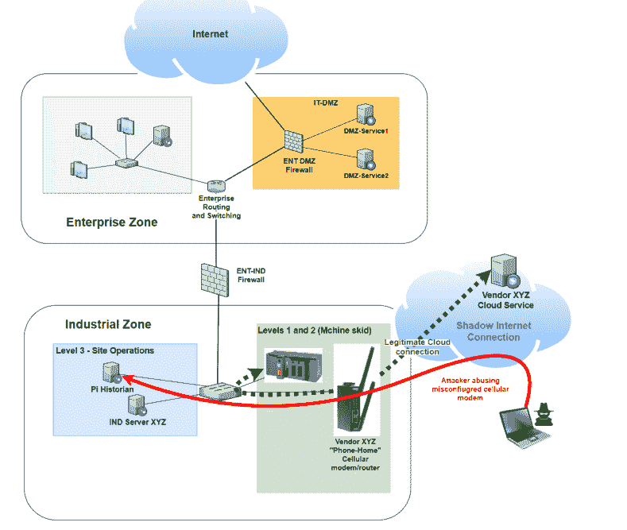

图13.4 – 影子互联网连接 – 通往ICS网络的后门

在此示例场景中，供应商安装了一个蜂窝路由器，例如Moxa提供的产品（https://www.moxa.com/en/products/industrial-network-infrastructure/cellular-gateways-routers/cellular-gateways/oncells-g3150a-lte-series），以允许现场运行的应用程序连接到供应商拥有的云服务（或更糟的是，让云服务连接到工业网络设备），目的是发送其设备的性能数据和/或允许某种类型的连接以进行故障排除或其他支持。该设置没有正确限制来自互联网的访问，或者所使用的蜂窝设备存在漏洞，现在允许攻击者进入组织的工业网络，从而允许从互联网直接访问供应商解决方案可访问的任何内容。

觉得这太离谱？看看下面在https://www.shodan.io/上的搜索，搜索词为enbt OR en2t，以发现暴露在互联网上的罗克韦尔自动化PLC网络卡：

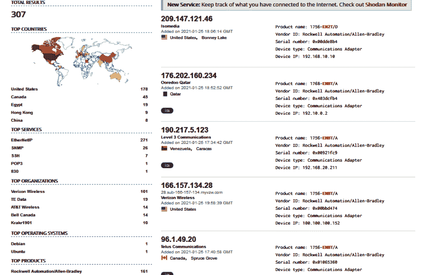

图13.5 – 使用Shodan搜索罗克韦尔网络接口卡

如果这些IP地址中有任何一个属于你，请将此视为一次免费的警醒。

这里返回的每个结果都是与组织内部（ICS）网络的直接连接。要开始与罗克韦尔设备通信，我们只需将Factory Talk编程套件或Python模块Pylogix（我们在第7章“主动安全监控”中讨论过，https://github.com/dmroeder/pylogix）指向搜索结果并连接即可。现在，仔细看看结果页面。注意到左侧统计信息中的规律了吗？

## 顶级组织

|  |  |
|---|---|
| Verizon Wireless | 101 |
| TE Data | 19 |
| AT&T Wireless | 14 |
| Bell Canada | 14 |
| Krakr1901 | 10 |

图13.6 – 顶级组织均为蜂窝运营商

被发现的IP地址所属的大多数组织都是蜂窝服务提供商！使这个问题更加复杂的是，这些IP地址不会出现在任何人的文档中。拥有此类蜂窝连接的组织通常不知道自己的IP地址，因此，如果执行互联网暴露检查（我强烈建议至少每年一次，https://threatgen.com/checking-the-internet-exposure-of-your-ics-using-shodan-io/），这类设备不会被检查，因为它们未登记为属于该组织。

你可能还记得我在第3章“工业非军事区”中曾详细谈论过这种情况。我想再次强调此类宽松配置的潜在影响。它们确实是攻击者会首先寻找的低垂果实。如果你的设备出现在Shodan.io上，你就应该认为自己已被入侵！一般来说，你应该防止供应商在你的工业网络上安装此类影子互联网连接，而应使用IDMZ中的专用服务，如第3章“工业非军事区”所述。

那么，除了运气好找到一个暴露在互联网上的目标之外，考虑到如今通过常规互联网连接直接访问组织/工厂已不可行，攻击者如何从互联网破坏工业环境？我们将在接下来看到这个问题的答案。

## 源自企业网络的攻击

任何配置还算得当的企业与工业区之间的防火墙，都会阻止来自互联网的IP地址穿越到工业网络。如果安装并正确配置了IDMZ，此类连接肯定会被阻止。随着从互联网到工业网络的直接连接越来越难找到，攻击者已经调整了技术，会先设法在企业网络上建立立足点，然后尝试通过横向移动进入工业网络。这个最初的立足点可能是钓鱼电子邮件的结果，该邮件让接收者打开恶意Office文档，或诱骗他们访问恶意网站。这两条路径都会导致恶意软件被安装到企业用户的计算机上。初始访问也可能来自意外感染，即企业用户仅访问了一个恶意网站（路过式下载）而被恶意软件感染。诸如此类的意外失陷经常在暗网上出售，使得有特定攻击目标的对手只需购买即可进入企业网络。

当然，还有更多场景，但重点是攻击者已在组织企业侧的系统上获得了初始立足点。现在，要么攻击者找到进入工业网络的方法，要么在这个过程中被抓住，只是时间问题，而后者通常需要平均200天或更长时间。

下图描述了以破坏工业网络（上的资产）为目标的攻击者的攻击路径：

## 入站网络连接

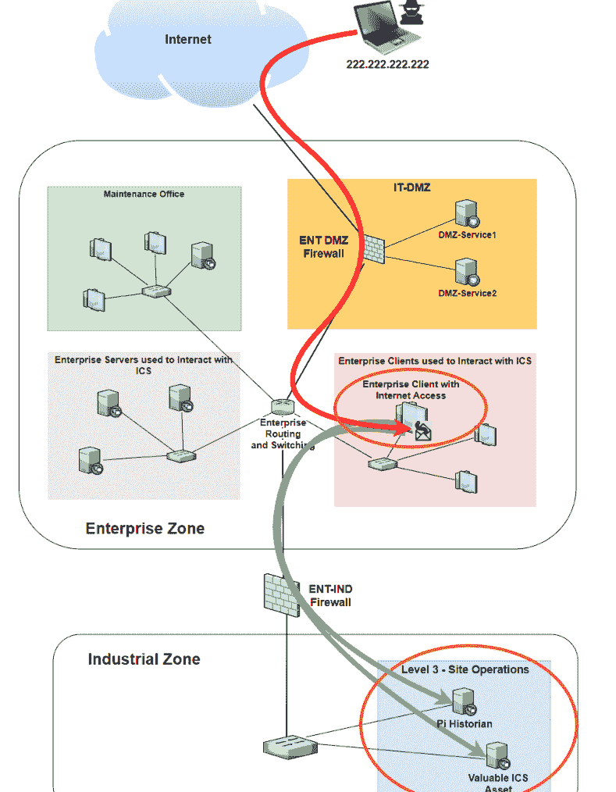

图13.7 – 以工业网络为目标的横向移动攻击

如图所示，攻击者将利用其在企业网络系统内的立足点，横向移动进入工业环境，并攻击工业网络上的资产。攻击者的“最终”目标在进入工业网络后的一段时间才会实现。例如，最终目标可能是攻击者利用受感染的Level 3现场运营服务器（如前面示意图中所示的Pi Historian）或其他方便的途径来窃取有价值的数据，或为攻击PLC或其他Level 2（及以下）设备铺平道路。

我刚才解释的正是**ICS网络杀伤链**。ICS网络杀伤链源自*IT网络杀伤链*（由洛克希德·马丁公司提出 – https://www.lockheedmartin.com/en-us/capabilities/cyber/cyber-kill-chain.html），并根据大多数现代ICS环境的层次化/分区化/分段化特性进行了调整。ICS网络杀伤链由SANS研究所开发并记录在案，你可以在此阅读更多信息：https://www.sans.org/reading-room/whitepapers/ICS/industrial-control-system-cyber-kill-chain-36297。

我们将在*第17章“ICS环境渗透测试”*中更详细地讨论ICS网络杀伤链。

接下来，让我们探讨如何检测横向移动攻击。我们将从查看源自企业区并进入工业网络的连接开始。

## 源自企业区的入站网络连接

现在，我们将查看Zeek为我们记录的网络连接，其中源IP地址位于企业网络子网内，这是组织中通常已知的IP地址范围（在我们的实验室设置中为10.0.0.0/24）。


导航至 **Home | Network | Connections**。在搜索栏中添加以下搜索字符串：`AND source.ip: 10.0.0.0/24`（这将过滤掉除企业网络子网作为源 IP 地址以外的所有流量）。接下来，对 `connection.local.responder is true` 设置过滤器（这将过滤掉除由本地子网（即工业网络子网）上的系统响应的连接以外的所有连接）。最后，将仪表板的时间范围设置为 **最近 7 天**（请记住，在我们用于执行三次威胁狩猎演练的*新或附加网络*场景中，我们仅在过去的 7 天内监控安全状况）：

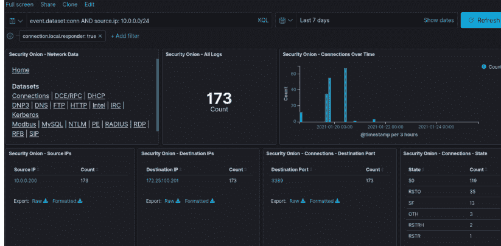

图 13.8 – 源自企业系统的连接

此次搜索找到了 173 个连接，全部来自 IP 地址为 `10.0.0.200` 的企业系统，目标是 IP 地址为 `172.25.100.201`（Workstation1）的工业系统，通过端口 3389。端口 3389 通常用于 **远程桌面协议 (RDP)** 连接。

我们可以从此次发现中识别出以下有趣的入站连接细节：

- `10.0.0.200 − 3389 − 172.25.100.201`

接下来，我们将调查是否能找到围绕此连接的恶意活动。

### 查看来自工业端点的交互

远程桌面协议连接通常被用作企业用户与工业环境交互的合法手段。事实上，正如我们在第 3 章“工业非军事区”中所讨论的，这是防止人类交互直接影响（触碰）工业设备的首选方式。因此，发现这类连接本身并不一定是恶意的。我们需要查看在连接建立期间发生了什么，换句话说，企业用户从工业端点与 ICS 网络上的其他系统和设备进行了哪些交互？为此，我们将使用我们在第 9 章“可视化、关联和警报”中构建的违规检测仪表板。请按照以下步骤深入了解情况：

1. 作为第一步，我们需要确定要应用于违规检测仪表板的时间范围。为此，我们将查看网络连接仪表板中的事件详情（所有日志）部分：

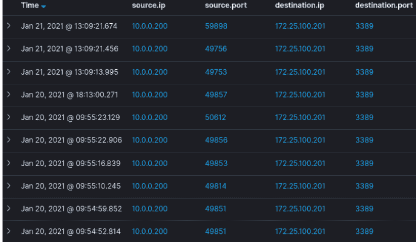

图 13.9 – 所有连接日志，从企业到工业

此面板向我们显示，最近记录的 RDP 连接（在我们指定的时间范围内）发生在 2021 年 1 月 21 日 @ 13:09:21.674。这是我们的结束时间。

2. 现在点击时间戳列（`Time`）标题名称旁边的向下箭头。这会反转事件的列出的顺序，我们会看到在我们设置的时间范围内 RDP 连接的第一次出现：

| Time | source.ip | source.port | destination.ip | destination.port |
| :--- | :--- | :--- | :--- | :--- |
| > 2021 年 1 月 18 日 @ 09:16:57.299 | 10.0.0.200 | 49837 | 172.25.100.201 | 3389 |
| > 2021 年 1 月 18 日 @ 09:17:14.212 | 10.0.0.200 | 49842 | 172.25.100.201 | 3389 |

图 13.10 – 查找第一次出现

我们现在有了用于违规检测仪表板的开始时间戳：`2021 年 1 月 18 日 @ 09:16:57.299`。这里我们需要考虑一个细节，Zeek 在连接结束时记录连接，因此我们需要查看连接持续时间并从中减去该持续时间。如果我们打开第一个事件的详细信息，连接持续时间列在 `event.duration` 中，并以秒为单位显示。对于开始事件，它是 `16.893`，在这种情况下可以忽略不计，但如果数值较大则可能会产生重大影响，因此请确保在威胁狩猎活动期间考虑到这一点。

3. 取得开始和结束时间戳后，我们现在可以设置违规检测仪表板的时间范围，为了方便输入，我们将定义从 `2021 年 1 月 18 日 @ 09:00` 到 `2021 年 1 月 21 日 @ 13:30`：

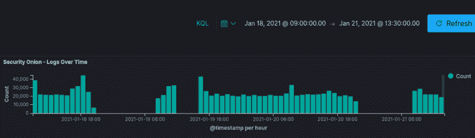

图 13.11 – 设置开始和停止时间戳

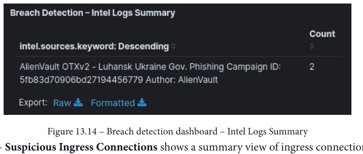

- **可疑入站连接** 显示了在我们指定的时间范围内记录的入站连接的摘要视图：

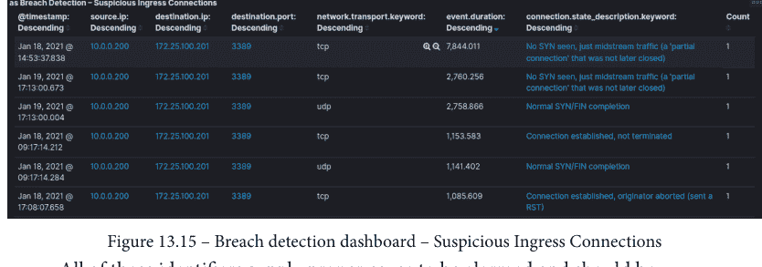

所有这些标识符都提供了警报警惕的正当理由，并应进行调查，但最令人担忧的标识符是在此时间段内记录的 Forescout **Silentdefense 警报**：

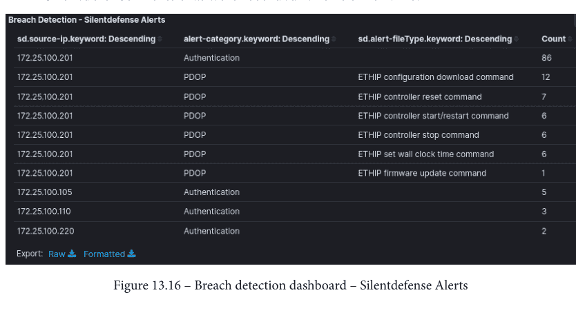

有明确迹象表明 Rockwell Automation PLC (ETHIP) 正在接收固件更新！这种情况并不经常发生，尤其是在工作时间内。这是我们将要处理的警报。

### 最终是谁执行了 PLC 固件更新？

已知固件更新是从 Workstation1 (172.25.100.201) 执行的，而该工作站被企业网络中的一个客户端 (10.0.0.200) 访问，我们需要弄清楚企业侧的该系统中谁已登录。为此，我们需要一个目标时间范围来搜索 10.0.0.200 机器事件日志中的登录事件。

为了获取此信息，我们将查看 SilentDefense 记录固件更新警报的事件时间戳。当鼠标悬停在警报文本上时，点击“Filter for value”弹出命令按钮来过滤该事件。向下滚动违规检测仪表板以查看事件详情：

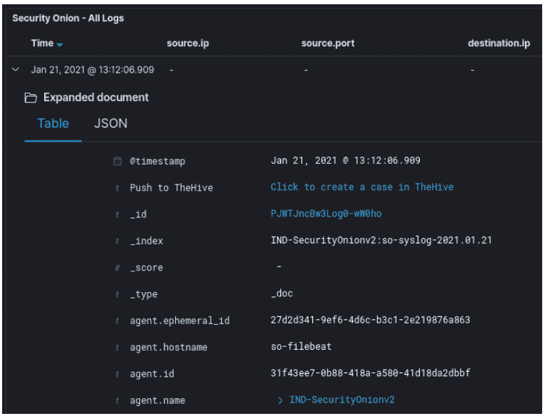

图 13.17 – 违规检测仪表板 – 固件警报详情

我们有了目标时间戳：2021 年 1 月 21 日 @ 13:12:06.909。让我们切换到 10.0.0.200 机器看看能找到什么。

### 探索企业系统的事件日志

不幸的是，企业计算机 10.0.0.200 未配置为将其事件发送到集中日志记录设施，或者我们没有访问权限。我们将不得不以传统方式这样做：

1. 一旦我们登录到 10.0.0.200，我们打开 **Windows 事件查看器（开始菜单 | Windows 管理工具 | 事件查看器）** 并导航到 **Security**（安全）日志部分：

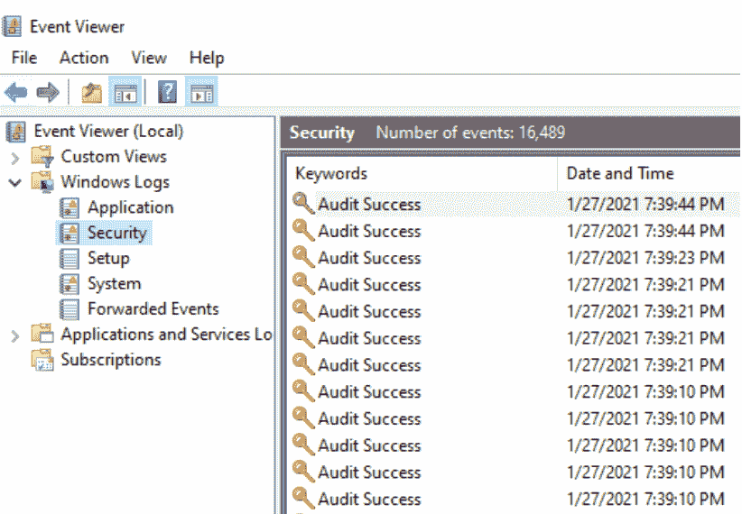

图 13.18 – 可疑企业系统 – 安全事件日志

我们将定义一个过滤器，以显示我们之前发现的警报时间戳附近的登录事件。点击事件查看器屏幕右侧的 **Filter Current Log**（过滤当前日志）按钮，并输入以下条件：

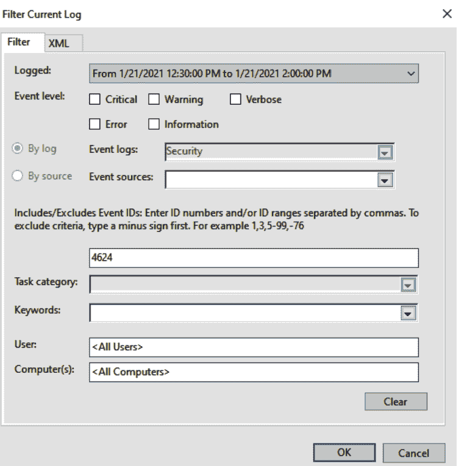

图 13.19 – 可疑企业系统 – 围绕 SilentDefense 警报时间戳过滤事件日志

我们定义的过滤器通过（通过 Logged 部分）缩小了显示的事件时间范围，并过滤事件 ID `4624`，这是 Windows 系统在账户成功登录系统时记录的事件（https://www.ultimatewindowsssecurity.com/securitylog/encyclopedia/event.aspx?eventID=4624）。

点击 **OK** 以应用过滤器。

3. 现在我们只剩下大量的登录事件列表，其中大部分对于在 Windows 机器上运行的服务或来自域控制器等其他系统的交互来说是合法的。你可以浏览此列表看看是否发现有趣的内容。这可能花点时间，但如果你知道要找什么（寻找非 *SYSTEM* 账户的登录是一个好的开始），这是可以完成的。还有另一种选择：我们可以搜索具有特定登录类型的事件。外部实体登录 Windows 机器有多种方式。以下是所有这些类型的表格：

| Logon type | Description |
| :--- | :--- |
| 2 | *Interactive*（使用系统键盘和屏幕进行登录） |
| 3 | Network（例如，连接到共享文件夹） |
| 4 | Batch（例如，计划任务） |
| 5 | *Service*（服务启动） |
| 7 | Unlock（例如，带有密码保护屏幕保护程序的无人值守工作站） |
| 8 | *NetworkCleartext*（使用明文发送凭据进行登录） |
| 9 | *NewCredentials* 例如使用 *RunAs* 或映射网络驱动器 |
| 10 | *RemoteInteractive*（终端服务、远程桌面或远程协助） |
| 11 | *CachedInteractive*（使用缓存的域凭据登录，例如在离开网络时登录笔记本电脑） |

我们感兴趣的登录类型是 **2 — Interactive**（交互式）、**7 — Unlock**（解锁）和 **10 — RemoteInteractive**（远程交互式）。这允许我们搜索 **在本地登录** 到计算机的人（**类型 2**）或 **通过远程桌面会话** 登录的人（**类型 10**），此外，它还显示用户 **重新登录** 且需要 **解锁** 计算机的连接（**类型 7**）。

解释完这些后，让我们搜索这三种登录类型：

1. 打开 **Filter Current Log** 屏幕并切换到 **XML** 选项卡。
2. 选中 **Edit query manually**（手动编辑查询）复选框。
3. 用以下内容替换 XML 查询文本（你的 TimeCreated 条目需要根据你的时间范围进行调整）：

```
<QueryList>
	<Query  Id='0' Path='Security'>
```


```xml
<Select Path='Security'>*[System[(EventID=4624)
and
TimeCreated
[@SystemTime&gt;='2021-01-21T19:30:00.000Z'
and
@SystemTime&lt;='2021-01-21T21:00:00.999Z']]
and
*[EventData[Data[@Name='LogonType']
and (Data=2 or Data=7 or Data=10)]]
</Select>
</Query>
</QueryList>
```

4. 这将显著减少事件数量。查找异常会更容易管理：

   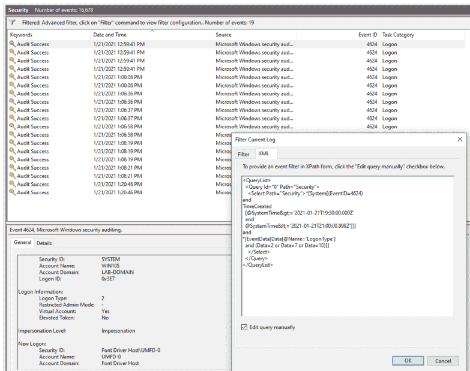

   图13.20 – 可疑企业系统 – 搜索指定登录类型的事件日志

5. 浏览剩余事件，看看是否能找到任何突出之处。

6. 此外，如果查询仍然返回过多事件，你可以从较少的登录类型开始。排除类型2后，除了2个事件外，其他所有事件都被消除：

   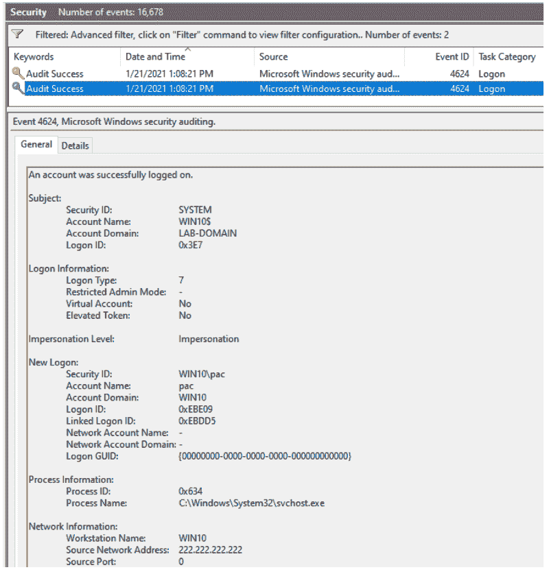

   图13.21 – 可疑企业系统 – 222.222.222.222的登录事件

屏幕底部那个源网络地址现在应该已经铭刻在你的脑海里了——222.222.222.222。为什么有两条记录？嗯，RDP使用两个或多个通道来分离服务，例如音频和视频。那是两条独立的连接，各有各的登录事件。

7. 对222.222.222.222执行Whois查询(https://ipinfo.io/222.222.222.222)应该让我们更加怀疑：

   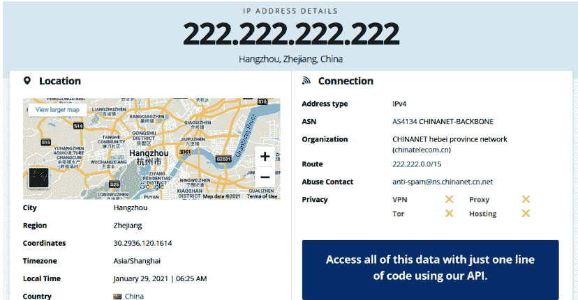

   图13.22 – IPInfo.io对222.222.222.222的查询结果

8. 为了进行验证，这些连接与Zeek在相同时间记录的10.0.0.200和172.25.100.201之间的连接非常吻合：

   **Security Onion - 所有日志**

   | 时间 | 源IP | 源端口 | 目标IP | 目标端口 |
   |---|---|---|---|---|
   | Jan 21, 2021 @ 13:09:21.674 | 10.0.0.200 | 59898 | 172.25.100.201 | 3389 |
   | Jan 21, 2021 @ 13:09:21.456 | 10.0.0.200 | 49756 | 172.25.100.201 | 3389 |

   图13.23 – 将登录事件与工业区连接关联起来的验证

我们可以相当确定，来自222.222.222.222到10.0.0.200的RDP连接被用来通过从10.0.0.200到172.25.100.201（Workstation1）的第二个RDP会话进入工业网络。该连接促成了SilentDefense报告的固件更新。

当然，我们需要验证来自222.222.222.222的用户没有正当理由进行此类活动。

这超出了本次威胁狩猎的范围，但攻击者能够在企业网络和工业网络之间快速跳转的原因，是我们很多人都有的一个习惯——使用缓存的凭据。我们经常看到这种情况。为了方便，用户会在RDP客户端中存储（缓存）凭据：

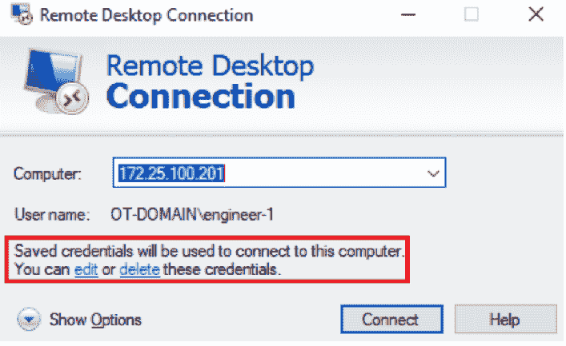

图13.24 – 使用缓存凭据是**不好的**

对于通过恶意软件或某些漏洞入侵企业用户计算机（和账户）的攻击者来说，使用这些缓存的凭据不仅轻而易举，而且这些凭据的存储方式也不是很安全。有许多工具可以从Windows机器中提取（检索）保存的RDP凭据和其他存储的凭据。NirSoft网站提供了一些非常有用的选项：`https://www.nirsoft.net/utils/remote_desktop_password.html`。

我认为这相当明确地证明了我们的威胁狩猎假设：*存在进入工业环境的可疑外部连接。* 是的，绝对如此。

让事件响应团队确定此事的影响范围和影响程度。

### 总结

在本章中，我们证明了我们的假设，即可疑的外部连接正在进入工业区。我们通过观察7天内在工业区发现的所有连接与工业设备的交互得出了这一结论。我们通过发现与可疑连接相关的异常来消除合法连接，并调查了企业网络上的可疑系统，以找到确凿证据，该证据来自发现从互联网上的一个中国IP地址进入企业系统的连接。

这结束了本书的*威胁狩猎*部分。下一章将是*第4部分，工业网络安全评估*的第一章。该第一章将介绍各种评估类型，这些类型可以帮助我们验证安全计划的有效性和正确性。
