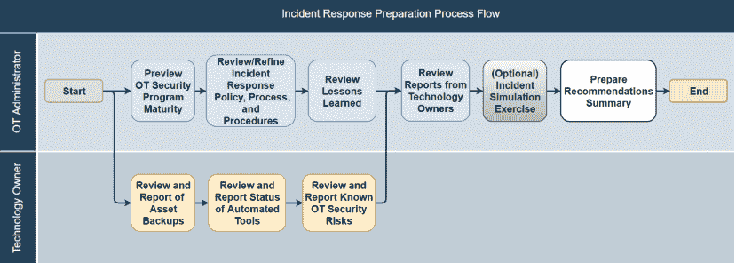
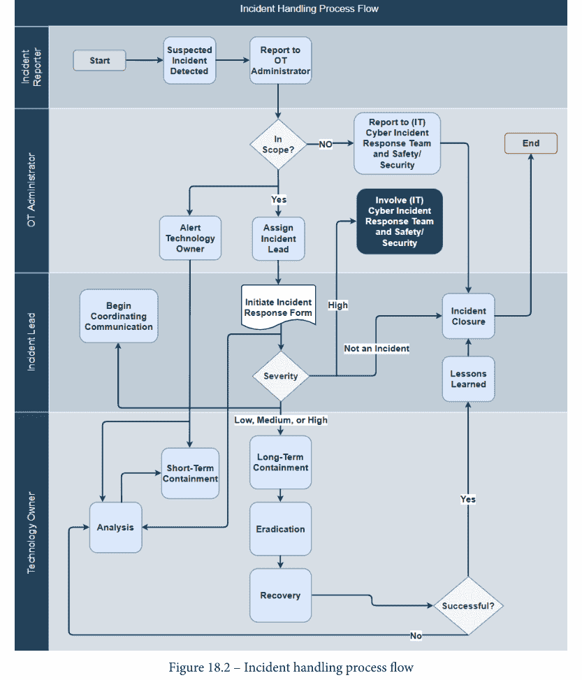
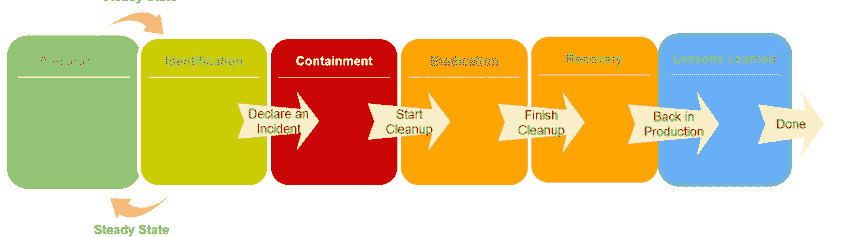
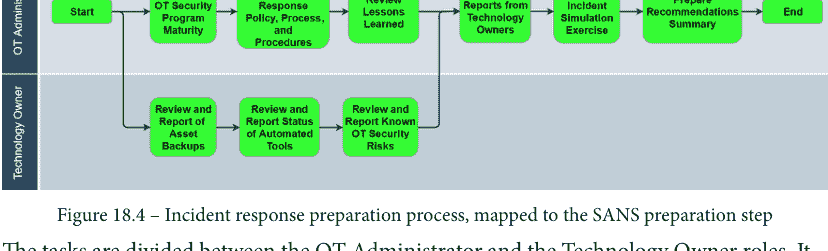
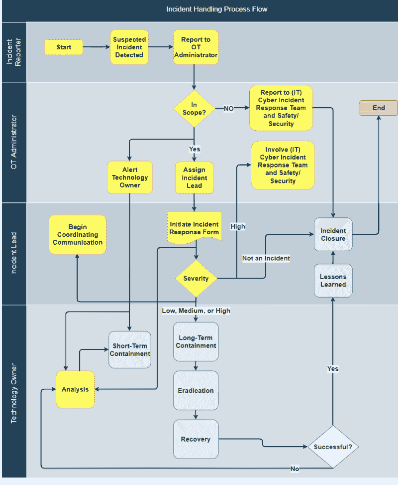
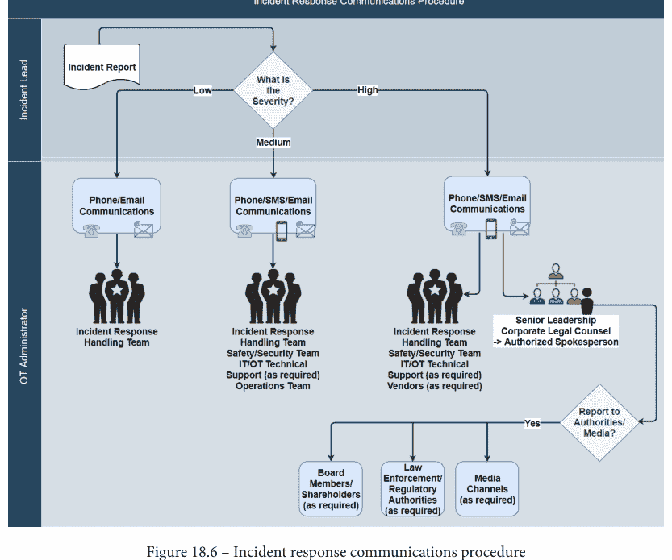

# 第 18 章
# 面向 ICS 环境的事件响应

我们穿越工业网络安全监控和验证的旅程即将结束。到目前为止，我们主要集中于如何验证工业环境的<|message|>安全性。在本书的最后一部分，我们将讨论如何为混乱做好准备，以及在面临与安全相关的事件时如何处理，以及事情出错时该怎么做。

在本章中，我们将讨论设置和维护事件响应计划的方方面面。我们将概述事件响应在工业环境中的阶段、活动和流程。你将了解到，通过在事件响应计划周围保持清晰详细的过程和程序，你将为处理安全事件做好成功准备。

本章将涵盖以下主题：

-   什么是事件？
-   什么是事件响应？
-   事件响应流程
-   事件响应程序

# 什么是事件？

回顾我们在第 5 章《安全监控简介》中讨论的内容，事件可以描述为事件的发生。因此，安全事件可以描述为与安全相关的事件的发生——发生在我们感兴趣并希望检测的 ICS 环境安全态势上的事情。为了检测有趣的安全事件，我们需要使用安全监控工具和实践对其进行监控。

以下是一些安全事件的示例：

-   在系统上执行恶意代码
-   ICS 系统或设备（DCS、SIS、PLC、HMI、SCADA 等）可用性受损或中断
-   与计算或生产资源进行恶意或破坏性交互
-   对可编程逻辑控制器（PLC）或人机界面（HMI）程序进行未经授权的更改
-   未经授权进入建筑物或建筑物的受限区域
-   未经授权访问计算机系统
-   未经授权使用或滥用软件或数据
-   对生产系统、软件或数据进行未经授权的更改
-   存储生产相关数据的设备丢失或被盗
-   分布式拒绝服务（DDoS）攻击
-   干扰运营技术（OT）或生产资源的正常运行
-   过多的登录失败尝试

有了这个认识，让我们通过定义事件响应流程和程序来讨论如何为事件做好准备和处理。

# 什么是事件响应？

事件响应（IR）是组织为（网络）安全相关事件（如数据泄露或网络攻击）做准备并处理的流程。这包括为管理事件的后果/影响而采取的措施。实施 IR 程序/流程的目标是能够有效地管理事件，以使事件的损害和影响得到限制，并将恢复时间和成本以及附带损害，包括组织的声誉，保持在最低限度。

组织应投入时间和资源实施全面的事件响应计划，以帮助他们为安全事件做好准备并应对安全事件。IR 计划应对组织认为什么是事件做出定义，并在发生（OT）安全事件时提供明确的指导流程和程序。

以下各节详细说明了 IR 的两个不同方面，即 IR 准备和 IR 处理。文本源自以下来源，并旨在用作模板策略：

-   **Blue Team Handbook: Incident Response Edition version 2.2**：`http://www.blueteamhandbook.com/`
-   **CSS2017 Session 7 SANS Training - Incident Handling Process**：`https://www.youtube.com/watch?v=76fuTjzuiLg`
-   **NIST SP 800-61 revision 2**：`https://csrc.nist.gov/publications/detail/sp/800-61/rev-2/final`

在解释了事件响应的定义后，让我们开始了解 IR 计划包含什么。

# 事件响应流程

事件响应有两个不同的方面：

-   事件响应准备
-   事件响应处理

事件响应准备流程在没有识别到任何事件的情况下定期发生。事件处理流程在检测到事件时触发。

# 事件响应准备流程

事件响应准备阶段的目标是为 **工业控制系统（ICS）** 或 OT 安全团队高效有效地处理事件做好准备。按其性质，准备阶段与任何已识别的事件或事件分开进行。

创建和维护事件响应策略文档（我们希望记录和跟踪我们的 IR 流程和程序），以及相关的流程和程序文档，是准备阶段的核心。事件响应准备流程包括旨在帮助防止事件的任务，以及旨在简化事件检测和响应的任务。

建议至少每年定期遵循事件响应准备流程一次。

# 事件响应准备流程图

下图描述了准备流程的主要步骤。该流程及其配套程序有助于组织为处理未来事件做好准备：

图 18.1 – 事件响应准备流程图

前面的流程图显示，该流程始于 **OT 管理员**（负责工厂/组织中 OT 的人）。启动流程并指导 OT 环境中的每位技术负责人开始各自的任务并汇报结果，是 OT 管理员的职责。流程结束时编制的建议摘要由 OT 管理员保存，并在预算编制和资源规划活动中使用：

- **事件响应准备输入：**
  - OT 安全计划策略、流程和规程
  - 资产清单
  - 已完成的事件响应表
- **事件响应准备输出：**
  - 修订后的事件响应策略、流程和规程
  - 建议摘要文档

接下来，让我们讨论 IR 计划的另一面：事件处理流程。

## 事件处理流程

事件处理流程的目标是提供一个框架，帮助 OT 安全团队高效且有效地处理事件。通过预先定义流程并明确各角色承担者要执行的操作，可以用系统化的响应来管理事件周围的混乱局面。如果每个角色承担者都能按照计划理解并履行自己的职责，行动和沟通就会变得精简高效。

就其性质而言，当员工、承包商或供应商检测到疑似事件时，事件处理流程即启动。

作为事件处理流程的一部分对 OT 环境所做的所有更改，都应遵守**变更管理（MOC）**政策。

## 事件处理流程

下面的流程示意图描述了事件处理流程的主要步骤。该流程及其配套规程帮助组织处理当前和未来的事件：

图 18.2 – 事件处理流程

上述流程图显示，流程始于员工、承包商或供应商检测到疑似事件，该检测者被称为**事件上报人**。事件上报人通过电子邮件、电话、短信或当面告知的方式，向 OT 管理员或指定人员报告事件。OT 管理员随后判断该事件是否在范围内，应按此流程由 OT 人员处理，还是应由**信息技术（IT）**人员及其网络事件响应团队处理，并让安全/安保人员参与。

如果疑似事件被认定属于此流程范围，OT 管理员将立即通知相关技术负责人，并指定一名**事件负责人**（负责将事件处理流程推进至圆满完成的人）。

技术负责人立即开始短期遏制和分析，同时事件负责人开始承担信息状态焦点和协调工作的角色。

事件负责人根据从事件上报人、OT 管理员和技术负责人处收集的信息，开始填写事件响应表（在*示例事件报告表*一节中介绍）。事件负责人随后引导所有相关方讨论，以确定事件的严重程度。如果出现分歧，OT 管理员拥有最终决定权。

如果事件的严重程度被确定为“非事件”，事件负责人可直接着手完成事件响应表并传达已关闭状态。

否则，对于低、中或高严重性事件，技术负责人开始执行长期遏制、随后根除、最后恢复的规程。事件负责人继续收集信息以完成事件响应表，同时按照沟通规程协调适当的沟通。

如果事件严重程度被确定为*高*，除上述行动外，OT 管理员还会让 IT 网络事件响应团队和安全/安保代表参与。此外，沟通计划将要求高层领导和法律顾问参与，以决定还需要采取哪些适当的升级措施。

一旦被认为已达到恢复状态，就会进入一个观察期，以确定事件症状是否仍然存在。如果检测到事件症状，则确定遏制/根除/恢复路径未完全成功，并启动新一轮分析、短期遏制、严重性确定以及遏制/根除/恢复。

一旦发现遏制/根除/恢复路径成功，相关方会在事件仍记忆犹新时聚集起来进行经验教训总结。事件负责人主持讨论，并将发现记录在事件响应表中。之后是事件关闭期，技术负责人确认系统运行已恢复正常，包括酌情移除短期遏制措施。

在最后一步，事件负责人完成事件响应表并提交给 OT 管理员。然后，传达事件已关闭的状态：

- **事件处理输入：**
  - 空白事件响应表
- **事件处理输出：**
  - 已完成的事件响应表。
  - 正常运行中的 OT 环境。
  - 已传达事件关闭状态。

接下来，我们将讨论事件响应规程。

## 事件响应规程

SANS 研究所描述了一个六步事件处理流程，如下图所示。第一步**准备**对应事件响应准备流程与规程，而其他五个步骤（**识别**、**遏制**、**根除**、**恢复**和**经验教训**）对应事件处理流程与规程：

以下规程更详细地说明了每个流程中的各步骤应如何完成。由于事件的性质多种多样，这些规程并不试图提供分步说明，而是侧重于一种方法，用以组织工作、管理资源，并向利益相关者传达事件相关信息。

## 事件响应准备流程

如下图所示，事件响应准备流程中以绿色显示的所有任务都映射到 SANS 研究所六步事件处理流程的准备步骤：

图 18.4 – 事件响应准备流程，映射到 SANS 准备步骤

这些任务在 OT 管理员和技术负责人角色之间分配。启动、结束和管理该流程是 OT 管理员的职责。每个步骤将在后续规程中更详细地描述。

## 审查 OT 安全计划成熟度

为了处理网络安全事件，我们所能做的最好的准备就是首先防止它们发生。为此目的，已经制定了定义完善的 OT 安全计划。事实上，一种最佳实践是在定期事件响应准备流程中评估 OT 安全计划的状态和有效性。如果最近已经进行了单独的定期 OT 安全计划审查，则应检查其结果，并酌情补充更多细节。

至少应审查以下方面：

- **治理：**
  - OT 团队成员是否了解他们在 OT 安全计划中的角色和职责？
- **培训：**
  - OT 安全计划中的角色成员是否已接受过有关策略、流程和规程的培训？是否有强调任何近期变更的复习培训？
  - OT 安全计划中的角色成员是否有培养所需技能和能力的培训计划？
  - 每个连接到 OT 环境的人员是否都已完成安全意识培训？
- **信息分类：**
  - 人员、承包商和供应商是否定期对信息进行分类以进行适当处理（例如，机密信息与非限制信息）？
  - 是否已从任何已从 OT 环境退役的资产中擦除数据和配置？
- **变更管理（MoC）：**
  - 对 OT 资产的变更是否遵循了 MoC 流程？
  - 在审查上一年的 MoC 表单后，紧急变更的百分比是否看起来合适？自上次审查以来，紧急变更的百分比是否有变化？
  - 是否有已知的、已经对 OT 环境做出但未经过 MoC 流程、本应经过的变更？
- **资产清单：**
  - 资产清单看起来是否完整？是否已针对新增或移除的资产进行更新？是否为所有资产分配了**恢复时间目标（RTO）**和**恢复点目标（RPO）**？是否已为每项资产确定个人作为技术负责人（或同等角色）？
  - 资产清单看起来是否准确？是否已根据 OT 环境中的变更更新资产清单？资产清单是否经过验证以代表当前状态？

- **访问控制：**
- OT 环境的物理访问控制看起来是否足够？过去一年内是否已审查授权人员名单，并且已撤销不再需要的人员权限？
- 具有对 OT 环境远程访问的个人名单是否合适？过去一年内是否已审查授权人员名单，并且已撤销不再需要远程访问的人员权限？
- OT 域的用户账户列表以及单个 OT 资产上的本地账户是否最近已审查？是否存在不再需要的高权限用户账户？
- 过程控制系统和 OT 环境中特权应用程序的用户账户列表是否已由相关技术负责人审查？
- 过程控制系统和特权应用程序的任何服务账户凭据是否已由相关技术负责人审查？

- **便携式媒体和便携式计算：**
- 是否存在用于确定哪些便携式媒体和便携式计算机可以连接到 OT 环境的政策或既定做法？是否在遵循此类政策或做法？

- **操作系统和应用程序安全补丁：**
- 哪些 OT 资产在过去一年内已应用至少一次安全补丁，哪些未应用？
- 是否有任何 OT 资产违反更新和补丁政策？
- 哪些 OT 资产正在运行过时的操作系统？这些资产的缓解和替换计划是什么？

- **网络架构：**
- OT 环境是否按照 ISA99/IEC62443、NIST CSE 或 Purdue 参考模型中概述的推荐最佳实践维护网络分段？
- OT 防火墙规则是否最近已审查？
- OT 防火墙的固件是否已审查更新？
- OT 网络架构图纸是否是最新的？

## 审查/完善事件响应政策、流程和程序

为处理 OT 安全事件做好准备的一个重要组成部分是建立事件响应能力，以便在检测到事件时能够立即响应。在定期事件响应准备过程中，应评估 OT 事件响应政策、其流程和程序的状态和有效性。

至少应调查以下内容：

- **治理：**
  - 政策中定义的角色和职责是否合适？
- **流程：**
  - **准备：** 此事件响应准备流程对于 OT 管理员和技术负责人来说是否是一个合理的时间利用？
  - **事件处理：** 事件处理流程中是否存在不必要的瓶颈？
- **程序：**
  - 事件准备程序是否清晰易于遵循？
  - 事件处理程序是否清晰易于遵循？如果发生高严重性事件，并且确定需要执法部门参与，相关人员是否知道如何联系他们？在事件处理的任何阶段是否不确定何时应纳入供应商或承包商？
  - 事件处理程序是否充分解决了 OT 环境中的最新发展？
- **分类：**
  - **类别：** 政策中列出的事件类别是否清楚地描述了 OT 环境中发生的事件类型？
  - **严重性：** 事件的四种严重性（高、中、低、非事件）是否足以区分 OT 环境事件的处理方式？

## 审查和报告资产备份状态

根除和从事件中恢复通常需要从备份中恢复资产或系统，或从源媒体重建。 从备份中恢复通常允许更快、更顺利的恢复。 在定期事件响应准备过程中，明智的做法是确保每个资产都有最近的在线和离线备份可用。

每个技术负责人都应根据该政策中的备份和恢复标准，审查其责任范围内资产的可用备份。 发现情况应报告给 OT 管理员。

## 审查和报告自动化工具状态

自动化工具已部署在 OT 环境中以帮助信息收集。 在定期事件响应准备过程中明智的做法是审查其运行情况，以验证其运行情况并识别错误配置、限制、烦扰警报和频繁警报。 每个技术负责人都应审查与其责任范围内资产相关的警报和指标，以及工具的状态。 所有发现都应报告给 OT 管理员。

OT 环境中的自动化工具可能包括以下内容：

- 防病毒/恶意软件预防
- 安全信息和事件日志管理（SIEM）
- 入侵检测
- 文件完整性检查
- Windows Server 事件日志
- 应用程序日志
- 网络设备日志
- 基础设施/网络监控

对 SIEM 系统的建议包括以下内容：

- 是否最近进行了日志审计以检测任何异常相关活动？
- 是否有任何新应用程序或硬件引入 OT 环境需要安全监控？
- 对于新资产，应用程序和系统日志文件是否已集成到 SIEM 解决方案中以进行审计和监控？
- SIEM 或其他资产管理解决方案是否发现任何差异？

在此次审查期间，技术负责人还应验证每个资产是否已配置一致的时间和日期。 应在所有支持的设备上启用 NTP，并且工业网络中应存在可靠的 NTP 源。

## 审查和报告已知 OT 安全风险

技术负责人最了解其责任范围内存在的风险。 在定期事件响应准备过程中明智的做法是审查这些风险，以避免对现有风险水平变得自满。

在该审查期间需要考虑的一些问题包括以下内容：

- 哪些 OT 资产正在运行过时的操作系统？
  - 这些资产的缓解和替换计划是什么？
- 哪些 OT 资产在过去一年内已应用至少一次安全补丁，哪些未应用？
  - 是否存在已知漏洞但未修补的 OT 资产？
- 哪些 OT 资产正在运行不受支持的硬件或软件？
  - 这些资产的缓解和替换计划是什么？
- MoC 流程中已识别出哪些风险？

发现情况应报告给 OT 管理员。

## 事件模拟演练

定期进行模拟事件及其处理方式的演练对于为潜在事件处理角色持有人做好准备非常有用。 它也有助于揭示事件处理政策、流程和程序的问题。 然而，这些演练要求 OT 员工从正常职责中抽出宝贵时间。 因此，对于任何给定的定期事件响应准备过程，此任务被标记为可选，但应至少每 3 年发生一次，或在 OT 员工中的人员发生重大变化后进行。

NIST 文档 *信息技术计划和能力测试、培训和演练计划指南（SP 800-84）* – https://csrc.nist.gov/publications/detail/sp/800-84/final – 概述了测试、桌面演练和功能演练在提高准备度方面的使用。 在这种情况下，**测试** 将涉及通过在实际 OT 环境（主环境或辅助/备用环境）中禁用 OT 资产、服务或软件应用程序来模拟事件。 相反，**功能演练** 将意味着在离线 OT 环境（例如开发/测试或培训环境）中模拟事件。 第三个选项，**桌面演练**，涉及基于讨论的模拟，其中引导者提出一个场景并使用问题引导参与者完成他们在流程中的角色。

桌面演练通常在运营影响和时间方面代表最低成本。 当由熟悉组织 OT 政策、流程和程序的、同时在事件处理方面经验丰富的员工、承包商或供应商以明确目标进行引导时，它们可以非常有效。

## 准备建议摘要

OT 管理员负责审查技术负责人关于备份、自动化工具和已知风险的报告。 OT 管理员还负责审查事件模拟演练的结果（如果举行了演练）。 结果应为一份建议摘要，旨在总结对 OT 安全事件响应的整体准备情况，并推荐和优先考虑改进措施。

该建议摘要应在定期事件响应准备过程结束时准备，由 OT 管理员保存，并在预算和资源规划活动中用于指导决策。 由于它可能包含有关 OT 环境安全漏洞的详细信息，因此该文件应被视为和分类为机密信息，并按需知原则分发。

## 事件处理流程

事件处理流程的任务映射到 SANS 研究所六步事件处理流程的五个步骤：**识别**、**遏制**、**根除**、**恢复** 和 **经验教训**。 这些程序描述了如何遵循事件处理流程，已按与 SANS 研究所流程步骤相对应的方式分组。

## 识别程序

识别程序包括事件处理流程中的多个步骤，如下图中黄色部分所示：

图 18.5 – 事件处理流程，映射到 SANS 识别步骤

识别阶段的目标如下：

- 快速排除人为错误、配置错误和误报
- 检测异常偏离
- 从工具和来源收集证据，以了解正在发生的情况
- 确定事件的性质和范围

识别阶段始于检测到特定事件，称为**疑似事件**。该事件将报告给 OT 管理员或指定人员，由其确定是否属于作为 OT 事件处理的范围。

如果对事件是否属于 OT 安全事件存在任何疑问，应按照本既定流程和程序启动事件响应。超出范围的事件应立即移交给 IT 安全团队，按照其既定流程进行处理。

一旦确定了疑似 OT 安全事件的适用范围，OT 管理员负责尽快通知相关的 OT 技术负责人并指派一名事件负责人。

每位被通知的技术负责人应立即开始分析和短期遏制程序，而事件负责人则启动事件响应表并开始收集信息。

虽然识别阶段在严重性确定后正式结束，但在实际操作中，分析活动可能会持续到事件关闭为止。

### 关于事件检测的注意事项

虽然某些事件的症状非常细微，可能长时间未被检测到，但其他事件可能会触发大量警报或具有非常明显的症状。防病毒、入侵检测和事件管理工具可以帮助报告事件的早期迹象。其他事件则遵循已知的攻击向量，例如感染的可移动介质、丢失或被盗的笔记本电脑，或不当使用 OT 环境。

疑似事件的一些迹象包括以下内容：

- 异常高的网络流量
- 包含多次登录失败尝试的事件日志
- 检测到恶意软件的防病毒警报
- SIEM 警报
- 普通用户的**直觉感受**

## 事件报告程序

疑似 OT 安全事件可通过任何可用方式报告给 OT 管理员或指定人员。通常预期通过电话和/或电子邮件进行报告。

未来的替代方式可能包括通过内部网页报告、向专门的事件报告地址发送安全即时消息、发送群组电子邮件等。建议至少拥有一种确保匿名性的报告方法。

报告疑似事件的基本内容应作为安全意识培训的一部分，提供给所有与 OT 环境互动的人员。

## 事件范围确定程序

一般而言，OT 安全事件是指涉及 OT 资产和/或网络的事件。源自企业网络或资产的安全事件应被判定为超出本 OT 流程和程序的范围，并主要通过 IT 事件处理流程和程序进行处理。然而，如果可以分离出 OT 症状，这些症状应由本流程处理，并在所有文档中引用相关的 IT 事件。

范围的最终判定权归 OT 管理员所有。

## 通知技术负责人

预期 OT 管理员在确定范围后立即亲自或通过电话联系相关的技术负责人或负责人。如果报告的事件症状严重性较低，通过短信联系可能也是合理的。

## 事件负责人指派程序

OT 管理员有责任为每个在范围内的疑似事件指派一名事件负责人。事件负责人可以是 OT 管理员、技术负责人、其他技术人员（员工、承包商或供应商），或其他具有技术项目管理技能的人员（员工、承包商或供应商）。

在事件处理过程中，事件负责人拥有最终的责任和权限，负责协调和管理事件响应工作的各个方面，包括协调沟通。事件负责人促进严重性和“经验教训”小组讨论，并负责完成事件响应表的文档工作。

## 事件分析程序

分析步骤中的当务之急是验证疑似事件。技术负责人应检查被认为涉及的 OT 资产、网络和系统，并确定报告的迹象是否得到确认。接下来，技术负责人应尝试排除误报，并确定根本原因是否可能与安全无关，例如硬件故障或缺乏磁盘空间。当技术负责人进行调查并收集证据时，目标是尝试理解事件的性质和范围，并将发现作为严重性确定步骤的输入。应在笔记本中记录发现的内容，包括在哪个 OT 资产上的哪个工具中发现了什么、何时发现以及由谁发现。

分析点示例包括以下内容：

- SIEM 警报。
- 操作系统服务或应用程序日志（例如 Windows 事件日志）。
- 数据库日志。
- 系统性能指标（CPU 和内存使用率）。
- 网络流量/模式：
  - 比较本地报告的网络活动与外部观察到的实际活动。
- 调查类似资产：
  - 查找事件迹象的复制。
- 识别受影响的资产是否存储机密数据（存在泄露风险）。

在此阶段不会发生遏制或清除活动。事件分析的发现为短期遏制和严重性确定提供了信息。对于敏感性质的发现，如不当行为的证据，应予以保全，并仅在“需要知道”的基础上共享。

## 事件报告表程序

事件负责人负责事件报告表的文档工作。如果可能，事件负责人应直接采访事件报告者，以尽可能详细地记录初始报告。表格可以是纸质形式，也可以是 Word 或 Excel 电子格式。如果使用纸质副本，应附上额外页面，因为许多字段太小，无法容纳足够的详细信息。未来的改进可能包括将事件响应表转换为可填写的 PDF 或网页表单。

示例事件响应表包含在示例事件报告表部分中。其中还包含如何填写表格的一般说明。

## 事件严重性确定程序

严重性确定是事件处理中的重要步骤，因为它规定了需要哪些人员参与、适当的遏制程序（范围和紧迫性）以及要执行的沟通计划（即，需要通知谁）。

事件负责人主导讨论，OT 管理员和相关技术负责人或负责人预期参与。事件负责人也可以邀请可能提供额外见解或贡献的其他人加入。

事件严重性确定应考虑以下几个因素：受影响最终用户的安全、受影响系统的关键性、涉及数据的敏感性，以及对公司履行其使命能力的影响。让我们看看严重性类别（**高、中、低、非事件**）。

### 高严重性事件

如果事件表现出以下任何特征，应将其视为**高**严重性安全事件：

- 事件危及任何个人的安全。
- 事件威胁影响（或影响）生产关键系统或服务。
- 事件对财务风险或法律责任构成严重威胁。
- 如果怀疑存在勒索软件。
- 如果存在暴露敏感数据的风险。
- 事件可以在工厂/设施/部门内部或外部传播到其他网络、系统和设备或对其发起攻击。
- 事件表现出恐怖主义威胁特征，或以某种方式威胁人类生命或公司/公共财产。

### 中严重性事件

如果事件未归类为**高**严重性，且表现出以下任何特征，则应将其视为**中严重性**事件：

- 事件威胁影响（或影响）大量 OT 资源或人员。生产可以继续，但可能会受到严重阻碍。
- 受影响系统不包含敏感数据。
- 不影响生产关键系统或服务。

## 低严重性事件

低严重性事件不被归类为 **medium** 或 **high** 类别事件，可能包括以下特征：

- 事件仅影响或威胁影响少量员工、承包商、供应商或 OT 资源。
- 受影响的系统不包含任何生产或 OT 相关数据。
- 事件扩散并影响其他工厂/设施/部门或网络的风险很小或几乎没有。

## 非事件（事件）

如果事件响应调查显示事件没有网络安全影响，或现有保护系统足以防止危害，则事件可重新分类为事件，除更新事件响应表外无需进一步强制行动。

事件的一些示例包括以下内容：

- 可疑行为被发现是硬件故障的根本原因。
- 调查未知软件确定其实际上是在 MoC 下正确安装的。
- SIEM 警报被确定为干扰警报，仅表明 SIEM 配置不理想。
- 防病毒日志显示检测到广告软件并已自动隔离。
- 防火墙日志显示未经授权的访问已被拒绝，符合政策。

应根据适用的数据保留政策维护网络安全事件的事件响应文档。

## 事件通信程序

一旦确定事件的严重性，事件负责人就开始根据以下图表所示的流程协调有关事件的通信。虽然事件负责人负责确保通信发生，但不一定是事件负责人进行任何公告。有关事件的所有通信都应包括提醒，即有关违规/安全事件的信息应被视为机密，未经授权不得与组织外部的任何人讨论，否则将受到纪律处分（应如您的事件响应政策中所述）：

图 18.6 – 事件响应通信程序

## 遏制程序

有两种不同的遏制程序：

- 短期遏制，目标是限制事件造成的损害程度。
- 长期遏制，目标是在隔离解除并准备清除时防止事件扩散或再次发生。

## 短期遏制程序

由技术所有者进行的短期遏制在他们收到事件警报并完成足够的分析以验证初始报告后立即开始。迫切需要限制损害并阻止任何事件扩散。由于此步骤发生在严重性确定之前，因此需要技术所有者使用技术判断。技术所有者应考虑的一些问题包括以下内容：

- OT 环境的功能影响是什么？
  - 如果影响低或无，因为受影响的资产是冗余集的一部分，并且该集的其余部分似乎未立即受到影响，请立即进行隔离。
  - 如果影响低或无，因为受影响的资产是非必要的（例如，实用服务器），请立即进行隔离。
  - 如果影响低或无，因为受影响的资产仍可在较低效率下提供完整功能，请决定是否隔离它或在短期内允许其正常运行，同时将 RTO 作为考虑因素。
  - 如果影响为中等到高，因为受影响的资产无法再执行其主要功能，通常最好在进行更多分析的同时进行隔离。
- 信息有何影响？
  - 如果受保护的关键基础设施信息似乎已被访问或外泄，通常最好隔离该资产（直到在长期遏制期间可以制作取证备份）。
  - 如果敏感或专有信息似乎已被更改或删除，通常最好隔离该资产（直到在长期遏制期间可以制作取证备份）。
- 涉及多少资产？
  - 如果数量超过一两个或几个，通常最好迅速采取行动隔离资产，直到可以进行进一步分析。

通常，对每个受影响资产执行的短期遏制任务操作如下之一：

- 将资产从网络中隔离（有线和无线，如适用）。
- 关闭资产电源（如果可能，使用对资产应用程序和数据库温和的关机做法）。
- 禁用直接影响其他资产的功能（如数据复制）并禁用所有远程访问。
- 在短期内允许资产正常运行，同时加强监督。

短期遏制旨在涉及临时措施，旨在限制损害并争取进行事件处理计划和严重性确定的必要时间。遏制操作应记录为对哪个 OT 资产做了什么、何时以及由谁在笔记本中完成。

### 长期遏制程序

长期遏制从短期遏制结束的地方开始，包括以下任务：

- 验证事件的性质。
- 验证事件的范围。
- 确定停止事件所需的最小更改。
- 收集显示事件发生的证据的数据，以及显示事件症状不再存在的证据。
- 对于高严重性和一些中等严重性事件，如果可行，获取受影响系统的备份映像（称为取证映像），或硬盘上文件的副本（称为取证副本）。
- 撤销超出最小必要更改的短期遏制操作。
- 验证事件症状已停止发生。

通常，在分析和短期遏制步骤中，在确定严重性之前会对事件的性质和范围形成印象。这些印象需要得到验证和细化，而无需专注于确定根本原因。随着理解的加深，就有可能确定停止事件所需的最小更改。这样的最小更改可能涉及更改帐户密码、禁用特定用户帐户、创建防火墙拒绝规则、安装安全补丁或部署本地或组安全策略。但是，在对系统进行更改之前，通常明智的做法是获取取证映像和取证副本数据以供离线分析和证据存储。**jump bag** 中包含的存储介质（见 *Reviewing/refining the incident response policy, process, and procedures* 部分）旨在用于保存取证映像和/或副本。

一旦做出最小遏制更改，就应逐一撤销不再被认为必要的短期遏制操作。通常，这意味着为受影响资产恢复网络连接。所有遏制操作应记录为对哪个 OT 资产做了什么、何时以及由谁在笔记本中完成。应有一段警惕期，以验证这些事件症状不会恢复。

如果症状恢复，或出现可能相关的新的症状，则应重新实施短期遏制操作并返回识别阶段的事件分析和严重性确定。同样，如果根据遏制期间收集的信息，严重性确定似乎可能不正确，则应返回严重性确定步骤。

长期遏制步骤在以下情况结束时结束：

- 事件影响 OT 环境的能力已有效停止。
- 所有受影响的 OT 资产（服务器、工作站和网络设备）均已识别。
- 用于后续分析的证据（取证映像和取证副本）已收集。

在某些情况下，临时遏制措施必须在清除和恢复期间保持在位。这些措施应在事件关闭步骤中解决。

## 根除程序

根除阶段的主要目标是清除安全事件痕迹所影响的资产。利用在识别和遏制步骤中收集的信息，确定根本原因和事件路径。然后，如果可能，防止事件的根本原因在 OT 环境中任何地方再次发生，或者至少在未来出现类似事件症状时建立警报。没有必要识别攻击主机（按名称、位置或 IP 地址），并且为此所做的尝试不应分散根除和恢复的注意力。

漏洞分析和改进防御通常在根除阶段进行。虽然重点是识别导致此次事件发生的漏洞，但如果可以在不延迟恢复进展的情况下执行，广泛的漏洞分析通常是合适的。此阶段的防御改进应限于能够快速且相对容易实施的缓解措施，例如禁用未使用的服务和/或在整个 OT 环境中安装安全补丁。其他改进和缓解措施应在“经验教训”步骤中处理，以保持对从此次安全事件中恢复的关注。

根除通常可以通过以下一种方式实现：

- 删除恶意软件
- 禁用已被入侵的用户账户
- 从干净备份中恢复资产
- 从源介质重建资产

根除操作应记录在笔记本中，包括对哪个 OT 资产做了什么、何时以及由谁执行。

在确定了此次安全事件的根本原因并了解了范围之前，不应进入恢复阶段；否则，此次或相关的安全事件再次发生的风险很大。例如，如果涉及 rootkit，系统分析工具可能会报告不可靠的信息，因此在资产恢复正常运行之前，必须从干净备份中恢复或从源介质重建。

如果安全事件症状在根除活动后未得到解决或出现新的症状，则应适当返回识别阶段进行事件分析、短期遏制和严重程度判定。否则，当事件负责人确信已采取措施消除重复发生时，即可退出根除步骤。恢复和重建活动可在恢复阶段进行。

## 恢复和恢复验证程序

恢复阶段的主要目标是将受影响的资产安全地恢复到正常运行。重要的是在一段时间内密切监控这些资产，以确认根除和恢复已完全实现且无症状残留。

### 恢复程序

恢复的重点是将所有受影响的资产恢复到正常运行。所需步骤因每个受影响资产的角色而异。在大多数情况下，资产将在 OT 环境内恢复正常活动和通信，包括可能涉及的任何数据复制或冗余。返回正常状态应与运营部门协调，针对更关键的资产。

如果资产是从干净备份恢复或从源介质重建的，可能需要额外工作以达到 RPO，例如同步数据和复制文件。此外，在将资产恢复到正常运行之前，应根据防病毒、操作系统补丁和应用程序更新政策安装所有已批准的应用程序和操作系统安全补丁。还应验证防病毒/恶意软件保护、资产管理和 SIEM 集成。

在根除期间开始的改进防御工作可在恢复和验证期间继续进行。

一旦所有受影响的资产都已恢复到正常运行，即可进入恢复验证。如果恢复非必要的 OT 资产被延迟，事件负责人和 OT 管理员可能会决定在没有该资产的情况下进入恢复验证和经验教训，但在大多数情况下，该资产应在事件关闭前完全恢复并通过验证。

### 恢复验证程序

当受影响的资产已恢复到正常运行，并且仔细监控未发现额外的安全事件症状时，即可验证恢复。技术所有者使用在事件分析期间使用的相同工具和调查点来验证恢复成功。至少，应监视应用程序和操作系统日志中的错误和警告，并监控 SIEM 中的警报。

对于低严重性事件，验证期可能很短（至少 24 小时）。对于中或高严重性安全事件，数天至数周的更长验证是合适的。最好在开始恢复验证前确定持续时间。成功的恢复是指在恢复验证期届满时未检测到事件的任何证据，且 OT 资产和系统被认为正常运行。

## 经验教训和事件结案程序

经验教训阶段的主要目标是确定事件响应流程中可以改进的地方，以及网络和系统防御中可以改进的地方。次要目标是就安全事件的事实达成一致并完成其文档记录。

### 经验教训程序

一旦恢复被认为成功，事件负责人收集所有相关事件响应团队成员的笔记，并用它们来制定事实性叙述，包括事件如何展开的时间线。事件负责人应访谈技术所有者以尝试填补任何空白。取证镜像和取证副本可以被研究以加深理解。摘要应避免归咎于个人、批评个人以及做出无根据的推测。

如果在互联网上搜索事件数据库和论坛发现类似事件或攻击的报告，可以利用该信息补充叙述，同时仍需注意记录信息来源。

接下来，与事件负责人、OT 管理员以及所需的技术所有者安排“经验教训”会议。其他潜在的事件响应团队成员、涉及的非 OT 人员（如安全/安保）以及事件报告人可视情况受邀。建议对除低严重性事件外的所有事件指定专人记录。

事件负责人应主持讨论并首先介绍事件叙述和时间线。介绍应暂停以允许在需要时提出问题、评论、更正和简短讨论。介绍应以确定根本原因并提供支持该结论的证据而结束。

介绍后，讨论应集中于回答以下问题：

- 是否有办法更快地检测到此次事件？
- 事件报告流程效率如何？
- 总体而言，是否遵循了事件处理流程？
  - 事件处理流程和程序是否有帮助？
  - 角色承担者是否理解其职责？
  - 应对事件响应政策做出哪些更改？
  - 应如何更改事件处理流程和程序？
- 范围内/范围外判定是否成为瓶颈？
- 技术所有者收到警报后，分析和短期遏制是否很快开始？
- 根据 documented 判定标准，确定事件严重程度是否困难？
- 下次发生类似事件时，如何改进事件处理流程？
- 关于事件状态的沟通是否及时且清晰易懂？
- 是否应让外部方参与，或更早参与？
- 什么本可以防止此次事件发生？
  - 需要哪些额外的安全控制？
- 我们是否需要收集工具或资源以更好地检测、分析和缓解未来的事件？
  - 是否需要专门培训？
- 什么做得很好？

会议结束时应总结达成的共识，并明确已确定的行动项。

被邀请参加“经验教训”会议的人数以及会议所需时间，会随事件的严重性和复杂性而增加。对于简单的低严重性事件，“经验教训”会议可能短至 15 分钟，而对于复杂的高严重性事件，则可能需要为期一周的会议。

## 事件结案流程

在事件可以结案之前，需要进行一次调查，以确定是否存在需要处理的未了事项：

- 是否仍有临时措施在生效？
  - 短期遏制措施？
  - 长期遏制措施？
  - 提高日志记录频率？
  - 其他临时分析工具？
- 所有 OT 资产是否都已恢复并得到验证？
  - 咨询各位技术负责人。
- 所有对防御措施的短期改进是否都已完成？

**应急包**需要重新补充并放回安全位置。

“经验教训”会议的记录需要附在事件响应表上，并且应核实该表格的完整性。对于高严重性事件和复杂的中等严重性事件，应估算处理该事件所投入的总工作量（人力、资源等）。

最后，事件负责人将事件响应表提交给 OT 管理员，并回答任何后续问题。一旦 OT 管理员确认事件已结案，并已确定适当的纠正措施，就将按照事件通报计划通报事件结案状态。然后，事件响应表按照文档保留策略归档保存，以备将来参考。

## 示例事件报告表

应使用此表格或类似表格来处理、跟踪和记录事件响应活动：

|  |  |  |
|---|---|---|
| 1 | 报告编号 |  |
| 2 | 报告标题： |  |
| 3 | 事件报告人： |  |
| 4 | 事件日期和时间： | 日期： | 时间： |  |
| 5 | 事件地点： |  |
| 6 | 事件描述（识别受影响的资产，包括相应的关键性） |  |
|   |  |  |
|   | 资产： |  |
|   |  |  |
|   | 关键性： |  |
|   |  |  |
|   | 事件： |  |
|   |  |  |
| 7 | 事件负责人： |  |
| 8 | 问题状态： |  |
|   | （1）已报告 | （2）已指派 | （3）已解决 | （4）已关闭 |  |
|   | IT 事件响应案件编号： |  |
| 9 | 相关事件： |  |
| 10 | 类别： |  |
|   | 恶意代码，例如病毒、恶意软件 |  | 拒绝服务 |  | 检测到未知软件 |  |  |  |
|   | 违反安全规程或变更控制 |  | 设备或软件丢失 |  | 篡改设备或软件 |  |  |  |
|   | 未经授权的 SCADA 系统访问 |  | 未经授权的物理访问 |  |  |  |  |  |
| 11 | 严重性： |  |  |  |  |  |  |
|   | （1）高 |  | （2）正常 |  | （3）低 |  | （4）非事件 |  |
| 12 | 解决计划摘要： |  |
| 13 | 计划解决日期： |  |
| 14 | 经验教训审查摘要： |  |
|   |  |  |

让我们来看看上表中显示的不同字段：

- 字段 1 至 5 应仅根据初始事件报告填写。预计在开始进行严重性判定讨论之前，这些字段就已填写完成。
- 字段 6 旨在根据技术负责人的分析，记录对事件的更具技术性的描述。
- 字段 7 填写事件负责人的姓名。一旦指派了事件负责人，即可填写此字段。
- 字段 8 记录事件处理过程中的当前事件状态。
- 字段 9 包含案件编号以及相关事件的名称。这些事件可能是之前的或当前的，可能是 OT 范围内的事件、IT 事件，也可能是外部已知事件。
- 字段 10 是事件类型的分类。可能适用于多个类别，并且随着分析的进行，分类也可能会变化。
- 如果可能，字段 7 至 10 应在严重性判定之前或期间填写完成。
- 字段 11 旨在记录严重性判定的结果。如果判定为**（4）非事件**，则字段 12 至 14 可留空。此字段应在严重性判定结束时填写。
- 关于解决方案的字段 12 和 13，应概括长期遏制、根除和恢复计划。
- 字段 14 记录**经验教训**讨论的结果。

此外，该表格可以转换为可编辑的 PDF 文件或网页表单，以便以数字方式存储。

### 总结

在本章中，我们为事件响应计划/方案奠定了基础。我们研究了通常会涉及的流程和步骤，以及围绕事件响应准备和处理的相关活动。我们探讨了事件响应准备和事件处理，并学习了如何清晰准确地准备和应对安全事件。

现在，您应该能够利用这些材料，并将其应用到您的环境中。

在下一章中，我们将通过讨论如何构建测试/实验室环境来结束本书。然后，您可以使用该环境来执行本书中介绍的一些练习和测试。

## 19