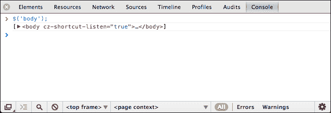
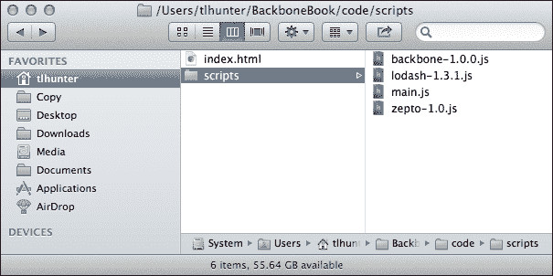
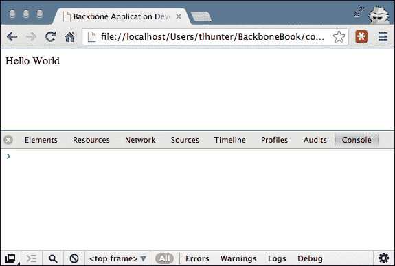
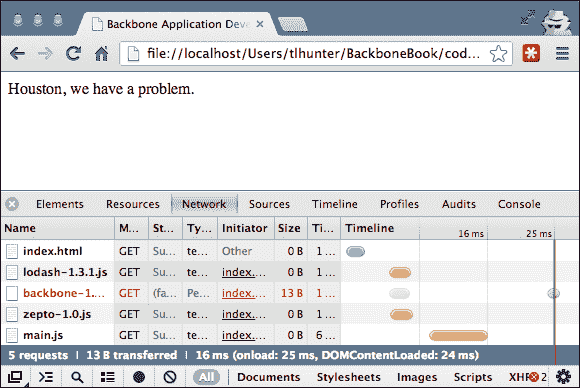
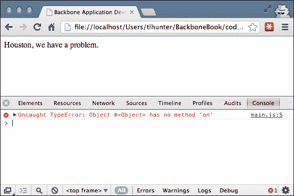
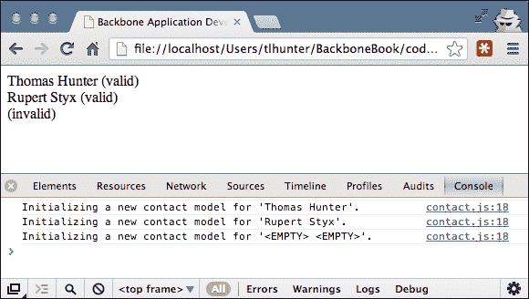
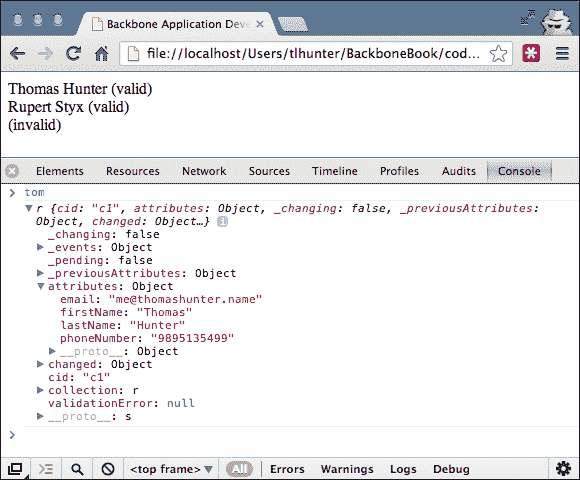

# Backbone.js 简介

## 什么是 Backbone.js
**什么是 Backbone.js** 将详细解释 Backbone.js 的用途、适用场景、用户群体及环境要求。

## 安装
**安装** 将指导您获取 Backbone.js 的依赖项，这些依赖项必须在您的项目中使用 Backbone.js 之前安装。本节将让您下载并安装它们，并建立一个简单的目录结构。

## 快速入门 – 构建一个 Hello World 应用
**快速入门 – 构建一个 Hello World 应用** 提供一个简单的 Hello World 消息，以验证安装是否正常工作以及库是否已正确加载。

## 您需要了解的 5 大核心特性
**您需要了解的 5 大核心特性** 涵盖了 Backbone 提供的不同代码分类，包括模型和集合、视图及其对应的模板、事件、URL 路由，以及将数据持久化到服务器。

## 您应该了解的社区资源
**您应该了解的社区资源** 涵盖了优秀的免费社区资源，您应了解这些资源以将您的 Backbone 开发技能提升到新的高度。

## 概述
`Backbone.js`（或简称为 `Backbone`）是一个用于构建数据密集型 **单页应用** (**SPA**) 的前端 JavaScript 框架。您可能听说过不同的框架模式，例如 **模型-视图-控制器** (**MVC**)、**模型-视图-展示器** (**MVP**)，甚至 **模型-视图-视图模型** (**MVVM**)，但 Backbone 遵循其自身独特的范式。Backbone 不要求以任何特定方式在文件系统中构建文件结构，但它确实对项目如何组织代码结构有建议。

当您的应用程序使用后端数据库来持久化用户数据，且前端应用程序需要镜像大量此类数据时，Backbone 最为有用。假设您的数据可通过标准化格式（基于 HTTP GET 的 RESTful JSON API）被前端应用访问，且数据可使用适当的 HTTP 动词（PUT、POST 和 DELETE）进行持久化，那么使用 Backbone 读写数据将轻而易举。

在运行基于 Backbone 的 SPA 时，用户将在浏览器中与来自后端的数据进行交互。当他们与应用程序交互时，是通过视图进行的。视图代表 **文档对象模型** (**DOM**) 的一部分，并与模型关联。当这些交互发生时，它们会触发事件，从而更新模型中的数据。Backbone 会跟踪这些模型，当数据发生变化时，它会将数据发送到您的 Web 服务器以进行持久化。它还会跟踪模型数据的变化，并相应地更新您的视图。这使得更新 DOM 和向服务器发送数据的过程看起来是自动的。您无需编写多个一次性的 jQuery `$.ajax` 调用，而是将使用一种统一的方法。

## 为什么要使用 Backbone？
首先，让我们看看 Web 开发者想要在其应用程序中使用 Backbone 的原因。许多 Web 开发者开始构建网站时，会将大量 jQuery 调用塞进一个单一的、整体的 JavaScript 文件中。这些调用处理从查询 DOM 到执行 AJAX 请求的所有事情。当这种情况发生时，项目通常会失控，您的应用程序将严重依赖 DOM，这意味着当设计师提出新的时髦布局时，您将面临诸多烦恼。依我之见，使用 Backbone 最好的理由之一是它能保持您的代码井然有序。许多大型 Web 应用程序都因面条代码和维护困难而陷入瘫痪。一个组织得当的 Backbone 应用程序不会陷入这一陷阱。

如果您确实发现需要在布局变更时更改 DOM 查询，它们会被保存在同一个文件中。如果您的数据库列名发生变化导致前端应用程序停止工作，只需在单个文件中进行更改即可使前端应用程序再次与后端兼容。

## 谁在使用 Backbone？
许多网站都使用 Backbone 来管理其前端应用程序！以下是一小部分您可能听说过的流行 Web 应用程序列表，供您参考：

*   Foursquare ([`www.foursquare.com`](http://www.foursquare.com))
*   Basecamp 日历 ([`basecamp.com/calendar`](http://basecamp.com/calendar))
*   Airbnb ([`airbnb.com`](http://airbnb.com))
*   Stripe ([`stripe.com`](https://stripe.com))
*   可汗学院 ([`www.khanacademy.org`](http://www.khanacademy.org))
*   Pandora ([`www.pandora.com/newpandora`](http://www.pandora.com/newpandora))
*   Copy ([`www.copy.com`](http://www.copy.com))
*   以及更多 ([`backbonejs.org/#examples`](http://backbonejs.org/#examples))

## 依赖项
要使用 Backbone.js，您至少需要 `Backbone` 本身、一个绑定到全局变量 `_`（下划线字符）的实用工具库，以及一个绑定到全局变量 `$` 的选择器引擎。事实上的标准实用工具库是 `Underscore.js`，事实上的标准选择器引擎是 `jQuery`。

实用工具库的目的是弥补 JavaScript 的一些不足。这些库提供了多种函数以加快编程速度。一个例子是 `foreach` 函数，如果您从 PHP 开发转行过来，可能会怀念这个函数。选择器引擎的目的是提供一种通用的方法来查询 DOM 元素。不同的浏览器使用不同的函数以不同的方式实现这些功能，且查询结果并不总是相同。一个好的选择器引擎会为您隐藏这些复杂性，并提供一个接受基于 CSS 选择器的单一函数来执行查询。

既然我喜欢提供选择，我将提及一些可用于此项目的替代库。`LoDash` 是 `Underscore.js` 的直接替代品且速度更快，而 `Zepto` 是 `jQuery` 的直接替代品且体积更小，但不支持 Internet Explorer 或旧版浏览器。

### 步骤 1 – 我需要什么？
在学习本书示例时，您需要使用现代 Web 浏览器。我推荐安装 Google Chrome。它是我示例中使用的浏览器，免费且拥有强大的 Web 检查器（在 Apple OS 中：`Cmd` + `Option` + `I`，在 Windows/Linux 中：`Ctrl` + `Shift` + `I`）。以下屏幕截图显示了打开的控制台：



您还需要以下第三方脚本：

*   `Backbone`
*   `Underscore` 或 `LoDash`
*   `jQuery` 或 `Zepto`

### 步骤 2 – 创建文件夹
在您的计算机上创建一个文件夹，用于存放我们将通过本书构建的项目。

### 步骤 3 – 下载必要文件
下一步是下载以下文件：

*   Backbone 框架 `Backbone.js` 1.0.0 版或更高版本
    *   从 [`backbonejs.org/backbone-min.js`](http://backbonejs.org/backbone-min.js) 下载文件
    *   将文件保存为 `scripts/backbone-1.0.0.js`
*   实用工具库 `Underscore.js` 1.4.4 版或更高版本，或 `LoDash` 1.3.1 版或更高版本
    *   从 [`underscorejs.org/underscore-min.js`](http://underscorejs.org/underscore-min.js) 下载文件
    *   将文件保存为 `scripts/underscore-1.4.4.js`
    *   或从 [`raw.github.com/bestiejs/lodash/master/dist/lodash.min.js`](https://raw.github.com/bestiejs/lodash/master/dist/lodash.min.js) 下载文件
    *   将文件保存为 `scripts/lodash-1.3.1.js`
*   选择器引擎 `jQuery` 1.9.1 版或更高版本，或 `Zepto` 1.0 版或更高版本
    *   从 [`code.jquery.com/jquery-1.9.1.min.js`](http://code.jquery.com/jquery-1.9.1.min.js) 下载文件
    *   将文件保存为 `scripts/jquery-1.9.1.js`
    *   或从 [`zeptojs.com/zepto.min.js`](http://zeptojs.com/zepto.min.js) 下载文件
    *   将文件保存为 `scripts/zepto-1.0.js`

### 步骤 4 – 创建新文件
将这些文件下载到 `project` 文件夹内的 `scripts` 文件夹后，您需要在该目录下创建另一个名为 `main.js` 的文件，我们将把特定于应用程序的脚本放在那里。


顺便在你的 `project` 目录根目录下创建一个名为 `index.html` 的文件；我们将在其中添加一些 HTML。

如果一切按计划进行，你应该会看到一个类似于下面截图所示的文件夹布局：



### 就这些了！

恭喜，你现在已经为基于 Backbone 的项目准备好了必要的文件。

既然你已经有了必要的脚本文件和项目目录布局，让我们开始编写一些代码来确认应用程序能正常工作。这段代码需要我们保存的所有脚本都可访问；否则我们会看到一些错误消息。

我们还将介绍 Web Inspector（Web 检查器）并使用它与我们的应用程序进行交互。学习这个工具对于任何 Web 应用程序开发者来说都是必不可少的，以便熟练地调试（甚至为其编写新代码）他们的应用程序。

### 步骤 1 – 向文档添加代码

将以下代码添加到你的 `index.html` 文件中。注意我假设使用 LoDash 和 Zepto，所以你需要相应地更新代码：

```html
<!DOCTYPE HTML>
<html>
  <head>
    <title>Backbone Application Development Starter</title>
    <!-- Your Utility Library -->
    <script src="scripts/lodash-1.3.1.js"></script>
    <!-- Your Selector Engine -->
    <script src="scripts/zepto-1.0.js"></script>
    <script src="scripts/backbone-1.0.0.js"></script>
  </head>
  <body>
    <div id="display">
      <div class="listing">Houston, we have a problem.</div>
    </div>
  </body>
  <script src="scripts/main.js"></script>
</html>
```

### 提示

**下载示例代码**

你可以从 [`www.packtpub.com`](http://www.packtpub.com) 的账户中下载你购买的所有 Packt 书籍的示例代码文件。如果你是在别处购买的这本书，可以访问 [`www.packtpub.com/support`](http://www.packtpub.com/support) 并注册，以便将文件直接通过电子邮件发送给你。

该文件将加载我们所有的脚本，并包含一个简单的 `` `<div>` ``，用于显示一些内容。

注意，我将 `main.js` 文件的加载放在了结束标签 `` `</body>` `` 之后。这只是我的个人偏好；它能确保脚本在 DOM 元素填充完毕后执行。如果你将其放在其他脚本旁边，你需要用一个函数调用来封装脚本的内容，以便在 DOM 加载完成后运行；否则，当脚本运行并尝试查找 `div#display` 元素时，将会失败。

### 步骤 2 – 向主脚本添加代码

现在，将以下代码添加到你的 `scripts/main.js` 文件中：

```javascript
var object = {};

_.extend(object, Backbone.Events);

object.on("show-message", function(msg) {
  $('#display .listing').text(msg);
});

object.trigger("show-message", "Hello World");
```

允许我分解 `main.js` 的内容，以便你知道每一行的作用。

```
var object = {};
```

前面这行应该非常明显。我们只是创建了一个名为 `object` 的新对象，它不包含任何属性。

```
_.extend(object, Backbone.Events);
```

前面这行是奇迹开始发生的地方。实用工具库为我们提供了许多函数，其中之一是 `extend`。该函数接受两个或更多对象作为参数，复制它们的属性，并将它们追加到第一个对象上。你可以把这看作是在经典语言（如 PHP）中扩展类的一种方式。

使用 `extend` 实用工具函数是向你的类添加 Backbone 功能的首选方式。在这种情况下，我们的 `object` 对象现在是一个 Backbone `Event` 对象，这意味着它可用于触发事件，并在事件触发时运行回调函数。通过这种方式扩展你的对象，你可以用一种通用的方法在代码中执行基于事件的操作，而无需编写一次性实现。

```
object.on("show-message", function(msg) {
  $('#display .listing').text(msg);
});
```

前面的代码向我们的对象添加了一个事件监听器。`on` 函数的第一个参数是事件的名称，在本例中为 `show-message`。这是一个描述你正在监听的事件的简单字符串，稍后将用于触发事件。对于命名约定没有硬性要求，但请尽量做到描述性强且一致。

第二个参数是一个回调函数，它接受一个参数，该参数可以在事件触发时设置。这里的回调函数非常简单；它只是使用我们的选择器引擎查询 DOM，并将元素的文本更新为传入事件的文本。

```
object.trigger("show-message", "Hello World");
```

最后，我们触发我们的事件。只需在对象上使用 `trigger` 函数，告诉它我们要触发 `show-message` 事件，并将触发回调的参数作为第二个参数传入。

### 步骤 3 – 在浏览器中打开项目

当我们在浏览器中打开 `index.html` 文件时，这将向我们显示文本 "`Hello World`"。不信？现在双击该文件，你应该会看到以下屏幕：



如果 Chrome 不是你的默认浏览器，你应该能在文件浏览器中右键点击该文件，并选择用哪个应用程序打开该文件。如果安装正确，Chrome 应该在列表中。

### 步骤 4 – 遇到问题

你看到的不是我们愉快的 "`Hello World`" 消息吗？代码的设置方式是，如果出现问题，它应该显示 "`Houston`"、"`we have a problem`" 消息（这是在 JavaScript 运行并替换它之前，默认在 DOM 中显示的文本）。

### 缺失的脚本文件

首先要查看的地方是 Web Inspector 的 **Network**（网络）选项卡。该选项卡向我们显示浏览器为满足页面渲染而下载的每个文件。有时，**Console**（控制台）选项卡也会告诉我们文件何时未正确下载，但并不总是如此。下面的截图解释了这一点：



如果你看 **Network** 选项卡，可以看到一个明显标记为红色的项目（`backbone-1.0.0.js`）。在我的项目文件夹中，我忘记下载 Backbone 库文件了，因此浏览器无法加载该文件。请注意，我们是从本地文件系统加载文件，所以状态栏显示 `Success`（成功）或 `Failure`（失败）。如果这些文件是从真实的 Web 服务器加载的，你将看到实际的 HTTP 状态码，例如成功下载文件的 `200 OK` 或文件缺失的 `404 Not Found`。

### 脚本拼写错误

也许你在从书中复制脚本时出现了拼写错误。如果你因不正确的 JavaScript 而遇到任何问题，它们将显示在 **Console** 选项卡中，如下面的截图所示：



在我的例子中，我忘记了用 Backbone 事件类扩展我的对象的那行代码。遗漏 `extend` 那行代码导致对象缺少一些功能，具体来说是 `on()` 方法。请注意控制台如何显示错误所在的文件名和行号。

请随意删除和添加文件中的代码并刷新页面，以感受控制台中错误的样子。这是熟悉调试基于 Backbone（实际上是任何 JavaScript）应用程序的好方法。

以下部分将指导你构建一个简单的联系人管理器应用。你将编写不同类型的代码，根据代码的用途将代码组织到不同的文件和目录中。

## Models and Collections


集合代表数据库表，而模型代表该表中的单个行。在我们的应用程序中，我们将把一堆人的联系信息存储在通讯录中。我们将拥有一个用于所有联系人的 `contacts` 集合，以及集合中每个人对应的不同 `contact` 模型。

### 步骤 1 – 创建一些文件和文件夹

在我们的 `scripts` 目录中创建两个新目录，一个名为 `models`，另一个名为 `collections`。

创建一个名为 `scripts/models/contact.js` 的新文件。

创建一个 `scripts/collections/contact.js` 文件。

### 步骤 2 – 更新主脚本

用以下代码替换 `scripts/main.js` 中的所有代码：

```
var App = {
  Models: {},
  Collections: {},
  Contacts: null
};

$(function() { // 当 DOM 准备就绪时运行此代码
  window.tom = new App.Models.Contact({
    firstName: 'Thomas',
    lastName: 'Hunter',
    phoneNumber: '9895135499',
    email: 'me@thomashunter.name'
  });

  App.Contacts = new App.Collections.Contact();

  App.Contacts.add(window.tom);

  App.Contacts.add({
    firstName: 'Rupert',
    lastName: 'Styx',
    phoneNumber: '9895551212',
    email: 'rupertstyx@example.com'
  });

  App.Contacts.add({});

  var contactListing = '';
  App.Contacts.each(function(contact) {
    contactListing += "<div>" +
    contact.get('firstName') + " " +
    contact.get('lastName') + " ";

    if (contact.isValid()) {
      contactListing += "(valid)";
    } else {
      contactListing += "(invalid)";
    }
    
    contactListing += "</div>";
  });
  $('#display').html(contactListing);

});
```

### 步骤 3 – 更新文档

在 `index.html` 文档中，靠近结束标签 `</body>` 处现有的 `<script>` 标签之后，添加以下两个 script 标签：

```
<script src="scripts/models/contact.js"></script>
<script src="scripts/collections/contact.js"></script>
```

### 步骤 4 – 更新 Contact 模型

将以下代码添加到 `scripts/models/contact.js` 文件中：

```
App.Models.Contact = Backbone.Model.extend({
  defaults: {
    firstName: '',
    lastName: '',
    phoneNumber: '<UNLISTED>',
    email: '<UNLISTED>'
  },

  validate: function(attrs, options) {
    if (!attrs.firstName) {
      return "A valid contact must have a first name";
    }
  },

  initialize: function(attributes) {
    var firstName = attributes.firstName || '<EMPTY>';
    var lastName = attributes.lastName || '<EMPTY>';
    console.log("Initializing a new contact model for '" +
      firstName + " " + lastName + "'."
    );
  }
});
```

### 步骤 5 – 更新 Contact 集合

将以下代码添加到 `scripts/collections/contact.js`：

```
App.Collections.Contact = Backbone.Collection.extend({
  model: App.Models.Contact
});
```

### 步骤 6 – 刷新浏览器

完成前面代码的添加后，刷新浏览器窗口。你应该会在浏览器中看到以下屏幕：



运行此代码后，我们成功创建了集合和模型对象，然后实例化了一个集合并用三个不同的模型填充它。我们还遍历了集合中的每一项，就像处理数据库结果一样，并将它们逐个显示在屏幕上。

### 检查 `scripts/main.js`

让我们看看 `scripts/main.js`。该文件包含我们的应用程序引导代码：

```
var App = {
  Models: {},
  Collections: {},
  Contacts: null
};
```

这段代码创建了一个名为 `App` 的全局对象，包含三个属性。前两个 `Models` 和 `Collections` 是空对象，将包含我们分别扩展了 Backbone Model 和 Collection 对象的 `Model` 和 `Collection` 对象。可以将它们视为稍后创建可供我们使用的实例的模板。在 JavaScript 中没有类，只有对象，但这些对象将包含我们将假装为类的对象。

第三个属性 `Contacts` 是我们实际存储主 Contact 集合实例的地方。因为我们永远只需要一个，且全局访问很方便，所以我们将其赋值于此。注意，我们不以这种方式跟踪单个 Contact 模型实例。

创建一个名为 `App` 的全局对象实际上并不是 Backbone 所要求的。这是我使用的一种约定，以便稍后可以从不同的脚本与该全局对象交互。如果你在单个文件中创建整个应用程序，只需创建临时局部变量来指向这些对象即可。

```
$(function() { // 当 DOM 准备就绪时运行此代码
```

`main.js` 中的下一段代码在 DOM 加载后执行。原因是一种两难境地（catch 22）。我们在调用 `main.js` 后实例化的不同 `Model` 和 `Collection` 文件需要访问全局 `App` 变量。我们 `main.js` 中的大部分需要 `Collections` 和 `Models` 对象已附加到全局 `App` 对象上。在 DOM 加载后运行代码可确保 `Model` 和 `Collection` 脚本先加载，我们永远不会遇到未初始化变量的问题。

```
  window.tom = new App.Models.Contact({
    firstName: 'Thomas',
    lastName: 'Hunter',
    phoneNumber: '9895135499',
    email: 'me@thomashunter.name'
  });
```

这里我们创建了一个 Contact Model 代码的实例。实例化对象时，我们传入一个简单对象，它将被转换为更复杂的 Backbone 模型。注意我是如何创建一个名为 `tom` 的全局变量的。这样做的原因是我们可以在 Web Inspector 中轻松检查它。

要查看对象的样子，打开你的 `Console`，只需输入 `tom`，然后按 `Enter`。你可以展开一些属性来查看对象的样子，如下截图所示：



正如你所见，Backbone 为我们添加了大量数据。Backbone 使用这些数据来帮助跟踪我们更改的内容、事件绑定、当我们准备持久化时发送到服务器的数据等。

这里最有趣的部分是 `attributes` 属性，它包含我们之前添加的所有简单数据。你可以通过运行 `tom.attributes.firstName` 来访问此信息，但按照惯例，你应该通过运行 `tom.get('firstName')` 来访问它。

```
App.Contacts = new App.Collections.Contact();
```

前面这行代码创建了一个全局可访问的 Contact Collection 实例，并赋值给 `App.Contacts`。稍后在我们的应用程序中，当我们想要处理不同的联系人时，只需输入 `App.Contacts` 即可。

```
  App.Contacts.add(window.tom);

  App.Contacts.add({
    firstName: 'Rupert',
    lastName: 'Styx',
    phoneNumber: '9895551212',
    email: 'rupertstyx@example.com'
  });

  App.Contacts.add({});
```

前面的代码行向我们的 Contact Collection 添加了三个不同的联系人。第一个获取我们预先创建的 Model 实例并将其添加到集合中。

第二个从我们提供的简单对象中为我们隐式创建了一个新模型。显然，这样做可以节省几行代码。然而，有时你希望在将数据插入 Collection 之前对其执行一些特定于模型的操作。也许你想先执行一些验证。在这些情况下，提前创建模型；否则，就用这种方式。

第三个也隐式创建了一个新模型，但请注意，没有设置任何属性。我们添加这个空 Model 是为了稍后查看验证和默认值是如何工作的。


