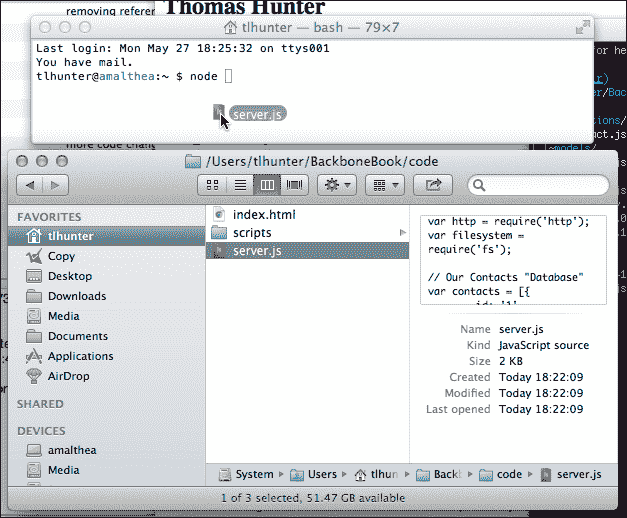
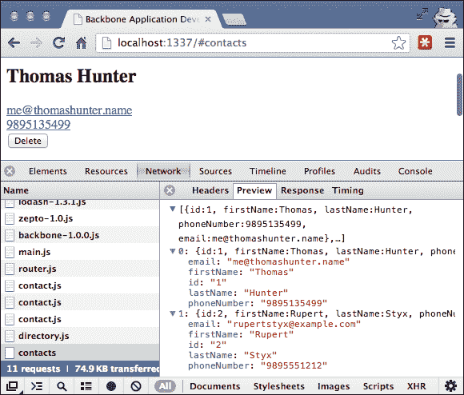

## 将数据持久化到服务器

Backbone 最大的特性之一是它能很好地保持后端服务器/数据库与用户交互的前端界面之间的数据同步。Collection 和 Model 是 Backbone 的核心部分，如果我们没有后端来持久化数据，那将是一种遗憾！

本节将指导你创建一个简单的基于 **Node.js** 的服务器，我们可以在其中保存联系人。我们在这个项目中使用 Node 有两个主要原因。第一是因为编程是用 JavaScript 完成的，而你已经懂 JavaScript 了！第二是因为在 Node 中为开发启动服务器非常简单。无需花费数小时调整配置文件和安装包依赖。

### 步骤 1 - 准备工作

下载并安装适用于你操作系统的 Node。你可以从以下 URL 下载 Node 包：

[`nodejs.org/download/`](http://nodejs.org/download/)

接下来，创建一个 `server.js` 文件。该文件应位于项目目录的根目录下。由于浏览器永远不会执行此代码，它不需要遵循我们放在 `scripts` 目录内的约定。事实上，它根本不应该遵循该约定，否则可能会让人对脚本的用途感到困惑。你也不需要在 HTML 文件中使用 `<script>` 标签加载它。

### 步骤 2 - 创建服务器脚本

将以下代码添加到 `server.js`。我不会像解释我们编写的其他代码那样逐行解释代码，因为这超出了本书的范围：


# 服务器实现

```javascript
var http = require('http');
var filesystem = require('fs');

// Our Contacts "Database"
var contacts = [{
  id: '1',
  firstName: 'Thomas',
  lastName: 'Hunter',
  phoneNumber: '9895135499',
  email: 'me@thomashunter.name'
},
{
  id: '2',
  firstName: 'Rupert',
  lastName: 'Styx',
  phoneNumber: '9895551212',
  email: 'rupertstyx@example.com'
}];

http.createServer(function (req, res) {
  console.log(req.method + ' ' + req.url);

  if (req.url === '/' && req.method === 'GET') {
    // Requesting HTML Document
    filesystem.readFile(__dirname + '/index.html',
      function(err, data) {
      if (err) throw err;
      res.end(data);
    });

    return;
  } else if (req.url.indexOf('/contacts') === 0) {
    // Backbone requesting some data
    res.writeHead(200, {
      'Content-Type': 'application/json'
    });

    if (req.method == 'GET') {
      // Backbone wants a list of all Contacts
      res.end(JSON.stringify(contacts));
    } else if (req.method == 'POST') {
      // Backbone is creating a new Contact
      var body = '';
      req.on('data', function(data) {
        body += data;
      });
      req.on('end', function() {
        var contact = JSON.parse(body);
        // Here we make up a unique ID
        contact.id = Math.random()
          .toString(36).substr(2);
        // The contact is stored in the DB
        contacts.push(contact);
        // Now we send the updated contact
        // (which has an ID) back to the
        // Backbone application
        res.end(JSON.stringify(contact));
        console.log("CONTACT ADD: ", contact);
      });
    } else if (req.method == 'DELETE') {
      // Backbone is deleting a Contact
      var id = req.url.split('/')[2];
      console.log("DELETE CONTACT: ", id);
      for (var index in contacts) {
        if (contacts[index].id === id) {
          // Delete Contact from DB
          contacts.splice(index, 1);
          break;
        }
      }
      res.end();
    }

    return;
  } else {
    // Browser probably requesting JavaScript
    var filename = __dirname + req.url;

    filesystem.lstat(filename,
        function(err, stats) {
      if (err || !stats.isFile()) {
        if (req.url != '/favicon.ico') {
          console.log("404: " + filename);
        }
        res.writeHead(404, {
          'Content-Type': 'text/plain'
        });
        res.write('404 Not Found\n');
        res.end();
        return;
      }

      filesystem.readFile(filename,
        function(err, data) {
        res.writeHead(200, {
          'Content-Type': 'text/javascript'
        });
        res.end(data);
      });
    });
    return;
  }

}).listen(1337);

console.log('http://localhost:1337/');
```

## 步骤 3 – 更新联系人集合

更新 `scripts/collections/contact.js`，在现有的 `model` 属性后添加以下属性：

```javascript
url: '/contacts'
```

## 步骤 4 – 更新主脚本

更新 `scripts/main.js`，删除添加那两个联系人的所有代码行。

同样在 `scripts/main.js` 中，在 DOM 就绪代码的末尾添加以下代码行：

```javascript
App.Contacts.fetch();
```

## 步骤 5 – 更新路由器

修改 `scripts/router.js` 中的 `contactsRemove()` 方法，使其类似于以下内容：

```javascript
contactsRemove: function(id) {
  var contact = App.Contacts.get(id);
  if (contact) {
    contact.destroy();
  }
  App.Directory.addFormHide();
}
```

## 步骤 6 – 更新联系人视图

修改 `scripts/views/contact.js` 中的 `remove()` 方法，使其类似于以下内容：

```javascript
remove: function() {
  App.Browser.navigate('contacts/remove/' + this.model.get('id'));
  this.model.destroy();
}
```

## 步骤 7 – 更新目录视图

在 `scripts/views/directory.js` 中，更新 `addSubmit()` 方法，在将联系人添加到集合的那行代码后添加以下代码行：

```javascript
newContact.save();
```

## 步骤 8 – 运行服务器

运行这个 Node 应用程序应该很简单，如下面的屏幕截图所示，打开一个终端窗口，输入 `node `（注意空格），将 `server.js` 文件拖放到终端窗口上，然后按回车键。

在 OS X 和大多数 Linux 发行版中，你可以启动终端应用程序。在 Windows 中，你可以运行命令提示符应用程序。



一旦你执行了 Node 服务器，你应该会在终端中看到消息 `http://localhost:1337/`。这是服务器监听传入 HTTP 请求的 URL。在浏览器中打开该 URL，你应该又能看到你的应用程序了！从现在起，你将想要使用该 URL 来导航到你的应用程序，而不是直接双击 `index.html` 文件。

你应该会看到之前那两个联系人的列表，即 **Thomas Hunter** 和 **Rupert Styx**。尝试添加更多联系人，并删除联系人。但这一次，在操作之间刷新页面。这一次它们保存在服务器端，而不是每次刷新都被删除！

我们在 Backbone 应用程序中做出的最值得注意的更改之一，是在 Contact 模型上添加了 `id` 属性。一旦 Backbone 看到该 `id` 属性，它就知道如何引用服务器上的对象。我们还添加了一些功能，用于告知 Backbone 在何时与服务器通信以持久化和检索数据。

### 检查集合

让我们首先看看 `scripts/collections/contact.js`：

```javascript
url: '/contacts'
```

Collection 对象上的 `url` 属性是 Backbone 的一个约定，用于指定代表该特定数据类型的根 URL 端点。

当 Backbone 想要创建一个新联系人时，它将对该位置执行 `POST` 操作。当 Backbone 想要获取集合中所有项目的列表时，它将对该位置执行 `GET` 操作。当 Backbone 想要移除特定项目时，它将对该位置执行 `DELETE` 操作，后跟斜杠和唯一标识符。当 Backbone 想要从服务器检索特定项目时，它将对该位置执行 `GET` 操作，并附带唯一标识符。最后，当 Backbone 想要更改现有项目时，它将对该位置执行 `PUT` 操作，并附带唯一标识符。

这是一种使用 URL 来表示服务器上数据的非常常见的方式。这种与资源交互的常见方式通常被称为 **REST**。因此，你可以说这个服务器脚本为前端 Backbone 应用程序提供了一个 **RESTful API** 来进行交互。

### 检查 main.js

现在我们将查看 `scripts/main.js`：

此文件中的大多数更改都是删除代码，这些代码添加了两个默认联系人，因为我们希望后端服务器来处理这些联系人。

```javascript
App.Contacts.fetch();
```

这行代码告诉 Backbone 执行数据获取。还记得之前的内容吗，既然 Backbone 想要集合中的所有数据，它就会对 URL `/contacts` 执行 `GET` 操作。

打开 Chrome 的网络控制台，选择最后一个网络请求“contacts”（应该是最后一个）。这将向你展示从 Node 发送到 Backbone 的数据到底长什么样。你应该会看到如下截图所示的对象数组：



如果这是一个完全使用 jQuery 从头构建的应用程序，你可能需要编写一个 `$.ajax()` 调用来执行这项工作，并手动遍历每个项目。Backbone 实际上使用的是 jQuery 提供的相同 `$.ajax()` 调用，但它会在后台自动为我们完成所有这些工作！

### 检查路由器

现在让我们看看 `scripts/router.js`：

```javascript
contactsRemove: function(id) {
  var contact = App.Contacts.get(id);
  if (contact) {
    contact.destroy();
  }
  App.Directory.addFormHide();
}
```


之前，我们的代码运行的是 `App.Contacts.remove(id)`，其中 `id` 是集合 ID。这是 `Backbone` 自动添加到 `collection` 中每个 `model` 上的，用于在内部进行跟踪。但现在我们已更新应用程序以使用真实的 ID 值，情况变得稍微复杂一些。

因为我们希望 `Contact` 的删除操作能持久化到服务器，所以我们需要使用 `model.destroy()`，而不是 `collection.remove()`。首先，我们尝试从 `collection` 中获取 `contact` 并将其赋值给变量 `contact`。用户可能会尝试删除一个不存在的 `contact`，这会导致错误。然后我们检查 `model` 是否返回，如果返回了，我们就运行 `destroy()`。这会向服务器发送 `DELETE` 命令。

现在让我们看看 `scripts/views/contact.js`：

```
  remove: function() {
    App.Browser.navigate('contacts/remove/' + this.model.get('id'));
    this.model.destroy();
  }
```

正如上一节所述，我们现在想要使用 `models` 的真实 ID，而不是 `Collection` ID。我们不再获取 `model.cid`，而是使用 `model.get('id')` 并将其传递给 URL 供 `router` 处理。

最后让我们看看 `scripts/views/directory.js`

```
      newContact.save();
```

这行代码明确告诉 `Backbone` 获取这个新创建的 `contact` 并将其保存到服务器。遗憾的是，仅将一个 `model` 添加到 `Collection` 中并不足以让 `Backbone` 将该 `collection` 持久化到服务器。不过，这确实给了我们对应用程序更多的控制权。

如果你检查此请求的网络流量，你会看到它在服务器上执行 `POST` 操作。然而，它也会响应一个完整的文档。`Backbone` 随后解析此文档，查找 `id` 属性，然后更新本地 `model`。通常，我们希望数据库为我们生成 `id` 值，而 `Backbone` 正好满足了这一需求。

### 注意

如果你终止 `Node` 应用程序（无论是按 `Ctrl` + `C` 还是关闭窗口），联系人数据库将永远被删除。之所以会这样，是因为 `Node` 只是将数据存储在内存中的一个变量里，程序退出时该变量会被清除。

如果你想永久保存数据，请考虑使用数据库系统，例如 `MySQL`、`MongoDB` 或 `Redis`。数据存储有很多可选方案。例如，`MongoDB` 与 `Node` 配合得很好，幸运的是，对于我们 `JavaScript` 开发者来说，它使用 `JSON` 来表示对象。

更多供你学习 `Backbone` 的链接。

## 官方网站

*   Backbone 文档：[`backbonejs.org/`](http://backbonejs.org/)
*   Backbone GitHub：[`github.com/documentcloud/backbone/`](http://github.com/documentcloud/backbone/)
*   Underscore 文档：[`underscorejs.org/`](http://underscorejs.org/)
*   jQuery 文档：[`api.jquery.com/`](http://api.jquery.com/)
*   Node.js 文档：[`nodejs.org/api/`](http://nodejs.org/api/)
*   本书示例的代码可从 [`github.com/tlhunter/backbone-book`](https://github.com/tlhunter/backbone-book) 获取

## 社区

*   Freenode IRC：`#documentcloud`
*   Backbone 问题：[`github.com/documentcloud/backbone/issues`](http://github.com/documentcloud/backbone/issues)
*   邮件列表：[`groups.google.com/forum/#!forum/backbonejs`](https://groups.google.com/forum/#!forum/backbonejs)

## Twitter

*   关注 Backbone.js 创建者 `@documentcloud`
*   关注本书作者 `@tlhunter`
*   如需更多开源信息，请关注 Packt `@packtopensource`
