## 即时 GIMP 入门

欢迎阅读 *即时 GIMP 入门*。本书旨在为任何想要开始使用 GIMP 的人提供动力。读者将接触到 GIMP 的功能，这足以让他们开始使用该工具。本书中的每个主题都将引导读者动手创作各种精彩的艺术作品。在此过程中，读者还将了解 GIMP 中的新技术和工具。

文档包含以下部分：

*那么，GIMP 是什么？* 向读者介绍 GIMP 及其功能。

*安装* 解释读者如何开始使用它。

*快速开始 – GIMP 巡览* 使用户能够熟悉使用 GIMP 的基本概念。

*您会想了解的 5 大功能* 引导读者了解如何使用 GIMP 工作并开始发挥创造力。

*您应该认识的人和地方* 为读者提供有关发现各种资源以帮助他们并激发灵感的指南。

### 那么，GIMP 是什么？

GIMP 是 GNU Image Manipulation Program 的缩写。它是一款开源程序，用户可以用它来修图并创建自己的绘画；它是一款完整的绘画工具。

还记得那张你希望能裁掉破坏整张照片的不必要物体的照片吗？现在你可以做到这一点，甚至可以更好地通过美丽的效果让那张照片成为你的回忆。

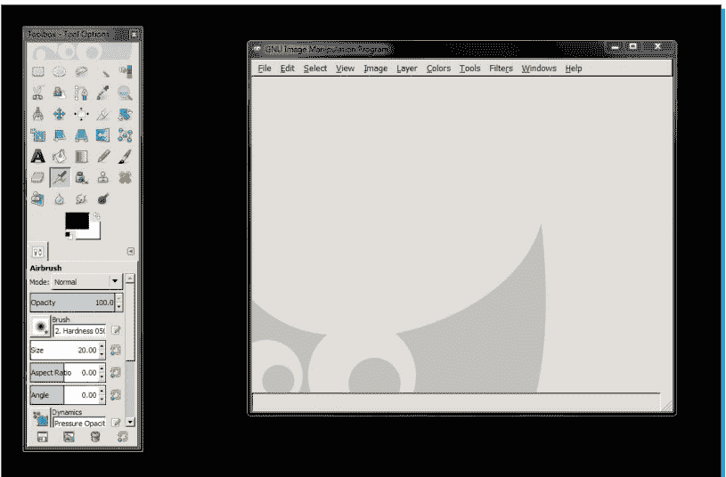

在整本书中，我将使用安装在 Windows 7 上的 GIMP 版本 2.8.2。GIMP 可用于 Windows、Linux 或 Mac 机器；所有这些都是免费的。

Windows、Linux 机器和 Mac 之间的用户体验应该相当。 我经常用数码相机或手机拍照。回家后，我只需将设备插入 Linux 机器并将照片传输到 USB 驱动器。我可能会在 Linux 机器上修图或进行一些设计，然后将 USB 驱动器带到我的个人笔记本电脑上继续工作。GIMP 使您可以在没有任何问题的情况下携带自己的作品。

我甚至在工作中使用 GIMP。我不必担心许可或服务订阅。您可以在 http://www.gimp.org/about/COPYING 阅读它们。GIMP 如此易用的原因是，我可以更快地执行某些任务。我需要处理大量要插入网站或文档的图像。我曾处理过数千张需要在提交前编辑的图像。在这种时候，没有试错的余地。GIMP 允许我们执行脚本（称为 Script-Fu），我可以用几秒钟完成 5 分钟的工作。我将在本书后面详细介绍这一点。

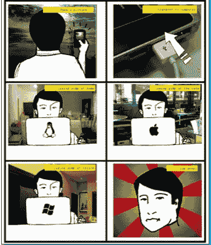

GIMP 也可作为便携式应用程序提供，您可以将数据复制到 USB 驱动器并在任何 Windows 机器上打开，而无需安装它。然而，本书不涵盖便携式应用程序。


### 安装
只需几个简单的步骤，你就可以安装 GIMP 并在系统上设置好它。

### 第 1 步 – 我需要什么？
在安装 GIMP 之前，你需要检查是否拥有以下项目中列出的所有必需元素：
- 需要至少 256 MB 内存，不过推荐 1 GB 以获得更流畅的工作体验
- 最低磁盘空间 100 MB
- 对于 Linux 机器，GIMP 需要机器上运行 X Window 系统

顺便说一下，在下面的截图中，展示了在 Ubuntu 上安装 GIMP 的唯一步骤：

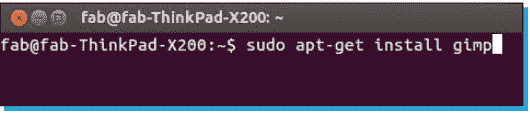

打开终端并执行以下命令：

```
sudo apt-get install gimp
```

### 第 2 步 – 下载 GIMP
下载 GIMP 最简单的方式是从 http://www.gimp.org/downloads/。网站上有指向最新版 Windows 安装程序的链接。

### 第 3 步 – 设置安装
设置安装，请按以下步骤操作：
- 1. 找到已下载的可执行文件，双击开始，如下图所示：
- 2. 选择安装过程中使用的首选语言。

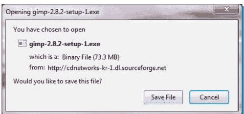

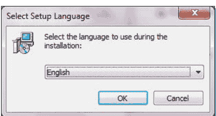

### 第 4 步 – 安装
开始安装 GIMP，请按以下步骤操作：
- 1. 点击 Install 按钮后安装开始，如下图所示：

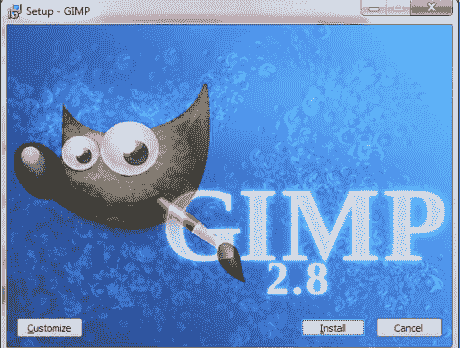

- 2. 在下面的截图中，安装程序正在解包其内容并加载到机器中。请等待进程完成。

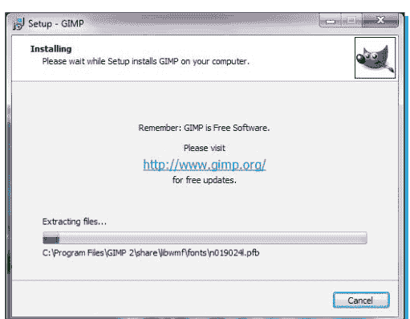

- 3. 安装的最后屏幕表明安装成功。然后，点击 Finish 按钮结束安装过程。

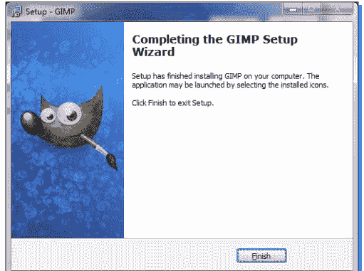

### 就这样！
到此时，你应该已经拥有一个可用的 GIMP 安装，并准备好激发创造力。

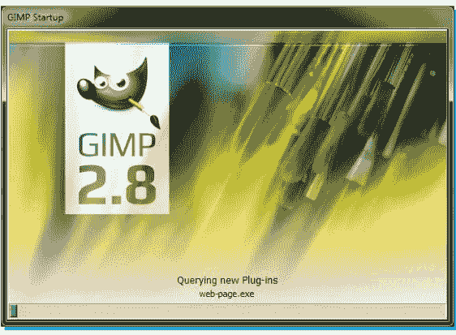

### 快速入门 – GIMP 巡览
让我们开始巡览 GIMP。本次巡览将让你接触到使用 GIMP 的基本任务。在过程中，我们将介绍使 GIMP 与其他图像处理程序不同的概念性理念。

我们将制作以下图像：

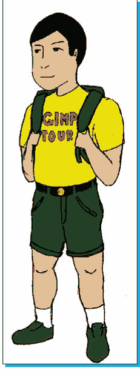

### 第 1 步 – 创建新文件
使用 GIMP 需要你在画布上工作，就像艺术家一样。在 GIMP 中，画布是系统上的一个文件。你可以有一个干净的画布（新文件），也可以在从各种来源获得的图像上工作。

### 
**文件** 菜单为你提供许多选项。从这里，你可以通过选择 **新建** 来创建一个干净的画布。从下一张截图可以看到，**创建** 有一个丰富的菜单。你可以开始导入从别处复制的图像，扫描它们，或截屏开始。

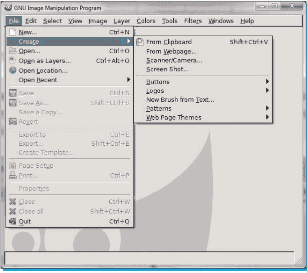

创建新画布，请按以下步骤操作：
- 1. 点击 **文件**。
- 2. 从菜单中点击 **新建**。
- 3. 现在 **创建新图像** 对话框会出现。调整宽度和高度。在点击 **确定** 之前，通过选择 **透明度** 将背景设置为不填充。

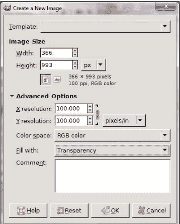

现在你有了画布，可以在上面进行第一次创作，如下图所示：

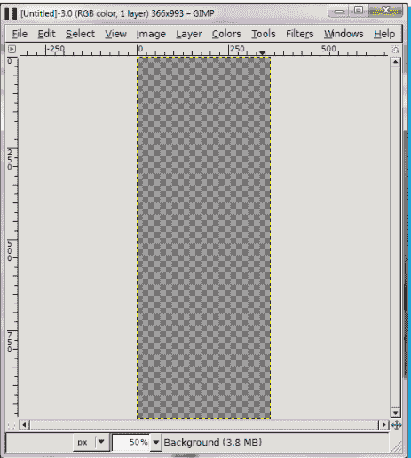

如果你像我一样事先手绘了图片轮廓并扫描过，定位机器上的扫描图片，然后只需将文件拖入画布即可。如果你有数位笔，也可以在画布上轻松绘画。

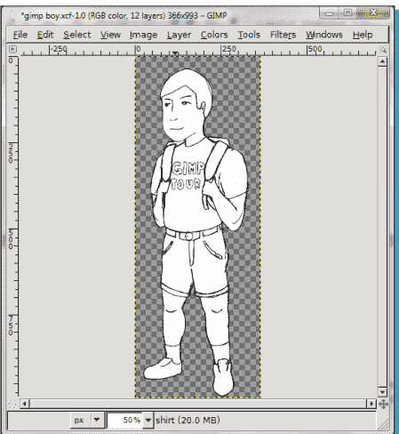

### 第 2 步 – 设置绘画图片
现在是介绍工具箱的完美时机。工具箱选项为你提供完成工作的工具集。这里的工具集合包括选择区域、绘画、变换和修补工具。

- 1. 如果工具箱窗口没有显示，按 Ctrl + B。以下是工具箱窗口的截图。

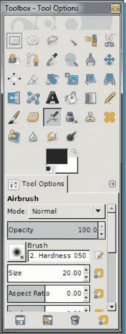

上一张截图包含两部分，工具以及进一步定义工具属性的工具选项。GIMP 默认安装将工具箱窗口和工具选项放在一起，但可以分开。根据用户偏好将窗口停靠在一起或分开是 GIMP 的一项功能。

- 2. 点击 **窗口** 并选择 **可停靠对话框** 以显示在工作时可能想要调到前面的各种对话框。
- 如果你不确定菜单中每个项目的操作，将光标放在图标上，会出现一个工具提示以及加粗的快捷键。**工具箱** 窗口底部是颜色选择器，用户可以在其中选择活动颜色和备用颜色，使在这些颜色可切换时绘画更轻松。
- 3. 点击魔术棒图标。然后，通过点击男孩的头发，头发将被选中。
- 4. 现在，复制图层，以便我们拥有专门用于他头发的图层。此步骤涉及图层操作。

### 第 3 步 – 创建图层
为图像的每个部分设置一个图层是个好主意。头发、衬衫、皮肤——都应有自己的图层。这样你就可以在不意外填充其他部分的情况下为每个部分上色。

图层的概念在使用 GIMP 时很重要。可以把它想象成你在不同的纸张或透明胶片上作画，然后在粘贴到绘图板上之前可以剪切和重新排列。

图层可停靠窗口可通过 Windows | Dockable Dialogs | Layers 访问。图层窗口有助于在图层之间导航。请参考以下截图：

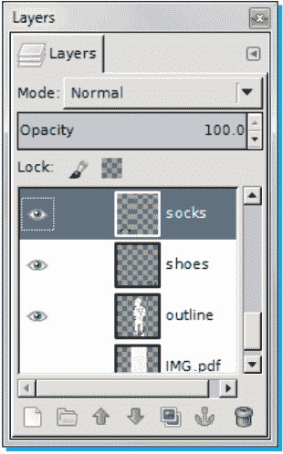

在图层之间导航，请按以下步骤操作：
- 1. 将图层拖到图标上可快速创建图层的副本。
- 2. 按 Ctrl + I（或点击 选择 | 反选）来选择相反的部分并删除它。现在你有一个专门用于某一部分的图层。
- 3. 为每个部分创建图层。图层应与原始轮廓对齐并重叠在其上方。要重命名图层，双击图层名称或点击图层后按 F2。

以下是图层应有的外观截图：

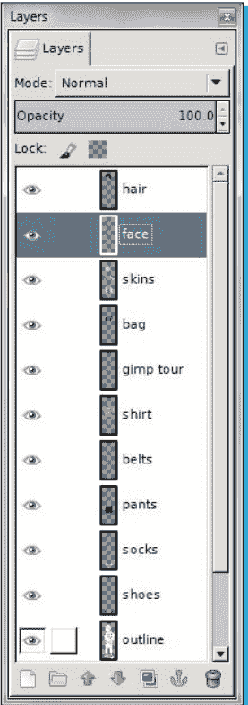

仅从图层窗口即可使用各种控件。你可以通过点击眼睛图标设置某些图层的可见性，并通过选择模式控制它与其他图层的混合方式。

图层在合成图像时最有用。每个图像都可以放在一个图层上，这样更容易在其他图层的图像周围调整它们。这些图层可以组织起来让某些图层位于其他图层之上。为此，将图层拖到顶部，使其位于其他图像之上。

### 第 4 步 – 上色
这将是最精彩的部分。当图层被复制并分离后，上色就很容易了。小心上色的技巧是使用魔术棒选择部分外部，然后反转选择（快捷键为 Ctrl + I），使颜色保持在部分内部。

完成此操作后，请按以下步骤操作：
- 1. 点击 **画笔工具** 🖌️，并选择你喜欢的颜色开始绘画。
- 2. 要选择另一种颜色，点击 🎨，你会得到一个菜单，其中有一组可供选择的颜色：
- 3. 你可以从光谱中选择任何颜色。完成后，点击 **确定**，你将返回画布。
- 4. 对每个部分重复选择并绘画的过程。为了说明单独图层被上色的情况，让我们看一下以下截图：

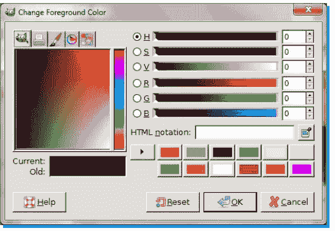


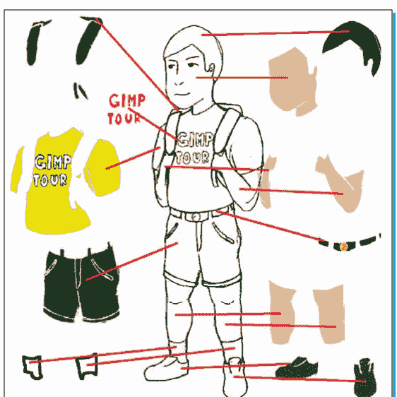

绘图中的每个填充都由图层分隔，以便可以修改每个图层而不影响其他图层。您还可以指定单个图层的透明度。

这就结束了 GIMP 的简要介绍。这些基础步骤只是冰山一角。GIMP 为您准备的内容令人惊叹。
