# 你好，Xcode

欢迎阅读 *《iOS 26 编程入门》*。我希望这本书能作为在 App Store 上创建和发布 iOS 26 应用的有用入门指南。

在本章中，你将下载并在 Mac 上安装 **Xcode**。然后，你将探索 Xcode 用户界面。之后，你将创建你的第一个 **iOS 应用** 并在 **模拟器** 中运行它。最后，你将在 **iOS 设备** 上运行你的应用。

到本章结束时，你将知道如何创建 iOS 应用，如何在模拟器中运行它，以及如何在 iOS 设备上运行它。

本章将涵盖以下主题：

- 从 App Store 下载并安装 Xcode
- 探索 Xcode 用户界面
- 在模拟器中运行你的应用
- 在 iOS 设备上运行你的应用

5. 安装完 Xcode 后，启动它。你会看到一个许可协议屏幕。点击 Agree：

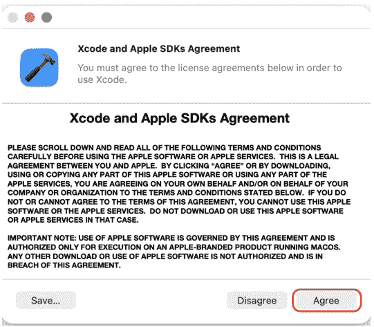

图 1.2：许可协议屏幕

6. 系统会提示你输入 Mac 管理员的用户名和密码。输入后，点击 OK：

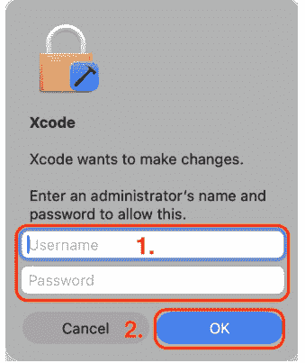

图 1.3：提示输入管理员用户名和密码

7. 你会看到一个显示可用开发平台的屏幕。现在你只需要 macOS 和 iOS。勾选 iOS 26.0，取消勾选其他所有选项，然后点击 Download & Install：


# Xcode

版本 26.0 (17A324)

选择你想要开始使用的组件：

平台支持

+ macOS 26.0 内置
+ iOS 26.0 10.07 GB
+ watchOS 26.0 3.83 GB
+ tvOS 26.0 4.83 GB
+ visionOS 26.0 6.98 GB

其他组件

+ 预测代码补全模型 2 GB

下载并安装

还将安装所需的系统组件。

图 1.4：开发平台屏幕

8. 如果看到提示重新启动 Xcode 以使用更新后的框架的提示，点击 **Relaunch Xcode.**

9. 如果看到 **What’s New in Xcode** 屏幕，点击 **Continue.**

10. 你会看到 **Welcome to Xcode** 屏幕。点击左侧窗格中的 **Create New Project...**：

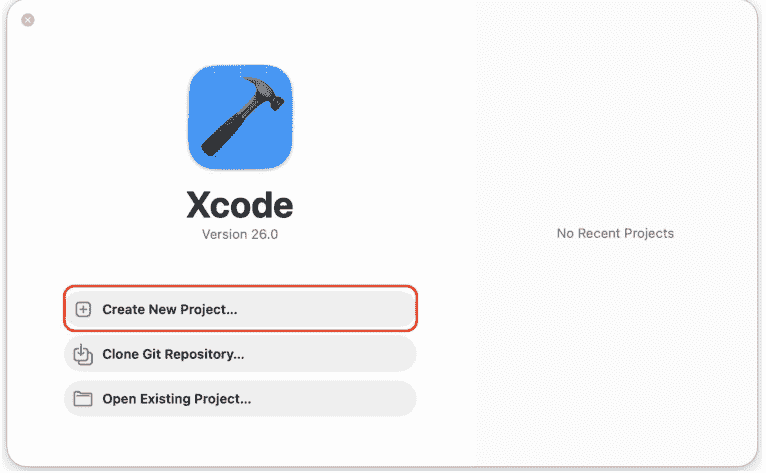

图 1.5：欢迎使用 Xcode 屏幕

11. Xcode 将自动开始下载 **iOS 26.0 Simulator**。请注意，在此过程完成之前，你将无法在模拟器上运行任何应用：

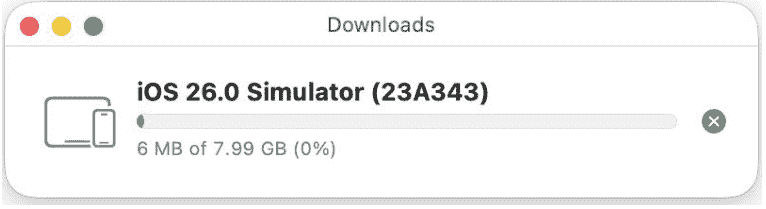

图 1.6：模拟器下载进度条

12. 你会看到如下的新建项目屏幕。在 **Choose a template for your new project** 部分，选择 **iOS**。然后选择 **App**，并点击 **Next**：

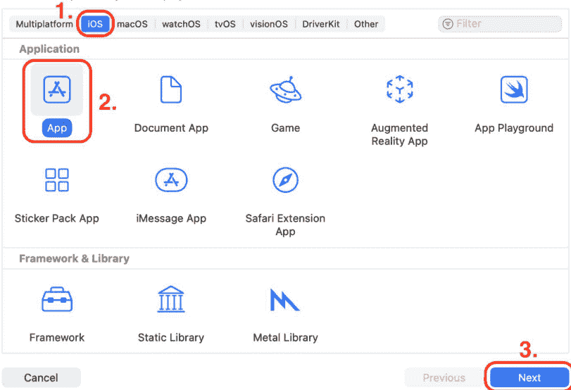

图 1.7：新建项目屏幕

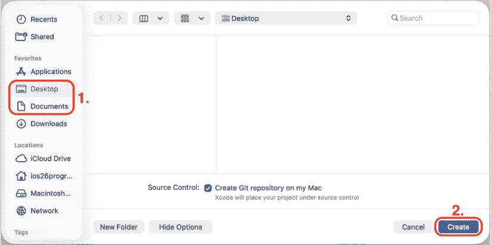

*图 1.9：保存对话框*

15. 你会看到如下的 **Provide Author Information** 对话框：

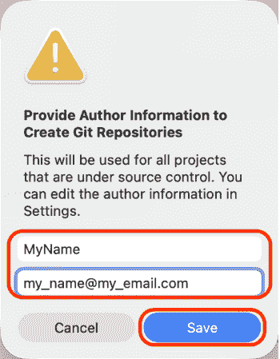

*图 1.10：源代码控制首选项屏幕*

如果你的 Mac 采用 Apple Silicon，物理设备部分将显示文字 **My Mac (Designed for iPad)**，因为 Apple Silicon Mac 可以运行 iOS 应用。否则，将显示 **No Devices**。如果你插入一台 iOS 设备，它将出现在该部分，你就可以在上面运行开发的应用进行测试。建议在实际设备上运行你的应用，因为模拟器无法准确反映实际 iOS 设备的性能特征，并且不具备实际设备所拥有的硬件功能。

**Build** 部分有两个菜单项，**Any iOS Device (arm64)** 和 **Any iOS Simulator Device (arm64, x86_64)**。这些在你需要在提交到 App Store 之前归档应用时使用。你将在 *第 27 章，Test and Submit Your App to the App Store* 中学习如何执行此操作。

现在让我们看看如何在实际 iOS 设备上构建和运行你的应用。本书中的大多数说明都不需要你拥有 iOS 设备，因此，如果你没有，可以跳过下一节，直接进入 *第 2 章，Simple Values and Types。*

## 在 iOS 设备上运行你的应用

虽然你可以使用模拟器完成本书中的大部分练习，但建议在实际 iOS 设备上构建和测试你的应用，因为模拟器无法模拟某些硬件组件和软件 API。

> 要全面了解模拟器与实际设备之间的所有差异，请参阅此链接：https://help.apple.com/simulator/mac/current/#!/devb0244142d。

除了设备之外，你还需要一个 Apple 账户（用于自动创建免费 Apple 开发者账户）或付费 Apple 开发者账户，以便在你的设备上构建和运行应用。你可以使用从 App Store 下载 Xcode 时使用的同一个 Apple 账户。

5. 要在你的 iOS 设备上启用开发者模式，请进入 设置 | 隐私与安全性，向下滚动到开发者模式项目并点击它：

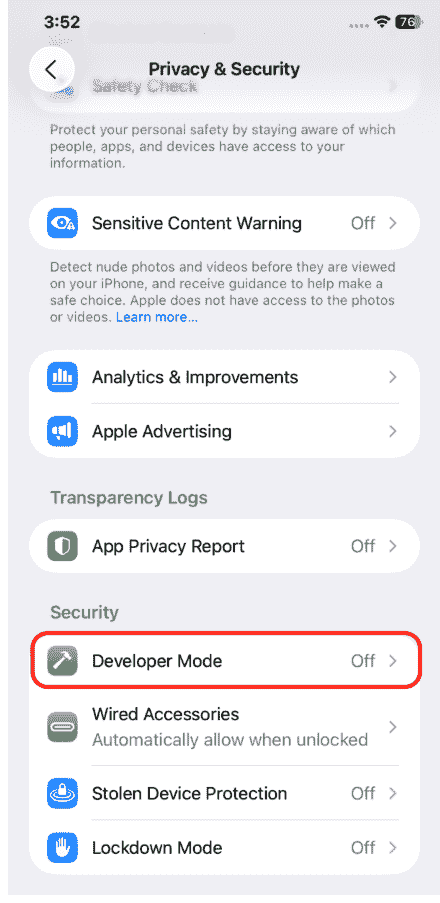

图 1.18：显示开发者模式的隐私与安全性屏幕

6. 打开开发者模式开关：

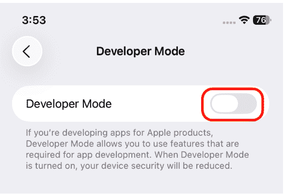

图 1.19：开发者模式开关

7. 会出现一个警告，提示开发者模式会降低 iOS 设备的安全性。点击重启。

8. 你的 iOS 设备重启并解锁后，通过点击启用并输入 iOS 设备的密码来确认你想要启用开发者模式。

9. 设备和模拟器窗口将显示正在准备 iPhone 的消息。等待几分钟，然后验证设备和模拟器窗口不再显示开发者模式已禁用的文字：

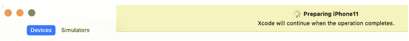

图 1.20：Xcode 设备和模拟器窗口显示正在准备 iPhone 消息

你的 iOS 设备现在已准备好从 Xcode 安装和运行应用。

10. 在 Xcode 中，从目标菜单中选择你的 iOS 设备。

11. 通过点击运行按钮（或使用 Command + R）运行项目。你将在 Xcode 的签名与功能面板中收到以下错误：Signing for “JRNL” requires a development team：

图 1.21：Xcode 签名与功能面板

这是因为在 iOS 设备上运行应用需要数字证书，你需要在 Xcode 中添加免费或付费的 Apple 开发者账户，以便生成数字证书。

使用 Apple 账户创建免费开发者账户将允许你在 iOS 设备上测试你的应用，但有效期仅为 7 天。此外，你需要付费 Apple 开发者账户才能在 App Store 上分发应用。你将在第 27 章 Test and Submit Your App to the App Store 中了解更多相关信息。

证书可确保在你的设备上运行的唯一应用是你授权的应用。这有助于防止恶意软件。你也可以在此链接了解更多信息：https://help.apple.com/xcode/mac/current/#/dev60b6fbbc7。

12. 点击 Add Account...：

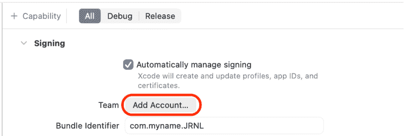

图 1.22：Xcode 签名与功能窗格中选中的 Add Account... 按钮

13. Xcode 设置窗口出现，并选中 Apple 账户窗格。点击 Add Apple Account...：

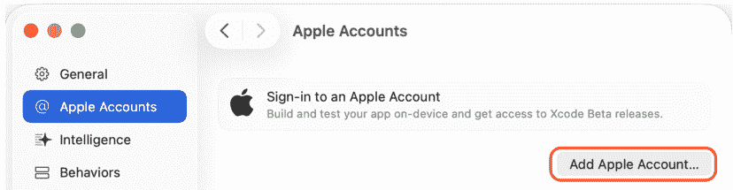

图 1.23：Xcode 设置窗口

14. 在提供的框中输入你的 Apple 账户电子邮件或电话号码，然后点击 Next。之后，在提供的框中输入你的密码，然后再次点击 Next：

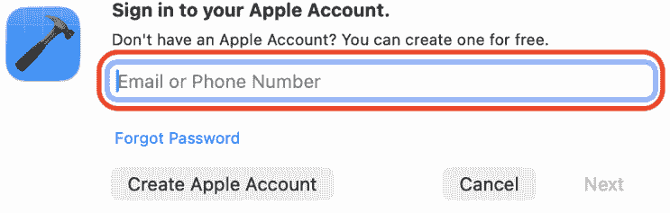

图 1.24：Apple 账户登录对话框

你也可以通过在 Xcode 菜单中选择设置来访问 Xcode 设置。

15. 几分钟后，验证 Apple 账户窗格是否显示你的账户名称和电子邮件地址：

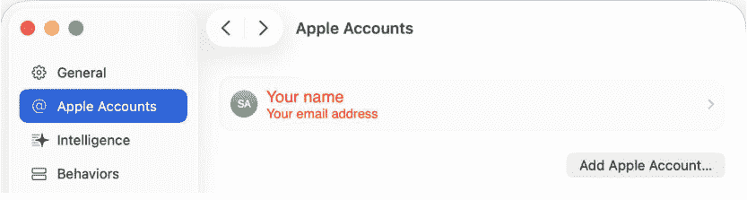

图 1.25：Xcode 设置中的 Apple 账户窗格

16. 完成后，点击左上角的红色关闭按钮关闭设置窗口。

17. 在 Xcode 的编辑器区域中，点击 Signing & Capabilities。确保已勾选 Automatically manage signing，并且在 Team 弹出菜单中选择了 Personal Team：


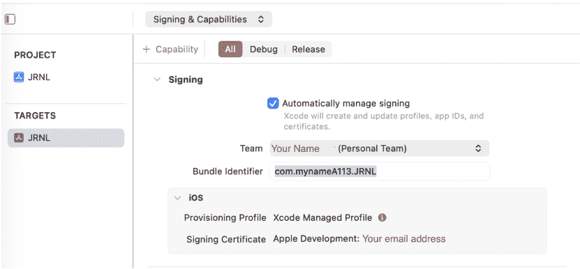

图 1.26：已设置账户的 Xcode“签名与功能”面板

18. 如果此屏幕仍显示错误，请尝试在 Bundle Identifier 中键入一些随机字符来更改它——例如 com.mynameA113.JRNL。

19. 构建并运行您的应用。如果提示输入密码，请输入您 Mac 的登录密码，然后点按“始终允许”。

20. 您的应用将被安装到 iOS 设备上。但是，它不会启动，您会看到以下对话框：

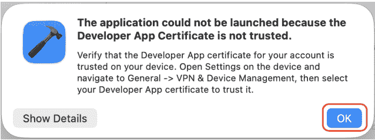

图 1.27：“无法启动 JRNL”对话框

21. 点按“好”以关闭此对话框。

如对话框所述，您需要信任已安装在 iOS 设备上的证书。您将在下一节中了解如何执行此操作。

## 在 iOS 设备上信任 Developer App 证书

Developer App 证书是一种特殊文件，会与您的应用一起安装到 iOS 设备上。在应用运行之前，您需要信任它。请按照以下步骤操作：

1. 在 iOS 设备上，轻点“设置”|“通用”|“VPN 与设备管理”：

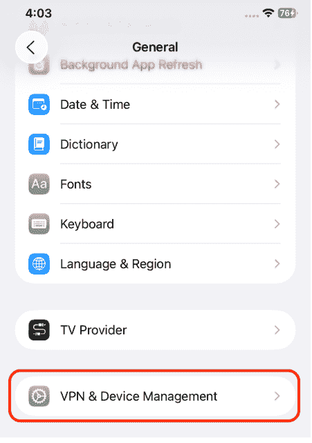

图 1.28：“设置”中的“VPN 与设备管理”设置

2. 轻点您的 Apple 账户：

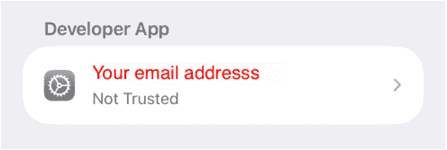

图 1.29：“设备管理”设置中的您的 Apple 账户

3. 轻点“信任”：


图 1.30：“信任”按钮

4. 轻点“允许”：

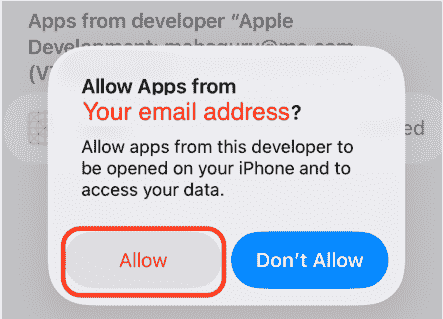

图 1.31：“允许”对话框

您应该会看到以下文本，这表明您安装的应用现在已被信任：

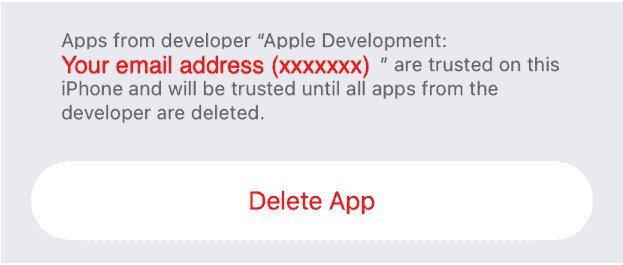

图 1.32：包含受信任证书的“设备管理”部分

5. 在 Xcode 中点按“运行”按钮，再次构建并运行。您将看到您的应用在 iOS 设备上启动并运行。

恭喜！您已成功在真实的 iOS 设备上运行您的应用！

有关 Swift 语言最新版本的更多信息，请访问 https://docs.swift.org/swift-book/documentation/the-swift-programming-language/。

要查看 Apple 在 WWDC 2025 期间宣布的 Swift 语言最新更新，请观看此视频：https://developer.apple.com/videos/play/wwdc2025/245/。

## 技术要求

要完成本章的练习，您需要以下内容：

- 一台运行 macOS 15 Sequoia 或 macOS Tahoe 26 的 Apple Mac 电脑
- 安装 Xcode 26（有关如何安装 Xcode 的说明，请参阅第 1 章“你好，Xcode”）

本章的 Xcode playground 位于本书代码包中的 Chapter 02 文件夹中，可在此处下载：

https://github.com/PacktPublishing/iOS-26-Programming-for-Beginners-10E

查看以下视频，了解代码的实际运行效果：

https://youtu.be/9WA68HayY2w

在下一节中，您将创建一个新的 playground，并可以在其中输入本章展示的代码。

## Swift playground

Playground 是交互式编码环境。您在左侧窗格中键入代码，结果会立即显示在右侧窗格中。这是试验代码和探索 iOS SDK 的好方法。

- **边框 (9)**：此边框分隔**编辑器**和**结果**区域。您可以向左或向右拖动边框，以更改分配给每个区域的空间。
- **调试区域 (10)**：这里显示 print() 命令的结果。
- **运行和停止按钮 (11)**：执行或停止执行 playground 中的所有代码。
- **调试按钮 (12)**：显示和隐藏调试区域。

您可能会觉得 playground 中的文本太小且难以阅读。下一节让我们看看如何将其放大。

## 更改字体和颜色

Xcode 提供了大量的自定义选项。您可以在**“设置...”**菜单中访问这些选项。如果您发现文本太小且难以看清，请按照以下步骤操作：

1. 从 Xcode 菜单中选择**“设置...”**，以显示**“设置”**窗口。

2. 在**“设置”**窗口中，点按**“主题”**，然后从弹出菜单中选择**“演示（浅色）”**，以使文本更大、更易于阅读：

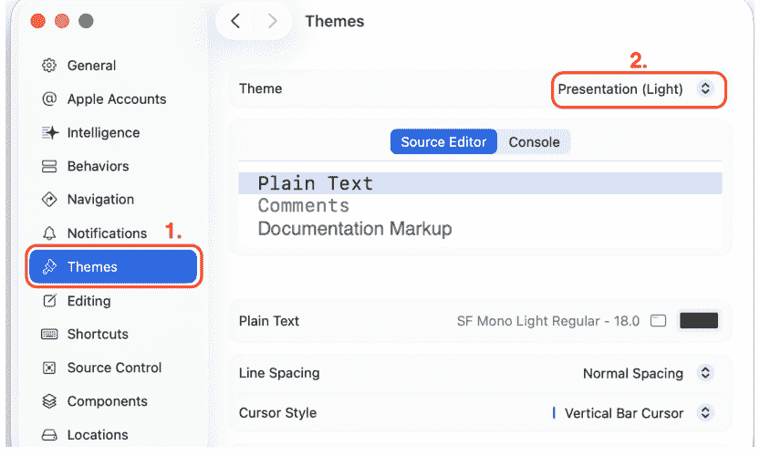

图 2.5：选中“主题”窗格的 Xcode 设置窗口

4. 常量的值一旦设置便无法更改。要测试这一点，请在变量声明之后添加以下代码：

```
let isRaining = true
isRaining = false
```

当您键入第二行代码时，会出现一个带有建议的弹出菜单：

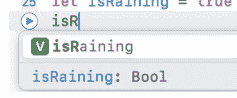

图 2.8：自动补全弹出菜单

使用上下箭头键选择 isRaining 常量，然后按 Tab 键将其选中。此功能称为自动补全，有助于防止输入代码时出现键入错误。

5. 输入完成后，等待几秒钟。您会在第二行看到错误通知（一个红色圆圈，中间有一个白点）出现：

```
24
25 let isRaining = true
26 isRaining = false  Cannot assign to value: 'isRaining' is a 'let' constant
27
```

图 2.9：错误通知

这意味着您的程序中存在错误，并且 Xcode 认为它可以被修复。出现此错误是因为您试图在常量初始值设置后为其赋予新值。

6. 点按红色圆圈以展开错误消息。您将看到以下带有“应用”按钮的框：

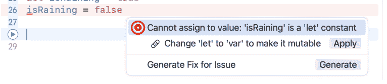

图 2.10：展开的错误通知

2. 按住 Option 键并点按 cuisine，以显示常量类型。您应该会看到以下内容：

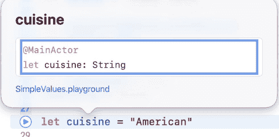

图 2.12：显示的类型声明

如您所见，cuisine 的类型是 String。

如果您想为变量或常量设置特定类型，该怎么办？您将在下一节中了解如何执行此操作。

## 使用类型标注指定类型

您已经看到 Xcode 会根据提供的值尝试自动确定变量或常量的数据类型。然而，有时您可能希望指定类型，而不是让 Xcode 为您完成。要做到这一点，请在常量或变量名称后键入冒号 (:)，然后键入所需类型。这称为类型标注。

将以下代码添加到您的 playground 中，以声明一个类型为 Double 的变量 restaurantRating，然后点按“运行”按钮来运行它：

```
var restaurantRating: Double = 3
```

在这里，您指定了 restaurantRating 具有特定类型 Double。即使您向 restaurantRating 分配了整数 3，它也会存储为浮点数 3.0。

在下一节中，您将了解 Xcode 如何通过强制类型安全来帮助您减少程序中的错误数量。

## 使用类型安全检查值

Swift 是一种类型安全的语言。它会检查您是否为变量分配了正确类型的值，并将类型不匹配标记为错误。让我们按照以下步骤看看它是如何工作的：

1. 将以下语句添加到您的 playground 中，以将字符串分配给 restaurantRating 并运行它：

```
restaurantRating = "Good"
```

2. 您将看到一个错误通知（一个内部带有 x 的红色圆圈）。这个 x 表示 Xcode 无法为此建议修复。点按红色圆圈。

3. 由于您试图将字符串分配给类型为 Double 的变量，因此会显示以下错误消息：

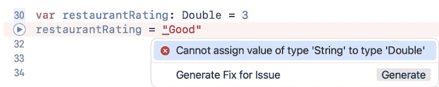

图 2.13：展开的错误通知，无修复建议

4. 通过在其前面键入 // 来注释掉该行，如下所示：

```
// restaurantRating = "Good"
```

红色圆圈消失，因为您的程序中不再有错误。


既然您知道了如何将数据存储在常量和变量中，下一节让我们来看看如何对它们执行操作。

## 运算符

您可以在 Swift 中执行算术、比较和逻辑运算。算术运算符用于执行常见的数学运算。比较和逻辑运算符检查表达式的值并返回 true 或 false。


有关运算符的更多信息，请访问 https://docs.swift.org/swift-book/documentation/the-swift-programming-language/basicoperators。

让我们更详细地了解每种运算符类型。下一节将从算术运算符（加法、减法、乘法和除法）开始。

### 算术运算符

你可以使用下面所示的标准算术运算符对整数和浮点数执行数学运算：

| 运算符 | 描述 |
| --- | --- |
| + | 加 |
| - | 减 |
| * | 乘 |
| / | 除 |

图 2.14：算术运算符

下面来看看如何使用这些运算符。请按照以下步骤操作：

1. 将以下代码添加到你的 playground 中，以添加算术运算：

```
let sum = 23 + 20
let result = 32 - sum
let total = result * 5
let divide = total / 10
```

2. 运行代码。结果区域显示的结果将分别为 43、-11、-55 和 -5。注意，55 除以 10 返回 5 而不是 5.5，因为两个数都是整数。

3. 运算符只能用于相同类型的操作数。输入以下代码并运行，看看当操作数类型不同时会发生什么：

```
let a = 12
let b = 12.0
let c = a + b
```

你会看到一个错误消息（二元运算符 ‘+’ 不能应用于类型 ‘Int’ 和 ‘Double’ 的操作数）。这是因为 a 和 b 是不同类型。注意，Xcode 无法自动修复此问题，因此它不会显示任何修复建议。

4. 要修复该错误，请按如下方式修改程序：

```
let c = Double(a) + b
```

Double(a) 获取 a 中的值，并从中创建一个浮点数。现在两个操作数都是相同的类型，因此你可以将其与 b 中的值相加。赋给 c 的值是 24.0，结果区域中会显示 24。

既然你已经了解了如何使用算术运算符，下一节将介绍复合赋值运算符（+=、-=、*= 和 /=）。

### 复合赋值运算符

你可以使用下面所示的复合赋值运算符对一个值执行运算，并将结果赋给变量：

| 运算符 | 描述 |
| --- | --- |
| += | 加上一个值并将结果赋给变量 |
| -= | 减去一个值并将结果赋给变量 |
| *= | 乘以一个值并将结果赋给变量 |
| /= | 除以一个值并将结果赋给变量 |

图 2.15：复合赋值运算符

下面来看看如何使用这些运算符。将以下代码添加到你的 playground 并运行：

```
var d = 1
d += 2
d -= 1
```

d += 2 表达式是 d = d + 2 的简写形式，因此 d 中的值现在是 1 + 2，并将 3 赋给 d。同样，d -= 1 是 d = d - 1 的简写形式，因此 d 中的值现在是 3 - 1，并将 2 赋给 d。

既然你已经熟悉了复合赋值运算符，下一节让我们来看看比较运算符（==、!=、>、<、>= 和 <=）。

### 比较运算符

你可以使用比较运算符将一个值与另一个值进行比较，结果将为 true 或 false。可以使用以下比较运算符：

| 运算符 | 描述 |
| --- | --- |
| == | 等于 |
| != | 不等于 |
| > | 大于 |
| < | 小于 |
| >= | 大于或等于 |
| <= | 小于或等于 |

图 2.16：比较运算符

下面来看看如何使用这些运算符。将以下代码添加到你的 playground 并运行：

```
1 == 1
2 != 1
2 > 1
1 < 2
1 >= 1
2 <= 1
```

下面看看这是如何工作的：

- 1 == 1 返回 true，因为 1 等于 1。
- 2 != 1 返回 true，因为 2 不等于 1。
- 2 > 1 返回 true，因为 2 大于 1。
- 1 < 2 返回 true，因为 1 小于 2。
- 1 >= 1 返回 true，因为 1 大于或等于 1。
- 2 <= 1 返回 false，因为 2 不小于或等于 1。

返回的布尔值将显示在结果区域。

如果你想检查多个条件会怎样？这时就要用到逻辑运算符（AND、OR 和 NOT）。下一节你将学习这些内容。

### 逻辑运算符

当你处理两个或更多条件时，逻辑运算符非常方便。例如，如果你在便利店，只要有现金或信用卡就可以付款。在这种情况下，OR 就是逻辑运算符。

| 运算符 | 描述 |
| --- | --- |
| && | 逻辑与——仅当所有条件都为 true 时返回 true |
| \|\| | 逻辑或——当任一条件为 true 时返回 true |
| ! | 逻辑非——返回相反的布尔值 |

图 2.17：逻辑运算符

要查看如何使用这些运算符，请将以下代码添加到你的 playground 并运行：

```
(1 == 1) && (2 == 2)
(1 == 1) && (2 != 2)
(1 == 1) || (2 == 2)
(1 == 1) || (2 != 2)
(1 != 1) || (2 != 2)
!(1 == 1)
```

下面看看这是如何工作的：

- (1 == 1) && (2 == 2) 返回 true，因为两个操作数都为 true，所以 true AND true 返回 true。
- (1 == 1) && (2 != 2) 返回 false，因为一个操作数为 false，所以 true AND false 返回 false。
- (1 == 1) || (2 == 2) 返回 true，因为两个操作数都为 true，所以 true OR true 返回 true。
- (1 == 1) || (2 != 2) 返回 true，因为一个操作数为 true，所以 true OR false 返回 true。
- (1 != 1) || (2 != 2) 返回 false，因为两个操作数都为 false，所以 false OR false 返回 false。
- !(1 == 1) 返回 false，因为 1==1 为 true，所以 NOT true 返回 false。

返回的布尔值将显示在结果区域。

你已经了解了如何对数字和字符串执行操作，这让你可以执行简单的数据处理任务。

你学会了如何修复错误以及如何打印到调试区域，这在查找和修复程序错误时非常有用。

在下一章中，你将学习**条件语句**和**可选类型**。条件语句用于在程序中做出逻辑选择，可选类型用于处理变量可能有值也可能没有值的情况。

### 加入我们的 Discord！

与其他读者、专家和作者本人一起阅读本书。提问、为其他读者提供解决方案、通过 Ask Me Anything 互动活动与作者聊天，等等。扫描二维码或访问链接加入社区。

https://packt.link/LdIDT


## 3
