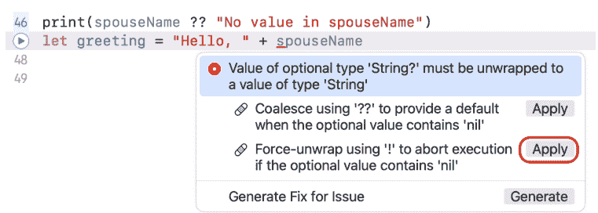

## 条件语句与可选类型

在上一章中，你了解了数据类型、常量、变量和运算。到目前为止，你可以编写处理字母和数字的简单程序。然而，程序并不总是按顺序执行。你经常需要根据条件执行不同的指令。Swift 允许你通过使用**条件语句**来实现这一点，本章将学习如何使用它们。

你可能还注意到，在上一章中，每个变量或常量都被立即赋予了值。如果你需要一个变量，但其值最初可能不存在怎么办？你将需要一种方法来创建可能有值也可能没有值的变量。Swift 允许你通过使用**可选类型**来实现这一点，本章也将会学习它们。

到本章结束时，你应该能够编写根据条件执行不同操作的程序，并处理可能有值也可能没有值的变量。

将涵盖以下主题：

- 条件语句
- 可选类型与可选绑定

> 请花一些时间来理解可选类型。它们对新手程序员来说可能令人生畏，但你会看到，它们是 iOS 开发的重要组成部分。

### 技术要求

本章的 Xcode playground 位于本书代码包的 Chapter03 文件夹中，可以从此处下载：

https://github.com/PacktPublishing/iOS-26-Programming-for-Beginners-10E

观看以下视频查看代码的实际运行效果：

https://youtu.be/0NqHr2gakJQ

创建一个新的 playground，并将其命名为 ConditionalsAndOptionals。你可以边学边输入并运行本章中的所有代码。接下来你将从学习条件语句开始。

### 条件语句

有时，你会希望根据特定条件执行不同的代码块，例如以下场景：

- 在酒店选择不同类型的房间。较大的房间价格更高。
- 在网上商店切换不同的支付方式。不同的支付方式会有不同的流程。
- 在快餐店决定点什么餐。每种食品的制作流程会有所不同。

要实现这一点，你可以使用条件语句。在 Swift 中，这是通过 if 语句（用于单个条件）和 switch 语句（用于多个条件）实现的。

> 有关条件语句的更多信息，请访问 https://docs.swift.org/swift-book/documentation/the-swift-programming-language/controlflow。

下一节让我们看看如何使用 if 语句根据条件执行不同的任务。


## if 语句

if 语句会在条件返回 true 时执行一段代码，并且可选地在条件返回 false 时执行另一段代码。它的写法如下：

```
if condition {
    code1
} else {
    code2
}
```

让我们现在实现一个 if 语句来看看它的实际效果。想象一下，你正在为一家餐厅编写一个应用程序。该应用程序允许你检查餐厅是否营业，搜索餐厅，并检查顾客是否超过最低饮酒年龄。请按照以下步骤操作：

- 1. 要检查餐厅是否营业，将以下代码添加到你的 playground 中。运行它以创建一个常量并在常量的值为 true 时执行语句：

```
let isRestaurantOpen = true
if isRestaurantOpen {
    print("Restaurant is open.")
}
```

首先，你创建了一个常量 isRestaurantOpen，并将其赋值为 true。接下来，你有一个 if 语句，检查 isRestaurantOpen 中存储的值是否等于 true。由于该值等于 true，print() 语句被执行，并且 Restaurant is open 会打印在 Debug 区域中。

- 2. 尝试将 isRestaurantOpen 的值更改为 false 并再次运行代码。由于条件现在返回 false，Debug 区域中不会打印任何内容。

- 3. 你也可以在值为 false 时执行语句。假设顾客搜索了一家不在应用程序数据库中的特定餐厅，因此应用程序应显示一条消息，说明未找到该餐厅。输入以下代码以创建一个常量并在常量的值为 false 时执行语句：

```
let isRestaurantFound = false
if isRestaurantFound == false {
    print("Restaurant was not found")
}
```

2. 这是如何将前面显示的 if 语句写成 switch 语句。输入以下代码并运行它：

```
trafficLightColor = "Yellow"
switch trafficLightColor {
case "Red":
    print("Stop")
case "Yellow":
    print("Caution")
case "Green":
    print("Go")
default:
    print("Invalid color")
}
```

与之前的版本相比，这里的代码更容易阅读和理解。trafficLightColor 的值为 "Yellow"，因此 case "Yellow": 被匹配，并且 Caution 会打印在 Debug 区域中。尝试更改 trafficLightColor 的值以查看不同的结果。

关于 switch 语句，有两点需要注意：

- - Swift 中的 switch 语句默认不会贯穿每个 case 的底部并进入下一个 case。在前面显示的示例中，一旦 case "Yellow": 被匹配，case "Red":、case "Green": 和 default: 将不会执行。
- - switch 语句必须涵盖所有可能的情况。在前面显示的示例中，trafficLightColor 的任何值如果不是 "Red"、"Yellow" 或 "Green"，都将被匹配到 default: 并且 Invalid color 会打印在 Debug 区域中。

至此，关于 if 和 switch 语句的部分就结束了。在下一部分，你将学习关于 optionals 的内容，optionals 允许你创建没有初始值的变量，以及 optional binding，它允许在 optional 有值时执行指令。

## Optionals 和 optional binding

到目前为止，每次你声明一个变量或常量时，你都会立即为其赋值。但如果想先声明一个变量然后稍后赋值怎么办？在这种情况下，你将使用 optionals。

7. 让我们为 spouseName 分配一个值。按如下方式修改代码：

```
var spouseName: String?
spouseName = "Nia"
print(spouseName ?? "No value in spouseName")
```

当你的程序运行时，Nia 会出现在 Debug 区域中。

8. 添加一行代码将 spouseName 与另一个字符串连接，如下所示：

```
print(spouseName ?? "No value in spouseName")
let greeting = "Hello, " + spouseName
```

你会收到一个错误，Debug 区域会显示错误信息以及错误发生的位置。这是因为你不能使用 + 运算符将普通字符串变量与 optional 连接。你需要先解包 optional。

9. 点击红色圆圈以显示可能的解决方案，你会看到以下内容：



图 3.4：展开的错误通知，其中突出显示了第二个修复方案

第二个解决方案建议使用强制解包来解决此问题。强制解包无论 optional 是否包含值都会解包它。如果 spouseName 有值，它工作正常，但如果 spouseName 为 nil，你的代码将会崩溃。

10. 点击第二个解决方案的 Apply，你会看到感叹号出现在最后一行代码的 spouseName 之后，这表示 optional 被强制解包：

```
let greeting = "Hello, " + spouseName!
```

11. 运行你的程序，你会看到 Hello, Nia 被赋给 greeting，如 Results 区域所示。这意味着 spouseName 已成功被强制解包。

12. 要查看强制解包包含 nil 的变量的效果，将 spouseName 设置为 nil：

```
spouseName = nil
```

你的代码崩溃了，你可以在 Debug 区域中看到导致崩溃的原因：

```
No value in spouseName
__lldb_expr_15/ConditionalsAndOptionals.playground:47: Fatal error: Unexpectedly found nil while unwrapping an Optional value
```

图 3.5：Debug 区域中崩溃的程序详情

由于 spouseName 现在为 nil，程序在尝试强制解包 spouseName 时崩溃了。

更好的处理方法是使用 optional binding。在 optional binding 中，你尝试将 optional 中的值赋给一个临时变量（你可以随意命名它）。如果赋值成功，则会执行一段代码。

13. 要查看 optional binding 的效果，按如下方式修改你的代码：

```
spouseName = "Nia"
print(spouseName ?? "No value in spouseName")
if let spouseTempVar = spouseName {
    let greeting = "Hello, " + spouseTempVar
    print(greeting)
}
```

Hello, Nia 将出现在 Debug 区域中。这就是它的工作原理。如果 spouseName 有值，它将被解包并赋给一个临时常量 spouseTempVar，并且 if 语句将返回 true。大括号之间的语句将被执行，greeting 常量将被赋值为 Hello, Nia。然后，Hello, Nia 将打印在 Debug 区域中。请注意，临时变量 spouseTempVar 不是 optional。如果 spouseName 没有值，则无法将值赋给 spouseTempVar，if 语句将返回 false。在这种情况下，大括号中的语句根本不会被执行。

14. 你也可以以更简单的方式编写上一步中的代码，如下所示：

```
spouseName = "Nia"
print(spouseName ?? "No value in spouseName")
if let spouseName {
    let greeting = "Hello, " + spouseName
```

查看以下视频以了解代码的实际运行情况：

https://youtu.be/U52X9c9EAVA

如果你想从头开始，创建一个新的 playground 并将其命名为 RangeOperatorsAndLoops。

你可以边进行边输入并运行本章中的所有代码。

让我们开始使用范围运算符指定一组数字。

## 范围运算符

想象一下，你需要为一家百货商店编写一个程序，自动向 18 至 30 岁之间的顾客发送折扣券。如果你需要为每个年龄设置 if 或 switch 语句，那将非常麻烦。在这种情况下，使用范围运算符会更方便。

范围运算符允许你表示一系列值。假设你想表示从 firstNumber 开始到 lastNumber 结束的数字序列。你不需要指定每个值；你可以这样指定范围：

```
firstNumber...lastNumber
```

在百货商店的示例中，你将按如下方式指定顾客年龄：

```
18...30
```

有关范围运算符的更多信息，请访问 https://docs.swift.org/swift-book/documentation/the-swift-programming-language/basicoperators。

让我们在 playground 中试试。按照以下步骤操作：

- 1. 将以下代码添加到你的 playground 并运行它：

```
let myRange = 10...20
```

这将为 myRange 常量分配一个从 10 开始到 20 结束的数字序列，包括这两个数字。这称为闭合范围运算符。myRange 的起始值和结束值将显示在 Results 区域中：


图 4.1：结果区域显示了范围的起始值和结束值

请记住，你可以拖动“结果”区域和“编辑器”区域之间的边框来更改“结果”区域的大小。

- 2. 如果你不希望区间包含序列中的最后一个数字，请用 ..< 替换 ...。在下一行输入并运行以下语句：

```
let myRange2 = 10..<20
```

这会将从 10 开始、到 19 结束的序列存储在常量 myRange2 中，并且该运算符被称为半开区间运算符。

还有一种区间运算符，即单侧区间运算符，你将在下一章中学习。

既然你已经知道如何创建和使用区间，接下来你将在下一节中学习循环、不同的循环类型以及如何使用它们。

## 循环

在编程中，你经常需要重复做同样的事情。例如，每个月，公司都需要为每位员工生成工资单。如果公司有 10,000 名员工，编写 10,000 条指令来创建工资单效率很低。重复一条指令 10,000 次会更好，循环就是为此而使用的。

有三种循环类型：for-in 循环、while 循环和 repeat-while 循环。for-in 循环会重复已知的次数，而 while 和 repeat-while 循环会在循环条件为真时重复。

> 有关循环的更多信息，请访问 https://docs.swift.org/swift-book/documentation/the-swift-programming-language/controlflow。

让我们依次看看每种类型。

### for-in 循环

for-in 循环会遍历序列中的每一个值，并且每次都会执行花括号中的一组语句，这组语句称为循环体。每个值依次被赋给一个临时变量，该临时变量可以在循环体内使用。如下所示：

```
for item in sequence {
    code
}
```

循环重复的次数由序列中的项目数量决定。让我们首先创建一个 for-in 循环来显示 myRange 中的所有数字。请按照以下步骤操作：

- 1. 将以下代码添加到你的 Playground 中并运行它：

```
for number in myRange {
    print(number)
}
```

在这里，循环内部的语句会执行 11 次，因为 myRange 包含了区间中的最后一个数字。你应该会看到序列中的每个数字都显示在“调试区域”中，并且在“调试区域”中打印的最后一个值是 20。

- 2. 让我们尝试相同的程序，但这次使用 myRange2。按如下方式修改代码并运行：

```
for number in myRange2 {
    print(number)
}
```

在这种情况下，循环内部的语句会执行 10 次，并且在“调试区域”中打印的最后一个值是 19。

让我们逐步分析这段代码。最初，x 被设置为 0。检查 x < 50 条件，返回 true，因此执行循环体。x 的值增加 5，并在“调试区域”中打印出“x is 5”。循环重复，再次检查 x < 50。由于 x 现在是 5，且 5 < 50 仍然返回 true，因此再次执行循环体。如此重复，直到 x 的值为 50，此时 x < 50 返回 false，循环停止。

如果 while 循环的条件一开始就为 false，则循环体将永远不会执行。试着将 x 的值改为 100，看看会发生什么。

在下一节中，你将学习 repeat-while 循环。这些循环会在检查循环条件之前先执行循环体中的语句。

### repeat-while 循环

与 while 循环一样，repeat-while 循环也包含一个条件和一个循环体，但会在检查条件之前先执行循环体。如果条件为 true，循环会重复执行，直到条件返回 false。下面是一个 repeat-while 循环的示例：

```
repeat {
    code
} while condition == true
```

要查看 repeat-while 循环的实际运行效果，请在 Playground 中的所有其他代码之后添加以下代码并运行：

```
var y = 0
repeat {
    y += 5
    print("y is \(y)")
} while y < 50
```

让我们逐步分析这段代码。最初，y 被设置为 0。执行循环体。y 的值增加 5，因此现在 y 包含 5，并在“调试区域”中打印出“y is 5”。检查 y < 50 条件，由于它返回 true，循环重复。y 的值增加 5，因此现在 y 包含 10，并在“调试区域”中打印出“y is 10”。循环重复，直到 y 包含 50，此时 y < 50 返回 false，循环停止。

即使条件一开始为 false，循环体也至少会执行一次。试着将 y 的值改为 100，看看会发生什么。

你现在知道如何创建和使用不同的循环类型了。太棒了！

### 小结

在本章中，你学习了闭区间运算符和半开区间运算符，它们允许你指定一个数字范围，而不是逐个指定每个单独的数字。

你还学习了三种不同的循环类型：for-in 循环、while 循环和 repeat-while 循环。for-in 循环允许你重复执行一组语句固定次数，而 while 和 repeat-while 循环允许你在条件为真时重复执行一组语句。干得好！

在下一章中，你将学习集合类型，它们允许你存储通过索引引用的数据集合、键值对集合以及无序的数据集合。

## 加入我们的 Discord

与其他读者、专家以及本书作者一起阅读这本书。

提出问题、为其他读者提供解决方案、通过“问我任何问题”（AMA）环节与作者聊天，等等。扫描二维码或访问链接即可加入社区。

https://packt.link/LdIDT/


