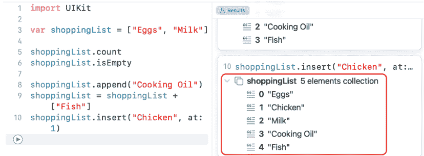

## 5 集合类型

到现在为止，你已经学到了很多！你现在可以创建程序，在常量或变量中存储数据并对它们执行操作，还可以使用条件语句和循环控制流程。但到目前为止，你主要是在存储单个值。

在本章中，你将学习存储值集合的方法。Swift 有三种集合类型：**数组**，存储有序的值列表；**字典**，存储无序的键值对列表；**集合**，存储无序的值列表。

学完本章，你将学会如何创建数组、字典和集合，以及如何对它们执行操作。

本章将涵盖以下主题：

- 数组
- 字典
- 集合

### 技术要求

本章的 Xcode Playground 可以在本书代码包的 Chapter05 文件夹中找到，代码包可从以下位置下载：

https://github.com/PacktPublishing/iOS-26-Programming-for-Beginners-10E

观看以下视频，查看代码的实际运行效果：

https://youtu.be/hLACW615fzs

如果你想从头开始，请创建一个新的 Playground，并将其命名为 CollectionTypes。你可以边学边输入并运行本章中的所有代码。

要了解更多关于数组、字典和集合的信息，请访问 https://docs.swift.org/swift-book/documentation/the-swift-programming-language/collectiontypes。

你将学习的第一个集合类型是数组，它允许你以有序列表的形式存储信息。

### 数组

假设你想存储以下内容：

- 在便利店要购买的物品列表
- 每个月必须做的家务

数组就很适合这种情况。数组以有序列表的形式存储值。如下所示：

| 索引 | 值 |
| --- | --- |
| 0 | 值1 |
| 1 | 值2 |
| 2 | 值3 |

图 5.1：数组的表示

数组中的值必须是相同类型的。你可以使用数组索引访问数组中的任何值，索引从 0 开始。

如果你使用 let 关键字创建数组，则数组创建后其内容无法更改。如果你想在创建后修改数组的内容，请使用 var 关键字。

让我们看看如何使用数组。在下一节中，你将通过给它赋值来创建一个数组。


## 创建数组

在之前的章节中，你通过声明常量或变量并为其分配初始值来创建它。你可以用同样的方式创建数组。

想象一下，你的配偶让你去便利店买一些东西。让我们使用数组来实现一个购物清单。将以下代码添加到你的游乐场并运行它：

```swift
var shoppingList = ["Eggs", "Milk"]
```

这条指令创建了一个名为 shoppingList 的数组变量。分配的值 `["Eggs", "Milk"]` 是一个数组字面量。它表示一个包含两个 String 类型元素的数组，其中索引 0 处为 `"Eggs"`，索引 1 处为 `"Milk"`。

在此处使用 `var` 关键字意味着数组的内容可以被修改。由于 Swift 使用类型推断，此数组的元素类型将为 String。

想象一下，你需要检查在商店需要买多少件物品。在下一节中，你将学习如何确定数组中元素的数量。

## 检查数组中的元素数量

要了解数组中有多少个元素，请使用 `count`。输入并运行以下代码：

```swift
shoppingList.count
```

由于 shoppingList 数组包含两个元素，结果区域中显示 2。

你可以使用 `isEmpty` 来检查数组是否为空。输入并运行以下代码：

```swift
shoppingList.isEmpty
```

由于 shoppingList 数组包含两个元素，结果区域中显示 false。

你也可以使用 `shoppingList.count == 0` 来判断数组是否为空，但使用 `shoppingList.isEmpty` 性能更好。

想象一下，你的配偶打电话来让你在去商店时顺便买食用油、鱼和鸡肉。在下一节中，你将看到如何向数组末尾添加元素以及在指定数组索引处添加元素。

## 向数组添加新元素

你可以使用 `append(_:)` 将新元素添加到数组末尾。输入并运行以下代码：

```swift
shoppingList.append("Cooking Oil")
```

"Cooking Oil" 已被添加到 shoppingList 数组的末尾，现在包含三个元素——"Eggs"、"Milk" 和 "Cooking Oil"——并且 "Eggs"、"Milk" 和 "Cooking Oil" 显示在结果区域中。

你也可以使用 `+` 运算符将一个数组添加到另一个数组，使用以下代码：

```swift
shoppingList = shoppingList + ["Fish"]
```

你可以使用 `insert(_:at:)` 在指定索引处添加新项目。输入并运行以下代码：

```swift
shoppingList.insert("Chicken", at: 1)
```

这将在索引 1 处插入 "Chicken"，因此 shoppingList 数组现在包含 "Eggs"、"Chicken"、"Milk"、"Cooking Oil" 和 "Fish"。请注意，"Chicken" 是数组中的第二个元素，因为第一个元素的索引为 0。这可以在结果区域中看到：



图 5.2：结果区域中显示的数组内容

想象一下，你已经拿到购物清单上的第一件物品，现在需要知道清单上的下一件物品。在下一节中，你将看到如何使用数组索引访问特定的数组元素。

你也可以选择不保留被移除的值。输入并运行以下代码：

```swift
shoppingList.remove(at: 3)
shoppingList
```

这会从 shoppingList 数组中移除索引 3 处的项目 "Fish"，因此现在它包含 "Eggs"、"Soy Milk" 和 "Cooking Oil"。

如果你要移除数组中的最后一个项目，可以改用 `removeLast()`，并且也可以选择将移除的值赋给常量或变量。

想象一下，你已经获得了清单上的所有物品，并且想再次检查清单。你需要依次访问每个数组元素并对每个元素执行操作。你将在下一节中看到如何做到这一点。

## 遍历数组

还记得上一章学过的 `for-in` 循环吗？你可以用它来遍历数组中的每个元素。输入并运行以下代码：

```swift
for shoppingListItem in shoppingList {
    print(shoppingListItem)
}
```

这会将数组中的每个元素打印到调试区域。

你也可以使用单侧范围运算符。这些是只有起始值的范围运算符，例如 `1...`。输入并运行以下代码：

```swift
for shoppingListItem in shoppingList[1...] {
    print(shoppingListItem)
}
```

这会从索引 1 处的元素开始，将数组中的元素打印到调试区域。

你现在知道如何使用数组创建有序列表，例如购物清单，以及如何执行访问、添加和移除元素等数组操作。在下一节中，让我们看看如何使用字典存储无序的键值对列表。

## 字典

假设你正在创建一个通讯录应用。你需要存储姓名及其对应的联系电话。字典非常适合此用途，因为它允许你将电话号码与联系人姓名关联起来。

## 检查字典中的元素数量

要了解字典中有多少个元素，请使用 `count`。输入并运行以下代码：

```swift
contactList.count
```

由于 contactList 字典中有两个元素，结果区域中显示 2。

你可以使用 `isEmpty` 来检查字典是否为空。输入并运行以下代码：

```swift
contactList.isEmpty
```

由于 contactList 字典有两个元素，结果区域中显示 false。

你也可以使用 `contactList.count == 0` 来判断字典是否为空，但使用 `contactList.isEmpty` 性能更好。

想象一下，你刚结束一次会议，想在应用中添加一个新联系人。由于此字典是用 `var` 关键字声明的，你可以向其中添加键值对。你将在下一节中学习如何操作。

## 向字典添加新元素

要向字典添加新元素，请提供一个键并为其分配值。输入并运行以下代码：

```swift
contactList["Nithya"] = "+0229876543"
contactList
```

这会在 contactList 字典中添加一个键值对，键为 "Nithya"，值为 "+0229876543"。它现在由 "Shah" : "+60126789345"、"Sohini" : "+0223456789" 和 "Nithya" : "+0229876543" 组成。你可以在结果区域中看到这一点。

想象一下，你想给其中一个联系人打电话，并需要该联系人的电话号码。在下一节中，你将看到如何通过指定键来访问字典元素。

## 访问字典元素

你可以指定字典键来访问其对应的值。输入并运行以下代码：

```swift
contactList["Shah"]
```

这会返回键 "Shah" 的值，并且 +60123456789 显示在结果区域中。

如果你尝试指定字典中不存在的键，将返回 nil 值。

想象一下，你的其中一个联系人换了新手机，因此你必须更新该联系人的电话号码。你可以修改字典中存储的键值对。你将在下一节中学习如何操作。

## 为现有键分配新值

你可以为现有键分配新值。输入并运行以下代码：

```swift
contactList["Shah"] = "+60126789345"
contactList
```

这会为键 "Shah" 分配一个新值。contactList 字典现在包含 "Shah" : "+60126789345"、"Sohini" : "+0223456789" 和 "Nithya" : "+0229876543"。你可以在结果区域中看到这一点。

想象一下，你必须从应用中删除一个联系人。让我们在下一节中看看如何从字典中删除元素。

## 从字典中删除元素

要从字典中删除元素，请将 nil 分配给现有键。输入并运行以下代码：

```swift
contactList["Sohini"] = nil
contactList
```

这会从 contactList 字典中删除键为 "Sohini" 的元素，现在它包含 "Shah" : "+60126789345" 和 "Nithya" : "+0229876543"。你可以在结果区域中看到这一点。


## Sets

假设你正在编写一个 Movies 应用，并且想要存储电影类型的列表。你可以用一个集合来做到这一点。

集合以无序列表的形式存储值。它的样子如下：

| Value |
| --- |
| value1 |
| value2 |
| value3 |

图 5.4：集合的表示

所有值都是同一类型。

如果使用 let 关键字创建集合，则在创建后其内容不能被更改。如果想要在创建后更改内容，请使用 var 关键字。

让我们看看如何使用集合。你将在下一节中通过为其分配值来创建一个集合。

### Create a set

想象一下，你正在创建 Movies 应用，并且希望在应用中存储电影类型。应用将存储你喜欢的电影类型，并且可以检查你考虑观看的电影是否在其中。与数组相比，集合是无序的并且只包含唯一值，而数组按索引排序并且可以包含重复项。由于你不需要按顺序存储电影类型，并且每个类型都是唯一的，因此你将为此目的使用集合。

正如你对数组和字典所见，你可以通过声明它并为其分配一个新值来创建集合。将以下代码添加到你的 playground 并运行它：

```
var movieGenres: Set = ["Horror", "Action", "Romantic Comedy"]
```

此指令创建一个名为 movieGenres 的集合变量。请注意，分配给它的集合字面量 `["Horror", "Action", "Romantic Comedy"]` 与数组字面量的格式相同，因此你使用类型标注将 movieGenres 的类型设置为 Set。否则，Swift 的类型推断将创建一个数组变量而不是集合变量。

在此使用 var 关键字意味着集合的内容可以被修改。此集合的元素将因类型推断而为 String 类型。

### Set operations

执行集合操作（如 **union**、**intersection**、**subtraction** 和 **symmetric difference**）很容易。输入并运行以下代码：

```
let movieGenres2: Set = ["Science Fiction", "War", "Fantasy"]
movieGenres.union(movieGenres2)
movieGenres.intersection(movieGenres2)
movieGenres.subtracting(movieGenres2)
movieGenres.symmetricDifference(movieGenres2)
```

在这里，你正在对两个集合 movieGenres 和 movieGenres2 执行集合操作。让我们看看每个集合操作的结果：

- union(_:) 返回一个包含两个集合中所有值的新集合，因此 **"Horror"**、**"Romantic Comedy"**、**"War"**、**"Science Fiction"** 和 **"Fantasy"** 将在 Results 区域显示
- intersection(_:) 返回一个仅包含两个集合共有的值的新集合，因此 **"War"** 将在 Results 区域显示
- subtracting(_:) 返回一个不包含指定集合中的值的新集合，因此 **"Horror"** 和 **"Romantic Comedy"** 将在 Results 区域显示
- symmetricDifference(_:) 返回一个不包含两个集合共有的值的新集合，因此 **"Horror"**、**"Romantic Comedy"**、**"Science Fiction"** 和 **"Fantasy"** 将在 Results 区域显示

假设你希望你的应用将你喜欢的类型与另一个人喜欢的类型进行比较。在下一节中，你将学习如何检查一个集合是否等于另一个集合、是另一个集合的一部分，或者与另一个集合没有任何共同之处。

### Set membership and equality

检查一个集合是否等于 **subset**、**superset** 或与另一个集合 **disjoint** 很简单。输入并运行以下代码：

```
let movieGenresSubset: Set = ["Horror", "Romantic Comedy"]
let movieGenresSuperset: Set = ["Horror", "Romantic Comedy", "War", "Science Fiction", "Fantasy"]
let movieGenresDisjoint: Set = ["Bollywood"]
movieGenres == movieGenres2
movieGenresSubset.isSubset(of: movieGenres)
```

## Get This Book’s PDF Version and Exclusive Extras

扫描二维码（或访问 packtpub.com/unlock）。按书名搜索此书，确认版本，然后按照页面上的步骤操作。

*Note:* 请保留你的发票。直接从 Packt 购买无需发票。


UNLOCK NOW
