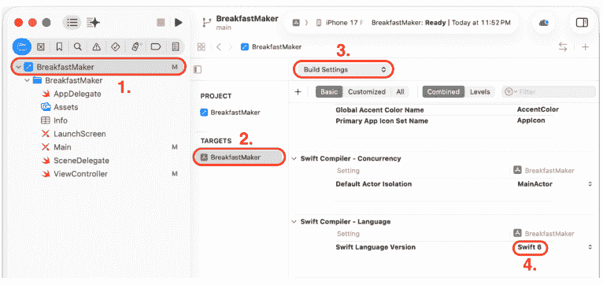
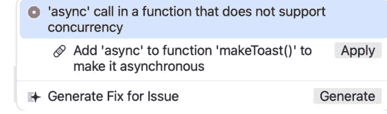
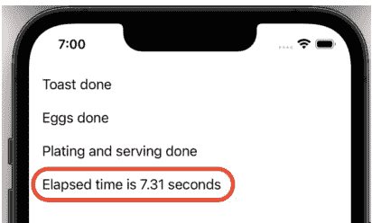

## Swift 并发

Apple 在 WWDC21 上推出了 **Swift 并发**，它为 Swift 5.5 添加了对结构化异步和并行编程的支持。它允许你编写更易读、更易理解的并发代码。在 WWDC24 期间，Apple 推出了 **Swift 6**，通过在编译时诊断**数据竞争**使并发编程更加容易。Swift 并发文档在 WWDC25 之后进一步更新。

> 目前，不建议为大型现有项目开启严格并发模式，因为这很可能会产生多个错误和警告。但是，由于这是 Apple 未来的发展方向，你将在本章以及本书*第三部分*的项目中开启它，以便你学习和积累相关经验。

在本章中，你将学习 Swift 并发的基本概念。接下来，你将检查一个没有使用并发的应用并探讨其问题。之后，你将使用 `async/await` 在应用中实现并发。最后，你将通过使用 `async-let` 使应用更高效。

到本章结束时，你将学习到 Swift 并发工作的基础知识，以及如何更新你自己的应用来使用它。

将涵盖以下主题：

- Swift 并发
- 检查没有使用并发的应用
- 使用 `async/await` 更新应用
- 使用 `async-let` 提高效率

## 技术要求

我们将使用一个示例应用 *BreakfastMaker* 来理解 Swift 并发的概念。

本章完整的 Xcode 项目位于本书代码包的 Chapter09 文件夹中，可从此处下载：

https://github.com/PacktPublishing/iOS-26-Programming-for-Beginners-10E

观看以下视频查看代码的实际运行：

https://youtu.be/QzsaoTmCp5s

让我们从下一节开始学习 Swift 并发。

## Swift 并发

在 Swift 5.5 中，Apple 添加了对以结构化方式编写**异步**和**并行**代码的支持。

异步代码允许你的应用挂起和恢复代码。并行代码允许你的应用同时运行多段代码。这使你的应用可以在下载互联网数据等操作进行的同时更新用户界面。

你可以通过以下链接阅读 Apple 的 Swift 并发文档：https://docs.swift.org/swift-book/documentation/the-swift-programming-language/concurrency/。

在 WWDC24 期间，Apple 发布了 Swift 6。借助 Swift 6 语言模式，编译器现在可以保证并发程序没有数据竞争。这意味着来自应用某一部分的代码不能再访问应用中另一部分代码正在修改的同一内存区域。但是，当你创建新的 Xcode 项目时，默认是 Swift 5 语言模式，你必须开启 Swift 6 语言模式才能启用此功能。WWDC25 之后，Apple 更新了 Swift 并发的文档和迁移指南。

要查看 Apple 关于将应用迁移到 Swift 6 的文档，请点击此链接：https://www.swift.org/migration/documentation/migrationguide/。

要查看 Apple 关于 Swift 并发最新更新的 WWDC25 视频，请点击此链接：https://developer.apple.com/videos/play/wwdc2025/268/。


要了解 Swift 并发的工作原理，可以想象你正在为早餐制作水煮蛋和吐司。以下是其中一种做法：

1. 把两片面包放入烤面包机。
2. 等待两分钟，直到面包烤好。
3. 把两个鸡蛋放入装有沸水的平底锅中并盖上。
4. 等待七分钟，直到鸡蛋煮熟。
5. 上盘并上菜。

总共需要九分钟。现在，思考一下这个事件序列。你会花那段时间只是盯着烤面包机和平底锅看吗？你可能会在面包在烤面包机里、鸡蛋在平底锅里时使用手机。换句话说，在吐司和鸡蛋准备期间，你可以做其他事情。因此，事件序列更准确的描述如下：

1. 把两片面包放入烤面包机。
2. 使用手机两分钟，直到面包烤好。
3. 把两个鸡蛋放入装有沸水的平底锅中并盖上。
4. 使用手机七分钟，直到鸡蛋煮熟。
5. 上盘并上菜。

在这里，你可以看到你与烤面包机和平底锅的交互可以被挂起然后恢复，这意味着这些操作是异步的。操作仍然需要九分钟，但在这段时间里你能够做其他事情。

还有另一个因素需要考虑。你不需要等面包烤完才把鸡蛋放入平底锅。这意味着你可以按如下方式修改步骤序列：

1. 把两片面包放入烤面包机。
2. 在面包烤制的同时，把两个鸡蛋放入装有沸水的平底锅中并盖上。
3. 使用手机七分钟。在这段时间里，面包会被烤好，鸡蛋会被煮熟。
4. 上盘并上菜。

烤面包和煮鸡蛋现在是并行进行的，这为你节省了两分钟。太好了！不过请注意，你现在需要跟踪的事情更多了。

现在你已经了解了异步和并行操作的概念，让我们在下一节研究没有并发的应用程序存在的问题。

```swift
func plateAndServe() -> String {
    return "Plating and serving done"
}
@IBAction func testButton(_ sender: UIButton) {
    print("Button tapped")
}
```

如你所见，这段代码模拟了上一节描述的做早餐的过程。让我们分解一下：

```swift
@IBOutlet var toastLabel: UILabel!
@IBOutlet var eggLabel: UILabel!
@IBOutlet var plateAndServeLabel: UILabel!
@IBOutlet var elapsedTimeLabel: UILabel!
```

这些 outlet 与 Main storyboard 文件中的四个标签链接。当你运行应用程序时，这些标签将显示吐司和鸡蛋的状态、上盘和上菜情况，以及完成该过程所需的时间。

```swift
override func viewDidAppear(_ animated: Bool) {
```

此方法在视图控制器的视图出现在屏幕上时被调用。

```swift
let startTime = Date().timeIntervalSince1970
```

此语句将 startTime 设置为当前时间，以便应用程序稍后可以计算制作餐食所需的时间。

```swift
toastLabel.text = "Making toast..."
```

此语句使 toastLabel 显示文本 Making toast...。

```swift
toastLabel.text = makeToast()
```

此语句调用 makeToast() 方法，该方法等待两秒钟以模拟制作吐司所需的时间，然后返回文本 Toast done，该文本将由 toastLabel 显示。

```swift
eggLabel.text = "Boiling eggs..."
```

```swift
eggLabel.text = boilEggs()
```



### 图 9.3：Swift 语言版本设置为 Swift 6 的 BreakfastMaker 项目

这将为你的应用程序启用严格的并发检查。

2. 在项目导航器中点击 ViewController 文件。修改 makeToast() 和 boilEggs() 方法，如下所示，使其主体中的代码变为异步：

    ```swift
    func makeToast() -> String {
        try? await Task.sleep(for: .seconds(2))
        return "Toast done"
    }

    func boilEggs() -> String {
        try? await Task.sleep(for: .seconds(7))
        return "Eggs done"
    }
    ```

    Task 表示一个异步工作单元。它有一个静态方法 sleep(for:)，该方法会暂停执行指定的持续时间，以秒为单位。由于此方法是一个抛出方法，你将使用 try? 关键字调用它，而无需实现 do-catch 块。await 关键字表示此代码可以被挂起以允许其他代码运行。

    > 使用 try? 会导致任何错误被抑制或忽略。在这种情况下是可以接受的，因为睡眠 2 或 7 秒不太可能产生错误。在其他情况下，这可能不可接受，do-catch 块是更好的解决方案。你可能希望重新阅读第 8 章《协议、扩展和错误处理》，以了解如何实现 do-catch 块。

3. makeToast() 和 boilEggs() 都会出现错误。点击任一错误图标以显示错误消息：

    

    图 9.4：点击错误图标时显示的错误消息

    错误的显示是因为你在不支持并发的方法内部调用了异步方法。你需要在方法声明中添加 async 关键字以指示它是异步的。

4. 对于每个方法，点击 Apply 按钮以将 async 关键字添加到方法声明中。

5. 完成后验证你的代码如下所示：

    ```swift
    func makeToast() async -> String {
        try? await Task.sleep(for: .seconds(2))
        return "Toast done"
    }
    func boilEggs() async -> String {
        try? await Task.sleep(for: .seconds(7))
        return "Eggs done"
    }
    ```

6. makeToast() 和 boilEggs() 方法中的错误应该消失了，但在 viewDidAppear() 方法中会出现新的错误。点击其中一个错误图标查看错误消息，该消息与步骤 2 中看到的消息相同。这是因为你在不支持并发的方法内部调用了异步方法。

7. 点击 Apply 按钮，更多错误将会出现。

8. 暂时忽略方法声明中的错误，并点击 makeToast() 方法调用旁边的错误以查看错误消息：

    图 9.5：点击错误图标时显示的错误消息

    此错误消息显示是因为你在调用异步函数时未使用 await。

9. 点击 Apply 按钮在方法调用前插入 await 关键字。

10. 对 boilEggs() 方法调用旁边的错误重复步骤 7 和步骤 8。await 关键字也将被插入到 boilEggs() 方法调用之前。

11. 点击 viewDidAppear() 方法声明中的错误图标查看错误消息：

    图 9.6：突出显示错误图标的 viewDidAppear() 方法声明

    此错误显示是因为你不能使用 async 关键字使 viewDidAppear() 方法异步，因为超类中不存在此功能。

12. 为了解决此问题，你将删除 async 关键字并将 super.viewDidAppear() 之后的所有代码包含在 Task 块中，这将允许它在同步方法中异步执行。按如下方式修改你的代码：

    ```swift
    override func viewDidAppear(_ animated: Bool) {
        super.viewDidAppear(animated)
        Task {
            let startTime = Date().timeIntervalSince1970
            toastLabel.text = "Making toast..."
            toastLabel.text = await makeToast()
    ```

在定义常量时在 let 语句前写入 async，然后在访问常量时写入 await，允许异步方法的并行执行，如下所示：

```swift
async let temporaryConstant1 = methodName1()
async let temporaryConstant2 = methodName2()
let variable1 = await temporaryConstant1
let variable2 = await temporaryConstant2
```

在此示例中，methodName1() 和 methodName2() 将并行运行。

你将修改你的应用程序以使用 async-let 来使 makeToast() 和 boilEggs() 方法并行运行。在 ViewController 文件中，按如下方式修改 Task 块中的代码：

```swift
Task {
    let startTime = Date().timeIntervalSince1970
    toastLabel.text = "Making toast..."
    async let tempToast = makeToast()
    eggLabel.text = "Boiling eggs..."
    async let tempEggs = boilEggs()
    toastLabel.text = await tempToast
    eggLabel.text = await tempEggs
    plateAndServeLabel.text = plateAndServe()
    let endTime = Date().timeIntervalSince1970
    elapsedTimeLabel.text = "Elapsed time is \(((endTime - startTime) * 100).rounded() / 100) seconds"
}
```

构建并运行应用程序。你会看到经过的时间现在比以前少了：



图 9.8：运行 BreakfastMaker 应用程序的模拟器，显示经过的时间


这就是使用 async-let 允许 `makeToast()` 和 `poachEgg()` 方法并行运行的原因，并且 `poachEgg()` 方法不再等待 `makeToast()` 方法完成后再开始执行。太棒了！

你已成功在你的应用中实现了异步代码。太棒了！关于 Swift 并发还有很多东西需要学习，例如结构化并发和 actors，但这超出了本章的范围。

给自己一个赞；你已完成了本书的第一部分！

## Summary

在本章中，你学习了 Swift 并发以及如何在 Breakfast-Maker 应用中实现它。

你首先学习了 Swift 并发的核心概念。然后，你检查了一个没有并发的应用并探索了其问题。之后，你打开了严格并发检查并使用 async/await 在应用中实现了并发。最后，你通过使用 async let 使你的应用更高效。

你现在了解了 Swift 并发的基础知识，将能够在自己的应用中使用 async/await 和 async-let。

在下一章中，你将通过使用 storyboards 创建其屏幕来开始编写你的第一个 iOS 应用程序，storyboards 允许你在无需编写大量代码的情况下快速原型化一个应用程序。

## Get This Book’s PDF Version and Exclusive Extras

扫描二维码（或访问 packtpub.com/unlock）。按书名搜索此书，确认版本，然后按照页面上的步骤操作。

Note: Keep your invoice handy. Purchases made directly from Packt don’t require an invoice.


## 10
