## 构建用户界面

在上一章中，你修改了一个现有的 Xcode 项目，为你的应用添加了一个标签栏，允许用户在 Journal List 和 Map 屏幕之间进行选择，并配置了标签栏按钮的标题和图标。当你的应用启动时，会显示 Journal List 屏幕，但目前它是空白的。

正如你在*第 10 章《设置用户界面》*的应用导览中所见，Journal List 屏幕应显示一个表视图，在表视图单元格中显示日志条目的列表。

在本章中，你将让 Journal List 屏幕显示一个包含 10 个空表视图单元格的表视图，以及一个在点击时显示表示“添加新日志条目”屏幕的视图的按钮。你还将配置一个取消按钮来关闭此视图并返回到 Journal List 屏幕。

你将向应用添加少量代码，但不必过于担心——你将在本书下一部分中了解更多相关内容。

到本章结束时，你将学会如何向故事板场景添加视图控制器、将视图控制器中的 outlet 连接到场景、设置表视图单元格，以及以模态方式呈现视图控制器。这在为你自己的应用设计用户界面时将非常有用。

本章将涵盖以下主题：

- 向 Journal List 屏幕添加表视图
- 将故事板元素连接到视图控制器
- 为表视图配置数据源方法
- 以模态方式呈现视图

+   3. 你将使用 Auto Layout 的 Add New Constraints 按钮将表视图的边缘绑定到其包围视图的边缘。确保选中 Table View，然后点击 Auto Layout 的 Add New Constraints 按钮：

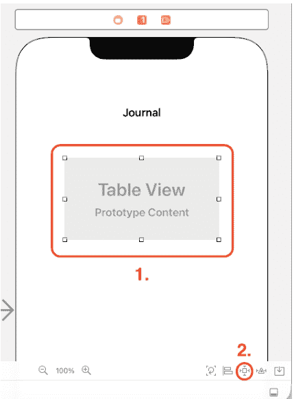

图 11.3：选中 Table View 的视图控制器场景

+   4. 在顶部、左侧、右侧和底部的约束字段中输入 0，然后点击所有浅红色支柱。确保所有支柱都变成亮红色。点击 Add 4 Constraints 按钮：

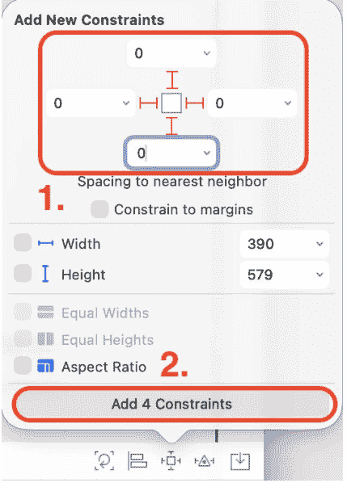

图 11.4：用于添加新约束的 Auto Layout 弹出对话框

这将表视图边缘与包围视图边缘之间的间距设置为 0，将表视图的边缘绑定到包围视图的边缘。现在，无论设备和方向如何，表视图都将填满可用空间。

你已经向 Journal List 屏幕的视图控制器场景的视图添加了一个表视图，并使用 Auto Layout 约束使其填满导航栏和标签栏之间的空间，但在你构建并运行应用时，Journal List 屏幕仍然会是空白的。

在下一节中，你将为 JournalListViewController 类实现代码，并将此类中的 outlet 连接到 Journal List 屏幕上的 UI 元素。这将使 JournalListViewController 类的实例能够控制 Journal List 屏幕上显示的内容。

## 将故事板元素连接到视图控制器

你已经向 Journal List 屏幕添加了一个表视图，但它还没有显示任何内容。你需要修改现有的视图控制器来管理 Journal List 屏幕中的表视图。ViewController 文件是你在创建 JRNL 项目时由 Xcode 自动创建的。

它包含了一个名为 ViewController 的 UIViewController 子类的声明和定义，该类当前被设置为 Journal List 屏幕的视图控制器。你将把 ViewController 文件中的类名改为 JournalListViewController，并为之前添加到视图控制器场景中的表视图创建一个 outlet。请按照以下步骤操作：

+   1. 在项目导航器中点击 ViewController 文件。在编辑器区域，右键单击类名（ViewController），然后选择 Refactor | Rename....。

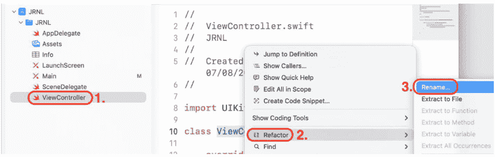

图 11.6：编辑器区域显示弹出菜单，其中 Rename... 高亮显示

2. 将类名改为 JournalListViewController，然后点击 Rename：

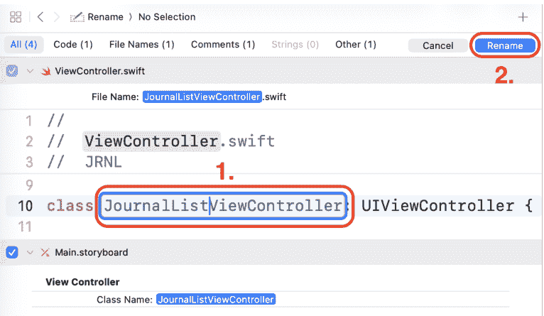

图 11.7：编辑器区域显示 ViewController 类的新名称

3. 验证类名和文件名都已更改为 JournalListViewController：

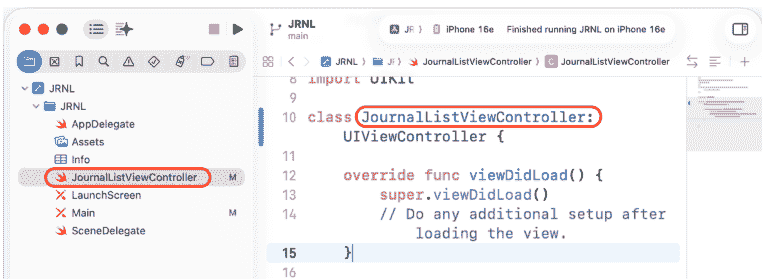

图 11.8：文件名和类名都已更改为 JournalListViewController

4. 在项目导航器中点击 **Main** 故事板文件，并在文档大纲中选择第一个 **Journal Scene**（包含表视图的那个）。

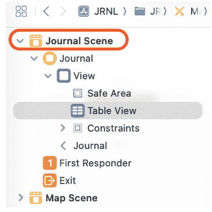

图 11.9：文档大纲显示选中的第一个 Journal Scene 选项

5. 点击 Identity inspector 按钮，并验证在 **Custom Class** 下，**Class** 设置为 **JournalListViewController**：

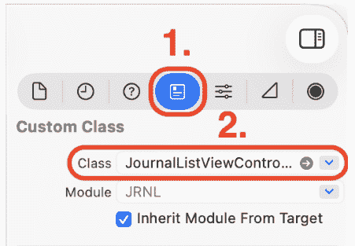

图 11.10：Identity inspector，其中 Class 设置为 JournalListViewController

这意味着 Journal List 屏幕的内容由 JournalListViewController 类的一个实例管理。

9. 要将 Journal 场景中的表视图连接到 JournalListViewController 类中的 outlet，请按住 Ctrl 键从表视图拖到 JournalListViewController 文件中，恰好放在类名声明下方：

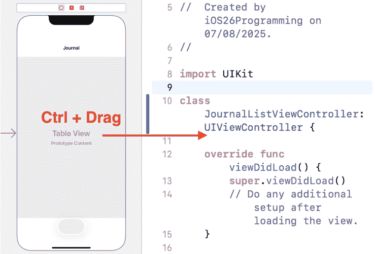

图 11.14：编辑器区域显示拖拽目标

> 你也可以从文档大纲中的表视图拖拽。

10. 会出现一个小的弹出对话框。在 Name 文本字段中输入 outlet 的名称 tableView，将 Storage 设置为 Strong，然后点击 Connect：

```
5 //  Created by
    iOS26Programming on
    07/08/2025.
6 //
7
8 import UIKit
9
10 class
    JournalListViewController:
    UIViewController {
11
12 override func
    viewDidLoad() {
13 super.viewDidLoad()
    // Do any additional
        setup after
        loading the view.
15 }
16
```

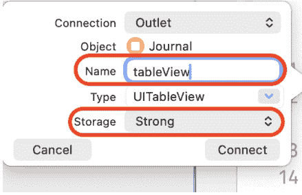

图 11.15：用于创建 outlet 的弹出对话框

11. 验证 tableView outlet 声明已添加到 JournalListViewController 类中。完成之后，点击 X 按钮关闭助手编辑器窗口：

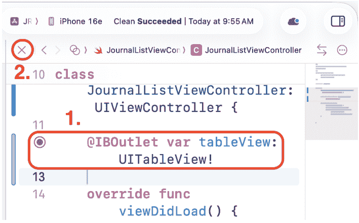

图 11.16：编辑器区域显示 tableView outlet

JournalListViewController 类现在有一个用于 Journal List 屏幕中表视图的 outlet，名为 tableView。这意味着 JournalListViewController 实例可以管理表视图显示的内容。


使用 Ctrl + 拖拽从故事板场景中的某个元素拖到文件时，很容易犯错。如果操作有误，可能导致应用启动时崩溃。要检查表格视图与 JournalListViewController 类之间的连接是否存在错误，请按以下步骤操作：

- 1. 点击导航器（Navigator）和检查器（Inspector）按钮，显示导航器和检查器区域。
- 2. 如果 Main 故事板文件尚未被选中，点击它。在文档大纲中点击“Journal Scene”下的“Journal”，然后点击“连接检查器”（Connections inspector）按钮：

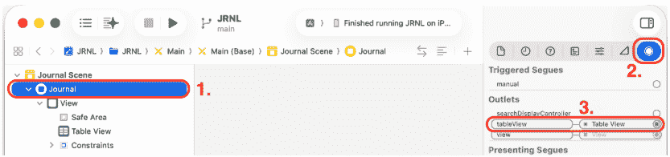

图 11.17：选中的连接检查器

连接检查器会显示 UI 对象和代码之间的连接。你将在“Outlets”部分看到 tableView 出口连接到 Table View。

- 3. 如果你看到一个小型黄色警告图标，点击 x 按钮断开连接：

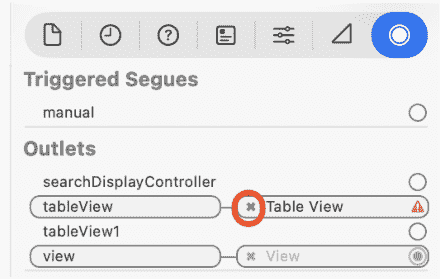

图 11.18：连接检查器显示带有黄色警告图标的 tableView 出口

4. 在**Outlets**下，从**tableView**出口拖到表格视图以重新建立连接：

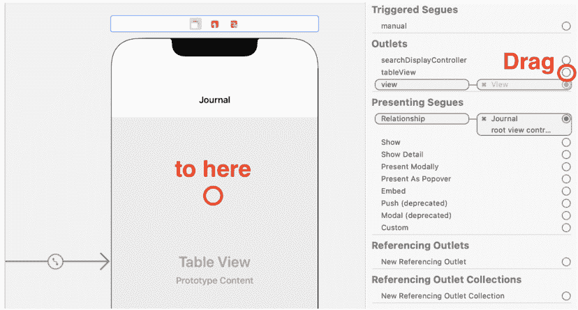

图 11.19：编辑器区域显示要连接的表格视图

> 如果你需要在创建出口后更改代码中出口的名称，请右键点击出口名称，并从弹出菜单中选择**重构 | 重命名...**，而不要手动更改，以避免此类错误。

你已成功在 JournalListViewController 类中为表格视图创建了一个出口。干得好！

要在屏幕上显示表格视图单元格，你需要通过向 JournalListViewController 类添加一些代码来实现表格视图的数据源方法。你将在下一节中完成这个操作。

# 采用 UITableViewDataSource 和 UITableViewDelegate 协议

到目前为止，你已经将 JournalListViewController 类设置为表格视图的数据源和委托。下一步是让它采用 UITableViewDataSource 和 UITableViewDelegate 协议，并实现任何必需的方法。你还需要更改表格视图单元格的颜色，使其在屏幕上可见。按以下步骤操作：

- 1. 在文档大纲中点击 Table View，然后点击属性检查器（Attributes inspector）按钮。在 Table View 下，将 Prototype Cells 的数量改为 1：

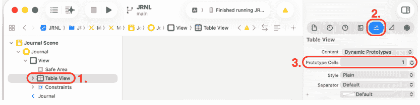

图 11.22：属性检查器显示 Prototype Cells 设置为 1

- 2. 在文档大纲中点击 Table View 旁边的 > 按钮，以显示 Table View Cell：

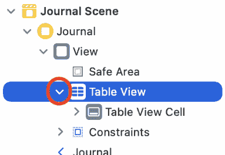

图 11.23：文档大纲显示 > 按钮

这表示表格视图将显示的表格视图单元格。

5. 在项目导航器中点击**JournalListViewController**文件。修改类声明，使 JournalListViewController 类采用 UITableViewDataSource 和 UITableViewDelegate 协议：

```
class JournalListViewController: UIViewController,
UITableViewDataSource, UITableViewDelegate {
```

几秒钟后，将出现一个错误：

```
8 import UIKit
9
10 class JournalListViewController: UIViewController,
    UITableViewDataSource, UITableViewDelegate {
11
    @IBOutlet var tableView: UITableView!
```

*图 11.26：编辑器区域显示错误*

6. 点击它显示错误消息。错误消息显示“类型 'JournalListViewController' 不符合协议 'UITableViewDataSource'”。为一致性添加存根：

类型 'JournalListViewController' 不符合协议 'UITableViewDataSource'
协议要求函数 'tableView(_:numberOfRowsInSection:)'，类型为 '(UITableView, Int) -> Int' (UIKit.UITableViewDataSource.tableView)
协议要求函数 'tableView(_:cellForRowAt:)'，类型为 '(UITableView, IndexPath) -> UITableViewCell' (UIKit.UITableViewDataSource.tableView)
为一致性添加存根  应用

*图 11.27：编辑器区域显示错误消息*

这意味着你需要为 UITableViewDataSource 协议实现必需的方法，以使 JournalListViewController 符合该协议。

7. 点击“应用”（Apply），自动在 JournalListViewController 类中添加所需方法的存根。

暂时不必担心这意味着什么，因为你将在第 3 部分了解更多关于表格视图的内容。

- 11. 构建并运行你的应用。模拟器将显示一列 10 个青色表格视图单元格，如下所示：

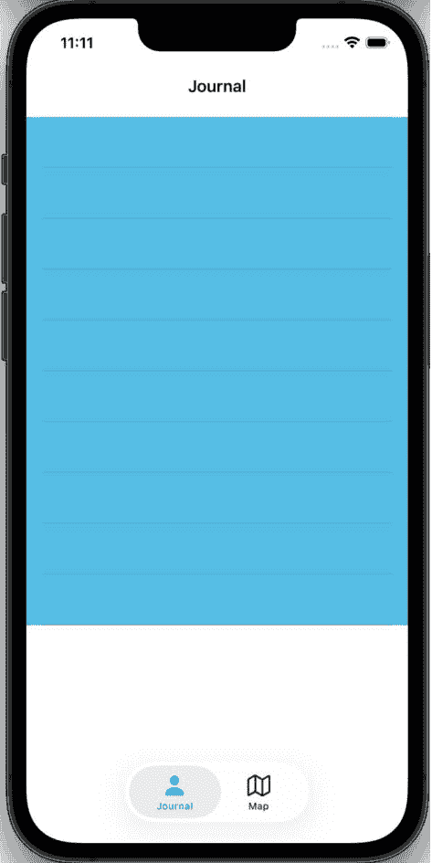

图 11.31：模拟器显示 10 个表格视图单元格

按以下步骤操作：

- 1. 在项目导航器中点击 Main 故事板文件。确保在文档大纲中选中了第一个 Journal 场景。点击“资源库”（Library）按钮以显示资源库：

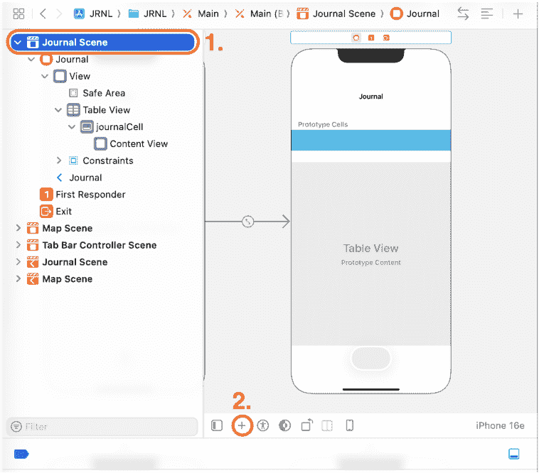

图 11.32：编辑器区域显示资源库按钮

- 2. 在过滤字段中输入 bar b。结果中会出现一个 Bar Button Item 对象。将该 bar button 对象拖到导航栏的右侧：

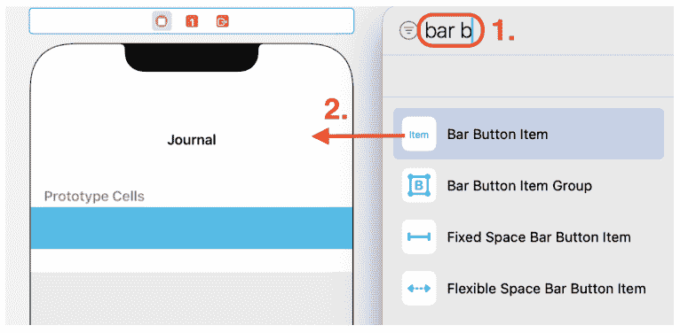

图 11.33：资源库中选中了 Bar Button Item

3. 选中 bar button 后，点击属性检查器按钮。在 Bar Button Item 下，将 System Item 设置为 Add：

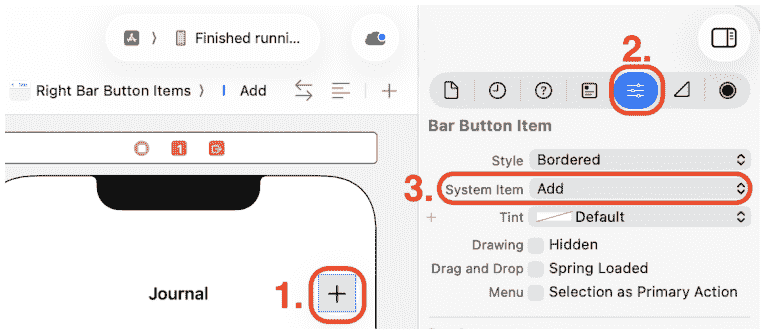

图 11.34：属性检查器将 System Item 设置为 Add

现在你的导航栏中有了一个 + 按钮。在下一节中，你将添加一个视图控制器场景，以表示点击该按钮时出现的“添加新日志条目”屏幕。

# 添加新的视图控制器场景

如第 10 章“设置用户界面”中的应用导览所示，当你点击导航栏中的 + 按钮时，将显示“添加新日志条目”屏幕。你将在项目中添加一个新的视图控制器场景来表示此屏幕。

5. 确认视图控制器场景左侧已出现一个导航控制器场景：

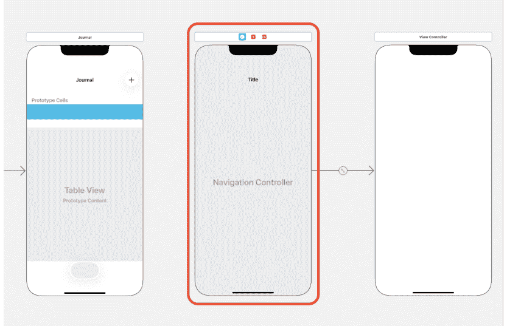

图 11.38：编辑器区域显示嵌入导航控制器中的视图控制器场景

6. 在文档大纲中点击新视图控制器场景的 Navigation Item。在属性检查器中，在 Navigation Item 下，将 Title 设置为 New Entry：

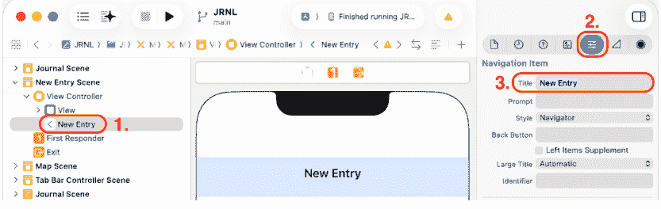

图 11.39：属性检查器将 Title 设置为 New Entry

导航项目的名称将变为**New Entry**。

- 7. 按住*Ctrl + 拖拽*从 + 按钮拖到导航控制器场景：

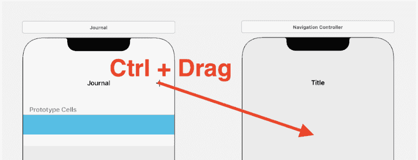

图 11.40：编辑器区域显示拖拽目标

- 8. 将出现**Action Segue**弹出菜单。选择**Present Modally**：

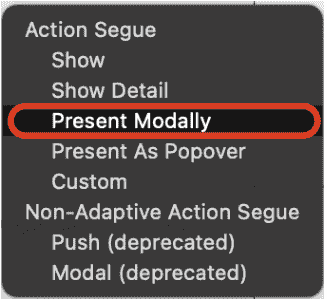

图 11.41：选中 Present Modally 的 Segue 弹出菜单

这会使视图控制器的视图在按钮被点击时从屏幕底部滑入。在该视图被关闭前，你无法与任何其他视图交互。

目前你只能通过向下拖动来关闭此视图。在下一节中，你将向导航栏添加一个“取消”按钮，并编写代码使其关闭视图。你还会添加一个“保存”按钮，但暂时不会为其编写代码。

# 将“取消”和“保存”按钮添加到导航栏

如你之前所见，将视图控制器嵌入导航控制器的好处之一是屏幕顶部的导航栏。你可以将按钮放置在导航栏的左侧和右侧。按以下步骤将“取消”和“保存”按钮添加到导航栏：

- 1. 在文档大纲中点击 New Entry 场景的 New Entry 导航项目。点击“资源库”按钮：

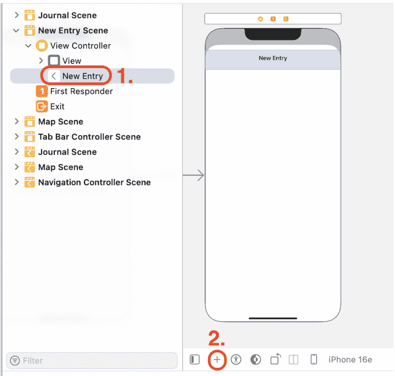

图 11.44：编辑器区域显示资源库按钮


2. 在过滤字段中输入 bar b，然后将一个栏按钮项对象拖到导航栏的两侧：

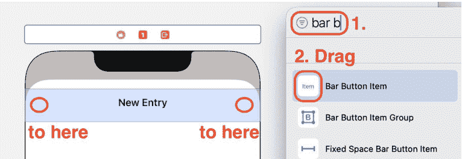

图11.45：库中选中了栏按钮项对象

3. 单击右侧的“项目”按钮。在属性检查器中，在“栏按钮项”下，将“样式”设置为“完成”，并将“系统项”设置为“保存”：

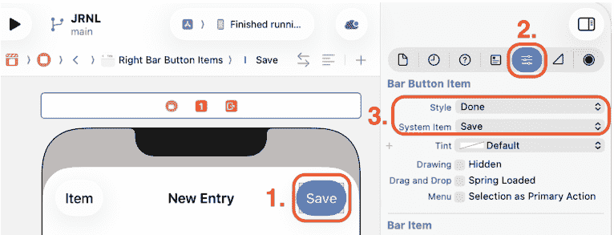

图11.46：属性检查器，样式设置为“完成”，“系统项”设置为“保存”

4. 单击左侧的“项目”按钮，并将“系统项”设置为“取消”：

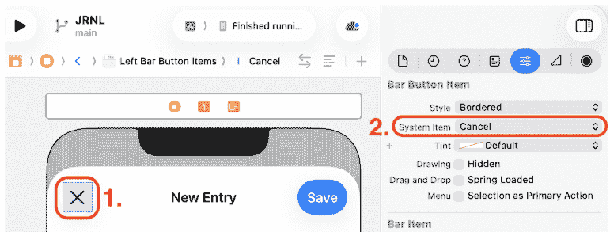

图11.47：属性检查器，“系统项”设置为“取消”

请记住，导航控制器有一个属性 `viewControllers`，它保存了一个视图控制器数组。当你在“日志列表”屏幕上点击“+”按钮时，新的视图控制器会被添加到 `viewControllers` 数组中，其视图会从屏幕底部出现，覆盖“日志列表”屏幕，而关闭该视图的唯一方法是将其向下拖拽。

5. 为了让“取消”按钮能够关闭视图，你需要将“取消”按钮连接到场景退出，并在 `JournalListViewController` 类中实现一个方法，该方法将在“日志列表”屏幕重新出现时执行。在项目导航器中，单击 `JournalListViewController` 文件，并在文件末尾的最后一个闭合花括号之前添加以下方法：

```
@IBAction func unwindNewEntryCancel(segue:
UIStoryboardSegue) {
}
```

6. 在项目导航器中点击“Main”故事板文件，然后点击“新建条目”场景中的“取消”按钮（显示为 X）。在文档大纲中，按住 Ctrl 键从“取消”按钮拖拽到场景退出图标，并从弹出菜单中选择 unwindNewEntryCancelWithSegue:：

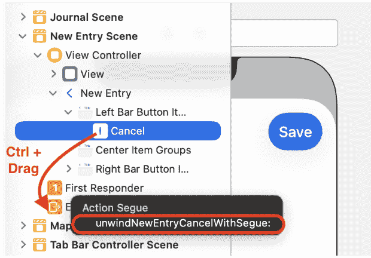

图11.48：文档大纲显示正在设置的“取消”按钮操作

当你的应用运行时，点击 X 按钮会将视图控制器从导航控制器的 `viewControllers` 数组中移除，关闭以模态方式呈现的视图，并执行 `unwindNewEntryCancel(segue:)` 方法。请注意，此方法目前不执行任何操作。

7. 构建并运行你的应用，然后点击“日志列表”屏幕导航栏中的“+”按钮。新视图将出现。当你点击 X 按钮时，新视图消失：


图11.49：模拟器显示 X 按钮

## 技术要求

你将继续处理上一章中创建的 JRNL 项目。

本章完整的 Xcode 项目位于本书代码包的第12章文件夹中，可从此处下载：

https://github.com/PacktPublishing/iOS-26-Programming-for-Beginners-10E

查看以下视频以了解代码的实际效果：

https://youtu.be/KSRjmZohfsU

首先，你将添加一个新的表视图控制器场景来表示“日志条目详情”屏幕。当“日志列表”屏幕中的某个单元格被点击时，将显示此屏幕。你将在下一节中完成此操作。

## 实现日志条目详情屏幕

如第10章“设置用户界面”中的应用演示所示，当你在“日志列表”屏幕中点击一条日志条目时，将出现一个包含该日志条目详细信息的“日志条目详情”屏幕。在本节中，你将在故事板中添加一个新的表视图控制器场景，以表示“日志条目详情”屏幕。请按照以下步骤操作：

- 1. 在项目导航器中点击“Main”故事板文件，然后点击“库”按钮。
- 2. 在过滤字段中输入 table，并将一个表视图控制器对象拖到故事板中“地图”场景旁边：

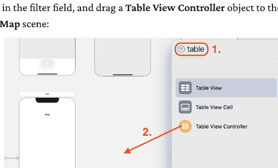

图12.1：库中显示表视图控制器对象

6. 确认两个场景之间已经出现了转场（segue）：

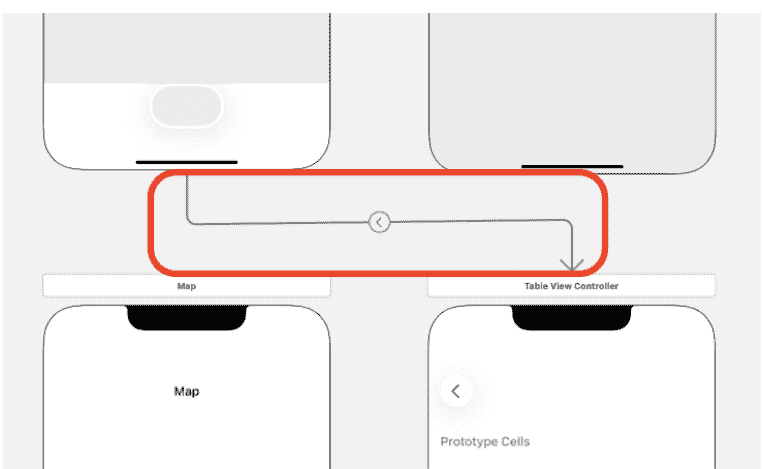

图12.5：编辑器区域显示“日志”场景和“表视图”场景之间的转场

你可以重新排列故事板中的场景，以便更清楚地查看转场。

7. “日志条目详情”屏幕将始终显示固定数量的单元格。在文档大纲中，单击“表视图控制器场景”下的“表视图”：

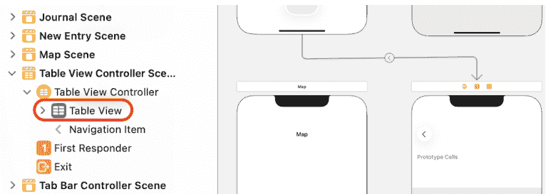

图12.6：在文档大纲中选中“表视图”

8. 点击“属性检查器”按钮，并将“内容”设置为“静态单元格”，使“日志条目详情”屏幕显示固定数量的单元格。

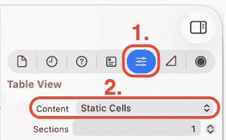

图12.7：属性检查器，“内容”设置为“静态单元格”

9. 构建并运行你的应用。点击“日志列表”屏幕中的某个单元格，以显示“日志条目详情”屏幕：

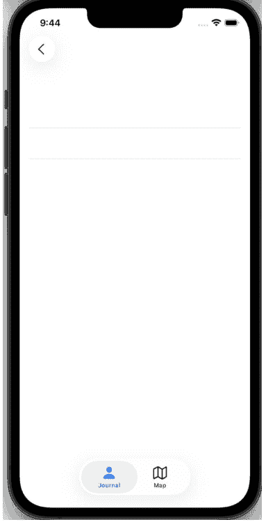

图12.8：模拟器显示“日志条目详情”屏幕

10. 点击“<”按钮返回“日志列表”屏幕。

你已成功实现“日志条目详情”屏幕！太棒了！

如果你的应用需要显示列表中某个项目的详细信息，可以使用此方法。例如你 iPhone 上的“通讯录”应用和“设置”应用。

在下一节中，你将让“地图”屏幕显示地图。

3. 要使地图视图填满导航栏和标签栏之间的所有可用空间，请确认它处于选中状态，然后点击“添加新约束”按钮：

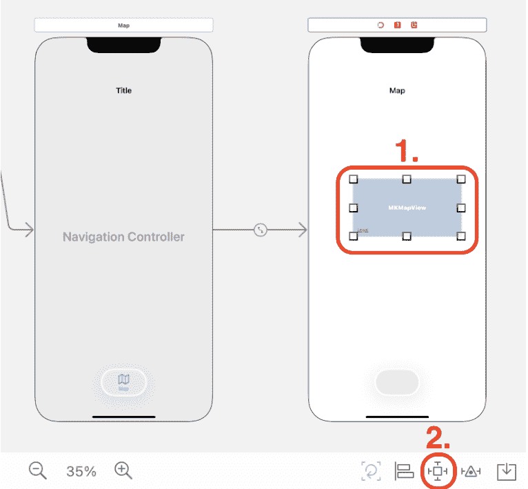

图12.11：选中了地图视图的视图控制器场景

4. 在“到最近邻居的间距”的所有字段中输入 0，并确保淡红色的支撑条被选中（它们会变成亮红色）。点击“添加 4 个约束”按钮：

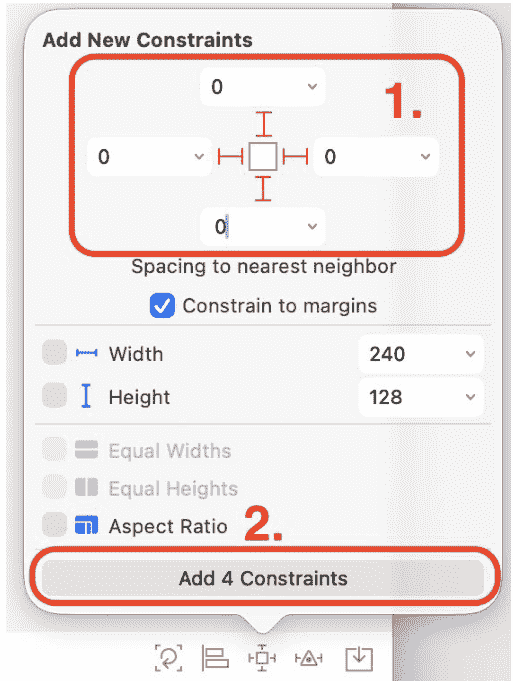

图12.12：Auto Layout 的“添加新约束”弹出对话框

5. 确认地图视图填满了导航栏和标签栏之间的空间：

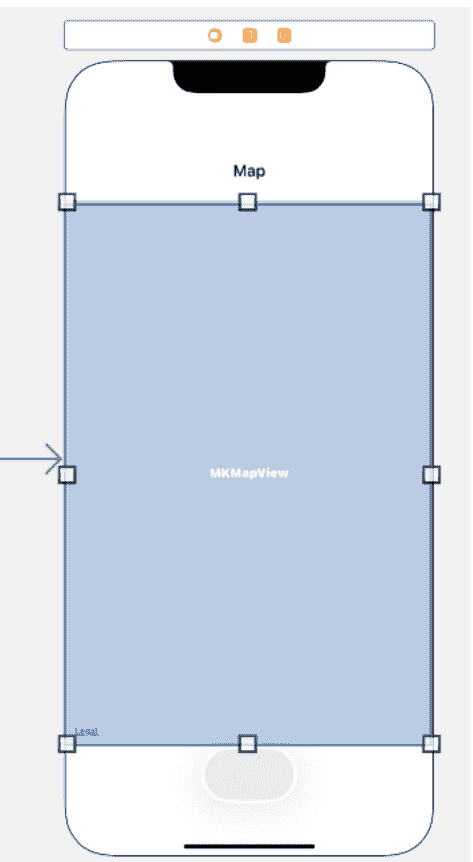

图12.13：地图视图填满屏幕的视图控制器场景

在下一章中，你将修改“日志列表”屏幕、“添加新日志条目”屏幕和“日志条目详情”屏幕上的单元格，使其与应用演示中显示的设计一致。

## 加入我们的 Discord

与其他用户、专家和作者本人一起阅读本书。

提问、为其他读者提供解决方案、通过“问我任何问题”环节与作者聊天等等。扫描二维码或访问链接加入社区。

https://packt.link/LdIDT/


## 13

## 修改应用屏幕

在第11章“构建用户界面”中，你添加了应用所需的部分屏幕，以匹配应用演示中的内容。在第12章“完善用户界面”中，你添加了应用所需的其余屏幕。现在，在模拟器中运行应用时，你可以浏览应用的所有屏幕，但这些屏幕仍然缺少数据输入和数据显示所需的用户界面元素。

在本章中，你将向“日志列表”、“添加新日志条目”和“日志条目详情”屏幕添加并配置缺失的用户界面元素，以匹配应用演示中显示的设计。

对于“日志列表”屏幕，你将通过向 `journalCell` 表视图单元格添加一个图像视图和两个标签来修改它，使其能够显示日志条目的照片、日期和标题。对于“添加新日志条目”屏幕，你将通过添加自定义视图、开关、文本字段、文本视图和图像视图来修改它，以便输入新日志条目的详细信息。你还需要将图像视图配置为显示默认图像。对于“日志条目详情”屏幕，你将向其中添加文本视图、标签和图像视图，并将图像视图配置为显示默认图像，以便该屏幕能够显示现有日志条目的详细信息。当所有用户界面元素就位后，你的应用就可以编写代码了，你将在本书的第3部分中实现这些代码。

到本章结束时，你将更加熟练地添加和定位用户界面元素，并将在如何使用约束来确定它们相对位置方面获得更多经验。这将有助于确保与不同屏幕尺寸和方向的兼容性，使你能够轻松地原型化应用的外观和流程。


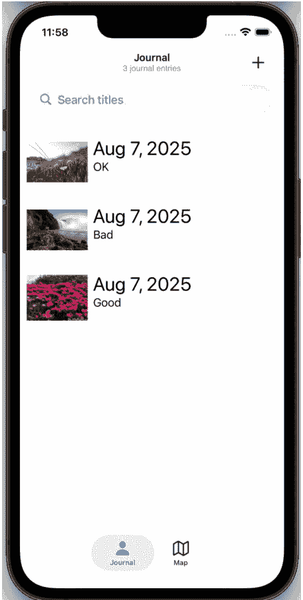

图 13.1：完成后的 JRNL 应用的“日志列表”屏幕

如你所见，“日志列表”屏幕上的表格视图单元格包含一张照片、一个日期和一个日志条目标题。在第 11 章“构建用户界面”中，你已将 `journalCell` 表格视图单元格的背景色设置为青色，并将表格视图配置为显示一列 10 个单元格。现在你将移除背景色，并向 `journalCell` 表格视图单元格添加用户界面元素，以匹配应用导览中显示的设计。你将在下一节中首先向其中添加一个图像视图。

6. 点击“添加新约束”按钮，并输入以下值来为新添加的图像视图设置约束：

- 顶部：0
- 左侧：0
- 底部：0
- 宽度：90
- 高度：90

完成后，点击“添加 5 个约束”按钮。

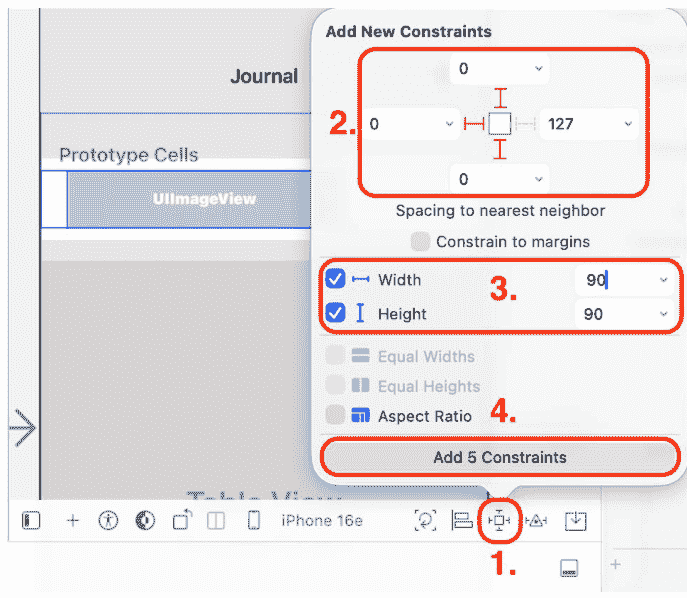

图 13.7：“添加新约束”对话框

这会将图像视图的顶部、左侧和底部边缘绑定到 `journalCell` 表格视图单元格的对应边缘，并将其宽度和高度设置为 90 点。同时，它还将表格视图单元格的高度隐式设置为 90 点。

4. 验证标签的位置是否如以下截图所示，并且新添加的约束是否出现在文档大纲中：

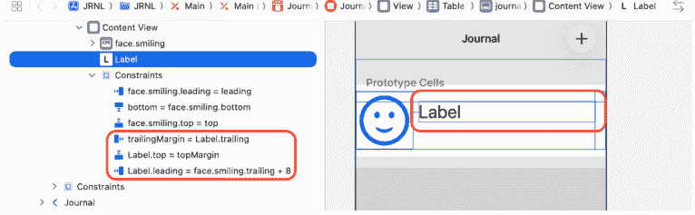

图 13.11：已应用约束的标签

标签顶部边缘与 `journalCell` 内容视图顶部边缘之间的间距设置为 0 + 8 点。标签左侧边缘与图像视图右侧边缘之间的间距为 8 点。标签右侧边缘与 `journalCell` 内容视图右侧边缘之间的间距为 0 + 8 点。标签底部边缘的位置由你之前设置的文本样式自动确定。

接下来，你将添加一个标签来显示日志条目标题。请按照以下步骤操作：

- 1. 点击“资源库”按钮，将一个“标签”对象拖放到你刚刚添加的标签与原型单元格底部之间的空白区域：

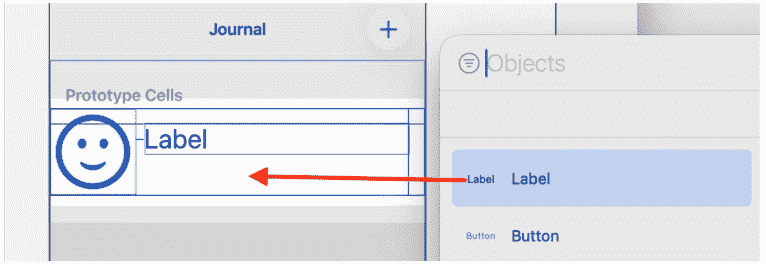

图 13.12：选中“标签”对象的资源库

请注意，“标签”出现在文档大纲中，并且是 `journalCell` 表格视图单元格内容视图的子视图。

- 2. 在“属性”检查器中，在“标签”部分下，使用“字体”菜单将“字体”设置为“正文”，并将“行数”设置为 2：

## 修改“新建日志条目”屏幕

让我们看看应用导览中“新建日志条目”屏幕的外观：


图 13.16：完成后的 Journal 应用的“新建日志条目”屏幕

Apple 提供了丰富的用户界面元素库，供你在自己的应用中使用。这有助于让所有 iOS 应用具有一致的外观和感觉。如你所见，“新建日志条目”屏幕包含以下元素：

- 一个显示星级评分的自定义视图
- 一个允许你获取当前位置的开关
- 一个用于输入日志条目标题的文本字段
- 一个用于输入日志条目正文的文本视图
- 一个用于显示你用手机摄像头拍摄照片的图像视图

你现在将修改该屏幕以匹配应用导览中显示的设计，从下一节开始，添加一个允许用户设置星级评分的自定义视图。

## 向“新建条目”场景添加自定义视图

正如你在应用导览中看到的，“新建日志条目”屏幕有一个显示星级评分的自定义视图。此自定义视图是水平堆栈视图的子类。你将在本章添加水平堆栈视图，并在第 19 章“自定义视图”中完成自定义视图的实现。

堆栈视图是 `UIStackView` 类的实例。它可以让你轻松地将一组视图按列或按行排列。要向“新建日志条目”屏幕添加堆栈视图，请按照以下步骤操作：

- 1. 在 Main 故事板文件中，点击文档大纲中的“新建条目场景”：

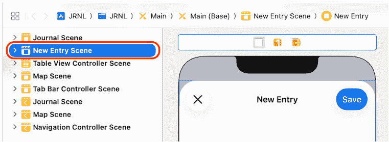

图 13.17：显示“新建条目场景”的编辑器区域

2. 要向场景添加水平堆栈视图，请点击“资源库”按钮。在过滤字段中输入 `hori`。结果中会出现一个**水平堆栈视图**对象。将其拖到编辑器区域中**新建条目**场景的视图上：

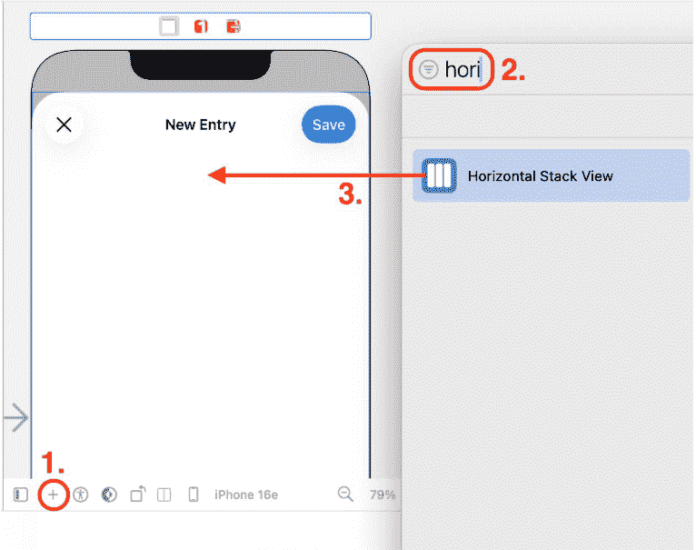

图 13.18：选中“水平堆栈视图”对象的资源库

请注意，你刚刚添加的堆栈视图是文档大纲中**新建条目场景**视图的子视图。

3. 点击“属性”检查器按钮。在“堆栈视图”部分下，如果“间距”尚未设置为 8，则将其设置为 8；在“视图”部分下，将“背景”设置为“系统青色颜色”：

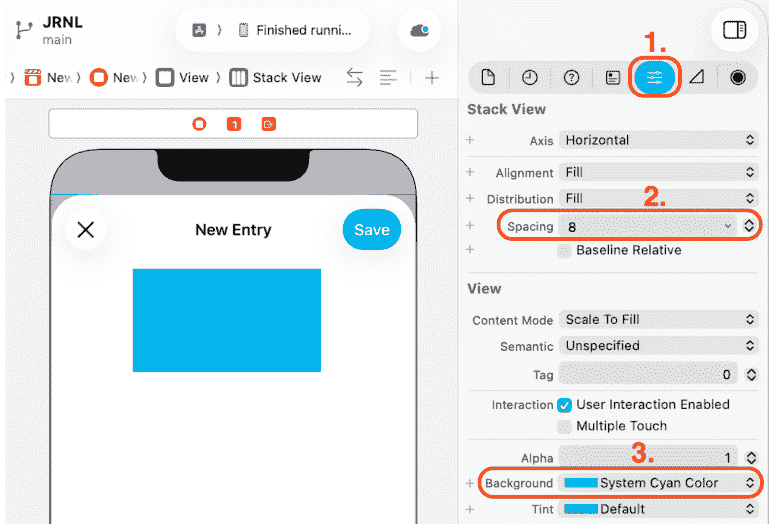

图 13.19：显示“间距”和“背景”设置的“属性”检查器

“间距”值决定了堆栈视图中元素之间的间距。

4. 点击“大小”检查器按钮。在“视图”部分下，将“宽度”设置为 252，“高度”设置为 44：

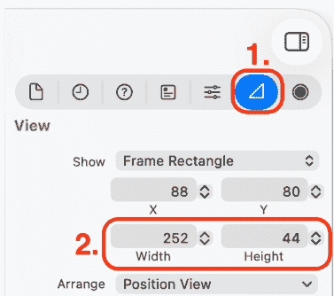

图 13.20：显示堆栈视图大小的“大小”检查器

显示星级评分的自定义视图将由五个按钮组成。每个按钮的高度为 44 点，宽度为 44 点，每个按钮之间的间距为 8 点。自定义视图的总宽度将为 5 x 44 + 4 x 8，即总宽度为 252 点。

5. 点击“添加新约束”按钮，并输入以下值来为堆栈视图设置约束：

- 宽度：252
- 高度：44

完成后，点击“添加 2 个约束”按钮。

在“大小”检查器中设置 UI 元素的大小，可以让你之后更容易添加约束，因为预期值已经设置在“添加新约束”对话框中了。

6. 你会看到堆栈视图以红色轮廓显示。点击文档大纲中的浅红粉色箭头。

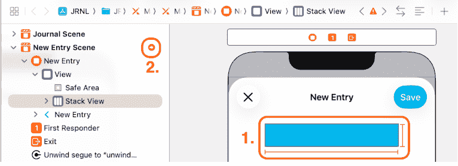

图 13.21：文档大纲中的箭头

7. 你会在文档大纲中看到两个“缺少约束”错误：

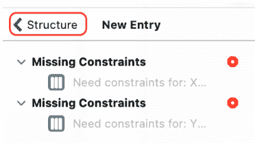

图 13.22：显示的“缺少约束”错误

堆栈视图以红色轮廓显示是因为存在**缺少约束**错误。这意味着堆栈视图相对于其包含视图的位置目前不明确。稍后当你将此堆栈视图嵌入另一个堆栈视图时，你将修复此问题。

- 8. 点击 **< 结构** 按钮返回。

你已成功向**新建条目**场景添加了一个水平堆栈视图。在下一节中，你将向其中添加一个允许你获取当前位置的 UI 元素。

## 向“新建条目”场景添加开关

如应用导览所示，在创建新日志条目时，你可以切换开关来获取当前位置。开关是 `UISwitch` 类的实例。它显示一个提供二元选择（如开/关）的控件。你还将添加一个标签来描述开关的功能，并将两个对象放在一个水平堆栈视图中。

请按照以下步骤操作：

- 1. 要向编辑器区域中的**新建条目**场景添加开关，请点击“资源库”按钮。在过滤字段中输入 `swi`。结果中会出现一个**开关**对象。将其拖到水平堆栈视图下方的**新建条目**场景视图上：

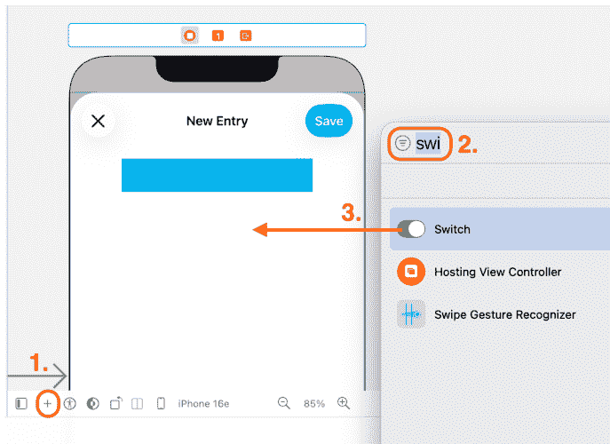

*图 13.23：选中“开关”对象的资源库*

请注意，你刚刚添加的开关出现在文档大纲中，并且是**新建条目场景**视图的子视图。

- 2. 要在开关旁边添加一个标签，请从资源库中拖出一个**标签**对象，并将其定位到开关的左侧：

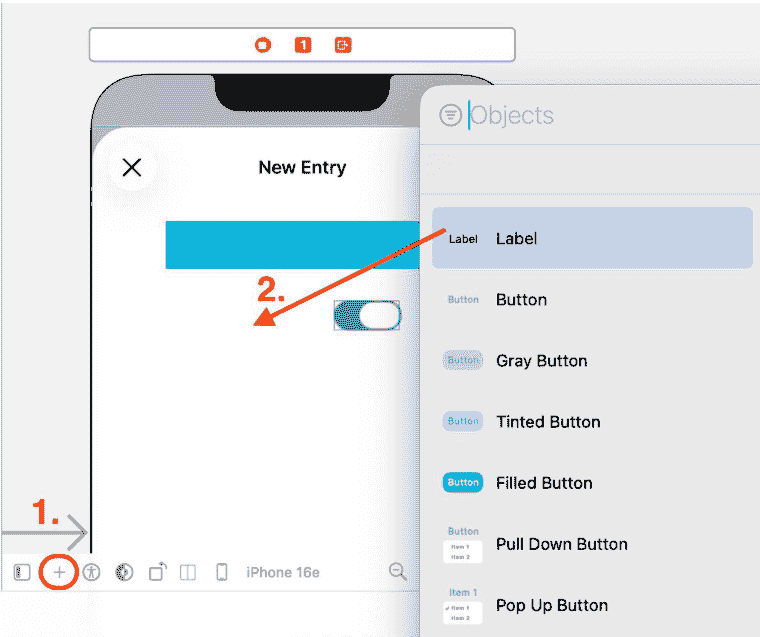

图 13.24：选中“标签”对象的资源库

请注意，你刚刚添加的标签出现在文档大纲中，并且也是**新建条目**场景视图的子视图。

会出现蓝色线条，帮助你按照推荐的间距将标签定位在开关旁边。


- 3. 双击标签并将标签文本更改为 Get Location：

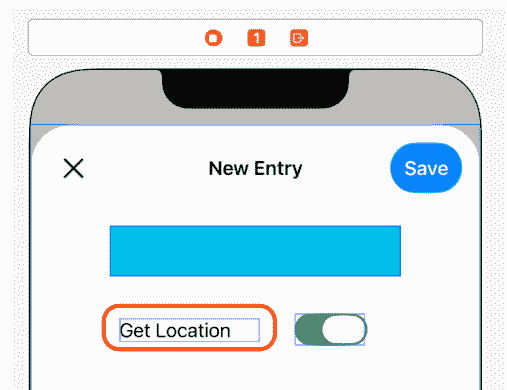

Figure 13.25: Label text changed to Get Location

- 4. 你将把标签和开关嵌入到一个水平堆栈视图中。在文档大纲中，按住 Shift 键，点击 Switch，然后点击 Get Location 以同时选中开关和标签：

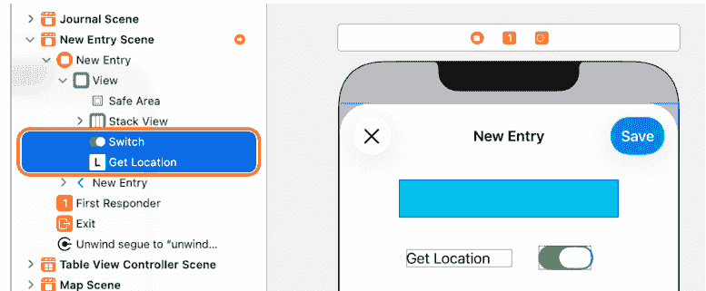

Figure 13.26: Document outline showing both label and switch selected

- 5. 从 Editor 菜单中选择 Embed In | Stack View。


Figure 13.27: Editor menu with Embed In | Stack View selected

开关和标签现已嵌入到堆栈视图中。

- 2. 在 Attributes 检查器中，在 Text Field 下，将 Placeholder 设置为 Journal Title：


Figure 13.30: Attributes inspector with Placeholder set to Journal Title

- 3. 要向场景添加文本视图，请点击 Library 按钮。在过滤字段中输入 text。结果中会出现一个 Text View 对象。将它拖到 New Entry 场景的视图中，放在你刚刚添加的文本字段下方：


Figure 13.31: Library with Text Field object selected

## 开放性伤口处理

如果发生切口渗漏，则需要缝合水密伤口。更常见的情况是，不会形成完全水密愈合。大约70%的病例将拥有防水伤口，尽管未缝合的小切口白内障手术(SICS)可能存在轻微的渗漏途径，这可能导致角膜水肿、浅前房、脉络膜渗出或睫状体脱离。理想的切口应具有自密封性，不需要缝合。穹隆部为基底的结膜瓣通常用于青光眼手术，不用于白内障手术。

## 前房穿刺

用尖刀片（15度或20度刀片）在角膜上做前房穿刺，后续的步骤通过该穿刺进行。

## 伤口构建

根据医生的经验和制定的计划，按照以下任何一种方法进行。

## 囊膜切开（CCC）

在白内障手术中，使用连有粘弹剂的钝针或囊膜镊进行连续环形撕囊术（CCC）是不可缺少的步骤。应设计和创建规定尺寸和中心的CCC。首先，用Utrata镊子进行初始撕裂或穿刺，然后用镊子抓住产生的撕裂瓣，并在圆周方向上移动。

## Add an image view to the New Entry scene

如应用导览所示，用户可以使用设备相机为日记条目拍照。所选照片将使用 image view 在 Add New Journal Entry 屏幕中显示。在第 11 章 Build the User Interface 中，你已向 journalCell 表视图单元格添加了 image view。现在，你将向 New Entry 场景添加一个 image view。请按照以下步骤操作：

- 1. 要向场景添加 image view，请点击 Library 按钮。在过滤字段中输入 imag。结果中会出现一个 Image View 对象。将它拖到 New Entry 场景的视图中，放在文本视图下方：


请注意，你刚刚添加的 image view 会出现在文档大纲中，并且是 New Entry Scene 视图的子视图。

- 2. 点击 Size 检查器按钮。在 View 下，将 Width 和 Height 都设置为 300。

- 3. 点击 Attributes 检查器按钮。在 Image View 下，将 Image 设置为 face.smiling。

- 4. 你将使用约束来设置 image view 的宽度和高度。点击 Add New Constraints 按钮并选中 Width 和 Height 约束（它们的值应已设置为 300）。之后，点击 Add 2 Constraints 按钮。image view 现在将如下图所示：


Figure 13.34: Image View with constraints applied

请注意 image view 周围的红色轮廓，因为它相对于包含视图的位置是不明确的。现在不用担心，因为你稍后会修复它。

New Entry 场景的所有用户界面元素都已添加。在下一节中，你将把它们全部嵌入到一个垂直堆栈视图中以解决定位问题。

## Embed user interface elements in a stack view

New Entry 场景现在已拥有所有所需的用户界面元素，但元素相对于包含视图的位置是不明确的。你将把所有元素嵌入到一个垂直堆栈视图中，并使用约束来解决定位问题。请按照以下步骤操作：

- 1. 在文档大纲中，选择你之前添加的所有用户界面元素，如下所示：


Figure 13.35: Document outline showing selected elements

- 2. 从 Editor 菜单中选择 Embed In | Stack View。

- 3. 在文档大纲中选择 Stack View。在 Attributes 检查器中，在 Stack View 下，将 Alignment 设置为 Center，将 Spacing 设置为 8。

- 4. 在选中堆栈视图的情况下，点击 Add New Constraints 按钮。输入以下值来设置堆栈视图的约束：
  - Top: 20
  - Left: 20
  - Right: 20

- 7. 在文档大纲中选择 Text View 并点击 Add New Constraints 按钮。将左右约束设置为 8，然后点击 Add 2 Constraints 按钮。文本视图将扩展到几乎堆栈视图的整个宽度。验证文本字段和文本视图是否如下图所示：


Figure 13.38: Text field and text view in the stack view with a constraint applied

所有定位问题现已解决。

正如你所见，Journal Entry Detail 屏幕具有以下元素：

- 显示日期的标签
- 显示星级评分的自定义视图
- 日记条目标题的标签
- 日记条目正文的标签
- 用于拍摄手机相机照片的 image view
- 显示地图位置的 image view

此外，你需要滚动以查看整个屏幕。你现在将对其进行修改以匹配应用导览中显示的设计，首先从设置下一节中表视图单元格的数量和大小开始。

## Configure the number and size of static table view cells

在第 12 章 Complete the User Interface 中，你向 Main storyboard 文件添加了一个 table view controller 场景。这将代表 Journal Entry Detail 屏幕。与 Journal List 屏幕不同，Journal Entry Detail 屏幕将始终显示相同数量的单元格，每个单元格包含一个用户界面元素。你现在将设置单元格的数量和大小以匹配应用导览中显示的布局。请按照以下步骤操作：

- 1. 在 Main storyboard 文件中，展开文档大纲中的 Table View Controller Scene，并点击 Navigation Item：


Figure 13.42: Document outline with Table View Controller Scene selected

- 2. 点击 Attributes 检查器按钮，并在 Navigation Item 下将 Title 设置为 Entry Detail。

- 3. 展开 Table View 并在文档大纲中选择 Table View Section：


Figure 13.43: Document outline with Table View Section selected

- 4. 在 Attributes 检查器中，在 Table View Section 下，将 Rows 设置为 7。


Figure 13.44: Attributes inspector showing 7 rows

- 5. 在文档大纲中点击 Table View Section 下的第二个 Table View Cell：


Figure 13.45: Document outline showing the second Table View Cell

- 6. 点击 Size 检查器按钮。在 Table View Cell 下，将 Row Height 设置为 60：


Figure 13.46: Size inspector showing Row Height set to 60

- 7. 在文档大纲中点击 Table View Section 下的第四个 Table View Cell。在 Size 检查器中，在 Table View Cell 下，将 Row Height 设置为 150。

- 8. 在文档大纲中点击 Table View Section 下的第五个 Table View Cell。在 Size 检查器中，在 Table View Cell 下，将 Row Height 设置为 316。

- 9. 对第六个 Table View Cell 重复上一步。

你已将单元格的数量和大小设置为与应用导览中显示的布局相匹配。在下一节中，你将向每个单元格添加用户界面元素。

## Add user interface elements to static table view cells

在上一节中，你使用堆栈视图帮助你在 Add New Journal Entry 屏幕中管理多个用户界面元素。在这里，你将改用具有静态表视图单元格的表视图。使用静态表视图的优点是视图滚动已内置，因此可以容纳比设备屏幕更高的视图。请按照以下步骤操作：

- 1. 在文档大纲中，点击第一个 Table View Cell，并从库中拖动一个 Label 对象到其中。在 Attributes 检查器中，在 Label 下，使用 Font 菜单将 Style 设置为 Semibold 并将 Alignment 设置为 right。

- 2. 点击 Add New Constraints 按钮，并将标签的顶部、左侧和右侧约束设置为 0。确保选中 Constrain to Margins，然后点击 Add 3 Constraints 按钮。标签现在将如下图所示：


Figure 13.47: Label with the constraints applied

- 3. 在文档大纲中，点击第二个 Table View Cell，并从库中拖动一个 Horizontal Stack View 对象到其中。在 Attributes 检查器中，在 Stack View 下，将 Spacing 设置为 8。在 View 下，将 Background 设置为 System Cyan Color。

- 4. 点击 Size 检查器。在 View 下，将 Width 设置为 252，Height 设置为 44。

- 5. 点击 Add New Constraints 按钮并设置 Width 和 Height 约束（它们的值应已存在）。点击 Add 2 Constraints 按钮。


8. 点击第三个 Table View Cell，并从库中拖入一个 Label 对象到其中。在 Attributes 检查器中，在 Label 下，将 Style 设置为 Semibold，Alignment 设置为左对齐。

9. 点击 Add New Constraints 按钮，并将 Label 的 top、left 和 right 约束设置为 0。确保 Constrain to Margins 已勾选，然后点击 Add 3 Constraints 按钮。标签现在看起来如下所示：


Figure 13.50: Label with the constraints applied

10. 点击第四个 Table View Cell，并从库中拖入一个 Text View 对象到其中。在 Attributes 检查器中，在 Text View 下，取消选中 Editable 和 Selectable，因为在 Journal Entry Detail 屏幕中你不需要编辑或选择文本。你也可以根据需要更改默认文本。

11. 点击 Add New Constraints 按钮，并将 top、left、right 和 bottom 约束设置为 0。确保 Constrain to Margins 已勾选，然后点击 Add 4 Constraints 按钮。文本视图现在看起来如下所示：


Figure 13.51: Text View with the constraints applied

12. 点击第五个 Table View Cell，并从库中拖入一个 Image View 对象到其中。在 Attributes 检查器中，在 Image View 下，将 Image 设置为 face.smiling。

13. 在 Size 检查器中，在 View 下，将 Width 和 Height 设置为 300。

14. 点击 Add New Constraints 按钮并设置 Width 和 Height 约束（其值应已存在）。点击 Add 2 Constraints 按钮。

15. 点击 Align 按钮，并勾选 Horizontally in Container 和 Vertically in Container。点击 Add 2 Constraints 按钮。图像视图现在看起来如下所示：


Figure 13.52: Image View object with constraints applied

16. 点击第六个 Table View Cell，并从库中拖入一个 Image View 对象到其中。在 Attributes 检查器中，在 Image View 下，将 Image 设置为 map。

17. 对此图像视图重复 *steps 13 to 15*。它现在看起来如下所示：


Figure 13.53: Image View object with constraints applied

18. 所有必需的用户界面元素都已添加到 Entry Detail 场景中。构建并运行你的应用，并在 Journal List 屏幕上点击一行以导航到 Journal Entry Detail 屏幕：

19. 向下滚动以查看 Journal Entry Detail 屏幕的剩余部分。


Figure 13.55: Simulator showing the remainder of the Journal Entry Detail screen

Excellent! You have modified all the screens for your app, and you’re ready to add functionality to them in the next part of this book.

## Summary

In this chapter, you modified the Journal List, Add New Journal Entry, and Journal Entry Detail screens to match the design shown in the app tour. For the Journal List screen, you modified the journalCell table view cell by adding an image view and two labels to it. You modified the Add New Journal Entry screen by adding a custom view, a switch, a text field, a text view, and an image view to it. You also configured the image view to show a default image. For the Journal Entry Detail screen, you added a text view, labels, and image views to it, configuring the image views to show default images.

You now have more experience in how to use Interface Builder to add and configure multiple user interface elements, set their sizes and positions using the Size inspector, and apply the necessary constraints using the Add New Constraints and Align buttons. This will be useful to ensure compatibility with different screen sizes and orientations. You should also be able to easily prototype the appearance and flow of your apps.

You’re now finished with the storyboard and design setup. You can go through every screen that your app has and see what they look like, even though none of the screens have actual data in them. If this app were a house being built, it’s as though you’ve built all the walls and floors, and the house is now ready to have the interior done. Great job!

This concludes Part 2 of this book. In the next part, you’ll begin to type in all the code required for your app to work. In the next chapter, you’ll start by learning more about the Model-View-Controller design pattern. You’ll also learn how table views work, which is crucial for understanding how the Journal List screen works.

## Get This Book’s PDF Version and Exclusive Extras

Scan the QR code (or go to packtpub.com/unlock). Search for this book by name, confirm the edition, and then follow the steps on the page.

Note: Keep your invoice handy. Purchases made directly from Packt don’t require an invoice.


