## 14 MVC and Table Views

In the previous chapter, you modified the Journal List screen, the Add New Journal Entry screen, and the Journal Entry Detail screen to match the app tour shown in *Chapter 10, Set Up the User Interface*. You have completed the initial UI for the JRNL app, and that concluded Part 2 of this book.

This chapter begins Part 3 of this book, where you will focus on the code that makes your app work. In this chapter, you will learn about the Model-View-Controller (MVC) design pattern and how the different parts of an app interact with one another. Then, you’ll implement a table view programmatically (which means implementing it using code instead of storyboards) using a playground, to understand how table views work. Finally, you’ll revisit the table view you implemented on the Journal List screen, so you can see the differences between implementing it in a storyboard and implementing it programmatically.

By the end of this chapter, you’ll understand the MVC design pattern, you’ll have learned how to create a table view controller programmatically, and you’ll know how to use table view delegate and data source protocols.

The following topics will be covered in this chapter:

- The MVC design pattern
- Table views
- Revisit the Journal List screen

### Technical requirements

The completed Xcode playground and project for this chapter are in the Chapter14 folder of the code bundle for this book, which can be downloaded here:

https://github.com/PacktPublishing/iOS-26-Programming-for-Beginners-10E

Check out the following video to see the code in action:

https://youtu.be/SHqmm6Ch57E

Create a new playground and call it TableViewBasics. You can use this playground to type in and run all the code in this chapter as you go along. Before you do, let’s look at the MVC design pattern, an approach commonly used when writing iOS apps.

### The MVC design pattern

The Model-View-Controller (MVC) design pattern is a common approach used when building iOS apps. MVC divides an app into three different parts:

- **Model:** This handles data storage and representation and data processing tasks
- **View:** This includes all the things that are on the screen that the user can interact with
- **Controller:** This manages the flow of information between the model and the view

One notable feature of MVC is that the view and model do not interact with one another; instead, all communication is managed by the controller.

For example, imagine you’re at a restaurant. You look at a menu and choose something you want. Then, a waiter comes, takes your order, and sends it to the cook. The cook prepares your order, and when it is done, the waiter takes the order and brings it out to you. In this scenario, the menu is the view, the waiter is the controller, and the cook is the model. Also, note that all interactions between you and the kitchen are only through the waiter; there is no interaction between you and the cook.

To find out more about MVC, visit https://developer.apple.com/library/archive/documentation/General/Conceptual/DevPedia-CocoaCore/MVC.html.


要了解 MVC 在 iOS 应用中的工作原理，让我们进一步学习视图控制器。你将看到实现一个用于管理表格视图的视图控制器需要做什么，该表格视图用于日志列表屏幕。

## 视图控制器

到目前为止，你已经实现了 JournalListViewController，这是一个管理日志列表屏幕上表格视图的视图控制器。然而，你还没有学习到添加到其中的代码是如何工作的，所以现在让我们来看一下。

你可能希望重读第 11 章《构建用户界面》，其中你实现了 JournalListViewController 类。

当 iOS 应用启动时，会加载要显示的第一个屏幕的视图控制器。视图控制器具有 view 属性，并自动加载分配给其 view 属性的视图实例。该视图可能有子视图，它们也会被加载。

如果其中一个子视图是表格视图，它将具有 dataSource 和 delegate 属性。dataSource 属性被分配给向表格视图提供数据的对象。delegate 属性被分配给处理与表格视图用户交互的对象。通常，表格视图的视图控制器将被分配给表格视图的 dataSource 和 delegate 属性。

表格视图将发送给其视图控制器的 方法调用在 UITableViewDataSource 和 UITableViewDelegate 协议中声明。记住，协议只提供方法声明；这些方法调用的实现在视图控制器中。视图控制器然后从模型对象获取数据并为表格视图提供数据。视图控制器还处理用户输入并根据需要修改模型对象。

让我们在下一节更仔细地查看表格视图和表格视图协议。

5. 在类定义中，按惯例属性是在任何方法声明之前在顶部声明的。重新排列代码，使属性声明位于顶部，如下所示：

```
class TableViewExampleController: UIViewController,
UITableViewDataSource {
    var tableView: UITableView!
    var journalEntries: [[String]] = [
        ["sun.max","12 Sept 2025","Nice weather today"],
        ["cloud.rain","13 Sept 2025","Heavy rain today"],
        ["cloud.sun","14 Sept 2025","It's cloudy out"]
    ]
    func tableView(_ tableView: UITableView,
    numberOfRowsInSection section: Int) -> Int {
```

6. 要使表格视图为 journalEntries 数组中的每个元素显示一行，请单击 tableView(_:numberOfRowsInSection:) 方法定义中的代码占位符并输入 journalEntries.count。完成的方法应如下所示：

```
func tableView(_ tableView: UITableView, numberOfRowsInSection section: Int) -> Int {
    journalEntries.count
}
```

journalEntries.count 返回 journalEntries 数组中的元素数量。由于其中有三个元素，这将使表格视图显示三行。

7. 要使表格视图在每个单元格中显示日志条目详情，请单击 tableView(_:cellForRowAt:) 方法定义中的代码占位符并输入以下内容：

```
func tableView(_ tableView: UITableView, cellForRowAt indexPath: IndexPath)
-> UITableViewCell {
    let cell = tableView.dequeueReusableCell(withIdentifier:
    "cell", for: indexPath)
    let journalEntry = journalEntries[indexPath.row]
    var content = cell.defaultContentConfiguration()
    content.image = UIImage(systemName: journalEntry[0])
    content.text = journalEntry[1]
```

```
content.secondaryText = journalEntry[2]
cell.contentConfiguration = content
return cell
}
```

让我们分解一下：

```
let cell = tableView.dequeueReusableCell(withIdentifier: "cell",
for: indexPath)
```

此语句创建一个新的表格视图单元格或重用现有的表格视图单元格并将其分配给 cell。想象一下你需要在表格视图中显示 1,000 个项目。你不需要 1,000 行包含 1,000 个表格视图单元格——你只需要足够填满屏幕的数量即可。滚动到屏幕顶部的表格视图单元格可以重用于显示出现在屏幕底部的项目，反之亦然。由于表格视图可以显示多种类型的单元格，因此你将单元格重用标识符设置为 "cell" 以标识此特定表格视图单元格类型。此标识符将在稍后与表格视图注册。

```
let journalEntry = journalEntries[indexPath.row]
```

indexPath 值定位表格视图中的行。第一行具有包含 section 0 和 row 0 的 indexPath。indexPath.row 对第一行返回 0，因此此语句将 journalEntries 数组中的第一个元素分配给 journalEntry。

```
var content = cell.defaultContentConfiguration()
```

默认情况下，UITableViewCell 实例可以存储一个图像、一个文本字符串和一个次要文本字符串。你通过使用表格视图单元格的 content configuration 属性来设置这些。此语句检索表格视图单元格样式的默认内容配置并将其分配给变量 content。

```
content.image = UIImage(systemName: journalEntry[0])
content.text = journalEntry[1]
content.secondaryText = journalEntry[2]
cell.contentConfiguration = content
```

这些语句使用 journalEntry 的详细信息更新 content，journalEntry 是一个具有三个元素的数组。第一个元素用于指定分配给 image 属性的图像。第二个元素分配给 text 属性。第三个元素分配给 secondaryText 属性。最后一行将 content 分配给表格视图单元格的 contentConfiguration 属性。

```
return cell
```

此语句返回表格视图单元格，然后在屏幕上显示。

tableView(_:cellForRowAt:) 方法会为表格视图中的每一行执行一次。

8. 要处理表格视图单元格删除，请在 tableView(_:cellForRowAt:) 的实现之后输入以下代码：

```
func tableView(_ tableView: UITableView, commit editingStyle: UITableViewCell.EditingStyle, forRowAt indexPath: IndexPath) {
    if editingStyle == .delete {
        journalEntries.remove(at: indexPath.row)
        tableView.reloadData()
    }
}
```

这会删除用户向左滑动的表格视图单元格对应的 journalEntries 元素并重新加载表格视图。

TableViewExampleController 类现在符合 UITableViewDataSource 协议。在下一节中，你将使其符合 UITableViewDelegate 协议。

## 采用 UITableViewDelegate 协议

用户可以点击表格视图单元格来选择它。为了处理用户交互，你将使 TableViewExampleController 类采用 UITableViewDelegate 协议。你将实现该协议中的一个可选方法 tableView(_:didSelectRowAt:)，当用户点击一行时，表格视图会调用它。请按照以下步骤操作：

+   1. 要使 TableViewExampleController 类采用 UITableViewDelegate 协议，请在类声明中 UITableViewDataSource 之后输入一个逗号，然后输入 UITableViewDelegate。你的代码应如下所示：

```
class TableViewExampleController: UIViewController,
UITableViewDataSource, UITableViewDelegate {
```

2. 在 tableView(_:commit:forRowAt:) 的实现之后输入以下内容：

```
func tableView(_ tableView: UITableView, didSelectRowAt indexPath: IndexPath) {
    let selectedJournalEntry = journalEntries[indexPath.row]
    print(selectedJournalEntry)
}
```

此方法将获取与被点击行对应的 journalEntries 数组元素并将其打印到调试区域。

3. 验证你的 TableViewExampleController 类是否如下所示：

```
class TableViewExampleController: UIViewController, UITableViewDataSource, UITableViewDelegate {
    var tableView: UITableView!
    var journalEntries: [[String]] = [
        ["sun.max","12 Sept 2025","Nice weather today"],
        ["cloud.rain","13 Sept 2025","Heavy rain today"],
        ["cloud.sun","14 Sept 2025","It's cloudy out"]
    ]
    func tableView(_ tableView: UITableView, numberOfRowsInSection section: Int) -> Int {
        journalEntries.count
    }
    func tableView(_ tableView: UITableView, cellForRowAt indexPath: IndexPath) -> UITableViewCell {
        let cell = tableView.dequeueReusableCell(withIdentifier: "cell", for: indexPath)
        let journalEntry = journalEntries[indexPath.row]
        var content = cell.defaultContentConfiguration()
        content.image = UIImage(systemName: journalEntry[0])
        content.text = journalEntry[1]
        content.secondaryText = journalEntry[2]
        cell.contentConfiguration = content
        return cell
    }
    func tableView(_ tableView: UITableView, commit editingStyle: UITableViewCell.EditingStyle,


```swift
forRowAt indexPath: IndexPath) {
    if editingStyle == .delete {
        journalEntries.remove(at: indexPath.row)
        tableView.reloadData()
    }
}
func tableView(_ tableView: UITableView, didSelectRowAt
indexPath: IndexPath) {
    let selectedJournalEntry =
    journalEntries[indexPath.row]
    print(selectedJournalEntry)
}
```

现在，TableViewExampleController 类遵循了 UITableViewDelegate 协议。

你已经完成了对 TableViewExampleController 类的实现。在下一节中，你将学习如何创建这个类的实例。

## 创建 TableViewExampleController 实例

现在你已经声明并定义了 TableViewExampleController 类，接下来将编写一个方法来创建它的实例。请按照以下步骤操作：

- 1. 在 `journalEntries` 变量声明之后，键入以下代码来声明一个新方法：

```
func createTableView() {
}
```

这声明了一个新方法 `createTableView()`，你将使用它来创建表视图的实例，并将其赋值给 `tableView` 属性。

- 2. 在左花括号之后，键入以下代码：

```
tableView = UITableView(frame: CGRect(x: 0, y: 0, width: view.frame.width, height: view.frame.height))
```

这将创建一个新的表视图实例，并将其赋值给 `tableView`。

- 3. 在下一行，键入以下代码，将表视图的 `dataSource` 和 `delegate` 属性设置为 `TableViewExampleController` 的实例：

```
tableView.dataSource = self
tableView.delegate = self
```

表视图的 `dataSource` 和 `delegate` 属性指定了包含 `UITableViewDataSource` 和 `UITableViewDelegate` 方法实现的对象。

- 4. 在下一行，键入以下代码以设置表视图的背景颜色：

```
tableView.backgroundColor = .white
```

- 5. 在下一行，键入以下代码，将表视图单元格的标识符设置为 `"cell"`：

```
tableView.register(UITableViewCell.self, forCellReuseIdentifier: "cell")
```

这个标识符将在 `tableView(_:cellForRowAt:)` 方法中使用，以标识要使用的表视图单元格类型。

- 6. 在下一行，键入以下代码，将表视图作为 `TableViewExampleController` 实例视图的子视图添加：

```
view.addSubview(tableView)
```

- 7. 验证完成后的方法如下所示：

```
func createTableView() {
    tableView = UITableView(frame: CGRect(x: 0, y: 0,
    width: view.frame.width, height: view.frame.height))
    tableView.dataSource = self
    tableView.delegate = self
    tableView.backgroundColor = .white
    tableView.register(UITableViewCell.self,
    forCellReuseIdentifier: "cell")
    view.addSubview(tableView)
}
```

现在你必须确定何时调用此方法。视图控制器有一个 `view` 属性。当视图控制器被加载时，分配给 `view` 属性的视图将被自动加载。视图成功加载后，将调用视图控制器的 `viewDidLoad()` 方法。你将在 `TableViewExampleController` 类中重写 `viewDidLoad()` 方法来调用 `createTableView()`。在 `createTableView()` 方法之前键入以下代码：

```
override func viewDidLoad() {
    super.viewDidLoad()
    view.bounds = CGRect(x: 0, y: -150, width: 375, height: 667)
    createTableView()
}
```

这将设置实时视图的大小，创建表视图实例，将其赋值给 `tableView`，并将其作为子视图添加到 `TableViewExampleController` 实例的视图中。然后，表视图调用数据源方法来确定要显示多少个表视图单元格以及每个单元格中显示什么内容。`tableView(_:numberOfRowsInSection:)` 返回 `journalEntries` 中元素的数量，因此将显示三个表视图单元格。`tableView(_:cellForRowAt:)` 创建单元格、创建新的单元格配置、设置单元格配置的属性，并将更新后的配置赋值给单元格。

验证你完成的 playground 是否如下所示：

```swift
import UIKit
import PlaygroundSupport

class TableViewExampleController: UIViewController, UITableViewDataSource, UITableViewDelegate {
    var tableView: UITableView!
    var journalEntries: [[String]] = [
        ["sun.max", "12 Sept 2025", "Nice weather today"],
        ["cloud.rain", "13 Sept 2025", "Heavy rain today"],
        ["cloud.sun", "14 Sept 2025", "It's cloudy out"]
    ]

    override func viewDidLoad() {
        super.viewDidLoad()
        view.bounds = CGRect(x: 0, y: -150, width: 375, height: 667)
        createTableView()
    }

    func createTableView() {
        tableView = UITableView(frame: CGRect(x: 0, y: 0,
                                              width: view.frame.width,
                                              height: view.frame.height))
        tableView.dataSource = self
        tableView.delegate = self
        tableView.backgroundColor = .white
        tableView.register(UITableViewCell.self,
                           forCellReuseIdentifier: "cell")
        view.addSubview(tableView)
    }

    func tableView(_ tableView: UITableView,
                   numberOfRowsInSection section: Int) -> Int {
        journalEntries.count
    }

    func tableView(_ tableView: UITableView, cellForRowAt
                   indexPath: IndexPath) -> UITableViewCell {
        let cell = tableView.dequeueReusableCell(withIdentifier: "cell", for: indexPath)
        let journalEntry = journalEntries[indexPath.row]
        var content = cell.defaultContentConfiguration()
        content.image = UIImage(systemName: journalEntry[0])
        content.text = journalEntry[1]
        content.secondaryText = journalEntry[2]
        cell.contentConfiguration = content
        return cell
    }

    func tableView(_ tableView: UITableView, commit editingStyle:
                   UITableViewCell.EditingStyle, forRowAt indexPath: IndexPath) {
        if editingStyle == .delete {
            journalEntries.remove(at: indexPath.row)
            tableView.reloadData()
        }
    }

    func tableView(_ tableView: UITableView, didSelectRowAt
                   indexPath: IndexPath) {
        let selectedJournalEntry = journalEntries[indexPath.row]
        print(selectedJournalEntry)
    }
}
```

现在是时候看看它的实际效果了。请按照以下步骤操作：

- 1. 在 playground 中所有其他代码之后，键入以下内容：

```swift
PlaygroundPage.current.liveView = TableViewExampleController()
```

此命令创建 `TableViewExampleController` 的实例，并在 playground 的实时视图中显示其视图。`createTableView()` 方法将创建一个表视图，并将其作为子视图添加到 `TableViewExampleController` 实例的视图中，然后它就会出现在屏幕上。

- 2. 要在屏幕上看到表视图的表示，必须启用 playground 的实时视图。单击“调整编辑器选项”按钮，并验证**结果**已选中：

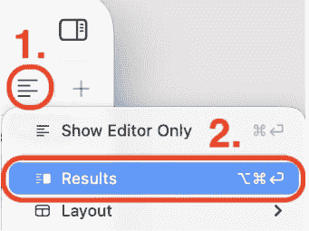

*图 14.3：调整编辑器选项菜单，选中“结果”*

- 3. 单击“实时视图”按钮，验证实时视图中是否显示三个表视图单元格：

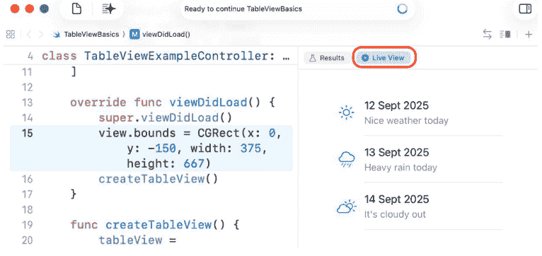

图 14.4：Playground 实时视图显示包含三个表视图单元格的表视图

- 4. 点按一行。该行的日志条目详细信息将打印在调试区域中：

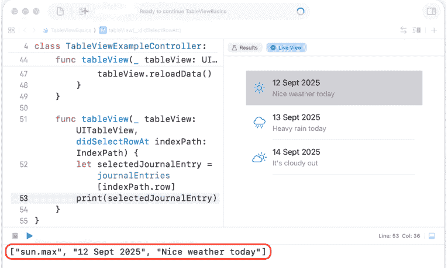

图 14.5：调试区域显示日志条目详细信息

- 5. 在行上向左轻扫。将出现“删除”按钮：

图 14.6：表视图行显示“删除”按钮

- 6. 点按“删除”按钮以从表视图中移除该行：

图 14.7：删除一行后的表视图

你刚刚为表视图创建了一个视图控制器，创建了它的实例，并在 playground 的实时视图中显示了表视图。干得漂亮！

在下一节中，你将重新回顾视图控制器是如何在第 11 章“构建用户界面”中实现的“日志列表”屏幕上使用的。参考你在本节中学到的内容，你应该能更好地理解其工作原理。

## 加入我们的 Discord

与本书的其他读者、专家以及作者本人一起阅读这本书。

提问、为其他读者提供解决方案、通过“问我任何问题”活动与作者聊天，等等。扫描二维码或访问链接加入社区。

```
https://packt.link/LdIDT/
```


## 15

## 将数据导入表格视图

在上一章中，你学习了模型-视图-控制器（MVC）设计模式和表格视图。你还回顾了《日志列表》屏幕中的表格视图。此时，《日志列表》屏幕显示的单元格中不包含任何数据。如第 10 章《设置用户界面》中的应用导览所示，它应该显示一份日志条目列表。

在本章中，你将实现《日志列表》屏幕的模型对象，使其显示日志条目列表。你将首先学习将要使用的模型对象的需求。然后，你将创建一个可以存储日志条目实例的 Swift 类。之后，你将创建一个静态方法，该方法返回包含示例日志条目实例的数组。此数组将用作《日志列表》屏幕上表格视图的数据源。

到本章结束时，你将学会如何创建模型对象，如何创建示例数据，以及如何配置视图控制器以填充表格视图。

本章将涵盖以下主题：

- 模型对象
- 创建一个类来表示日志条目
- 创建示例数据
- 在集合视图中显示数据

## 技术要求

你将继续在 *第 13 章《修改应用屏幕》* 中修改的 JRNL 项目上工作。本章的资源文件和完成的 Xcode 项目位于本书代码包的第 15 章文件夹中，可在此下载：

https://github.com/PacktPublishing/iOS-26-Programming-for-Beginners-10E

观看以下视频以查看代码运行情况：

https://youtu.be/E-xh-3_x1YY

让我们先在下一节中检查存储日志条目数据所需的模型对象。

## 模型对象

如你在 *第 14 章《MVC 与表格视图》* 中所学，iOS 应用的常见设计模式是 MVC。回顾一下，MVC 将应用分为三个不同的部分：

- **模型：** 处理数据存储、表示和数据处理任务
- **视图：** 用户可以在屏幕上与之交互的任何内容
- **控制器：** 管理模型和视图之间信息流

让我们重新回顾一下你在应用导览中看到的《日志列表》屏幕的设计，其外观如下：

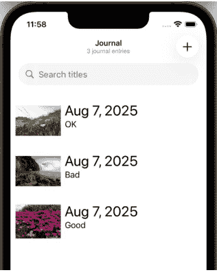

*图 15.1：模拟器显示来自应用导览的《日志列表》屏幕*

在第 14 章《MVC 与表格视图》中，你使用字符串数组来表示日志条目。然而，字符串数组只能存储字符串，而你必须能够存储除字符串之外的数据类型。为了解决这个问题，你将创建一个名为 JournalEntry 的类来存储日志条目所需的所有数据。接下来，你将创建一个静态方法，该方法返回存储在 JournalEntry 实例数组中的示例数据。之后，你将创建一个自定义 UITableView 类来管理表格视图单元格显示的数据。最后，你将修改 JournalListViewController 类，使其能够为表格视图提供要显示的数据。

## 创建一个类来表示日志条目

为了创建一个可以代表应用中日志条目的模型对象，你将向项目中添加一个名为 JournalEntry 的新 Swift 文件，并声明一个 JournalEntry 类，该类具有日志条目所需的属性。在此之前，你将配置项目以使用 Swift 6 并将主项目文件夹更改为组。请按照以下步骤操作：

1. 在项目导航器中，单击左上角的 JRNL 图标。单击 JRNL 目标并选择 Build Settings。向下滚动到 Swift Compiler - Language 并将 Swift Language Version 设置为 Swift 6：

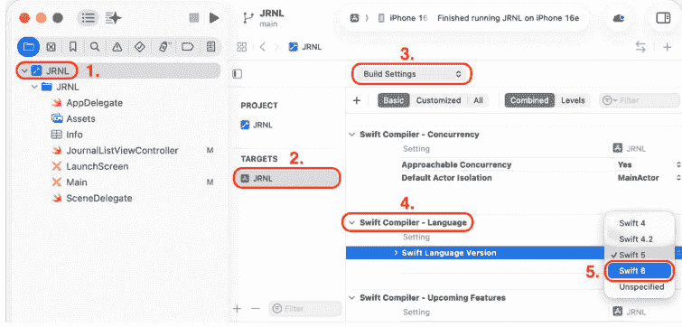

图 15.3：编辑器区域显示 Build Settings，其中 Swift 6 已设置

2. 右键单击 JRNL 图标下方的蓝色 JRNL 项目文件夹，并选择 Convert to Group：

图 15.4：弹出菜单中选择了 Convert to Group

6. 你现在将为《日志列表》屏幕中使用的模型和视图对象创建组。右键单击《日志列表屏幕》组并选择 New Group：

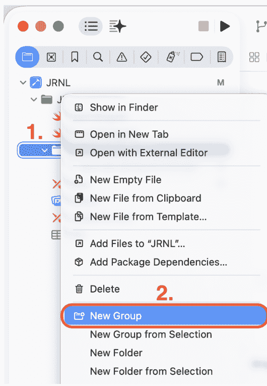

图 15.8：弹出菜单中选择了 New Group

9. 你现在将创建一个文件，其中包含 JournalEntry 类的实现。右键单击 Model 文件夹并选择 New File from Template…：

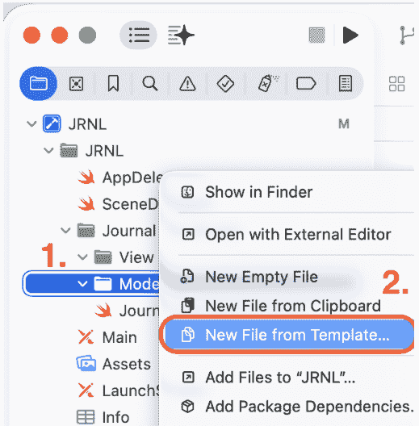

图 15.11：弹出菜单中选择了 New File from Template…

10. iOS 应该已经选择。选择 Swift File 并单击 Next：

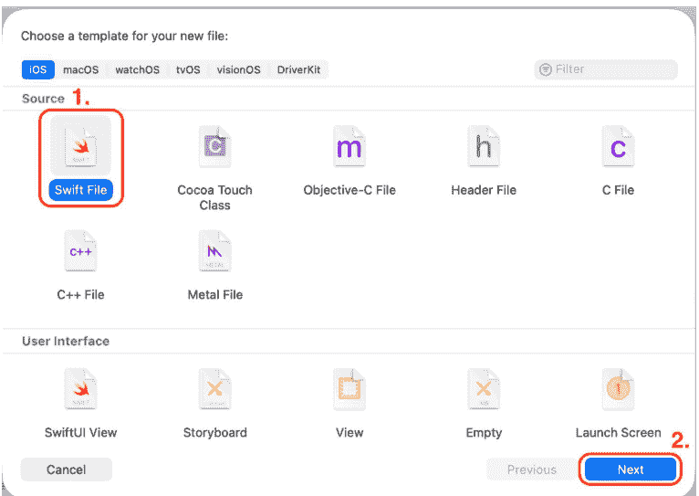

图 15.12：选择新文件模板，其中 Swift File 已被选中

11. 将文件命名为 JournalEntry 然后单击 Create。文件将出现在项目导航器中，其内容将出现在编辑器区域中：

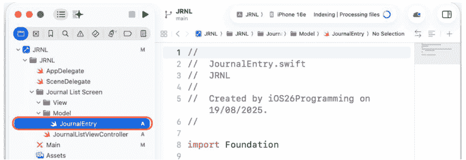

图 15.13：编辑器区域显示 JournalEntry 文件的内容

让我们分解一下：

- date 属性为 Date 类型，将存储日志条目创建的日期。
- rating 属性为 Int 类型，将存储日志条目的星级数量。
- title 属性为 String 类型，将存储日志条目的标题文本。
- body 属性为 String 类型，将存储日志条目的正文文本。
- photo 属性为 UIImage? 类型，将存储照片。这是一个可选属性，因为并非所有日志条目都需要照片。
- latitude 和 longitude 属性为 Double? 类型，将存储日志条目创建的位置。这些是可选属性，因为并非所有日志条目都需要位置。

将出现一个错误，因为你的类没有初始化器。

15. 在 longitude 属性之后添加以下代码以实现初始化器：

```
// MARK: - Initialization
init?(rating: Int, title: String, body: String, photo: UIImage? = nil, latitude: Double? = nil, longitude: Double? = nil) {
    if title.isEmpty || body.isEmpty || rating < 0 || rating > 5 {
        return nil
    }
    self.date = Date()
    self.rating = rating
    self.title = title
    self.body = body
    self.photo = photo
    self.latitude = latitude
    self.longitude = longitude
}
```

类在第 7 章《类、结构体和枚举》中介绍。

让我们分解一下：

```
init?(rating: Int, title: String, body: String, photo: UIImage? =
 nil, latitude: Double? = nil, longitude: Double? = nil) {
```

JournalEntry 类的初始化器具有 Int 值、两个 String 值、一个可选 UIImage 值和两个可选 Double 值的参数。所有可选值的默认值均为 nil。init 关键字后的问号表示这是一个可失败的初始化器；如果某些条件未满足，它将不会创建 JournalEntry 实例。

```
if title.isEmpty || body.isEmpty || rating < 0 || rating > 5 {
    return nil
}
```

如果以下任一条件返回 true，则初始化器将失败创建 JournalEntry 实例；title 为空，body 为空，rating 小于 0，且 rating 大于 5。

```
self.date = Date()
```

此语句创建一个 Date 对象，其默认为当前日期，并在创建 JournalEntry 实例时将其分配给 date 属性。

```
self.rating = rating
self.title = title
self.body = body
self.photo = photo
self.latitude = latitude
self.longitude = longitude
```

这些语句将参数值分配给 JournalEntry 实例的相应属性。注意使用 self 来区分具有相同名称的属性和参数。


```swift
let photo2 = UIImage(systemName: "cloud")
let photo3 = UIImage(systemName: "cloud.sun")
guard let journalEntry1 = JournalEntry(rating: 5, title: "Good", body: "Today is a good day", photo: photo1) else {
    fatalError("Unable to instantiate journalEntry1")
}
guard let journalEntry2 = JournalEntry(rating: 0, title: "Bad", body: "Today is a bad day", photo: photo2) else {
    fatalError("Unable to instantiate journalEntry2")
}
guard let journalEntry3 = JournalEntry(rating: 3, title: "OK", body: "Today is an OK day", photo: photo3) else {
    fatalError("Unable to instantiate journalEntry3")
}
return [journalEntry1, journalEntry2, journalEntry3]
}
```

该扩展包含一个 `createSampleJournalEntryData()` 方法，该方法使用来自 Apple SFSymbols 库的符号创建三个 `UIImage` 实例，创建三个 `JournalEntry` 实例，将它们添加到一个数组中并返回该数组。`static` 关键字表示它是在 `JournalEntry` 类型上的方法，而不是 `JournalEntry` 实例方法。

要了解有关类型方法和实例方法的更多信息，请参阅此链接：https://docs.swift.org/swift-book/documentation/the-swift-programming-language/methods/。

您现在已完成 `JournalEntry` 类的实现。您还添加了一个静态方法来生成三个示例日记条目。在下一节中，您将修改 `JournalListViewController` 类以使用此方法返回的数组来填充表格视图。

按照以下步骤操作：

- 1. 在项目导航器中，右键单击 View 文件夹并选择 New File from Template....
- 2. iOS 应该已经选中。选择 Cocoa Touch Class，然后单击 Next：

    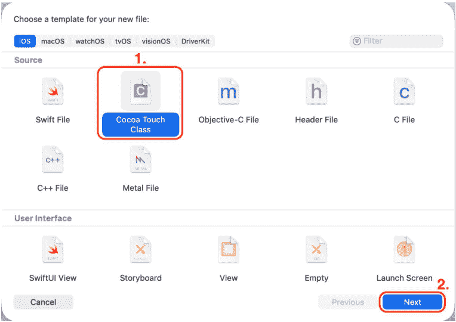

    图 15.15：选择新文件模板的屏幕

    使用 Cocoa Touch Class 模板将允许您设置超类并自动为将要创建的类插入样板代码。

- 3. 将出现“为新文件选择选项”屏幕：

    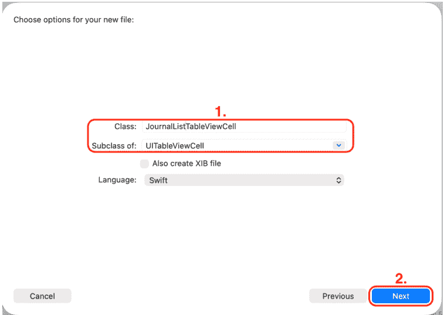

    图 15.16：为新文件选择选项的屏幕

    按如下方式配置类：

    - Class: JournalListTableViewCell
    - Subclass of: UITableViewCell
    - Also create XIB: 未选中
    - Language: Swift

    完成后单击 Next。

- 4. 单击 Create，一个名为 JournalListTableViewCell 的新文件将被添加到项目的 View 组中。在其中，您将看到以下代码：

```swift
import UIKit
class JournalListTableViewCell: UITableViewCell {
    override func awakeFromNib() {
        super.awakeFromNib()
        // Initialization code
    }

    override func setSelected(_ selected: Bool, animated: Bool) {
        super.setSelected(selected, animated: animated)
        // Configure the view for the selected state
    }
}
```

- 5. 删除 `JournalListTableViewCell` 类声明中的所有代码，如下所示：

```swift
class JournalListTableViewCell: UITableViewCell {
}
```

- 6. 要创建对应于 journalCell 表视图单元格的子视图的三个属性，请在 `JournalListTableViewCell` 类声明的大括号之间输入以下代码：

```swift
// MARK: - Properties
@IBOutlet var photoImageView: UIImageView!
@IBOutlet var dateLabel: UILabel!
@IBOutlet var titleLabel: UILabel!
```

- 7. `JournalListTableViewCell` 类的实现已完成。现在您将把此类分配为 journalCell 表视图单元格的标识。单击项目导航器中的 Main storyboard 文件并在文档大纲中单击 Journal Scene 下的 journalCell：

    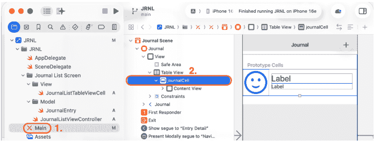

    图 15.17：文档大纲显示 journalCell 已选中

- 8. 单击 Identity inspector 按钮。在 Custom Class 部分，将 Class 设置为 JournalListTableViewCell。这将把 JournalListTableViewCell 实例设置为 journalCell 的自定义表视图子类。完成后按 Return：

    图 15.18：Identity inspector 显示 journalCell 的 Class 设置

您刚刚声明并定义了 `JournalListTableViewCell` 类，并将其分配为 journalCell 表视图单元格的自定义表视图单元格子类。在下一节中，您将把此类连接到 journalCell 表视图单元格中的图像视图和标签，以便您可以控制它们的显示内容。

## 连接 journalCell 中的 outlets

为了管理 Journal List 屏幕中表视图单元格的显示内容，您将使用 Connections inspector 将 journalCell 表视图单元格中的图像视图和标签连接到 `JournalListTableViewCell` 类中的 outlets。按照以下步骤操作：

- 1. 在文档大纲中选中 journalCell 时，单击 Connections inspector 按钮以显示其 outlets。

    图 15.19：Connections inspector 显示 journalCell 的 outlets

- 2. 从 photoImageView outlet 拖动到表视图单元格中的图像视图：

    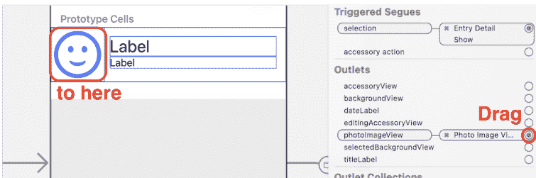

    图 15.20：Connections inspector 显示 photoImageView outlet

- 3. 从 dateLabel outlet 拖动到表视图单元格中的顶部标签。

    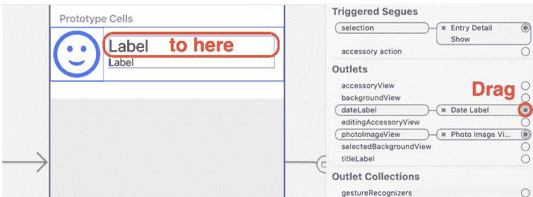

    图 15.21：Connections inspector 显示 dateLabel outlet

- 4. 从 titleLabel outlet 拖动到表视图单元格中的底部标签：

    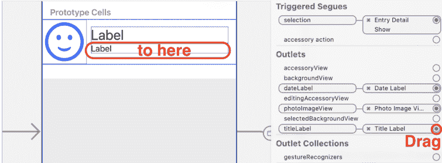

    图 15.22：Connections inspector 显示 titleLabel outlet

请记住，如果您犯了错误，可以单击 x 按钮来断开连接，然后再次从 outlet 拖动到 UI 元素。

Main storyboard 文件中的 journalCell 表视图单元格现在已使用自定义表视图子类 `JournalListTableViewCell` 设置。表视图单元格的图像视图和标签的 outlets 也已创建并分配。现在，您将能够在应用运行时将 `photoImageView`、`dateLabel` 和 `titleLabel` outlets 设置为在每个单元格中显示照片、日期和标题。

在下一节中，您将更新 `JournalListViewController` 类中的表视图数据源方法，以提供要在表视图中显示的表视图单元格数量，以及为每个单元格提供日记条目照片、日期和标题。

## 更新 JournalListViewController 中的数据源方法

`JournalListViewController` 类中的数据源方法当前设置为显示 10 个表视图单元格，每个单元格包含一个显示笑脸的图像视图和两个标签。您将更新它们以从 `SampleJournalEntryData` 实例获取要显示的单元格数量以及要放入每个单元格的数据。按照以下步骤操作：

- 1. 在项目导航器中单击 JournalListViewController 文件。

- 2. 重新排列 `JournalListViewController` 类中的代码，使 `tableView` outlet 和 `viewDidLoad()` 方法位于表视图委托方法之前：

```swift
class JournalListViewController: UIViewController,
UITableViewDataSource, UITableViewDelegate {
@IBOutlet var tableView: UITableView!
override func viewDidLoad() {
    super.viewDidLoad()
}
func tableView(_ tableView: UITableView,
numberOfRowsInSection section: Int) -> Int {
```

- 3. 在属性声明之前添加一个 MARK 语句，如下所示：

```swift
// MARK: - Properties
@IBOutlet var tableView: UITableView!
```

- 4. 在 `viewDidLoad()` 方法之前添加一个 MARK 语句，如下所示：

```swift
// MARK: - View controller lifecycle
override func viewDidLoad() {
```

- 5. 在表视图数据源方法之前添加一个 MARK 语句，如下所示：

```swift
// MARK: - UITableViewDataSource
func tableView(_ tableView: UITableView, numberOfRowsInSection
```

- 6. 在 `unwindNewEntryCancel(segue:)` 之前添加一个 MARK 语句，如下所示：

```swift
// MARK: - Methods
@IBAction func unwindNewEntryCancel(segue: UIStoryboardSegue) {
```

- 7. 验证 `JournalListViewController` 中的代码如下所示：

```swift
class JournalListViewController: UIViewController,
UITableViewDataSource, UITableViewDelegate {
    // MARK: - Properties
    @IBOutlet var tableView: UITableView!
    // MARK: - View controller lifecycle
    override func viewDidLoad() {
        super.viewDidLoad()
    }
    // MARK: - UITableViewDataSource
    func tableView(_ tableView: UITableView,
    numberOfRowsInSection section: Int) -> Int {
        10
    }
    func tableView(_ tableView: UITableView, cellForRowAt
    indexPath: IndexPath) -> UITableViewCell {
        tableView.dequeueReusableCell(withIdentifier:
        "journalCell", for: indexPath)
    }
    // MARK: - Methods
    @IBAction func unwindNewEntryCancel(segue:
```


点击某一行会显示“日志条目详情”屏幕，但该屏幕尚未显示所选日志条目的任何数据。你将在下一章中解决这个问题。

恭喜！至此，日志列表屏幕已经能够显示来自 `journalEntries` 数组的文本和图像。不过，你仍然无法向 `journalEntries` 数组中添加或移除日志条目。你将在下一章中学习如何做到这一点。

## 小结

在本章中，你为日志列表屏幕实现了模型对象，使其能够显示日志条目列表。你了解了将要使用的模型对象，创建了一个可用于存储日志条目实例的 Swift 类，并创建了一个返回示例日志条目的静态方法。接着，你为你的表视图创建了一个自定义的 `UITableViewCell` 实例，并使用返回示例日志条目的方法来填充数组。该数组随后被用作日志列表屏幕中表视图的数据源。

你现在知道了如何创建模型对象、如何创建示例数据，以及如何配置视图控制器来使用示例数据填充表视图。如果你想创建自己的使用表视图的应用，这将非常有用。

在下一章中，你将学习如何从日志列表屏幕添加和移除日志条目，还将学习如何在视图控制器之间传递数据。

## 获取本书的 PDF 版本和独家附加内容

扫描二维码（或访问 packtpub.com/unlock）。按名称搜索这本书，确认版本，然后按照页面上的步骤操作。

*注意：* 请准备好你的发票。直接从 Packt 购买无需发票。

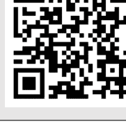

## 16

## 在视图控制器之间传递数据

在上一章中，你配置了 `JournalListViewController` 类——日志列表屏幕的视图控制器——使其在表视图中显示来自包含示例数据的结构中的日志条目。

在本章中，你将学习如何在视图控制器之间传递数据。首先，你将为“添加新日志条目”屏幕实现一个视图控制器，然后添加代码，将数据从“添加新日志条目”屏幕传递到日志列表屏幕。接下来，你将学习如何在日志列表屏幕中移除日志条目。之后，你将学习文本字段和文本视图的委托方法，最后，你将把数据从日志列表屏幕传递到日志条目详情屏幕。

到本章结束时，你将学会如何在视图控制器之间传递数据，以及如何使用文本字段和文本视图的委托方法。这将使你能够在自己的应用中轻松地在视图控制器之间传递数据。

本章将涵盖以下主题：

-   将数据从“添加新日志条目”屏幕传递到日志列表屏幕
-   从表视图中移除行
-   文本字段和文本视图的委托方法
-   将数据从日志列表屏幕传递到日志条目详情屏幕

## 垂直切片架构

在软件开发中，**垂直切片**是一个跨功能的端到端功能切片，贯穿应用程序的所有层。它是一个完整的、面向用户的功能，可以独立交付和演示。

垂直切片是在敏捷软件开发中广泛使用的一种技术，尤其在领域驱动设计（DDD）和微服务架构中。它强调交付小而有价值的功能增量，而不是横向分层。

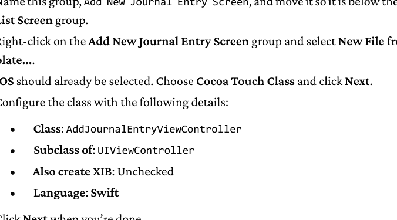

### 主要特性

-   **跨功能：**垂直切片涉及所有层——UI、业务逻辑和数据访问。
-   **以用户为中心：**每个切片对应一个特定的用户故事或用例。
-   **独立：**切片可以独立开发、测试和部署。
-   **增量：**每个切片交付一个小而有价值的功能增量。

### 优势

-   更快的反馈循环
-   降低集成复杂性
-   更好地与业务目标对齐
-   更早发现架构问题

`AddJournalEntryViewController` 文件现在已经创建，其中包含 `AddJournalEntryViewController` 类声明。你将把这个类设置为当你在日志列表屏幕中点击 + 按钮时呈现的视图控制器场景的自定义类。请按照以下步骤操作：

1.  在项目导航器中点击 Main storyboard 文件，然后在文档大纲中点击 New Entry Scene：

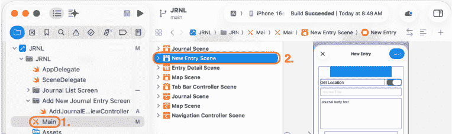

图 16.1：编辑器区域显示 New Entry Scene

2.  点击 Identity inspector 按钮，然后在 Custom Class 下，将 Class 设置为 AddJournalEntryViewController：

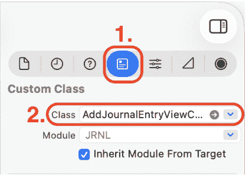

图 16.2：New Entry Scene 的 Identity inspector 设置

很好！在下一节中，我们将把 New Entry Scene 中的用户界面元素连接到 `AddJournalEntryViewController` 类中的输出口（outlets）。这样，`AddJournalEntryViewController` 实例将能够访问用户在“添加新日志条目”屏幕上输入的数据。

## 根据用户输入创建 JournalEntry 实例

你已经实现了 `AddJournalEntryViewController` 类，并将此类中的输出口连接到 New Entry Scene 中的文本字段、文本视图和图像视图。当用户在文本字段和文本视图中输入数据时，你可以使用这些信息来创建新的日志条目。

当视图控制器即将转换到另一个视图控制器时，会调用视图控制器的 `prepare(for:sender:)` 方法。你将实现此方法来创建新的 `JournalEntry` 实例，然后可以将其传递给日志列表屏幕的视图控制器。请按照以下步骤操作：

1.  在项目导航器中，点击 AddJournalEntryViewController 文件，并在输出口声明之后向 AddJournalEntryViewController 类添加一个 newJournalEntry 属性：

```
//MARK: - Properties
@IBOutlet var titleTextField: UITextField!
@IBOutlet var bodyTextView: UITextView!
@IBOutlet var photoImageView: UIImageView!
var newJournalEntry: JournalEntry?
```

使用用户输入的数据创建的 JournalEntry 实例将被赋值给这个属性。

2.  取消这个类中 `prepare(for:sender:)` 方法的注释。它应该看起来像下面这样：

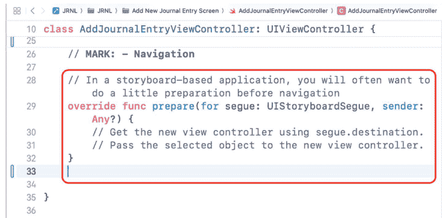

图 16.6：编辑器区域显示 `prepare(for:sender:)` 方法

此方法检查源视图控制器是否为 AddJournalEntryViewController 类的实例，如果是，则从 newJournalEntry 属性获取 JournalEntry 实例。然后，该实例会被插入到 journalEntries 数组的第一项。之后，tableView.reloadData() 语句将重新绘制表视图。

2.  点击 Main storyboard 文件，并在文档大纲中展开 New Entry Scene。展开“< New Entry”导航项。按住 Ctrl 并将“Right Bar Button Items”下的 Save 按钮拖到场景出口，然后从弹出菜单中选择 unwindNewEntrySaveWithSegue:。

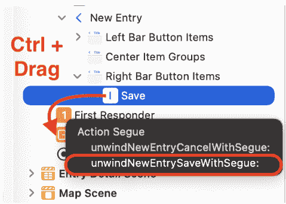

当你运行项目时，点击 Save 按钮将从“添加新日志条目”屏幕过渡到日志列表屏幕，并执行 unwindNewEntrySave(segue:) 方法。

2.  构建并运行你的项目。在任意一行上向左轻扫，以显示 Delete 按钮：

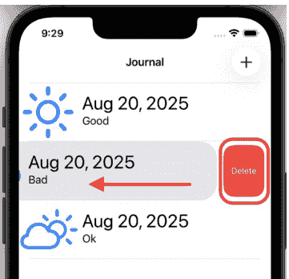

图 16.10：模拟器显示日志列表屏幕上的 Delete 按钮

3.  点击 Delete 按钮，该行将从表视图中移除：

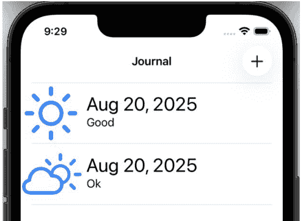

图 16.11：模拟器显示重新绘制的表视图

至此，你已经成功实现了一种从表视图中移除行的方法！太棒了！在下一节中，你将进一步学习文本字段和文本视图的委托方法，这些方法在你于“添加新日志条目”屏幕中输入数据时会很有用。


- 5. 构建并运行你的应用，然后轻点文本字段。如果软件键盘没有出现，请从模拟器的 I/O 菜单中选择 Keyboard | Toggle Software Keyboard：

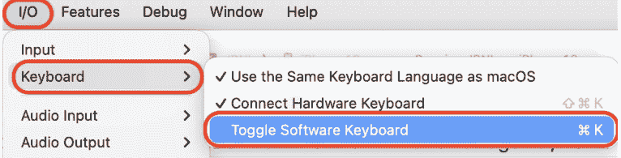

图 16.12：模拟器 I/O 菜单，选中 Keyboard | Toggle Software Keyboard

- 6. 使用软件键盘在文本字段或文本视图中输入一些文本：

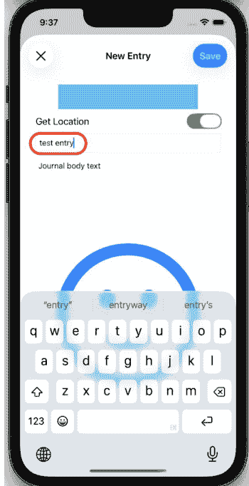

图 16.13：显示软件键盘的模拟器

```
let textViewText = bodyTextView.text ?? ""
saveButton.isEnabled = !textFieldText.isEmpty &&
!textViewText.isEmpty
}
```

private 关键字表示此方法仅可在该类内部访问。

- 5. 在 `textFieldShouldReturn(_:)` 方法之后添加如下 `UITextFieldDelegate` 方法：

```
func textFieldShouldReturn(_ textField: UITextField) -> Bool {
    textField.resignFirstResponder()
    return true
}
func textFieldDidEndEditing(_ textField: UITextField) {
    updateSaveButtonState()
}
```

此方法在文本字段放弃第一响应者状态后调用 `updateSaveButtonState()`。

- 6. 在 `textView(_:shouldChangeTextIn:replacementText:)` 方法之后添加如下 `UITextViewDelegate` 方法：

```
func textView(_ textView: UITextView, shouldChangeTextIn range: NSRange, replacementText text: String) -> Bool {
    if (text == "\n") {
        textView.resignFirstResponder()
    }
    return true
}
func textViewDidEndEditing(_ textView: UITextView) {
    updateSaveButtonState()
}
func textViewDidChange(_ textView: UITextView) {
    updateSaveButtonState()
}
```

至此，`JournalEntryDetailViewController` 文件已创建，其中包含 `JournalEntryDetailViewController` 类声明。现在，你需要为点击 Journal List 屏幕上的表格视图单元格时呈现的视图控制器场景设置标识。请按以下步骤操作：

- 1. 在 Project navigator 中点击 Main storyboard 文件，并在文档大纲中选择 Entry Detail Scene。
- 2. 点击 Identity inspector 按钮，然后在 Custom Class 下将 Class 设置为 `JournalEntryDetailViewController`：

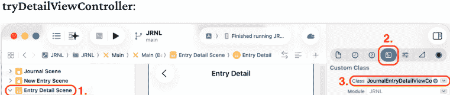

图 16.16：Entry Detail Scene 的 Identity inspector 设置

太棒了！在下一节中，你将把 Entry Detail Scene 中的用户界面元素连接到 `JournalEntryDetailViewController` 类中的 outlet。这样，`JournalEntryDetailViewController` 实例将能够显示日志条目的详细信息。

## 将 UI 元素连接到 JournalEntryDetailViewController 类

目前，Journal Entry Detail 屏幕的 `JournalEntryDetailViewController` 实例无法与其内部的 UI 元素通信。现在，你将在 `JournalEntryDetailViewController` 类中创建 outlet，并将 Entry Detail Scene 中相应的 UI 元素分配给每个 outlet。请按以下步骤操作：

- 1. 在 Project navigator 中，点击 `JournalEntryDetailViewController` 文件，并删除花括号之间的所有代码，只保留 `viewDidLoad()` 方法。
- 2. 在左花括号后向 `JournalEntryDetailViewController` 类中添加以下属性：

```
// MARK: - Properties
@IBOutlet var dateLabel: UILabel!
@IBOutlet var titleLabel: UILabel!
@IBOutlet var bodyTextView: UITextView!
@IBOutlet var photoImageView: UIImageView!
```

- 3. 点击 Main storyboard 文件，并在文档大纲中选择 Entry Detail Scene。
- 4. 点击 Connections inspector 按钮，并从 `dateLabel` outlet 拖到 Entry Detail 场景中的第一个标签：

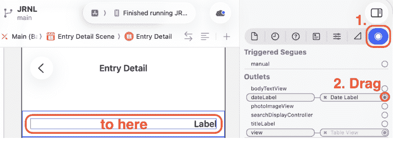

图 16.17：Connections inspector 显示 dateLabel outlet

- 5. 从 `titleLabel` outlet 拖到 Entry Detail 场景中的第二个标签：

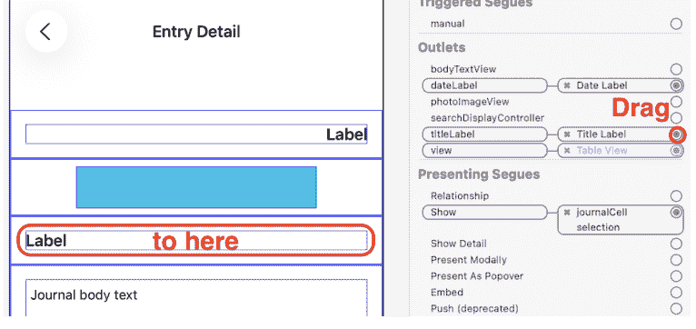

图 16.18：Connections inspector 显示 titleLabel outlet

- 6. 从 `bodyTextView` outlet 拖到 Entry Detail 场景中的文本视图：

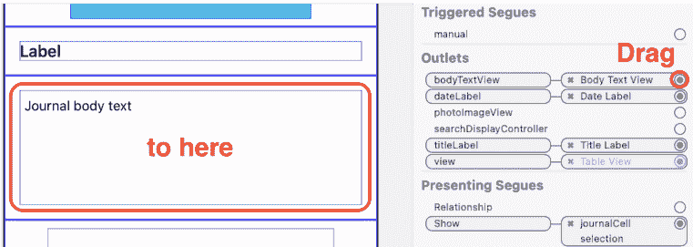

图 16.19：Connections inspector 显示 bodyTextView outlet

- 7. 从 `photoImageView` outlet 拖到 Entry Detail 场景中的图像视图：

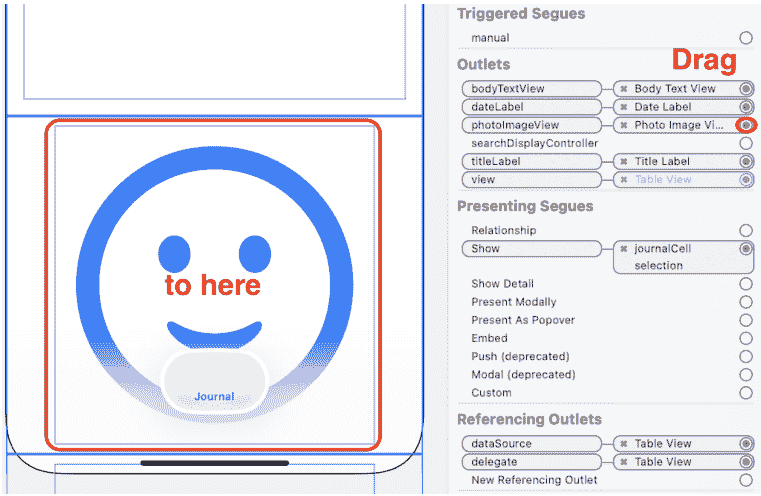

图 16.20：Connections inspector 显示 photoImageView outlet

> 请记住，如果出错，你可以点击 x 按钮断开连接，然后再次从 outlet 拖到 UI 元素上。

现在，你已成功将 **Entry Detail 场景**中的 UI 元素连接到 `JournalEntryDetailViewController` 类中的 outlet。在下一节中，你将实现代码，以便当用户点击 Journal List 屏幕上的表格视图单元格时显示 `JournalEntry` 实例的详细信息。

## 显示日志条目的详细信息

到目前为止，你已经实现了 `JournalEntryDetailViewController` 类，并将此类中的 outlet 连接到 **Entry Detail 场景**中的标签、文本视图和图像视图。当用户点击 Journal List 屏幕上的表格视图单元格时，你将根据数据源获取对应的 `JournalEntry` 实例，并将其传递给 `JournalEntryDetailViewController` 实例，以便在 Journal Entry Detail 屏幕上显示。为此，你将在 `JournalListViewController` 类中实现 `prepare(for:sender:)` 方法。请按以下步骤操作：

- 1. 在 Project navigator 中，点击 **Main** storyboard 文件，并点击连接 **Journal** 场景和 **Entry Detail** 场景的 segue。点击 Attributes inspector 按钮，然后在 **Storyboard Segue** 下将 **Identifier** 设置为 `entryDetail`：

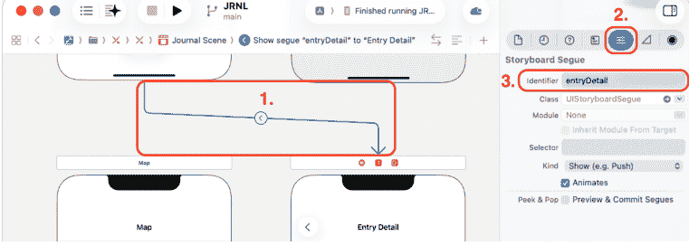

图 16.21：Attributes inspector 显示 Identifier 设置为 entryDetail

稍后你将使用此标识符来识别从 Journal List 屏幕转到 Journal Entry Detail 屏幕所用的 segue。

我们来分解一下：

```
guard segue.identifier == "entryDetail" else { return }
```

这段代码用于检查是否正在使用正确的 segue；如果不是，方法将退出。

```
guard let journalEntryDetailViewController = segue.destination as?
JournalEntryDetailViewController,
let indexPath = tableView.indexPathForSelectedRow else {
    fatalError("Could not get indexPath")
}
```

这段代码检查目标视图控制器是否是 `JournalEntryDetailViewController` 的实例，获取用户点击的表格视图单元格，并获取该单元格的索引路径。

```
let selectedJournalEntry = journalEntries[indexPath.row]
```

此语句从 `journalEntries` 数组中获取对应的 `JournalEntry` 实例。

```
journalEntryDetailViewController.selectedJournalEntry =
selectedJournalEntry
```

此语句将 `JournalEntry` 实例赋值给目标视图控制器的 `selectedJournalEntry` 属性。

现在，你已添加了代码，当从 Journal List 屏幕转到 Journal Entry Detail 屏幕时，会将用户点击的表格视图单元格对应的日志条目传递给 `JournalEntryDetailViewController` 实例。在下一节中，你将修改 `JournalEntryDetailViewController` 类以显示日志条目的详细信息。

## 修改 JournalEntryDetailViewController 以显示所选日志条目的详细信息

当转到 Journal Entry Detail 屏幕时，与用户点击的表格视图单元格对应的 `JournalEntry` 实例将被赋值给 `JournalEntryDetailViewController` 实例的 `selectedJournalEntry` 属性。你将在 `JournalEntryDetailViewController` 类中添加代码来访问此属性并显示日志条目的详细信息。请按以下步骤操作：

- 1. 在 Project navigator 中，点击 `JournalEntryDetailViewController` 文件，并按如下所示修改 `JournalEntryDetailViewController` 类的 `viewDidLoad()` 方法，以显示日志条目的详细信息：

```
override func viewDidLoad() {
    super.viewDidLoad()
    dateLabel.text = selectedJournalEntry?.date.formatted(
        .dateTime.day().month(.wide).year()
    )
    titleLabel.text = selectedJournalEntry?.title
    bodyTextView.text = selectedJournalEntry?.body
    photoImageView.image = selectedJournalEntry?.photo
}
```

如你所见，之前传递给此视图控制器的 `JournalEntry` 实例的属性被用来填充用户界面元素。请注意，`date` 属性需要先格式化为字符串，然后才能赋值给 `dateLabel.text` 属性。

- 2. 构建并运行你的项目，然后点击一个表格视图单元格。与该表格视图单元格对应的日志条目的详细信息将显示在 Journal Entry Detail 屏幕上：


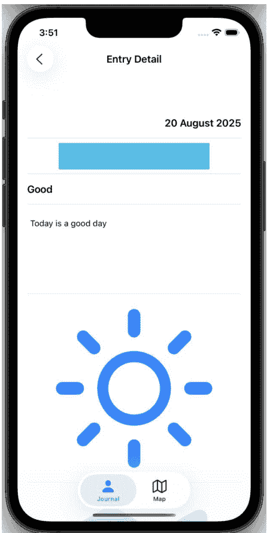

图 16.22：模拟器显示“日志条目详情”屏幕

恭喜！您已成功为“日志条目详情”屏幕实现了一个视图控制器。现在，当用户在“日志列表”屏幕上点击表格视图单元格时，您将能够在其中显示日志条目详细信息。

## 17

## Core Location 和 MapKit

在上一章中，您学习了如何将数据从“添加新日志条目”屏幕传递到“日志列表”屏幕，以及从“日志列表”屏幕传递到“日志条目详情”屏幕。您还了解了 UITextFieldDelegate 和 UITextViewDelegate 方法。

在本章中，您将学习如何使用 Apple 的 Core Location 框架获取设备位置，以及如何使用 Apple 的 MapKit 框架设置地图区域、显示地图标注和创建地图快照。如果您打算构建使用地图的应用（如 Apple Maps 或 Waze），这将非常有用。

首先，您将修改“添加新日志条目”屏幕，以便用户可以将当前位置添加到新的日志条目中。接下来，您将创建一个 MapViewController 类（“地图”屏幕的视图控制器），并将其配置为显示以您的位置为中心的地图区域。然后，您将更新 JournalEntry 类以遵守 MKAnnotation 协议，该协议允许您将日志条目作为地图标注添加到地图上。之后，您将修改 MapViewController 类，以便在您之前设置的地图区域内为每个日志条目显示一个图钉。您将配置图钉以显示标注气泡，并配置标注气泡中的按钮，以便在点击时显示“日志条目详情”屏幕。最后，您将修改 JournalEntryViewController 类，以在“日志条目详情”屏幕上显示一张地图快照，显示创建日志条目时的位置。

学完本章，您将学会如何使用 Core Location 获取设备位置，以及如何使用 MapKit 指定地图区域、向地图添加地图标注视图以及创建地图快照。

要了解有关 CLLocationManager 类的更多信息，请访问 https://developer.apple.com/documentation/corelocation/configuring_your_app_to_use_location_services。

您可以在此处观看 Apple 关于简化位置更新的 WWDC 2023 视频：https://developer.apple.com/videos/play/wwdc2023/10180/。

由于位置信息被视为敏感的用户数据，您还需要获得使用定位服务的授权。您还可以检查由 CLLocationUpdate 类型的 liveUpdates 方法提供的位置更新的授权状态。

要了解有关请求使用定位服务授权的更多信息，请访问 https://developer.apple.com/documentation/corelocation/requesting_authorization_to_use_location_services。

您可以在此处观看 Apple 标题为*位置授权的新内容*的 WWDC 2024 视频：https://developer.apple.com/videos/play/wwdc2024/10212/。

在下一节中，您将修改 AddJournalEntryViewController 类，以便用户创建新日志条目时可以指定位置。

### 修改 AddJournalEntryViewController 类

目前，“添加新日志条目”屏幕有一个“获取位置”开关，但它还不执行任何操作。您将为这个开关向 AddJournalEntryViewController 类添加一个 outlet，并修改它，以便在开关打开时将您的位置添加到 JournalEntry 实例中。请按照以下步骤操作：

- 1. 在项目导航器中，单击 AddJournalEntryViewController 文件。在该文件中，在 import UIKit 语句之后添加一条 import 语句，以导入 Core Location 框架：

```
import UIKit
import CoreLocation
```

- 2. 在文件中所有其他代码之后，为 AddJournalEntryViewController 类添加一个扩展：

```
extension AddJournalEntryViewController {
    // MARK: - CoreLocation
}
```

- 3. 在 AddJournalEntryViewController 类中所有其他 outlet 之后，为“获取位置”开关及其旁边的标签添加 outlet：

```
@IBOutlet var photoImageView: UIImageView!
@IBOutlet var saveButton: UIBarButtonItem!
@IBOutlet var getLocationSwitch: UISwitch!
@IBOutlet var getLocationSwitchLabel: UILabel!
var newJournalEntry: JournalEntry?
```

- 4. 在所有其他属性声明之后，添加属性以存储 CLLocationManager 类的实例、一个将管理位置更新的异步任务以及当前设备位置：

```
var newJournalEntry: JournalEntry?
private let locationManager = CLLocationManager()
private var locationTask: Task<Void, Error>?
private var currentLocation: CLLocation?
```

所有这些属性都是私有的，因为它们只会在此类中使用。

- 5. 在 AddJournalEntryViewController 扩展的右花括号之前，实现一个用于确定用户位置的方法：

```
private func fetchUserLocation() {
    locationManager.requestWhenInUseAuthorization()
    locationTask = Task {
        for try await update in
        CLLocationUpdate.liveUpdates() {
            if let location = update.location {
                updateCurrentLocation(location)
            } else if update.authorizationDenied {
```

```
failedToGetLocation(message: "Check Location
Services settings for JRNL in Settings > Privacy
& Security.")
} else if update.locationUnavailable {
    failedToGetLocation(message: "Location
Unavailable")
}
}
}
}
```

下面来分析一下这段代码：

```
locationManager.requestWhenInUseAuthorization()
```

此语句请求用户允许使用其位置信息。

```
locationTask = Task {
```

此语句将一个持续获取位置更新的异步任务分配给 locationTask 属性。

```
for try await update in
CLLocationUpdate.liveUpdates() {
```

此语句获取 CLLocation.liveUpdates() 提供的更新，并将每个更新分配给一个 update 实例。

```
if let location = update.location {
    updateCurrentLocation(location)
}
```

此语句从 update 实例中获取用户位置，并调用 updateCurrentLocation 方法。

```
else if update.authorizationDenied {
    failedToGetLocation(message: "Check Location
Services settings for JRNL in Settings > Privacy & Security.")
}
```

如果用户未授权使用其私人数据，此语句将调用 failedToGetLocation(message:) 方法。

```
else if update.locationUnavailable {
    failedToGetLocation(message: "Location Unavailable")
}
```

如果用户的位置不可用，此语句将调用 failedToGetLocation(message:) 方法。

您将看到错误消息，因为 fetchUserLocation() 调用的方法尚未实现。

- 6. 在 AddJournalEntryViewController 扩展的右花括号之前，实现由 fetchUserLocation() 方法调用的 updateCurrentLocation(_:) 方法：

```
private func updateCurrentLocation(_ location: CLLocation) {
    let interval = location.timestamp.timeIntervalSinceNow
    if abs(interval) < 30 {
        locationTask?.cancel()
        getLocationSwitchLabel.text = "Done"
        let lat = location.coordinate.latitude
        let long = location.coordinate.longitude
        currentLocation = CLLocation(latitude: lat,
            longitude: long)
    }
}
```

此方法首先获取位置的时间戳。此位置可能是旧的缓存位置，并非实际的当前位置，因此将该时间戳与当前日期和时间进行比较。如果持续时间少于 30 秒，则表明用户的位置是当前的。在这种情况下，将取消分配给 locationTask 的异步任务，将“获取位置”开关标签的文本设置为“Done”，并将 currentLocation 属性设置为该位置。

- 7. 在 AddJournalEntryViewController 扩展的右花括号之前，实现由 fetchUserLocation() 方法调用的 failedToGetLocation(message:) 方法：

```
private func failedToGetLocation(message: String) {
    locationTask?.cancel()
    getLocationSwitch.setOn(false, animated: true)
    getLocationSwitchLabel.text = "Get location"
    let alertController = UIAlertController(title:
    "Failed to get location", message: message,
    preferredStyle: .alert)
    let okAction = UIAlertAction(title: "OK", style:
    .default)
    alertController.addAction(okAction)
    present(alertController, animated: true)
}
```

此方法将取消分配给 locationTask 的异步任务，将“获取位置”开关和标签的值重置为初始值，并显示一个配置了相应错误消息的警报。

- 8. 在 AddJournalEntryViewController 类中，在右花括号之前实现一个操作，该操作在“获取位置”开关的值更改时执行：

```
// MARK: - Actions
@IBAction func locationSwitchValueChanged(_ sender: UISwitch) {
    if getLocationSwitch.isOn {
        getLocationSwitchLabel.text = "Getting location..."
        fetchUserLocation()
    } else {
        currentLocation = nil
        getLocationSwitchLabel.text = "Get location"
        locationTask?.cancel()
    }
}
```


16. 将 locationSwitchValueChanged 操作连接到“获取位置”开关，并从弹出菜单中选择“值已更改”：

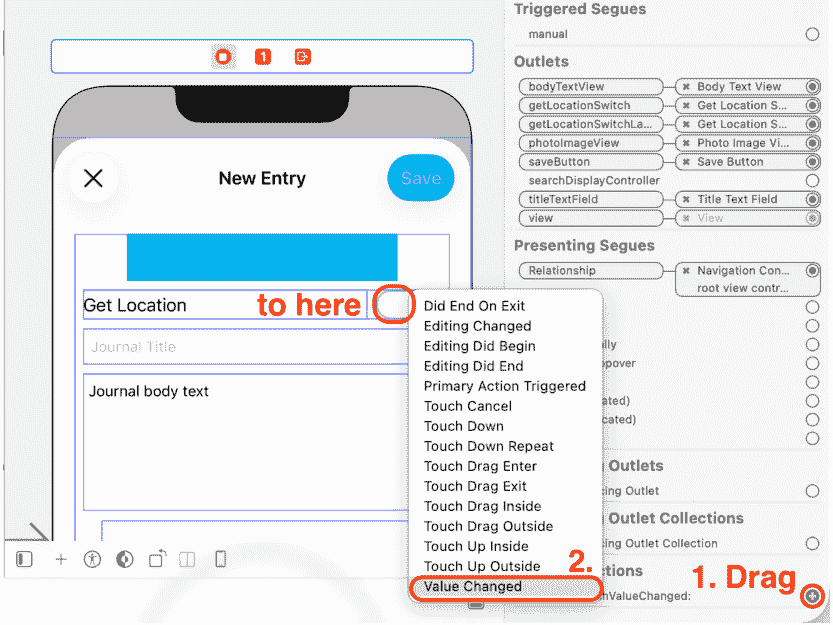

图 17.4：属性检查器显示 getLocationSwitchValueChanged outlet

您已完成对 AddJournalEntryViewController 类的修改。在下一节中，您将学习如何配置您的应用以访问用户数据。

## 修改 Info.plist 文件

由于您的应用使用用户数据，您需要请求用户授予使用权限。为此，您将在应用的 Info 属性列表文件中添加一项新设置。请按以下步骤操作：

+   1. 在项目导航器中，单击 Info 属性列表文件。如果您将指针移到 Information Property List 行上，您会看到一个小 + 按钮。单击它来创建新行：

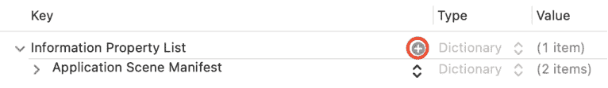

图 17.5：编辑器区域显示 Info 属性列表文件的内容

+   2. 在新行中，将 Key 设置为“Privacy - Location When In Use Usage Description”，将 Value 设置为“This app uses your location for journal entries.”。完成后，您的 Info 属性列表文件应如下图所示：

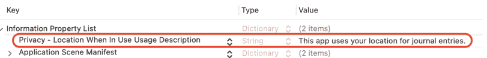

图 17.6：添加了新行的 Info 属性列表文件

+   3. 启动模拟器，然后从模拟器的 Features 菜单中选择 Location | Apple 来模拟一个位置：

## 创建 MapViewController 类

在第 12 章“完成用户界面”中，您向“地图”屏幕添加了一个地图视图。地图视图是 MKMapView 类的一个实例。您可以在 Apple 地图应用中看到它的样子。

要了解有关 MKMapView 的更多信息，请参阅 https://developer.apple.com/documentation/mapkit/mkmapview。

当您构建并运行应用时，屏幕上将显示地图。屏幕上可见的地图部分可以通过设置地图视图的 region 属性来指定。

要了解有关区域以及如何创建区域的更多信息，请参阅 https://developer.apple.com/documentation/mapkit/mkmapview/1452709-region。

您将创建一个新类 MapViewController 作为“地图”屏幕的视图控制器，并使用 Core Location 来确定要显示的地图区域的中心点。请按以下步骤操作：

+   1. 右键单击 JRNL 组并选择“新建组”(New Group)，在项目中创建一个新组。将此组命名为 Map Screen，并将其移动到 Journal Entry Detail Screen 组的下方。

+   2. 右键单击 Map Screen 组，然后选择“从模板新建文件...”(New File From Template...)。

+   3. iOS 应该已被选中。选择 Cocoa Touch Class，然后单击“下一步”(Next)。

+   4. 使用以下详细信息配置该类：
+      - 类 (Class)：MapViewController
+      - 子类 (Subclass)：UIViewController
+      - 同时创建 XIB (Also create XIB)：不勾选
+      - 语言 (Language)：Swift
      完成后单击“下一步”(Next)。

+   5. 单击“创建”(Create)。MapViewController 文件将出现在项目导航器中，其内容将显示在编辑器区域中。

```
} else if update.locationUnavailable {
    failedToGetLocation(message: "Location Unavailable")
}
}
}
}
```

此方法与您在 AddJournalEntryViewController 扩展中实现的 fetchUserLocation() 方法类似。首先，它会请求使用私人用户数据的权限，并将“地图”屏幕的标题设置为“正在获取位置...”。接下来，一个用于持续确定用户位置的异步任务将被分配给 locationTask；如果找到了用户的位置，则地图将更新以显示用户的位置。否则，将显示一个带有相应错误消息的警告。

请注意，由于 fetchUserLocation() 调用的方法尚未实现，您将会看到错误消息。

+   11. 在 MapViewController 扩展中，于右花括号之前实现缺失的方法：

```
private func updateMapWithLocation(_ location: CLLocation) {
    let interval = location.timestamp.timeIntervalSinceNow
    if abs(interval) < 30 {
        locationTask?.cancel()
        let lat = location.coordinate.latitude
        let long = location.coordinate.longitude
        navigationItem.title = "Map"
        mapView.region = MKCoordinateRegion(center:
        CLLocationCoordinate2D(latitude: lat,
        longitude: long), span: MKCoordinateSpan(
        latitudeDelta: 0.01, longitudeDelta: 0.01))
    }
}
private func failedToGetLocation(message: String) {
    locationTask?.cancel()
    navigationItem.title = "Location not found"
    let alertController = UIAlertController(title:
    "Failed to get location", message: message,
    preferredStyle: .alert)
}
```

```
let okAction = UIAlertAction(title: "OK",
style: .default)
alertController.addAction(okAction)
present(alertController, animated: true)
}
```

这些方法类似于您之前在 AddJournalEntryViewController 扩展中实现的 updateCurrentLocation(location:) 和 failedToGetLocation(message:) 方法。

updateMapWithLocation(location:) 方法会将“地图”屏幕的标题设置为 Map，创建一个以用户位置为中心的地图区域，并将其指定为 mapView 属性的区域。

如果使用用户数据的权限被拒绝或位置不可用，failedToGetLocation(message:) 方法会将“地图”屏幕的标题设置为 Location not found，并显示相应的错误消息。

+   12. 修改 MapViewController 类的 viewDidLoad() 方法，以调用 fetchUserLocation()，如下所示：

```
override func viewDidLoad() {
    super.viewDidLoad()
    fetchUserLocation()
}
```

+   13. 在项目导航器中单击 Main storyboard 文件，然后在文档大纲中单击第一个地图场景 (Map Scene)。单击身份检查器 (Identity inspector) 按钮，在“自定义类”(Custom Class) 下，将 Class 设置为 MapViewController：

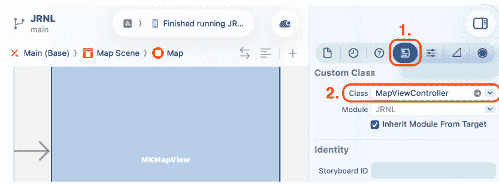

图 17.10：地图场景的身份检查器设置

14. 单击连接检查器 (Connections inspector) 以显示地图场景的所有 outlet。将 mapView outlet 拖到地图场景中的地图视图：

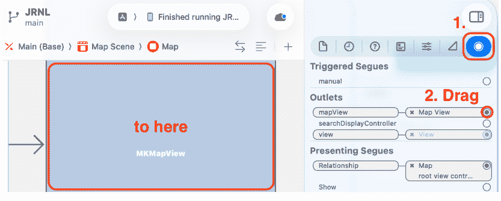

图 17.11：连接检查器显示 mapView outlet

请记住，如果操作错误，您可以单击 x 以断开连接，然后再次从 outlet 拖到 UI 元素。

15. 构建并运行应用，并确认模拟器的 Features | Location 菜单中已选择 Apple。点击“地图”标签按钮，显示以您所选位置为中心的地图区域，在本例中为 Apple 园区：

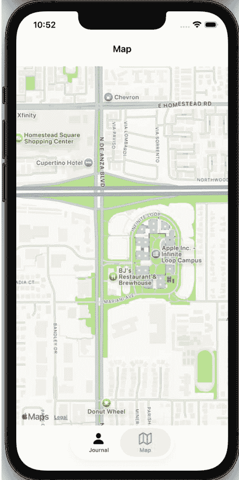

图 17.12：模拟器显示以所选位置为中心的地图

由于 viewDidLoad() 只在 MapViewController 实例加载其视图时调用一次，因此如果在初始设置后用户的位置发生变化，地图将不会更新。此外，您会注意到，如果在实际的 iOS 设备上运行应用，确定位置需要很长时间。我们将在下一章中解决这两个问题。

您可以通过选择 Features | Location | Custom Location 并输入所需位置的经度和纬度，在模拟器中模拟任何位置。

您已成功为“地图”屏幕创建了新的视图控制器，并将其配置为显示以设备位置为中心的地图区域。太棒了！在下一节中，您将了解 MKAnnotation 协议以及如何使类遵守该协议。

## 更新 JournalEntry 类以遵守 MKAnnotation 协议

在 iPhone 上使用“地图”应用时，您可以点按并按住地图来放置大头针：


2. MKAnnotation 协议具有一个可选的 title 属性，您稍后将用到它。您需要将 JournalEntry 类中 title 属性的名称更改为 entryTitle，以免同时存在两个同名属性。右键单击 title 属性，然后从弹出菜单中选择 Refactor | Rename（重构 | 重命名）。

3. 将新名称设置为 entryTitle，如图所示，并单击“重命名”(Rename)：

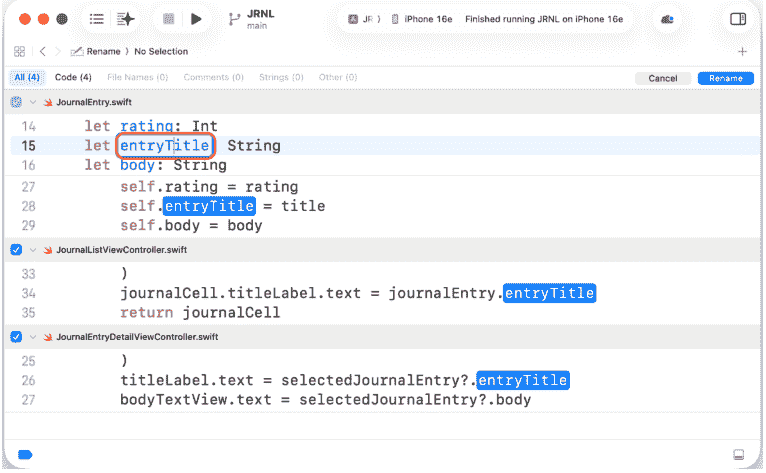

图 17.14：将 title 属性重构为 entryTitle

4. 按如下所示修改 JournalEntry 类声明，使其成为 NSObject 类的子类并采用 MKAnnotation 协议：

```
class JournalEntry: NSObject, MKAnnotation {
```

5. 您会看到错误，因为您尚未实现 coordinate 属性，而该属性是遵守 MKAnnotation 协议所必需的。请在初始化器之后输入以下代码：

```
// MARK: - MKAnnotation
var coordinate: CLLocationCoordinate2D {
    guard let latitude, let longitude else {
        return CLLocationCoordinate2D()
    }
}
```


```
return CLLocationCoordinate2D(latitude: latitude, longitude:
longitude)
```

`coordinate` 属性属于 `CLLocationCoordinate2D` 类型，它保存一个地理位置。`coordinate` 属性的值不是直接赋值的；`guard` 语句从 `latitude` 和 `longitude` 属性获取经纬度值，然后用这些值创建 `coordinate` 属性的值。这类属性称为计算属性。

6. 要实现可选的 `title` 属性，请在 `coordinate` 属性之后输入以下代码：

```
var title: String? {
    date.formatted(
        .dateTime.day().month().year()
    )
}
```

这是一个计算属性，返回格式化为字符串的日志条目日期。

7. 要实现可选的 `subtitle` 属性，请在 `title` 属性之后输入以下代码：

```
var subtitle: String? {
    entryTitle
}
```

这是一个计算属性，返回日志条目的标题。

此时，你已经修改了 `JournalEntry` 类，使其遵循 `MKAnnotation` 协议。在下一节中，你将修改 `MapViewController` 类，将 `JournalEntry` 实例数组添加到地图视图中，并且地图视图显示区域内的任何实例都会作为大头针出现在地图界面上。

## 在地图界面上显示标注视图

地图界面当前显示以你的设备位置为中心的地图区域。既然地图区域已设置，你可以根据 `JournalEntry` 实例的 `coordinate` 属性来确定哪些实例位于该区域内。请记住，`JournalEntry` 类遵循 `MKAnnotation` 协议。作为地图视图的视图控制器，`MapViewController` 类负责为该区域内的任何 `MKAnnotation` 实例提供 `MKAnnotationView` 实例。

现在你将修改 `MapViewController` 类，从 `createSampleJournalEntryData()` 方法获取 `JournalEntry` 实例数组，并将其添加到地图视图中。请按照以下步骤操作：

- 1. 在项目导航器中，点击 `JournalEntry` 文件。在 `createSampleJournalEntryData()` 方法中，修改创建 `journalEntry2` 实例的语句，如下所示：

```
guard let journalEntry2 = JournalEntry(rating: 0, title: "Bad", body: "Today is a bad day", photo: photo2, latitude: 37.3318, longitude: -122.0312) else {
    fatalError("Unable to instantiate journalEntry2")
}
```

该实例现在包含 `latitude` 和 `longitude` 属性的值，这些值将用于设置其 `coordinate` 属性。所使用的值对应 Apple 园区附近的一个位置，运行应用时你将在模拟器中设置该位置。

> 你可以使用任何你想要的位置，但需要确保该位置靠近地图的中心点；否则，大头针将不会显示。

- 2. 在项目导航器中，点击 `MapViewController` 文件。在该文件中所有其他代码之后添加一个扩展，使 `MapViewController` 类遵循 `MKMapViewDelegate` 协议：

```
extension MapViewController: MKMapViewDelegate {
}
```

- 3. 在 `locationTask` 属性声明之后，添加以下代码来创建一个私有属性 `annotations`，该属性将保存 `JournalEntry` 实例数组：

```
private var locationTask: Task<Void, Error>?
private var annotations: [JournalEntry] = []
```

> 目前，日志列表界面和地图界面之间没有任何连接。这意味着你使用“添加新日志条目”界面添加的任何日志条目都不会出现在地图界面上。你将在下一章中创建一个供两个视图控制器共享的实例。

- 4. 在 `viewDidLoad()` 方法中，在右花括号之前，将地图视图的 `delegate` 属性设置为 `MapViewController` 的一个实例：

```
fetchUserLocation()
mapView.delegate = self
}
```

- 5. 在下一行，通过调用 `JournalEntry` 结构体的 `createSampleJournalEntryData()` 方法来填充 `annotations` 数组：

```
mapView.delegate = self
annotations = JournalEntry.createSampleJournalEntryData()
}
```

- 6. 在下一行，添加以下语句，将所有示例日志条目（它们遵循 `MKAnnotation` 协议）添加到地图视图中：

```
annotations = JournalEntry.createSampleJournalEntryData()
mapView.addAnnotations(annotations)
}
```

地图视图的委托（此处为 `MapViewController` 类）现在会自动为地图界面上显示的地图区域内的每个 `JournalEntry` 实例提供 `MKAnnotationView` 实例。

- 7. 构建并运行你的应用，并使用模拟器的“Features | Location”菜单验证位置已设置为 Apple。你应该会在地图界面上看到一个单独的大头针（`MKAnnotationView` 实例）：

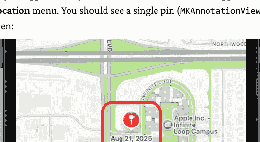

图 17.15：iOS 模拟器显示一个标准的 `MKAnnotationView` 实例

地图界面现在可以显示大头针，但点击大头针只会使其变大。你将在下一节中添加代码，使大头针显示带有按钮的标注气泡。

由于 `viewDidLoad()` 仅在 `MapViewController` 实例加载其视图时调用一次，因此之后添加到 `annotations` 数组的带有位置的任何日志条目都不会作为标注添加到地图中。你将在下一章中解决这个问题。

## 配置大头针以显示标注气泡

目前，地图界面显示标准的 `MKAnnotationView` 实例，它们看起来像大头针。点击大头针只会使其变大。`MKAnnotationView` 实例可以配置为在点击时显示标注气泡。要实现这一点，你将实现 `mapView(_:viewFor:)` 方法，这是 `MKMapViewDelegate` 协议的一个可选方法。请按照以下步骤操作：

- 1. 在项目导航器中点击 `MapViewController` 文件。在 `MKMapViewDelegate` 扩展中，在左花括号之后添加以下方法：

```
// MARK: - MKMapViewDelegate
func mapView(_ mapView: MKMapView, viewFor annotation: any MKAnnotation) -> MKAnnotationView? {
    let identifier = "mapAnnotation"
    guard annotation is JournalEntry else {
        return nil
    }
    if let annotationView =
    mapView.dequeueReusableAnnotationView(withIdentifier:
    identifier) {
        annotationView.annotation = annotation
        return annotationView
    } else {
        let annotationView =
        MKMarkerAnnotationView(annotation:annotation,
        reuseIdentifier:identifier)
        annotationView.canShowCallout = true
        let calloutButton = UIButton(type: .detailDisclosure)
        annotationView.rightCalloutAccessoryView = calloutButton
        return annotationView
    }
}
```

## 火星的气候

火星的气候几个世纪以来一直是科学好奇的话题，部分原因是火星是唯一一颗可以从地球直接详细观测其表面的行星。

尽管火星比地球小，但其气候具有重要的相似之处，例如极地冰盖的存在、季节变化以及可观测的天气模式。它吸引了火星车和轨道飞行器的持续研究。

- 火星的大气层约有 95% 是二氧化碳。
- 平均表面温度约为 −63°C。
- 由于火星的轴向倾斜，它拥有与地球相似的季节。

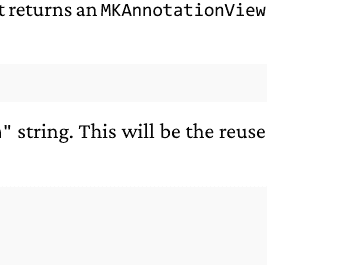

与地球相比，火星大气层很稀薄，表面压力平均约为 610 帕斯卡（0.088 psi），远低于地球的 101.3 千帕。

| 属性 | 火星 | 地球 |
| --- | --- | --- |
| 直径（千米） | 6,779 | 12,742 |
| 表面重力（米/秒²） | 3.71 | 9.81 |
| 平均温度（°C） | −63 | 15 |
| 大气 CO₂（%） | 95.3 | 0.04 |

> “火星是我们在太阳系中最接近另一个地球的存在，但它的气候仍然陌生而严酷。”

未来的任务旨在更深入地了解火星的气候历史，包括液态水的作用以及过去存在生命的可能性。

```
MartianSol = 1.0275 * EarthDay
if temperature < 273.15:
    print("Water ice stable")
```


前面已完成。

```swift
annotationView.canShowCallout = true
let calloutButton = UIButton(type: .detailDisclosure)
annotationView.rightCalloutAccessoryView = calloutButton
```

为这个 `MKAnnotationView` 实例配置了标注气泡。当你点击地图上的大头针时，会出现一个标注气泡，显示标题（日志条目日期）、副标题（日志条目标题）和一个按钮。稍后你将编写该按钮的代码，让它呈现日志条目详情屏幕。

```swift
return annotationView
```

返回自定义的 `MKAnnotationView` 实例。

> 如需了解更多关于 `mapView(_:viewFor:)` 方法的信息，请参阅 https://developer.apple.com/documentation/mapkit/mkmapviewdelegate/1452045-mapview。

- 2. 构建并运行你的应用，然后使用模拟器的 **Features | Location** 菜单将位置设置为 Apple。你应在地图屏幕上看到一个大头针。点击该大头针即可显示标注气泡：

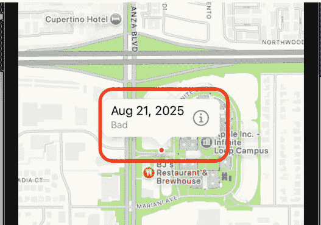

图 17.16：iOS 模拟器显示点击大头针时出现的标注气泡

2. 你需要为此转场设置标识符，以便 `mapView(_:annotationView:calloutAccessoryControlTapped:)` 方法知道要执行哪个转场。选择连接地图场景和条目详情场景的转场：

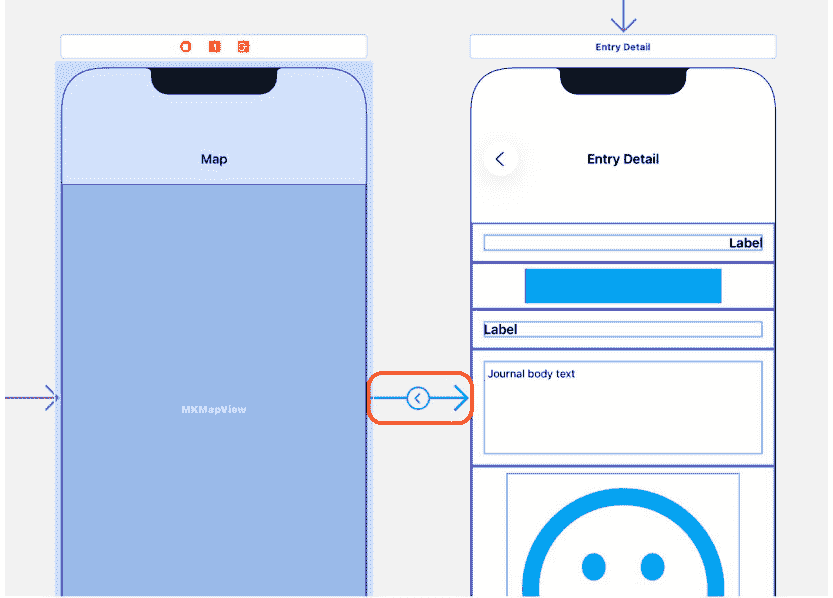

图 17.18：地图场景与条目详情场景之间的转场

3. 在属性检查器中，在 Storyboard Segue 下，将 Identifier 设置为 `showMapDetail`：

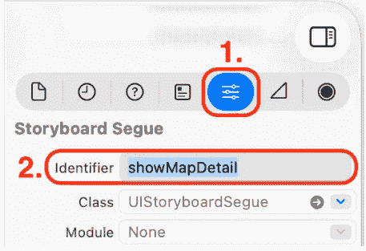

图 17.19：showMapDetail 转场的属性检查器设置

4. 在项目导航器中点击 MapViewController 文件。在 MapViewController 类中，在所有其他属性声明之后添加一个用于存储日志条目的属性：

```swift
private var annotations: [JournalEntry] = []
private var selectedAnnotation: JournalEntry?
```

该属性将存储被点击的 MKAnnotationView 实例所对应的 JournalEntry 实例。

5. 在 `mapView(_:viewFor:)` 方法之后添加 `mapView(_:annotationView:calloutAccessoryControlTapped:)` 方法：

```swift
func mapView(_ mapView: MKMapView, annotationView view: MKAnnotationView, calloutAccessoryControlTapped control: UIControl) {
    guard let annotation = mapView.selectedAnnotations.first as? JournalEntry else {
        return
    }
    selectedAnnotation = annotation
    performSegue(withIdentifier: "showMapDetail", sender: self)
}
```

- 8. 要让日志条目详情屏幕显示日志条目的详细信息，你将使用 `prepare(for:sender:)` 方法将选中的日志条目传递到日志条目详情屏幕的视图控制器。在 MapViewController 类中，取消注释并修改 `prepare(for:sender:)` 方法，如下所示：

```swift
// MARK: - Navigation
override func prepare(for segue: UIStoryboardSegue, sender: Any?) {
    super.prepare(for: segue, sender: sender)
    guard segue.identifier == "showMapDetail" else {
        fatalError("Unexpected segue identifier")
    }
    guard let entryDetailViewController = segue.destination as?
        JournalEntryDetailViewController else {
        fatalError("Unexpected view controller")
    }
    entryDetailViewController.selectedJournalEntry =
        selectedAnnotation
}
```

正如你之前所学，视图控制器会在转换到另一个视图控制器之前执行 `prepare(for:sender:)` 方法。在这种情况下，此方法会在地图屏幕转换到日志条目详情屏幕之前被调用。如果转场的标识符是 `showMapDetail`，并且转场目的地是 `JournalEntryDetailViewController` 实例，那么 `selectedAnnotation` 将被赋值给该 `JournalEntryDetailViewController` 实例的 `selectedJournalEntry` 属性。

- 9. 构建并运行你的应用，使用模拟器的 **Features | Location** 菜单确认位置已设置为 **Apple**。你应在地图屏幕上看到一个大头针。点击该大头针显示标注气泡，再点击标注气泡中的按钮。随后会显示日志条目详情屏幕，并展示你在地图屏幕上点击的日志条目的详细信息。

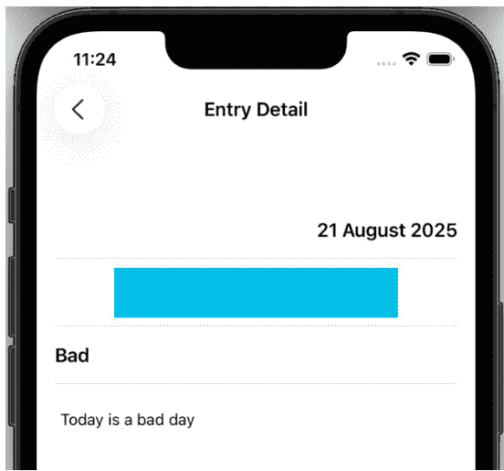

图 17.21：模拟器显示日志条目详情屏幕

你已将日志条目详情屏幕连接到地图屏幕，并成功地将地图屏幕上选中的日志条目数据传递到日志条目详情屏幕。太棒了！在下一节中，你将配置日志条目详情屏幕，以显示日志条目所在位置的地图快照。

## 在日志条目详情屏幕上显示地图快照

地图屏幕当前显示一个大头针，代表一条日志条目。当你在地图屏幕上点击大头针并点击标注按钮时，日志条目的详细信息会显示在日志条目详情屏幕上，但日志条目详情屏幕上的第二个图像视图目前显示的是占位地图图像。你可以使用 `MKMapSnapshotter` 类捕获一个地图区域并将其转换为图像。

有关 `MKMapSnapshotter` 类的更多信息，请参阅 https://developer.apple.com/documentation/mapkit/mkmapsnapshotter。

要配置快照中捕获的地图的区域和外观，需要使用 `MKMapSnapshotter.Options` 对象。

有关 `MKMapSnapshotter.Options` 对象的更多信息，请参阅 https://developer.apple.com/documentation/mapkit/mkmapsnapshotter/options。

你将把 Entry Detail 场景中的第二个图像视图连接到 `JournalEntryDetailViewController` 类中的一个输出口，并用显示日志条目位置的地图快照替换占位图像。请按照以下步骤操作：

- 1. 在项目导航器中，点击 JournalEntryDetailViewController 文件。在 `import UIKit` 语句之后输入以下内容，以导入 MapKit 框架：

```swift
import UIKit
import MapKit
```

- 2. 在 JournalEntryDetailViewController 类中，在所有其他输出口之后添加以下输出口：

```swift
@IBOutlet var bodyTextView: UITextView!
@IBOutlet var photoImageView: UIImageView!
@IBOutlet var mapImageView: UIImageView!
var selectedJournalEntry: JournalEntry?
```

- 3. 在右花括号之前添加一个用于生成地图快照的方法：

```swift
// MARK: - Private methods
private func getMapSnapshot() {
    guard let lat = selectedJournalEntry?.latitude, let
    long = selectedJournalEntry?.longitude else {
        mapImageView.image = nil
        return
    }

    let options = MKMapSnapshotter.Options()
    options.region = MKCoordinateRegion(center:
    CLLocationCoordinate2D(latitude: lat, longitude: long),
    span: MKCoordinateSpan(latitudeDelta: 0.01,
    longitudeDelta: 0.01))
    options.size = CGSize(width: 300, height: 300)
    options.preferredConfiguration = MKStandardMapConfiguration()
    let snapshooter = MKMapSnapshotter(options: options)
    snapshooter.start { snapshot, error in
        if let snapshot {
            self.mapImageView.image = snapshot.image
        } else if let error {
            print("snapshot error: \(error.localizedDescription)")
        }
    }
}
```

此方法检查 `selectedJournalEntry` 的 latitude 和 longitude 属性是否有值。如果有值，则会创建、配置一个 `MKMapSnapshotter.Options` 对象，并将其分配给一个 `MKMapSnapshotter` 对象。然后使用 `MKMapSnapshotter` 对象生成地图快照，该快照将被赋值给 `mapImageView` 的 image 属性。

- 4. 在 `viewDidLoad()` 方法中的右花括号之前调用 `getMapSnapshot()` 方法：

```swift
photoImageView.image = selectedJournalEntry?.photo
getMapSnapshot()
}
```

5. 在项目导航器中，点击 Main 故事板文件，并在文档大纲中点击 Entry Detail 场景。点击连接检查器按钮，然后将 `mapImageView` 输出口连接到故事板中 Entry Detail 场景的第二个图像视图：

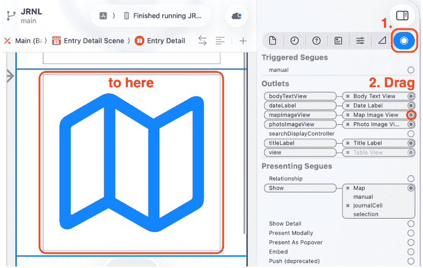

图 17.22：连接检查器显示 `mapImageView` 输出口

直接拖到文档大纲中的图像视图上可能会更容易。


6. 构建并运行你的 App，然后使用模拟器的“Features | Location”菜单验证位置已设置为 Apple。你应该会在“Map”屏幕上看到一个图钉。轻点该图钉以显示弹出气泡，然后轻点气泡内的按钮。此时会显示“Journal Entry Detail”屏幕，并展示你在“Map”屏幕上轻点的日记条目的详细信息。向下滚动，你会看到第二个图像视图中的地图快照：

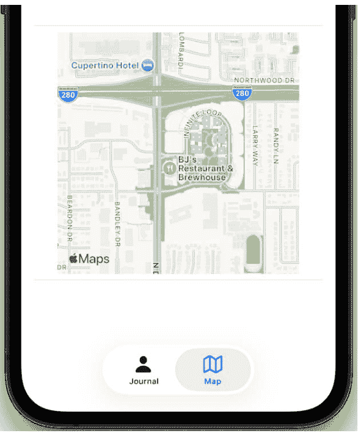

图 17.23：模拟器显示带有地图快照的“Journal Entry Detail”屏幕

现在，“Journal Entry Detail”屏幕可以显示展示日记条目位置的地图快照了。真酷！

本章将涵盖以下主题：

- 实现单例（singleton）
- 修改 JournalEntry 类以支持 JSON
- 加载和保存 JSON 数据

## 技术要求

你将继续处理上一章中修改过的 JRNL 项目。

本章的资源文件和完整的 Xcode 项目位于本书代码包中的 Chapter18 文件夹中，可从此处下载：

https://github.com/PacktPublishing/iOS-26-Programming-for-Beginners-10E

查看以下视频以查看实际运行中的代码：

https://youtu.be/OPMjo1Ro9OI

让我们先创建一个新的单例来存储你的 App 所使用的数据。

## 实现单例

目前，当你向 App 添加新的日记条目时，它们会出现在“Journal List”屏幕上，但当你切换到“Map”屏幕时，新添加的日记条目不会出现。这是因为 `MapViewController` 实例无法访问 `JournalListViewController` 实例中的 `journalEntries` 数组。要解决这个问题，你需要创建一个新的单例来存储你的 App 数据。单例只创建一次，然后在整个 App 中引用。这意味着 `JournalListViewController` 类和 `MapViewController` 类都将从单一数据源获取数据。

> 有关单例的更多信息，请参阅 https://developer.apple.com/documentation/swift/managing-a-shared-resource-using-a-singleton。

在下一节中，你将创建一个名为 `SharedData` 的单例，它将由 `JournalListViewController` 和 `MapViewController` 类使用。

```
var numberOfJournalEntries: Int {
    journalEntries.count
}
var allJournalEntries: [JournalEntry] {
    journalEntries
}
// MARK: - Initialization
private init() {
}
// MARK: - Access methods
func journalEntry(at index: Int) -> JournalEntry {
    journalEntries[index]
}
func addJournalEntry(_ newJournalEntry: JournalEntry) {
    journalEntries.insert(newJournalEntry, at: 0)
}
func removeJournalEntry(at index: Int) {
    journalEntries.remove(at: index)
}
```

让我们来分解一下：

```
@MainActor static let shared = SharedData()
```

这条语句创建了该类的一个实例，这意味着你的 App 中 `SharedData` 的唯一实例存储在 `shared` 属性中。该属性标记有 `@MainActor`，以确保它只能从主队列访问。

> 如需更多信息，请观看 Apple 在 WWDC 2022 上题为 *Eliminate data races using Swift Concurrency* 的视频：
> https://developer.apple.com/videos/play/wwdc2022/110351/。

```
private var journalEntries: [JournalEntry] = []
```

这条语句创建了一个名为 `journalEntries` 的空数组，用于存储 `JournalEntry` 实例。`private` 关键字意味着 `journalEntries` 数组只能由 `SharedData` 类中的方法修改。这是为了确保 App 的其他部分无法对 `journalEntries` 数组进行更改。

```
var numberOfJournalEntries: Int {
    journalEntries.count
}
```

这个计算属性返回 `journalEntries` 数组中的条目数量。

```
var allJournalEntries: [JournalEntry] {
    journalEntries
}
```

这个计算属性返回 `JournalEntries` 数组的副本。

```
private init() {
}
```

`init()` 方法有一个空的主体。这防止了意外创建 `SharedData()` 实例。

```
func journalEntry(at index: Int) -> JournalEntry {
    journalEntries[index]
}
```

此方法返回 `journalEntries` 数组中指定索引处的 `JournalEntry` 实例。

```
func addJournalEntry(_ newJournalEntry: JournalEntry) {
    journalEntries.insert(newJournalEntry, at: 0)
}
```

此方法将参数提供的 `JournalEntry` 实例插入到 `JournalEntries` 数组的索引 0 处。

```
func removeJournalEntry(at index: Int) {
    journalEntries.remove(at: index)
}
```

此方法从 `journalEntries` 数组中删除指定索引处的 `JournalEntry` 实例。

你已完成 `SharedData` 类的初始实现。在下一节中，你将修改你的 App 以使用它，首先更新 `JournalListViewController` 类。

## 修改 JournalListViewController 类

既然你已经创建了 `SharedData` 类，接下来需要修改你的 App 以使用它。你首先会修改 `JournalListViewController` 类，使其使用 `SharedData` 类。按以下步骤操作：

- 1. 在 Project 导航器中，点击 `JournalListViewController` 文件。从 `JournalListViewController` 类中移除 `journalEntries` 属性：
```
@IBOutlet var tableView: UITableView!
private var journalEntries: [JournalEntry] = [] // 移除
```
- 2. 在 `viewDidLoad()` 中，移除创建示例数据并将其追加到 `journalEntries` 数组的语句：
```
override func viewDidLoad() {
    super.viewDidLoad()
    journalEntries = JournalEntry.createSampleJournalEntryData() // 移除
}
```
- 3. 修改 `tableView(_:numberOfRowsInSection:)` 方法，使其从 `SharedData` 获取表视图的行数：
```
func tableView(_ tableView: UITableView, numberOfRowsInSection section: Int) -> Int {
    SharedData.shared.numberOfJournalEntries
}
```

## 修改 MapViewController 类

在本节中，你将修改 `MapViewController` 类以使用 `SharedData`。如上一章所述，当你在真机上运行 App 时，确定设备位置需要很长时间，并且如果用户的位置发生变化，Map 屏幕上的地图不会更新。你还需要解决这两个问题。按以下步骤操作：

- 1. 在 Project 导航器中，点击 `MapViewController` 文件。从 `MapViewController` 类中移除 `annotations` 属性：

```
@IBOutlet var mapView: MKMapView!
private let locationManager = CLLocationManager()
private var locationTask: Task<Void, Error>?
private var annotations: [JournalEntry] = [] // 移除
private var selectedAnnotation: JournalEntry?
```
- 2. 通过移除突出显示的语句来修改 `viewDidLoad()` 方法：

```
override func viewDidLoad() {
    super.viewDidLoad()
    fetchUserLocation() // 移除
    mapView.delegate = self
    annotations = JournalEntry.createSampleJournalEntryData() // 移除
    mapView.addAnnotations(annotations) // 移除
}
```
- 3. 为了减少确定用户位置所需的时间，请在 `fetchUserLocation()` 中添加一条语句，将位置管理器实例的精度设置为 `kCLLocationAccuracyKilometer`，如下所示：

```
locationManager.requestWhenInUseAuthorization()
locationManager.desiredAccuracy = kCLLocationAccuracyKilometer
navigationItem.title = "Getting location..."
```

此属性的默认值是 `kCLLocationAccuracyBest`，它需要相对较长的时间来确定。由于 JRNL App 在显示地图标注时不需要最高级别的精度，因此这种权衡是可以接受的。

2. 点击 + 按钮并添加新的日记条目。确保“Get Location”开关已打开：

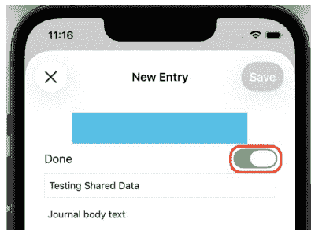

图 18.2：模拟器显示“Add New Journal Entry”屏幕

3. 点击“Map”标签页按钮进入“Map”屏幕：

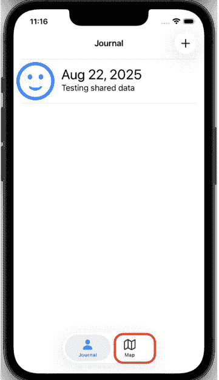

图 18.3：模拟器显示“Map”标签页按钮


- 4. 请注意，你之前添加的日记条目会以大头针形式显示在“地图”屏幕上。点击该大头针，然后点击标注按钮：

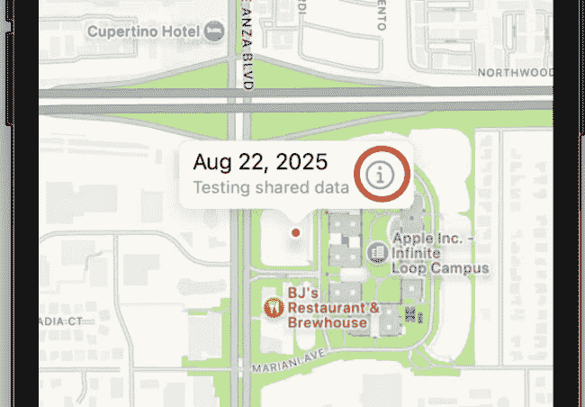

图 18.4：模拟器显示大头针标注按钮

日记条目详情会显示在“日记条目详情”屏幕上：


图 18.5：模拟器显示“日记条目详情”屏幕

你已经成功创建了一个单例并配置你的应用使用它，但一旦应用退出，数据就会丢失。稍后，你将编写代码将日记条目保存到设备存储中。但在那之前，你需要修改 JournalEntry 类，使其中的数据能够以 JSON 格式存储。你将在下一节完成这项工作。

## 让 JournalEntry 类兼容 JSON

目前，当你退出应用时，所有应用数据都会丢失。你需要实现一种保存应用数据的方式。iOS 提供了许多存储应用数据的方法。其中之一是将数据转换为 JavaScript Object Notation（JSON）格式，然后将其作为文件写入设备存储。JSON 是一种在文件中结构化数据的方式，既能让人轻松阅读，也能让计算机轻松解析。

为了帮助你理解 JSON 格式，请看下面显示的示例：

```
[
  {
    "dateString": "May 17, 2023",
    "rating": 5,
    "entryTitle": "Good",
    "entryBody": "Today is a good day",
    "photoData": "<photo data for the sun.max image>",
    "latitude": null,
    "longitude": null
  },
  {
    "dateString": "May 17, 2023",
    "rating": 0,
    "entryTitle": "Bad",
    "entryBody": "Today is a bad day",
    "photoData": "<photo data for the cloud image>",
    "latitude": 37.331354,
    "longitude": -122.031791
  },
  {
    "dateString": "May 17, 2023",
    "rating": 3,
    "entryTitle": "Good",
    "entryBody": "Today is a good day",
    "photoData": "<photo data for the cloud.sun>"
  }
]
```

该示例是 journalEntries 数组的 JSON 格式表示。如你所见，它以左方括号开头，其中的每一项都由包含日记条目信息的键值对组成，这些键值对由花括号括起，并用逗号分隔。

在文件的最后，你可以看到一个右方括号。方括号表示数组，花括号表示字典。字典中的键对应 JournalEntry 实例中的属性，值则对应赋给这些属性的值。

要了解有关将 JSON 与 Swift 类型结合使用的更多信息，请参阅 https://developer.apple.com/documentation/foundation/archives_and_serialization/using_json_with_custom_types。

要了解有关解析 JSON 文件的更多信息，请观看此处的视频：https://devstreaming-cdn.apple.com/videos/wwdc/2017/212vz78e2gz12/212/212_hd_whats_new_in_foundation.mp4。

自定义 Swift 类型需要遵循 Codable 协议，才能与 JSON 进行相互转换。

要了解有关 Codable 的更多信息，请参阅 https://developer.apple.com/documentation/swift/codable。

JSON 支持日期、字符串、数字、布尔值和 null 值，但不支持图像。为了遵循 Codable 协议，你需要修改 JournalEntry 类，使其使用 JSON 支持的类型，并修改应用的其他部分，使其与更新后的 JournalEntry 实例协同工作。请按以下步骤操作：

- 1. 在项目导航器中，点击 JournalEntry 文件。如下所示修改 JournalEntry 类的声明，以采用 Codable 协议：

```
class JournalEntry: NSObject, MKAnnotation, Codable {
```

```
}
journalCell.dateLabel.text = journalEntry.date.formatted(
    .dateTime.month().day().year()
)
```

更新后的代码将存储在 photoData 中的数据转换回 UIImage，并将其赋值给 journalCell 中的图像视图。

- 2. 在项目导航器中，点击 JournalEntryDetailViewController 文件。如下所示修改 viewDidLoad() 方法：

```
override func viewDidLoad() {
    super.viewDidLoad()
    dateLabel.text = selectedJournalEntry?.date.formatted(
        .dateTime.day().month(.wide).year()
    )
    titleLabel.text = selectedJournalEntry?.entryTitle
    bodyTextView.text = selectedJournalEntry?.entryBody
    if let photoData = selectedJournalEntry?.photoData {
        photoImageView.image = UIImage(data: photoData)
    } else {
        photoImageView.image = nil
    }
    getMapSnapshot()
}
```

更新后的代码将存储在 photoData 中的数据转换为 UIImage 实例，并将其赋值给 photoImageView 的 image 属性。至此，你的应用中应该不再有错误了。

- 3. 构建并运行你的应用。确认已设置模拟位置，然后添加一条新的日记条目。你的应用应该和之前一样正常工作。

> 请注意，图像现在是黑色而不是蓝色。这是由于图像转换过程造成的，当你使用相机或照片库中的图像时，这一点不会很明显。你将在第 20 章“相机和照片库”中学习如何做到这一点。

你已经成功修改了 JournalEntry 类，使其遵循 Codable 协议，并解决了应用中的所有错误。在下一节中，你将实现保存和

该方法尝试使用 JSONEncoder 实例将 journalEntries 数组编码为 JSON 格式，随后将其写入由 savedDataURL 指定位置存储的文件中。

你已经在应用中实现了加载和保存日记条目的方法。现在，你将修改 SharedData 类，以在适当的时候调用这些方法。请按以下步骤操作：

- 1. 在 SharedData 类中，修改初始化器以调用 loadJournalEntriesData() 方法：

```
// MARK: - Initialization
private init() {
    loadJournalEntriesData()
}
```

这将在应用启动时加载任何已保存的日记条目。

- 2. 修改 addJournalEntry(_:) 方法，以便在添加新的日记条目后调用 saveJournalEntriesData() 方法：

```
func addJournalEntry(_ newJournalEntry: JournalEntry) {
    journalEntries.insert(newJournalEntry, at: 0)
    saveJournalEntriesData()
}
```

- 3. 修改 removeJournalEntry(at:) 方法，以便在从表视图中移除一行后调用 saveJournalEntriesData() 方法：

```
func removeJournalEntry(at index: Int) {
    journalEntries.remove(at: index)
    saveJournalEntriesData()
}
```

- 4. 构建并运行你的应用。确认已设置模拟位置，然后添加一条新的日记条目。你的应用应该和之前一样正常工作。

- 5. 停止你的应用并重新运行。你之前添加的日记条目应该仍然存在：


图 18.6：模拟器显示你的应用中的持久化数据

如果你在模拟器中运行应用，可以在 loadJournalEntriesData() 方法中使用 print(savedDataURL) 语句将文件路径打印到调试区域。这将告诉你 journalEntriesData.json 文件保存在 Mac 上的什么位置。

你已经成功地为你的应用实现了使用 JSON 文件进行保存和加载！干得漂亮！

## 总结

在本章中，你创建了一个单例 SharedData，并配置你的应用使用它。接下来，你修改了 JournalEntry 类以兼容 JSON 格式，从而可以将日记条目保存到 JSON 文件，并从 JSON 文件加载日记条目。之后，你添加了在添加或删除日记条目时保存日记条目数据的方法，以及在应用启动时加载日记条目数据的方法。

你现在知道了如何创建一个类来存储、加载和保存来自 JSON 文件的数据，以便在你自己应用中使用。

在下一章中，你将实现一个自定义用户界面元素，用于为日记条目设置星级评分。

## 加入我们的 Discord

与其他用户、专家和作者本人一起阅读本书。

提出问题、为其他读者提供解决方案、通过“问我任何问题”环节与作者聊天，等等。扫描二维码或访问链接加入社区。

https://packt.link/LdIDT/


观看以下视频，查看代码的实际运行效果：

https://youtu.be/J0ueVai569s

让我们先来学习如何创建一个自定义的 UIStackView 子类，用于在屏幕上显示星级评分。

## 创建自定义的 UIStackView 子类

到目前为止，你只使用了 Apple 预定义的 UI 元素，例如标签和按钮。你只需点击 Library 按钮，搜索所需对象，然后将其拖入故事板。然而，在某些情况下，Apple 提供的对象可能不合适或不存在。在这种情况下，你需要自己构建。让我们回顾一下在应用导览中看到的“添加新日志条目”屏幕：


图 19.1：显示星级评分的“添加新日志条目”屏幕

你可以看到“获取位置”开关上方有一组五个星形图标。目前，Main 故事板文件中的“新建条目”场景和“条目详情”场景在星形图标应处的位置上有占位视图对象。你将创建 RatingView 类，它是 UIStackView 类的自定义子类，并将在两个场景中使用它。该类的实例将以星形图标显示评分。

在本章其余部分，RatingView 类的实例将被称为评分视图（正如 UIButton 类的实例被称为按钮一样）。

让我们首先创建 UIStackView 类的子类。请按照以下步骤操作：

- 1. 在 Project 导航器中，右键点击 JRNL 文件夹，从弹出菜单中选择 New Group。将此组命名为 View。将此组移动到 Model 组下方的新位置：

9. 在初始化器中调用 setupButtons() 方法：

```
required init(coder: NSCoder) {
    super.init(coder: coder)
    setupButtons()
}
```

这将在评分视图初始化时将其绘制在屏幕上。

你已经创建了一个名为 RatingView 的自定义 UIStackView 子类，并添加了代码使其在屏幕上绘制五个星形图标。现在，让我们添加代码，使用户在点击评分视图中的星形图标时能够更改评分。请按照以下步骤操作：

1. 实现一个方法，当 ratingButtons 数组中的按钮在 setupButtons() 方法之后被点击时，更改评分视图的 rating 属性：

```
@objc private func ratingButtonTapped(_ button: UIButton) {
    guard let index = ratingButtons.firstIndex(of: button) else {
        fatalError("The button, \(button), is not in the ratingButtons array: \(ratingButtons)")
    }
    let selectedRating = index + 1
    if selectedRating == rating {
        rating = 0
    } else {
        rating = selectedRating
    }
}
```

当 ratingButtons 数组中的按钮被点击时，guard 语句将该按钮的索引赋值给 index。然后 selectedRating 被设置为 index + 1 的值。如果 rating 属性与 selectedRating 的值相同，则将其设置为 0；否则，将其设置为与 selectedRating 相同的值。

例如，假设你点击评分视图中的第三个星形图标。由于第三个星形图标是 ratingButtons 数组中的第三个元素，index 将被设置为 2，selectedRating 将被设置为 2 + 1 = 3。假设 rating 属性的初始值为 0，则 selectedRating == rating 将返回 false，rating 属性的值将被设置为 3。

2. 在 setupButtons 方法的 for 循环中，在设置约束的语句之后，将此方法指定为按钮动作：

```
button.widthAnchor.constraint(equalToConstant: starSize.width).
isActive = true
button.addTarget(self, action: #selector(RatingView.
ratingButtonTapped(_:)), for: .touchUpInside)
addArrangedSubview(button)
```

3. 添加一个方法，根据在闭合花括号之前设置的 rating 来更改按钮状态：

```
private func updateButtonSelectionStates() {
    for (index, button) in ratingButtons.enumerated() {
        button.isSelected = index < rating
    }
}
```

为了了解其工作原理，假设 rating 属性设置为 3。每个按钮的默认状态是 .normal。

第一个按钮位于索引 0，因此 button.isSelected 为 0 < 3，返回 true。由于 .selected 状态的图像是一个实心星形，该按钮的图像被设置为实心星形。接下来的两个按钮也是如此。

第四个按钮位于索引 3，因此 button.isSelected 为 3 < 3，返回 false。这意味着按钮的状态保持为 .normal。.normal 状态的图像是星形轮廓，因此该按钮的图像被设置为星形轮廓。第五个按钮也是如此。

简而言之，当 rating 属性设置为 3 时，评分视图显示前三个按钮为实心星形，其余两个按钮为星形轮廓。

4. 每次 rating 属性的值改变时，你都需要调用 updateButtonSelectionStates() 方法。为此，请按如下方式修改 rating 属性：

```
var rating = 0 {
    didSet {
        updateButtonSelectionStates()
    }
}
```

这称为属性观察器，每次 rating 属性的值改变时，都会调用 updateButtonSelectionStates() 方法。

你已完成评分视图的实现。在下一节中，你将把它添加到“添加新日志条目”屏幕。

## 将自定义视图添加到“添加新日志条目”屏幕

到目前为止，你已经在项目中创建了一个新的 RatingView 类，并对其进行了配置，使其在点击其中的星形图标时设置 rating 属性。在本节中，你将把“新建条目”场景中“获取位置”开关上方的堆栈视图对象的身份设置为 RatingView 类，在 AddJournalEntryViewController 类中为其配置一个 outlet，并添加代码以在创建新日志条目时使用 rating 属性的值。请按照以下步骤操作：

- 1. 在 Project 导航器中，点击 AddJournalEntryViewController 文件。在 AddJournalEntryViewController 类中，在其他所有属性声明之后，为评分视图添加一个新的 outlet：

```
@IBOutlet var getLocationSwitch: UISwitch!
@IBOutlet var getLocationSwitchLabel: UILabel!
@IBOutlet var ratingView: RatingView!
```

- 2. 修改 prepare(for:sender:) 方法，以在创建新日志条目时获取评分视图的 rating 属性值：

```
let photo = photoImageView.image
let rating = ratingView.rating
let lat = currentLocation?.coordinate.latitude
```

- 3. 点击 Main 故事板文件，并在文档大纲中选择“新建条目”场景。点击“获取位置”开关上方的 UIStackView 对象，如图所示：


图 19.3：编辑器区域显示“获取位置”开关上方的 UIStackView 对象

6. 点击文档大纲中的“新建条目”场景，然后点击 Connections 检查器按钮。将 ratingView outlet 连接到故事板中“新建条目”场景中的评分视图：


图 19.6：显示 ratingView outlet 的 Connections 检查器

7. 构建并运行你的应用。点击 + 按钮进入“添加新日志条目”屏幕，你将看到评分视图显示在“获取位置”开关上方。添加日志条目标题、正文和评分，然后点击 Save：


图 19.7：模拟器显示“添加新日志条目”屏幕上的评分视图

现在，“日志列表”屏幕上会显示一个带有评分的新日志条目。在下一节中，你将修改“日志条目详情”屏幕，以显示该日志条目的评分。

## 将自定义视图添加到“日志条目详情”屏幕

此时，你可以使用“添加新日志条目”屏幕在创建新日志条目时设置评分，但你设置的评分不会显示在“日志条目详情”屏幕上。你将添加一个评分视图的 outlet，修改 JournalEntryDetailViewController 类中的代码，并将评分视图添加到故事板中的“条目详情”场景。请按照以下步骤操作：

- 1. 在 Project 导航器中，点击 JournalEntryDetailViewController 文件。在其他所有属性声明之后，为评分视图添加一个 outlet：

```
@IBOutlet var photoImageView: UIImageView!
@IBOutlet var mapImageView: UIImageView!
@IBOutlet var ratingView: RatingView!
```

- 2. 修改 viewDidLoad() 方法中的代码，以设置评分视图的 rating 属性的值：

```
super.viewDidLoad()
dateLabel.text = selectedJournalEntry?.date.formatted(
    .dateTime.day().month(.wide).year()
)
ratingView.rating = selectedJournalEntry?.rating ?? 0
titleLabel.text = selectedJournalEntry?.entryTitle
```

- 3. 点击 Main 故事板文件，并在文档大纲中点击“条目详情”场景。选择第二个表视图单元格中的堆栈视图。点击 Identity 检查器按钮，然后在 Custom Class 下，将 Class 设置为 RatingView：


图 19.8：Identity 检查器，Class 设置为 RatingView


4. 点击 Attributes 检查器按钮并验证 Stack View 下的设置。在 View 下，取消选中 User Interaction Enabled 复选框（因为用户不应能在 Journal Entry Detail 屏幕上更改评分），并将 Background 设置为 Default：


图 19.9：Attributes 检查器中 Background 设置为 Default

5. 在文档大纲中点击 **Entry Detail Scene**，然后点击 Connections 检查器按钮。将 **ratingView** outlet 连接到 storyboard 中 **Entry Detail** 场景中的 rating view：


图 19.10：Connections 检查器显示 ratingView outlet

6. Build and run 你的应用。点击你在上一节中添加的日记条目，你将在 Journal Entry Detail 屏幕上看到评分显示在 rating view 中：


图 19.11：Simulator 显示 Journal Entry Detail 屏幕上的 rating view

你已成功在 Journal Entry Detail 屏幕上添加并配置了 rating view！做得好！

## Technical requirements

你将继续在上一章中修改的 JRNL 项目上工作。

本章的资源文件和完成的 Xcode 项目可在本书代码包的 Chapter20 文件夹中找到，可在此下载：

https://github.com/PacktPublishing/iOS-26-Programming-for-Beginners-10E

观看以下视频以了解代码的运行情况：

https://youtu.be/UY9AB8TLjOU

让我们开始修改 Add New Journal Entry 屏幕以显示一个 image picker controller，该控制器允许你使用设备相机或从用户照片库中选择照片。

## Create a new UIImagePickerController instance

为了让用户轻松使用相机或照片库，Apple 实现了 UIImagePickerController 类。该类管理用于拍摄照片和从用户照片库中选择项目的系统界面。该类的一个实例称为 image picker controller，它可以在屏幕上显示 image picker。

如果你曾经向社交媒体帖子添加过照片，你就会知道 image picker 的样子。它通常显示来自你相机的视图或来自你照片库的照片网格，然后你可以选择一张照片添加到你的帖子中：


图 20.1：Simulator 显示 image picker

5. 你应该在 assistant editor 中看到 AddJournalEntryViewController 文件的内容。从文档大纲中的 Tap Gesture Recognizer Ctrl + Drag 到 locationSwitchValueChanged(_:) 方法与闭合大括号之间的空间：


图 20.5：Editor 区域显示拖放目标

6. 在弹出对话框中，将 Name 设置为 getPhoto，Type 设置为 UITapGestureRecognizer。点击 Connect：


图 20.6：用于 action 创建的弹出对话框

2. 按如下所示修改 getPhoto() 方法：

```
@IBAction func getPhoto(_ sender: UITapGestureRecognizer) {
    let imagePickerController = UIImagePickerController()
    imagePickerController.delegate = self
    #if targetEnvironment(simulator)
    imagePickerController.sourceType = .photoLibrary
    #else
    imagePickerController.sourceType = .camera
    imagePickerController.showsCameraControls = true
    #endif
    present(imagePickerController, animated: true)
}
```

让我们分解一下：

```
let imagePickerController = UIImagePickerController()
```

此语句创建 UIImagePickerController 类的一个实例并将其分配给 imagePickerController。

```
imagePickerController.delegate = self
```

此语句将 image picker controller 的 delegate 属性设置为 AddJournalEntryViewController 实例。

```
#if targetEnvironment(simulator)
imagePickerController.sourceType = .photoLibrary
#else
imagePickerController.sourceType = .camera
imagePickerController.showsCameraControls = true
#endif
```

这段代码称为条件编译块。它以 #if 编译指令开始，以 #endif 编译指令结束。如果你在 Simulator 中运行，则只会编译设置 image picker controller 的 sourceType 属性为照片库的语句。如果你在实际设备上运行，则会编译设置 image picker controller 的 sourceType 属性为相机并显示相机控件的语句。这意味着 image picker controller 在 Simulator 中运行时将使用照片库，在实际设备上运行时将使用相机。

你可以在此链接了解有关条件编译块的更多信息：https://docs.swift.org/swift-book/documentation/the-swift-programming-language/statements/#Conditional-Compilation-Block。

```
present(imagePickerController, animated: true)
```

此语句将 image picker controller 呈现在屏幕上。

你已实现呈现 image picker controller 所需的所有代码，当点击 image view 时会触发它。在下一节中，你将实现在用户选择图像或取消时会被调用的 UIImagePickerControllerDelegate 方法。

## Implement UIImagePickerControllerDelegate methods

UIImagePickerControllerDelegate 协议有一组你必须在 delegate 对象中实现的方法，以便与 image picker controller 界面交互。

要了解有关 UIImagePickerControllerDelegate 协议的更多信息，请参阅 https://developer.apple.com/documentation/uikit/uiimagepickercontrollerdelegate。

当 image picker controller 出现在屏幕上时，用户可以选择照片或取消。如果用户取消，则会触发 imagePickerControllerDidCancel(_:) 方法，如果用户选择照片，则会触发 imagePickerController(_:didFinishPickingMediaWithInfo:) 方法。

你现在将在 AddJournalEntryViewController 类中实现这些方法。在 Project navigator 中，点击 AddJournalEntryViewController 文件。在 UIImagePickerControllerDelegate extension 中输入以下代码：

```
// MARK: - UIImagePickerControllerDelegate
func imagePickerControllerDidCancel(_ picker: UIImagePickerController) {
    dismiss(animated: true)
}
func imagePickerController(_ picker: UIImagePickerController, didFinishPickingMediaWithInfo info: [UIImagePickerController.InfoKey: Any]) {
    guard let selectedImage = info[.originalImage] as? UIImage else {
        fatalError("Expected a dictionary containing an image, but was provided the following: \(info)")
    }
    let smallerImage = selectedImage.preparingThumbnail(of: CGSize(width: 300, height: 300))
    photoImageView.image = smallerImage
    dismiss(animated: true)
}
```

imagePickerControllerDidCancel(_:) 方法在用户取消时触发。image picker controller 将被 dismiss，用户将被返回到 Add New Journal Entry 屏幕。

imagePickerController(_:didFinishPickingMediaWithInfo:) 方法在用户选择照片时触发。此照片随后被分配给 selectedImage。接下来，selectedImage 实例的 preparingThumbnail(of:) 方法将被用来创建一个宽度和高度均为 300 points 的较小图像，与 Journal Entry Detail 屏幕上 image view 的大小相同。此图像随后将被分配给 photoImageView 属性，image picker controller 将被 dismiss。

你可以在此链接了解有关 preparingThumbnail(of:) 方法的更多信息：https://developer.apple.com/documentation/uikit/uiimage/3750835-preparingthumbnail。

所有必需的 `UIImagePickerController` delegate 方法都已实现。在下一节中，你将修改 `Info.plist` 文件，以便你的应用在请求使用相机或照片库时请求权限。

## Get permission to use the camera or photo library

Apple 规定你的应用必须在希望访问相机或照片库时通知用户。如果不这样做，你的应用将被拒绝，且不会被允许上架 App Store。

你将修改项目中的 Info property list 文件，以便你的应用在尝试访问相机或照片库时显示消息。请按照以下步骤操作：

1. 在 Project navigator 中点击 **Info** property list 文件。将指针移到 **Information Property List** 行上并点击 + 按钮以创建新行。

2. 在新行中，将 **Key** 设置为 **Privacy - Photo Library Usage Description**，将 **Value** 设置为 `This app uses photos in your photo library when creating journal entries.`

3. 使用 + 按钮添加第二行。这次将 **Key** 设置为 **Privacy - Camera Usage Description**，将 **Value** 设置为 `This app uses your camera when creating journal entries.` 完成后，你的 Info.plist 文件应如下所示：

4. Build and run 你的应用。进入 Add New Journal Entry 屏幕并点击 image view。image picker 将出现：


图 20.8：Info.plist 中添加了额外的键


图 20.9：模拟器显示图片选择器

如果你在真实的 iOS 设备上运行该应用，会弹出一个对话框，请求使用相机的权限。点击**好**继续。

5. 选择一张照片，它就会出现在“添加新日记条目”屏幕的图像视图中。输入日记条目的示例详细信息，然后点击“保存”：


图 20.10：模拟器在“添加新日记条目”屏幕上显示照片

6. 你将返回到“日记列表”屏幕。点击新添加的日记条目。你将看到照片显示在“日记条目详情”屏幕上：


图 20.11：模拟器在“日记条目详情”屏幕上显示照片

现在，你可以在“添加新日记条目”屏幕中为新日记条目添加照片，并在“日记条目详情”屏幕中显示它们。太棒了！

## 小结

在本章中，你完成了“添加新日记条目”屏幕的实现，添加了一种让用户从相机或照片库获取照片的方式，然后可以将照片添加到新的日记条目中。首先，你在“添加新日记条目”屏幕的图像视图中添加了一个点击手势识别器，并将其配置为显示图像选择器控制器。然后，你实现了 UIImagePickerDelegate 协议，它允许你从相机或照片库获取照片，并在照片保存到日记条目实例之前将其缩小。你还修改了 Info 属性列表文件，以便允许访问相机和照片库。

现在，你已经能够编写自己的应用，从相机或照片库导入照片了。

在下一章中，你将实现一种让用户在“日记列表”屏幕中搜索日记条目的方式。

## 加入我们的 Discord

与本书的其他用户和作者本人一起阅读这本书。

提问、为其他读者提供解决方案、通过“问我任何问题”环节与作者交流，以及更多内容。扫描二维码或访问链接加入社区。

https://packt.link/LdIDT/


这条语句将 JournalListViewController 实例设置为负责更新搜索结果的对象。

```
search.obscuresBackgroundDuringPresentation = false
```

当用户与搜索栏交互时，这条语句会模糊包含搜索内容的视图控制器。由于你使用“日记列表”屏幕上的表视图来显示搜索结果，因此将该值设为 false，否则会遮挡搜索结果。

```
search.searchBar.placeholder = "Search titles"
```

这条语句为搜索栏设置占位符文本。

```
navigationItem.searchController = search
```

这条语句将搜索栏添加到屏幕上的导航栏。

5. 构建并运行你的应用，你会在“日记列表”屏幕上看到一个搜索栏。在搜索栏中输入一些文本：


图 21.1：模拟器在“日记列表”屏幕上显示搜索栏

6. 注意，你在搜索栏中输入的文本会出现在调试区域中：


图 21.2：调试区域显示搜索文本

你已经在“日记列表”屏幕上添加了一个搜索栏。太棒了！在下一节中，你将修改 JournalListViewController 文件，以显示标题与搜索栏中输入文本匹配的日记条目。

## 修改表视图数据源方法

正如你在第 14 章“MVC 与表视图”中学到的，你可以使用 UITableViewDataSource 方法来确定要显示多少表视图行，以及每行中放入什么内容。

在上一节中，你添加了一个新属性 filteredTableData，用于保存与搜索文本匹配的 JournalEntry 实例数组。你将修改 updateSearchResults(for:) 方法，用与搜索文本匹配的 JournalEntry 实例填充 filteredTableData，并修改 UITableViewDataSource 方法，以便在搜索栏处于活动状态时将 filteredTableData 的内容显示在“日记列表”屏幕上。请按照以下步骤操作：

- 1. 在项目导航器中，点击 JournalListViewController 文件。修改 UISearchResultsUpdating 扩展中的 updateSearchResults(for:) 方法，如下所示：

```
//MARK: - Search
func updateSearchResults(for searchController: UISearchController) {
    guard let searchBarText = searchController.searchBar.text
    else { return }
    filteredTableData = SharedData.shared.allJournalEntries.filter {
        entry in
        entry.entryTitle.lowercased().contains(searchBarText.
```

4. 构建并运行你的应用，在搜索栏中输入与某条日记条目标题匹配的文本。标题与搜索文本匹配的日记条目将被显示：


图 21.3：模拟器显示标题与搜索文本匹配的日记条目

现在，你可以显示标题与搜索文本匹配的日记条目，但当你点击它们时，“日记条目详情”屏幕可能会或可能不会显示所点击日记条目的详情。你将在下一节中解决这个问题。

## 修改 prepare(for:sender:) 方法

当你在搜索栏中输入文本时，标题与搜索文本匹配的日记条目会出现在“日记列表”屏幕的表视图中。但如果你点击其中一个，“日记条目详情”屏幕可能会或可能不会显示所点击日记条目的详情。这是因为 prepare(for:sender:) 方法引用的是 SharedData.shared 实例中的 journalEntries 数组，而不是 filteredTableData 数组。要修复此问题，请按照以下步骤操作：

- 1. 修改 JournalListViewController 类中的 prepare(for:sender:) 方法，如下所示，以便在搜索栏处于活动状态时，将 filteredTableData 数组中相应的 JournalEntry 实例分配给目标视图控制器的 journalEntry 属性：

```
guard let journalEntryDetailViewController = segue.destination as? JournalEntryDetailViewController, let indexPath = tableView.indexPathForSelectedRow else {
    fatalError("Could not get indexPath")
}
let selectedJournalEntry: JournalEntry
if search.isActive {
```

当搜索栏处于活动状态时，在表视图行上向左滑动会将其从表视图中删除，并同时从 SharedData 实例的 journalEntries 数组中删除相应的日记条目。

6. 验证被删除的日记条目不再出现在“日记列表”屏幕上：


图 21.8：模拟器在“日记列表”屏幕上显示剩余的日记条目

你已成功修改了删除日记条目的方法，“日记列表”屏幕上搜索栏的实现现已完成。优秀！

## 小结

在本章中，你为“日记列表”屏幕实现了一个搜索栏。首先，你修改了 JournalListViewController 类，使其符合 UISearchResultsUpdating 协议并在“日记列表”屏幕上显示搜索栏。接下来，你修改了数据源方法，以便在用户输入搜索词时显示正确的日记条目。然后，你修改了 prepare(for:sender:) 方法，以确保在“日记条目详情”屏幕上显示正确的日记条目详情。最后，你修改了用于删除日记条目的方法。

现在，你已经学会了如何为自己的应用实现搜索栏，并且也完成了 JRNL 应用。干得漂亮！

在下一章中，你将学习如何让应用适配 iPad 和 Mac。


# 获取本书 PDF 版本及专属附加内容

扫描二维码（或访问 packtpub.com/unlock）。按名称搜索本书，确认版本，然后按照页面上的步骤操作。

> *注意：* 请保管好您的发票。直接从 Packt 购买则无需发票。


## 技术要求

你将继续操作在上一章中修改过的 JRNL 项目。

本章的资源文件和完整的 Xcode 项目位于本书代码包的第 22 章文件夹中，可从此处下载：

https://github.com/PacktPublishing/iOS-26-Programming-for-Beginners-10E

查看以下视频以了解代码的实际运行情况：

https://youtu.be/AcqGtM4hQL4

让我们从下一节开始了解集合视图。

## 集合视图

集合视图是 UICollectionView 类的一个实例。它管理有序的元素集合，并使用可自定义的布局进行展示。

要了解更多关于集合视图的信息，请访问 https://developer.apple.com/documentation/uikit/uicollectionview。

集合视图显示的数据通常由视图控制器提供。为集合视图提供数据的视图控制器必须采用 UICollectionViewDataSource 协议。该协议声明了一系列方法，告诉集合视图显示多少个单元格以及每个单元格中显示什么内容。

要了解更多关于 UICollectionViewDataSource 协议的信息，请访问 https://developer.apple.com/documentation/uikit/uicollectionviewdatasource。

## 修改日志列表屏幕以使用集合视图

目前，JRNL 应用中的日志列表屏幕使用的是表视图。表视图使用排列在单列中的行来显示表视图单元格。这在 iPhone 上运行良好，但如果你在 iPad 上运行该应用，你会看到日志列表屏幕上有大量屏幕空间被浪费，如下图所示：


图 22.1：模拟器在 iPad 上显示包含表视图的日志列表屏幕

为了解决这个问题，你将用集合视图替换表视图，这样就可以更有效地利用可用的屏幕空间，如下图所示：


图 22.2：模拟器在 iPad 上显示包含集合视图的日志列表屏幕

2. 构建并运行你的应用，观察它在 iPad 屏幕上的显示情况：


图 22.4：模拟器显示 iPad 屏幕

尽管应用运行正常，但请注意日志列表屏幕右侧浪费了大量空间。

3. 点击“停止”按钮。在项目导航器中点击 Main storyboard 文件。在文档大纲中，点击 Journal 场景下的表视图。按 Delete 键将其删除：


图 22.5：编辑器区域显示在文档大纲中选中的表视图

6. 在顶部、左侧、右侧和底部的边缘约束字段中输入 0，并点击所有淡红色的支撑条。确保所有支撑条都变成了亮红色，且“Constrain to margins”未被勾选。然后，点击“Add 4 Constraints”按钮：


图 22.8：Auto Layout – Add New Constraints 弹出对话框

这会将集合视图的边缘与封闭视图的边缘之间的间距设置为 0，将集合视图的边缘绑定到封闭视图的边缘。

8. 在集合视图仍处于选中状态时，点击“尺寸检查器”按钮。在“Collection View”下，将“Estimate Size”设置为“None”。

图 22.10：尺寸检查器中突出显示 Estimate Size

稍后你将添加代码来动态确定集合视图的大小。

9. 你需要重新建立日志列表屏幕和日志条目详情屏幕之间的 segue。按住 Ctrl 键从文档大纲中的“Collection View Cell”拖到编辑器区域中的“Entry Detail”场景，然后从弹出菜单中选择“Show”。

图 22.11：编辑器区域显示拖动目标

10. 点击新添加的 storyboard segue，然后点击“属性检查器”按钮。在“Storyboard Segue”下，将“Identifier”设置为 `entryDetail`。


图 22.12：属性检查器，其中 Identifier 设置为 entryDetail

你已将集合视图添加到 Journal 场景，并使用 Auto Layout 约束使其填满屏幕，但原型集合视图单元格目前是空的。下一节将向集合视图单元格添加 UI 元素。

## 向集合视图单元格添加 UI 元素

你已将 Journal 场景中的表视图替换为集合视图，但集合视图中的原型集合视图单元格是空的。你需要向原型集合视图单元格添加一个图像视图和两个标签，并为其设置约束。这将使其与之前使用的表视图单元格相匹配。请按照以下步骤操作：

- 1. 在文档大纲中选择 Journal 场景的 Collection View Cell。将集合视图单元格的右边缘向右拖动，直到它到达屏幕的右侧：


图 22.13：编辑器区域显示 Collection View Cell

不应勾选“Constrain to margins”。完成后，点击“Add 4 Constraints”按钮：


图 22.15：图像视图的约束

5. 点击“属性检查器”按钮。在 **Image View** 下，将 **Image** 设置为 `face.smiling`：


*图 22.16：图像视图的 Image 设置为 face.smiling*

6. 接下来，你将添加一个标签来显示日志条目的日期。点击“Library”按钮。在过滤字段中输入 label。结果中会出现一个 **Label** 对象。将其拖到你刚刚添加的图像视图与单元格右侧之间的空间：


*图 22.17：已添加标签的原型单元格*

7. 在“属性检查器”中，在 Label 下，使用 Font 菜单将 Font 设置为 Title 1：


图 22.18：Label 的属性检查器

8. 点击“Add New Constraints”按钮，输入以下值来设置标签的约束：

- Top: 0
- Left: 8
- Right: 0

应勾选“Constrain to margins”，它会设置 8 点的标准边距。完成后，点击“Add 3 Constraints”按钮。


图 22.19：标签的约束

9. 最后，你将添加一个标签来显示日志条目标题。点击“Library”按钮。在过滤字段中输入 label。结果中会出现一个 Label 对象。将其拖到你刚刚添加的标签与单元格底部之间的空间：


图 22.20：已添加第二个标签的原型单元格

10. 在 **Attributes** 检查器中，在 **Label** 下，使用 **Font** 菜单将 **Font** 设置为 **Body**，并将 **Lines** 设置为 2：


图 22.21：Label 的属性检查器

11. 点击“Add New Constraints”按钮，输入以下值来设置标签的约束：

- Top: 0
- Left: 8
- Right: 0

应勾选 **Constrain to margins**，它会设置 8 点的标准边距。完成后，点击 **Add 3 Constraints** 按钮。


图 22.22：第二个标签的约束

原型集合视图单元格现在有一个图像视图和两个标签，并且所有必要的约束都已添加。太棒了！在下一节中，你将修改 JournalListTableViewCell 类，以管理集合视图单元格的内容。

## 修改 JournalListTableViewCell 类

最初，JournalListTableViewCell 类用于管理日志列表屏幕中表视图实例的表视图单元格。由于你已将表视图替换为集合视图，因此需要重新建立 JournalListTableViewCell 类与你刚刚添加到集合视图单元格的 UI 元素之间的所有连接。


3. 你将修改类声明，因为该类现在用于管理集合视图单元格。将超类更改为 UICollectionViewCell：

```
class JournalListCollectionViewCell: UICollectionViewCell {
```

4. 你现在将把该类分配为集合视图单元格的标识。点击项目导航器中的 Main storyboard 文件，然后在文档大纲中点击 Journal Scene 下的 Collection View Cell：


图 22.25：编辑器区域显示 Journal Scene 中的 Collection View Cell

5. 点击 Identity inspector 按钮。在 Custom Class 部分下，将 Class 设置为 JournalListCollectionViewCell。这会将 JournalListCollectionViewCell 实例设置为集合视图单元格的自定义集合视图子类。完成后按 Return：


图 22.26：Identity inspector 显示 Class 已设置为 JournalListCollectionViewCell

```
return filteredTableData.count
} else {
    return SharedData.shared.numberOfJournalEntries()
}
}
func collectionView(_ collectionView: UICollectionView,
cellForItemAt indexPath: IndexPath) ->
UICollectionViewCell {
    let journalCell =
    collectionView.dequeueReusableCell(withReuseIdentifier:
    "journalCell", for: indexPath) as!
    JournalListCollectionViewCell
    let journalEntry: JournalEntry
    if search.isActive {
        journalEntry = filteredTableData[indexPath.item]
    } else {
        journalEntry = SharedData.shared.journalEntry(at:
        indexPath.item)
    }
    if let photoData = journalEntry.photoData {
        journalCell.photoImageView.image = UIImage(data:
        photoData)
    } else {
        journalCell.photoImageView.image = nil
    }
    journalCell.dateLabel.text =
    journalEntry.date.formatted(
        .dateTime.month().day().year()
    )
    journalCell.titleLabel.text = journalEntry.entryTitle
    return journalCell
}
```

正如你所见，它们与你之前使用的表格视图数据源方法非常相似。

9. 由于你现在使用的是集合视图，tableView(_:commit:forRowAt:) 已无法再用于删除单元格。用以下方法替换 tableView(_:commit:forRowAt:) 方法：

```
// MARK: - UICollectionView delete method
func collectionView(_ collectionView: UICollectionView,
contextMenuConfigurationForItemsAt indexPaths: [IndexPath], point: CGPoint) -> UIContextMenuConfiguration? {
    guard let indexPath = indexPaths.first else {
        return nil
    }
    let config = UIContextMenuConfiguration(previewProvider: nil) { elements -> UIMenu? in
        let delete = UIAction(title: "Delete") {
            action in
            if self.search.isActive {
                let selectedJournalEntry =
                self.filteredTableData[indexPath.item]
                self.filteredTableData.remove(at: indexPath.item)
                SharedData.shared
                .removeSelectedJournalEntry(selectedJournalEntry)
            } else {
                SharedData.shared.removeJournalEntry(at:
                indexPath.item)
            }
            collectionView.reloadData()
        }
        return UIMenu(children: [delete])
    }
    return config
}
```

而不是向左滑动删除，此方法实现了一个上下文菜单，其中包含一个选项 Delete，当你长按集合视图单元格时会出现该选项。

10. 你还会在 prepare(for:sender:) 方法中看到一个错误。按所示修改 prepare(for:sender:) 方法中的 guard 语句：

```
guard let journalEntryDetailViewController =
segue.destination as?
JournalEntryDetailViewController, let indexPath =
collectionView.indexPathsForSelectedItems?.first
else {
    fatalError("Could not get indexpath")
}
```

JournalListViewController 中的所有错误都已解决。太棒了！在下一节中，你将添加代码以根据设备屏幕尺寸和方向更改集合视图单元格的大小。

## 使用 size classes 动态修改集合视图单元格大小

如你之前所见，Journal List 屏幕上的表格视图使用单列排列的行来呈现表格视图单元格。这在 iPhone 上效果很好，但在 iPad 上运行应用程序时，如你所见，这会导致大量空间浪费。即使你可以使用相同的 UI 用于 iPhone 和 iPad，但最好能对其进行自定义以适应每个设备。

为此，你将添加一些代码，以便你的应用程序能够识别其运行的屏幕大小，并动态修改集合视图中集合视图单元格的大小以适应。你可以使用 size classes 来识别当前屏幕大小；你将在下一节中了解它们。

## Size classes

要确定应用程序运行的屏幕大小，你必须考虑设备方向对 UI 的影响。由于在纵向和横向方向上存在各种屏幕尺寸，因此这可能具有挑战性。为了让它更简单，而不是使用设备的物理分辨率，你将使用 size classes。

> 有关 size classes 的更多信息，请参阅此链接：https://developer.apple.com/design/human-interface-guidelines/layout。

Size classes 是操作系统自动分配给视图的特征。定义了两个类别，描述视图的高度和宽度：regular（宽敞空间）和 compact（受限空间）。让我们看一下不同设备上全屏视图的 size classes：

| 设备 | 纵向 | 横向 |
|---|---|---|
| iPad | Regular width<br>Regular height | Regular width<br>Regular height |
| iPhone 17 Pro Max | Compact width<br>Regular height | Regular width<br>Compact height |
| iPhone 16e | Compact width<br>Regular height | Compact width<br>Compact height |

图 22.33：不同 iOS 设备的 size classes

对于 JRNL 应用程序，你将配置 Journal List 屏幕中的集合视图，如果 size class 为 compact，则使用单列集合视图单元格，如果 size class 为 regular，则使用两列。

你将向应用程序添加代码以确定当前 size class。一旦你知道 size class，你将能够设置要使用的列数以及集合视图中集合视图单元格的大小。你将在下一节中学习如何做到这一点。

## 修改 JournalListViewController 类

你已经让 JournalListViewController 类采用了 UICollectionViewDelegateFlowLayout 协议。现在你将使用 UICollectionViewFlowLayout 实例创建并设置集合视图的布局，并实现方法以动态设置集合视图单元格大小。

按照以下步骤操作：

- 1. 在项目导航器中点击 JournalListViewController 文件。在 JournalListViewController 类中，在闭合大括号之前向类定义添加以下方法：

```
func setupCollectionView() {
    let flowLayout = UICollectionViewFlowLayout()
    flowLayout.sectionInset = UIEdgeInsets(top: 10, left: 10,
```

2. 从 Device 菜单中选择 Rotate Left，你仍然会看到两列，但单元格已扩展大小以填充屏幕：


图 22.35：模拟器显示 iPad 屏幕向左旋转，显示两列

3. 停止你的应用程序并从 Destination 菜单中选择 iPhone 16e。再次在模拟器上运行你的应用程序，它将显示单列，如图所示：


图 22.36：模拟器显示 iPhone 屏幕，显示单列

模拟器在启动 iPhone 实例时不会自动关闭 iPad 实例。为获得更好的性能，请手动关闭 iPad 实例。


6. 从 **Device** 菜单中选择 **Rotate Left**，你会看到两列：


*Figure 22.39: Simulator showing iPhone screen rotated with two columns*

7. 停止你的应用并在 **Destination** 菜单中选择 **My Mac (Designed for iPad)**。运行你的应用，它应该显示两列：


*Figure 22.40: Mac app with two columns*

> 你需要一个免费或付费的 Apple 开发者账号才能在你的 Mac 上运行你的应用。

你已修改你的应用以使用集合视图替代表格视图，并且已使其能够在不同设备上运行时动态修改集合视图单元格大小。干得好！
