## 23 Adopt Liquid Glass

在 Apple 2025 年的 **Worldwide Developers Conference (WWDC)** 上，他们在所有平台上引入了新的设计。其关键元素是一种名为 **Liquid Glass** 的新材质。UIKit 的外观和感觉已随此设计更新，因此你只需使用最新 SDK 重新编译应用即可。然而，仍有一些事情你可以做来完善应用的用户体验。

在本章中，你将更新 *JRNL* 应用以利用新设计。首先，你将了解利用 Liquid Glass 的新设计系统。接下来，你将修改你的应用以采用新设计。

在本章结束时，你将学会如何为自己的应用实现新的设计系统。

本章将涵盖以下主题：

- Meet Liquid Glass
- Modify your app

### Technical requirements

你将继续在 *Chapter 22, Collection Views* 中修改的 JRNL 项目上工作。

本章的资源文件和完成的 Xcode 项目位于本书代码包的 Chapter 23 文件夹中，可在此下载：

```
https://github.com/PacktPublishing/iOS-26-Programming-for-Beginners-10E
```

观看以下视频以查看代码运行情况：

https://youtu.be/jkd0y2NbBbM

让我们从下一节开始了解更多关于新设计系统和 Liquid Glass 的信息。

### Meet Liquid Glass

Apple 的新 Liquid Glass 材质结合了玻璃的光学特性与流动感。控件和导航元素放置在不同的功能层上，并且用户体验被修改以使内容成为焦点。

要了解新设计系统的概览，请观看此视频：https://developer.apple.com/videos/play/wwdc2025/219/

要了解新设计系统的最佳实践，请观看此视频：https://developer.apple.com/videos/play/wwdc2025/356/

使用最新 SDK 重新编译的应用用户界面会自动更新。然而，你可能需要对应用进行更改以充分拥抱新设计。

要了解如何将应用更新为新设计，请观看此视频：https://developer.apple.com/videos/play/wwdc2025/284/

在本书中，你一直在使用标准用户界面元素来构建你的应用，除了你在第 19 章 Custom Views 中构建的 RatingView 元素。因此，当你使用 Xcode 26 构建和运行 JRNL 应用时，它会自动采用融入 Liquid Glass 的新设计。话虽如此，你仍可以对应用进行一些调整，你将在下一节学习如何做到这一点。

### Modify your app

当你使用 Xcode 26 构建和运行 JRNL 应用时，你可以看到它已自动采用 Apple 的新设计，融入了 Liquid Glass。仍有一些修改可以进行以充分拥抱新的外观和感觉，具体如下：

- Automatically minimize the tab bar on scroll down
- Add a subtitle showing the number of journal entries on the Journal List screen
- Add a Liquid Glass effect to the star buttons in RatingView

让我们看看如何实现这些更改，从下一节开始介绍向下滚动时最小化标签栏。

### Minimize the tab bar on scroll down

在 iOS 26 中，标签栏已使用 Liquid Glass 外观更新。它浮动在你的内容之上，并且可以配置为在向上或向下滚动时最小化，保持对内容的关注。要在向下滚动时最小化标签栏，请按照以下步骤操作：

1. 在 Project navigator 中，单击 **JournalListViewController** 文件（位于 **Journal List Scene** 组中）。在 viewDidLoad() 方法中添加以下行：

```swift
// MARK: - View controller lifecycle
override func viewDidLoad() {
    super.viewDidLoad()
    tabBarController?.tabBarMinimizeBehavior = .onScrollDown
    setupCollectionView()
}
```

2. 构建并运行你的项目。你会看到向下滚动时标签栏会最小化：

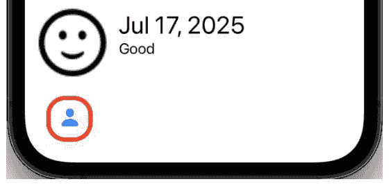

*Figure 23.1: Minimized tab bar on the Journal List screen*

> 此功能在 iOS 26 的 beta 版本中可用，但在正式版中似乎无法工作。Apple 可能会在以后恢复此功能。

太好了！在下一节中，你将学习如何在 Journal List 屏幕中添加显示日记条目数量的副标题。

### Add a subtitle to the Journal List screen

在 iOS 26 中，每个视图控制器的 UINavigationItem 对象获得了一个新的 subtitle 属性，它显示在标题下方。你将添加代码以在 Journal List 屏幕的标题下方显示日记条目数量。请按照以下步骤操作：

1. 在 Project navigator 中单击 **JournalListViewController** 文件。在 setupCollectionView() 方法之后添加一个新方法，以在 Journal List 屏幕的副标题中显示日记条目数量：

```swift
func updateSubtitleCount() {
    let noOfJournalEntries = SharedData.shared.numberOfJournalEntries
    switch noOfJournalEntries {
    case 0:
        navigationItem.subtitle = "No journal entries"
    case 1:
        navigationItem.subtitle = "1 journal entry"
    default:
        navigationItem.subtitle = "\(noOfJournalEntries) journal entries"
    }
}
```

2. 在 viewDidLoad() 中在闭合大括号之前调用 updateSubtitleCount()。这将在应用启动时在 Journal List 屏幕中显示日记条目数量：

```swift
navigationItem.searchController = search
updateSubtitleCount()
}
```

3. 当日记条目被删除时，需要更新显示的日记条目数量。修改 collectionView(_:contextMenuConfigurationForItemAt:point:) 以在日记条目被删除时调用 updateSubtitleCount()：

```swift
collectionView.reloadData()
self.updateSubtitleCount()
}
return UIMenu(children: [delete])
```

## Technical requirements

你将继续在 *Chapter 23, Adopt Liquid Glass* 中修改的 JRNL 项目上工作。

本章的资源文件和完成的 Xcode 项目位于本书代码包的 Chapter 24 文件夹中，可在此下载：

https://github.com/PacktPublishing/iOS-26-Programming-for-Beginners-10E

观看以下视频以查看代码运行情况：

https://youtu.be/sShKNjo2jRs

让我们从下一节开始了解 Icon Composer。

## About Icon Composer

在 WWDC 2025 期间引入，Icon Composer 用于创建应用图标的单一文件表示。此文件包含所有 Apple 平台的所有图标和 widget 样式外观和尺寸。要创建初始图标 artwork，你可以使用你喜欢的设计工具，如 Photoshop 或 Canva。然后你将导出 artwork 的一个或多个图层并将其导入 Icon Composer。在 Icon Composer 中，你可以组织和美化 artwork，充分利用 Liquid Glass 的动态属性。最后，你将把图标添加到你的项目中。

要了解有关如何使用 Icon Composer 的更多信息，请观看此视频：
https://developer.apple.com/videos/play/wwdc2025/361/

Icon Composer 文档可在以下链接获取：
https://developer.apple.com/documentation/Xcode/creating-your-app-icon-using-icon-composer

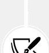

让我们在下一节中了解如何为图标的每个图层生成单独的图像。

## Creating images for each icon layer

创建图标的典型方法将使用 Adobe Photoshop 或 Canva 等应用。话虽如此，任何可以生成图标的单独图层作为单独文件的应用都可以使用。你将使用 Keynote，为 Apple Mac 免费，打开包含示例图标设计的演示文稿并将其导出为可在 Icon Composer 中使用的单独图层。


请按照以下步骤操作：

- 1. 如果你尚未安装 Keynote 应用，请通过此链接下载并安装：https://apps.apple.com/us/app/keynote/id409183694?mt=12

- 2. 在此链接下载本章的项目文件，这些文件位于本书代码包的 Chapter24 文件夹中：https://github.com/PacktPublishing/iOS-26-Programming-for-Beginners-10E

- 3. 打开 Chapter24 文件夹，打开 resources 文件夹，然后打开 JRNLImages 文件。你将看到一个包含四张幻灯片的 Keynote 演示文稿，如下图所示：

   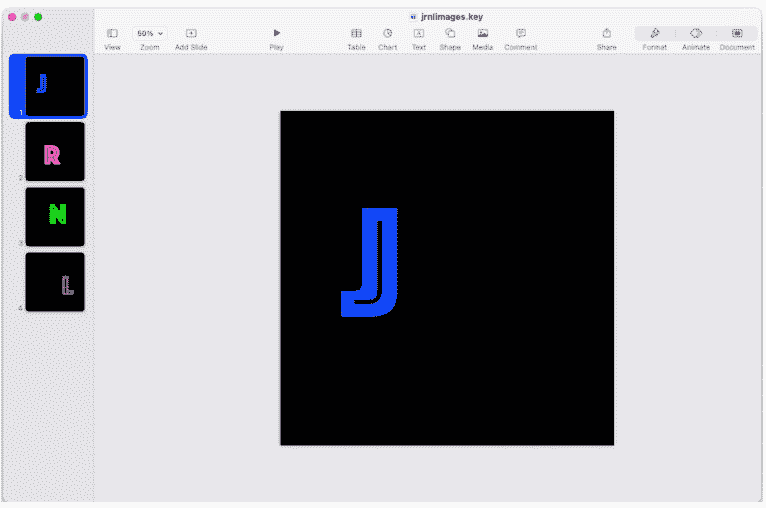

   图 24.1：JRNLImages 文件的内容

- 4. 如果第一张幻灯片未被选中，请将其选中。点击工具栏上的“格式”按钮。注意“背景”设置为“无填充”，本演示文稿中的所有幻灯片都是如此。这是确保导出时背景透明所必需的：

   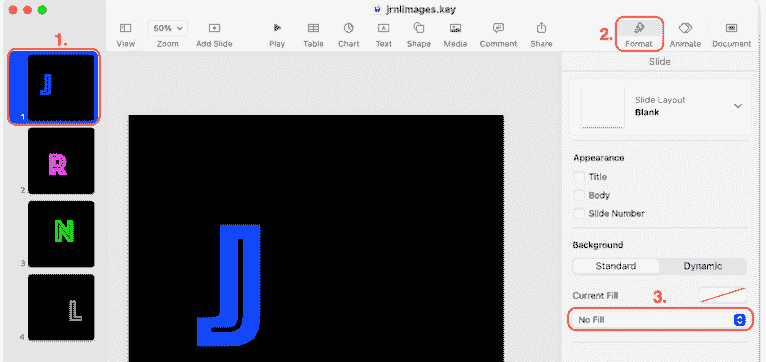

   图 24.2：背景设置为“无填充”的幻灯片

- 5. 点击工具栏上的“文稿”按钮。注意幻灯片大小设置为 1024 x 1024，这是 iOS 26 中图标所需的尺寸：

   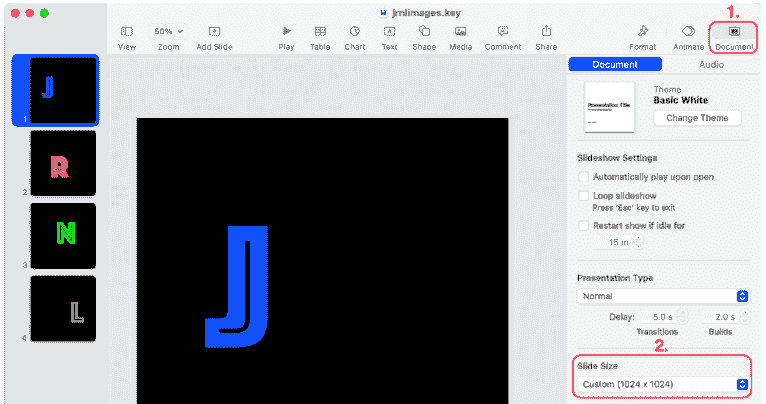

   图 24.3：Keynote 文稿幻灯片大小设置为 1024 x 1024

- 6. 从“文件”菜单中选择“导出为” | “图像...”：

   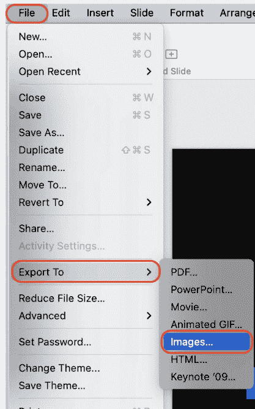

   图 24.4：Keynote 文件菜单中选择了“导出为” | “图像...”

## 使用 Icon Composer 创建图标

此时，你的图标各图层已保存为带有透明背景的 PNG 文件。现在你将使用 Icon Composer 来组合和修改这些文件，以创建你的应用图标。请按照以下步骤操作：

- 1. 从 Xcode 菜单中，选择“打开开发者工具” | “Icon Composer”：

   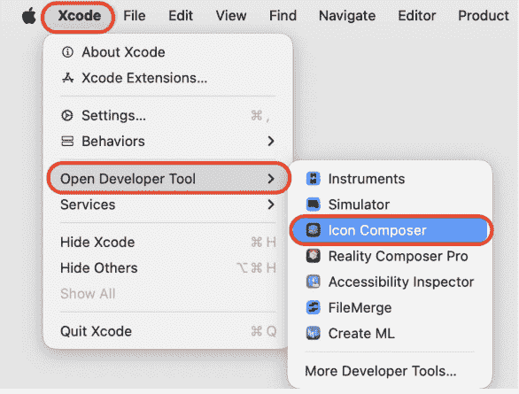

   图 24.6：Xcode 菜单中选择了“打开开发者工具” | “Icon Composer”

- 2. 如果看到显示 **Icon Composer 许可协议** 的屏幕，请点击 **同意**：

   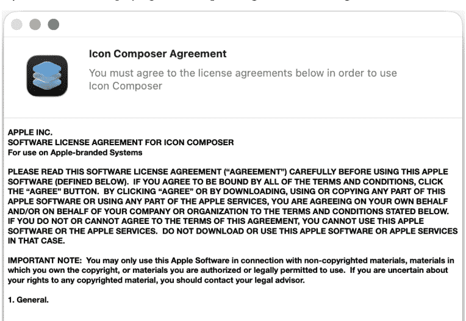

   *图 24.7：Icon Composer 许可协议屏幕，其中“同意”按钮高亮显示*

- 3. Icon Composer 将启动并显示文件选择对话框。点击 **新建文稿**。

- 4. 出现一个新的 Icon Composer 文稿。打开包含已导出 PNG 文件的文件夹，并将它们拖到 Icon Composer 文稿的左侧：

   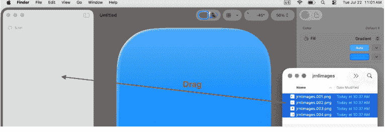

   图 24.8：Icon Composer 文稿，显示 PNG 文件的拖放目标位置

- 5. 确认 Icon Composer 已自动组合你的应用图标，并对每个图像应用了 Liquid Glass 效果：

   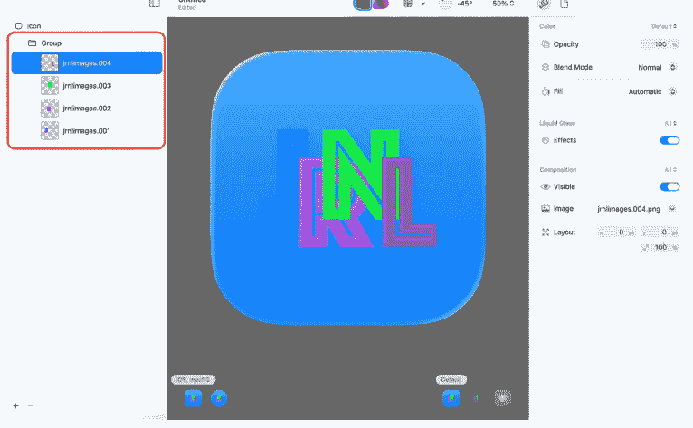

   图 24.9：Icon Composer 文稿，显示应用图标

## 将图标添加到你的项目中

至此，你已经为项目创建了图标。接下来，你将使用 Xcode 导入图标，并使用 Simulator 预览它在各种模式下的显示效果。请按照以下步骤操作：

- 1. 打开你在上一章（第 23 章“采用 Liquid Glass”）中修改的 JRNL 项目。

- 2. 将 Icon Composer 文件拖到项目的项目导航器中。

   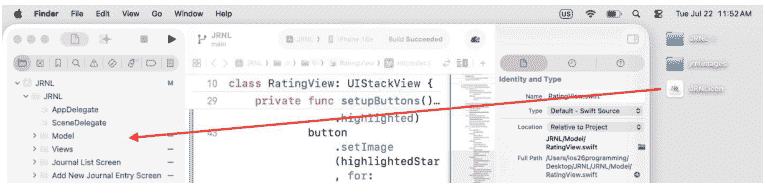

   图 24.14：Xcode 项目，显示 Icon Composer 文件的拖放目标位置

- 3. 在“选择这些文件的添加选项”窗口中，按截图所示进行配置，然后点击“完成”：

   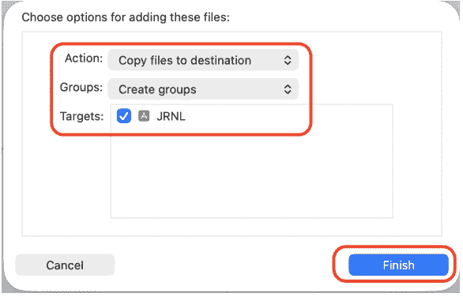

   图 24.15：“选择这些文件的添加选项”窗口

- 4. 在项目导航器中，点击 JRNL 项目并选择项目目标。在“通用”标签页中，将“应用图标”设置为上一步中添加的 Icon Composer 文件的名称：

   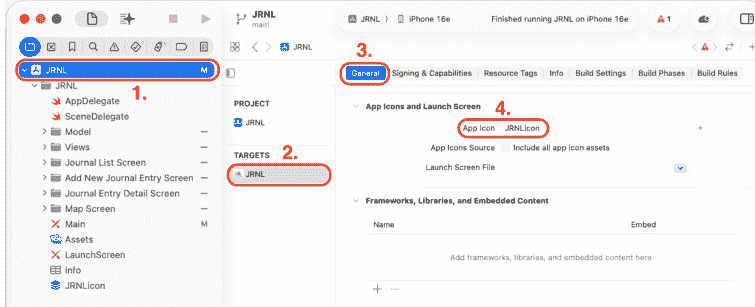

   图 24.16：Xcode 项目，显示“应用图标”已设置为 Icon Composer 文件的名称

- 5. 构建并运行你的项目，然后停止运行。你将在 Simulator 屏幕上看到你的应用的新图标：

   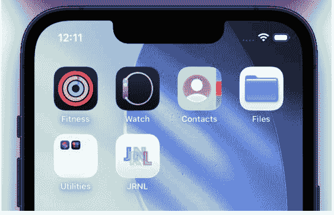

   图 24.17：Simulator 显示 JRNL 应用的新图标

- 6. 从 Simulator 菜单栏的 **“功能”** 菜单中选择 **“切换外观”**。Simulator 将切换到深色模式，**JRNL** 图标也会自动变为深色变体：

   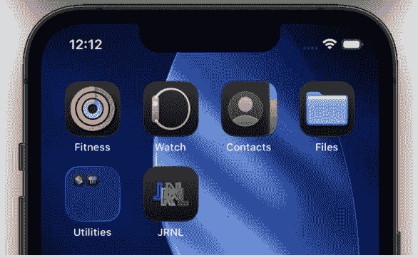

   图 24.18：处于深色模式的 Simulator，显示更改后的 JRNL 应用图标

你已使用 Icon Composer 创建了一个图标，并成功将其添加到 JRNL 项目中！太棒了！

## 小结

在本章中，你学习了如何使用 Icon Composer 为 JRNL 应用构建图标。

你首先使用 Keynote 为图标的每个图层生成带有透明背景的 PNG 文件。接着，你将 PNG 文件添加到 Icon Composer，并调整了每个图层的属性。最后，你将它添加到项目中，并在 Simulator 中测试了其外观。

现在你知道了如何使用 Icon Composer 为自己的应用创建图标。

在本节对 SwiftUI 的简要介绍中，你已经了解了如何使用 SwiftUI 构建 JRNL 应用的简化版本。

在下一章中，你将了解 **Apple Intelligence**，以及如何使用它来生成代码并为你的应用添加一些很酷的功能。

## 加入我们的 Discord

与其他读者、专家和本书作者一同阅读这本书。

提出问题、为其他读者提供解决方案、通过“Ask Me Anything”问答环节与作者交流，以及更多精彩内容。扫描二维码或访问链接加入社区。

https://packt.link/LdIDT/


