## 25 Apple Intelligence

在 2024 年苹果全球开发者大会（WWDC）上，苹果推出了 **Apple Intelligence**——一个将强大生成模型置于苹果设备中的个人智能系统，为你的应用带来全新 AI 驱动的功能。这些功能包括 **写作工具（Writing Tools）**、**图像游乐场（Image Playground）**、**Genmoji** 和 **支持 App Intents 的 Siri**。

在本章中，你将在应用中实现 Apple Intelligence 功能。首先，你将了解 Apple Intelligence 及其功能。接下来，你将看到预测性代码补全如何帮助你编写应用。之后，你将了解写作工具（Writing Tools）并查看它在应用中的运作方式。然后，你将在应用中实现图像游乐场（Image Playground）。最后，你将了解 Genmoji，并查看它在应用中的运作方式。

学完本章后，你将学会如何在 Xcode 和应用中使用 Apple Intelligence 功能。

本章将涵盖以下主题：

- 关于 Apple Intelligence
- 在 Xcode 中使用预测性代码补全
- 在你的应用中实现写作工具（Writing Tools）
- 在你的应用中实现图像游乐场（Image Playground）
- 在你的应用中实现 Genmoji

### 技术要求

你将继续处理你在 *第 24 章“Icon Composer”* 中修改过的 JRNL 项目。

本章的资源文件和完整 Xcode 项目位于本书代码包的 Chapter 25 文件夹中，可在此处下载：
https://github.com/PacktPublishing/iOS-26-Programming-for-Beginners-10E

观看以下视频，了解代码的实际运行效果：
https://youtu.be/wgfrKZaj4VI

让我们从下一节开始了解 Apple Intelligence。

### 关于 Apple Intelligence

Apple Intelligence 是一个人工智能平台，由设备端和服务器端处理组成，将支持一系列出色的新功能，帮助用户沟通、工作和表达自我。这些功能包括以下内容：

- 预测性代码补全，帮助你使用 Xcode 编写代码
- 写作工具（Writing Tools），帮助用户校对、改写和总结文本
- 图像游乐场（Image Playground），允许用户创建有趣好玩的图像
- Genmoji，让用户能够创建适合任何场合的表情符号
- 支持 App Intents 的 Siri，让开发者能够赋予 Siri 在其应用内执行操作的能力

Apple Intelligence 对所有 Apple 用户免费，并且苹果在 2025 年持续为其添加新功能。

要了解 Apple Intelligence 的最新更新，请观看此视频：
https://developer.apple.com/videos/play/wwdc2025/360/

你可以通过此链接查看 Apple Developer 上关于 Apple Intelligence 的文档：
https://developer.apple.com/apple-intelligence/

在下一节中，你将了解 Apple Intelligence 如何帮助你为应用编写代码。


- 3. 将出现“下载预测性代码补全模型？”提示。点击“下载”按钮以下载并安装语言模型，并等待它完成：

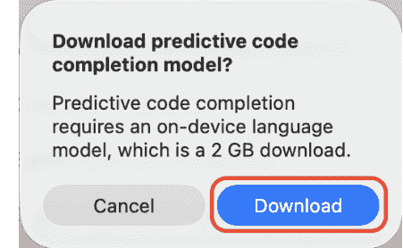

图25.2：“下载预测性代码补全模型？”提示

- 4. 在“设置”窗口中点击“组件”标签，并验证“预测性代码补全模型”是否存在：

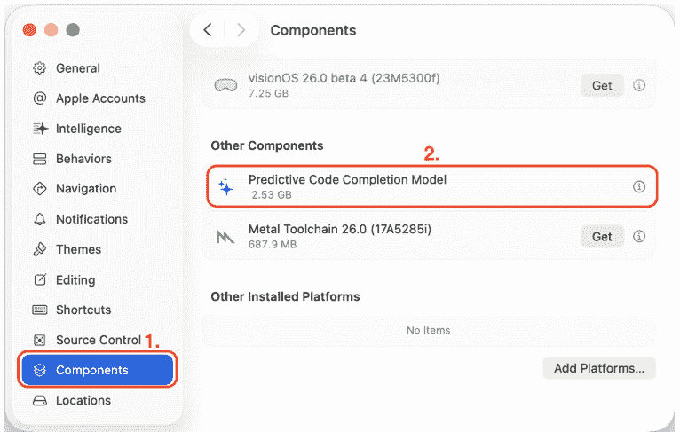

图25.3：显示“组件”标签的“设置”窗口

- 5. 在项目导航器中右键单击“JRNL”文件夹，并选择“从模板新建文件...”。在模板选择器中选择“Swift 文件”，并将文件命名为“Employee”。它将出现在项目导航器中。

- 6. 在导入语句之后输入以下注释和代码：

```
// This file contains the definition of the Employee structure, a method that will generate sample data, an EmployeeDatabase structure containing an array of Employee instances and methods to add, delete and find employees in an array.
struct Employee
```

- 7. Xcode 将显示一个预测性代码建议。按 Tab 键接受它：

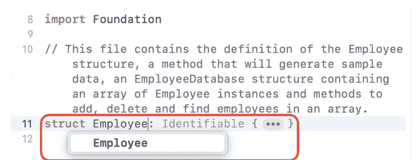

图25.4：显示预测性代码建议的编辑器区域

- 8. Xcode 将显示 Employee 结构可能具有的属性列表。按 Tab 键接受它：

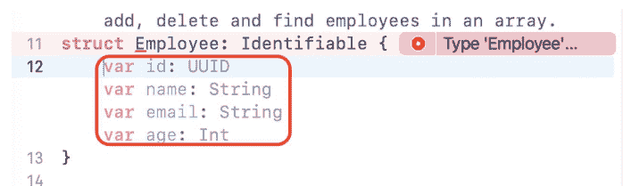

图25.5：显示预测性代码建议的编辑器区域

请注意，Xcode 已自动为你创建了 Employee 结构。太酷了！

- 9. 在 Employee 结构定义之后输入 extension Employee，然后按 Tab 键接受预测性代码建议。

- 10. 验证 Xcode 是否已自动创建了一个生成示例数据的方法：

```
14      var email: String
15      var age: Int
16  }
17
18 extension Employee {
19     static func generateSampleData(count: Int = 20)
20         -> [Employee] {
21         var employees: [Employee] = []
22         for i in 1...count {
23             let id = UUID()
24             let name = "Employee \(i)"
25             let email = "employee\(i)@example.com"
26             let age = Int.random(in: 18...65)
27             employees._
28         }
29     }
30 }
```

图25.6：显示语法错误的编辑器区域

请注意，可能存在一些需要你修复的语法错误。随着 Apple 不断更新语言模型，这种情况可能会有所改善。

修复语法错误后，你的代码应如下所示：

```
struct Employee: Identifiable {
    var id: UUID
    var name: String
    var email: String
    var age: Int
}

extension Employee {
    static func generateSampleData(count: Int = 20) -> [Employee] {
        var employees: [Employee] = []
        for i in 1...count {
func findEmployee(withId id: UUID) -> Employee? {
    return employees.first(where: { $0.id == id })
}
}
```

借助预测性代码补全，你只需很少的输入量，就成功创建了注释中描述的类和方法！太棒了！

但请注意，生成的代码并非完美无缺，你需要按需修复错误和其他问题。

在下一节中，你将学习如何实现编写工具，以校对、重写和总结应用中的文本。

## 在你的应用中实现编写工具

编写工具是一项系统级的 Apple Intelligence 功能，可帮助你校对、重写和总结文本。只要你的应用使用的是 UITextView、NSTextView 或 WKWebView，当你的应用在受支持的环境中运行时，编写工具就会自动出现。Apple 还引入了文本视图委托方法和属性，以便你的应用在使用编写工具时采取适当的操作。

要观看 Apple 关于编写工具的 WWDC24 视频，请参阅 https://developer.apple.com/videos/play/wwdc2024/10168/。

要查看编写工具的实际效果，你将在 Mac 上运行 JRNL 应用，并使用编写工具修改“添加新日志条目”屏幕中的文本。你还将探索 Apple 引入的新文本视图委托方法和属性。请按以下步骤操作：

- 1. 在 Mac 上打开“系统设置”，在侧边栏中选择“Apple Intelligence 与 Siri”，然后打开“Apple Intelligence”：

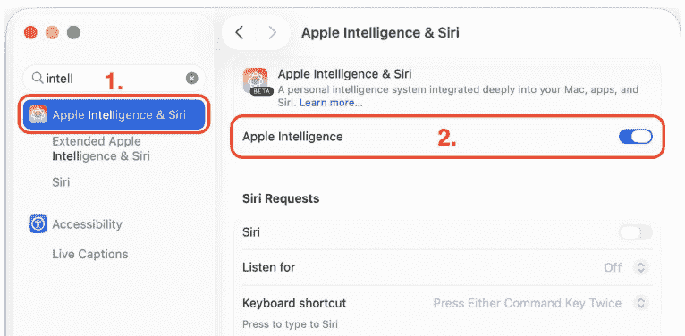

图25.7：已打开 Apple Intelligence 的“系统设置”窗口

- 2. 在 Xcode 中，打开 JRNL 项目，并从工具栏的目标菜单中选择“我的 Mac（专为 iPad 设计）”：

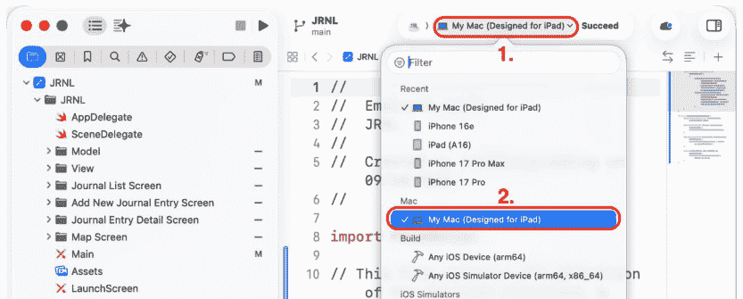

图25.8：选择了“我的 Mac（专为 iPad 设计）”的目标菜单

日志
地图
新建条目
保存
还原
校对
1 / 1
完成
获取位置
日志标题

LEGO Mindstorms EV3（风格化写法：LEGO MINDSTORMS EV3）是 LEGO Mindstorms 机器人套件系列的第三代也是最后一代产品。它是第二代 LEGO Mindstorms NXT 套件的继任者。“EV”这个名称指

second generation

断字处理

此处应使用“second-generation”而不是“second generation”。

图25.12：在文本视图中查看编写工具的更改

请按以下步骤操作：

- 1. 在项目导航器中，点击 Main 故事板文件。在文档大纲中点击“新建条目”场景。

- 2. 点击“资源库”按钮以显示资源库。在筛选字段中输入 long。将出现一个“长按手势识别器”对象。将其拖到图像视图上：

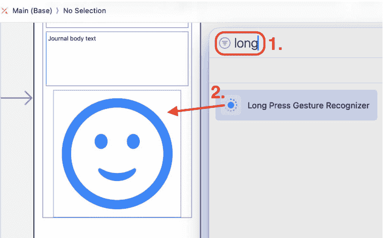

图25.14：选择了“长按手势识别器”对象的资源库

- 3. 如果你需要更多工作空间，请点击“导航器”和“检查器”按钮。点击“调整编辑器选项”按钮，并从弹出菜单中选择“助手”：

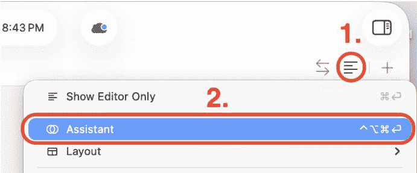

图25.15：选择了“助手”的“调整编辑器选项”菜单

- 6. 验证 getAIImage(_:) 方法已在 AddJournalEntryViewController 类中创建。点击“x”关闭助手编辑器窗口：

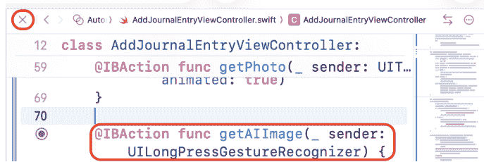

图25.18：显示 getAIImage(_:) 方法的助手

你已成功将长按手势识别器添加到“新建条目”场景中的图像视图，并将其链接到 AddJournalEntryViewController 类中的 getAIImage(_:) 方法。现在，你将添加代码，以便在用户长按图像视图时生成 AI 图像。请按以下步骤操作：

- 1. 在项目导航器中，点击 AddJournalEntryViewController 文件。在文件中的所有其他导入语句之后，添加一条导入语句以导入 ImagePlayground 框架：

```
import UIKit
import CoreLocation
import ImagePlayground
```

- 2. 在 getAIImage(_:) 方法之后添加以下私有方法：

```
private func generateAIImage(prompt: String) async throws -> UIImage? {
    var generatedImage: UIImage?
    do {
        let creator = try await ImageCreator()
        let images = creator.images(
            for: [.text(prompt)],
            style: .sketch,
            limit: 1)
        for try await image in images {
            let anImage = image.cgImage
            generatedImage = UIImage(cgImage: anImage)
}
} catch {
    generatedImage = UIImage(systemName: "exclamationmark.triangle")
    print("Image creation error.")
}
return generatedImage
}
```

此方法实例化一个 ImageCreator 实例，并根据文本提示生成一张 AI 图像。此处使用了 `.sketch` 风格，如果你愿意，也可以尝试另外两种风格：`.animation` 和 `.illustration`。如果 AI 图像创建成功，生成的图像会被转换为 UIImage 实例并返回。如果 AI 图像创建失败，则返回一个三角形内带有感叹号的图像。

你可以通过此链接了解有关 ImageCreator 类的更多信息：https://developer.apple.com/documentation/imageplayground/imagecreator

- 3. 按如下所示修改 getAIImage(_:) 方法：

```
@IBAction func getAIImage(_ sender: UILongPressGestureRecognizer) {
    if sender.state == .ended {
        photoImageView.image = UIImage(systemName: "progress.indicator")
        guard let prompt = bodyTextView.text else { return }
        Task {
            let generatedImage = try await generateAIImage(prompt: prompt)
            photoImageView.image = generatedImage
        }
    }
}
```

此方法使 photoImageView 显示进度指示器，获取 bodyTextView 的内容作为图像生成的文本提示，并调用 generateAIImage(prompt:) 方法。返回的图像被赋给 photoImageView 的 image 属性。


4. 在你的 Mac 上构建并运行该应用，点击 + 按钮以显示“添加新日记条目”屏幕。在文本视图中输入描述你想要生成的图像的句子，然后长按图像视图。几秒钟后，基于你提供的描述生成的 AI 图像将会出现：


图 25.19：Mac 上“添加新日记条目”屏幕中显示的 AI 生成图像

现在你可以在日记条目中添加 AI 生成的图像了！很酷！在下一节中，你将学习如何向新日记条目添加 Genmoji。

按照以下步骤操作：

- 1. 在你的 Mac 上构建并运行该应用，点击 + 按钮以显示“添加新日记条目”屏幕。
- 2. 点击正文文本视图，并从 Finder 的输入菜单中选择“显示表情符号与符号”以显示字符查看器：

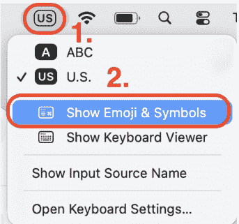

图 25.20：输入菜单中“显示表情符号与符号”处于高亮状态

> 如果你在 Mac 上看不到输入菜单，请参阅此链接：https://support.apple.com/en-kg/guide/mac-help/mchl p1560/mac。
- 3. 点击字符查看器右上角的 Genmoji 按钮：

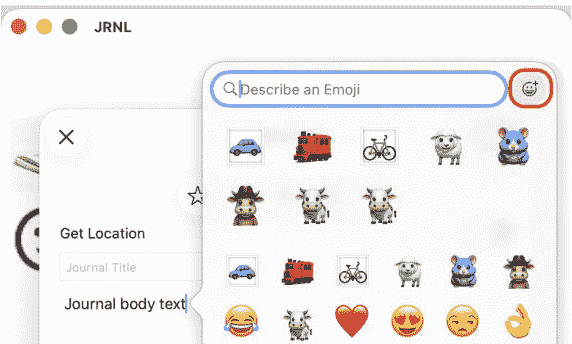

图 25.21：字符查看器中 Genmoji 按钮处于高亮状态

4. 输入 Genmoji 描述（例如“戴手套的猫”），等待其生成，然后点击“添加”将其添加到正文文本字段中：

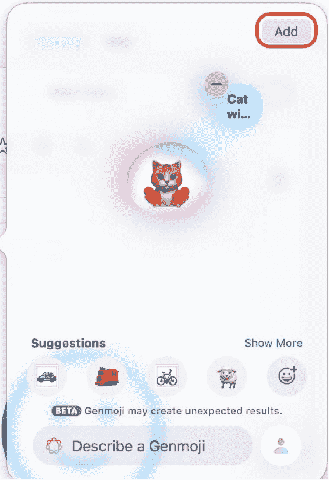

图 25.22：Genmoji 创建屏幕中“添加”按钮处于高亮状态
