## 26

## Foundation Models

Apple 在 WWDC25 期间推出了 **Foundation Models** 框架。这是一个新的框架，可让你访问 Apple 的设备端大型语言模型。此基于文本的模型可根据提示生成新的文本。

在本章中，你将为 *JRNL* 应用配置一个新屏幕，该屏幕将使用 Foundation Models 框架帮助你撰写日记条目。

你将首先了解 Foundation Models 框架。接下来，你将查看 *JRNL* 应用的一个版本，其中添加了一个额外的标签页。该标签页显示一个新屏幕，允许你为大型语言模型输入提示并显示结果文本，但目前还无法使用。之后，你将添加代码来实现所需功能，最后，你将测试应用以查看其工作原理。

在本章结束时，你将学习 Foundation Models 框架的基础知识以及如何将其实现到自己的应用中。

将涵盖以下主题：

- - 关于 Foundation Models
- - 查看 Assist 屏幕
- - 实现 Foundation Models 框架

### 技术要求

你将使用 JRNL 项目的修改版本，该版本已添加了新屏幕。

本章完成的 Xcode 项目位于本书代码包的 Chapter26 文件夹中，可在此处下载：

https://github.com/PacktPublishing/iOS-26-Programming-for-Beginners-10E

观看以下视频以查看代码运行情况：

https://youtu.be/ImS27Gb0KRk

让我们先了解 Foundation Models 框架及其工作原理。

### 关于 Foundation Models

Foundation Models 框架是你在上一章学到的 Apple Intelligence 功能的核心。它位于设备上，因此无需互联网连接即可工作。你可以使用它在应用中实现智能功能，例如文本生成、文本提取和摘要。

要观看 Apple 关于 Foundation Models 框架的 WWDC2025 视频，请参阅此链接：https://developer.apple.com/videos/play/wwdc2025/286/。要查看 Apple 开发者文档中关于 Foundation Models 框架的内容，请参阅此链接：https://developer.apple.com/documentation/foundationmodels。

在撰写日记条目时，你可能会发现表达自己很困难。如果能以某种方式创建示例日记条目，然后再根据自己的需要进行自定义，那就太好了。使用 Foundation Models 框架，你可以为 JRNL 应用实现一个屏幕，用户可以在其中输入提示并生成示例日记条目。在下一节中，你将查看具有此类屏幕的 JRNL 应用版本。

### 查看 Assist 屏幕

为了允许用户输入提示并生成示例日记条目，需要用户界面。你将查看 JRNL 应用的一个版本，其中添加了一个名为 Assist 屏幕的新屏幕。该屏幕有一个文本字段，用户可以在其中输入提示，结果随后显示在文本视图中。用户可以根据需要修改文本视图中的文本。

当你点击 **Assist** 标签时，应用将显示此视图控制器的屏幕。用户随后可以在文本字段中输入提示，点击 **Generate** 按钮，并在文本视图中查看生成的文本。

你可能希望回顾本书的 *第 2 部分*，其中介绍了如何使用 Interface Builder 为应用创建用户界面，并尝试使用 *第 25 章 Apple Intelligence* 中的 JRNL 项目作为起点，自己创建此屏幕。

4. 在项目导航器中点击 **Assist Screen** 文件夹中的 **AssistViewController** 文件。你应该在编辑器区域中看到以下代码：

```
import UIKit

class AssistViewController: UIViewController {

    // MARK: - Properties
    @IBOutlet var promptTextField: UITextField!
    @IBOutlet var resultTextView: UITextView!

    // MARK: - View controller lifecycle
    override func viewDidLoad() {
        super.viewDidLoad()
        promptTextField.delegate = self
        resultTextView.delegate = self
    }

    // MARK: - Actions
    @IBAction func generateButtonTapped(_ sender: UIButton) {
        resultTextView.text = "Generating..."
        let prompt = promptTextField.text ?? ""
        resultTextView.text = "The generated text from this prompt: \
        (prompt)"
    }
}

extension AssistViewController: UITextFieldDelegate,
UITextViewDelegate {
```

```
// MARK: - UITextFieldDelegate
func textFieldShouldReturn(_ textField: UITextField) -> Bool {
    textField.resignFirstResponder()
    return true
}

// MARK: - UITextViewDelegate
func textView(_ textView: UITextView, shouldChangeTextInRanges ranges: [NSValue], replacementText text: String) -> Bool {
    if (text == "\n") {
        textView.resignFirstResponder()
    }
    return true
}
```

如你所见，AssistViewController 类有两个 outlet 分别链接到 Assist Scene 中的文本字段和文本视图，以及一个链接到按钮的 action。当按钮被点击时，文本视图中的文本被设置为 "Generating..."，文本字段中的文本被赋给 prompt。文本视图中的文本随后显示 "The generated text from this prompt:" 后跟 prompt 的内容。

在你的 Mac 上构建并运行该应用。点击 Assist 标签以显示 Assist 屏幕。在文本字段中输入一些文本并点击 Generate 按钮。文本视图随后将显示 The generated text from this prompt: 后跟你之前在文本字段中输入的文本，如下所示：

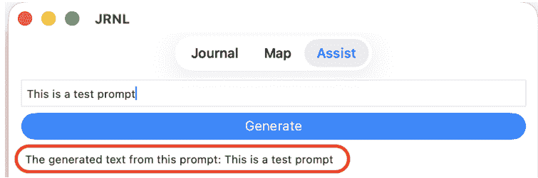

图 26.2：在你的 Mac 上运行的应用显示 Assist 标签

现在你熟悉了 Assist 屏幕，在下一节中，你将添加 Foundation Models 框架并实现此屏幕的功能。

### 实现 Foundation Models 框架

如你所见，当点击 Generate 按钮时，应用会显示你在文本字段中输入的提示。为了实现所需功能，首先，你需要检查系统语言模型是否可用。然后，你将实现一个方法，使用 LanguageModelSession() 的实例基于你的提示生成文本。最后，你将向按钮 action 添加代码以调用此方法并在文本视图中显示生成的文本。

> 要查看 Apple 关于使用 Foundation Models 生成内容和执行任务的文档，请参阅此链接：https://developer.apple.com/documentation/foundationmodels/generating-content-and-performing-tasks-with-foundation-models。

使用 Foundation Models 框架，你将添加代码以便应用可以根据你输入的提示生成文本。按照以下步骤操作：

- 1. 在项目导航器中点击 Assist Screen 文件夹中的 AssistViewController 文件。
- 2. 在 import 语句之后添加导入 Foundation Models 框架的代码：

```
import UIKit
import FoundationModels
```

- 3. 在 outlet 声明之后添加一个将被分配 LanguageModelSession() 实例的属性：

```
// MARK: - Properties
@IBOutlet var promptTextField: UITextField!
@IBOutlet var resultTextView: UITextView!

private let session = LanguageModelSession(instructions: "Your job is to write a journal entry for the user based on the short description provided.")

// MARK: - View controller lifecycle
override func viewDidLoad() {
```


4. 并非所有设备都支持 Apple Intelligence。在 `AssistViewController` 类中，在 `session` 属性之后添加一个属性，用于检查系统语言模型的可用性：

```
private let session = LanguageModelSession(instructions: "Your job is to write a journal entry for the user based on the short description provided.")
private var isSystemLanguageModelAvailable: Bool {
    let model = SystemLanguageModel.default
    switch model.availability {
    case .available:
        return true
    case .unavailable(.deviceNotEligible):
        print("Device not eligible")
        return false
    case .unavailable(.appleIntelligenceNotEnabled):
        print("Apple Intelligence not enabled")
        return false
    case .unavailable(.modelNotReady):
        print("Model not ready")
        return false
    case .unavailable(_):
        print("Model not available for unknown reason")
        return false
    }
}
```

5. 在 `AssistViewController` 类中，在右花括号前实现一个方法，该方法将使用 `LanguageModelSession()` 实例根据提示生成文本：

```
// MARK: - Private methods
private func generateResult(prompt: String) async -> String {
    do {
        let result = try await session.respond(to: prompt)
        return result.content
    } catch {
        return "Could not generate content, please try again."
    }
}
```

7. 在你的 Mac 上构建并运行你的应用。点击 Assist 标签页。在文本字段中输入提示，然后点击 Generate 按钮。你的应用应在文本视图中显示生成的文本，如下所示：

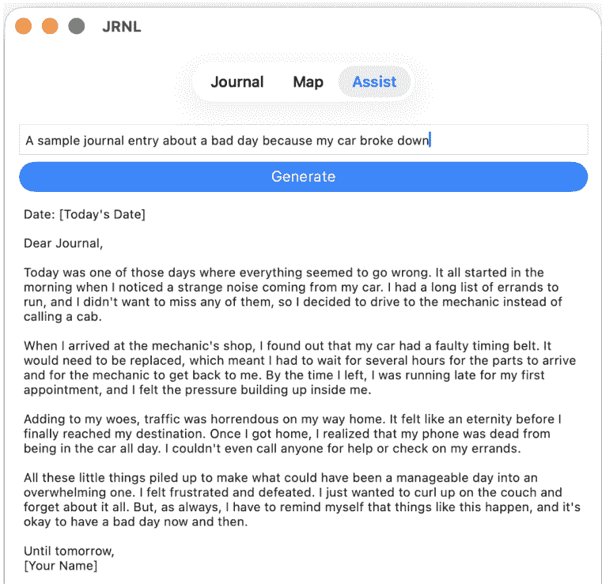

图 26.3：Assist 屏幕显示根据提示生成的文本

8. 你可以通过输入额外的提示来修改已生成的文本，如下所示：

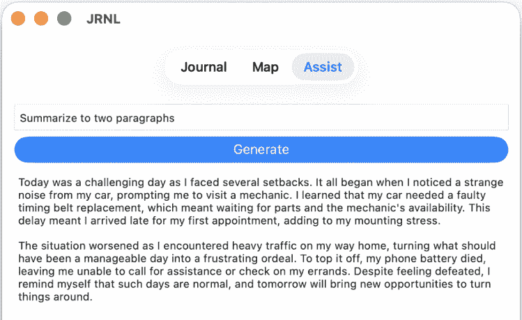

图 26.4：Assist 屏幕显示由第二个提示修改后的生成文本

至此，你已成功将 Foundation Models 框架添加到你的应用中！干得漂亮！

## 本章小结

在本章中，你将 Foundation Models 框架添加到了你的应用中，并使用它根据提示生成文本。

你首先了解了 Foundation Models 框架。接着，你查看了一个新增了标签页的 JRNL 应用版本。之后，你添加了代码来实现所需功能，最后测试了应用，看它能否根据你输入的提示生成文本。

现在你已经掌握了 Foundation Models 框架的基础知识，以及如何为自己的应用实现它。

在下一章中，你将学习如何测试并将你的应用提交到 App Store。

## 加入我们的 Discord

与其他用户、专家以及作者本人一起阅读这本书。

提出问题、为其他读者提供解决方案，通过 Ask Me Anything 环节与作者聊天等等。扫描二维码或访问链接加入社区。

https://packt.link/LdIDT/

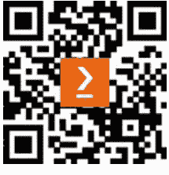

## 技术要求

你需要一个 Apple 账户和一个付费的 Apple Developer 账户才能完成本章内容。

本章没有项目文件，因为它应作为如何提交应用的参考，并不针对任何特定应用。

要查看 App Store 的最新更新，请访问 https://developer.apple.com/app-store/whats-new/。

要了解 App Store Connect 的新功能，请观看此视频：
https://developer.apple.com/videos/play/wwdc2025/328/。

让我们从下一节开始，学习如何获取付费的 Apple Developer 账户，这是提交到 App Store 所必需的。

## 获取 Apple Developer 账户

如你在前面章节中所见，要在设备上测试应用，你只需要一个免费的 Apple 账户。但是，这些应用只能运行几天，而且你将无法添加高级功能，例如“通过 Apple 登录”或将应用上传到 App Store。为此，你需要一个付费的 Apple Developer 账户。请按照以下步骤购买个人/个体工商户 Apple Developer 账户：

1. 前往 https://developer.apple.com/programs/ 并点击 Enroll 按钮。
2. 点击 Start your enrollment。
3. 在提示时输入你的 Apple 账户和密码。
4. 在“信任此浏览器？”屏幕上，只有当你本人是此浏览器的唯一使用者时才点击 Trust，否则点击 Not Now。这是为了保护你的账户信息安全。
5. 点击 Continue enrollment on the web >。
6. 在“确认你的个人信息”屏幕上，输入你的个人信息并点击 Continue。
7. 在“选择你的实体类型”屏幕上，选择 Individual/Sole Proprietor。点击 Continue。
8. 在“查看并接受”屏幕上，勾选页面底部的复选框，然后点击 Continue。
9. 在“完成购买”屏幕上，点击 Purchase。
10. 按照屏幕上的指示完成购买。购买账户后，前往 https://developer.apple.com/account/ 并使用你购买 Developer 账户时所用的同一 Apple 账户登录。你应该会看到类似以下内容：

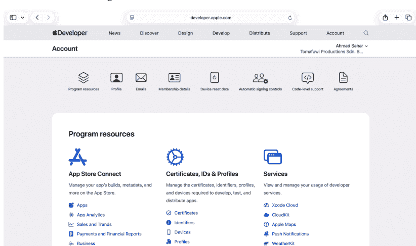

图 27.1：已登录付费 Apple Developer 账户的 Apple Developer 网站

既然你已经拥有了付费的 Apple Developer 账户，让我们在下一节中学习如何配置应用所需的各种设置。

## 关于你的 Apple Developer 账户

你的 Apple Developer 账户包含开发和提交应用所需的一切。你可以查看会员资格状态、添加和组织开发团队成员、访问开发者文档、下载测试版软件等等。不过，所有这些功能都超出了本书的范围，本节将只涵盖让你的应用上架 App Store 所需的内容。

以下是创建开发和分发证书的方法：

1. 登录你的 Apple Developer 账户并点击 Certificates：

图 27.4：已登录付费 Apple Developer 账户的 Apple Developer 网站

2. 你将看到 Certificates 屏幕。点击 + 按钮：

图 27.5：显示 + 按钮的 Certificates 屏幕

3. 点击 Apple Development 单选按钮，然后点击 Continue：

图 27.6：显示 Apple Development 单选按钮的 Create a New Certificate 屏幕

4. 点击 Choose File：

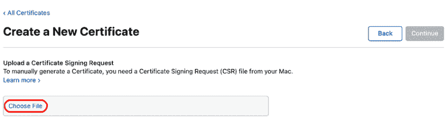

图 27.7：上传 CSR 屏幕

5. 选择你之前保存到硬盘的 CSR 文件并点击 Choose，然后上传你的 CSR。

6. 点击 Continue：

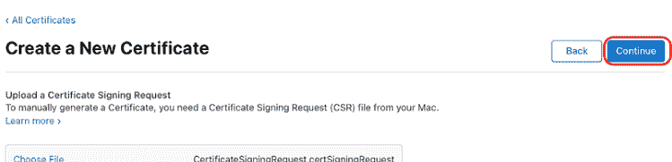

图 27.8：已上传证书的 CSR 上传屏幕

7. 你的证书将自动生成。点击 Download 将生成的证书下载到你的 Mac 上：

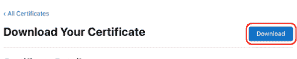

图 27.9：下载你的证书屏幕

8. 双击下载的证书以将其安装到你的 Mac 上。

9. 再次重复步骤 3-8，但这次在步骤 3 中选择 Apple Distribution 单选按钮：

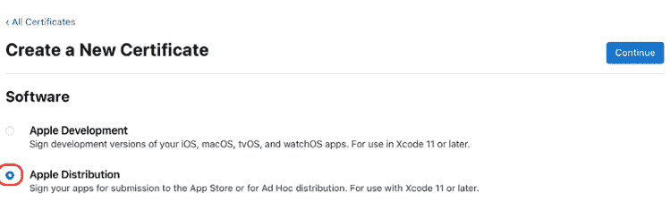

图 27.10：显示 Apple Distribution 单选按钮的 Create a New Certificate 屏幕

太棒了！你现在已经拥有了开发和分发证书。下一步是为你的应用注册 App ID，以便在 App Store 中标识它。你将在下一节中学习如何执行此操作。

## 注册 App ID

当你在第 1 章“Hello, Xcode”中创建项目时，你为它创建了一个包标识符（也称为 App ID）。App ID 用于在 App Store 中标识你的应用。在将应用上传到 App Store 之前，你需要在你的开发者账户中注册此 App ID。以下是注册 App ID 的方法：

1. 登录你的 Apple Developer 账户并点击 Identifiers。
2. 点击 + 按钮：

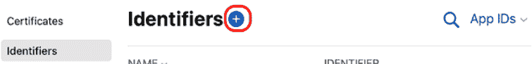

图 27.11：Identifiers 屏幕

3. 点击 App IDs 单选按钮并点击 Continue：

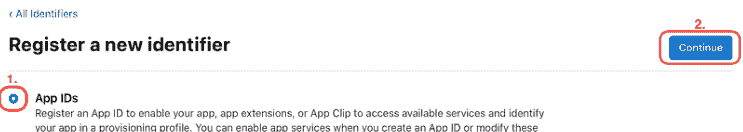

图 27.12：注册新标识符屏幕


4. 点击“App”，然后点击“继续”：

图 27.13：标识符类型屏幕

5. 为此 App ID 输入描述，例如“JRNL Packt Publishing App ID”。勾选“显式”按钮，并在字段中输入应用的 Bundle ID。确保该值与您创建项目时使用的 Bundle 标识符相同。完成后点击“继续”按钮：

图 27.14：描述和 Bundle ID 屏幕

应用发布后，您将无法再更改应用的 Bundle ID。

6. 点击“注册”：

图 27.15：注册屏幕

您的 App ID 现已注册完成。太棒了！在下一节中，您将注册用于测试应用的设备。

## 注册您的设备

要在个人设备上运行应用进行测试，您需要先将这些设备注册到您的开发者账户中。以下是注册设备的步骤：

1. 登录您的 Apple Developer 账户，然后点击“设备”。
2. 点击“+”按钮：

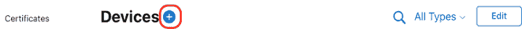

图 27.16：设备注册屏幕

3. 出现“注册新设备”屏幕：

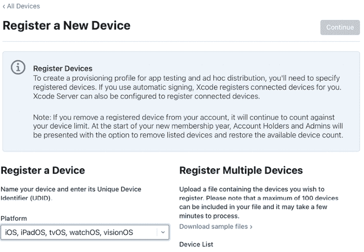

图 27.17：注册新设备屏幕

您需要提供设备名称和设备 ID 来注册您的设备。

4. 将设备连接到 Mac。启动 Xcode，从“窗口”菜单中选择“设备和模拟器”。在左侧窗格中选择设备，并复制“标识符”值：

图 27.18：设备和模拟器窗口

5. 在“设备名称”字段中输入设备名称，并将标识符值粘贴到“设备 ID (UDID)”字段中。点击“继续”：

图 27.19：注册设备屏幕

您已成功注册测试设备。太棒了！下一步是创建描述文件。需要 iOS 应用开发描述文件，以便您的应用能够在测试设备上运行；对于要上传到 App Store 的应用，则需要 iOS App Store 分发描述文件。在下一节中，您将创建开发和分发描述文件。

## 创建描述文件

您需要创建两个描述文件。应用要在测试设备上运行，需要 iOS 应用开发描述文件。iOS App Store 分发描述文件用于将应用提交到 App Store。以下是创建开发描述文件的方法：

1. 登录您的 Apple Developer 账户，然后点击“描述文件”。
2. 点击“+”按钮：

图 27.20：描述文件屏幕

3. 点击“iOS App Development”单选按钮，然后点击“继续”：

图 27.21：注册新描述文件屏幕

4. 选择要测试的应用的 App ID，然后点击“继续”：

图 27.22：选择 App ID 屏幕

5. 勾选一个开发证书复选框，然后点击“继续”：

图 27.23：选择开发证书

要在测试设备上测试应用，您需要使用开发证书、App ID、已注册的测试设备和开发描述文件。要将应用提交到 App Store，您需要使用分发证书、App ID 和分发描述文件。您可以将 Xcode 配置为自动管理这些内容。

在提交应用之前，您必须创建应用的图标并获取应用截图。然后，您可以创建 App Store 上架信息，生成要上传的归档构建，并填写 App Store Connect 信息。随后 Apple 将审核您的应用，如果一切顺利，它就会出现在 App Store 上。

> 要了解更多有关如何提交应用的信息，请访问 https://developer.apple.com/app-store/submitting/。

在下一节中，让我们看看如何为应用创建图标，这些图标会在应用安装后显示在设备屏幕上。

## 为您的应用创建图标

在将应用上传到 App Store 之前，您必须为其创建图标集。以下是为应用创建图标集的方法：

1. 创建一个 1,024 x 1,024 像素的应用图标。
2. 在 Project 导航器中点击 Assets 文件，然后将您创建的图标拖到下图所示的位置：

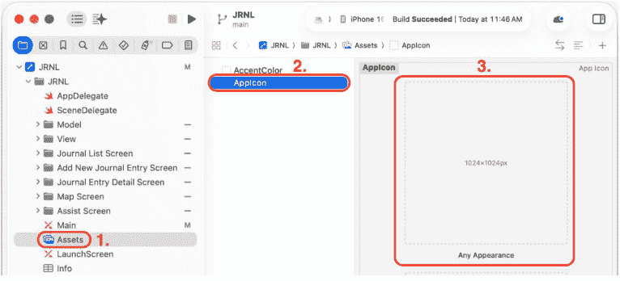

图 27.32：Assets 文件显示应用图标的位置

当您在模拟器或设备上运行应用并退出后，您应该能在主屏幕上看到应用图标。很酷吧！

如第 24 章“Icon Composer”所示，您也可以使用 Icon Composer 为应用创建图标。

接下来，让我们看看如何创建截图。提交 App Store 时需要这些截图，以便客户了解您的应用外观。您将在下一节中完成此操作。

## 为您的应用拍摄截图

您需要应用的截图，这些截图将用于您的 App Store 上架信息。要创建截图，请在模拟器中运行应用，然后点击截图按钮。截图将保存到桌面：

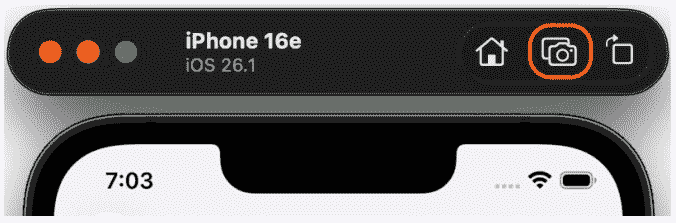

图 27.33：模拟器显示截图按钮

Apple 要求提供应用在配备 6.7 英寸显示屏的 iPhone（如 iPhone 14 Plus）和配备 13 英寸显示屏的 iPad（如 iPad Pro 13 英寸）上运行的截图。如果您没有实际设备，可以使用模拟器来模拟这些设备，并且您的截图应展示应用的功能以及应用在不同屏幕尺寸下的外观。

下一节将更详细地讨论如何提交应用截图，您将学习如何创建 App Store 上架信息。App Store 上架信息包含应用将在 App Store 中显示的所有信息，以便客户在下载或购买您的应用时做出明智的决定。

## 创建 App Store 上架信息

既然您已经有了应用的图标和截图，接下来就要创建 App Store 上架信息。这样客户在下载之前就能看到有关您的应用的信息。请按照以下步骤操作：

1. 前往 http://appstoreconnect.apple.com 并选择“Apps”（应用）：

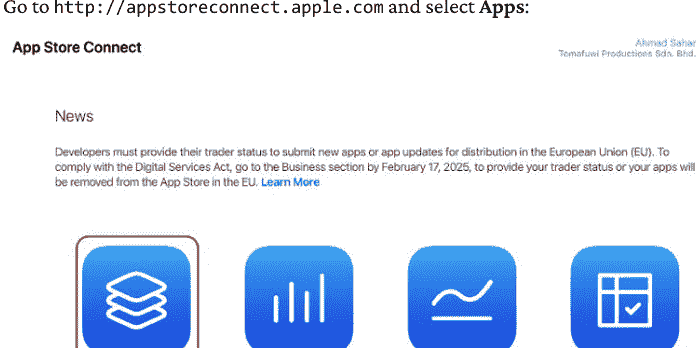

图 27.34：App Store Connect 网站

2. 点击屏幕左上角的“+”按钮，然后选择“新建应用”：

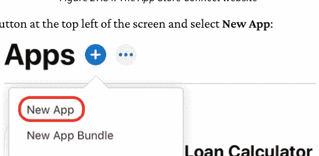

图 27.35：“新建应用”按钮和菜单

3. 屏幕上会出现一个显示字段列表的“新建应用”屏幕：

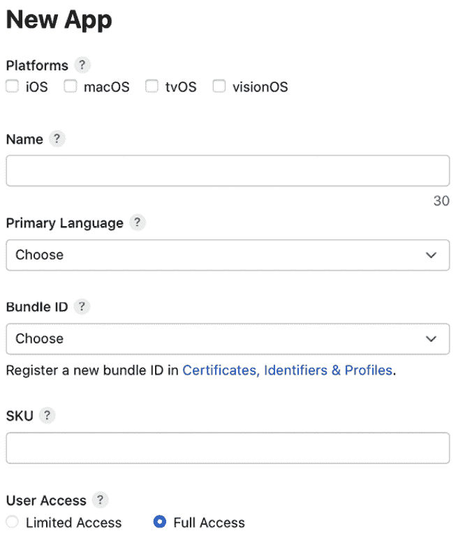

图 27.36：应用详细信息屏幕

4. 输入您的应用详细信息：

- 平台：您的应用支持的所有平台（iOS、macOS 和/或 tvOS）。
- 名称：您的应用的名称。
- 主要语言：您的应用使用的语言。
- Bundle ID：您之前创建的 Bundle ID。

3. 选择屏幕左侧的**App 信息**，并确保所有信息正确无误：

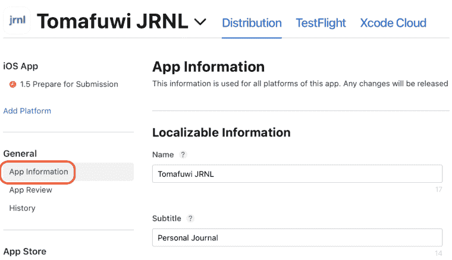

图 27.46：应用信息屏幕

4. 对**定价与可用性**和**App 隐私**部分执行相同操作：

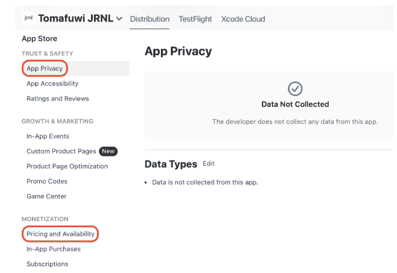

图 27.47：App 隐私屏幕

5. 选择屏幕左侧的“准备提交”。在“App 预览和截图”部分，将您之前拍摄的截图拖入：

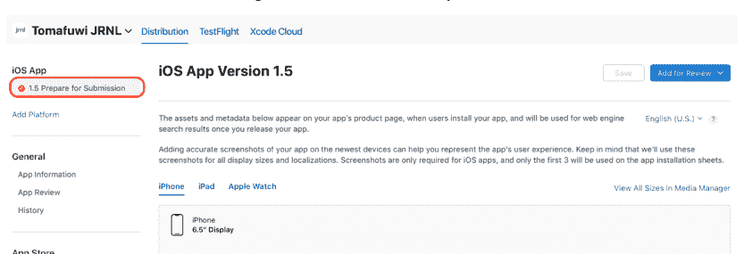

图 27.48：显示 App 预览和截图部分的“准备提交”屏幕

6. 向下滚动并填写“促销文本”、“描述”、“关键词”、“支持 URL”（包含应用的支持信息）和“营销 URL”（包含应用的营销信息）字段：

| 字段 | 值 |
| --- | --- |
| 促销文本 | 记录生活中重要时刻的简单日记应用。 |
| 描述 | 记录生活中重要时刻的简单日记应用。 |
| 关键词 | #Journal |
| 支持 URL | https://tomafuwi.tumblr.com |
| 营销 URL | https://tomafuwi.tumblr.com |

图 27.49：版本信息部分

7. 滚动到常规应用信息部分，并填写所有必填详细信息：

| 字段 | 值 |
| --- | --- |
| 版本 | 1.5 |
| 版权 | Tomafuwi Productions Sdn. Bhd. |
| 路由应用覆盖文件 | 选择文件（可选） |

图 27.50：常规应用信息部分


8. 滚动到 Build 部分，你会看到之前上传的存档构建。如果看不到，请点击 + 或 Add Build 按钮，选择一个构建，然后点击 Done：

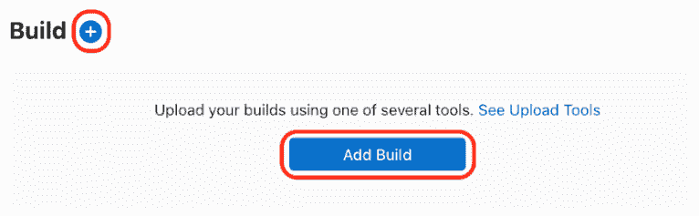

Figure 27.51: 构建选择屏幕

Apple 处理你的提交可能需要长达 30 分钟。

9. 验证你的构建是否在 Build 部分中：

## Build

| BUILD | VERSION | HAS APP CLIP |
|---|---|---|
| 2 | 1.5 | NO |

Figure 27.52: Build 部分

10. 滚动到 App Review Information 部分。如果你想向应用审核员提供任何额外信息，请在此处填写：

## App Review Information

Sign-In Information ?
提供用户名和密码，以便我们登录你的应用。我们需要此信息来完成你的应用审核。

Sign-in required

Contact Information ?

Ahmad
Sahar

Notes ?
中国法律要求在图书和杂志内容的应用在大陆 App Store 上架时必须具备相关许可。如适用，请在下方输入你的许可信息。Learn More

Figure 27.53: App Review Information 部分

11. 滚动到 App Store Version Release 部分并保持默认设置，这样你的应用在 Apple 批准后会立即自动发布：

## App Store Version Release

要使你的应用在 App Store 上可用，你可以在 App Review 批准后自动发布它。你也可以在稍后日期手动在 App Store 上发布。

Manually release this version
Automatically release this version
Automatically release this version after App Review, no earlier than
Your local date and time.
October 13, 2025 3:00 PM
Oct 13, 2025 7:00 AM (GMT)

Figure 27.54: App Store Version Release 部分

12. 滚动回屏幕顶部并点击 Add for Review 按钮：

## iOS App Version 1.5

Save
Add for Review

Figure 27.55: Add for Review 按钮

3. 点击 TestFlight 选项卡：

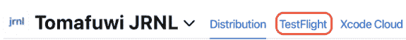

Figure 27.57: TestFlight 选项卡

4. 点击 INTERNAL TESTING 旁边的 + 按钮以创建新的内部测试组：

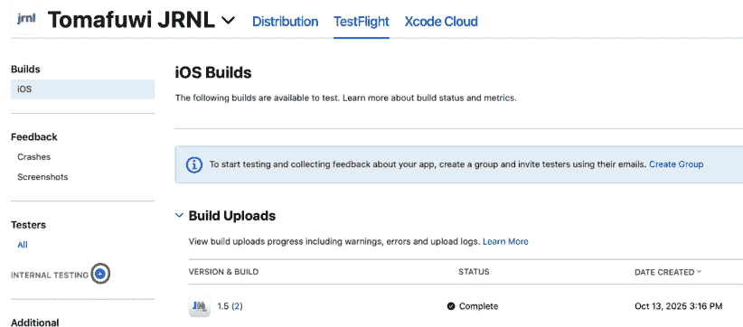

Figure 27.58: 显示 + 按钮的 TestFlight 屏幕

5. Create New Internal Group 对话框将会出现。为你的内部测试组命名并点击 Create：

## Create New Internal Group

你可以添加最多 100 名测试人员，他们可以使用 TestFlight 应用测试构建。

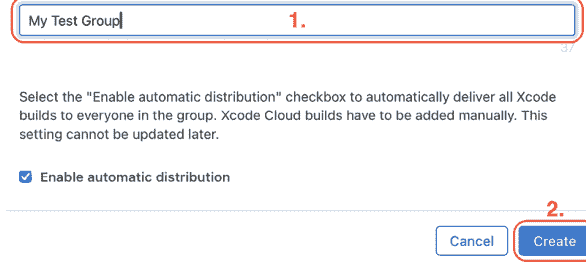

Figure 27.59: Create New Internal Group 对话框

6. 创建测试组后，点击 + 按钮将用户添加到你的组中：

Figure 27.60: 显示 + 按钮的测试组屏幕

7. 选中你想要发送测试构建的所有用户并点击 Add。他们将被邀请测试所有可用构建：

## Add Testers to the Group "My Test Group"

选择最多 100 名测试人员，他们将被邀请在 TestFlight 应用中测试所有可用构建。他们在添加新构建时也会收到通知。如果你想添加看不到的测试人员，请在 Users and Access 中添加他们。

Testers (1 Selected)

1 of 100 Total Testers

| EMAIL ^ | NAME | ROLE |
|---|---|---|
| ☑ [redacted] | Ahmad Sahar | Admin, Account Holder |

Figure 27.61: Add Testers 屏幕

5. 输入测试组的名称并点击 **Create**：

## Create a New Group

你可以将任何人添加到此组，他们可以使用 TestFlight 应用测试构建。
构建可能需要 Beta App Review 的批准。

My External Test Group

Cancel
Create

*Figure 27.64: Create a New Group 屏幕*

6. 点击 **Add Builds** 链接以选择你希望测试人员测试的构建：

## My External Test Group

External Group • 0 Testers • 0 Builds

要开始使用外部测试人员进行测试，请完成以下步骤：

Add Builds
选择要添加到此组的构建。

Invite Testers
选择如何邀请测试人员加入此组。

*Figure 27.65: 显示 Add Builds 链接的外部测试组*

7. 选择其中一个构建并点击 **Next**：

## Select a Build to Test

选择一个构建，我们将邀请组 "My External Test Group" 开始测试。在你的构建可以测试之前，它可能需要 Beta App Review 的批准。

iOS Version 1.5

| BUILD | STATUS | UPLOAD DATE |
| --- | --- | --- |
| 2 | Ready to Submit
Expires in 90 days | Oct 13, 2025 at 3:17 PM |
| 1 | Ready to Submit
Expires in 90 days | Oct 13, 2025 at 3:13 PM |

Cancel Next

Figure 27.66: Select a Build to Test 屏幕

8. 你的测试人员需要知道出现问题时联系谁。输入你的联系方式并点击 Next：

## Test Information

Feedback Email ?

## Contact Information

First Name
Ahmad
Last Name
Sahar

Previous Cancel Next

Figure 27.67: Test Information 屏幕

9. 在提供的框中输入你希望测试人员在此构建中测试的内容，然后点击 Submit for Review：

## What to Test

让你的测试人员知道你希望他们在此构建中测试的内容。此信息将对有权访问此构建的所有组的测试人员可用。

Automatically notify testers

English (U.S.)

Test AI Integration

1.

Previous

Cancel

Submit for Review

2.

Figure 27.68: What to Test 屏幕

Apple 可能在使测试构建对你的测试人员可用之前对其进行审核。如果你的应用被拒绝，你需要修复问题并重新提交。

10. 现在，你将向你的组添加外部测试人员。点击 Testers 选项卡：

My External Test Group

External Group • 0 Testers • 1 Build

Testers

Builds

Settings

Build (1)

BUILD STATUS PLATFORM SESSIONS CRASHES

1.1 (1) Waiting for Review Expires in 90 days iOS - -

Figure 27.69: 显示 Testers 选项卡的 My External Test Group 屏幕

13. 输入你的测试人员的姓名和电子邮件地址。请注意，Apple 会在构建准备好测试时自动通知他们：

## Add New Testers to the Group “My External Test Group”

我们将邀请这些测试人员测试你添加到此组的构建。

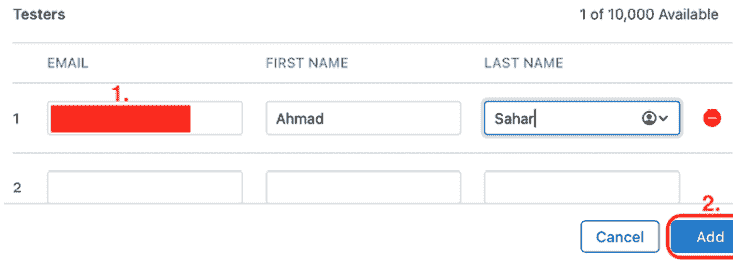

Figure 27.72: Add New Testers to the Group 屏幕

太好了！你现在知道如何内部和外部测试你的应用，并且已经到达本书的结尾！

## Summary

你现在已完成构建应用并将其提交到 App Store 的整个流程。恭喜！

你首先学习了如何获取 Apple Developer 账户。接下来，你学习了如何生成 CSR 以创建证书，从而允许你在自己的设备上测试应用并将其发布到 App Store。你学习了如何创建 bundle identifier 以在 App Store 上唯一标识你的应用并注册你的测试设备。之后，你学习了如何创建开发和生产 provisioning profiles 以允许应用在你的测试设备上运行并上传到 App Store。接下来，你学习了如何创建 App Store 列表并将发布构建提交到 App Store。最后，你学习了如何使用内部和外部测试人员对你的应用进行测试。

你现在知道如何构建自己的应用，对其进行内部和外部测试，并将其提交到 App Store。

一旦应用提交审核，你能做的就是等待 Apple 审核你的应用。如果应用被拒绝也不用担心——这对所有开发者都会发生。通过 *Resolution Center* 与 Apple 合作解决问题的同时，做好研究，了解 Apple 认为可接受和不可接受的内容。

在你的应用上架 App Store 后，欢迎在 Twitter 上联系我 (@shah_apple) 让我知道——我很想看看你构建了什么。

## Get This Book’s PDF Version and Exclusive Extras

扫描二维码（或访问 packtpub.com/unlock）。按书名搜索此书，确认版本，然后按照页面上的步骤操作。

*Note: Keep your invoice handy. Purchases made directly from Packt don’t require an invoice.*

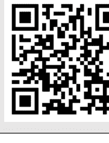


## 解锁您的专属福利

您购买的本书包含以下专属福利：

- 下一代 Packt Reader
- 无 DRM 的 PDF/ePub 下载

按照以下指南解锁这些福利。整个过程只需几分钟，且只需完成一次。

## 三步轻松解锁本书的免费福利

### 第 1 步

请为第 3 步准备好您的购买发票。如果您有实体书，请用手机扫描并将其保存为 PDF、JPG 或 PNG 格式。

如需有关查找发票的更多帮助，请访问 https://www.packtpub.com/unlock-benefits/help。

> 注意：如果您直接从 Packt 购买本书，则无需发票。完成第 2 步后，您即可立即访问专属内容。

## Packt 正在寻找像您一样的作者

如果您有兴趣成为 Packt 的作者，请访问 authors.packtpub.com 并立即申请。我们已与数千名像您一样的开发者和技术专业人士合作，帮助他们与全球技术社区分享见解。您可以进行普通申请，申请我们正在招募作者的特定热门主题，也可以提交您自己的想法。

## 分享您的想法

现在您已经读完了《*iOS 26 编程入门（第十版）*》，我们很乐意倾听您的想法！扫描下方二维码直接进入本书的 Amazon 评论页面，分享您的反馈，或在您购买本书的网站上留下评论。

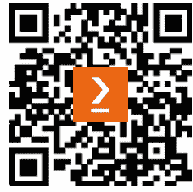

https://packt.link/r/1806023938

您的评论对我们和技术社区非常重要，将帮助我们确保提供优质内容。
