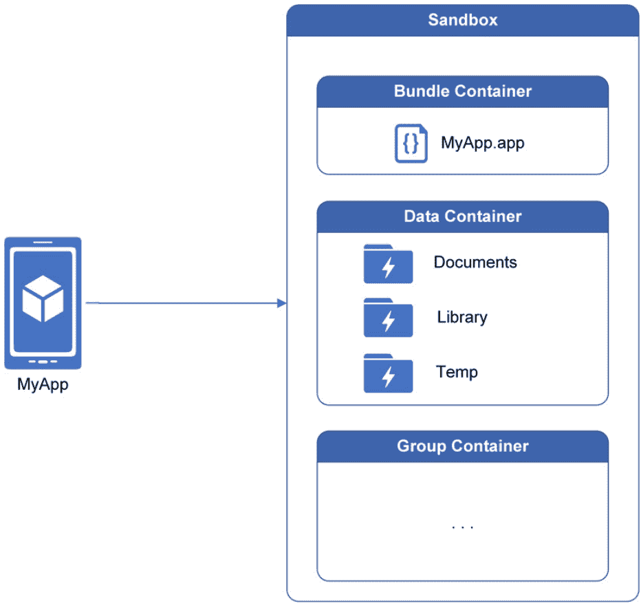
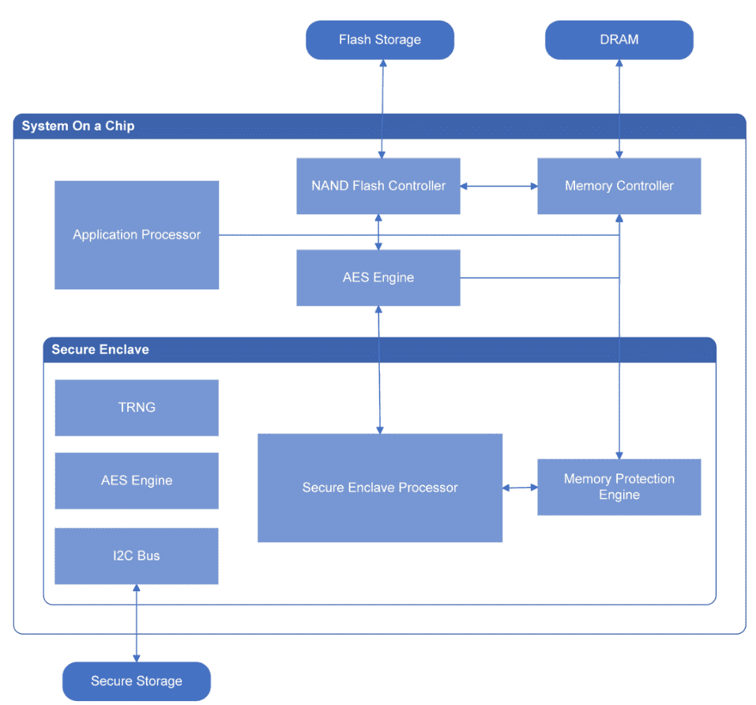
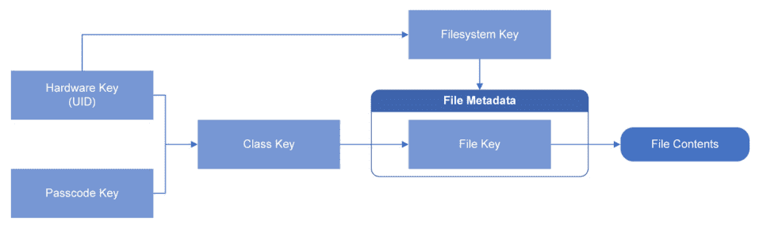

## 第 1 章：介绍 iOS 取证

在过去十年中，智能手机经历了一场深刻的革命，以各种可能的方式影响着我们的生活：我们的设备不再只是智能手机——它们已成为存储我们数字生活（以及非数字生活）各种信息的数据中心。

如今，从手掌中，我们可以冲浪网页、购买戏票、让食物送到门口，或叫一辆 Uber。我们使用设备阅读电子书、做笔记、从事创造性任务，并通过社交媒体与粉丝分享我们的生活。我们逐渐用 iPhone 相册取代了数码相机。智能手机可以跟踪身体活动、与外部设备交互、为我们提供导航，并提醒我们可能忘记的重要会议。我们使用生产力应用来完成工作，并使用 Apple Pay 进行支付。当然——我们使用 iPhone 与世界另一端的人取得联系。随着 iPad 和平板电脑的广泛普及，我们的设备不再只是通信设备。它们已成为一个几乎无限的内容平台，我们可以在其中享受电影、电视剧，或 simply 听我们最喜欢的音乐。

为了能够提供这些令人惊叹的功能，移动设备收集了大量数据，这些数据由 iOS 处理，有时还会同步到 iCloud。这些信息比任何台式电脑上存储的数据更充分地记录并揭示了用户的想法和活动。

移动取证就是收集这些数据、保存它、评估它、验证它，并提取可以作为证据呈现的有意义见解的全部过程。

在本章中，我们将涵盖以下主题：

- 理解移动取证
- 剖析 iOS 操作系统
- 理解 iOS 安全
- 建立工作流程

## 理解移动取证

由于 Apple 设备提供的用户体验、精美的设计和革命性功能而在全球流行，因此 2016 年 Apple 宣布已售出超过十亿部 iPhone 并不令人意外。在过去 5 年中，移动设备的使用量增长尤其迅速，2021 年的数据显示，活跃的 iOS 设备数量达到十亿部。

存储在智能手机上的信息可以帮助调查解决关键问题，揭示个人与谁联系过、在哪里以及他们用设备做了什么。随着新功能被添加到设备中，并且 App Store 上有更多应用可用，存储在 iOS 设备上的信息量持续增长。

移动取证可以定义为在法证可靠的条件下使用经过验证的手段从移动设备恢复数字证据的过程。

我们能从设备上恢复的证据类型取决于设备本身以及用于数据提取的技术，但通常，智能手机包含个人信息，例如通话记录、消息、电子邮件、照片、视频、备忘录、密码、位置数据和传感器数据。没有其他计算设备像手机一样个人化。

通常，检查过程应揭示所有数字证据，包括可能被隐藏、模糊或删除的痕迹。证据是通过应用既定的科学方法获得的，应充分描述数据的内容和状态，包括其位置、潜在意义以及不同数据源之间的关系。取证过程始于从移动设备提取证据的副本。一旦副本可用，下一步涉及分析数据、识别证据并制定最终报告的内容。

## iOS 取证的新黄金时代

在过去 3 年中，数字取证行业经历了一场重大革命。

2019 年，针对 iOS 设备的 **checkm8** 漏洞的发现是一个彻底的游戏规则改变者，因为它为数字取证调查员打开了新的大门，允许对数以亿计的 Apple 设备进行完整文件系统提取。如果你从未见过完整文件系统提取，你可能会对设备存储的数据的范围和种类感到惊讶！

Checkm8 基于一个无法修补的硬件缺陷，该缺陷直接存在于 iOS 设备的芯片上，从运行 Apple A11 芯片的设备一直到 A5 世代。这包括从 iPhone 4S 到 iPhone X 以及多款 iPad。

此漏洞具体是一个 BootROM 漏洞，这意味着它利用了 iOS 设备在启动过程中加载的初始代码中的安全缺陷，并且无法通过 Apple 的软件更新覆盖或修补。

在 2019 年底，**checkra1n** 发布了，这是基于 checkm8 漏洞的第一个公开、闭源越狱。数字调查员和取证分析师已迅速采用 checkra1n 来访问设备的文件系统和钥匙串；然而，与所有越狱一样，此解决方案有几个缺点，因为使用越狱不可避免地会修改设备文件系统上的某些数据，并且不被认为在法证上是可靠的。

出于这些原因，Cellebrite、Elcomsoft 和 Oxygen Forensic 等厂商已开发出基于原始 checkm8 漏洞的专有解决方案，这些解决方案通过修补设备的 RAM 来工作。这些工具允许调查员在不触及系统和用户分区以及不对设备进行任何更改的情况下执行完整文件系统提取，因为漏洞在内存中运行。

换句话说，在选定的设备上，可以利用 checkm8 漏洞提取完整文件系统，而无需实际越狱设备。下表显示了容易受到 checkm8 漏洞攻击的设备列表：

| iPhone 4S | iPhone 5/5c/5s | iPhone 6/6s | iPhone SE |
|---|---|---|---|
| iPhone 7 | iPhone 8 | iPhone X | iPad 2nd–7th gen |
| iPad Mini 2nd and 3rd | iPad Air 1st and 2nd | iPad Pro | Apple Watch 1st–3rd |

表 1.1 – 容易受到 checkm8 漏洞攻击的设备

要利用 checkm8 进行文件系统提取，你的设备必须兼容，并且必须运行受支持的 iOS 版本。这是一个主要缺点，因为较新的设备，例如最新的 iPhone 13，并不受支持。然而，还有其他选择。

在 2020 年，Elcomsoft 和 Belkasoft 等厂商引入了基于代理的提取，这是一种新的采集方法，允许在不越狱设备的情况下进行完整文件系统提取。安装在设备上后，代理通过软件漏洞逃离沙箱，获得对设备的无限制访问，并建立设备与计算机之间的连接。基于代理的提取在法证上是安全的，通常比大多数越狱更快更安全。截至撰写本文时，受支持的设备包括从 5S 到 iPhone 12 的所有 iPhone，运行 iOS 9.0 到 14.3 版本。

在 2020 年 5 月，**unc0ver** 越狱发布了重大更新，增加了对基于 A12-A13 芯片的设备的支持。截至撰写本文时，unc0ver 支持从 iPhone 5s 到 iPhone 12 的所有设备越狱。支持的 iOS 版本范围从 iOS 11 到 iOS 14.3。

尽管越狱设备允许完整文件系统提取，但它不被认为是一个法证可靠的过程。如果受支持，调查员应首先考虑更安全的选项，例如 checkm8 或基于代理的提取。

提示

需要注意 checkm8 基于的提取与通过 checkra1n 或 unc0ver 越狱设备之间的区别。诸如 **Cellebrite UFED** 和 **Elcomsoft iOS Forensics Toolkit** 之类的工具利用 checkm8 漏洞通过在设备 RAM 中运行漏洞来临时提供对整个文件系统的访问。提取完成后，设备将正常重启。不会对设备进行永久更改。

另一方面，越狱设备会留下永久痕迹，并且还需要安装 Cydia 或 AFC2 等第三方软件包，从而对设备进行额外更改。

## iOS 取证中的挑战

智能手机被视为实时、动态系统，因此从取证角度来看，它们带来了几个挑战，因为数据和文件 constantly 变化。

数字调查员可能面临的主要复杂性之一是处理锁定设备：最近的 iOS 更新使密码破解几乎不可能，其他选项必须被考虑以尽可能多地提取数据。

设备数量的增长以及它们运行的软件的多样性使得开发单一工具和一致的工作流程来应对所有情况变得极其困难。这通常是因为用于从一台设备提取数据的方法在发布新版本的 iOS 时会停止工作；事实上，取证提取工具通常依赖于安全漏洞来访问设备的文件系统并提取比 iTunes 备份中通常找到的更多数据，甚至在密码未知时解锁设备。当


新的 iOS 更新发布后，这些漏洞可能会被修补，从而使工具失效。

现代调查人员在接触 Apple 设备时必须考虑这些问题，并应根据具体情况决定采用哪种最佳技术，以获取最广泛的有价值证据。

## 剖析 iOS 操作系统

对来自移动设备的数字证据进行取证检查，不仅需要充分理解数据，还需要了解设备本身如何工作以及这些数据是如何生成的基础知识。这在 iOS 设备上尤其具有挑战性，因为该平台闭源，因而难以理解 iOS 到底如何与所有这些数据交互，以及设备后台发生了什么。

Apple 投入大量精力，通过多项安全特性来限制可在其硬件上运行的操作系统和应用软件：Apple 设备上运行的应用不直接与底层硬件交互，而是通过系统接口进行交互。iOS 可被定义为设备硬件组件与设备上应用之间的中介。

提示

许多出版物都提供有关 iOS 硬件的信息。如需完整的 iPhone 组件和设备列表，请参阅 Apple 支持页面：https://support.apple.com/specs/iphone。

## 理解 iOS 文件系统

自 iOS 10 以来，Apple 文件系统（APFS）已取代 HFS+ 成为默认文件系统。APFS 是一个专有文件系统，专为移动设备而设计：它针对 SSD 存储进行了优化，并支持强加密。在 iOS 设备上，文件系统被配置为两个逻辑磁盘分区——系统分区和用户分区：

- 系统分区包含 iOS 操作系统以及设备随附的所有预加载应用，但这些应用几乎不包含证据信息。系统分区仅在设备执行固件升级时才会更新。
- 用户分区挂载在 /private/var 目录下，包含所有用户创建的数据，并提供与调查人员相关的大部分证据信息。

## 数据在 iOS 文件系统上存储在哪里？

iOS 管理应用与硬件之间通信的例子之一是沙盒机制，它使用户无需直接访问文件系统即可与应用交互，确保每个应用都*被包含*在一个或多个特定容器中，这些容器会在设备上安装新应用时自动创建。这种组织方式让调查人员轻松很多，因为与特定应用相关的所有文件都分组在特定位置。

每个容器都有特定的作用：

- 捆绑包容器包含应用本身，包括从 App Store 下载应用时附带的所有资源。
- 数据容器保存应用和用户的数据，并进一步划分为多个目录，应用可使用这些目录来组织其数据。
- 组容器是应用存储数据的地方，这些数据可以与同组的其他应用共享。

下图展示了每个应用的容器：



图 1.1 – 应用容器示意图

数据容器包含几个不同的文件夹：

- Documents/：此文件夹包含用户创建的文件，并且会自动纳入 iTunes 备份和 iCloud 备份。
- Library/：此文件夹供应用存储与应用相关的数据，并非由用户创建。此文件夹包含在 iTunes 和 iCloud 备份中。
- Temp/：包含应用相关的临时文件，不包含在备份中。

如你所见，所有应用文件都完美地组织到各自的数据容器中。不过，你可能想知道这些容器到底存储在设备文件系统上的什么位置。设备上的每个应用都通过**全局唯一标识符（GUID）**进行标识，也称为 BundleID 标识符。该标识符在应用首次安装时唯一生成，如果应用被更新或重新安装，则可能会改变。

应用捆绑包容器存储在 iOS 文件系统的以下路径中：

```
/private/var/containers/Bundle/Application/<app-GUID>/
```

应用数据容器存储在以下路径中：

```
/private/var/mobile/Containers/Data/Application/<app-GUID>/
```

组容器存储在以下路径中：

```
/private/var/mobile/Containers/Shared/AppGroup/<app-GUID>/
```

提示

在本节中，我们了解了应用在 iOS 文件系统上存储数据的位置。但系统工件呢？系统相关的数据分布在文件系统的各个位置，所以我们不会在一个地方找到所有内容！我们将深入探讨系统工件以及在哪里找到它们，详见_第4章，处理常见iOS工件_。

## iOS 文件系统上的数据是如何存储的？

到目前为止，我们学习了 iOS 如何将应用数据组织到容器中，以及这些容器在文件系统上的存储位置。现在，让我们讨论 iOS 文件系统中通常包含有用证据的文件类型。

除了用户生成的内容（如文档、照片、视频或文本文件）之外，存储在 iOS 设备上的数据通常由以下项目组成：

- **SQLite 数据库**：SQLite 是一个独立、自包含的数据库，可以在一个文件中存储几乎任何类型的数据，包括二进制 BLOB。SQLite 数据库是应用和系统数据的主要存储来源，因此解析这些数据库将是大多数数字调查的重点之一。如果你希望尝试恢复已删除的数据，数据库也极其有用，因为已删除的记录通常会在数据库本身或其临时文件中留下数字痕迹。短信、WhatsApp 对话、通讯录、通话记录、备忘录和浏览器历史记录等基本工件都存储在 SQLite 数据库中。
- **属性列表文件（Plists）**：Plists 是 iOS 和应用用来在设备上存储、组织和访问数据的结构化文件。这些文件可以以 XML 格式或二进制格式存储。通常，plists 用于存储应用设置或用户偏好。
- **其他文件类型**：包括日志文件、XML 文件、Protocol Buffers 和 Realm 数据库。本书稍后将深入介绍这些文件类型。

以下是 XML 格式的属性列表示例：

```
<?xml version="1.0" encoding="UTF-8" standalone="yes"?>
<!DOCTYPE plist PUBLIC "-//Apple//DTD PLIST 1.0//EN"
"http://www.apple.com/DTDs/PropertyList-1.0.dtd">
<plist version="1.0">
    <dict>
        <key>UUID</key>
        <string>3bdd52c7-ee36-4689-8517-c5fed2c98s5</string>
        <key>ClientID</key>
```

iPhone X，苹果推出了 Face ID，它利用面部识别来解锁设备。

解锁受密码保护的 iOS 设备是移动取证中的主要挑战之一。

由于数字密码的组合数量相对较少，理论上可以使用暴力猜测攻击来利用身份验证机制。然而，这极其危险，因为 iOS 被设计为对密码输入尝试进行速率限制，如果失败尝试次数过多，设备上的数据可能会被永久删除。

该密码不仅用于解锁设备本身——它还是 iOS 数据保护模型的关键特性之一：密码与硬件加密密钥结合，用于生成一个唯一且极强加密的密钥，该密钥由算法用来加密用户数据。

## 加密与数据保护

虽然用户身份验证在防止未经授权访问物理设备方面提供了一定程度的安全性，但这些机制仍可能通过利用软件或硬件漏洞而被绕过。被入侵的设备可能会允许未经授权访问设备的文件系统。因此，从 iPhone 4 开始，整个文件系统都使用强大的加密算法进行加密。然而，随着 iPhone 5s 的发布，苹果引入了名为**数据保护**的技术，开创了移动安全的新先例，该技术依靠多个专用组件来支持加密和生物识别。

## 安全隔区

iOS 安全的核心是安全隔区，这是一个与主处理器和操作系统隔离的专用**片上系统（SoC）**，为数据保护和密钥管理提供加密操作。

安全隔区的主要组成部分如下：


- **安全隔区处理器（SEP）**，运行 Apple 修改版的 L4 微内核，并专门为安全隔区提供计算能力。
- 一个内存保护引擎。
- 一个**真随机数生成器（TRNG）**，用于生成随机加密密钥。
- 专用的**高级加密标准（AES）**硬件引擎，通过安全通道直接与 SEP 通信，并在文件写入或读取时执行内联加密和解密。
- 一个**唯一 ID（UID）**，是唯一标识设备的加密密钥。UID 是随机生成的，在设备制造过程中直接熔入安全隔区的硬件中，因此在设备外部不可见。
- 一个专用的、安全的非易失性存储系统，只能由安全隔区访问。数据加密密钥存储在此处，确保这些密钥永远不会暴露给 iOS 系统或应用。

下图显示了安全隔区的各个组件：



### 图 1.2 – 安全隔区组件

安全隔区负责多项与安全相关的操作，包括生成和存储加密设备数据所需的密钥，以及评估来自 Touch ID 和 Face ID 的生物识别数据。

SEP 使用 UID 生成与特定设备绑定的加密密钥。这增加了一层安全保护：如果设备的 SSD 存储被物理移动到另一台设备，文件将无法解密，因此无法访问，因为每台设备都有唯一的 UID，解密文件需要原始的 UID。

### iOS 数据保护密钥

iOS 上的数据保护通过生成和管理分层加密密钥来实现。

为了便于理解，在深入细节之前，我们先来看看加密和解密过程中使用了哪些密钥，以及它们的用途是什么：



图 1.3 – 用于 iOS 数据保护的加密密钥

- 设备的 UID 是一个 AES 256 位密钥，在制造过程中直接熔入安全隔区。该密钥与用户的密码一起，用于解锁*类密钥*。
- 类密钥是在设备上发生特定事件时生成的；例如，当设备被解锁时，会创建一个*完全保护*类密钥。设备锁定后不久，解密后的类密钥即被丢弃。类密钥用于包装和解包文件密钥。
- 文件密钥是 256 位密钥，用于加密每个文件的内容；这些密钥是每个文件独立的密钥，因此每次在用户分区上创建新文件时都会随机生成。文件密钥使用类密钥加密，然后存储在文件的元数据中。所有文件的元数据都使用文件系统密钥加密。
- 文件系统密钥是一个随机密钥，在 iOS 首次安装或设备被擦除时生成。文件系统密钥存储在设备上，其设计目的是在用户

*用户认证*类；这允许数据在保持加密的同时可供设备访问。

### iOS 数据加密和解密

当文件写入文件系统时，文件内容使用每个文件唯一的密钥进行加密，该密钥使用类密钥进行包装，并存储在文件的元数据中。然后，元数据使用文件系统密钥进行加密。

我们已经了解了类密钥是如何结合硬件 UID 和用户密码生成的，而文件系统密钥是在 iOS 安装时生成并存储在设备上。现在，让我们逐步分析单个文件的加密过程：

- 1. 每次在文件系统上创建文件时，安全隔区都会生成一个 256 位的文件密钥，并将该密钥传递给硬件 AES 引擎。
- 2. AES 引擎在文件内容写入闪存时使用提供的文件密钥对其进行加密。
- 3. 然后，根据分配的保护类别，使用四个类密钥之一对文件密钥进行包装，并存储在文件的元数据中。
- 4. 所有文件的元数据都使用文件系统密钥进行加密。

所有密钥处理均在安全隔区内进行，因此操作永远不会暴露给系统及其应用。

解密过程则相反：

- 1. 打开文件时，使用文件系统密钥解密其元数据，从而获取被包装的文件密钥和分配的保护类别。
- 2. 使用类密钥解包文件密钥，然后将其传递给 AES 引擎。
- 3. 硬件 AES 引擎在从内存读取文件时，使用提供的文件密钥解密文件内容。

这里需要理解的关键点是，你用来检查移动设备并从中提取数据的过程，才是使检查具有取证意义的关键。既不是你使用的软件，也不是你使用的硬件，而是你在检查过程中使用的过程，才使其真正具有取证意义。

随着技术不断发展和不同移动设备的上市，这些指南和流程应定期审查。

## 扣押和识别

第一步涉及对设备的物理扣押。这包括收集设备所涉事件类型的信息，以及至少一些关于设备所有者的基本信息。

扣押的方式取决于你所在的司法管辖区，因此你应熟悉有关扣押和分析智能设备的法律及其要求（通常需要搜查令）。在此阶段，你还应对预期找到的数据有一个大致了解，这将有助于你确定具体目标，并根据你的需求规划后续步骤。

首先，你需要记录你所做的每一件事，并考虑如何保全证据。你*如何*处理设备至关重要，并且可能对调查结果产生巨大影响。

你还应记录设备被发现时的状态。以下是一些示例：

- 设备是开机还是关机？
- 设备是否受密码保护？
- 密码是否已知？
- SIM 卡是否存在？
- 是否有可见损坏？
- 设备上的日期和时间是多少？
- 如果设备处于开机状态，正在运行哪些应用？
- 基本所有权信息。

取证合规流程的基本要素之一是，操作应在不以任何方式更改或改变设备上数据内容的情况下进行。请注意，iOS 设备是活跃的动态计算机系统，因此与设备的任何交互都会导致系统文件和数据库发生变化，更不用说可能无意中删除包含有用证据的临时文件了。除下一节将指出的保全操作外，应小心限制与设备的所有交互。

一旦设备被扣押，调查人员可能会忍不住手动访问设备中的数据，例如运行消息应用并直接查看设备屏幕上的对话；然而，应强烈劝阻这种做法，因为这会导致系统日志和其他与系统相关的文件被更改，这不是取证合规的行为。

在此阶段，调查人员还需要识别设备、其硬件型号以及 iOS 版本。如果你想开始评估调查人员从设备中提取证据有哪些选择，这些信息将会很有用。

对于每次检查，调查人员还应识别以下内容：

- 检查设备的法律权限
- 检查的目标
- 其他潜在证据来源（包括云存储）

## 保全


智能手机的设计初衷就是通过蜂窝网络、蓝牙连接和无线 Wi-Fi 网络进行通信。为了防止设备通信，尽快隔离设备非常重要。隔离设备可防止新数据（来电、接收消息等）修改现有证据，从而强制执行数据保存。此外，如果允许设备联网，数据销毁就可能发生，因为 Apple 产品可通过 *kill signal* 远程擦除。

隔离 Apple 设备最简单的方法是启用 **Airplane** 模式；这会停用设备的无线和蜂窝连接。你可以从设备的 **Settings** 中启用 **Airplane** 模式，或如果设备已锁定，可直接从控制中心通过从底部向上滑动启用。如果设备是 iPhone X 或更新机型，你可以通过从右上角向下滑动访问控制中心。不过值得注意的是，隔离设备也可以通过将设备放入法拉第袋来实现，法拉第袋是一种由金属屏蔽制成的容器，可阻断蜂窝网络、GPS 和 Wi-Fi 网络使用的无线电频率。

不要忘记保持设备充电，以确保其不会关机。一般来说，你希望设备保持你发现时的状态：

- 如果设备是关的，就保持关机。
- 如果它是开的，确保你保持开机状态，以免锁定！

如果设备受密码保护且调查人员没有密码，这一点尤其重要：如果设备断电，它将从 AFU 状态转变为 BFU 状态，从而使数据恢复变得更加困难，在某些情况下甚至不可能。我们将在本章后面了解更多关于设备状态的信息。

### Tip

最常见的错误之一是从未锁定的设备中取出 SIM 卡以将其与蜂窝网络隔离。在处理不同设备时这可能有意义，但你应避免从 iPhone 或 iPad 中取出 SIM 卡，因为这样做会导致 iOS 自动锁定设备，生物识别解锁将被禁用，并且 USB 限制模式将被激活。

成功扣押并隔离设备后，应注意维护设备的保管链。NIST 将保管链定义如下：

> “一种通过记录处理证据的每个人的信息、收集或转移的日期/时间以及转移目的，来跟踪证据在其收集、保护和分析生命周期中的移动的过程。”

你可以通过访问以下网站了解更多关于此主题的信息：

[CSRC.nist.gov](https://csrc.nist.gov/)。

## Acquisition

Acquisition 是从设备获取信息和证据的过程。

在实际采集过程开始之前，你应该清楚地了解自己正在寻找哪种证据，因为这会对你选择的工具产生很大影响。

一般来说，有三种不同类型的数据采集，调查人员选择的方法会影响可以从设备中提取的数据量：

- Logical acquisition
- Full filesystem acquisition
- Physical acquisition

在下面的表格中，你可以看到每种方法可以提取哪种数据：

| | Logical | Filesystem | Physical |
|---|---|---|---|
| Calls, calendars, contacts, and messages | ✓ | ✓ | ✓ |
| User content (photos, videos, notes, and so on) | ✓ | ✓ | P |
| Keychain | Limited | ✓ | ✓ |
| Third-party app data | Limited | ✓ | ✓ |
| Apple Pay | - | ✓ | ✓ |
| Location data (radio cells, GPS fixes, and so on) | - | ✓ | ✓ |
| Mail | - | ✓ | ✓ |
| User activity logs | - | ✓ | ✓ |
| System logs | - | ✓ | ✓ |
| Deleted data (unallocated space) | - | - | ✓ |
| Deleted data (SQLite databases) | Limited | ✓ | ✓ |

表 1.2 – 不同采集方法可提取数据的比较

## Logical and filesystem extractions

正如你所见，逻辑采集将从设备中提取一些用户生成的数据，例如照片、消息和笔记。逻辑提取通常是最简单、最快速的提取类型，大多数取证工具都支持它。然而，考虑到 iOS 设备上可用的文件数量，只有获取完整的完整文件系统才能访问宝贵的证据，例如第三方应用数据、精确的位置数据和生活模式信息。

文件系统提取是设备用户分区的文件和文件夹的表示；通过分析数据库和临时文件（例如 WAL 文件），可以部分恢复已删除的数据。

## Physical extraction

iPhone 4 及更早的设备可以进行完整的、取证可靠的整个原始磁盘物理提取。这种提取提供的数据最多，就像标准硬盘一样，系统和用户分区以及磁盘的未分配区域都会被提取。这非常有用，因为它允许调查人员恢复已删除的数据，包括消息、照片和视频。然而，随着 iOS 5 的引入，Apple 改变了磁盘上数据的加密方式，并启用了其他安全功能，例如数据保护类密钥。截至撰写本文时，提取现代 iOS 设备的物理镜像是不可能的。

## Choosing the best acquisition method

调查人员应始终先执行逻辑采集，然后如果可能的话，再尝试文件系统或物理采集。

通常需要越狱设备才能实现对设备文件系统的不受限制访问；然而，越来越多的厂商增加了运行取证可靠的基于 checkm8 的提取（所有操作都在设备的易失性 RAM 中执行）或基于代理的提取的可能性。这两个选项都允许你在不越狱设备的情况下获取完整的文件系统。

归根结底，你选择的方法通常取决于四个变量：

- 你发现设备的状态（锁定或未锁定）
- 设备型号和 iOS 版本
- 你可以使用的工具
- 越狱设备的可能性

如果设备已锁定且你没有密码，就没有一种简单的解决方案可以始终绕过 iOS 安全。然而，根据设备型号，有几个选项可以提供有限的数据。我们将在下一章详细介绍这些选项。

如果设备未锁定，根据可用工具，你可以尝试文件系统提取。你应该从较不具侵入性的选项开始，例如内存中的 checkm8 漏洞利用，如果你的工具支持的话。如果设备不允许 checkm8 漏洞利用，你可以尝试基于代理的提取，如果 iOS 版本兼容的话。虽然这需要安装代理到设备上并且可能会发生一些小的更改，但这被认为在取证上是安全的。如果这两个选项都不可用，你可以考虑通过 checkra1n 或 unc0ver 越狱设备。确保你了解越狱的工作原理，它如何影响设备以及风险是什么。最后，如果这些选项都不可用，你将不得不进行逻辑采集。

我们将在下一章学习有关从 iOS 设备提取数据的所有内容，但现在重要的是要注意，手机应使用经过测试、可重复且尽可能取证可靠的方法进行采集。强烈建议在测试设备上使用各种工具进行实验，以确定哪种采集方法和工具最适合不同的设备。

如果你无法直接访问设备，还有其他证据来源可供考虑，例如 iTunes 备份和 iCloud 提取。

## Analysis

进行取证检查的主要目的是找到、提取和处理与特定案件或调查相关的证据。

虽然没有标准流程来分析你从设备中提取的内容，但以下是一些可以帮助你入门的指南：

- 浏览所有可用数据，以熟悉设备上发现的主要证据来源。
- 使用你的工具和取证软件快速解析常见的数据源，例如 SMS 数据库、已安装应用、通话记录、照片等。
- 尝试使用软件恢复任何已删除的数据，并通过手动 carving 二进制文件、日志、plists 和 SQLite 数据库进行恢复。


- 通过搜索特定于调查的关键词和细节来识别关键证据。
- 从文件中收集元数据并查找隐藏证据（时间戳、地理位置数据、二进制 BLOB 等）。
- 查找不同证据之间的关系。
- 对所有获取的证据进行时间分析，建立相关证据和事件的时间线。

当处理的数据量有限时，可能通过手动浏览工作站上的所有文件夹并查看文件内容来评估证据。然而，当面对数 GB 的数据源时，包括 SQLite 数据库、缓存和 plists，你很可能不得不求助于取证工具。在这种情况下，调查人员必须制定策略，根据数字证据的类型和调查目标使用最佳工具。

我们将在 *第 2 章，从 iOS 设备获取数据* 和 *第 3 章，使用取证工具* 中详细介绍商业工具，但在那之前，必须指出所有移动取证工具都只是应用软件。这些工具并不是只需点击按钮就能进行自主处理和报告的神奇事物！数字调查人员必须了解每个工具的 *功能* 和局限性。

移动取证工具通常在可执行的提取类型上有所不同，但不同工具也兼容不同的设备和不同版本的 iOS 操作系统。鉴于各种不同的移动设备类型，没有任何单一软件支持所有移动设备。

自动化工具可以加快处理庞大数据集所需的时间，我坚信现代调查人员应拥有不止一种工具可用。然而，这一过程不能替代系统化、手动的取证检查和验证。

最终，一切都取决于目标设备型号、iOS 版本、提取类型、检查的目标以及产生的证据以后可能如何使用。

## 验证

在处理完设备上的证据后，调查人员必须验证已执行的所有步骤的准确性。此过程不应仅专注于验证从设备提取的数据。它还应包括验证用于检查的工具，并验证整个过程以确保其以取证可靠的方式进行。

不幸的是，验证是最容易被忽视的方面之一。

在开始检查之前，强烈建议在测试设备和已知数据集上尝试各种工具，以确定哪些获取和分析工具最适合特定的 iOS 设备型号和版本。

既定的程序应指导获取和分析设备的过程。当调查人员处理来自第三方应用或 **未识别取证对象 (UFOs)** 的数据时尤其如此。必须测试实践，以确保获得的结果是 *有效* 的并且可以独立 *重现*。

被要求就其发现作证的检查员应能够解释不仅 *发现* 了什么证据，还应解释 *在哪里* 发现该数据以及 *如何* iOS 操作系统生成了这些证据。这可能涉及手动解码二进制数据和文件雕刻。分析用户数据被解析出的实际二进制文件以及 SQLite 数据库和 plists，为调查人员提供了深入分析 iOS 设备文件系统的机会，提取出仅依赖自动工具可能遗漏的证据。

以下列表类似于有关验证和确认的最佳实践：

- **哈希值**：在获取过程中应对从设备提取的所有文件进行哈希处理，以确保不会发生任何更改。如果进行文件系统提取，可以在过程结束时为每个文件计算哈希值。数据完整性可以通过为单个文件计算哈希并将其与原始值进行检查来验证。
- **确定性工具：** 用于检查的所有工具都应是确定性的：在相同情况下，给定工具在给定相同输入数据时应产生相同的输出。
- **数据验证：** 检查设备上存储的已知数据是否准确报告，未做任何修改。一般来说，从设备提取的数据应与在设备屏幕上查看的数据相匹配。
- **工具准确性：** 工具输出的质量应通过使用多个工具提取/处理相同数据并比较结果来检查。
- **流程测试：** 在处理 UFOs 或尚未建立检查流程的证据时，通过在不同设备上和已知控制条件下测试每个解决方案来验证你的发现，并评估每次测试的结果。

## 报告

移动取证过程中的最后一步是报告。报告可以定义为准备一份详细摘要，说明为从移动设备获取和分析数字证据所做的工作。取证报告还应包括所有相关证据，以清晰简洁的方式呈现，以及调查得出的结论。

许多取证工具提供内置的报告功能，允许你自动生成数字报告，其中包含来自调查的项目，例如以下内容：

- 关键证据
- 设备识别（型号、序列号、电话号码等）
- 案件编号和分析员姓名
- 检查进行的日期和时间
- 用于提取和分析的工具

根据你的司法管辖区，取证报告还应描述数据是如何提取的（逻辑、物理或文件系统提取），并解释为确保整个过程可重复且取证可靠所采取的措施。

## 时间线分析

最常见的取证报告形式之一包括时间分析，其定义为创建设备上在指定日期和时间发生的事件时间线的过程。

时间线通常包括来自各种来源的数据；例如，位置数据、系统日志和消息证据可以结合起来，从而发现发生了什么、在哪里发生以及何时发生。

确定设备上事件发生的时间并通过报告日志、文件和时间戳将设备使用与个人关联起来可能非常有用。

## 总结

在本章中，我们了解了取证检查的目标以及发现 checkm8 漏洞如何为从 iOS 设备获取数据提供新的机会。

首先，我们介绍了 iOS 操作系统并讨论了其安全架构的一些关键元素，例如安全飞地和数据保护。然后，我们介绍了 iOS 取证检查的步骤。

第一步是扣押设备并采用保留证据的技术，例如将设备放入法拉第袋或启用飞行模式。有不同的方法可以从 iOS 设备获取数据，这取决于型号、iOS 版本和可用工具。本章涵盖了逻辑和文件系统获取技术，以及越狱和基于代理的提取。

分析证据应遵循彻底的验证流程，以确保商业工具产生一致的结果，并且证据已以取证可靠的方式处理。

最后，我们了解了取证报告中应包含的关键要素。

下一章将详细讨论 iOS 数据获取，并提供对用于进行取证检查的工具的实践方法。


