## 第 2 章：从 iOS 设备获取数据

与台式电脑相比，移动设备在数据获取阶段会带来一套独特的问题。虽然在台式电脑的世界里，有一种成熟的工作流程可以让调查人员进行所谓的 *取证可靠* 的获取，但在处理移动设备时，并没有一种一刀切的程序可以适用于每一种设备。当我们处理 iOS 设备时，这一点变得更加明显，因为各种机型和不同版本的 iOS 意味着，要实现令人满意的获取，所执行的程序会因设备本身而异。通常，某种特定的工具、漏洞利用或厂商解决方案在设备更新到新的 iOS 版本后就会停止工作。对于大多数依赖公开漏洞的越狱来说，这就是典型情况，而这些漏洞随后会被苹果修复。另一个挑战是可能需要处理锁定设备；在这种情况下，从设备中提取有用信息的机会要少得多。

因此，数据获取可以说是 iOS 取证工作流程中最具挑战性的方面。因此，在本章中，我们将讨论各种解决方案，首先区分不同类型的获取方法及其局限性。然后我们将进入实践阶段，学习如何对 iOS 设备执行逻辑、文件系统和物理获取。

在本章中，我们将涵盖以下主题：

- 理解获取方法
- 越狱设备
- 快速取证设备
- 执行逻辑获取
- 执行完整文件系统获取

### 理解获取方法

在第一章中，我们简要讨论了获取方法以及逻辑、文件系统和物理提取之间的区别。现在我们将在此基础上深入研究更高级的主题，以全面了解它们的工作原理以及我们能从每种获取方法中期望获得何种数据。

### 逻辑获取

逻辑获取通常是从 iOS 设备提取最常见类型证据最简单、最快的方式。如果设备已解锁或你拥有密码，你肯定能够执行逻辑获取，因为所有 iOS 设备都支持它；基于 **Apple File Connection (AFC) 协议**，这种获取本质上等同于运行本地（iTunes）备份，一些取证工具实际上会依赖苹果的库和 iTunes 功能从设备中提取数据。

逻辑获取可以使用免费软件如 **iTunes**、第三方库如 `libimobiledevice`，或使用取证软件来执行。在本章的后续部分中，我们将使用三款最受欢迎的数字取证工具来执行逻辑获取：*Cellebrite UFED、Elcomsoft iOS Forensic Toolkit 和 Magnet ACQUIRE。*

正如我们在上一章中所了解的，逻辑获取的主要限制在于提取数据的深度和质量；虽然它会包含 *大部分* 用户生成内容，例如短信、通话记录、照片和笔记，但它 *不会* 包含其他珍贵的痕迹，例如电子邮件、位置数据、第三方应用和精确的系统日志。这里的关键点是，苹果和 iOS 开发者可以通过决定哪些文件会包含在备份中、哪些文件不会备份来限制逻辑提取。例如，许多流行应用，如 **Twitter、Facebook、Instagram、Telegram** 或 **Signal**，不会将其文件包含在本地备份中，因此这些痕迹无法通过逻辑获取获得。

为了让事情变得更加复杂，在 iOS 4 发布时，苹果引入了一项功能，使用户能够使用密码 **加密** 本地备份。此设置可通过 iTunes 激活，一旦启用，后续所有备份都将使用提供的密码自动加密。换句话说，如果我决定启用备份加密，下一次在任何电脑上尝试本地备份时，就需要密码才能读取备份文件。显然，这对取证调查人员来说在多个方面都构成问题；如果启用了备份加密且密码未知，从逻辑获取中提取的数据将毫无用处，因为无法解密它。一些取证工具，如 Elcomsoft Phone Breaker，允许调查人员通过暴力破解密码来攻击加密备份；然而，这并不能保证密码会被有效恢复，而且暴力破解攻击通常需要相当长的时间。

不过，还有另一种选择。自 iOS 11 起，苹果引入了直接从设备中删除用于加密本地备份的密码的可能性。

这里有个前提：虽然此解决方案效果完美，但它不仅会删除加密密码，还会重置 *所有* 设备的设置。显然，这会对设备中存储的一些文件产生影响，但如果没有备份密码的访问权限，这可能是你唯一的选项。

以下是重置本地备份加密密码的方法：

- 1. 在 iOS 设备上，进入 **设置 | 通用 | 还原**。
- 2. 选择 **还原所有设置** 选项并输入设备密码。
- 3. 按照步骤还原设备。

按照此流程，你不会丢失任何用户数据或其他密码，但它会重置通用设备设置，如壁纸、显示设置等。这当然会导致系统文件和数据库发生一些变化；因此，如果你处理的是刑事案件中的设备，请确保你了解对原始设备进行更改的后果，并确保你有法律授权执行此类操作。

### 提示

需要注意的是，自 iOS 13 起，如果用户决定加密本地备份，将包含更多数据，包括来自钥匙串、通话、健康数据、Safari 历史记录等的数据。在执行逻辑获取时，大多数取证工具会检查是否启用了备份加密，如果未启用，则会临时启用以获取尽可能多的数据，并在获取过程结束后再次禁用。请记住这一点——如果你在执行逻辑获取前不加密备份，你将错过关键证据！

为了更好地了解在逻辑提取中可以期望找到哪些痕迹，请查看以下从 *Cellebrite Physical Analyzer* 截取的屏幕截图，其中显示了通过逻辑获取从 iOS 设备获取的数据：

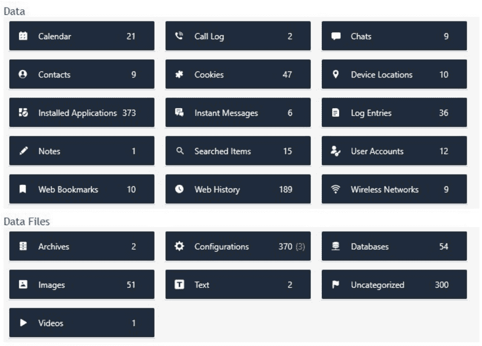

图 2.1 – 通过逻辑获取获取的数据

你想要执行逻辑获取的主要原因是在处理较新设备时，因为它们通常在 iOS 更新发布后就会得到支持，因此你不必等待太久即可开始收集证据；然而，正如我们已经讨论的那样，许多项目不会包含在逻辑获取中。

与标准逻辑提取相比，完整文件系统提取或物理提取可让调查人员访问 iOS 设备上更多用户数据，包括完全访问钥匙串，其中还将包含可用于解密来自 Signal、Wickr、Snapchat 或 Facebook 等安全应用的数据的加密密钥。

通过获取完整文件系统，调查人员还将获得许多系统痕迹的访问权限，例如设备上发生的完整事件历史记录（锁定/解锁状态、用户交互、已安装


applications, AirDrop, Bluetooth, camera, and airplane mode history). Also, a lot more geodata will be available from a full filesystem acquisition, including artifacts from cell towers, Wi-Fi connections, and GPS locations with the corresponding geo-coordinates and timestamps.

The following screenshots show the differences between a logical acquisition and a full filesystem acquisition from the same device; the full filesystem extraction, on the right, contains a lot more data:

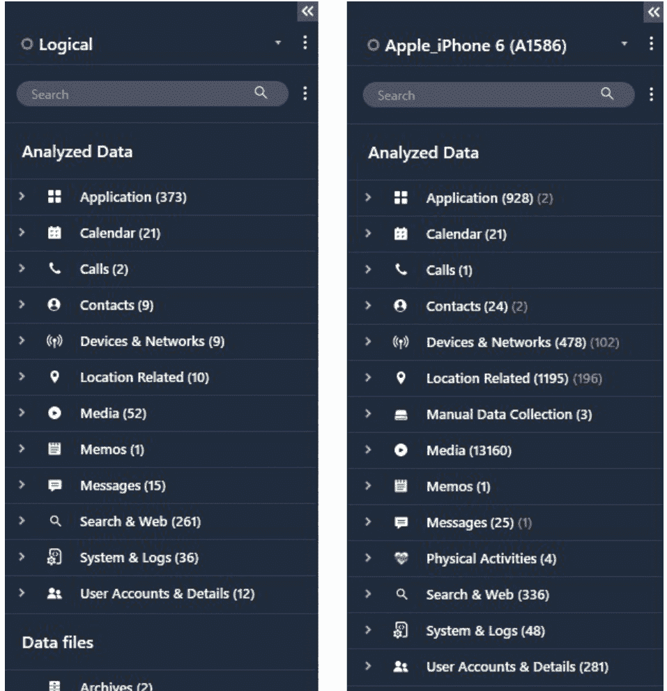

still obtained during a filesystem acquisition, but the examiner is also granted access to raw files stored within the device. This allows investigators to access, for example, databases of all third-party applications without restrictions, and recovery of deleted artifacts can also be attempted.

Although there are many tools that allow you to perform this kind of acquisition, Apple restricts direct access to the device's filesystem, so you will have to find a workaround to gain full access to the device before a full filesystem acquisition can be performed.

So, you may be wondering – how do I access the device filesystem? Is a **jailbreak** required? Although jailbreaking is one of the available options, it is not the only one.

At the time of writing, there are three different solutions to gain access to the device's filesystem:

- Using tools that leverage Checkm8, a BootROM exploit
- Using an extraction agent
- Jailbreaking the device

## Checkm8

The publication of the Checkm8 vulnerability in 2019 by the hacker @axi0mX, which is based on an unpatchable vulnerability present in the BootROM of millions of iOS devices, is arguably the biggest game changer ever in the forensics industry.

Checkm8 is compatible with A5 to A11-based devices; this includes all devices starting from the iPhone 5s up to the iPhone X, as there is no working implementation for 4S hardware.

Before we get into the details, it's useful to understand how the iOS boot procedure works and why the Checkm8 vulnerability cannot be patched.

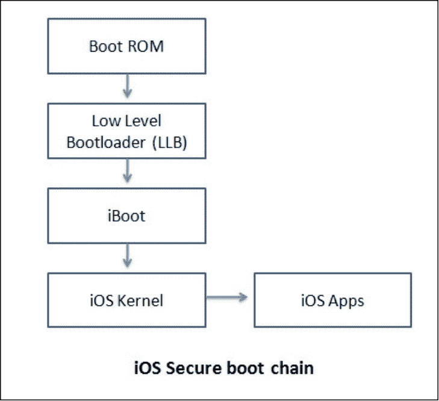

Figure 2.3 – iOS secure boot chain

As you can see, the first step in the boot process is the execution of the code from the device's BootROM. This stage of the process is implicitly trusted because, as its name implies, the BootROM is a read-only memory component that cannot be modified after manufacturing by anyone, not even by Apple.

The Checkm8 exploit is based on a vulnerability that resides within this portion of read-only memory, so this means that Apple has no way of patching it, leaving hundreds of millions of iOS devices vulnerable. To have a better understanding of what a breakthrough this is, keep in mind that the previous BootROM exploit was discovered in 2010!

### Tip

If you're interested in the technical details, you can find a full report on the Checkm8 vulnerability at the following link:

In light of these limitations, some vendors have come up with a built-in solution that allows investigators to perform a full filesystem acquisition, exploiting the Checkm8 vulnerability but *without* actually jailbreaking the device.

Currently, this feature is available in some of the most popular forensic tools, including *Cellebrite UFED*, *Elcomsoft iOS Forensic Toolkit*, and *Oxygen Forensic Detective*.

The difference between these solutions and performing a traditional jailbreak through checkra1n is that these tools do not modify the device in any way; the exploit is performed in the device's RAM. Once the acquisition process ends, the device will reboot normally, leaving no traces.

Whenever possible, this should be the preferred method to acquire the full filesystem from an iOS device, as this is definitely the most forensically sound solution.

## Agent-based acquisitions

The main drawback in Checkm8 acquisitions is that they're not supported by newer devices like the **iPhone 12** or the **iPhone 13**, as these devices are not vulnerable to the Checkm8 exploit.

In 2020, vendors responded to these limitations by providing an alternative method to extract the full filesystem from any iOS device, including the latest iPhone 12; this solution relies on installing an extraction agent that will exploit software vulnerabilities, gain access to the entire filesystem, and establish a secure connection between the device and the computer.

Although this method requires installing an application (**the agent**) on the device, this is considered forensically safe, as the agent leaves a drastically smaller footprint compared to other solutions, like jailbreaking the device. The only traces left on the device are some minor changes in system log files; however, because of this, depending on your jurisdiction, you may need authorization or legal authority to use this method.

The following is a list of requirements to use this method:

- Supported iOS devices: all devices starting from the iPhone 5s up to iPhone 12.
- Supported iOS versions: iOS 9.0 through to iOS 14.3.
- Using an **Apple ID** registered in Apple's Developer Program is strongly recommended for installing the agent on the device, as this relieves the need to open internet access on the device.

Currently, *Elcomsoft iOS Forensic Toolkit* and *Belkasoft Evidence Center X* are the only tools that provide agent-based extraction capabilities.

## Jailbreaking the device

Finally, let's talk about jailbreaks! We've seen how it's possible to extract a full filesystem from an iOS device by exploiting the CheckM8 vulnerability or by performing an agent-based acquisition. However, as we've learned, both these methods have their limitations, and there could be some cases where jailbreaking the device is your only option to perform a filesystem acquisition.

Applying a jailbreak will leave some permanent traces on the device, so this option should only be considered as a last resort and only if you have the legal authority to do so.

At the moment, the most popular jailbreaks are **checkra1n** and **unc0ver**. Both these jailbreaks allow investigators to install third-party tools such as SSH, which will give unrestricted access to the device's filesystem.

In the following table, you can check the compatibility for both these jailbreaks:

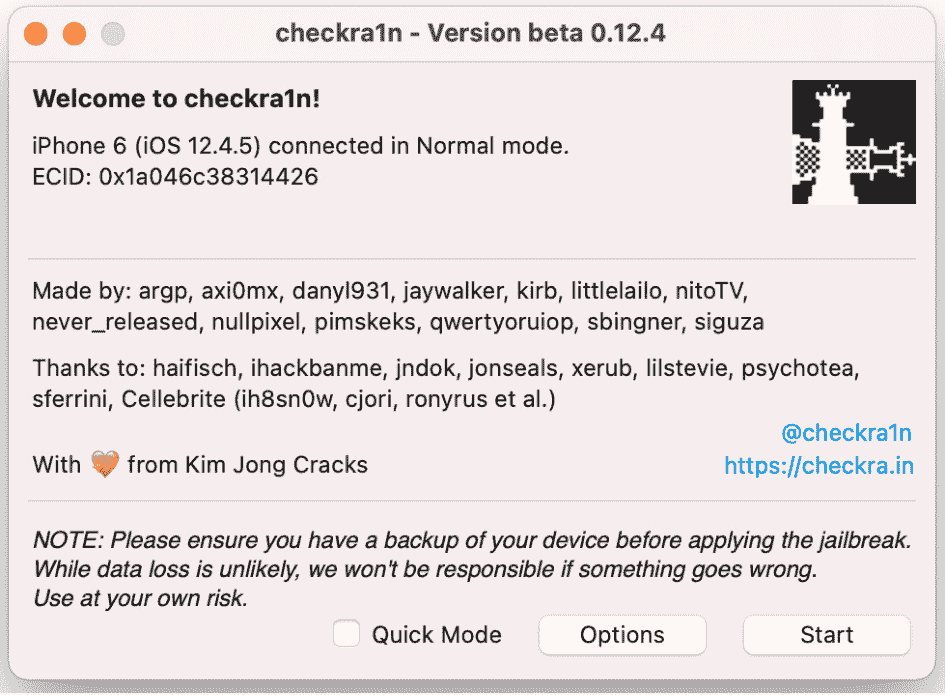

Figure 2.4 – The main checkra1n screen

- 4. When you're ready, click **Start**. The device will reboot into recovery mode automatically.
- 5. You will now be presented with instructions on how to reboot the device into DFU mode. Follow the instructions until your device shows a black screen:

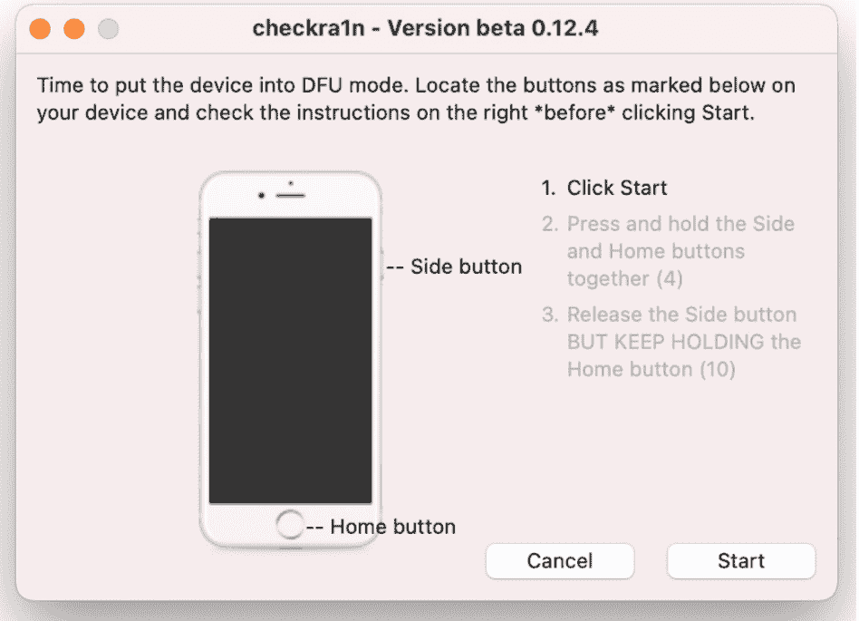

Figure 2.5 – Follow the instructions to put the device in DFU mode

- 6. At this point, checkra1n will begin the jailbreak process. The device will boot PongoOS and should look like this:

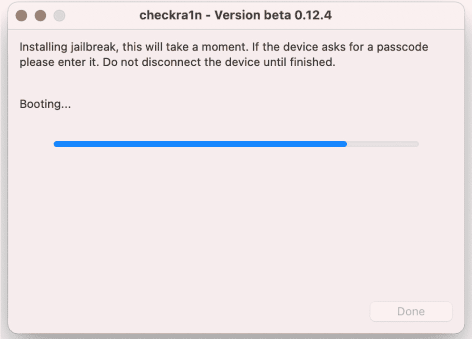

Figure 2.7 – Enter the passcode when requested

When the device reboots, you will find the checkra1n icon. Launching that application will allow you to install Cydia. Once Cydia is installed, you can proceed to install any third-party packages, such as SSH.

Remember that checkra1n is a semi-tethered jailbreak; if you reboot the device, you will have to jailbreak it again using the checkra1n tool.

Once the device has been successfully jailbroken, you can perform a full filesystem acquisition using the tool of your choice.

## Triaging the device

When you're dealing with iOS devices, it's useful to gather some information directly from the device prior to starting the acquisition process. Knowing what iOS version is running on the device, for instance, can be useful to determine what the best acquisition method is. For this purpose, we're going to use `libimobiledevice`.

The `libimobiledevice` library is a cross-platform library that allows users to communicate with an iOS device using their native protocol to provide access to the device's filesystem, including information about the device and its internals. It works with all devices, including the most recent ones.

The first step is to head to http://libimobiledevice.org, where the library can be downloaded for free. If you're running Windows, instead of downloading the source files and compiling them, you can download precompiled binaries from the project's GitHub repository.

If you're running macOS, you can install the library simply by running the following command from the terminal:

```
brew install libimobiledevice
```

If you're running a Linux distribution that supports the apt packet manager, you can install the library by running the following command:

```
sudo apt-get install usbmuxd libimobiledevice6
libimobiledevice-utils
```

Once you have installed the library, connect the device to your forensic workstation and run the following command from the terminal:

```
ideviceinfo
```

This command will connect to the device, parse data relevant to the hardware and software, and display it on screen. Keep in mind that the device will have to be paired with the host system by entering the passcode. If you're running Linux or macOS, you can combine the previous command with the grep command to view some key data:

### Identifying the device model:


您可以通过运行以下命令来读取设备型号：

```
ideviceinfo | grep ModelNumber
```

## 识别 iOS 版本：

要识别设备运行的 iOS 版本，可以运行以下命令：

```
ideviceinfo | grep ProductVersion
```

## 识别设备序列号：

可以通过运行以下命令来解析设备的序列号：

```
ideviceinfo | grep SerialNumber
```

## 识别电话号码：

最后，要识别设备中 SIM 卡对应的电话号码，请运行以下命令：

```
ideviceinfo | grep PhoneNumber
```

## 决定最佳获取方法

一旦设备被扣押、正确隔离，并且您已确认硬件型号和 iOS 版本，检查过程的下一步就是评估哪种获取方法最适合在保持数据完整性的同时从设备中提取最丰富的数据。

一般来说，在对设备执行任何操作之前，您需要牢记这两个概念：

- 按照**易失性**的顺序获取证据。
- 从侵入性较低的方法开始获取证据。

任何获取过程的第一步都是确定目标数据的易失性；例如，如果调查范围是从设备中提取照片或解析短信，这显然不会引起任何担忧，因为这些数据写入闪存，不易失，任何获取方法都能提取这些痕迹。然而，如果调查旨在了解设备的使用方式、特定日期和时间是否有人机交互，或者设备几天前位于何处，这些痕迹的易失性要高得多，因为 iOS 设备上的日志文件和数据库会被不断覆盖。例如，位置数据通常会在设备上保留数周；然而，*精确的*位置数据（包括基站数据）只保留几天。在这种情况下，我们需要尽快提取此类数据，以免被覆盖。这意味着在其它操作之前尽可能先执行完整文件系统获取，因为逻辑获取不包含这些数据。

调查人员应清楚了解取证工具的工作原理及其对数据和设备本身的影响：

- 您决定做的任何事情（包括什么都不做！）都会对设备产生影响。
- 您的操作会对数据产生什么影响？
- 所选的获取方法是否需要重启设备？
- 相关痕迹能否在设备重启后保留？
- 痕迹在设备上覆盖前能保留多长时间？
- 越狱会影响哪些文件或文件夹？
- 运行 Checkm8 获取会产生哪些变化？

## 执行基于代理的获取会发生哪些变化？

逻辑获取对设备几乎没有任何影响，因此通常这会是您的首选。如果设备易受 Checkm8 攻击，并且您拥有可执行此类获取的工具，那么 Checkm8 获取将是在不对设备做任何更改的情况下访问整个文件系统的最佳选择。如果这不是一个可行选项，下一步就是考虑基于代理的获取。最后，作为最后手段，越狱设备可以让调查人员访问整个文件系统，但请务必了解这将如何影响设备及其数据。

## 执行逻辑获取

现在我们已经学习了理论，是时候通过执行第一次逻辑获取来将其付诸实践了。

几乎所有取证工具都可以执行逻辑获取；我们将重点介绍其中最流行的两种：Cellebrite UFED 和 Elcomsoft iOS Forensic Toolkit。

Cellebrite UFED 被视为行业标准，因为它允许调查人员执行多种不同类型的获取，包括传统逻辑获取、部分文件系统获取、通过 Checkm8 进行的完整文件系统获取，以及从已越狱设备进行的完整文件系统获取。

另一方面，Elcomsoft iOS Forensic Toolkit 可以执行逻辑获取、从越狱设备进行完整文件系统获取、通过基于代理的提取进行完整文件系统获取，并且还支持对旧设备的物理获取。

## 使用 Cellebrite UFED 进行逻辑获取

在本示例中，我们将获取一台运行 iOS 12 的 iPhone 6：

1. 第一步是启动 Cellebrite UFED，并从主屏幕选择 Mobile device：

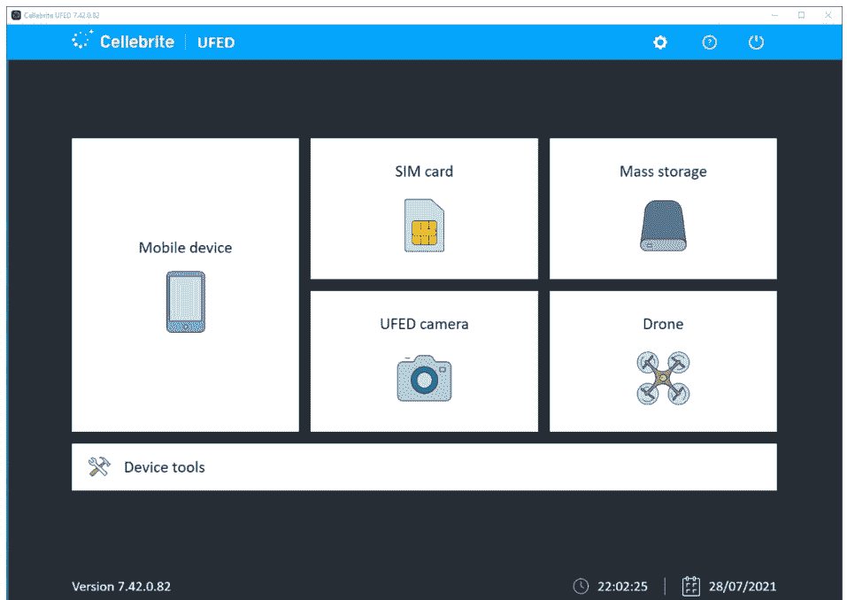

图 2.8 – Cellebrite UFED 的主屏幕

2. 接下来，选择 AUTO DETECT 选项，或使用屏幕左上角的搜索功能选择设备型号：

### 图 2.9 – 选择设备或让 UFED 自动检测

3. 设备被识别后，UFED 将根据 iPhone 型号显示可用的获取方法。选择 Logical (Partial) 获取以继续：

### 图 2.10 – 选择获取类型

4. Cellebrite UFED 的最佳功能之一是它允许您选择要提取的数据。这将大大加快提取过程，让您在几分钟内访问有用的证据。选择应提取的痕迹，然后点击 Next 开始获取过程：

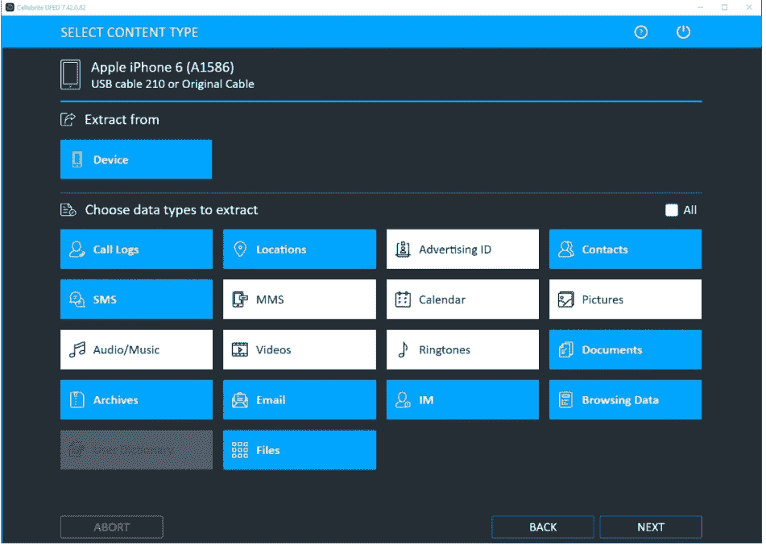

### 图 2.11 – 选择应提取的痕迹

5. 要执行逻辑获取，设备必须已解锁。请考虑在设备设置中禁用 Auto-lock。当设备提示配对请求时，您还应该选择 Trust（信任）此电脑：

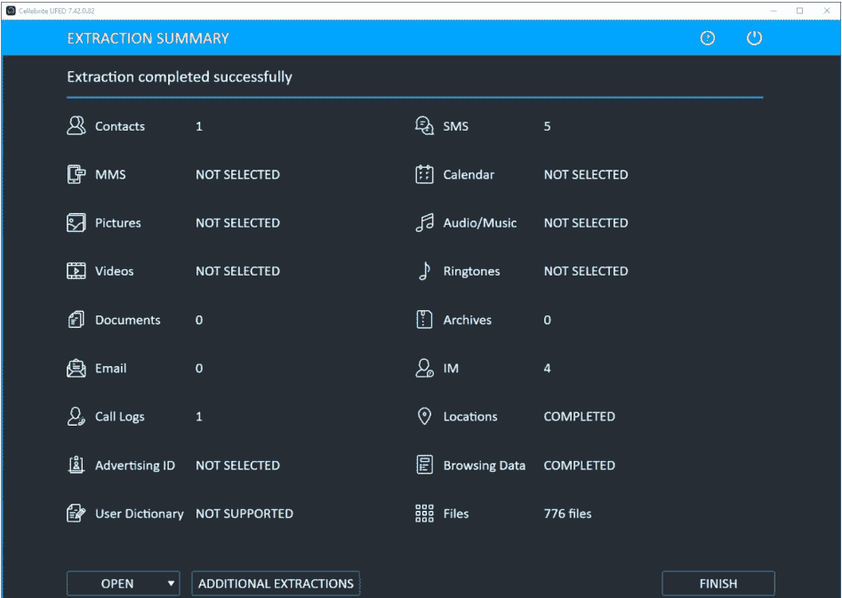

图 2.13 – 提取摘要显示已提取的数据

您可以通过将逻辑获取内容加载到取证工具中来查看提取的数据，例如 Belkasoft Evidence Center X、Elcomsoft Phone Viewer 或 Cellebrite Physical Analyzer。

## 使用 Elcomsoft iOS Forensic Toolkit 进行逻辑获取

另一个用于从 iOS 设备执行获取的优秀工具是 Elcomsoft 的取证工具包。该工具包专为 iOS 设备设计，并提供一些独特功能，例如基于代理的提取。步骤如下：

1. 启动 Elcomsoft iOS Forensic Toolkit，并检查设备是否被正确识别。从下面的截图可以看出，该工具分为四个部分，每个部分处理不同的获取过程。在我们的示例中，我们想要获取逻辑镜像，且设备未越狱，因此我们将选择 Backup 选项，该选项将执行逻辑获取：

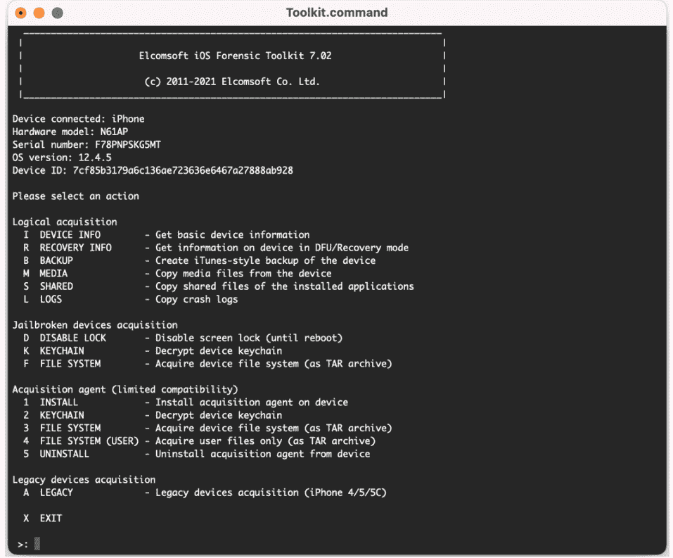

图 2.14 – Elcomsoft iOS Forensic Toolkit 的主屏幕

2. 选择备份文件的存储文件夹：

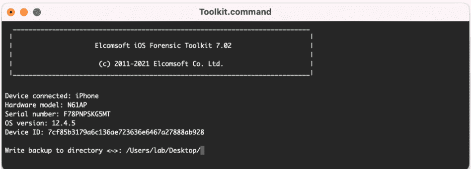

图 2.15 – 选择备份的存储位置

3. 为了获得最完整的逻辑镜像，应启用备份加密。工具包将自动检测加密是否已启用；如果未启用，它将通过将密码设置为 123 来启用加密。获取过程结束时，备份加密将被禁用：

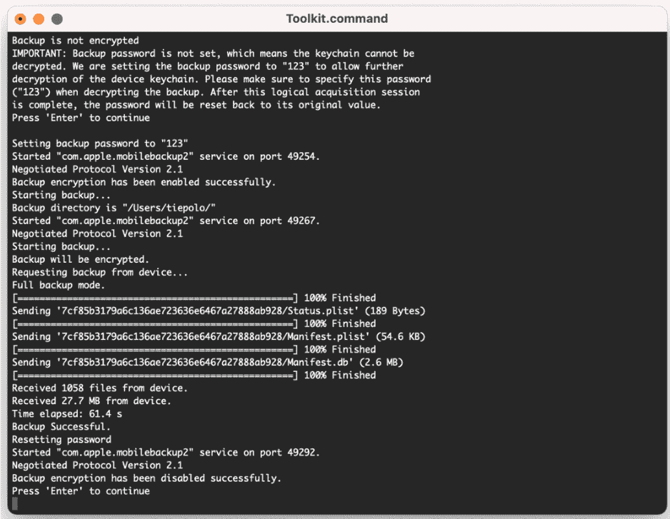

图 2.16 – 工具包将在屏幕上显示进度和调试信息

最后，工具包将给出获取过程的摘要。现在可以使用您选择的取证工具检查提取的文件。

我们已经了解了如何使用两种不同工具执行逻辑获取。请记住，有多种不同工具可以执行此类获取，包括免费工具。在下一节中，我们将学习如何执行完整文件系统获取。

## 执行文件系统获取


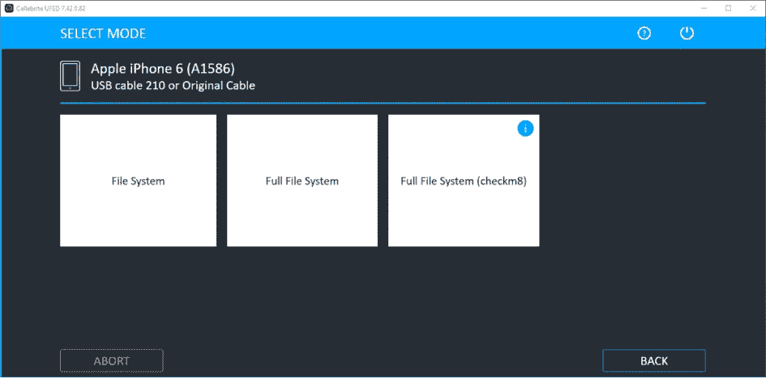

**图 2.17 – 选择完整文件系统（checkm8）选项**

3. 接下来，设备必须关机。关机后，你需要进入 **恢复模式**，然后从那里将设备置于 **DFU 模式**。屏幕上的说明相当准确，但基本上，设备关机后，你应按住 **Home** 按钮同时连接设备。这会将设备置于 **恢复模式**。从那里，按住 **电源** 按钮和 **Home** 按钮 10 秒，然后松开 **电源** 按钮，同时继续按住 **Home** 按钮几秒。此操作可能因设备型号而异。一旦设备进入 DFU 模式，**继续** 按钮将亮起：

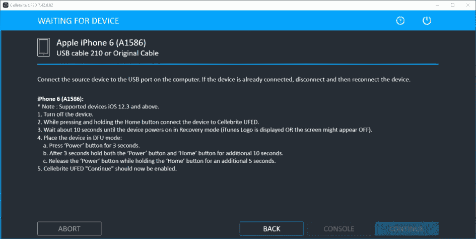

图 2.18 – UFED 将显示如何进入恢复模式和 DFU 模式的说明

4. 此时，UFED 将利用 Checkm8 漏洞对设备进行利用。这可能需要几分钟。整个过程在设备的易失性内存中执行，因此设备本身不会发生任何更改，并且在采集过程结束时将恢复正常启动：

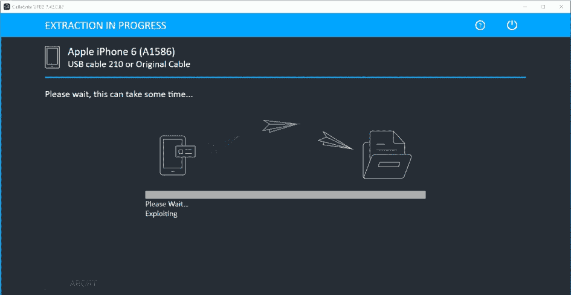

图 2.19 – 利用设备可能需要几分钟

5. 一旦设备被成功利用，采集阶段将开始，设备将显示进度指示器：

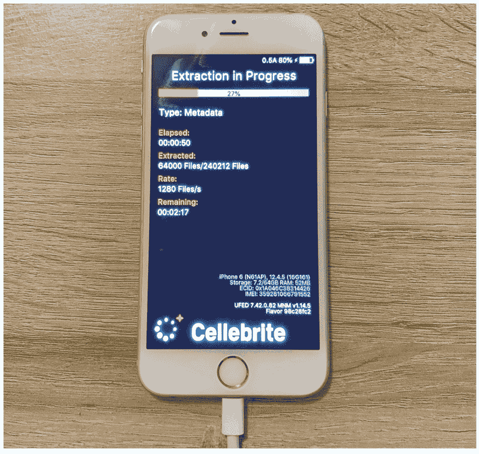

图 2.20 – 采集进行中

6. 完整文件系统将被镜像并归档为 DAR 文件，其类似于 TAR 归档：

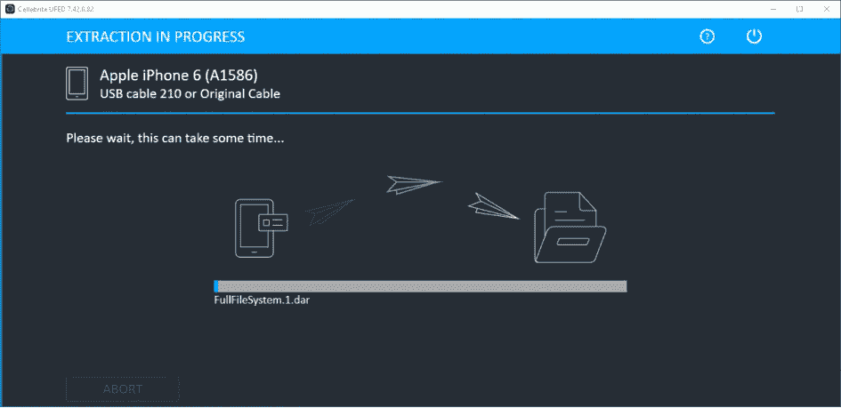

图 2.21 – 提取结果将归档为 DAR 文件

采集过程结束时，设备将自动正常重启。生成的 DAR 归档可以通过导入到 Cellebrite Physical Analyzer 或你选择的工具进行分析。

### 基于代理的完整文件系统采集

Elcomsoft iOS Forensic Toolkit 是少数支持基于代理采集的工具之一。由于此方法需要将应用程序（代理）侧载到设备上，因此你需要一个 Apple ID。在 Windows 版本中，你需要一个 Apple Developer ID，而在 macOS 上，你可以使用传统账户：

1. 开始时，启动工具包并检查设备是否被正确识别：

图 2.22 – Elcomsoft iOS Forensic Toolkit 主屏幕

2. 从菜单中选择选项 1，这将把代理安装到设备上。你将被要求提供 Apple ID 凭据，并且需要通过双重身份验证。然后，代理将使用你的 Apple ID 进行签名并安装到设备上：

```
Toolkit.command

|---------------------------------------------------------------|
|                                                               |
|               Elcomsoft iOS Forensic Toolkit 7.02            |
|                                                               |
|                     (c) 2011-2021 Elcomsoft Co. Ltd.         |
|                                                               |
|---------------------------------------------------------------|

[Please enter Apple ID (enrolled in the Apple Development Program is preferred): ]
[Please enter Apple ID password (normal, not app-specific): ]
Device with udid 7cf85b3179a6c136ae723636e6467a27888ab928 has been detected.
Device Name: iPhone
Device Model: iPhone7,2
OS Version: iPhone OS 12.4.5
Serial Number: F78PNPSKGSMT
Build Version: 16G161

Input 2fa 6-digit code sent to your devices OR type 0 to show another options: 868276
Individual team Effe Lab (59C356955L) will be used for installing an application on the device.
Please note signing the application by this team profile will require approval on the device
Certificate signing request will be submitted to the account.
Device will be enrolled in the Apple Developer Program.
Application info will be uploaded to the account.
Install: CreatingStagingDirectory (5%)
Install: ExtractingPackage (15%)
Install: InspectingPackage (20%)
Install: TakingInstallLock (20%)
Install: PreflightingApplication (30%)
Install: InstallingEmbeddedProfile (30%)
Install: VerifyingApplication (40%)
Install: CreatingContainer (50%)
Install: InstallingApplication (60%)
Install: PostflightingApplication (70%)
Install: SandboxingApplication (80%)
Install: GeneratingApplicationMap (90%)
Process has been completed.
Please launch the Acquisition agent on the iOS device now and keep it running in the foreground.
Press 'Enter' to continue
```

图 2.23 – 将代理安装到设备上

3. 一旦代理成功安装，启动设备上的应用程序。现在，要提取钥匙串，从工具包中选择选项 2。

4. 钥匙串提取过程完成后，你可以继续提取完整文件系统。通常，你会想要选择选项 4，这将提取用户分区：

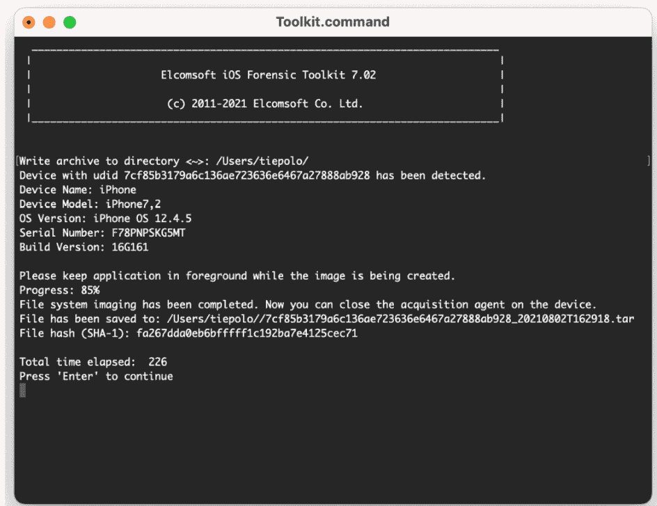

图 2.24 – 使用代理采集完整文件系统

5. 文件系统镜像将归档为 TAR 文件。过程完成后，选择选项 5 以卸载代理。

至此，我们的文件系统采集完成！

基于 Checkm8 的采集和基于代理的采集都是一个完整的突破，因为它们允许对整个文件系统进行取证可靠的提取，包括与第三方应用相关的所有文件。正如你所学到的，完整文件系统相比逻辑提取将包含更多数据。在接下来的章节中，我们将深入研究这些文件，并学习如何分析它们以获得有意义的证据。

### 总结

在本章中，我们学习了采集方法之间的差异以及在 iOS 提取中可以期望找到的数据类型。我们学习了 Checkm8 漏洞的工作原理，如何利用此漏洞访问设备的文件系统，以及它的局限性。然后，我们讨论了基于代理的采集，并学习了哪些 iOS 版本支持此采集。

越狱是 iOS 世界中一个引人入胜的话题；我们讨论了其中两个最受欢迎的越狱工具，checkra1n 和 unc0ver，以及它们的兼容性。然后，我们学习了如何使用 checkra1n 越狱设备。

最后，我们学习了如何使用 Cellebrite UFED 和 Elcomsoft iOS Forensic Toolkit 执行逻辑采集，并探讨了执行完整文件系统采集的两种不同选项。

请记住，在本章中，我们专注于 **首次解锁后（AFU）** 采集方法，因此取证人员必须完全访问设备。在接下来的章节中，我们将研究 **首次解锁前（BFU）** 采集方法，以了解在锁定设备中可以找到哪些类型的痕迹。

在下一章中，我们将讨论取证工具，哪些是最受欢迎的，以及如何使用这些工具分析提取的数据。
