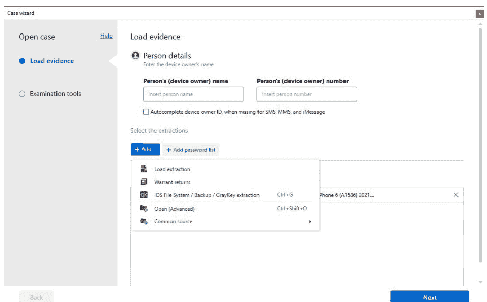
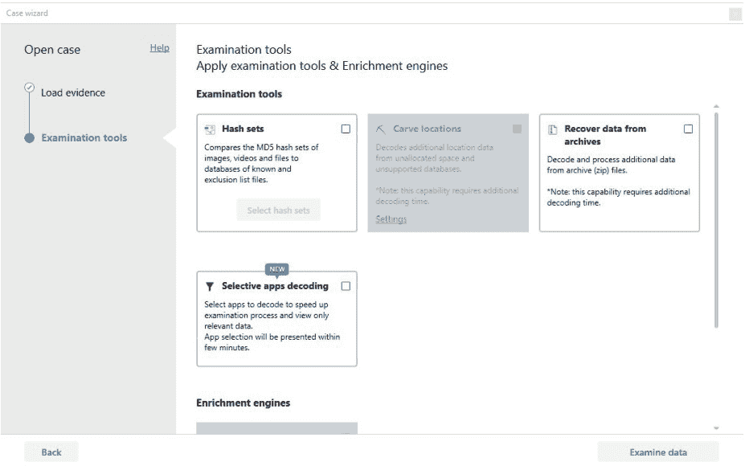
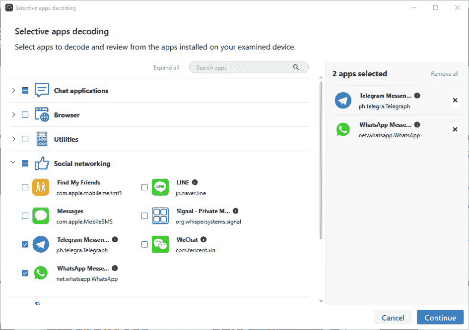
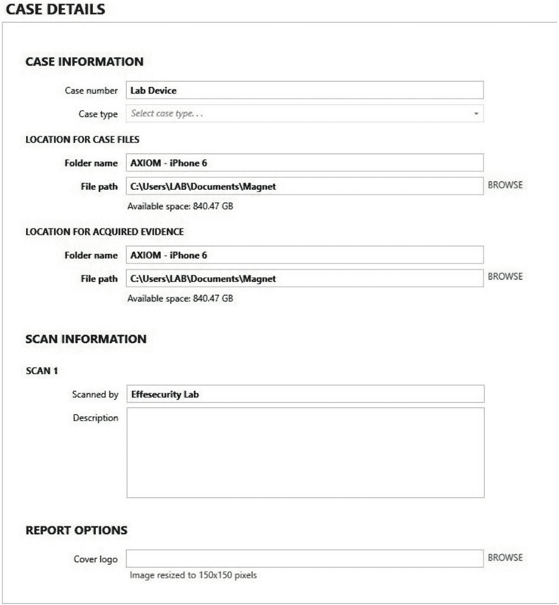
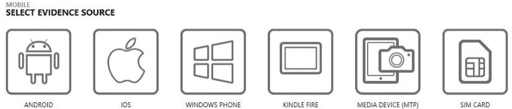
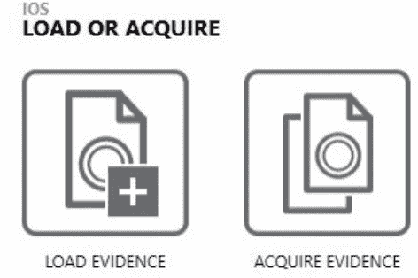
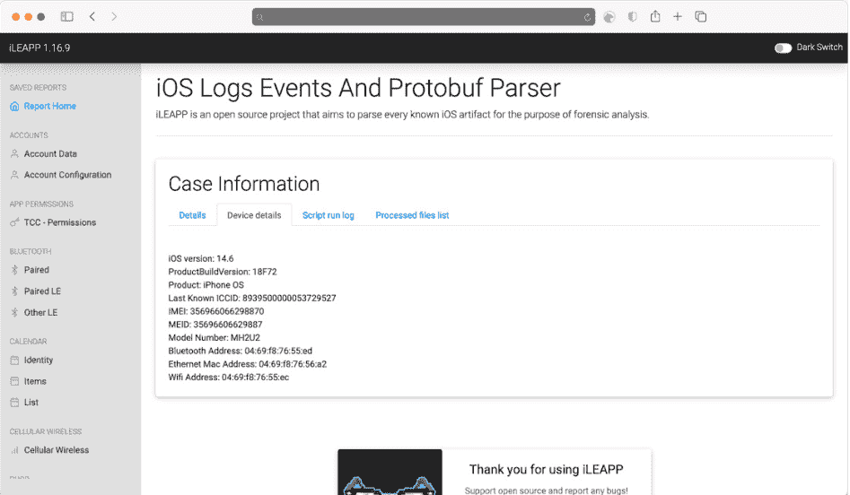

## 第 3 章：使用取证工具

在上一章中，我们学习了有关不同采集技术的所有知识，以及如何使用取证工具从 iOS 设备中提取数据。在本章中，我们将学习用于数据分析的最受欢迎的工具，以及它们的特性和局限性。

尽管使用取证工具进行数据分析并非严格必需，因为理论上可以手动检查文件，但使用这些工具具有许多优势。与手动解析痕迹相比，使用取证工具最明显的好处是时间：如果使用正确，这些工具是巨大的时间节省者，因为它们被编程为自动搜索相关文件、查找模式、分析已知数据结构，并从常见痕迹中提取有意义的见解。使用适当的工具可确保不会遗漏宝贵的痕迹，尽管调查人员应始终验证此类工具的输出并了解其局限性。没有完美的取证工具——每个工具都有其缺陷！大多数工具允许调查人员检查第三方应用程序以及系统应用程序，并且还可以配置为对这些应用程序自动执行自定义数据雕刻。

在本章中，我们将涵盖以下主题：

- 了解取证工具
- 使用 Cellebrite Physical Analyzer
- 使用 Magnet AXIOM
- 使用开源工具

### 了解取证工具

一旦 iOS 设备及其存储的证据被成功扣押、保存并通过取证可靠的方式提取


Acquisition process, the next steps involve processing and analyzing the extracted data.

Currently, there are a number of commercial tools available on the market that perform data analysis, such as *Cellebrite Physical Analyzer*, *Oxygen Forensic Detective*, *Magnet AXIOM*, *Belkasoft Evidence Center*, *MSAB XRY*, *EnCase Forensic*, and many others. In this chapter, we'll work with two of these tools, **Cellebrite Physical Analyzer** and **Magnet AXIOM**.

We've already seen how mobile forensics presents several additional challenges compared to digital forensics, and one significant difference has to do with how data extracted from iOS devices is analyzed; with mobile device forensics, using a single tool to process and analyze the evidence is extremely risky, as one solution will not provide all the tools that support all devices and all iOS versions. Generally speaking, forensic tools work by parsing files of interest (such as SQLite databases, plists, and log files) and running a series of **plugins** on these files that look for key evidence in predefined locations. What this means is that more recent applications may not be supported because if there isn't a plugin for a given app, forensic tools will not automatically display data for that application! No one tool can process and analyze all artifacts from every mobile device.

To choose the best tools for your purpose, you need to know the following:

- Where the tool will search for data
- What a tool is doing to the extracted data
- How the tool will represent the data

For instance, iOS devices sometimes compress log files into archives to save space on disk. If your tool does not automatically extract files from archives that are found in an iOS extraction, you could be missing some key evidence. Make sure you understand exactly what files your tool parses and what files it doesn't.

## Tool validation

Once the investigator has assessed which tool is the best fit for a particular scenario, the tool and its output should be **validated** before starting the examination process. Validating a tool is the process of determining through testing that it performs in a certain way and that the results are consistent.

In particular, the investigator should verify the following:

- The tool does not alter the data in any way.
- The data provided by the tool is consistent with what is displayed on the device.
- The data represented by the tool is consistent with what you find in the source file of that particular piece of data.
- The results are consistent among different forensic tools.

Validation is increasingly important when dealing with unsupported third-party applications or **Unidentified Forensic Objects (UFOs)**, as some tools have some built-in features that use heuristics to attempt data extraction from these artifacts, but sometimes the results can be incomplete or inconsistent.

## Tip

One of the most common ways to get to know your tools and validate their output is by using them to analyze a known device, such as your personal iPhone. Use your device to perform normal day-to-day activity and take notes. Then, extract and analyze data from the device using several tools and check that it gets reported correctly.

Although forensic tools will greatly aid the investigator by speeding up the entire process, this software should not substitute the process of manually viewing and assessing the files that were extracted in the acquisition process.

## Working with Cellebrite Physical Analyzer

Cellebrite software is generally regarded as the golden standard for mobile forensics among law enforcement and security organizations due to its powerful features, wide device compatibility, frequent updates, and easy-to-use user interface. Their most popular tools are **Cellebrite Universal Forensic Extraction Device (Cellebrite UFED)**, which we used in the previous chapter to acquire the device's filesystem, and **Cellebrite Physical Analyzer**, which is used for data analysis and reporting.

We will now learn how to import the extracted data into Physical Analyzer and then we'll go over some of the main features of this powerful tool.

### Loading evidence and selective decoding

The first step in a Physical Analyzer examination is loading the evidence into the tool. You can accomplish this by using the **case wizard**, which is a step-by-step procedure that will guide you through the process and also show you some optional features that can be enabled. One of these is **selective decoding**, which allows investigators to perform faster parsing and analysis by selecting specific applications or specific categories that should be parsed in addition to common system artifacts. This is especially useful when you're dealing with devices that have dozens of installed applications, but you only need to parse very specific artifacts that pertain to a few of these apps.

Let's see how this works:

1. From Physical Analyzer's menu, choose **File | Open case** to bring up the case wizard.

2. The next step involves choosing which files to load depending on the type of acquisition that was performed. If you acquired the device using Cellebrite UFED, choose Add | Load extraction and select the UFDX or UFD file that was created by Cellebrite UFED. If you used a different forensic tool and performed a filesystem acquisition, choose Add | GrayKey and point it to the folder or archive where the extracted data is stored. Finally, if you performed a logical acquisition, choose Add | Common source | Backup and select the folder that contains your iTunes backup. Then, click Next to continue:

   

   *Figure 3.1 – Open the case wizard and add the folder or file that contains your data*

3. In the next screen, the case wizard will display a set of examination tools that can be enabled by selecting their checkbox. Enabling parsing of archives can be useful to recover data from log files that have been compressed and archived by iOS; however, keep in mind that this will increase decoding time. In this example, we're going to use selective decoding to speed up the decoding process, so enable this tool and click on **Examine data** to start the process:

   

   *Figure 3.2 — The case wizard also allows you to enable specific examination tools*

4. At this point, Physical Analyzer will scan for applications available on the device, and when it's done scanning, a list will appear with several filtration options – for example, from the **Social networking** category, we can choose to only parse **Telegram Messenger** and **WhatsApp Messenger** by checking the boxes. When you've finished, click **Continue** to start the decoding process:

   

   *Figure 3.3 – Choose which applications should be decoded*

5. When the process finishes, the **Extraction Summary** pane will be displayed, which shows some key data on the device and a list of all the artifacts divided into categories:

   **Extraction Summary**

   Extractions: 1

   

   File System - Selective apps decodi...
   Apple iPhone 6 (A1586)
   File System
   Extraction start date/time: 28/07/2021 22:19:13(UTC+2)
   Extraction end date/time: 28/07/2021 22:47:49(UTC+2)
   C:\Users\LAB\Documents\My UFED Extra...

   **Device Info**

   Generate preliminary device report

   | Field | Value |
   |---|---|
   | Advertising Id (IDFA) #1 | AE8A0E64-8B2E-4E2D-9439-CB233DD9428E |
   | AirDrop ID | A4E655FDBCE7 |
   | Apple ID | |
   | Detected Phone Model | iPhone 6 |
   | iCloud account present | True |
   | Model number | N61AP |
   | Owner Name | iPhone |
   | Serial | F78PNPSK5GMT |
   | Time Zone | (UTC+01:00) Rome (Europe) |
   | Unique ID | 7cf85b3179a6c136ae723636e6467a27888ab928 |
   | ICCID | |
   | IMEI | |
   | Last user ICCID | |
   | Last used MSISDN | |
   | MSISDN | |
   | Network Interfaces | |
   | MAC address | D2:25:98:82:3E:78 |
   | MAC address | D2:25:98:82:3E:87 |
   | Wi-Fi MAC address | D0:25:98:82:3E:76 |
   | Phone Settings | |
   | Find my iPhone enabled | True |
   | Locale language | it_IT |
   | Location Services Enabled | True |
   | Message Retention Duration | Forever |
   | Tethering | |
   | Last Activation Time | 28/07/2021 09:38:46(UTC+0) |

   **External Enrichment**

   | File | Offset |
   |---|---|
   | com.apple.lsidentifiers.plist | 0xC4E |
   | com.apple.sharingd.plist | 0x199F |
   | Accounts3.sqlite-wal | 0x1EFD1C |
   | Accounts3.sqlite-wal | 0x1EF0C1 |
   | preferences.plist | 0xAAE |
   | data.ark.plist | 0x23D |
   | AccountToken.txt | 0x449 |
   | com.apple.AppStore.plist | 0x264 |
   | AccountToken.txt | 0x4BC |
   | com.apple.commcenter.plist | 0x202 |
   | AccountToken.txt | 0x2D |
   | CellularUsage.db | 0x6FD8 |
   | CellularUsage.db | 0x6FEB |
   | com.apple.commcenter.plist | 0x3FA |
   | NetworkInterfaces.plist | 0x26A |
   | NetworkInterfaces.plist | 0x35D |
   | NetworkInterfaces.plist | 0x173 |
   | com.apple.icloud.findmydevice.FMIPAccounts.plist | 0x0 |
   | data.ark.plist | 0x221 |
   | com.apple.locationd.plist | 0x7F |

   *Figure 3.4 – Extraction Summary*

Now that we have loaded and decoded the data, we will see how to view the decoded data.

## Viewing decoded data


## 选择应用以获取更多数据

按类别浏览设备上的应用，并选择你需要额外数据的应用。

注意：内部应用服务不显示在此视图中。

筛选依据：全部展开 搜索应用

- 聊天应用
- 浏览器
- 隐藏文件或图片
- 实用工具
- 社交网络
- 生活
- 娱乐
- 新闻与图书
- 金融
- 音乐
- 健康与健身

图 3.8 – 设备上已安装应用的列表

3. 下一个屏幕会提醒你，AppGenie 是一个研究工具，你必须通过手动深入检查源文件来验证结果：

### AppGenie 是什么？

AppGenie 是一个研究工具，试图从设备数据库中自动识别特定类型的证据。AppGenie 基于过去的解码支持和启发式规则分析数据库，并可提供额外的应用数据，如联系人、用户账户和聊天记录。

作为一个研究工具，建议的结果不能替代原生的 PA 解码，应作为人工审查的初步/分流结果使用，因为它可能包含误报和不完整的结果。建议在将结果纳入报告之前先进行审查。

图 3.9 – 提醒需要验证

4. 最后一个屏幕会为你汇总哪些应用被选中进行额外解析。点击“开始”按钮，让 AppGenie 发挥它的魔力：

AppGenie 摘要

所选项目：Apple_iPhone 6 (A1586)

已选择 1 个应用

Uber com.ubercab.UberClient

图 3.10 – 应由 AppGenie 解析的应用摘要

5. AppGenie 完成后，任何提取的数据都将添加到项目树中名为 **AppGenie 分析数据** 的类别中。

正如你在这一简要介绍中所见，Cellebrite Physical Analyzer 让浏览数千个证据变得简单直接；所有数据都被分类，并可直接从检验摘要中轻松访问，AppGenie 还可以帮助发现未解析的证据。

深入探讨 Physical Analyzer 的所有功能超出了本章的范围，因此请务必花时间充分探索该工具，并熟悉其余所有有用的功能，例如**关键词搜索、证据标记、Python 脚本和内置报告功能**。

## 使用 Magnet AXIOM

Magnet AXIOM 是最流行的数字取证工具之一。它同时支持计算机取证和移动取证，几乎完全支持所有 Android 和 iOS 设备。该软件有两个模块：**AXIOM Process** 和 **AXIOM Examine**。第一个模块负责从设备获取证据或加载现有的提取数据，并执行数据解析和解码。解码过程完成后，你可以使用 AXIOM Examine 查看所有恢复的证据并分析数据。

### 加载证据和即时处理

Magnet AXIOM 的关键特性之一是，它允许调查人员在数据处理的同时开始分析证据。在时间至关重要的所有情况下，这是一个救命的功能，因为需要尽快审查证据。

在以下示例中，我们将学习如何将 iOS 设备现有的文件系统提取数据加载到 AXIOM Process，以及如何使用 AXIOM Examine 定位关键证据：

1. 检验的第一步是在 AXIOM Process 中创建新案件。启动应用程序并填写案件详情。然后，点击**转到证据源：**



图 3.11 – 填写案件详情

2. 下一步是选择证据源。在本例中，我们分析的是 iOS 设备，因此选择**移动设备**，然后选择**iOS**：



图 3.12 – 选择证据源

3. 由于我们已经在上一章中获取了设备，请选择**加载证据**，然后选择**镜像**，并定位包含提取数据的文件：



图 3.13 – 选择包含提取数据的文件或文件夹

4. 将所有证据源添加到案件后，点击**转到处理详情**以继续：

处理详情

添加要搜索的关键词

提供你希望在搜索中包含的关键词和正则表达式。如果某个关键词在搜索过程中命中，它会被添加到 AXIOM Examine 的“关键词”过滤器中。

添加要搜索的关键词

使用 MAGNET.AI 对聊天进行分类

启用聊天分类，使 AXIOM Examine 根据你选择的类别自动对聊天对话进行分类，并在“证据浏览器”中为它们添加标签。

使用 MAGNET.AI 对聊天进行分类

搜索存档和移动备份

容器文件（如存档和移动备份）可以在其他证据源中找到。在此页面上配置选项，以搜索在搜索过程中发现的任何容器。

搜索存档和移动备份

计算哈希值

导入无关文件的哈希值，这样它们就不会出现在你的案件中。

计算哈希值

对图片和视频进行分类

你可以启用图片分类，使 AXIOM Examine 在“证据浏览器”中自动对其进行分类和标记。

对图片和视频进行分类

查找更多证据

启用动态应用查找器，并配置自定义文件类型列表，以搜索 Magnet AXIOM 当前不支持的证据。

查找更多证据

案件概览

证据概览

案件摘要备注

在此记录你的案件摘要备注。启用该设置后，这些备注将出现在案件报告中。

检验员姓名：Effesecurity Lab

案件摘要

FullFileSystem.1.dar (545)

仅查看此来源的证据

证据编号：FullFileSystem.1.dar

描述

位置：FullFileSystem.1.dar

平台：移动设备

未添加图片

更换图片

案件处理详情

案件编号

扫描 1

扫描人：Effesecurity Lab

扫描日期：11/08/2021 00:10:49

扫描描述

案件信息

Case Information.txt 文件包含有关案件处理方式的信息。例如，该文件包含应用于搜索的设置、搜索类型、发现的证据数量等。

打开案件信息文件

AXIOMExamine.log 文件包含有关遇到的任何错误、运行的作业以及常规调试信息。

打开日志文件

图 3.17 – 案件仪表板屏幕

7. 你可以从屏幕左下角查看进度；当新数据被恢复时，点击“加载新结果”会将证据加载到 AXIOM Examine 中，以便你立即开始分析数据。

8. 当 AXIOM Process 完成后，扫描摘要将显示解码过程的结果，包括可能出现的任何异常。

### 使用 AXIOM Examine 分析证据

使用 AXIOM Examine 进行数据分析的起点是案件仪表板；从这个视图中，你可以查看关于案件的信息，并

如果不提及一些最好的开源 iOS 取证工具，本章将不完整！**DFIR（数字取证与事件响应）**社区是现有最活跃、最有帮助的社区之一，这些工具是安全研究人员、取证检验员和开发人员辛勤工作和热情的结晶，他们与社区分享了他们的知识。

### Apollo

**Apple Pattern of Life Lazy Output'er（APOLLO）** 是一个由 Sarah Edwards 编写的 Python 脚本（你可以在 Twitter 上找到她——@iamevltwin），它处理 iOS 和 macOS 证据以提取生活模式数据，并将结果合并到单个 SQLite 数据库或 CSV 文件中以供查看。

该脚本基于许多不同的模块（其中一些由 DFIR 社区编写），每个模块运行一个或多个查询，以从 iOS 提取数据中提取特定数据。我们将在*第 5 章*、*生活模式取证*中广泛使用这个强大的工具。

你可以从项目的 GitHub 仓库下载 APOLLO：https://github.com/mac4n6/APOLLO。

### iLEAPP

**iOS 日志、事件和属性列表解析器（iLEAPP）** 是一个由 Alexis Brignoni（Twitter – @AlexisBrignoni）用 Python 3 编写的脚本，是商业取证工具的免费替代品。该工具可以解析完整的 iOS 文件系统提取数据，解析和解码你在 iOS 设备上能找到的几乎所有类型的证据。

就个人而言，我发现这是除商业软件之外很好用的工具，因为它可以帮助验证你的发现。

你可以从 https://github.com/abrignoni/iLEAPP 下载 iLEAPP。

### iOS Triage


此工具是一个由 Mattia Epifani（Twitter – @mattiaep）编写的 Unix **shell 脚本**，可用于从越狱的 iOS 设备中提取数据。如果你需要对设备进行初步分类检查（包括处于 **BFU** 状态的设备），这是一个快速的解决方案。我们将在本书后面的内容中使用 iOS Triage。

你可以从 GitHub 下载此工具：
https://github.com/RealityNet/ios_triage。

## Sysdiagnose

这是 Mattia Epifani（@mattiaep）、Adrian Leong 和 Heather Mahalik（@HeatherMahalik）对 iOS 设备生成的**日志文件**进行研究后得出的成果。

这些 Python 脚本将解析日志文件，并提供商业取证工具可能遗漏的有用证据。

你可以从以下地址下载这些脚本：
https://github.com/cheeky4n6monkey/iOS_sysdiagnose_forensic_scripts。

## 使用 iLEAPP 分析数据

让我们来看看 iLEAPP 是如何工作的，以及使用此工具可以提取哪些类型的证据。

在安装 iLEAPP 之前，请确保你的系统上已安装 Python 3。第一步是通过克隆仓库从 GitHub 下载代码。你可以运行以下命令来完成此操作：

```bash
git clone https://github.com/abrignoni/iLEAPP.git
```

然后，我们需要安装所需的软件包：

```bash
cd iLEAPP
pip install -r requirements.txt
```

现在一切就绪，我们可以运行 iLEAPP 了。在此示例中，我们提供一个 ZIP 压缩包作为输入文件，并将报告导出到输出文件夹：

```bash
python3 ileapp.py -t zip -i ../iphone_dump.zip -o output
```

如你所见，我们使用 `-t` 选项指定提供的输入类型，使用 `-i` 选项指定输入文件的路径，使用 `-o` 选项指定输出文件夹的路径。

iLEAPP 处理完成后，结果将合并到一份 HTML 报告中：



图 3.21 – iLEAPP 生成的报告

报告将包含各种痕迹和有用的证据，包括**账户数据、蜂窝数据、位置信息、应用程序数据、设备使用数据、联系人、消息**等等！

这个开源软件是一个非常强大的工具，我绝对建议你多动手操作它，以充分了解它的潜力。

## 总结

在本章中，我们了解了最流行的商业取证工具有哪些，以及通过使用多种工具、比较它们的输出、在开始检验之前运行验证测试来验证结果的重要性。

请记住，尽管这些工具极其有用，并且大大减轻了调查人员的工作，但工具本身不是证据。报告也不是证据。证据就是证据，检验人员的工作是理解该证据是如何生成的、它代表什么，以及通过分析该证据能获得哪些见解。取证软件确实有其用武之地，但它不应取代对痕迹的手动检查。换句话说，可以使用这些工具，但不要盲目相信它们，并确保你了解后台正在发生的事情。

在本章后续部分，我们重点介绍了其中两款工具：Cellebrite Physical Analyzer 和 Magnet AXIOM。我们学习了如何将数据导入这些工具，以及如何使用软件的功能（如 AppGenie 或 Connections 资源管理器）来深入挖掘数据并获得有用的见解。

最后，在本章的末尾部分，我们了解了一些有用的开源脚本，并使用 iLEAPP 从完整的文件系统提取中提取并分析了痕迹。

在下一章中，我们将讨论 iOS 文件系统，并学习到哪里查找核心的 iOS 痕迹。
