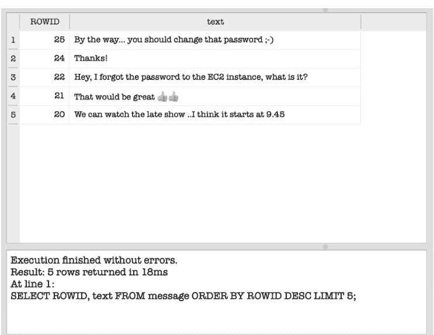
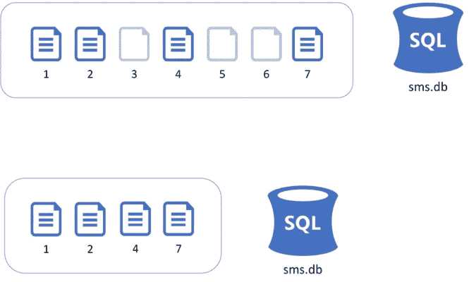
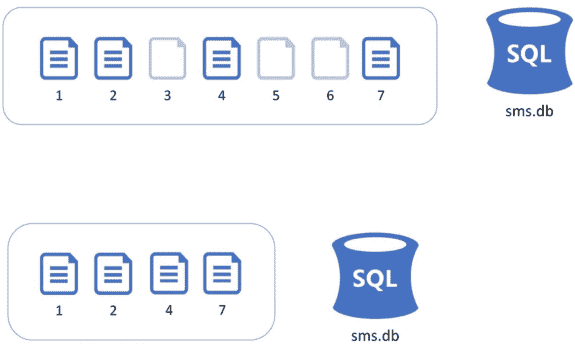
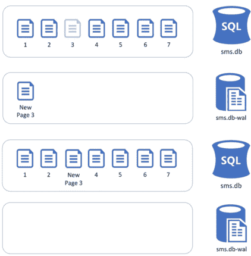
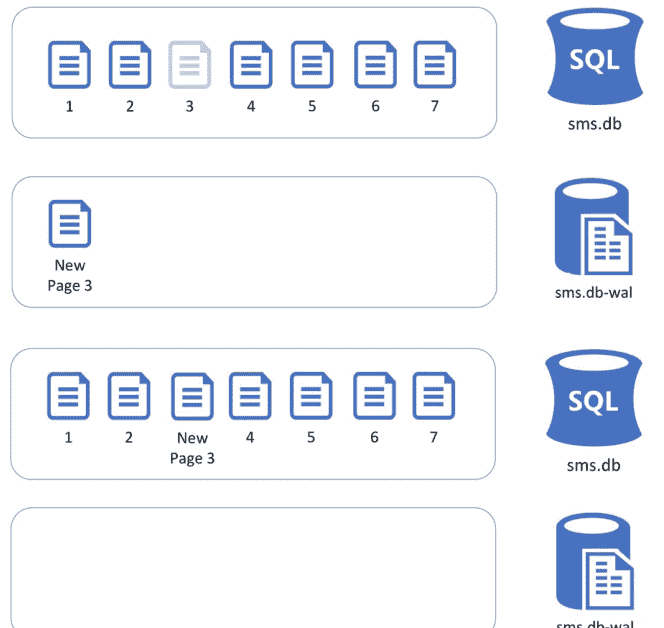
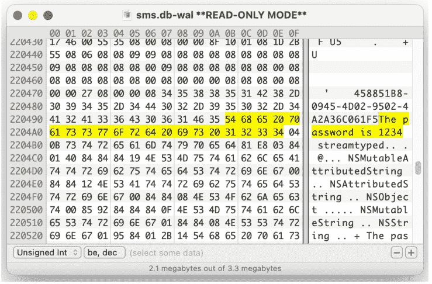
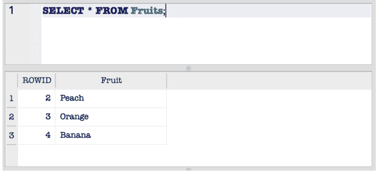
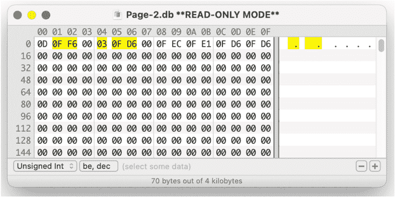
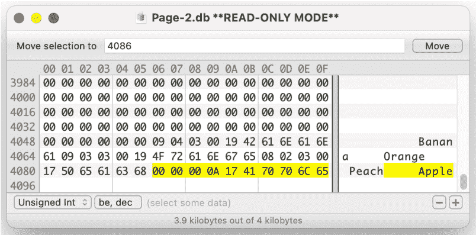
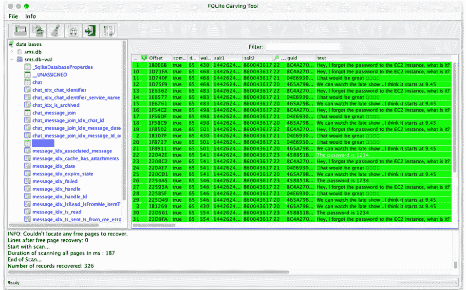

## 第 4 章：处理常见的 iOS 痕迹

在前面的章节中，我们从广义上讨论了 iOS 操作系统的工作方式以及移动检验工作流程的不同阶段。然后，我们学习了各种获取方法，以及如何从设备中提取最丰富的数据。在第三章中，我们研究了取证工具，并通过将数据加载到工具中进行分析来继续我们的检验过程。

移动取证调查中最关键的方面之一是验证你的发现。我们已经在前面章节中讨论了工具验证的重要性，但这个过程应进一步扩展，以确保所收集数据的完整性，并理解和解释数据的上下文，因为这对于在法庭上将其作为证据出示至关重要。这通常需要追踪源文件，并以原始格式手动查看痕迹。

在本章中，我们首先介绍 iOS 设备上最常见的痕迹类型，以及如何以其原始格式查看它们。然后，我们将深入探讨 SQLite 数据库，了解它们在内部如何管理数据存储，以及我们有哪些选项可以恢复已删除的记录。最后，我们将仔细查看文件系统，了解系统痕迹位于何处，通过分析这些数据我们能获得哪些见解，以及特定应用程序的痕迹在哪里可以找到。

在本章中，我们将涵盖以下主题：

- 理解验证的重要性
- 处理 iOS 痕迹
- 定位常见痕迹

### 理解验证的重要性

在第三章“使用取证工具”中，我们了解了 Cellebrite Physical Analyzer 和 Magnet AXIOM 等软件的一些功能，并对这些工具可能分析出的数据有了更好的理解。

你可能会想，当这些工具已经为你完成了所有繁重的工作时，为什么检验人员还要花时间学习手动分析设备上找到的数据。首先，虽然这些软件是调查人员工具箱中的必备物品，但调查人员也应该了解这些工具的局限性，以及如何处理无法自动解析的痕迹；尽管取证工具声称支持各种不同的应用程序和痕迹，但这并不意味着这些产品能够真正解析与正在检验的特定应用程序相关的所有数据。随着移动应用程序的更新速度，取证工具不支持最近更新的应用程序，或者在某些情况下仅部分支持（只提供部分而非全部可用数据）的情况相当常见。在这种情况下，调查人员必须求助于以原始格式手动检查源文件。

调查人员想要查看痕迹源文件的另一个原因是验证他们的发现；即使取证工具已经产生了可观的结果，将数据与源文件进行交叉引用以理解该数据的上下文也是非常重要的。例如，通过分析 SQLite 数据库中的表，调查人员不仅可以理解存储了哪些数据，还可以理解这些数据在设备上是如何存储的，以及操作系统如何记录特定事件，例如来电、短信或通知。

如果在检验过程中发现了对整个调查至关重要的关键痕迹，检验人员应准备好回答如下问题：

- 这些数据是如何到达那里的？
- 当我们将其置于上下文中时，这些数据告诉了我们什么？
- 该痕迹是用户活动的结果，还是由操作系统生成的？
- 它与设备上发现的其他数据是如何交互的？

这些问题的答案往往存在于痕迹的源文件中，因此学习如何手动分析此类文件是负责 iOS 设备检验过程的人员必须具备的技能。

**验证**的重要性怎么强调都不为过；使用经验证的方法论来检验设备，通过验证工具输出来确保工具正常工作，以及通过深入研究源文件以理解数据的上下文来验证你的发现，这些都可能对调查的最终结果产生巨大影响。在某些情况下，这可能使某人失去工作与否，或者在极端情况下，决定他们是否入狱。

在我们讨论 iOS 设备上常见痕迹的位置之前，下一节我们将学习如何在典型检验中手动处理你将会遇到的最常见文件类型。

### 处理 iOS 痕迹

一般来说，可以在 iOS 设备上找到的痕迹可分为以下类别之一：

- SQLite 数据库
- 属性列表
- 协议缓冲区
- XML 文件
- 日志文件


虽然最后两个文件不会构成任何问题，因为它们本质上是文本文件，可以用几乎任何文本编辑器查看，但其他文件可能（并且通常是）以**二进制格式**存储，因此需要特定的工具或库来解析数据。

## 介绍 SQLite

几乎每款 iOS 设备上的应用程序，包括系统自带的 **Messages**、**Contacts** 或 **Email**，都需要一个长期存储数据的场所。这是通过使用 **SQLite** 实现的，SQLite 是一种开源、小型、自包含的关系型数据库。SQLite 数据库可以通过 `.sqlite` 或 `.sqlite3` 文件扩展名识别，尽管有些数据库使用 `.db` 扩展名，或其他扩展名。

SQLite 在移动设备中如此受欢迎的原因在于其简单架构和出色的性能。以下是其部分特性：

- **SQLite 是自包含的：** 整个数据库包含在一个文件中，该文件可直接集成到应用程序中。其无服务器架构意味着数据库作为一个独立文件工作，而非传统的客户端-服务器协议。
- **SQLite 跨平台：** 数据库驻留在单个跨平台文件中，可以被 SQLite 支持的所有操作系统访问，包括 Windows、macOS、Linux、Android、iOS、BSD、Solaris 等。
- **SQLite 完全符合 ACID：** 这允许多个应用程序或线程安全访问。它还支持大多数 SQL 查询语言，这是与几乎所有现代关系型数据库系统交互的主要方式。

既然我们已经了解了 SQLite 的特性，让我们来看看它如何存储数据。

## 表、列和行

SQLite 数据库的基本概念应该很容易形象化——数据库包含一个或多个**表**，每个表包含的数据按**列**和**行**组织。列代表单个数据元素，例如 *电话号码* 或 *地址*，而行代表一组值，每个列一个值。

SQLite 支持五种不同的数据类型：

- INTEGER
- TEXT
- REAL
- BLOB
- NULL

前三种类型不言自明。**二进制大对象 (BLOB)** 数据类型将任何输入原样保留，而不将其转换为某种类型；BLOB 数据类型通常用于在 SQLite 记录中存储复杂二进制数据结构，例如 **属性列表** 或 **协议缓冲区**。NULL 数据类型仅存储空值。

要从数据库检索数据，你运行一个**查询**，它是一组用 **SQL 语言** 编写的逻辑指令，用于解析给定表以提取你想要的数据。查询的结果实际上表示为另一个表，如以下屏幕截图所示。

为了了解查询的样子，让我们看一个简单示例。以下查询从 sms.db 数据库中提取最后五条消息：

```
SELECT ROWID, text FROM message
ORDER BY ROWID DESC
LIMIT 5;
```

输出可在以下屏幕截图中看到：



图 4.1 – DB Browser for SQLite 中显示的查询结果

在不深入细节的情况下，我们将暂时关注此查询以了解 SQL 语言的基础。显然，如果你正在对 SQLite 数据库进行取证检查，你不希望以任何方式修改数据。因此，所有查询很可能都以 SELECT 子句开头，这表示我们希望从表中读取数据。

在第一行，我们选择要包含在结果中的列（ROWID 和 text）以及表名——在本例中为 message 表。查询的第二行指示结果应按什么顺序显示。在示例表中，每条短信都由递增的 ROWID 列标识，因此为了显示最近的消息，我们按此列以降序排列结果。由于我们只对五条消息感兴趣，我们使用 LIMIT 命令来指示应显示多少行。

### 提示

如果你是 SQL 语言的新手，可以通过访问 SQLite 网站学习如何编写最常见的查询类型

https://www.sqlite.org/lang.html.

作为取证检查员，你运行的查询通常涉及过滤和搜索数据，因此你可能想了解 CASE、WHEN 和 WHERE 等命令。我们将在本章中看到更复杂的查询。

## 运行 SQL 查询

大多数取证工具都附带内置数据库查看器，允许调查人员查看整个数据库并在工具内部直接运行查询；然而，还有其他选择：

- **SQLite 命令行实用程序**，可从 http://www.sqlite.org 下载，允许从命令行直接与数据库交互。
- 其他免费工具，例如 **DB Browser for SQLite**，允许用户通过 **图形用户界面 (GUI)** 查看数据库并在其上运行查询。DB Browser for SQLite 可从 https://sqlitebrowser.org 下载。

调查人员应熟悉用于直接访问数据库的工具，因为当检查范围仅限于一个或多个 SQLite 数据库时，这些工具将证明是巨大的时间节省者。使用 Cellebrite Physical Analyzer 或 Magnet AXIOM 等取证工具分析这些数据库会导致需要将整个提取加载到内存中解析；这可能非常耗时，具体取决于提取数据的大小。

## 使用 SQLite 命令行工具

sqlite3 是 SQLite 库的一部分的命令行实用程序。macOS 和大多数 Linux 发行版已预装它，而 Windows 用户可以从上一节中列出的 SQLite 网站下载可执行文件。

要从命令行打开 SQLite 数据库，只需输入以下内容：

```
sqlite3 filename.db
```

如果指定名称的数据库不存在，SQLite 将为你创建它。一旦你打开数据库，将显示一个 SQL 提示符，你可以在其中运行查询和命令。有许多内置命令可以用来获取数据库及其表的基本信息。

如果你不熟悉数据库布局，可以通过运行 .tables 命令列出其中的所有表：

```
sqlite> .tables
attachment                 message
chat                       message_attachment_join
chat_handle_join           message_processing_task
chat_message_join          sync_deleted_attachments
deleted_messages           sync_deleted_chats
```

如果你对特定表感兴趣，输入 .schema 后跟表名以显示表的列和数据类型：

```
sqlite> .schema handle
CREATE TABLE handle (ROWID INTEGER PRIMARY KEY AUTOINCREMENT UNIQUE, id TEXT NOT NULL, country TEXT, service TEXT NOT NULL);
```

通过查看列名和类型，你应该能够大致了解表中存储了什么数据。在此示例中，handle 表中的每一行都有一个自动递增的 ROWID 列和三个 TEXT 类型的列：id、country 和 service。

如果你想从表中检索数据，使用 SELECT 查询：

```
SELECT * FROM handle;
```

完成后，输入 `.exit` 或 `.quit` 终止 SQLite 会话。

## 页面、真空化和预写日志

SQLite 的一个特性使其对取证检查员如此有趣，即有可能从数据库中恢复**已删除记录**。根据数据库的范围，这可能意味着恢复已删除的短信、浏览器历史记录或与设备活动相关的日志。为了更好地理解数据恢复如何实现，我们需要退一步，了解 SQLite 在底层如何管理 `write` 和 `delete` 操作。

我们已经了解到，从逻辑角度来看，数据库中的数据组织成包含列和行的表。这是一个高级抽象层，允许用户使用简单易于可视化的数据模型（如列和行）与数据库交互；然而，在更低级别，SQLite 库实际上在文件系统上以不同的方式组织数据，将数据存储到**页面**中。页面类似于文件系统中的块，其目的是以二进制格式存储数据。SQLite 数据库中的每个页面可以有可变大小，默认大小为 4096 字节，每个页面都有一个不同的编号。第一个页面包含一个 100 字节的头部，可以使用 **十六进制查看器** 分析，例如在 macOS 和 Linux 上可用的 hexdump 命令行实用程序。

例如，要查看名为 `sms.db` 的 SQLite 数据库的头部，我们将执行以下命令：

```
```bash
hexdump -n 100 -C sms.db
```
```

`-n` 参数指定应显示的字节数。由于 SQLite 有固定大小的头部，我们只对前 100 字节感兴趣。`-C` 参数告诉 hexdump 实用程序也以字符串格式显示数据：


```
00000000  53 51 4c 69 74 65 20 66  6f 72 6d 61 74 20 33 00  |SQLite format 3.|
00000010  10 00 02 02 00 40 20 20  00 00 00 13 00 00 00 43  |.....@ ......C|
00000020  00 00 00 00 00 00 00 00  00 00 00 50 00 00 00 04  |..........P...|
00000030  00 00 00 00 00 00 00 00  00 00 00 01 00 00 00 00  |..............|
00000040  00 00 00 00 00 00 00 00  00 00 00 00 00 00 00 00  |..............|
00000050  00 00 00 00 00 00 00 00  00 00 00 00 00 00 00 13  |..............|
00000060  00 2e 24 80                                         |..$.|
00000064
```

图 4.2 – hexdump 命令的输出

如你所见，前 16 个字节包含 SQLite 3 格式字符串。你可以通过以下表格作为参考来解析头部其余部分：

| Offset | Size | Description |
|---|---|---|
| 0 | 16 | 头部字符串："SQLite format 3\000" |
| 16 | 2 | 数据库页大小，以字节为单位。 |
| 18 | 1 | 文件格式写入版本。1 为传统；2 为 WAL。 |
| 19 | 1 | 文件格式读取版本。1 为传统；2 为 WAL。 |
| 20 | 1 | 每个页面末尾未使用的“保留”空间的字节数。通常为 0。 |
| 21 | 1 | 最大嵌入有效载荷比例。必须为 64。 |
| 22 | 1 | 最小嵌入有效载荷比例。必须为 32。 |
| 23 | 1 | 叶节点有效载荷比例。必须为 32。 |
| 24 | 4 | 文件更改计数器。 |
| 28 | 4 | 数据库文件以页为单位的大小。 “头部中的数据库大小”。 |
| 32 | 4 | 第一个空闲列表主干页面的页号。 |
| 36 | 4 | 空闲页面的总数。 |
| 40 | 4 | 模式 cookie。 |
| 44 | 4 | 模式格式编号。支持的模式格式为 1、2、3 和 4。 |
| 48 | 4 | 默认页面缓存大小。 |
| 52 | 4 | 自动真空模式下最大根 B 树页面的页号，否则为零。 |
| 56 | 4 | 数据库文本编码。值为 1 表示 UTF-8。值为 2 表示 UTF-16le。值为 3 表示 UTF-16be。 |
| 60 | 4 | 由 user_version pragma 读写和设置的“用户版本”。 |
| 64 | 4 | 增量真空模式为真（非零）。否则为假（零）。 |
| 68 | 4 | 由 PRAGMA application_id 设置的“应用程序 ID”。 |
| 72 | 20 | 保留用于扩展。必须为零。 |
| 92 | 4 | 版本有效期编号。 |
| 96 | 4 | SQLITE_VERSION_NUMBER |

图 4.3 – SQLite 数据库头部参考

为了表示表及其数据，SQLite 使用平衡树（B-tree）数据结构来组织页面，这是一种存储数据的高效方式。实际包含数据的页面，也称为活动页面，被分配给一个节点，该节点的功能是连接页面。

文件中的活动页面进一步细分为 **cells**，它们是页面中包含数据库中每一行数据的段。当添加新单元格时，SQLite 会尝试将它们放置在页面的底部。页面中第一个单元格之前的空闲空间称为 **unallocated space**。从取证角度来看，未分配空间非常有趣，因为它可能为空，但也可能包含先前删除的数据或先前使用页面的片段。

当数据从数据库中删除时，对应的单元格或页面实际上并未被删除，而是被简单地 *标记* 为已删除。被标记为删除的页面称为 **free pages**，SQLite 通过将它们添加到另一个数据结构 **free-list** 来管理这些页面。从数据库中删除单个记录会在页面中创建间隙；这些空间称为 **free blocks**，SQLite 通过将它们添加到链表来跟踪这些空间。

如前表所示，数据库头部在偏移量 32 处告诉我们空闲列表中的第一个页面的编号，而空闲页面的总数可以通过查看偏移量 36 处的值来读取。数据库中的每个页面还都有一个 8 或 12 字节的头部，具体取决于页面的类型。以下表格说明了页面头部的格式：

| Offset | Size | Description |
|---:|---:|---|
| 0 | 1 | 偏移量 0 处的单字节标志，表示 B 树页面类型。 - 值为 2（0x02）表示页面是内部索引 B 树页面。 - 值为 5（0x05）表示页面是内部表 B 树页面。 - 值为 10（0x0a）表示页面是叶索引 B 树页面。 - 值为 13（0x0d）表示页面是叶表 B 树页面。 |
| 1 | 2 | 偏移量 1 处的双字节整数给出页面上第一个空闲块的起始位置，如果没有空闲块则为零。 |
| 3 | 2 | 偏移量 3 处的双字节整数给出页面上的单元格数量。 |
| 5 | 2 | 偏移量 5 处的双字节整数指定单元格内容区域的起始位置。此整数的值为零时解释为 65536。 |
| 7 | 1 | 偏移量 7 处的单字节整数给出单元格内容区域内的碎片化空闲字节数。 |
| 8 | 4 | 偏移量 8 处的四字节页号为最右指针。此值仅出现在内部 B 树页面的头部中，并从所有其他页面中省略。 |

图 4.4 — SQLite 页面头部参考

有了这些信息，我们就可以使用十六进制查看器手动解析文件，并查找包含已从数据库中删除的数据的空闲页面。幸运的是，有工具可以自动化此任务！

## Vacuuming

你可以通过检查删除数据时数据库文件大小是否发生变化来确认 SQLite 保留已删除页面的事实。因此，在正常情况下，文件大小只能随着向数据库写入新数据而增长。此外，随着向数据库添加和删除新记录，数据可能会变得碎片化，因为空闲页面会散布并混合在整个文件中。这意味着数据库中保存特定表的实际部分不会在文件中连续存储，这会影响性能。

下图说明了当数据写入数据库并从中删除时发生的情况，导致文件碎片化：



图 4.5 — 碎片化 SQLite 数据库中的页面

对 SQLite 数据库进行 **vacuuming** 的过程通过读取数据库中的逻辑数据（表、列和行）并将其写入临时文件来解决这些问题，同时忽略空闲页面。因此，该过程会从头开始重建数据库文件，重新打包活动页面，并对文件中的数据进行碎片整理。过程完成后，临时文件的内容将被复制回原始数据库，覆盖它。

下图显示了运行 VACUUM 命令后的同一数据库；数据库中存储的记录显然没有变化，但现在活动页面存储在一起且空闲页面不存在：



图 4.6 – 真空处理过程后 SQLite 数据库中的页面

应该很清楚，一旦真空处理过程完成，从数据库中恢复已删除记录几乎是不可能的。研究表明，iOS 会定期为大多数 SQLite 数据库运行 VACUUM 命令。然而，在撰写本文时，具体何时发生尚不明确，因为它似乎在很大程度上取决于设备型号和 iOS 版本。

## Write-ahead logging

到目前为止，我们一直专注于分析主数据库文件，以了解数据如何在该文件中存储以及在哪里查找已删除记录。然而，从取证角度来看，还有其他不应被忽视的文件，例如 SQLite 临时文件。你在 iOS 设备上找到的最常见的临时文件类型是称为预写日志（WAL）的日志文件。

WAL 文件可以通过其文件名轻松识别，因为 -wal 字符串被附加到数据库名称上。因此，例如，如果我们正在处理一个名为 sms.db 的 SQLite 数据库，WAL 文件将被称为 sms.db-wal，并且它将创建在与主数据库文件相同的目录中。这些临时文件并不总是存在，因为只有将日志模式设置为 WAL 的数据库才会使用预写日志方法。

根据已开展的研究，可以肯定地说，iOS 设备上的大多数数据库都启用了 WAL 模式。如果是这种情况，当添加、修改或删除数据时，事务会存储在 WAL 文件中，而不是直接存储在主 SQLite 数据库中。同样，在从数据库读取数据时，SQLite 引擎会确定特定记录的最新版本存储在哪里，并从适当的文件中读取它：



图 4.7 – 添加到数据库的新记录会附加到 WAL 文件

应用程序希望在其数据库中启用 WAL 模式的原因有很多。最重要的原因是性能；页面按顺序写入 WAL 文件，并且对数据库的每次更改都会导致一次磁盘写入。此外，由于文件分离，使用多个线程的应用程序可以在写入数据库的同时从中读取。


在某个时间点，WAL 文件中的数据必须转移回主数据库。此过程称为 **checkpoint**。通常，SQLite 会在 WAL 文件达到一定大小时（默认情况下为 1,000 页）或在最后一次数据库连接关闭时自动执行 checkpoint：



Figure 4.8 – A checkpoint transfers data from the WAL file back into the main database

## Tip

需要知道的是，当所有与数据库的连接都已干净关闭时，SQLite 会执行自动 checkpoint。因此，如果你在使用 DB Viewer 之类的工具时启用了 WAL 关闭数据库，WAL 文件的内容将被转移到主数据库，并且 WAL 文件将被删除。



Figure 4.11 – Using a hex viewer to display the contents of an SQLite file

通过分析数据库头以了解页面大小以及空闲页面和空闲块的位置，检查员可以使用自己选择的工具通过指定偏移量和长度来突出显示文件中的特定页面，从而有效地将该页面与剩余数据隔离开来。然后可以通过以字符串格式显示其内容来分析该页面。

以下步骤描述了手动解析 SQLite 数据库页面的过程：

- 1. 读取数据库头并识别页面大小和页面数量。
- 2. 计算每个页面的偏移位置。
- 3. 分析页面头。
- 4. 如果是活动页面，请在未分配空间或空闲块中搜索任何有用的证据。如果是空闲页面，则分析整个页面。
- 5. 对数据库中的每个页面重复此过程。

同样的原则也适用于 WAL 文件；由于文件格式有详细记录，检查员可以使用十六进制查看器打开 WAL，计算每个帧的偏移量，隔离每个单独的帧，并通过将其转换为 UTF-8 字符串来查看数据以识别任何可读字符串。

作为示例，我们将创建一个名为 test.db 的新数据库，其中包含一个名为 Fruits 的表。然后，我们将向数据库中填充几条记录，删除一行数据，并使用十六进制查看器分析文件。为简单起见，数据库将不使用预写日志。

你可以使用自己选择的软件或 sqlite3 命令行工具创建数据库。然后，运行以下查询：

```
CREATE TABLE "Fruits" (
    "ROWID"    INTEGER,
    "Fruit"    TEXT,
    PRIMARY KEY("ROWID" AUTOINCREMENT)
);
INSERT INTO "Fruits" VALUES (1,'Apple');
INSERT INTO "Fruits" VALUES (2,'Peach');
INSERT INTO "Fruits" VALUES (3,'Orange');
INSERT INTO "Fruits" VALUES (4,'Banana');
DELETE FROM Fruits WHERE ROWID == 1;
```

正如以下屏幕截图所示，表中现在包含三行，如预期那样：



Figure 4.12 – The table contains three rows of data

我们检查的第一步是使用十六进制查看器打开文件并分析 100 字节的头，以从数据库中提取任何有用的信息：

bytes, and copy the data to a new window in your editor. From now on, the offsets will be relative to the page:



Figure 4.14 – The page header

现在我们已将第二页加载到十六进制编辑器中，下一步涉及检查页面头：

- - 在偏移量 `01` 处，我们可以读取第一个空闲块的位置，即 `0x0FF6` 或十进制格式的 `4086`。
- - 偏移量 `04` 处的值表示页面上的活动单元格数量，`3`。
- - 通过查看偏移量 `05`，我们可以找到第一个非空数据单元格的位置，即 `0x0FD6` 或 `4054`。
- - 最后，头与第一个数据单元格之间的空间是未分配空间。

有了这些信息，我们可以突出显示从偏移量 4086 开始并延伸到页面底部的空闲块；十六进制查看器的右窗格将数据显示为 UTF-8 字符串：



Figure 4.15 – The free block shows previously deleted data

正如你所见，之前从数据库中删除的名为 Apple 的记录仍然存在于文件中，在第二页的空闲块的右侧。

## Carving for strings

数据雕刻是搜索文件中特定字符串或字节的过程；检查员首先确定要搜索的字符串或模式，然后使用十六进制查看器或命令行工具在文件中搜索该字符串或模式。此过程是手动解析 SQLite 数据库的绝佳替代方案，因为它允许调查人员立即验证给定记录是否可以在文件中找到，包括已删除数据通常隐藏的位置。

strings 工具是一个命令行实用程序，可在二进制文件中执行字符串雕刻并将结果打印到屏幕上。显示 SQLite 数据库中可以找到的所有字符串与运行以下命令一样简单：

```
strings sms.db
```

此工具可以与其他命令（如 grep）结合使用，以搜索特定字符串或模式。以下命令将在我们之前示例中使用的数据库中搜索 Apple 单词：

```
strings test.db | grep Apple
Apple
```

正如你所见，Apple 字符串被打印到屏幕上，这证实了它在 SQLite 数据库中被找到。这个简单的工具可以成为显示数据库中存储的所有字符串的救命技巧，包括已删除的数据！

## Recovering deleted records using FQLite

手动从 SQLite 数据库中恢复已删除数据的任务可能令人望而生畏；幸运的是，大多数商业取证工具都内置了此功能，但也有其他选择。截至撰写本文时，FQLite 可能是最完整的开源 SQLite 恢复工具，原因如下：

- - 它是用 Java 编写的，因此你可以在任何操作系统上运行它。
- - 它支持从所有数据库页面恢复已删除记录，包括空闲块和未分配空间。
- - 它内置支持 WAL 文件。
- - 恢复的记录可以以 CSV 格式导出。

要下载 FQLite，请访问 https://www.staff.hs-mittweida.de/~pawlaszc/fqlite/ 或前往位于 https://github.com/pawlaszczyk/fqlite 的 GitHub 仓库。

我们现在将简要介绍从 sms.db SQLite 数据库中恢复已删除数据的过程：

- 1. 启动 FQLite 并通过转到 File | Open Database 选择要尝试恢复的数据库。
- 2. FQLite 现在将处理文件并分析数据库，搜索已删除记录。你可以通过查看屏幕底部的日志面板来跟踪进度。
- 3. FQLite 完成后，从左侧面板中选择要检查的数据库或 WAL 文件。
- 4. FQLite 将显示一个包含数据库中找到的所有数据的表，包括已删除记录：



Figure 4.16 – FQLite recovers deleted records from an SQLite database

到目前为止，你应该对 SQLite 的工作原理、调查人员如何通过命令行工具检查数据库以及数据恢复的最常见技术有了良好的理解。我们现在将更进一步，查看另一种流行的数据结构。

## Working with property lists

虽然 Protobufs 在 iOS 设备上并不常见，但仍有一些应用程序使用它们来存储数据，因此调查人员应至少对如何处理这些文件有一个基本的了解。

由于 protobuf 以二进制格式存储，因此它们不可读；protoc 命令行工具允许你显示文件的内容，并让你大致了解数据的结构。

## Tip

protoc 工具是 protocol buffers 包的一部分，可以从位于 https://github.com/protocolbuffers/protobuf 的 GitHub 仓库下载。

安装 protoc 工具后，可以通过运行以下命令将 protobuf 的内容打印到屏幕上：

```
protoc --decode_raw < [protobuf_blob_file]
```

使用协议缓冲区的应用程序示例包括 Apple **Notes**、Apple **Maps** 和 **Spotify** 应用程序。

现在我们对工件的外观以及如何手动分析它们有了更好的理解，下一个部分将提供 iOS 设备上最常见的证据位置的详尽列表，以及我们可以期望获得的见解。

## Locating common artifacts

与应用程序相关的工件对于 iOS 调查至关重要，但设备设置、日志和用户生成的内容也很重要。在本章的最后一部分中，我们将研究 iOS 文件系统中的一些常见位置，检查员可以快速查看以收集更多信息：


| Path | Description |
|---|---|
| installd/Library/MobileInstallation/LastBuildInfo.plist | OS version |
| mobile/Library/Preferences/com.apple.springboard.plist | Order of apps |
| mobile/Library/Preferences/com.apple.mobilegestalt.plist | Device name |
| mobile/Library/Preferences/com.apple.Preferences.plist | Disk usage |
| mobile/Library/Preferences/com.apple.purplebuddy.plist | Language |
| mobile/Library/Preferences/com.apple.commcenter.shared.plist | Phone number |
| mobile/Library/Preferences/com.apple.corerecents.recentsd.plist | iCloud data |
| preferences/SystemConfiguration/com.apple.networkidentification.plist | Network data |
| preferences/SystemConfiguration/NetworkInterfaces.plist | WiFi data |
| preferences/SystemConfiguration/preferences.plist | Cellular + WiFi |

表 4.2 – 常见的 iOS 设备 artifacts

现在我们知道了在哪里查找设置和日志，接下来我们将快速了解一下用户生成的数据，例如消息或通话存储在哪里。表 4.3 说明了一些最受欢迎的文件。像往常一样，路径均相对于 /private/var/：

| Path | Description |
|---|---|
| mobile/Library/Mail/Recents.db | Recent SMS and email metadata |
| mobile/Media/Recordings/Recordings.db | Audio recordings |
| mobile/Media/PhotoData/Photos.sqlite | Photo categorization |
| mobile/Library/CallHistoryDB/CallHistory.storedata | Call log |
| mobile/Library/SMS/sms.db | SMS/MMS/iMessage |
| mobile/Library/Safari/History.db | Browsing history |
| mobile/Media/DCIM/* | Photos |
| mobile/Library/Accounts/Accounts3.sqlite | Account details |

表 4.3 – 常见的 iOS 用户 artifacts

需要理解的是，这些表格仅包含一些最受欢迎的 artifacts，但还有很多、很多其他可能对调查有价值的文件。检查员应始终深入查看整个文件系统，以从数据中获得所有可用的见解。

## Summary

在本章中，我们学习了在 iOS 设备上发现的最常见类型的 artifacts 以及如何分析这些文件。

首先，我们介绍了数据库并学习了 SQLite 如何将数据组织成表、列和行。然后，我们深入研究了 SQLite 的内部架构，以了解记录在更低层级是如何组织的以及已删除记录可以在哪里找到。我们讨论了尝试恢复已删除数据的可能选项，例如通过十六进制查看器手动分析数据库或使用诸如 FQLite 之类的工具。

在章节的后面部分，我们谈到了属性列表和协议缓冲区，它们也可以以 XML 或二进制格式在 iOS 设备上找到。为了可读，这些文件首先需要解码。

最后，在本章的最后一部分，我们概述了一些 artifacts 可能存在于的常见位置，并列出了在每次调查中都应考虑的一些基本文件。在下一章中，我们将讨论行为模式取证。
