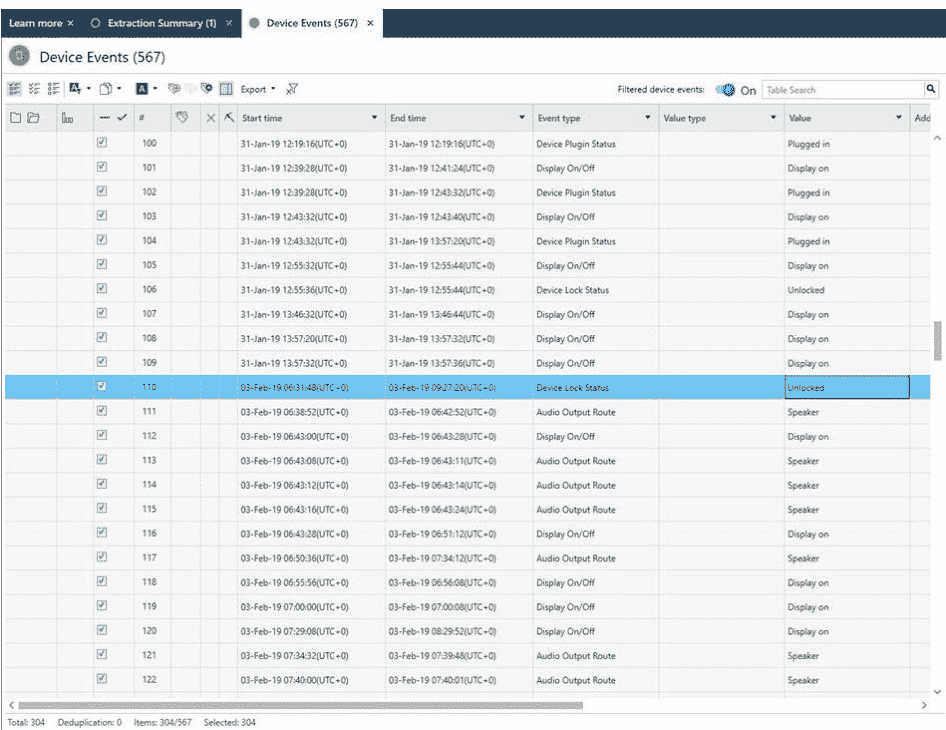
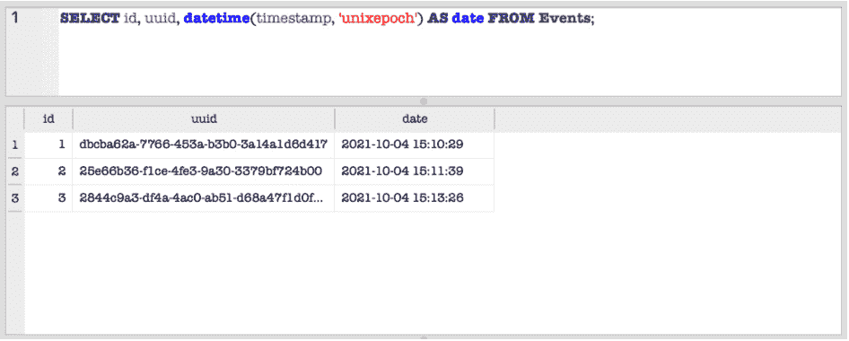
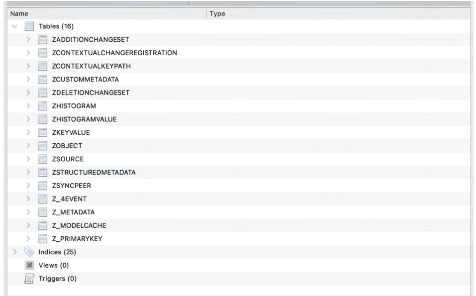
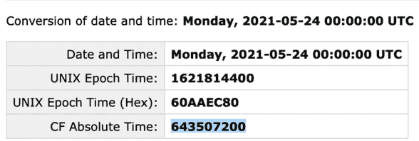
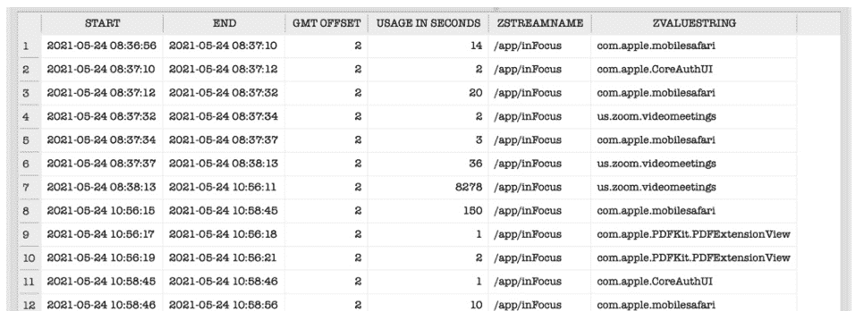
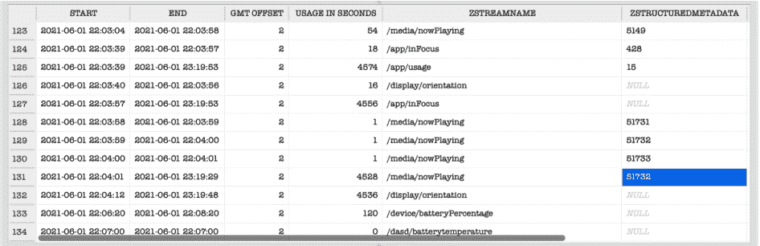
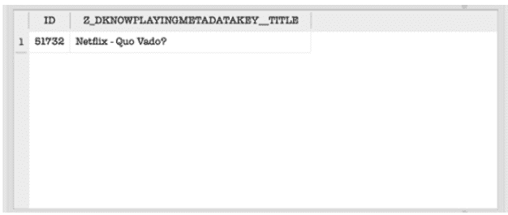
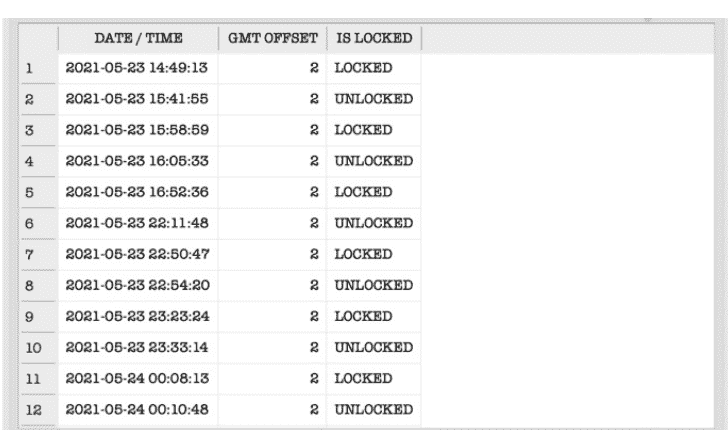
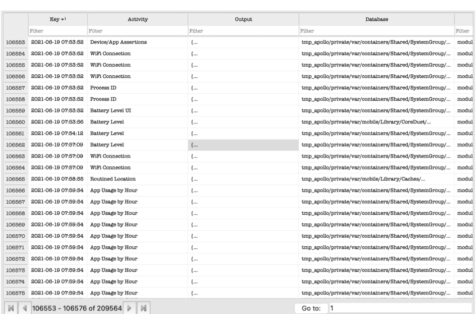

## Chapter 5: Pattern-of-Life Forensics

在上一章中，我们了解了可以在 iOS 设备上找到的不同类型的 artifacts，例如 SQLite 数据库和 plists，以及如何手动分析这些文件。在本章中，我们将利用这些知识来处理从取证角度来看最有趣的数据库，例如 **KnowledgeC** 数据库，它是行为模式取证的首选解决方案。

行为模式数据关乎设备所有者在日常生活中进行的习惯。对于智能手机而言，这包括在任何给定时间使用了哪些应用以及使用了多长时间，设备何时被解锁，电池温度是多少，以及用户正在浏览哪个网页。

我们将从定义行为模式取证开始，以便更好地理解在 iOS 设备调查中可能遇到的哪种数据。然后，我们将讨论时间戳以及如何在不同时区之间转换。然后，我们将深入研究 KnowledgeC、电源日志和设备事件，并学习如何识别用户交互。最后，我们将介绍 Apollo，这是一款开源工具，大大简化了定位和审查行为模式 artifacts 的过程。

在本章中，我们将涵盖以下主题：

- Introducing pattern-of-life forensics
- Working with timestamps
- Logs, events, and user interaction
- Introducing Apollo

### Introducing pattern-of-life forensics

如果你从未有机会仔细查看 iOS 设备的行为模式数据，你可能会对在正常智能手机使用过程中收集、存储和处理的数据量和种类感到惊讶。通常，这些数据被操作系统用来为用户提供个性化推荐，例如 Siri 的建议。

行为模式取证到底是什么？这些数据全部关乎 **user behavior** 和 **device usage**，它使调查人员能够回答以下问题：

- 用户使用设备做什么？
- 他们访问了什么？
- 他们与谁进行了通信？

从取证角度来看，分析行为模式数据非常有用，不仅可以识别在给定时间段内设备上执行的所有活动，还可以构建设备所有者的画像；通过分析 iOS 收集的数据，调查人员将深入了解所有者的习惯，例如用户醒来时使用哪些应用，设备最常连接哪些 Wi-Fi 网络，网页历史记录和通知。构建可被视为正常的活动画像使调查人员能够立即检测到可能对调查感兴趣的 **patterns of abnormal behavior**。

令人惊讶的是，行为模式数据在取证界得到的关注很少，主要是因为从设备获取相关 SQLite 数据库的挑战；这些数据在设备正常使用期间无法访问，只能通过 **full filesystem acquisition** 访问。显然，这限制了可以从中提取此类数据的设备范围，但 **checkm8 exploit** 和其他依赖公共软件漏洞的 **agent-based acquisitions** 等技术使调查人员能够从大多数 iOS 设备中访问用户活动和行为。

### Meaningful SQLite databases

以下是与行为模式取证相关的最常见数据库列表。我们将在本书后面对每个数据库进行深入研究：

- 用户和设备活动的主要来源是 `KnowledgeC.db` SQLite 数据库，它可以在 macOS 和 iOS 设备上找到。在 iOS 上，它位于 `/private/var/mobile/Library/CoreDuet/Knowledge/`，只能通过完整文件系统获取来访问。该数据库通常包含数十万条与设备事件和用户活动相关的记录。

- `interactionC.db` SQLite 数据库跟踪设备所有者与其联系人之间的最近交互，例如短信或通话。目前尚不清楚该数据库的保留期是多少，因为不同设备之间的数据不一致，但一般来说，调查人员会找到最近六个月的条目。虽然 `interactionC.db` 不包含对话的实际内容，但它包含可以与其他 artifacts 相关联的元数据。数据库可以在 `/private/var/mobile/Library/CoreDuet/People/` 找到。

- 位于 `/private/var/containers/Shared/SystemGroup/UUID/Library/BatteryLife/` 的 `CurrentPowerLog.PLSQL` 文件跟踪与电池寿命相关的数据，例如使用情况和温度。

- 另一个可以帮助调查人员了解设备在特定时间点运行了哪些进程的有趣数据库是 `DataUsage.sqlite` 数据库，它位于 `/private/var/wireless/Library/Databases/`。该数据库存储每个进程的网络使用统计信息。


与生活模式取证相关的最重要主题之一是位置数据；在 iOS 上，不止一个文件会跟踪用户在任意给定时间点所处的位置，并显示用户更常访问的地点，例如位于 `/private/var/root/Library/Caches/locationd/` 的 cache_encrypted.db 数据库，或者 consolidated.db 数据库。每个数据库包含的数据具有不同的粒度和详细程度，我们将在下一章深入探讨这一主题。

现在我们已经了解了哪些是最常见的生活模式数据来源，你可能会想知道这些数据库中究竟会记录哪些内容。下面的截图展示了在 Cellebrite Physical Analyzer 中查看的一些最有趣的生活模式数据痕迹：



图 5.1 – Cellebrite Physical Analyzer 中的设备事件

### 将 Unix 时间戳转换为可读日期，反之亦然

1633614474 时间戳转人类可读日期 [批量转换]

支持秒、毫秒、微秒和纳秒级别的 Unix 时间戳。

假设该时间戳以秒为单位：
**GMT**：2021 年 10 月 7 日星期四 13:47:54
**你的时区**：2021 年 10 月 7 日星期四 15:47:54 GMT+02:00 夏令时
**相对时间**：几秒前

图 5.2 – 将 Unix 时间戳转换为字符串

现在我们知道什么是 Unix 时间戳了，接下来看看如何使用 SQL 查询将其转换为可读的字符串。

在下面的示例中，我们有一个名为 Events 的单一表，包含三列：id、uuid 和 timestamp。timestamp 列使用 Unix 格式：

```
SELECT * FROM Events;
```


要将 Unix 时间戳转换为可读字符串，请运行以下查询：

```
SELECT id, uuid, datetime(timestamp, 'unixepoch') AS date FROM Events;
```

datetime SQL 函数会将 timestamp 列中的数值转换为字符串。结果时间以 UTC 格式提供：

```sql
SELECT id, uuid, datetime(timestamp, 'unixepoch') AS date FROM Events;
```

|   | id | uuid | date |
|---|---:|---|---|
| 1 | 1 | dbcab8a2-7766-453a-b3b0-3a14a1d6d417 | 2021-10-04 15:10:29 |
| 2 | 2 | 25e66b36-f1ce-4fe3-9a30-3379bf724b00 | 2021-10-04 15:11:39 |
| 3 | 3 | 2844e9a3-df4a-4ac0-ab51-d68a47f1d0f... | 2021-10-04 15:13:26 |



要以本地时间格式显示字符串，请运行以下查询：

```sql
SELECT id, uuid, datetime(timestamp, 'unixepoch',
'localtime') AS date FROM Events;
```

时区将反映所使用设备的设置，通常是调查人员的工作站。

### Mac 时间戳

另一种常用的时间戳格式是 Mac 绝对时间，其定义为自 2001 年 1 月 1 日 00:00:00 的 Mac 纪元以来经过的秒数。Mac 时间戳可以通过在线转换器转换为可读字符串，或者简单地将 Mac 时间戳加上自 **Unix 纪元**以来的秒数（978307200），然后转换为字符串。

以下查询演示了将 Mac 时间戳转换为本地时区字符串的过程：

```sql
SELECT id, uuid, datetime(timestamp + 978307200,
'unixepoch', 'localtime') AS date FROM Events;
```

Mac 时间戳通常用于 iOS 的生活模式数据中，例如 KnowledgeC.db 数据库。

## 日志、事件和用户交互

在本章开头，我们介绍了生活模式取证，并了解了 iOS 如何存储和分析大量用户事件和设备事件。接着，我们学习了最常见的数据来源，如 KnowledgeC.db 数据库，并了解了 iOS 如何通过 Unix 时间戳和 Mac 绝对时间来表示时间。

现在，我们将深入探讨你在 iOS 设备上会发现的最具取证价值的 SQLite 数据库之一。

### KnowledgeC 数据库

KnowledgeC.db 是跟踪几乎所有活动和设备事件（从电池电量到播放的音乐）的 SQLite 数据库。该数据库位于 `/private/var/mobile/Library/CoreDuet/Knowledge/`，只能通过完整文件系统提取来访问。该数据库由 16 个表组成，但大部分有用数据都集中在其中一个表——ZOBJECT 表中。

下面的截图展示了该数据库的架构：



图 5.5 – KnowledgeC 数据库的架构

务必记住，此数据库中的数据只会保留大约四周，然后按先进先出的原则被清除，因此如果生活模式数据是调查中的关键部分，应尽快获取设备。

从取证角度来看，主要的关注表是 ZOBJECT 表，其中每一行对应一个事件或交互，数据分布在 40 列中。我们将简要介绍最有趣的几列，以理解该表如何记录事件：

- 每行包含一个 ZCREATIONDATE 列，记录条目写入数据库的时间戳（Mac 格式）。
- ZSTARTDATE 和 ZENDDATE 列包含事件开始和结束时间的时间戳。
- ZSTARTDAYOFWEEK 列指示事件发生的星期几。
- `ZSECONDSFROMGMT` 列以秒为单位指示 GMT 偏移量。
- `ZSTREAMNAME` 列指示发生的事件类型。
- `ZVALUESTRING` 列显示与该事件相关的应用程序的包 ID。

为了更好理解该数据库会记录哪些类型的事件，我们将分析 `ZSTREAMNAME` 列并检查其值。你可以通过运行以下 SQL 查询来查看事件类型列表：

```
SELECT DISTINCT ZOBJECT.ZSTREAMNAME FROM ZOBJECT ORDER BY ZSTREAMNAME;
```

在一台运行 iOS 14.6 的最新 iOS 设备上，该查询返回了 50 多种不同的事件类型。下面列出了一些最常见的事件类型以及如何解读 `ZOBJECT` 表中的数据。

#### /device/batteryPercentage

batteryPercentage 流类型表示设备电池的电量水平。百分比值存储在 `ZVALUEDOUBLE` 列中。

#### /device/isPluggedIn

此事件指示设备是否已插入电源并正在充电。如果设备未插入电源，`ZVALUEINTEGER` 列将指示为 0；如果已插入电源，则指示为 1。

#### /displayIsBacklit

此事件流指示背光是否亮起。如果背光关闭，`ZVALUEINTEGER` 列将指示为 0；如果背光开启，则指示为 1。此事件在设备锁定时可用于检测人为交互；只需轻触屏幕就会点亮显示屏，从而触发此事件。

#### /device/isLocked

isLocked 流类型指示设备是否处于密码锁定状态。锁定状态存储在 ZVALUEINTEGER 列中；值为 0 表示设备已锁定，值为 1 表示设备未锁定。

#### /app/inFocus

此事件流指示哪个应用程序处于活动状态并在前台运行。ZVALUESTRING 列存储应用程序的名称。可以分析 inFocus 事件以详细了解应用程序的使用情况。

#### /notification/usage

此事件流指示推送通知活动。ZVALUESTRING 列显示记录的活动类型，例如 *接收*、*清除* 和 *忽略*。此事件也有助于识别用户活动，例如用户在设备锁定时忽略通知。

#### /app/webUsage

此事件指示哪个应用程序正在使用互联网连接。ZVALUESTRING 列显示应用程序的名称。

#### /display/orientation

orientation 事件指示设备方向的变化。如果设备处于竖屏模式，`ZVALUEINTEGER` 列将指示为 0；如果处于横屏模式，则指示为 1。

#### /media/nowPlaying


此事件表示设备上正在播放多媒体内容。ZVALUESTRING 列将显示正在播放该内容的应用信息，例如 YouTube 或 Apple Music。

到目前为止，你应该对 KnowledgeC.db 数据库中记录了哪些类型的事件以及如何分析这些记录有了大致的了解。接下来，我们将深入研究更高级的主题，例如详细分析应用程序使用情况。

## 分析应用程序使用情况

通过分析生活模式数据可以获得的最有价值的洞察之一就是应用程序使用情况。通过分析 ZOBJECT 表中的 /app/inFocus 事件流，调查人员将能够识别在特定时间范围内设备上使用了哪些应用程序，以及使用了多长时间。

例如，我们将运行一个查询，以识别在 48 小时时间范围内使用了哪些应用程序，时间从 2021 年 5 月 24 日 00:00:00 到 2021 年 5 月 26 日 00:00:00。

首先，我们需要将日期和时间转换为 Mac 绝对时间戳：

### 结果



图 5.6 – 使用 https://www.gaijin.at/en/tools/time-converter 将日期和时间转换为 Mac 时间戳

现在我们已经有了 Mac 绝对时间戳，我们希望查询 KnowledgeC.db 中所有发生在 643507200 时间戳和 643680000 时间戳之间的 /app/inFocus 事件。为此，请运行以下查询：

```sql
SELECT
datetime(ZOBJECT.ZSTARTDATE+978307200, 'UNIXEPOCH',
'LOCALTIME') as "START",
datetime(ZOBJECT.ZENDDATE+978307200, 'UNIXEPOCH',
'LOCALTIME') as "END",
ZOBJECT.ZSECONDSFROMGMT/3600 AS "GMT OFFSET",
(ZOBJECT.ZENDDATE-ZOBJECT.ZSTARTDATE) as "USAGE IN SECONDS",
ZOBJECT.ZSTREAMNAME,
ZOBJECT.ZVALUESTRING
FROM ZOBJECT
WHERE ZSTREAMNAME IS "/app/inFocus"
AND ZOBJECT.ZSTARTDATE > 643507200
AND ZOBJECT.ZSTARTDATE < 643680000
ORDER BY "START";
```

首先，我们使用 datetime SQL 命令选择开始和结束时间戳，并将其转换为可读的字符串。然后，我们计算以小时为单位的 GMT 偏移量和以秒为单位的事件持续时间。最后，我们通过仅选择之前计算出的时间戳之间发生的 /app/inFocus 事件来过滤结果。

得到的数据集如下所示：



图 5.7 – 查询结果显示了应用程序的使用情况

正如你所看到的，我们详细列出了设备上使用了哪些应用程序、事件的日期和时间，以及应用程序的使用时长。例如，你可以看到在这一天，我使用 Safari 短暂浏览了网页，然后参加了一个 2 小时的 Zoom 会议，最后在 Safari 中查看了来自某个网站的 PDF 文件。

另一个对调查有用的洞察是分析用户行为，判断他们是否在从事某项长期任务，例如看电影。我们可以通过按 USAGE 列降序排列结果来实现这一点。在以下示例中，我还移除了所有时间限制：

```sql
SELECT
datetime(ZOBJECT.ZSTARTDATE+978307200,'UNIXEPOCH',
'LOCALTIME') as "START",
datetime(ZOBJECT.ZENDDATE+978307200,'UNIXEPOCH',
'LOCALTIME') as "END",
ZOBJECT.ZSECONDSFROMGMT/3600 AS "GMT OFFSET",
(ZOBJECT.ZENDDATE-ZOBJECT.ZSTARTDATE) as "USAGE IN SECONDS",
ZOBJECT.ZSTREAMNAME,
ZOBJECT.ZVALUESTRING
FROM ZOBJECT
WHERE ZSTREAMNAME IS "/app/inFocus"
ORDER BY "USAGE IN SECONDS" DESC;
```

下面，你可以看到得到的数据：

|  | 开始时间 | 结束时间 | GMT 偏移量 | 使用时长（秒） | ZSTREAMNAME | ZVALUESTRING |
|---|---|---|---:|---:|---|---|
| 1 | 2021-06-24 08:38:13 | 2021-06-24 10:56:11 | 2 | 8278 | /app/inFocus | us.zoom.videomeetings |
| 2 | 2021-06-06 14:53:43 | 2021-06-06 17:07:49 | 2 | 8046 | /app/inFocus | com.apple.mobilesafari |
| 3 | 2021-05-26 16:25:19 | 2021-05-26 18:38:19 | 2 | 7980 | /app/inFocus | us.zoom.videomeetings |
| 4 | 2021-06-02 11:03:58 | 2021-06-02 12:31:20 | 2 | 5242 | /app/inFocus | com.apple.mobilesafari |
| 5 | 2021-06-25 14:57:21 | 2021-06-25 16:23:48 | 2 | 5187 | /app/inFocus | com.apple.mobilesafari |
| 6 | 2021-06-24 13:37:35 | 2021-06-24 14:58:41 | 2 | 4866 | /app/inFocus | com.apple.mobilesafari |
| 7 | 2021-06-13 18:02:54 | 2021-06-13 19:23:42 | 2 | 4848 | /app/inFocus | com.apple.mobilesafari |
| 8 | 2021-06-13 16:44:36 | 2021-06-13 18:02:54 | 2 | 4698 | /app/inFocus | com.apple.mobilesafari |
| 9 | 2021-05-29 10:52:03 | 2021-05-29 13:09:21 | 2 | 4638 | /app/inFocus | com.google.ios.youtube |
| 10 | 2021-05-31 17:47:34 | 2021-05-31 19:04:05 | 2 | 4591 | /app/inFocus | us.zoom.videomeetings |
| 11 | 2021-06-01 22:03:57 | 2021-06-01 23:19:53 | 2 | 4556 | /app/inFocus | com.netflix.Netflix |
| 12 | 2021-06-06 11:18:07 | 2021-06-06 12:30:11 | 2 | 4504 | /app/inFocus | com.apple.mobilesafari |

图 5.8 — 分析长期任务

正如你所看到的，我参与了相当多的长期任务，例如 Zoom 会议、网页浏览，以及在 YouTube 和 Netflix 上播放媒体内容。现在，假设我们想更深入地挖掘数据，分析 2021 年 6 月 1 日晚上发生了什么。从之前的查询结果中，我们可以看到那天晚上我在使用 Netflix。但我到底在看什么呢？

首先，我们将计算该日期和时间的 Mac 时间戳，然后运行以下查询：

```sql
SELECT
datetime(ZOBJECT.ZSTARTDATE+978307200,'UNIXEPOCH',
'LOCALTIME') as "START",
datetime(ZOBJECT.ZENDDATE+978307200,'UNIXEPOCH',
'LOCALTIME') as "END",
ZOBJECT.ZSECONDSFROMGMT/3600 AS "GMT OFFSET",
(ZOBJECT.ZENDDATE-ZOBJECT.ZSTARTDATE) as "USAGE IN SECONDS",
ZOBJECT.ZSTREAMNAME,
ZOBJECT.ZSTRUCTUREDMETADATA,
ZOBJECT.ZVALUESTRING
FROM ZOBJECT
WHERE ZOBJECT.ZSTARTDATE > 644266800
AND ZOBJECT.ZSTARTDATE < 644277599
ORDER BY "START";
```

结果如下所示：



图 5.9 – 查询结果显示感兴趣时间范围内的用户交互

通过分析得到的数据集，我们可以看到 Netflix 应用被启动，触发了 /media/nowPlaying 事件，并且设备被旋转为横屏模式。要了解 Netflix 上正在播放什么内容，我们需要分析与该事件关联的元数据。在本例中，关联 ID 为 51732，我们将使用它来查询 ZSTRUCTUREDMETADATA 表：

```sql
SELECT
Z_PK AS "ID",
Z_DKNOWPLAYINGMETADATAKEY__TITLE
FROM ZSTRUCTUREDMETADATA
WHERE "ID" = "51732";
```

结果如下图所示，显示了正在播放的应用名称 Netflix，以及我正在观看的电影名称：



图 5.10 – 与 /media/nowPlaying 事件关联的元数据

从这些简单的示例可以看出，调查人员能够非常详细地分析用户行为，不仅了解用户正在使用哪个应用程序，还能了解用户在该特定应用程序中具体在做什么。例如，通过定制 SQL 查询，可以了解用户访问了哪个网站，或者正在阅读哪个 PDF 文件。我们将在接下来的章节中详细讨论这些用例。

**提示**

如果没有 **数字取证与事件响应（DFIR）** 社区的慷慨贡献，就不可能从生活模式数据中获取洞察。特别是，本章中使用的大多数查询都基于 Sarah Edwards（@iamevltwin）进行的研究。你可以访问她的博客：[https://www.mac4n6.com](https://www.mac4n6.com)。

## 分析用户交互

在任何涉及智能设备的数字调查中，调查人员通常首先想要回答的问题之一是设备何时被使用，以及何时发生了人机交互。这可以通过查找需要人工交互的事件来轻松发现，例如解锁设备或激活屏幕。

以下查询显示了设备何时被锁定或解锁：

```sql
SELECT
datetime(ZOBJECT.ZSTARTDATE+978307200, 'UNIXEPOCH',
'LOCALTIME') as "DATE / TIME",
ZOBJECT.ZSECONDSFROMGMT/3600 AS "GMT OFFSET",
CASE ZOBJECT.ZVALUEINTEGER
        WHEN '0' THEN 'UNLOCKED'
        WHEN '1' THEN 'LOCKED'
    END "IS LOCKED"
FROM ZOBJECT
WHERE ZOBJECT.ZSTREAMNAME LIKE "/device/isLocked"
ORDER BY "DATE / TIME";
```

结果如下面的截图所示：




图 5.11 – 查询显示设备锁定状态

如果我们想在每次屏幕被激活时都查找记录，即使设备未被解锁，也可以通过运行以下查询来实现：

```
SELECT
datetime(ZOBJECT.ZSTARTDATE+978307200, 'UNIXEPOCH',
'LOCALTIME') as "DATE / TIME",
ZOBJECT.ZSECONDSFROMGMT/3600 AS "GMT OFFSET"
FROM ZOBJECT
WHERE ZOBJECT.ZSTREAMNAME LIKE "/display/isBacklit"
AND ZOBJECT.ZVALUEINTEGER = '1'
ORDER BY "DATE / TIME";
```

 resulting 记录将显示显示屏被激活的时间。 这些示例中使用的查询应该很容易理解，并且可以轻松自定义以匹配调查中可能感兴趣的其他事件。

我们现在将研究另一种分析生活模式数据的方法，使用开源工具。

## 介绍 Apollo

到目前为止，我们已经学习了如何通过查询 SQLite 数据库手动分析生活模式数据。 然而，还有另一种选择可以自动化该过程，并允许调查人员查看所有数据在统一数据库中。

**Apollo**，全称为 **Apple Pattern of Life Lazy Output'er**，是由 Sarah Edwards (@iamevltwin) 开发的 Python 脚本，它将多个数据源关联到统一的 **timeline** 中，简化了检查人员了解设备上到底发生了什么的任务。

该工具由数十个高度可配置的模块组成，每个模块查询特定的 iOS 数据库以提取数据和事件。 主 Python 脚本随后将每个模块的结果编译成统一的 **CSV** 文件或 SQLite 数据库。

我们现在将介绍下载该工具、运行它并将结果导出到单个 SQLite 数据库所需的步骤：

- 1. 要下载 Apollo，请前往其 GitHub 仓库 https://github.com/mac4n6/APOLLO 并下载最新版本作为 ZIP 归档，或通过运行 git clone 命令克隆仓库。
- 2. 接下来，通过指定导出格式、模块目录的位置以及应分析的数据位置来运行该工具，例如包含 SQLite 数据库的文件夹或完整的系统提取。 例如，运行 python apollo.py -output sql modules/ fs-extraction/ 将以 SQL 模式运行 Apollo，分析 fs-extraction 文件夹中的文件并运行 modules 文件夹中找到的所有模块。 Apollo 也可以使用不同的选项运行； 有关所有可用命令行选项的完整列表，您可以参考项目的 GitHub 页面。
- 3. 当工具结束处理时，结果将存储在名为 apollo.db 的文件中。
- 4. 然后，您可以使用您选择的工具，例如 **DB Browser**，继续分析 SQLite 数据库。



图 5.12 – DB Browser 中显示的 Apollo 数据库

该数据库包含一个表 APOLLO，其中包含工具模块处理过的所有数据的 timeline。 以下是该表列的简要说明：

- Key 列包含事件发生的时间戳，以人类可读的字符串显示。
- Activity 列显示记录了何种事件的简单描述。
- Output 列包含与特定事件相关的所有数据的 JSON 对象。
- Database 列指示事件是从哪个数据库提取的。
- Module 列指示负责提取和分析事件的模块的名称。

通常，从取证角度来看，输出命令将包含大部分有趣的数据。 下图显示了 `Battery Level` 事件的 JSON 对象是什么样的：

```
```json
{
  "ADJUSTED_TIMESTAMP": "2021-06-19 07:57:09",
  "LEVEL": 31.0,
  "RAW_LEVEL": 31.2364696962684408,
  "IS_CHARGING": 0,
  "FULLY_CHARGED": 0,
  "ORIGINAL_TIMESTAMP": "2021-04-26 05:35:55",
  "OFFSET_TIMESTAMP": "2021-04-28 15:48:56",
  "TIME_OFFSET": 4674074.367777824,
  "PLBATTERYAGENT_EVENTBATTERY_TABLE_ID": 480012
}
```
```

图 5.13 – 存储在 Apollo Output 列中的 JSON 对象

Apollo 的美妙之处在于它是一个完全模块化和可定制的工具，允许调查人员提取所有生活模式数据或选择仅通过使用适当的模块包含某些工件。 将结果浓缩到单个文件中意味着调查人员能够查看事件时间线，可以根据日期和时间轻松过滤，或通过搜索特定事件。

Apollo 正在积极开发中，模块不断被添加和更新。 最后，需要注意的是，该工具不仅支持 iOS，还允许分析来自 MacOS 设备和其他设备的生活模式数据。

## 总结

在本章中，我们了解了生活模式取证是什么，以及调查人员如何通过分析此类数据来可视化用户行为并检测异常模式而受益。
