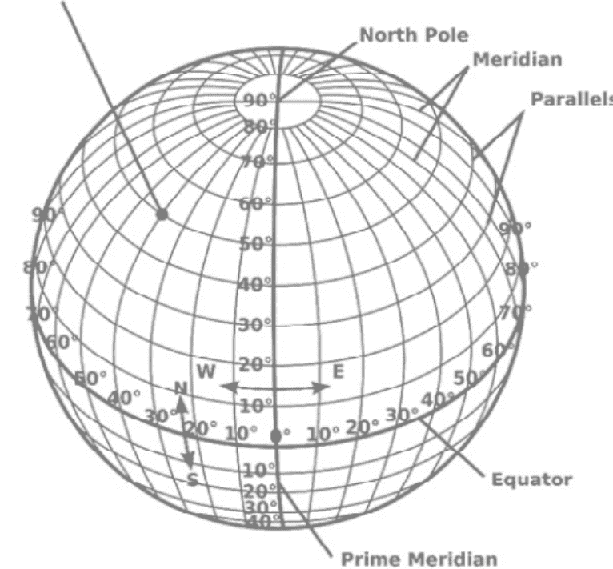
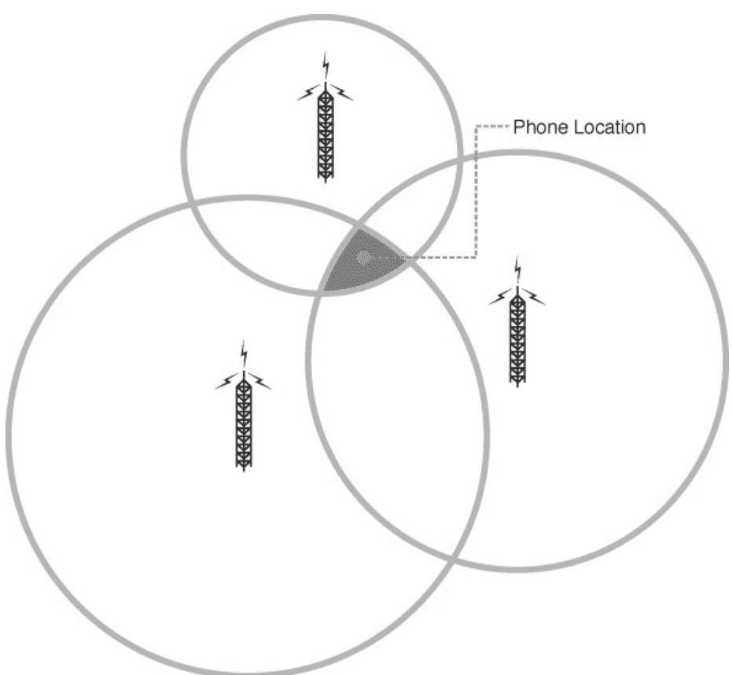
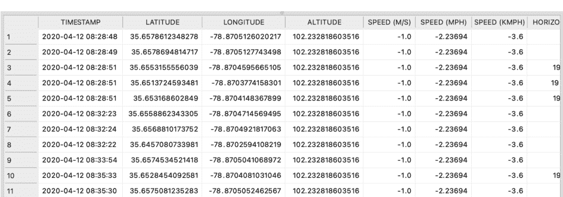
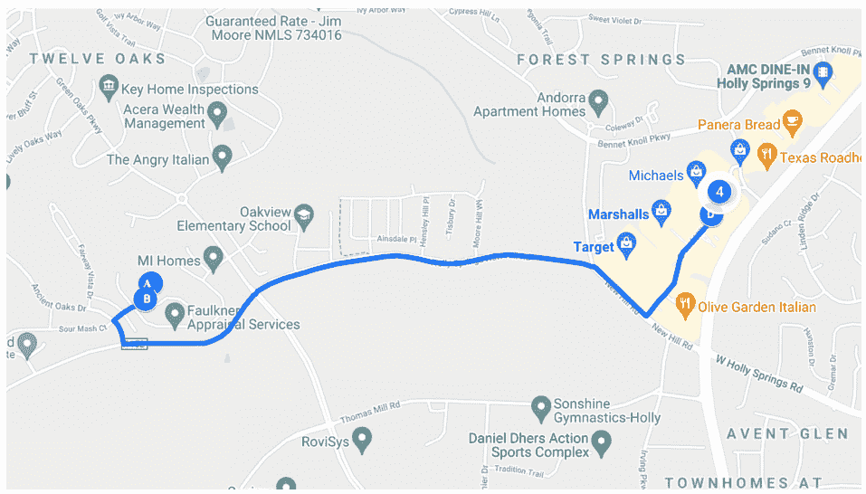
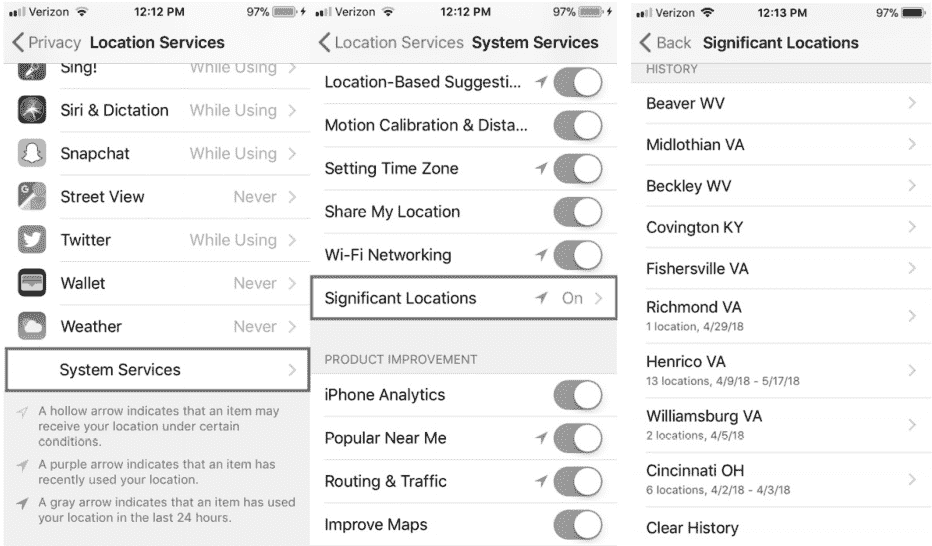
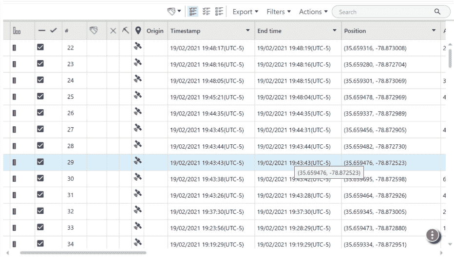
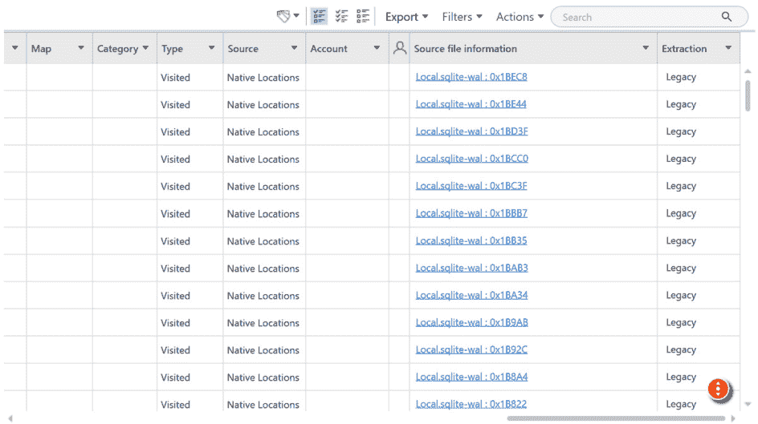
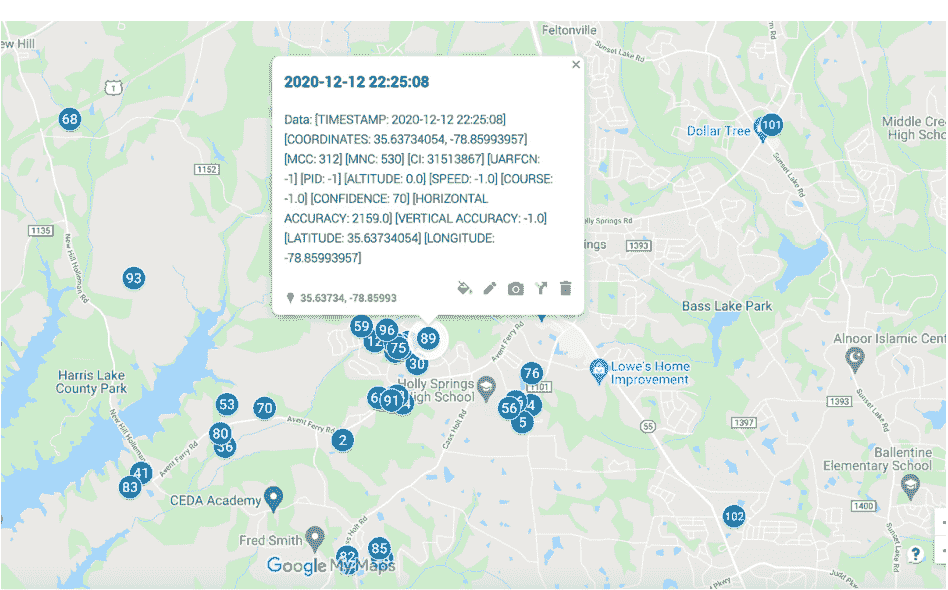

## 第 6 章：剖析位置数据

在上一章中，我们了解了可以在 iOS 设备上找到的生活模式工件，例如应用程序使用情况和系统事件，以及如何手动分析数据库和日志。 在本章中，我们将重点关注可在移动设备上找到的最有趣的数据类型之一，即位置数据。

移动设备存储了大量位置数据，例如与蜂窝基站、Wi-Fi 网络和与设备接近的蓝牙设备相关的数据。 位置工件也可以从第三方应用程序或多媒体文件中提取。

我们将从学习位置数据是什么、设备如何确定其位置以及此数据存储在哪里开始本章。 我们将学习 GPS、蜂窝基站三角定位和 Wi-Fi 位置之间的区别。 然后，我们将深入研究存储位置数据的一些 SQLite 数据库，并学习如何分析它们以获得有意义的见解。 最后，我们将学习 Cellebrite Physical Analyzer 和 Apollo 等取证工具如何加快位置数据分析过程。

在本章中，我们将涵盖以下主题：

- 介绍位置数据
- GPS 定位、蜂窝基站和 Wi-Fi 网络
- 定位位置工件
- 使用取证工具分析位置数据

### 介绍位置数据



图 6.1 – 地理位置使用纬度和经度表示

在接下来的章节中，我们将学习位置服务如何工作以确定设备的位置。

## GPS 定位、蜂窝基站和 Wi-Fi 网络

Location Services iOS API 使用一种称为辅助 GPS (A-GPS) 的技术集合来确定设备的位置。 移动设备使用 A-GPS 而不是仅使用传统卫星 GPS 的主要原因是

后者在建筑物内部性能不佳； 它也比其他技术慢，并且会迅速耗尽设备的电池。 A-GPS 通过使用外部源（例如蜂窝基站）来增强卫星 GPS，从而提高卫星信号的速度、质量和精度。 外部源接收到的数据随后被整合以确定设备的精确位置。

以下是为 A-GPS 提供支持的来源列表：

- 卫星 GPS
- 蜂窝基站
- Wi-Fi 网络
- 蓝牙设备

我们将在以下各节中更详细地研究这些内容。

你可能想知道 iOS 设备如何从 Wi-Fi 网络或蜂窝基站解析位置； 这是由 Apple 使用 **基于同行的机制** 实现的，其中每个 iOS 设备都贡献创建网络和设备的地图。

通常，该机制包括三个步骤：

- 1. 如果启用了位置服务，每个 iOS 设备会定期收集和存储当前 GPS 位置以及周围蜂窝基站和 Wi-Fi 热点列表。
- 2. 这些数据随后匿名发送到 Apple 服务器，在那里与其他收集的信息和第三方提供商整合。
- 3. 当位置服务请求设备位置时，数据会同步回 iOS 设备。

例如，如果位置服务请求设备位置且卫星 GPS 不可用，iOS 将扫描附近的蜂窝基站并查询 Apple 的基于同行生成的地图以查找与


这些蜂窝基站。通过这种机制，定位服务可以在几秒内获得粗略位置，然后在可用时报告更精确的 GPS 定位结果。

每台 iOS 设备还有一个内部缓存，存储大量位置、蜂窝基站和 Wi-Fi 网络信息。通过访问本地缓存，设备无需数据连接即可通过 Wi-Fi 网络解析位置。为了使这些数据保持最新，缓存数据库会定期清除。

除了这种基于对等设备的机制外，Apple 还依赖外部来源将蜂窝基站和无线网络转换为物理位置。例如，战争驾驶（wardriving）是指一个人通常驾车移动，使用笔记本电脑或智能手机搜索无线电信号，并记录自己的 GPS 坐标以及与该无线电信号相关的数据。

## 卫星 GPS

传统 GPS，也称为卫星 GPS，是 iOS 设备最精确的位置数据来源。

该技术基于一个由 30 多颗卫星组成的网络，这些卫星在距地球 20,000 公里的高度绕地运行。每颗卫星都会通过无线电波向地球发射信号，其中包含卫星标识符、当前位置和时间戳。因此，当设备截获卫星信号时，它会利用信号接收时间与广播时间之间的时间差来计算从接收器到卫星的距离。然后，设备利用计算出的距离和卫星的位置来计算其大致位置。

值得注意的是，要计算精确位置，接收器必须锁定至少三颗卫星的信号。当视野中有四颗或更多卫星时，接收器可以确定其 3D 位置：**纬度**、**经度**和**海拔**。

某些大气因素和其他误差源会影响设备 GPS 接收器的精度；不过，接收器通常精度可以达到



图 6.3 – 蜂窝基站三边测量过程

不难看出，三边测量过程的精度会因蜂窝基站的位置和密度而有很大差异。

## Wi-Fi 与蓝牙

与蜂窝基站类似，Wi-Fi 热点也会广播无线电信号，并且可以通过 RSSI 测量信号强度。移动设备会不断扫描无线热点，搜索已知网络，因此利用这些信息来计算设备的位置是有道理的。Wi-Fi 信号的覆盖范围在室外仅约 70 米，室内约 40-50 米，因此如果设备收到信号，它一定在物理上靠近热点。

考虑到这一点，移动设备如何通过评估 Wi-Fi 网络的 RSSI 来确定设备与热点之间的大致距离就很清楚了。然后，iOS 使用前面描述的基于对等设备的机制将该数据解析为物理位置。

蓝牙信标也可以以类似方式使用。

## 查找位置数据痕迹

在本章的第一部分，我们介绍了定位服务 API，并了解了 iOS 如何使用不同技术来评估其位置。现在，我们将深入探讨存储地理位置数据的 SQLite 数据库。

以下是一份只有在完整文件系统提取中才能找到的感兴趣文件列表：

- `/private/var/mobile/Library/Caches/com.apple.routined/Cache.sqlite`

  这是 iOS 位置数据的主要存储方式。`ZRTCLLOCATIONMO` 表包含多条有用记录，例如 GPS 坐标、时间戳和水平精度值，该值表示设备认为 GPS 坐标的准确程度。`ZRTWIFIACCESSPOINTMO` 表存储了设备扫描过的 Wi-Fi 网络列表。一般来说，此数据库中的数据应被视为最新且准确的。

- `/private/var/mobile/Library/Caches/com.apple.routined/Local.sqlite`

  此 SQLite 数据库在结构上与 `Cache.sqlite` 数据库相同。根据 iOS 版本的不同，`ZRTLEARNEDLOCATIONOFINTERESTSMO` 表通常包含任何*常去位置*的详细信息，我们稍后会研究这一点。

- `/private/var/mobile/Library/Caches/com.apple.routined/Cloud-V2.sqlite`

  顾名思义，此数据库存储应同步到 iCloud 的位置数据。

- `/private/var/root/Library/Caches/locationd/cache_encryptedDB.db`

  此数据库包含 Apple 收集到的位置数据，例如蜂窝小区和 Wi-Fi 网络；这些记录涉及与设备较近的蜂窝基站，但应始终检查这些地理坐标的准确性。

- `/private/var/root/Library/Caches/locationd/cache_encryptedC.db`

  此数据库存储从设备加速度计接收的数据，例如运动数据和一般健康相关数据。

- `/private/var/root/Library/Caches/locationd/consolidated.db`

  最后，此数据库供地理围栏（GeoFence）API 使用，任何创建地理围栏的应用都会存储在这里。

为了更好地理解位置相关数据如何存储在这些数据库中，我们将逐一分析它们，并了解可以使用哪些查询来提取有意义的见解。

## 分析位置数据

正如我们已经了解到的，iOS 设备会追踪许多不同的位置相关数据痕迹。调查人员应清楚了解这些数据的存储方式和存储位置，以及哪些位置是用户实际访问过的，哪些只是靠近设备的位置。

位置数据的取证分析第一步是查看 `Cache.sqlite` 数据库。该数据库包含由设备 GPS 接收器提供的极其精确的坐标历史记录。通常，这些数据会存储一周多一点的时间。

我们将从查看 `ZRTCLLOCATIONMO` 表开始。以下是该表的结构：

- `ZLATITUDE` 和 `ZLONGITUDE` 存储地理坐标。
- `ZALTITUDE` 列表示海拔的估算值。该数据由设备的加速度计提供。
- `ZHORIZONTALACCURACY` 列表示设备认为坐标的准确程度，以米为单位。
- `ZVERTICALACCURACY` 表示海拔精度，以米为单位。
- `ZTIMESTAMP` 列以 Mac 绝对时间格式存储时间戳。

通过运行以下查询，可以获取设备位置数据的完整历史记录：

```
SELECT
    DATETIME(ZTIMESTAMP + 978307200, 'UNIXEPOCH') AS "TIMESTAMP",
    ZLATITUDE AS "LATITUDE",
    ZLONGITUDE AS "LONGITUDE",
    ZALTITUDE AS "ALTITUDE",
    ZSPEED AS "SPEED (M/S)",
    ZSPEED*2.23694 AS "SPEED (MPH)",
    ZSPEED*3.6 AS "SPEED (KMPH)",
    ZHORIZONTALACCURACY AS "HORIZONTAL ACCURACY",
    ZVERTICALACCURACY AS "VERTICAL ACCURACY"
FROM
    ZRTCLLOCATIONMO;
```

首先，我们使用 `datetime` SQL 命令将 Mac 绝对时间戳转换为可读字符串。然后，我们从表中选择相关列，并计算设备移动的速度。

下图显示了查询结果：



图 6.4 – 查询结果显示设备的位置

如你所见，位置数据痕迹为调查人员提供了关于某个用户设备在特定时刻所处位置的准确信息。通常，这些数据粒度非常细，每秒记录一条条目也并不罕见。数据粒度的差异可以解释为：GPS 并非在所有地方都可用，因此在这些情况下，设备会转而在附近有 Wi-Fi 网络和蜂窝基站时使用它们来确定其位置。


一旦调查人员获取了地理坐标列表，这些坐标就可以与地图提供商一起使用，以获得设备所在位置的视觉反馈。



图 6.5 – 查询结果被映射出来以确定用户的行程

需要注意的是，不同数据库存储的定位数据类型各不相同，准确性也高低不等。根据已开展的研究，这种被称为 **routined location data** 的数据已被证明具有高度准确性。

## 理解重要位置

随着 iOS 8 的发布，苹果引入了一项名为 **Frequent Locations** 的功能，从 iOS 10 开始更名为 **Significant Locations**。基本上，每当设备访问某个位置时，都会在 SQLite 数据库中存储一条记录，其中包含设备行程的详细信息。当设备多次返回同一位置时，该位置就成为一个 *significant location*。

截至今天，苹果使用的算法如何工作以及需要多少次访问特定位置才会被视为重要位置，目前仍不清楚。就区域而言，研究发现，只要设备在重要位置 250 m 半径范围内，就会记录对该位置的访问。

如果启用了定位服务，可以通过 **Settings | Privacy | Location Services | System Services | Significant Locations** 直接从设备上查看 Significant Locations。



图 6.6 – Significant Locations 可以直接在设备上查看

请记住，自 iOS 15 以来，在设备上查看 Significant Locations 仅显示这些位置的摘要。完整数据只有通过完整的文件系统提取才能获得。

从取证角度来看，频繁位置数据非常宝贵，因为它使调查人员能够了解用户经常访问的位置。此外，与重要位置相关的数据通常可以追溯到很久以前。

要查看此数据，我们将在 Local.sqlite 数据库上运行以下查询：

```sql
SELECT
DATETIME(ZRTLEARNEDLOCATIONOFINTERESTVISITMO.ZENTRYDATE + 978307200, 'UNIXEPOCH') AS "ENTRY",
DATETIME(ZRTLEARNEDLOCATIONOFINTERESTVISITMO.ZEXITDATE + 978307200, 'UNIXEPOCH') AS "EXIT",
(ZRTLEARNEDLOCATIONOFINTERESTVISITMO.ZEXITDATE-ZRTLEARNEDLOCATIONOFINTERESTVISITMO.ZENTRYDATE)/60.00 AS "DURATION (MINUTES)",
ZRTLEARNEDLOCATIONOFINTERESTMO.ZLOCATIONLATITUDE AS "LATITUDE",
ZRTLEARNEDLOCATIONOFINTERESTMO.ZLOCATIONLONGITUDE AS "LONGITUDE",
ZRTLEARNEDLOCATIONOFINTERESTVISITMO.ZLOCATIONUNCERTAINTY AS "LOCATION UNCERTAINTY",
ZRTLEARNEDLOCATIONOFINTERESTVISITMO.ZDATAPOINTCOUNT AS "DATA POINTS"
FROM
ZRTLEARNEDLOCATIONOFINTERESTVISITMO
LEFT JOIN
ZRTLEARNEDLOCATIONOFINTERESTMO
ON ZRTLEARNEDLOCATIONOFINTERESTMO.Z_PK = ZRTLEARNEDLOCATIONOFINTERESTVISITMO.ZLOCATIONOFINTEREST;
```

尽管此查询看起来很复杂，但如果我们将其分解为逻辑步骤，实际上会容易得多：首先，我们使用 datetime SQL 命令将时间戳转换为可读的字符串。Entry 字段指的是设备访问重要位置的时间，而 Exit 字段表示设备离开该位置的时间。然后，我们计算访问的持续时间（Duration）并打印纬度、经度和不确定性。最后，我们打印该次访问该特定位置的数据点数（Data Points）。

下图显示了查询结果：

| # | DATE | MAC ADDRESS | CHANNEL | RSSI |
|---|---|---|---|---|
| 1 | 2020-04-12 12:46:19 | f8:bb:bf:1e:fa:ea | 161 | -57 |
| 2 | 2020-04-12 12:46:19 | f8:bb:bf:1e:fa:e4 | 161 | -57 |
| 3 | 2020-04-12 12:46:20 | 80:da:13:72:52:64 | 149 | -90 |
| 4 | 2020-04-12 12:46:20 | f8:bb:bf:1e:fa:eb | 48 | -51 |
| 5 | 2020-04-12 12:46:20 | 58:ef:68:25:35:34 | 48 | -90 |
| 6 | 2020-04-12 12:46:20 | d8:d7:75:b6:28:9 | 48 | -89 |
| 7 | 2020-04-12 12:46:20 | 80:da:13:72:52:6a | 149 | -89 |
| 8 | 2020-04-12 12:46:20 | f8:bb:bf:8d:b9:c2 | 48 | -78 |
| 9 | 2020-04-12 12:46:20 | f8:bb:bf:90:a8:f2 | 48 | -70 |
| 10 | 2020-04-12 12:46:20 | b8:66:85:53:d3:7 | 44 | -85 |
| 11 | 2020-04-12 12:46:20 | 7c:db:98:c2:30:34 | 40 | -89 |
| 12 | 2020-04-12 12:46:20 | f8:bb:bf:1e:fa:e8 | 48 | -50 |

图 6.8 – 结果显示了设备扫描到的无线设备的详细信息

尽管此表不存储诸如纬度和经度之类的地理坐标，但它仍然为调查人员提供了有关设备何时以及捕获了哪些无线信号的详细信息。通过将此数据与外部数据源（例如已知网络设备及其 MAC 地址的列表）相关联，可以在特定时间点将设备定位在特定位置。

## 理解采集的位置

在本章开头，我们介绍了 A-GPS 技术，并了解了苹果如何维护一个基于同行的地图，该地图在 Location Services 请求地理定位时下载回设备。此数据包含数千条与设备附近的蜂窝基站和 Wi-Fi 网络相关的记录，以及它们的地理坐标。设备可以使用此数据将无线电信号解析为物理位置，而无需 GPS 信号。

下载到设备上的苹果数据称为 **Harvested Locations** 数据，可在 `cache_encryptedB.db` 数据库中找到。

在这里，我们可以找到几个感兴趣的表：

- 蜂窝基站数据可在以下表中找到：
  - `CdmaCellLocation`、`CellLocation` 和 `LteCellLocation`。
- Wi-Fi 设备数据存储在 `wifiLocation` 表中。

### 常规位置与采集位置

在开始分析此数据之前，了解设备访问的位置与苹果提供的位置之间的区别非常重要：我们之前查看的数据，也称为常规位置数据，通常非常准确，因为它来自设备的 GPS，并且可以详细显示设备所在的位置。另一方面，Harvested Locations 数据由苹果提供，作为增强设备对该区域了解的一种方式。此数据不是从内置 GPS 接收器检索的，而是表示位于设备附近的蜂窝基站和无线设备。

### 分析采集的蜂窝基站数据

蜂窝基站数据存储在 `cache_encryptedB.db` 数据库中，并保留约一周。以下是一些最相关的列：

- MCC，或 **Mobile Country Code**，表示蜂窝基站的国家代码。
- MNC，或 **Mobile Network Code**，标识移动运营商。
- CI，或 **Cell ID**，是用于表示蜂窝基站每个收发站的唯一编号。
- `HorizontalAccuracy` 值表示设备认为坐标的精确程度，以米为单位。
- `Latitude` 和 `Longitude` 列存储地理坐标。

我们可以通过运行 SQL 查询来提取所有蜂窝相关数据，例如以下代码块所示。在用于研究<|message|>的设备上，蜂窝数据存储在 LTECELLLOCATION 表中；不过，这取决于设备型号和 iOS 版本：

```sql
SELECT
    DATETIME(TIMESTAMP + 978307200, 'UNIXEPOCH') AS "TIMESTAMP",
    MCC AS "MCC",
    MNC AS "MNC",
    CI AS "CI",
    HORIZONTALACCURACY AS "HORIZONTAL ACCURACY",
    LATITUDE AS "LATITUDE",
    LONGITUDE AS "LONGITUDE"
FROM LTECELLLOCATION;
```

查询结果如下图所示：

| # | TIMESTAMP | MCC | MNC | CI | HORIZONTAL ACCURACY | LATITUDE | LONGITUDE |
|---|---|---|---|---|---|---|---|
| 1 | 2020-12-12 22:25:08 | 310 | 260 | 18005506 | 2142.0 | 35.6559143 | -78.87465667 |
| 2 | 2020-12-12 22:25:08 | 310 | 260 | 256947784 | 1414.0 | 35.62225341 | -78.87554168 |
| 3 | 2020-12-12 22:25:08 | 310 | 260 | 256769850 | 1414.0 | 35.66263961 | -78.87255859 |
| 4 | 2020-12-12 22:25:08 | 311 | 480 | 39694094 | 2977.0 | 35.62737655 | -78.84117126 |
| 5 | 2020-12-12 22:25:08 | 311 | 480 | 39694096 | 1414.0 | 35.62499618 | -78.84272003 |
| 6 | 2020-12-12 22:25:08 | 310 | 410 | 196794049 | 2094.0 | 35.66758346 | -78.87165069 |
| 7 | 2020-12-12 22:25:08 | 310 | 410 | 195403799 | 1414.0 | 35.64883804 | -78.8419876 |
| 8 | 2020-12-12 22:25:08 | 311 | 480 | 116500503 | 1414.0 | 35.63685607 | -78.86347198 |
| 9 | 2020-12-12 22:25:08 | 311 | 480 | 116500504 | 1414.0 | 35.63601303 | -78.86531829 |
| 10 | 2020-12-12 22:25:08 | 310 | 410 | 195138569 | 1414.0 | 35.63536071 | -78.86586761 |
| 11 | 2020-12-12 22:25:08 | 310 | 410 | 195001864 | 1414.0 | 35.66678237 | -78.87182617 |
| 12 | 2020-12-12 22:25:08 | 311 | 480 | 39694114 | 13696.0 | 35.63697433 | -78.86968231 |

图 6.9 – 查询结果显示了蜂窝基站和地理位置的详细信息


到目前为止，我们已经学习了如何通过在数据库上运行 SQL 查询来手动分析位置相关数据。然而，还有其他可以自动执行该过程的选项，例如使用取证工具。

### 使用取证工具分析位置数据

我们将重点介绍两种工具：商业工具 Cellebrite **Physical Analyzer**，以及免费工具 **Apollo**。

### 使用 Physical Analyzer 查看位置数据

Cellebrite Physical Analyzer 通过在统一视图中显示 GPS、蜂窝和 Wi-Fi 位置来自动化分析位置数据的任务。请记住，要访问位置数据，您需要执行完整的系统提取，因为感兴趣的文件在逻辑或 iTunes 备份中不可用。

要查看位置数据，请从左侧菜单中选择 **Location Related | Device Locations | Native Locations：**



图 6.10 – 在 Physical Analyzer 中查看位置数据

下图详细显示了剩余的列：



图 6.11 – Physical Analyzer 指定了该工件的源文件

正如前图所示，对于每条记录，Physical Analyzer 都会指定记录被解析的源文件。请记住，仅因为某个位置出现在结果中，并不一定意味着设备实际上访问过该位置，因为该工具也会显示收集的数据。

### 使用 Apollo 分析位置数据

Apollo，我们在上一章中介绍过，是一款将多个数据源关联到统一 **时间线** 的 Python 脚本，简化了检查员弄清设备上到底发生了什么的任务。该工具由数十个高度可配置的模块组成，每个模块查询特定的 iOS 数据库以提取数据和事件。Apollo 支持常规位置数据和收集数据。

我们现在将介绍下载该工具、运行它并将位置数据导出为可导入地图提供商服务的 KMZ 文件所需的步骤：

- 1. 要下载 Apollo，请前往其 GitHub 仓库 https://github.com/mac4n6/APOLLO 并下载最新版本作为 ZIP 归档，或通过运行 git clone 命令克隆仓库。
- 2. 接下来，通过指定导出格式、模块目录的位置以及应分析的数据位置，例如包含 SQLite 数据库的文件夹或完整的系统提取，来运行该工具。例如，运行 python3 apollo.py extract -o sql -p apple -v 14 -k modules/ fs-extraction/ 将以 SQL 模式运行 Apollo，分析 fs-extraction 文件夹中的文件并运行 modules 文件夹中找到的所有模块。请确保使用 -k 选项输出位置文件。
- 3. 当工具结束处理后，结果将存储在一个名为 apollo.db 的文件中以及多个 KMZ 文件中。
- 4. 然后，您可以使用您选择的工具，例如 **Google Earth** 或 **Google Maps** 导入 KMZ 文件。

下图显示了由 Apollo 输出的一个 KMZ 文件导入到 Google Maps 中的情况：



图 6.12 – Google Maps 显示由 Apollo 导出的位置数据

正如前图所示，将位置相关数据导入地图服务可以让调查人员即时可视化设备的所在位置，以及可能的用户行程。

### 总结

在本章中，我们学习了所有关于位置工件的知识，以及调查人员如何从分析此类数据中受益。

首先，我们介绍了位置服务 API。然后，我们学习了 A-GPS 如何使用多种技术来确定设备的位置，例如卫星 GPS、Wi-Fi 和蜂窝基站。我们学习了 iOS 如何管理重要位置以及此数据存储的位置。
