## 第 7 章：分析连接数据

在上一章中，我们介绍了位置相关工件，并学习了调查如何利用此类数据来获得设备可能所在的大致地理位置。在本章中，我们将重点关注连接数据。

现代移动电话已从用于通过语音通信的简单手持设备发展成为与互联网通信的移动计算设备。设备与外部世界之间的几乎每次交互都会被操作系统记录，因此不足为奇的是，连接数据已成为几乎每种类型调查中最重要的证据来源：例如通话记录和互联网浏览历史对现代调查人员来说是无价的。

我们将从本章开始查看蜂窝相关工件、联系人和电话通话，包括 FaceTime 视频通话。然后，我们将学习网络取证，包括如何分析设备的常用 Wi-Fi 网络和详细的网络使用情况。我们还将简要查看蓝牙取证。最后，我们将学习互联网相关工件以及如何分析 Safari 历史记录。

在本章中，我们将涵盖以下主题：

- 介绍蜂窝取证
- 分析网络数据
- 介绍蓝牙取证
- 了解 Safari 取证

### 介绍蜂窝取证

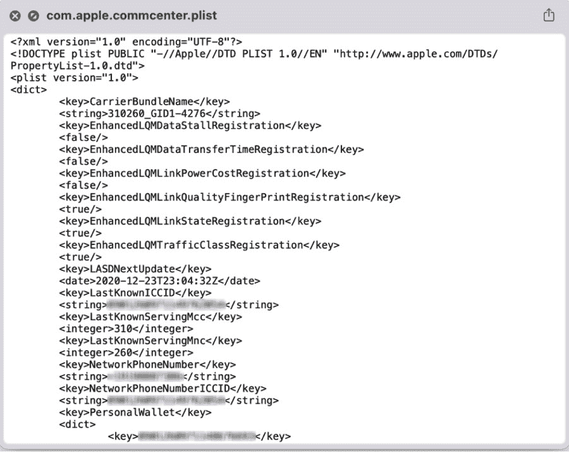

图 7.1 – com.apple.commcenter PLIST

此 PLIST 包含多个有用的蜂窝相关值，例如其 **集成电路卡标识符 (ICCID)**、**国际移动用户识别码 (IMSI)**、**国际移动设备识别码 (IMEI)**、设备的电话号码，以及设备最后连接的蜂窝基站的详细信息。

**ICCID**

ICCID 是 SIM 卡的序列号。此值唯一标识物理 SIM 卡，如果卡被更换，即使电话号码保持不变，该值也会发生变化。此值可以通过查看 PLIST 中的 LastKnownICCID 键来提取。

**IMSI**

**IMSI** 可以通过查看 `lastGoodImsi` 键找到。此值通常长 15 位，标识网络上的 SIM 卡。重要的是要理解，此代码与电话号码绑定，而不是物理 SIM 卡。IMSI 由移动网络运营商用于连接电话呼叫并与 SIM 卡通信。

**IMEI**

**IMEI** 是一个唯一的 15 位代码，用于标识特定的移动设备。此代码与订阅者没有任何关系，仅标识移动电话；然而，当移动设备在 GSM 网络上注册时，它也会提供设备的 IMEI，因此运营商可以通过将其 IMEI 添加到阻止列表中来阻止被报告为被盗的设备。此代码也可以由执法机构和情报机构用于跟踪移动设备，可以通过分析设备连接的蜂窝基站来定位设备。IMEI 可以通过查看 PLIST 中的 `kEntitlementsSelfRegistrationUpdateImei` 键找到。

**MCC 和 MNC**

**移动国家代码 (MCC)** 和 **移动网络代码 (MNC)** 是唯一标识蜂窝基站的值组合。移动 iOS 设备在 PLIST 下的 `LastKnownServingMcc` 和 `LastKnownServingMnc` 键中存储最后已知的 MCC 和 MNC 值。这些值与已知蜂窝基站的地图结合使用，可以精确定位设备的最后位置。

**电话号码**

最后，设备的电话号码也存储在 PLIST 中，位于 `NetworkPhoneNumber` 键下。重要的是要记住 iOS 设备

|    | TIMESTAMP | SERVICE | OPERATOR | STATUS |
|----|-----------|---------|----------|--------|
| 3  | 2020-05-08 15:25:25 | None | NULL | NotRegistered |
| 4  | 2020-08-24 16:55:03 | None | NULL | NotRegistered |
| 5  | 2020-12-12 22:19:12 | None | NULL | NotRegistered |
| 6  | 2020-12-12 22:21:15 | None | NULL | NotRegistered |
| 7  | 2020-12-12 22:30:00 | None | NULL | Searching |
| 8  | 2020-12-12 22:30:11 | None | NULL | EmergencyOnly |
| 9  | 2020-12-12 22:30:49 | None | NULL | Denied |
| 10 | 2020-12-12 22:30:49 | None | NULL | EmergencyOnly |
| 11 | 2020-12-12 22:33:38 | None | Google Fi | RegisteredHome |
| 12 | 2020-12-12 22:33:38 | 4G | Google Fi | RegisteredHome |
| 13 | 2020-12-12 22:33:43 | None | Google Fi | RegisteredHome |
| 14 | 2020-12-12 22:33:43 | 4G | Google Fi | RegisteredHome |

图 7.2 – 蜂窝注册记录

现在我们已经学习了如何提取基本的蜂窝相关数据，我们将学习如何分析通信。在本章中，我们将重点关注电话呼叫；电子邮件和消息将在第 8 章《电子邮件和消息取证》中更深入地讨论。

### 分析地址簿

在深入研究通话历史数据库之前，有用的是介绍 AddressBook.sqlite 数据库，其中包含设备上存储的联系人的姓名和详细信息。数据库位于 /private/var/mobile/Library/AddressBook/，包含两个感兴趣的表 — ABPerson 和 ABMultiValue。第一个包含联系人的姓名和设备使用的额外元数据，而第二个表存储实际数据，例如电话号码和电子邮件地址。两个表通过一对多关系连接。

现在我们知道了地址簿的基本结构，我们可以通过运行以下查询来提取数据：


```
SELECT p.First AS "First Name",
       p.Last AS "Last Name",
       GROUP_CONCAT(c.value) AS "Contacts"
FROM   ABPerson AS p
       LEFT JOIN ABMultiValue AS c
             ON c.record_id = p.rowid
GROUP  BY p.rowid,
          p.first;
```

首先，我们必须选择与名字和姓氏相关的列；然后，我们必须使用 GROUP_CONCAT SQL 函数将所有联系人数据（电话号码、电子邮件等）聚合到一列 Contacts 中。然后，我们必须使用 JOIN 语句在 ABPerson 和 ABMultiValue 表之间建立关系。

此查询将提取地址簿中存储的所有联系人列表，如以下屏幕截图所示：

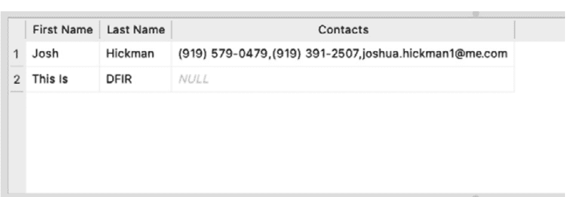

图 7.3 – 从地址簿中提取的记录

现在我们已经学会了如何提取联系人数据，我们可以开始分析通话记录。

## 分析通话记录

所有已拨出、已接听或未接听的电话和 FaceTime 通话都记录在 CallHistory.storedata 数据库中，该数据库位于 /private/var/mobile/Library/CallHistoryDB/。

### Tip

`CallHistory.storedata` 数据库是在 iOS 8 中引入的。此前，通话记录位于 `call_history.db` 文件中。另外请注意，通话历史记录只有在 **After First Unlock (AFU)** 状态下才可用。在首次解锁之前，数据存储在名为 `CallHistoryTemp.storedata` 的临时文件中。

从取证角度来看，最重要的数据存储在 ZCALLRECORD 表中，您将在其中找到以下列：

- ZDATE 列包含通话发生的时间戳，采用 Mac Absolute Time 格式。
- ZADDRESS 表示拨打的电话号码，或如果是来电，则表示通话的来源。
- ZLOCATION 列存储位置，该位置是根据电话号码计算得出的。
- ZDURATION 列表示通话时长，以秒为单位。
- ZORIGINATED 列表示通话是来电（0）还是去电（1）。
- ZANSWERED 列表示来电是否被接听（1）或未接听（0）。
- ZSERVICE_PROVIDER 列显示产生通话的服务名称。通常，这将显示为传统通话的 `com.apple.Telephony` 或 FaceTime 通话的 `com.apple.FaceTime`。

以下 SQL 查询将从 ZCALLRECORD 表中提取有意义的数据：

```
SELECT
DATETIME(ZDATE + 978307200, 'unixepoch', 'localtime') AS "Date/Time",
ZADDRESS AS "Phone Number",
ZLOCATION AS "Location",
ZDURATION AS "Call in Seconds",
```

分析 iOS 设备提供的网络数据可以让调查人员准确了解哪些服务和应用程序正在消耗带宽，以及设备连接了哪些网络。

我们将通过学习如何从完整文件系统中提取一些基本网络相关数据来介绍该主题。

## 飞行模式

要检测设备是否处于飞行模式，可以检查位于 /private/var/preferences/SystemConfiguration/ 的 com.apple.radios.plist 文件。该 PLIST 包含一个 AirplaneMode 键，其值为 true 或 false。

## Wi-Fi MAC 地址

设备内无线网络接口的 MAC 地址可以通过分析位于 /private/var/preferences/SystemConfiguration/ 的 NetworkInterfaces.plist 文件找到。IOMACAddress 键指示所需的值。请注意，每台 iOS 设备都有多个网络接口，每个接口都有唯一的 MAC 地址。

## 已知 Wi-Fi 网络

已知无线网络的列表存储在 /private/var/preferences/SystemConfiguration/com.apple.wifi.plist 文件中。该 PLIST 包含一个已知网络的键列表，这也是一个项目数组：

- SSID_STR 键包含一个可读的 SSID 字符串，用于标识网络。
- BSSID 键指示接入点的 MAC 地址。
- `lastJoined` 键存储用户上次手动访问网络的时间戳。
- `lastAutoJoined` 键指示设备上次自动连接到无线接入点的时间：

```
```xml
<key>SSID</key>
<data>
Q2Nvb2tpZXNEY2FzdGlugR3Vlc3Q=
</data>
<key>SSID_STR</key>
<string>Cookiesdcastler5 Guest</string>
<key>SaveDataMode</key>
<integer>2</integer>
<key>ScaledRSSI</key>
<real>0.82863259315490723</real>
<key>ScaledRate</key>
<real>1</real>
<key>ShareableStatus</key>
<integer>1</integer>
<key>Strength</key>
<real>0.82863259315490723</real>
<key>VHT_CAPS_IE</key>
<dict>
    <key>VHT_CAPS</key>
    <integer>864041394</integer>
    <key>VHT_SUPPORTED_MCS_SET</key>
    <data>
    +v8AArP/AAA=
    </data>
</dict>
<key>WiFiAutoInstantHotspotJoining</key>
<false/>
<key>WiFiInstantHotspotJoining</key>
<false/>
<key>WiFiManagerKnownNetworksEventType</key>
<integer>1</integer>
<key>WiFiNetworkAttributeIsKnown</key>
<true/>
<key>WiFiNetworkAttributeIsMoving</key>
<false/>
<key>WiFiNetworkAttributeIsPotentiallyMoving</key>
<true/>
<key>WiFiNetworkAttributeLowPopularity</key>
<true/>
<key>WiFiNetworkAttributePopularityScore</key>
<integer>0</integer>
<key>WiFiNetworkAttributeProminentDisplay</key>
<true/>
<key>WiFiNetworkAttributeSource</key>
<integer>2</integer>
<key>WiFiNetworkIsAutoJoined</key>
<true/>
<key>WiFiNetworkPasswordModificationDate</key>
<date>2020-03-22T19:00:00Z</date>
<key>addedAt</key>
<date>2020-03-22T19:00:00Z</date>
<key>enabled</key>
<true/>
```
```

图 7.5 – com.apple.wifi.plist 显示已知网络的详细信息

现在我们知道如何分析设备上的基本网络数据，让我们更仔细地查看网络使用痕迹。

## 分析网络使用情况

分析哪些服务或应用程序正在使用网络可以帮助调查人员识别任何异常进程，例如设备上运行的 **malware**。

iOS 设备上的数据使用情况存储在两个不同的文件中：

- `CurrentPowerLog.PLSQL` 数据库，可在 `/private/var/containers/Shared/SystemGroup/<GUID>/Library/BatteryLife/` 中找到，包含多个感兴趣的表。通过关联不同表中的数据，检查人员可以提取每个进程的精确数据使用情况，包括 **Wi-Fi 接口** 和 **WAN 接口**。需要注意的是，此数据库仅存储大约 24 小时的进程数据。

- `DataUsage.db` 数据库，可在 `/private/var/wireless/Library/Databases/DataUsage.sqlite` 中找到，包含两个重要的表 – ZPROCESS 和 ZLIVEUSAGE。第一个存储应用程序的名称、应用程序包及其关联的进程以及时间戳；第二个表存储每个进程通过 WAN 接口进出的数据。虽然该数据库通常会存储数周的数据，但请注意，根据已开展的研究，似乎通过 Wi-Fi 接口进出的数据未被记录。

这些数据库可以帮助调查人员确定不仅哪些进程正在使用网络，而且受试者在特定时间是否正在使用应用程序。

可以从 `DataUsage.db` 数据库中运行以下查询来提取进程和网络使用数据：

```
SELECT
    DATETIME(ZPROCESS.ZTIMESTAMP+ 978307200,
'UNIXEPOCH') AS "PROCESS TIMESTAMP",
    ZPROCESS.ZPROCNAME AS "PROCESS NAME",
    ZPROCESS.ZBUNDLENAME AS "BUNDLE ID",
    ZLIVEUSAGE.ZWWANIN AS "WWAN IN",
    ZLIVEUSAGE.ZWWANOUT AS "WWAN OUT"
FROM ZLIVEUSAGE
LEFT JOIN ZPROCESS ON ZLIVEUSAGE.ZHASPROCESS =
ZPROCESS.Z_PK;
```

以下屏幕截图显示了输出结果；它包含对调查人员非常有价值的数据，特别是如果调查中对应用程序使用感兴趣：

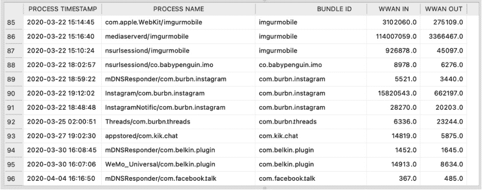

图 7.6 – 查询结果显示设备上运行的进程及其数据使用情况

在下一节中，我们将介绍蓝牙取证。

## 介绍蓝牙取证

使用蓝牙技术，用户可以在不同设备之间传输数据，并将耳机、扬声器或任何类型的无线设备连接到智能手机。通常，iOS 设备作为 Class 2 蓝牙设备运行，这意味着它们的工作范围约为 10 米（33 英尺）。


从取证角度来看，iOS 设备维护以下内容：

- 一份可连接用户设备的 *低功耗* 蓝牙设备列表，也称为 **已配对设备**。这些设备存储在 `/private/var/containers/Shared/SystemGroup/<GUID>/Library/Database/com.apple.MobileBluetooth.ledevices.paired.db` 数据库中，位于 `PairedDevices` 表下。该表维护着设备列表、其名称、其 **媒体访问控制 (MAC)** 地址以及最后看到的时间戳。
- 其他蓝牙已配对设备（*不仅仅是低功耗*），存储在 `/private/var/containers/Shared/SystemGroup/<GUID>/Library/Preferences/com.apple.MobileBluetooth.devices.plist` 文件中。该属性列表维护着设备名称和最后检测时间的列表。
- 一份 *已见* 蓝牙设备的列表，即在设备附近但未连接的其他可用蓝牙设备。这些设备可以在 `/private/var/containers/Shared/SystemGroup/<GUID>/Library/Database/com.apple.MobileBluetooth.ledevices.other.db` 数据库中找到，位于 `OtherDevices` 表下。
- 蓝牙相关事件的详细日志，例如 **连接** 和 **断开连接** 事件。这些存储在 `knowledgeC.db` 数据库中。

由于前三个文件很容易查询，我们将集中精力从 `/private/var/mobile/Library/CoreDuet/Knowledge/knowledgeC.db` 数据库中提取蓝牙事件，该数据库我们在 *第 5 章，行为模式取证* 中介绍过。

首先，我们必须从 `ZOBJECT` 表中选择事件的开始和结束日期。然后，我们必须通过搜索 `/bluetooth/isConnected` 流来筛选结果。我们必须从 `ZSTRUCTUREDMETADATA` 表中提取事件状态和设备详细信息。最后，我们必须按时间顺序排列结果。

最终的查询如下所示：

```
SELECT
DATETIME(ZOBJECT.ZSTARTDATE + 978307200, 'unixepoch',
'localtime') AS "Start",
DATETIME(ZOBJECT.ZENDDATE + 978307200, 'unixepoch',
'localtime') AS "End",
CASE
    WHEN ZOBJECT.ZVALUEINTEGER = 0 THEN "Disconnected"
    WHEN ZOBJECT.ZVALUEINTEGER = 1 THEN "Connected"
END AS "Status",
ZSTRUCTUREDMETADATA.Z_DKBLUETOOTHMETADATAKEY__ADDRESS AS "Address",
ZSTRUCTUREDMETADATA.Z_DKBLUETOOTHMETADATAKEY__NAME AS "Device"
FROM ZSTRUCTUREDMETADATA
LEFT JOIN ZOBJECT ON ZSTRUCTUREDMETADATA.Z_PK =
ZOBJECT.ZSTRUCTUREDMETADATA
WHERE ZOBJECT.ZSTREAMNAME = "/bluetooth/isConnected"
ORDER BY "Start" ASC;
```

查询完成后，调查人员可以检索每次设备连接到或断开与蓝牙启用设备的连接时记录的事件列表，以及设备的 MAC 地址；结果显示在以下屏幕截图中：

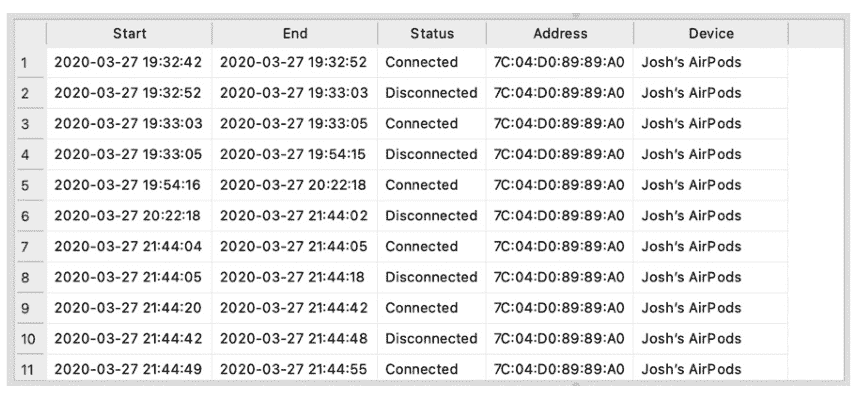

图 7.7 – 显示蓝牙连接事件的查询

蓝牙 artifacts 可以成为调查的重要组成部分。通过利用有关已配对或已见设备的 data，调查人员不仅可以评估设备是否在使用并连接到某个设备，而且

还可以将设备所有者在某个时间点的大致位置确定出来，如果蓝牙设备的位置已知的话。在下一节中，我们将介绍 Safari 取证。

## 了解 Safari 取证

分析互联网浏览活动留下的 artifacts 通常是移动取证调查的一个关键方面。嫌疑人在移动设备上使用浏览器执行几乎每项活动都会在设备本身留下痕迹，包括当然是搜索信息和浏览网页。

在本节中，我们将重点关注内置于所有 iOS 设备的浏览器，**Safari**。请记住，数十个第三方浏览器可以安装在设备上，例如 **Chrome**、**Firefox** 和 **Opera**：审查这些应用程序并分析其 artifacts 很重要，因为它们可能包含重要数据。我们将在 _第 10 章，分析第三方应用程序_ 中学习如何分析第三方应用程序。

浏览历史可能是最常恢复的项目，但也应审查其他文件。通常，通过分析 Safari artifacts 可以恢复以下数据：

- 浏览历史
- 打开/私有标签页
- 书签/已保存页面
- Cookies
- 缓存文件

Safari 的大部分 artifacts 存储在 `/private/var/mobile/Library/Safari/` 中。在此文件夹中，您将找到以下相关文件：

/private/var/mobile/Containers/Data/Application/GUID/Library
/Cookies/Cookies.binarycookies

Safari cookies 存储在此文件中，采用二进制格式。要了解格式规范，请参阅以下链接：https://github.com/libyal/dtformats/blob/main/documentation/Safari%20Cookies.asciidoc。Cookies 也可以使用 **自动化脚本** 提取，例如 Mari DeGrazia 的 Safari-Binary-Cookie-Parser Python 脚本。它可以从 https://github.com/mdegrazia/Safari-Binary-Cookie-Parser 下载。

```
/private/var/mobile/Containers/Data/Application/GUID/Library
/Safari/
```

此文件夹应进行分析，因为它包含多个有用的文件，例如 Safari **缩略图**、**首选项**、**自动填充数据** 和 **下载** 列表。

最后，让我们介绍两种不同的分析 Safari 浏览历史的方法。

## 分析 Safari 历史记录

正如我们之前学到的，Safari 将浏览历史存储在 /private/var/mobile/Library/Safari/History.db 数据库中。重要的是要理解，此文件不仅仅存储本地设备的浏览历史——它还包含已从 **iCloud 同步** 的数据，例如其他设备的浏览历史。分析人员在分析此数据时的工作是区分哪些网站是在正在检查的设备上访问的，哪些数据是从不同设备同步的。

以下屏幕截图显示了一个提取所有相关数据并生成结果记录的查询示例：

```
LEFT JOIN
    ZSTRUCTUREDMETADATA
    ON ZOBJECT.ZSTRUCTUREDMETADATA =
ZSTRUCTUREDMETADATA.Z_PK
LEFT JOIN
    ZSOURCE
    ON ZOBJECT.ZSOURCE = ZSOURCE.Z_PK
WHERE
    ZSTREAMNAME IS "/safari/history"
ORDER BY DATE ASC;
```

首先，我们必须选择浏览器事件发生的时间戳，并使用 DATETIME 函数将其转换为可读字符串。然后，我们必须在 ZSTRUCTUREDMETADATA 表上执行 JOIN 以提取网页标题。之后，我们必须选择 URL 并计算 GMT 偏移量。最后，我们必须按时间顺序排列结果。

以下屏幕截图显示了此查询的结果：

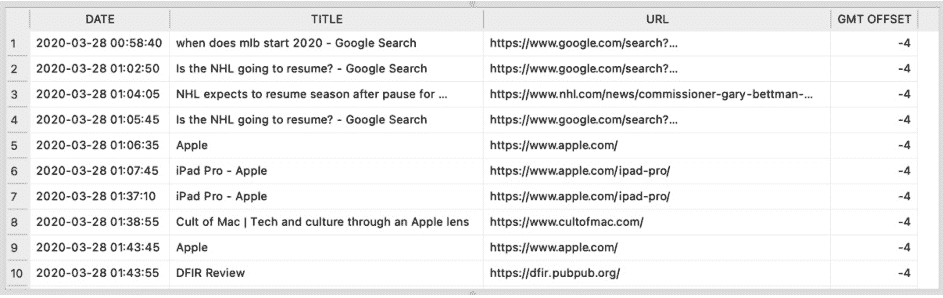

图 7.9 — 分析 KnowledgeC.db 的浏览历史

在分析用户的浏览历史时，调查人员应始终检查两个数据库，因为其中一个可能包含独特的数据。

## 介绍私有浏览

为了完成本章，我们将介绍 **私有浏览**，这是 Apple 在 iOS 5 中引入的功能。当此功能处于活动状态时，用户浏览历史的详细信息不会被存储，并且已访问的网站不会同步到 iCloud。

> 正如 Apple 官方文档所述，*"在私有浏览模式下关闭标签页后，Safari 不会记住您访问的页面、搜索历史或您的自动填充信息。"*

从取证角度来看，这在理论上构成了一个问题，因为 `history.db` 和 `KnowledgeC.db` 都不存储此数据。然而，还有其他选择：

- 您可以分析设备上存储的 cookies。Safari 的网页缓存也可能揭示在私有浏览处于活动状态时浏览的网站的痕迹。
- `BrowserState.db` 数据库存储活动标签页的详细信息，**包括私有标签页**。对于每个标签页，`tab_sessions` 表中都有一个条目，其中包含二进制 PLIST。将此 PLIST 转换为 XML 格式将允许调查人员解析文件，其中包含在该标签页内浏览的页面的历史记录。这仅在私有标签页仍在 Safari 中打开时才有效。
- 正如我们在前几章中所学到的，已删除的数据并未从 SQLite 数据库中永久删除——它只是被标记为已删除。通过使用 **取证工具**，可以从 `BrowserState.db` 数据库中恢复已删除的记录，其中可能包括在私有模式下打开的标签页的详细信息。要了解如何尝试从 SQLite 数据库中恢复数据，请参阅 *第 4 章，使用常见的 iOS Artifacts*。

互联网浏览 artifacts 是任何移动取证调查的重要组成部分。分析浏览历史可能提供一些见解，但访问与私有互联网浏览相关的数据可能更有启发性，揭示用户想要隐藏的任何活动。

## 总结


在本章中，我们学习了连接数据，以及 iOS 设备如何通过蜂窝网络、Wi-Fi 和蓝牙技术进行通信。

首先，我们介绍了蜂窝取证，并学习了如何从 iOS 提取中提取与蜂窝相关的数据，例如设备的 IMSI 和 IMEI 代码。然后，我们分析了 PowerLog 以查看相关事件，例如设备注册到蜂窝网络。

之后，我们重点关注了电话通话，学习了如何从通讯录中提取联系人数据，以及如何访问通话记录，其中包含所有来电和去电的详细信息，包括 FaceTime 视频通话。然后，我们介绍了网络使用的主题，学习了哪些查询能让调查人员查看设备上运行了哪些进程，以及它们消耗了多少网络数据。

最后，我们学习了 Safari 取证。我们深入研究了常见 Safari 工件的存放位置，以及如何通过 `History.db` 和 `KnowledgeC.db` 数据库分析浏览历史。我们还简要讨论了一些在隐私浏览模式下恢复数据的选项。

在下一章中，我们将学习电子邮件和消息取证。

## 电子邮件取证简介

在本章的第一部分，我们将介绍电子邮件取证，并重点关注 **Apple Mail** 应用程序。可以肯定地说，Apple Mail 无疑是 iOS 设备上最流行的电子邮件客户端；然而，调查人员应记住，还有更多第三方电子邮件应用可用，例如 **Outlook**、**Spark**、**Gmail** 和 **Airmail**。分析第三方应用将在*第 10 章“分析第三方应用”*中介绍。对电子邮件工件进行全面取证分析应包括分析 Apple Mail 以及设备上安装的任何第三方客户端。

调查 Apple Mail 数据的第一步是定位工件：这些工件可以在 `/private/var/mobile/Library/Mail` 文件夹中找到。请注意，需要进行完整的文件系统提取。以下是最相关文件及其描述的列表：

- 对于设备上配置的每个电子邮件帐户，`Mail` 文件夹中都会有一个对应的文件夹；该文件夹的名称指向该帐户的唯一标识符。每个文件夹都包含额外的子文件夹，例如 `Inbox`、`Sent`、`Spam` 和 `Drafts`，其中包含实际的电子邮件，存储为**电子邮件（EML）**文件。
- `Envelope Index` 文件是一个 SQLite 数据库，包含多个表，这些表存储与设备上配置的每个电子邮件帐户相关的**元数据**。
- `Protected Index` 数据库包含与电子邮件相关的实际数据，例如邮件正文的**摘要**、**主题**和**地址**。
- `MailboxCollections.plist` 存储与每个帐户相关的用户偏好设置。
- `metadata.plist` 文件存储每个邮箱最后一次同步到设备的时间戳。

既然我们知道了电子邮件工件的位置，我们将直接深入这些 SQLite 数据库，解析电子邮件元数据及其内容。

### 提取电子邮件元数据

我们将从检查 Envelope Index 数据库开始。第一个值得关注的表是 mailboxes 表。顾名思义，该表存储了设备上配置的所有邮箱的列表。这包括单个帐户的不同文件夹，例如“重要”、“垃圾邮件”、“草稿”和“已删除”。

以下截图显示了 mailboxes 表中的一些示例数据：

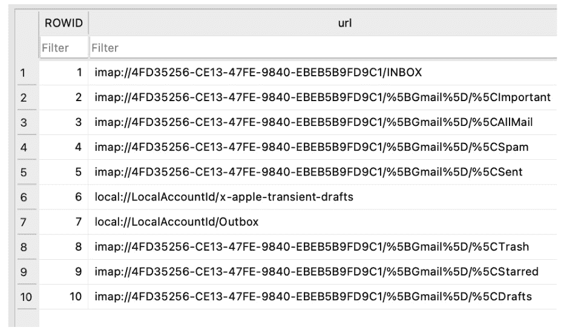

图 8.1 – DB Browser 中显示的 mailboxes 表

如截图所示，每个帐户由一个通用唯一标识符（UUID）标识（在本例中为 4FD35256-CE13-47FE-9840-EBEB5B9FD9C1），而每个文件夹由一个唯一的 ROWID 标识。通过分析该表，检查人员可以大致了解设备上配置了多少个电子邮件帐户以及是哪些帐户。

下一步涉及提取和分析存储在 `messages` 表中的电子邮件元数据。需要注意的是，该表中存储的某些数据必须与其他记录相关联才能有意义；事实上，数据之间的关系不仅跨越表，还跨越 `Envelope Index` 和 `Protected Index` 数据库。

以下是从取证角度值得关注的列列表：

- `external_id` 列表示包含实际电子邮件内容的 EML 文件的名称。
- sender 列表示发件人的电子邮件地址；该值需要与 `Protected Index` 数据库中 Addresses 表存储的记录相关联。
- subject 列也需要与 `Protected Index` 中的 Subjects 表相关联。
- summary 列与 Summaries 表相关联，存储电子邮件内容的前 500 个字节。
- `date_sent` 列存储电子邮件发送时的时间戳。
- `mailbox` 列显示哪个帐户和文件夹包含该电子邮件。
- 如果电子邮件已被阅读，`read` 列的值为 1；如果未被阅读，则为 0。

以下查询从表中提取所有相关元数据：

```
SELECT
DATETIME(messages.date_sent, 'UNIXEPOCH', 'localtime') AS
"DATE / TIME",
messages.sender AS SENDER,
messages.subject AS SUBJECT,
messages.summary AS SUMMARY,
messages.read AS READ,
mailboxes.url AS MAILBOX,
messages.external_id AS "EML FILENAME"
FROM messages
```

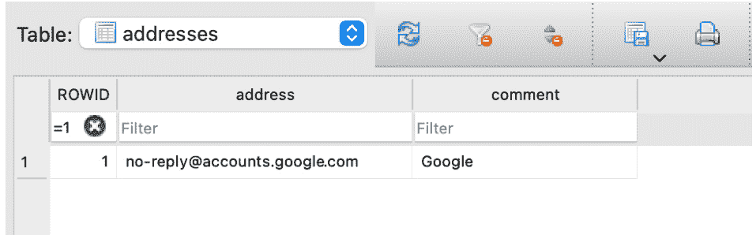

图 8.3 – 按 ROWID 过滤的 addresses 表

同样的逻辑也适用于 SUBJECT 和 SUMMARY 列。至此，您应该对如何提取电子邮件元数据有了大致的了解。在以下部分中，我们将学习如何分析电子邮件内容。

### 分析电子邮件内容

识别特定电子邮件是一项简单的任务，因为 Apple Mail 将每封电子邮件存储为单独的文件。当我们之前提取电子邮件元数据时，我们了解到 messages 表为每封电子邮件存储了一条 external_id 记录，即 EML 文件的名称。这些文件存储在 `/private/var/mobile/Library/Mail/MAILBOX-UUID/` 中。

EML 文件可以在 macOS 系统上使用 Apple Mail 桌面应用程序打开，在 Windows 上使用 Microsoft Outlook 打开。也可以在任何 Web 浏览器中查看电子邮件内容，只需将文件扩展名重命名为 .html 即可。

要获取完整内容（包括电子邮件头），可以使用文本编辑器打开 EML 文件，或通过终端查看，如下面的截图所示：

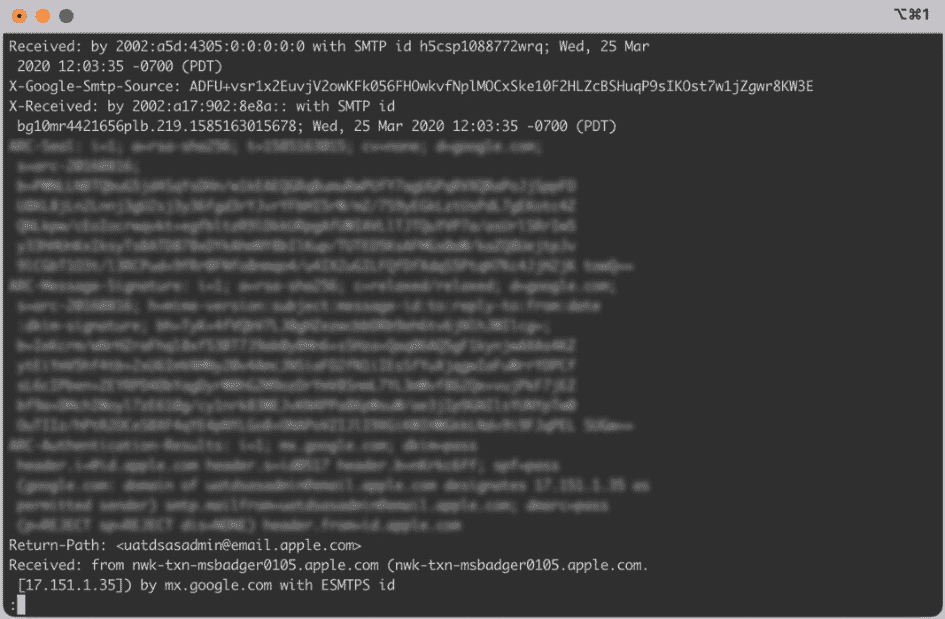

图 8.4 – 通过终端查看的 EML 文件，显示电子邮件内容

请记住，电子邮件的内容通常会被拆分到多个 EML 文件中；在这种情况下，必须将部分文件合并为一个文件才能查看完整的电子邮件。

既然我们已经学习了在哪里查找电子邮件工件以及如何分析它们，我们将在本章的下一部分重点关注消息取证。

## 了解消息取证

**短消息服务（SMS）** 消息和**即时消息（IM）** 聊天应用程序（例如 **WhatsApp** 或 **Telegram**）可能包含非常重要的信息，有助于任何类型的调查。

- `/private/var/mobile/Library/Preferences/com.apple.madrid.plist` 属性列表包含一组与 SMS、iMessage 和 FaceTime 相关的属性和用户偏好设置。特别是，该 plist 在 allAliases 键下包含一个字典，指示连接到 iMessage 帐户的所有别名，例如电话号码和电子邮件地址。
- `/private/var/mobile/Library/Preferences/com.apple.MobileSMS.plist` 存储与 SMS 和 iMessage 相关的偏好设置，包括 KeepMessageForDays 键，该键指示保留期限。默认情况下，此值设置为“永久”。
- `/private/var/mobile/Library/SMS/Attachments/` 文件夹，顾名思义，包含通过 MMS 或 iMessage 发送的附件，例如照片、视频和音频录音。
- `/private/var/mobile/Library/SMS/Drafts/` 文件夹存储草稿消息和待发送消息（用户已发送但由于例如没有连接而导致 iOS 未发送的消息）。
- `/private/var/mobile/Library/SMS/sms.db` 数据库存储所有消息（SMS 和 iMessage）的所有元数据和内容。
- 在**首次解锁前（BFU）** 接收到的消息存储在一个临时数据库中，该数据库位于 `/private/var/mobile/Library/SMS/sms-temp.db`。

我们将重点研究 sms.db 文件，学习如何从 message、chat_message_join、chat 和 attachment 表中提取所有消息及其元数据。以下 SQL 查询可以实现这一点：

```
SELECT
CASE when LENGTH(chat_message_join.message_date)=18 THEN
    datetime(chat_message_join.message_date/100000000 + 978307200,'unixepoch','localtime')
    when LENGTH(chat_message_join.message_date)=9 THEN
    datetime(chat_message_join.message_date + 978307200,'unixepoch','localtime')
    else 'NA'
```


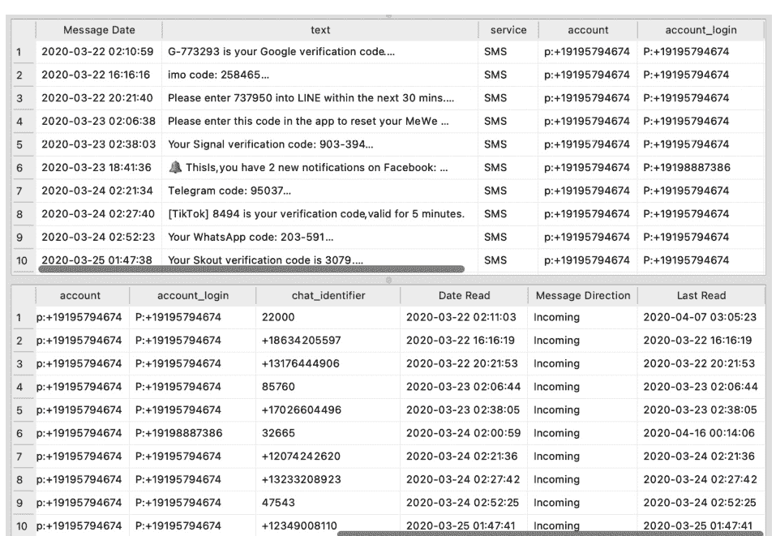

Figure 8.5 – Extracting message data from sms.db

首先需要记住的是，自 **iOS 11** 起，Apple 开始将时间戳存储为 18 位数字，而此前消息时间戳仅为九位数字长。这意味着 sms.db 数据库很可能同时包含九位和 18 位时间戳。我们的查询首先验证时间戳的长度，并据此显示消息发送的日期和时间。然后，我们提取 text 列和 service 列，后者指示消息是传统 SMS 还是 iMessage。account 和 account_login 列显示用户发送或接收消息时使用的电话号码或电子邮件地址。chat_identifier 列存储用户正在通信的对方的电话号码或电子邮件地址。最后，Date Read、Message Direction 和 Last Read 列不言自明。

在涉及 SMS 和 iMessage 取证的调查中，不应忽视 Drafts 和 Attachments 文件夹，因为这些可能涉及 WhatsApp 语音通话和视频通话。这些数据库也包含在本地（iTunes）备份中。

- **Telegram** 是一款跨平台即时通讯应用，兼容包括桌面电脑在内的大量设备。聊天和消息同时存储在本地设备和 Telegram 服务器上。还可选择创建秘密聊天，其中数据永远不会存储在应用服务器上。Telegram 证据不包含在本地或 iCloud 备份中，只能通过完整文件系统获取获得。证据和日志可找到在 `/private/var/mobile/Containers/Data/Application/<APP_GUID>/` 和 `/private/var/mobile/Containers/Shared/AppGroup/<APP_GUID>/`。聊天和消息，包括秘密聊天，可在 `db_sqlite` 数据库中找到。

- **Signal** 是一款适用于移动设备和桌面电脑（包括 Linux）的安全加密消息应用。Signal 上的所有通信，如消息、群组聊天、照片和文件传输，均采用端到端加密。Signal 对话不会存储在其服务器上，不会在本地备份中提供，也无法将数据备份到 iCloud。Signal 的数据库以加密形式存储在本地设备上。访问这些证据的唯一方法是执行完整文件系统获取并解密钥匙串以访问加密密钥，进而解密数据库。日志文件和用户偏好设置存储在 `/private/var/mobile/Containers/Data/Application/<APP_GUID>/`。加密数据库 `signal.sqlite` 可在 `/private/var/mobile/Containers/Shared/AppGroup/<APP_GUID>/` 找到。

在本节中，我们简要讨论了第三方消息应用，并了解了这些应用如何以及在何处存储对话数据。在本章的最后一部分，我们将学习如何尝试恢复已删除的消息。

### Recovering deleted messages

在移动设备调查中最常见的任务之一是尝试恢复用户删除的数据，例如聊天和消息，因为这些可能包含无价的证据。

在本章中，我们了解到 SMS 消息和来自第三方应用的聊天都存储在 SQLite 数据库中；这意味着恢复已删除聊天的能力有效地取决于能否从 SQLite 数据库中恢复任何记录。

在第 4 章《Working with Common iOS Artifacts》中，我们讨论了恢复已删除记录的几种选项，例如：

- 使用十六进制查看器解析数据库
- 字符串 carving
- 分析预写日志 Write Ahead Log (WAL) 文件
- 使用 FQLite 等取证工具从空闲块和未分配空间中恢复数据

所有这些解决方案都可以有效恢复已删除消息，但前提是记录从数据库中清除后数据库未被 vacuum。

**Tip**

需要注意的是，要尝试数据恢复，数据库应通过完整文件系统获取提取，而不是逻辑获取，因为后者将包含一个在备份过程中从头重建的已 vacuum 数据库副本。研究还表明，自 iOS 11 以来，sms.db 数据库会定期进行 vacuum，因此 SMS 消息和 iMessages 可能在检查员有机会获取设备之前就被清除。

在下一节中，我们将介绍一种可用于恢复已删除消息的开源工具。

### Detecting deleted messages using Mirf

有时恢复已删除消息根本不可能；然而，在这种情况下，即使无法恢复其内容，也可能检测到用户删除了消息这一事实。

聊天和消息以单个记录的形式存储在 SQLite 表中；每个记录通过一个唯一的、递增的标识符进行识别，称为 **primary key**。例如，在以下屏幕截图中，该截图包含从 WhatsApp ChatStorage.sqlite 数据库提取的数据，单个消息使用存储在 Z_PK 列中的标识符引用：

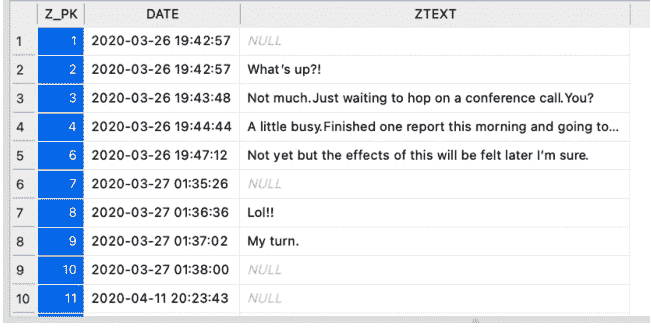

Figure 8.6 – The Z_PK column stores a unique identifier for each message

通过分析 Z_PK 列中的值，检查员可以查找任何缺失的记录：在前一个示例中，与值 5 关联的记录丢失。这足以说明一条消息已被删除。即使无法恢复实际消息，也可以通过查看前后记录的时间戳来推断消息发送或接收的大致时间范围。值得庆幸的是，这一过程可以通过使用名为 **Missing Record Finder for SQLite Databases (Mirf)** 的开源 Python 脚本实现自动化，该脚本可通过发现间隙来帮助检测是否删除了任何数据行。

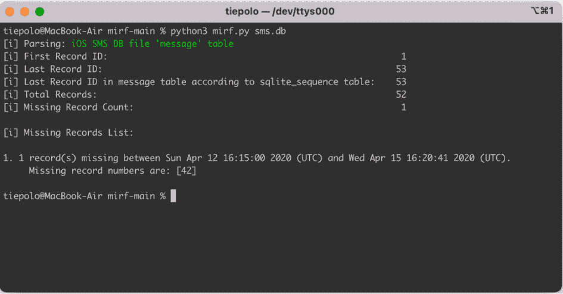

Figure 8.7 — Running Mirf to detect deleted messages

在这种情况下，识别出一条缺失记录，包括 UTC 时区的日期范围和缺失记录编号。

### Summary

在本章中，我们了解了 iOS 如何在设备上存储电子邮件和消息，以及调查人员可以期望找到哪些证据。

首先，我们介绍了 Apple Mail 应用并发现了电子邮件的存储位置。我们分析了相关的 SQLite 数据库以提取电子邮件元数据，并学习了如何解析 EML 文件以查看电子邮件正文。

本章后半部分，我们通过查看 iOS 如何在 sms.db 数据库中存储 SMS 和 iMessage 数据以及如何使用 SQL 查询提取所有消息及其元数据，专注于消息取证。然后，我们介绍了第三方消息应用的主题，并重点关注其中三个：WhatsApp、Telegram 和 Signal。我们了解了可以从这些应用中提取哪些数据以及最相关的 SQL 数据库。

最后，在本章的最后一节中，我们讨论了尝试恢复已删除消息的不同选项，例如使用名为 Mirf 的开源工具，该工具可检测 SQL 表中记录之间的间隙。

在下一章中，我们将学习有关照片、视频和音乐取证的所有内容。
