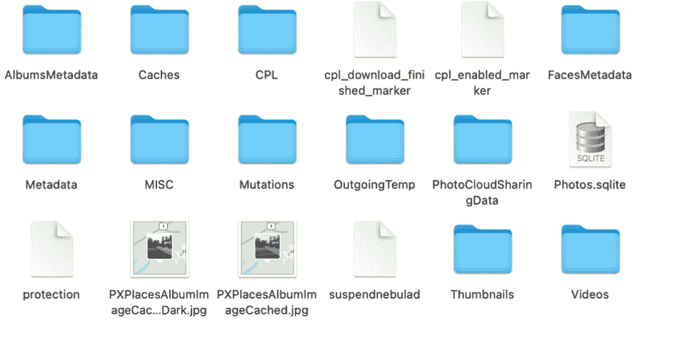

## Chapter 9: Photo, Video, and Audio Forensics

在本书的前几章中，我们专注于识别和分析存储在系统生成证据中的移动证据，例如数据库、PLIST 和日志文件。然而，任何类型的调查通常还涉及分析设备上找到的用户生成内容，例如媒体文件。

现代 iOS 设备可能包含数万个媒体文件，每个文件都关联着对调查至关重要的独特元数据。在本章中，我们将学习如何识别和分析照片、视频和音频文件等多媒体内容。

我们将从媒体取证的介绍开始，讨论照片、视频和音频录音在 iOS 设备上的存储位置。然后，我们将学习如何分析媒体元数据以获得有意义的见解，无论是从文件本身还是从相应的数据库。在本章的最后一部分，我们将学习如何分析用户行为，以了解用户通过 Apple 应用（如 Music 和 Safari）以及第三方应用（如 Spotify 或 Netflix）访问或观看了哪些媒体。

在本章中，我们将涵盖以下主题：

- Introducing media forensics
- Analyzing photos and videos
- Introducing EXIF metadata
- Analyzing user viewing activity

### Introducing media forensics


我们首先来指出一些最常见的媒体相关工件存放位置：

- `/private/var/mobile/Media/DCIM/1**APPLE/`：此文件夹存储由用户创建或保存到设备的照片和视频。通常，图像以 **JPG**、**PNG** 或 **HEIC** 格式存储，视频则以 **MP4** 或 **MOV** 文件存储。
- `/private/var/mobile/Media/PhotoData/`：PhotoData 文件夹存储与媒体元数据相关的若干工件，例如 `Photos.sqlite` 数据库、**缩略图**（存储在 `/private/var/mobile/Media/PhotoData/Thumbnails/V2/DCIM/1**APPLE/IMG_****.JPG/****.JPG`）以及**相册**数据。通常，该文件夹会是设备上存储的任何媒体文件的主要证据来源。我们将在下一节深入分析此文件夹。
- `/private/var/mobile/Media/PhotoData/PhotoCloudSharingData/`：PhotoCloudSharingData 文件夹包含与“共享相簿”相关的工件，这是 iOS 的一项功能，允许用户轻松共享照片集。每个共享相簿都有一个子文件夹，其中包含 `Info.plist` 文件（包含相簿元数据，如名称、所有者等）和 `DCIM_CLOUD.plist`（存储相簿中照片的数量）。
- `/private/var/mobile/Media/Recordings/*`：此文件夹包含用户录制的**语音备忘录**。

以下截图显示了 PhotoData 文件夹中可以找到的文件和文件夹：



图 9.1 – PhotoData 文件夹包含媒体元数据

每个媒体资产都有两种相关的元数据——**EXIF 元数据**包含诸如生成图像的设备或位置等详细信息，存储在文件本身中；而 iOS 生成的元数据则存储在 `Photos.sqlite` 数据库中。

在下一节中，我们将分析该数据库，以了解如何为设备上存储的每张图像或视频提取有意义的信息。

## 分析照片和视频

每当通过设备相机拍摄照片或视频，或将其保存到设备时，iOS 都会对其进行分析并生成大量元数据，这些元数据存储在 `Photos.sqlite` 数据库中。

以下是该过程中发生的事件列表：

1. 首先，新拍摄或保存的照片或视频以 JPG、HEIC、MP4 或 MOV 文件形式保存在 `/private/var/mobile/Media/DCIM/1**APPLE/` 中。随着设备上存储的照片或视频增多，文件夹名称会向上迭代（100APPLE、101APPLE、102APPLE，依此类推）。
2. 此外，还会创建 `PreviewWellImage.tiff` 图像并存储在 `/private/var/mobile/Media/PhotoData/MISC/` 中。该图像是 **照片** 应用中显示的缩略图，用于展示最近的一张图像。
3. 当新媒体被存储时，会在 Photos.sqlite 数据库的 ZGENERICASSET 表中创建一条新记录。从 iOS 14 开始，该表改名为 ZASSET。新记录将包含诸如内容保存时的日期和时间、上次编辑的日期和时间、文件名以及色彩空间等元数据。
4. 在后台，iOS 开始通过运行若干算法（如人脸和物体识别）来处理新创建的媒体。如果 iOS 在媒体文件中识别到的人脸关联了姓名，该照片或视频还会显示在 **照片** 应用中的 **人物** 相簿中。分析结果随后存储在 Photos.sqlite 数据库和 mediaanalysis.db 中，后者位于 `/private/var/mobile/Media/MediaAnalysis/`。

如你所见，这其中涉及很多处理过程！既然我们已经知道了工件的位置，接下来将重点分析照片和视频。

## 理解 Photos.sqlite

Photos.sqlite 数据库包含 60 多个数据表，数据量庞大，是 iOS 取证中发现的最大数据集之一。对该数据库的详细分析超出了本书的范围，因此我们将重点从 ZGENERICASSET（iOS 14 和 15 中为 ZASSET）表中提取最重要的元数据片段。

使用你选择的工具（例如 *DB Browser for SQLite*）打开文件后，运行以下查询：

```
SELECT
Z_PK,
DATETIME(ZDATECREATED + 978307200, 'UNIXEPOCH') AS "Created
```

|  | AlbumTitle | CreatorBundleID | EditorBundleID | Directory | Uniformi |
|---|---|---|---|---|---|
| 22 | 720D5959.jpg | Imgur | NULL | NULL | DCIM/100APPLE | public.jpeg |
| 23 | 720D5959.jpg | Imgur | NULL | NULL | DCIM/100APPLE | public.jpeg |
| 24 |  | NULL | NULL | com.apple.ScreenshotServicesService | DCIM/100APPLE | public.jpeg |
| 25 | A30D6460.jpg | NULL | NULL | NULL | DCIM/100APPLE | public.jpeg |
| 26 | D46310D.jpg | NULL | NULL | NULL | DCIM/100APPLE | public.jpeg |
| 27 | I-13D1A552AFDF.jpg | NULL | NULL | NULL | DCIM/100APPLE | public.jpeg |
| 28 |  | NULL | com.reddit.Reddit | NULL | DCIM/100APPLE | public.jpeg |
| 29 |  | NULL | org.whispersystems.signal | NULL | DCIM/100APPLE | public.png |
| 30 |  | NULL | NULL | NULL | DCIM/100APPLE | public.jpeg |
| 31 |  | NULL | NULL | com.apple.ScreenshotServicesService | DCIM/100APPLE | public.jpeg |

图 9.4 – CreatorBundleID 和 EditorBundleID 指示资产的来源

- SavedAssetType 列指示该资产是在设备上创建的，还是从其他来源同步的。
- Favorite、Hidden_File 和 TrashState 指示媒体资产是否被添加到“个人收藏”相簿、用户是否选择隐藏它，或者是否被标记为删除。
- ShareCount 和 LastSharedDate 列指示某个媒体资产被共享的次数，以及最后一次共享的时间戳：

| rashDate | ViewCount | PlayCount | ShareCount | LastSharedDate | FileModificationDate | Has_Adjustments | AdjustmentsTimeS |
|---|---|---|---|---|---|---|---|
| 31 |  | 2 | 0 | 0 | NULL | 2020-04-06 15:02:38 | Yes | 2020-03-25 01:53 |
| 32 |  | 1 | 0 | 0 | NULL | 2020-04-06 15:02:38 | No | NULL |
| 33 |  | 2 | 0 | 0 | NULL | 2020-04-19 18:25:57 | No | NULL |
| 34 |  | 1 | 0 | 0 | NULL | 2020-04-06 15:02:38 | No | NULL |
| 35 |  | 1 | 0 | 1 | 2020-04-05 19:13:52 | 2020-04-19 18:25:57 | No | NULL |
| 36 |  | 1 | 0 | 1 | 2020-04-05 19:13:52 | 2020-04-19 18:25:57 | No | NULL |
| 37 |  | 1 | 0 | 1 | 2020-03-27 01:17:03 | 2020-04-19 18:25:58 | No | NULL |
| 38 |  | 1 | 0 | 1 | 2020-03-27 01:17:03 | 2020-04-19 18:25:58 | No | NULL |
| 39 |  | 1 | 0 | 1 | 2020-03-27 01:17:03 | 2020-04-19 18:25:58 | No | NULL |
| 40 |  | 0 | 0 | 0 | NULL | 2020-03-27 00:38:01 | No | NULL |

图 9.5 – ShareCount 列指示媒体资产是否与其他设备共享

- 通过检查 `Has_Adjustments` 列，调查人员可以了解媒体资产是否在设备上被调整、编辑或裁剪。
- 如果定位服务已启用，`Latitude` 和 `Longitude` 列会存储拍摄照片或视频地点的坐标。
- 最后，`UUID` 列指示资产的唯一标识符。

从该查询的结果可以看出，数据库中存储了大量元数据；但这并不是媒体元数据的唯一来源。在下一节中，我们将重点从媒体文件本身提取信息。

## 介绍 EXIF 元数据

`Photos.sqlite` 数据库可能是一个巨大的元数据来源，但在某些情况下，数据库可能不可用，调查人员只能访问媒体文件。幸运的是，图像和视频通常包含嵌入的元数据，即所谓的**可交换图像文件格式（EXIF）**。

EXIF 元数据可以为调查人员提供大量信息，例如：

- 设备型号
- 相机设置
- 曝光和镜头规格
- 时间戳
- 位置数据
- 海拔和方位
- 速度参考


在 Windows 上，您可以通过右键单击媒体文件并选择 **属性** 来查看文件的元数据。然后，单击 **详细信息** 选项卡并向下滚动以查看 EXIF 数据。免费工具 exiftool 也可用于相同目的。它可以从 http://exiftool.org 下载，并且兼容 Windows 和 macOS。

在 macOS 上，您只需使用 **预览** 打开文件即可查看 EXIF。打开后，单击 **工具** 并选择 **显示检查器**。然后，单击 **Exif** 选项卡。

在大多数 Linux 发行版中，可以使用 exif 命令行工具来实现此目的。

到目前为止，您应该对 EXIF 元数据是什么、它如何有利于调查以及如何分析它有了一个大致的了解。

## 分析用户查看活动

到目前为止，我们一直专注于分析照片和视频媒体资产；然而，调查人员可能不仅想了解设备上存储了哪些媒体，还想了解用户查看了哪些媒体。

这可能包括以下任何内容：

- 通过 Safari 或其他浏览器流式传输的音频/视频
- 通过 Apple Music 或第三方应用（如 Spotify）播放的音乐
- 通过第三方应用（如 YouTube 和 Netflix）播放的视频

我们将在 *第 5 章*、*生活模式取证* 中讨论的 KnowledgeC.db 数据库跟踪用户日常活动的大部分内容，包括与音频或视频播放相关的事件。

感兴趣的表是 ZOBJECT 表，它存储设备事件，并按 *流名称* 组织。每当 iOS 检测到用户启动了媒体播放时，就会触发一个 /media/nowPlaying 事件。
