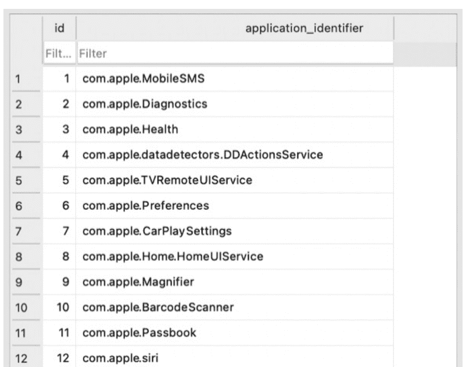
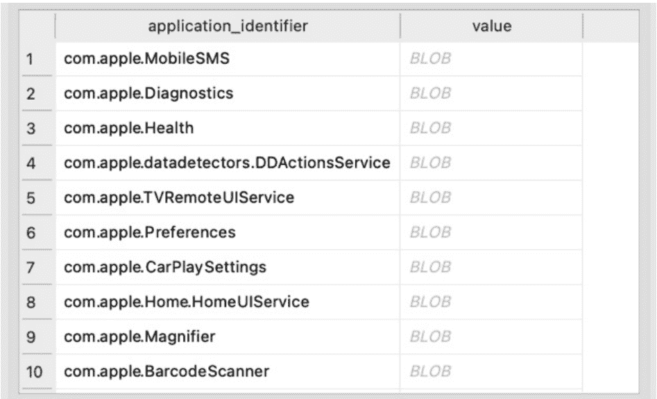
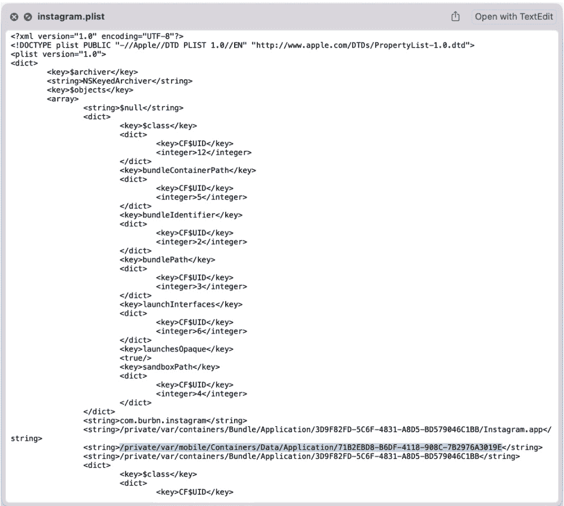
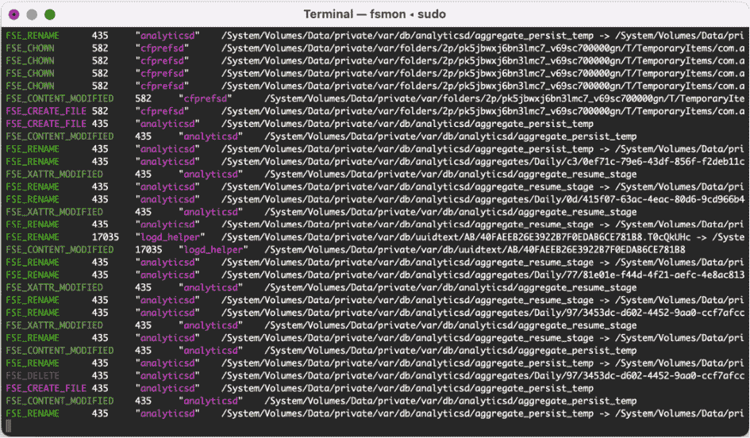
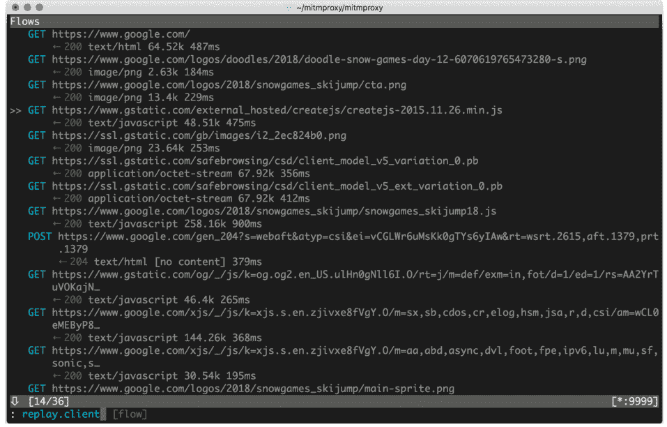
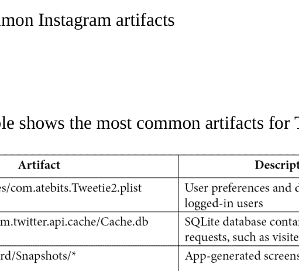

## 第 10 章：分析第三方应用

App Store 于 2008 年发布，允许用户在其 iOS 设备上下载第三方应用。截至 2021 年，可供下载的应用超过 450 万个。一旦应用在商店中可用，开发人员可以发布包含错误修复或新功能的更新，这些更新将自动安装在设备上。这从取证角度来看存在问题，因为许多取证工具无法跟上应用更新的速度，而有些应用根本不受支持。

当需要对调查中的第三方应用程序进行分析时，检查员很可能不得不求助于手动研究、验证和分析工件，而这正是本章将要讨论的内容。

我们将首先学习如何了解哪些应用已安装在设备上，它们位于何处，以及调查人员应在哪里查找任何工件。然后，我们将介绍动态应用程序分析并讨论可用于研究和验证目的的几种工具。最后，我们将深入研究一些最受欢迎的第三方应用，例如 Facebook、Twitter、Instagram、YouTube 等。

在本章中，我们将涵盖以下主题：

- 介绍 iOS 应用程序
- 动态应用程序分析
- 实用第三方应用程序取证

### 介绍 iOS 应用程序

图 10.1 – 数据容器的目录结构

Documents 文件夹包含用户创建的工件，Library 文件夹由应用程序用于存储其数据、设置和首选项，tmp 文件夹存储任何临时文件，而 SystemData 文件夹通常为空。

如前一个屏幕截图所示，Applications 文件夹包含设备上安装的每个应用的子文件夹；然而，由于文件夹按应用程序的 GUID 命名，因此仅通过查看目录结构就无法了解哪个应用是哪个。

在以下各节中，我们将学习如何将应用程序与其 GUID 相关联，以了解设备上安装了哪些应用。

### 识别已安装的应用

位于 /private/var/mobile/Library/FrontBoard/ 的 applicationState.db 数据库跟踪设备上安装的任何应用程序的 Bundle ID，包括已删除的应用程序。通过查询此数据库，检查员不仅可以了解设备上当前安装了哪些应用，还可以了解其工件的位置。

数据库包含三个感兴趣的表：
application_identifier_tab、key_tab 和 kvs。第一个表包含在某个时间点安装在设备上的应用程序列表，以其 Bundle ID 也称为其应用程序标识符标识。

以下屏幕截图显示了基于我们示例数据集的表内容：



图 10.2 – 来自 applicationState.db 的 application_identifier 表

kvs 表包含两个感兴趣的列：application_identifier，它将记录映射到上一个表中的 Bundle ID，以及名为 value 的列，其中包含二进制 BLOB。

key_tab 表是描述 BLOB 内容的指南。深入研究此表超出了本节的范围，但请记住，key_tab 值为 1 表示相应的应用程序仍安装在设备上。

基于此逻辑，以下 SQL 查询将提取设备上当前安装的所有应用程序的 Bundle ID：

```
SELECT
application_identifier_tab.[application_identifier],
```
```
kvs.[value]
FROM kvs, key_tab,application_identifier_tab
WHERE key_tab.[id] = '1'
AND kvs.[key] = key_tab.[id]
AND application_identifier_tab.[id] = kvs.
[application_identifier]
ORDER BY application_identifier_tab.[id];
```

此查询的结果显示在以下屏幕截图中：



图 10.3 – 查询打印所有已安装应用程序的 bundle ID

如您所见，查询打印了所有已安装应用的 Bundle ID，包括随设备预装的 Apple 开发的应用。

value 列包含一个 BLOB，我们将在下一节中使用它来查找应用程序存储其数据的位置。

### 跟踪应用程序 GUID

以下屏幕截图显示了通过十六进制查看器显示的二进制 BLOB：

单元格中当前数据类型：二进制

1061 字节

图 10.5 – BLOB 包含二进制 PLIST

通过查看数据，可以看出一些字符串，例如路径和位置。

现在，让我们提取 BLOB 并查看生成的 PLIST。请参阅第 4 章，处理常见的 iOS 工件，以了解如何将 BPLIST 转换为基于 XML 的 PLIST。

以下屏幕截图显示了将数据转换为 XML 然后进行 base-64 解码后的 PLIST：



图 10.6 – PLIST 包含与应用容器相关的详细信息

如您所见，我们可以从 PLIST 中提取应用数据容器的路径。在我们的示例数据集中，如果我们找到 `/private/var/mobile/Containers/Data/Application/71B2EBD8-B6DF-4118-908C-7B2976A3019E` 文件夹，我们将找到 Instagram 的工件。

到目前为止，我们已经学习了如何识别安装在 iOS 设备上的应用以及数据存储在哪里。在以下各节中，我们将深入分析第三方应用程序。

### 动态应用程序分析

第三方应用程序可能是证据工件的巨大来源，因为大多数应用程序都会收集、存储和处理大量用户数据。不幸的是，调查人员很可能不得不求助于手动分析这些应用程序，因为取证工具不可能支持每个应用的每次更新。即使工具 *确实* 支持某个应用程序，仍应进行手动检查以验证工具的结果并确保所有数据都已正确解析。

通常，在进行检查之前，检查员必须对感兴趣的应用程序进行一些研究，以了解它是如何工作的，它存储什么数据以及存储在哪里。这需要使用研究设备安装该应用并对其进行分析。

在分析移动应用程序时，调查人员没有标准流程来检查数据，因为每个应用程序的执行方式都不同；在本章中，我们将学习一种可能的方法，称为 **动态分析**。

一般来说，应用程序分析有两种方法：

- **静态分析** 涉及深入查看应用程序的代码，以识别已知函数和 API 调用，从而有助于确定应用程序的确切工作原理。
- **动态分析** 涉及在受控环境中运行应用程序并分析应用程序的行为以了解其如何


一个可简化定位应用容器任务的简单工具。

## 使用 cda 定位应用的容器

在本章的第一部分，我们学习了如何查询 `applicationState.db` 数据库来定位 iOS 应用存储数据的位置；但是，如果取证人员能够直接访问设备，则可以使用 cda 工具来快速识别应用的容器。

该工具可从 [https://github.com/ay-kay/cda](https://github.com/ay-kay/cda) 下载，使用 Objective-C 编写；按照项目页面上的说明即可编译源代码文件。

为了让这一过程更简单，已针对 64 位 ARM 设备编译好的二进制可执行文件可以从 [https://github.com/tiepolocgian/iOS-Tools](https://github.com/tiepolocgian/iOS-Tools) 下载。

下一步是将 cda 二进制文件复制到设备上。这可以通过 scp 命令完成，该命令通过 **SSH 连接**执行文件传输。假设你已经下载了二进制文件并解压了 ZIP 文件，请按照以下步骤操作：

- 1. 在本地工作站上打开终端 shell，并使用 `cd` 命令进入 `iOS_tools` 文件夹。
- 2. 运行 `scp -P 4242 cda root@127.0.0.1:/usr/bin/` 命令，然后按 *回车键*。系统会提示你输入设备密码，密码为 `alpine`。输入并按下 *回车键*。
- 3. 如果命令成功，cda 二进制文件将被复制到 iOS 设备上的 `/usr/bin/` 文件夹中。通过将该可执行文件放在该文件夹中，可以从设备上的任何位置调用该工具。
- 4. 为确保其正常工作，请在连接到设备的终端 shell 中运行 `ls -la /usr/bin/` 命令。你会看到一个很长的文件列表，其中包含 cda。

工具复制到设备后，我们可以使用它快速定位任何已安装的应用程序。只需运行 cda，后跟应用的名称（或其部分名称）。

例如，在一台装有 **Instagram** 应用的测试设备上，我们可以通过运行以下命令来查找该应用存储数据的位置：

```
iPhone:~ root# cda instagram
[1] Instagram (com.burbn.instagram)
Bundle: /private/var/containers/Bundle/Application/D054F8DC-95A4-4489-BBBD-68F3E457A575
Data:
/private/var/mobile/Containers/Data/Application/2A2FEE52-B59D-42F1-A810-333364E12525
```

如你所见，该工具会向取证人员提供与该应用程序关联的容器列表。这包括**数据容器**（应用存储用户数据和偏好的位置）和**群组容器**（包含同一群组应用之间共享数据的位置）。

定位应用的容器通常是动态分析的第一步，因为这会缩小检查范围，使取证人员只需关注一两个文件夹。在下一节中，我们将学习如何监视这些文件夹，以了解应用如何以及在哪里存储其数据。

## 使用 fsmon 监视文件系统事件

在前文中，我们介绍了动态应用分析，并了解到该过程的第一步包括运行应用并实时监视其行为。值得监视的一个方面是应用如何与文件系统交互，包括检测应用写入、编辑或删除的任何文件。

通过使用文件系统监视器，取证人员可以运行应用，执行诸如输入一些数据（用户认证、表单等）之类的任务，并可视化应用如何响应用户输入。这有助于他们了解哪些文件存储了哪些数据。

最流行的文件系统监视工具之一是 `fsmon`，这是一个由 *Sergi Álvarez* 开发的开源工具，支持许多操作系统，包括 **Linux**、**macOS**、**Android**，当然还有 **iOS**。该工具可以从 GitHub 下载：https://github.com/nowsecure/fsmon。

针对 64 位 ARM 设备的预编译二进制文件也可以从 https://github.com/tiepologian/iOS-Tools 下载。

第一步是将 `fsmon` 复制到设备上，就像我们对 `cda` 工具所做的那样：

- 1. 在本地工作站上打开终端 shell，如果你使用的是预编译二进制文件，请使用 `cd` 命令进入 `ios_tools` 文件夹。
- 2. 运行 `scp -P 4242 fsmon root@127.0.0.1:/usr/bin/` 命令，然后按 *回车键*。输入设备密码并按下 *回车键*。
- 3. 如果命令成功，`fsmon` 二进制文件将被复制到 iOS 设备上的 `/usr/bin/` 文件夹中。

要运行该工具，请键入 `fsmon`，后跟要监视的位置路径。例如，要运行 `fsmon` 并监视整个文件系统上的所有事件，请键入 `fsmon /`。以下截图显示了该工具的输出：



图 10.7 – fsmon 工具输出所有文件系统事件

如你所见，`fsmon` 以不同的颜色显示文件系统上发生的任何事件，具体取决于事件类型。以黄色显示的事件表示文件被*编辑*或其属性被*修改*，红色事件表示文件被*删除*，紫色事件表示*新建*的文件。

要了解应用在底层是如何工作的，请使用 `cda` 查找应用的数据容器所在位置。然后，使用 `fsmon` 监视该位置，并正常运行应用，执行典型的用户操作。监视工具的输出，以了解在执行特定操作后创建或编辑了哪些文件。

最后，在本章的下一节中，我们将简要介绍如何监视网络活动。

## 使用 mitmproxy 监视网络活动

在执行动态应用分析时，你可能会遇到需要查看应用正在发出哪些 **API 调用**、连接哪些服务器，以及更广泛地查看通过网络发送或接收哪些数据的情况。

一种可能的解决方案是使用**代理服务器**来拦截和解码通过 HTTPS/SSL 发送的加密数据，例如 **mitmproxy**。

mitmproxy 是一个开源交互式 **HTTPS 代理**，位于客户端（iOS 应用）和服务器之间。**中间人（MITM）**是代理服务器用来拦截流量的技术名称：其原理是 `mitmproxy` 对客户端假装自己是服务器，对服务器假装自己是客户端，同时解码来自双方的流量。解密流量是通过在设备上安装数字证书实现的，该证书将 `mitmproxy` 注册为受信任的**证书颁发机构（CA）**。

要使用 `mitmproxy`，你必须手动将证书安装到 iOS 设备上，然后将设备配置为将流量发送到代理服务器。最后，你必须在工作站上运行代理服务器，以便监视和分析网络活动。

要安装 `mitmproxy`，请访问 https://mitmproxy.org 并下载安装程序。如果你的工作站安装了 `brew`，可以在终端中运行以下命令来安装代理：

```
brew install mitmproxy
```

服务器安装完成后，在终端中运行 `mitmproxy` 来启动它。

服务器启动并运行后，需要在 iOS 设备上安装 CA 证书。你可以通过设备的浏览器访问 http://mitm.it 来完成此操作；但是，在安装证书之前，需要配置其网络设置，以允许流量从设备发送到代理。请按照以下步骤操作：

- 1. 在设备上，打开**设置 | 无线局域网**，点击无线网络以打开**高级设置**。
- 2. 向下滚动到 **HTTP 代理**，然后点击**配置代理**。
- 3. 选择**手动**，在**服务器**字段中输入运行 mitmproxy 的工作站的 IP 地址。在**端口**字段中输入 8080。
- 4. 在设备上访问 [mitm.it](http://mitm.it)，并按照说明安装 CA 证书。
- 5. 导航至**设置 | 通用 | 关于 | 证书信任设置**。找到该证书，然后打开开关以启用它。

如果一切设置正确，请打开设备上的任何应用并监视工作站上的终端：你应该会看到进出设备的网络流量。

以下截图显示了 mitmproxy 拦截网络流量的情况：



图 10.8 – 使用 mitmproxy 拦截网络流量


一般来说，代理服务器是了解 iOS 应用程序如何与网络交互的绝佳选择。然而，在某些情况下，这种方法可能无法奏效。我们将在下一节讨论更高级的选项。

## 高级应用程序分析

执行动态应用程序分析通常是一项简单的任务；然而，某些应用程序，尤其是像 **Instagram** 或 **Twitter** 这样流行的第三方社交网络，具有一些内置机制来防止 MITM 攻击。

其中之一是证书钉扎，这本质上意味着 mitmproxy 的证书将不会被应用程序接受。在这种情况下，监控应用程序的网络流量根本就不会起作用。这是因为数字证书将不会被信任，应用程序将无法连接到其服务器。

唯一的变通方法是将自定义代码注入到应用程序中以改变其工作方式。最受欢迎的代码插桩工具包之一是 **Frida**，这是一个开源工具，允许您将 JavaScript 代码注入到任何 iOS 应用程序中。Frida 允许检查人员追踪应用程序调用了哪些函数，打印或修改函数的参数，并在函数调用之前或之后 **注入其代码**。请记住，运行此工具需要设备越狱。

对 Frida 所有功能的完整介绍超出了本书的范围；您可以通过遵循 [https://frida.re/docs/home/](https://frida.re/docs/home/) 的教程开始使用该工具，或阅读 *Alexander Fadeev* 的博客文章；例如，[https://fadeevab.com/quick-start-with-frida-to-reverse-engineer-any-ios-application/](https://fadeevab.com/quick-start-with-frida-to-reverse-engineer-any-ios-application/)。

从取证的角度来看，Frida 可以与其他工具一起使用，例如 **Meduza**，以绕过证书钉扎并允许检查人员分析任何类型的 iOS 应用。Meduza 是由 *Dima Kovalenko* 开发的开源工具，它分为两个步骤：首先，它分析应用程序并收集应用程序用于连接到其

## 社交网络应用程序

在本节中，我们将重点关注三个主要的社交网络应用程序，**Facebook**、**Instagram** 和 **Twitter**。**Reddit** 应用也包含在此类别中。

## Facebook

下表显示了 Facebook 最常见的 artifacts：

| Artifact | Description |
|---|---|
| Library/Preferences/com.facebook.Facebook.plist | 用户偏好设置和已登录用户的详细信息（电子邮件和 Facebook ID）。 |
| Library/Caches/com.facebook.Facebook.*/ | 缓存的文件和图像，例如在浏览帖子和页面时存储的媒体。 |

表 10.1 – 常见 Facebook artifacts

## Instagram

下表显示了 Instagram 最常见的 artifacts：

## Anno xxxj° Elizabethæ, Reginæ

### An Act against such as are wilfully absent, and refuse to come to Church.

### An Act for the punishment of Vagabonds, and for Relief of the Poor and Impotent.



| Artifact | Description |
|---|---|
| Library/Preferences/com.reddit.Reddit.plist | 用户偏好设置和已登录用户的详细信息 |
| Documents/release2/accountData/* | 包含用户数据的二进制属性列表 |
| Library/SplashBoard/Snapshots/* | 应用生成的屏幕截图 |
| Library/Caches/com.reddit.Reddit/Cache.db | 包含缓存 API 请求的 SQLite 数据库 |
| Library/Caches/com.reddit.Reddit/imagedownload/* | 包含缓存图像的 SQLite 数据库 |

表 10.4 – 常见 Reddit artifacts

现在，让我们看几个消息应用程序。

## 消息应用程序

尽管消息应用程序已在 *第 8 章，电子邮件和消息取证* 中进行了详细讨论，但本节将为一些最常用的即时消息应用程序提供参考，例如 **WhatsApp、Telegram、Facebook Messenger 和 Signal**。

## WhatsApp

下表显示了 WhatsApp 最常见的 artifacts：

| Artifact | Description |
|---|---|
| Documents/com.facebook.Messenger.preferences/* | 包含用户偏好设置的 Property List |
| Library/Preferences/com.facebook.Messenger.plist | 应用程序设置 |
| Shared/AppGroup/shared_messenger_contacts/*.db | 包含联系人的 SQLite 数据库 |
| Shared/AppGroup/shared_messenger_messages/*.db | 存储聊天和消息的 SQLite 数据库 |
| Shared/AppGroup/lightspeed-imageCache/* | 缓存 |

表 10.7 – 常见 Facebook Messenger artifacts

## Signal

下表显示了 Signal 最常见的 artifacts：

| Artifact | Description |
|---|---|
| Library/Preferences/org.whisper systems.signal.plist | 应用程序设置 |
| Library/Caches/* | 缓存的媒体和 API 请求 |
| Shared/AppGroup/Attachments/* | 媒体文件 |
| Shared/AppGroup/grdb/signal.sqlite | 包含聊天和消息的 SQLite 数据库 |

表 10.8 – 常见 Signal artifacts

接下来，我们将讨论与生产力应用程序相关的 artifacts。

## 生产力应用程序

| Artifact | Description |
|---|---|
| Library/Preferences/com.google.Gmail.plist | 用户偏好设置、应用程序设置和已登录用户数据 |
| Library/ApplicationSupport/data/<email>/* | 包含用户数据的 SQLite 数据库 |
| Library/Caches/* | 缓存文件 |

表 10.13 – 常见 Gmail artifacts

接下来，我们将看几个多媒体应用。

## 多媒体应用程序

本节包括允许您查看或共享媒体文件的应用程序，例如 Netflix、YouTube、Spotify、Snapchat 和 TikTok。

## Netflix

下表显示了 Netflix 最常见的 artifacts：

| Artifact | Description |
|---|---|
| Library/Preferences/com.netflix.Netflix.plist | 用户偏好设置和应用程序设置 |
| Documents/store.sqlite | 包含已登录用户信息 的 SQLite 数据库 |
| Library/Caches/* | 缓存的视频流和 API 请求 |

表 10.14 – 常见 Netflix artifacts

## YouTube

下表显示了 YouTube 最常见的 artifacts：

| Artifact | Description |
|---|---|
| Library/Preferences/com.google.ios.youtube.plist | 用户偏好设置和应用程序设置 |
| Library/Caches/* | 视频和 API 请求缓存 |

表 10.15 – 常见 YouTube artifacts

## Spotify

下表显示了 Spotify 最常见的 artifacts：

| Artifact | Description |
|---|---|
| Library/Preferences/com.spotify.client.plist | 用户偏好设置和应用程序设置 |
| Documents/ InstrumentsModel.sqlite | 存储应用事件的 SQLite 数据库 |
| Library/ApplicationSupport/PersistentCache/mercury.db | 播放历史缓存媒体 |
| Library/ApplicationSupport/Users/<id>/recently_played | 以二进制格式的最近播放历史 |
| SplashBoard/Snapshots/* | 应用生成的屏幕截图 |

表 10.16 – 常见 Spotify artifacts

## Snapchat

下表显示了 Snapchat 最常见的 artifacts：

| Artifact | Description |
|---|---|
| Library/Preferences/com.toyopagroup.picaboo.plist | 用户偏好设置和应用程序设置 |
| Documents/user.plist | 存储已登录用户详细信息的 Property List |
| Documents/chatConversationStore.plist | 包含聊天的 Property List |
| Documents/stories.plist | 存储故事数据的 Property List |
| Library/Caches/* | 缓存的媒体和 API 请求 |

表 10.17 – 常见 Snapchat artifacts

## TikTok

下表显示了 TikTok 最常见的 artifacts：

| Artifact | Description |
|---|---|
| Library/Preferences/com.zhiliaoapp.musically.plist | 用户偏好设置和应用程序设置 |
| Documents/AwemelM.db | 存储 TikTok 联系人的 SQLite 数据库 |
| Documents/Aweme.db | 包含已发布 TikTok 视频的 SQLite 数据库 |
| Library/ApplicationSupport/ChatFiles/<id>/db.sqlite | 存储聊天和消息的 SQLite 数据库 |
| Library/Caches/* | 缓存的媒体和 API 请求 |

表 10.18 – 常见 TikTok artifacts

在分析第三方应用程序时，检查人员应牢记，研究和验证始终是必需的，因为应用程序不断更新，而每次更新都可能改变应用程序存储数据的方式。

## 总结


在本章中，我们学习了第三方 iOS 应用程序。首先，我们学习了应用程序将数据存储在何处、如何识别已安装的应用程序，以及如何将应用程序与其 GUID 关联。然后，我们专注于分析第三方应用程序。我们介绍了动态分析的概念，并学习了分析应用程序的逐步流程。我们还学习了如何使用 cda 工具识别数据容器、如何监控文件系统变化，以及如何可视化应用程序的网络流量。

最后，我们提供了一份实用的速查表，其中包含可在流行的第三方 iOS 应用程序中找到的最常见工件的路径和描述。

在下一章中，我们将讨论 iOS 取证中的更高级主题。
