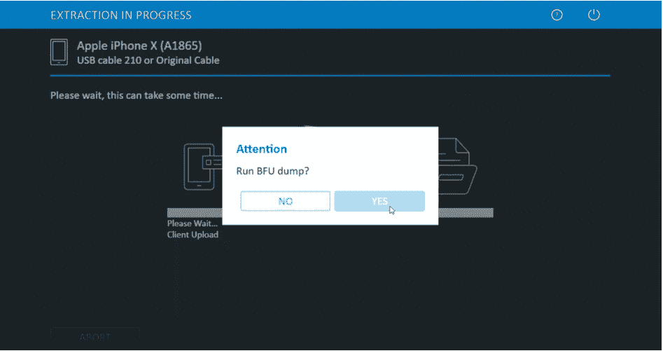
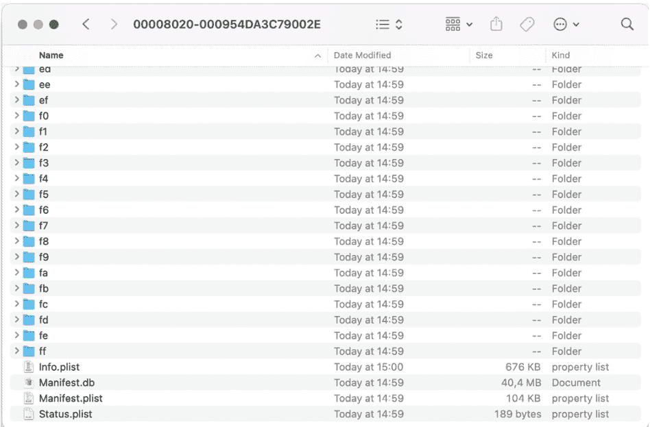
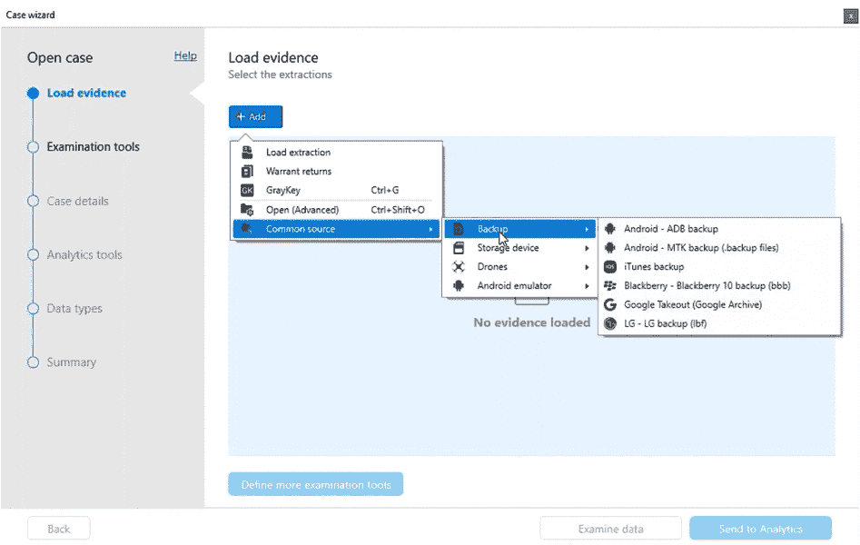
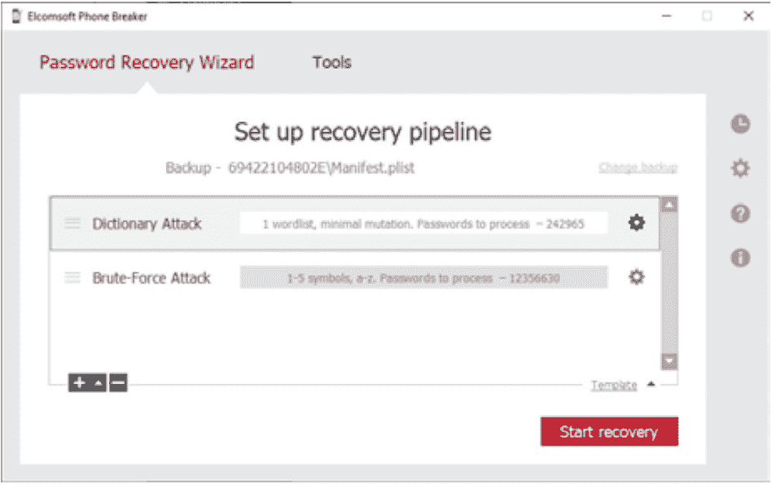
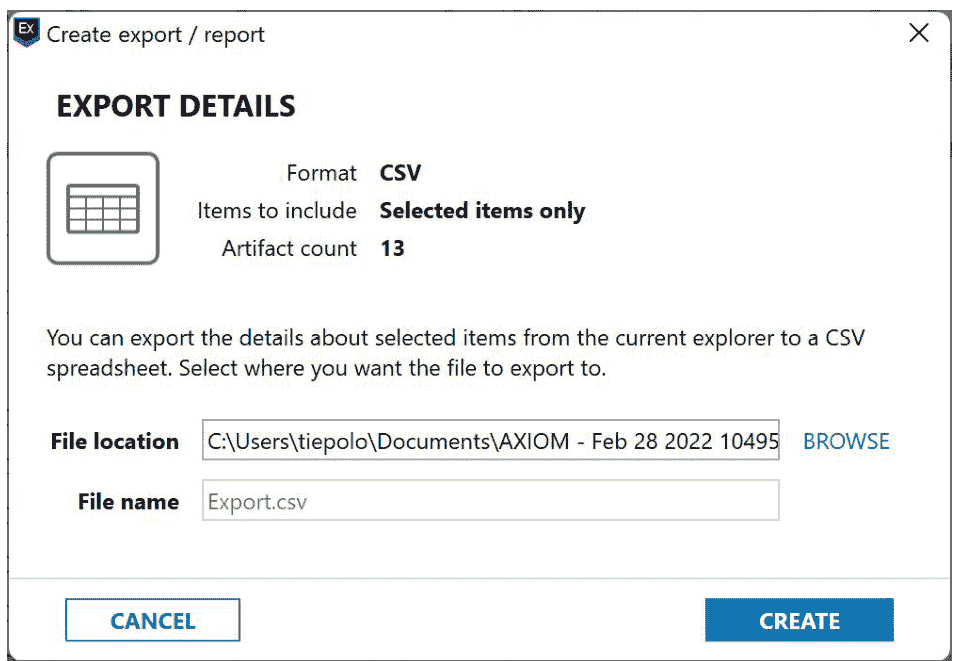
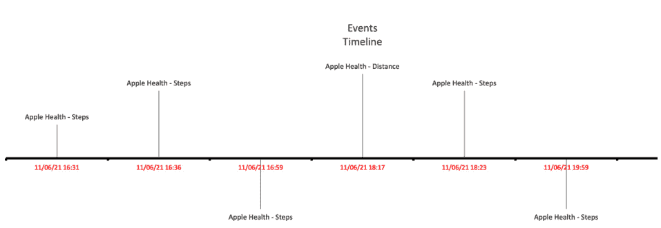
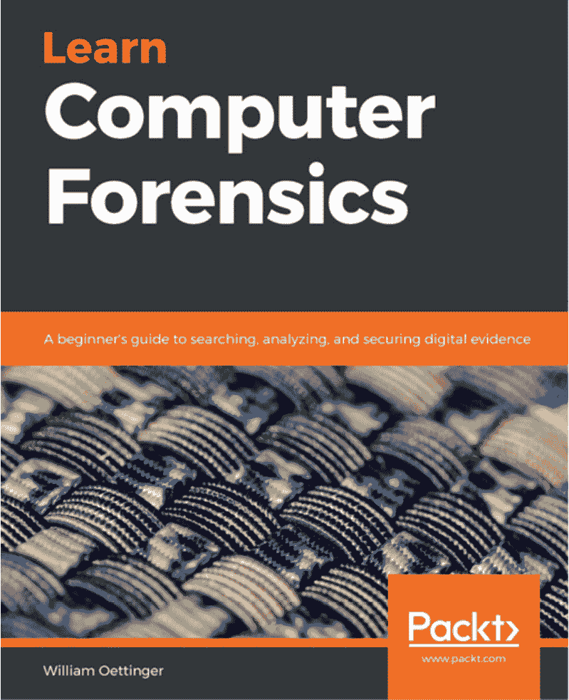

## 第 11 章：锁定设备、iTunes 备份和 iCloud 取证

到目前为止，在本书中，我们学习了如何使用不同的方法执行 iOS 采集，以及如何分析提取的数据以获得有意义的见解，例如解释位置工件、解析媒体文件或分析生活模式数据。到目前为止我们所涵盖的一切都依赖于被检查的 iOS 设备处于解锁状态，或已知密码；然而，这并不总是如此。有时调查人员可能不得不处理锁定设备，而这将是本章的重点。

我们将从学习如何处理锁定设备开始，检查员有哪些选择，以及如何尝试密码破解。然后，我们将讨论 **首次解锁前 (BFU)** 采集，并学习在这种提取中我们可能找到什么样的数据。本章后面，我们将介绍 iTunes 备份，并学习如何提取和分析它们。在本章的最后一部分，我们将讨论 iCloud 取证，并学习如何提取备份、钥匙串和同步到 iCloud 的数据。

在本章中，我们将涵盖以下主题：

- 采集锁定设备
- 锁定设备的 BFU 采集
- 介绍 iTunes 备份
- 介绍 iCloud 取证

### 采集锁定设备

在本书记载的开头，在 *第 1 章*，*介绍 iOS 取证* 中，我们讨论了 iOS 操作系统，并学习了 Apple 如何通过加密设备上存储的文件来实现 **数据保护**。

设备的密码是加密过程中的一个重要方面，因为它用于生成 **加密密钥**，而该密钥又用于解密数据。在用户输入屏幕锁定密码之前，几乎所有数据都无法访问。当然，有些例外，因为某些文件是操作系统运行所必需的，即使设备被锁定也需要始终可访问。

由于这些原因，采集和分析锁定设备并非易事，但有几种选择。当调查人员处理锁定设备时，第一步需要 **识别** 设备及其当前状态，因为可用于尝试数据采集的选项会根据多种因素而有所不同，例如型号和 iOS 版本。

初始识别阶段应使检查员能够回答以下问题：

- 锁定设备处于 BFU 还是 **首次解锁后 (AFU)** 状态？
- 设备的硬件型号是什么？
- 设备是否容易受到 Checkm8 攻击？
- 设备运行的是什么 iOS 版本？
- 设备是否曾经与台式机或笔记本电脑配对过？

通过回答这些问题，检查员将能够评估可能获得对锁定设备访问的最佳行动方案。在继续之前，了解 BFU 和 AFU 状态之间的差异很重要：

- **BFU**：处于 BFU 状态的设备是指已关机或重新启动，并且自设备开机以来尚未解锁，甚至一次都没有的设备。
- **AFU**：当设备开机并输入正确的密码时，设备进入 AFU 模式。

关键在于，当设备处于 AFU 状态时，可以提取和分析的数据要多得多，因为某些加密密钥实际上保留在内存中。

一旦设备成功识别，应考虑以下选项：

- 定位并使用 **锁定配对记录**
- 密码破解
- 执行 **BFU 采集**
- 将设备发送到第三方实验室或高级服务，例如 **Cellebrite Advanced Services** 或 **Grayshift's GrayKey**
- 定位并分析 **iTunes 备份**
- 下载并分析 **iCloud 备份**
- 下载并分析 iCloud 同步数据

在本章的以下部分中，我们将讨论这些选项的利弊，首先是使用锁定配对记录。

### 使用锁定配对记录访问设备

**锁定记录**，也称为 **配对记录**，本质上是存储在主机计算机上的文件，其中包含用于允许 iOS 设备与已配对计算机通信的加密密钥。

第一次将 iOS 设备连接到安装了 iTunes 的 PC 或 macOS 计算机时，用户将被提示通过输入设备的密码来 *信任* 该设备。这将在主机上创建锁定记录，这意味着用户每次将设备连接到计算机时无需解锁设备。

如果调查人员对与设备配对的主机计算机拥有物理和合法访问权限，则可以使用锁定文件访问锁定设备并成功执行逻辑采集。

然而，有一些注意事项。首先，使用配对记录访问锁定设备仅在设备处于 **AFU 状态** 时才有效；其次，锁定记录会在一段时间后 **过期**。虽然没有确切答案说明这些记录何时过期，但已开展的研究似乎表明锁定记录在创建后 7 到 30 天之间任何时间过期。

在 Windows 机器上，锁定记录通常存储在 `%ProgramData%\Apple\Lockdown\` 中。

在 macOS 计算机上，可以在 `/var/db/lockdown/` 中找到它们。

一旦调查人员找到锁定记录，就可以使用诸如 **Elcomsoft iOS Forensic Toolkit** 或 **MOBILedit Forensic Express** 等工具执行逻辑采集。

以下步骤描述了使用 Elcomsoft iOS Forensic Toolkit 的过程：

1. 首先，启动 Toolkit。
2. 使用 USB-A 电缆将设备连接到工作站。
3. 选择 **B – Backup** 选项。
4. 在提示时，输入锁定记录的路径。

如果接受配对记录，将创建逻辑备份。以下屏幕截图显示了 Toolkit 的主菜单：

```
Elcomsoft iOS Forensic Toolkit 7.02

(c) 2011-2021 Elcomsoft Co. Ltd.

Device connected: iPhone
Hardware model: N61AP
Serial number: F78PNPSKG5MT
OS version: 12.4.5
Device ID: 7cf85b3179a6c136ae723636e6467a27888ab928

Please select an action

Logical acquisition
  I  DEVICE INFO      - Get basic device information
  R  RECOVERY INFO    - Get information on device in DFU/Recovery mode
  B  BACKUP           - Create iTunes-style backup of the device
  M  MEDIA            - Copy media files from the device
  S  SHARED           - Copy shared files of the installed applications
  L  LOGS             - Copy crash logs

Jailbroken devices acquisition
  D  DISABLE LOCK     - Disable screen lock (until reboot)
  K  KEYCHAIN         - Decrypt device keychain
  F  FILE SYSTEM      - Acquire device file system (as TAR archive)

Acquisition agent (limited compatibility)
  1  INSTALL          - Install acquisition agent on device
  2  KEYCHAIN         - Decrypt device keychain
  3  FILE SYSTEM      - Acquire device file system (as TAR archive)
  4  FILE SYSTEM (USER) - Acquire user files only (as TAR archive)
  5  UNINSTALL        - Uninstall acquisition agent from device

Legacy devices acquisition
  A  LEGACY           - Legacy devices acquisition (iPhone 4/5/5C)

  X  EXIT

>:
```

图 11.1 – Elcomsoft iOS Forensic Toolkit 可以使用配对记录采集锁定设备


如果设备配置为生成未加密的备份，该工具将自动设置一个临时密码，以确保备份过程中所有数据都能被获取。

在下一节中，我们将讨论密码破解。

## 密码破解

过去，有几种方法可以尝试破解设备的密码，例如连接到设备的*黑盒*，可以对所有可能的组合进行暴力破解。不幸的是，这些方法仅支持旧设备。

从 iPhone 5s 开始，苹果引入了**安全隔区**，有效减慢了密码尝试的速度，使暴力破解攻击变得不可能。

仍然有一些软件工具可用于此目的，例如 Elcomsoft 的 iOS 取证工具包，它可以对运行 iOS 4 至 iOS 10 的 iPhone 4、5 和 5c 进行密码暴力破解。

如果检查人员有幸遇到这些设备之一，可以执行完整的物理获取，破解密码，并有效访问锁定的设备。要执行暴力破解攻击，设备必须启动到**DFU 模式**，并通过**Checkm8**漏洞进行利用。对**六位密码**的完整暴力破解攻击在 iPhone 5 上大约需要 21 小时，在 iPhone 4 上最多需要 40 小时。

如果密码破解不可行，且未找到锁定记录，执行 BFU 获取可能是唯一的选择。我们将在下一节讨论这些获取方式。

## 锁定设备的 BFU 获取

在*第 2 章*《*从 iOS 设备获取数据*》中，我们介绍了**Checkm8**漏洞和**checkra1n**越狱，它们允许检查人员完全访问从**iPhone 5s**到**iPhone X**设备的文件系统。即使密码未知，也可以利用此漏洞对*锁定*或*已禁用*的设备执行获取。这种获取方式称为**BFU 获取**。

重要的是要理解，BFU 获取仅允许*部分*提取设备数据，因为大多数文件在输入密码之前仍处于加密状态。尽管如此，部分提取（包括钥匙串中的数据）绝对比什么都没有好，因为这些可能包含重要的证据。

下表列出了通过 BFU 获取可以提取的一些最常见的工件：

| 工件 |
|---|
| `/private/var/mobile/Library/Preferences/*` |
| `/private/var/preferences/SystemConfiguration/*` |
| `/private/var/root/Library/Preferences/*` |
| `/private/var/mobile/Library/Accounts/Accounts3.sqlite` |
| `/private/var/mobile/Library/DataAccess/*` |
| `/private/installd/Library/Logs/MobileInstallation/*` |
| `/private/var/mobile/Library/SpringBoard/*` |
| `/private/var/mobile/Library/CallHistoryDB/CallHistoryTemp.storedata` |
| `/private/var/mobile/Library/Preferences/com.apple.*` |
| `/private/var/mobile/Library/SMS/sms-temp.db` |
| `/private/var/mobile/Library/Preferences/com.apple.preferences.network.plist` |
| `/private/var/wireless/Library/Databases/CellularUsage.db` |
| `/private/var/root/Library/Caches/locationd/consolidated.db` |

表 11.1 – BFU 获取中发现的常见工件

从表中可以看出，只要设备易受 Checkm8 攻击，就可以通过 BFU 获取从锁定设备中提取一些关键工件。

要执行 BFU 获取，首先使用 checkra1n 对设备进行越狱，这不需要设备解锁。然后，部分提取**钥匙串**，并使用诸如 Elcomsoft iOS 取证工具包之类的工具执行文件系统获取。一些取证工具，如**Cellebrite UFED**，不需要设备越狱，因为 Checkm8 漏洞利用直接在工具内执行。

### 使用 Elcomsoft iOS 取证工具包执行 BFU 获取

以下步骤描述了使用 Elcomsoft iOS 取证工具包执行 BFU 获取的过程：

1. 首先，将设备置于恢复模式并启动 checkra1n。
2. 按照说明将设备置于 DFU 模式并应用临时越狱。确保设备使用 USB-A 线缆连接，因为使用 USB-C 线缆将无法工作。
3. 启动 Elcomsoft iOS 取证工具包，并选择 **K – Keychain** 选项。
4. 当工具提示输入密码时，按 *Enter* 跳过此步骤。
5. 当过程完成时，从主菜单中选择 **F – File System** 选项以获取设备的文件系统。
6. 当工具提示输入密码时，按 *Enter* 并等待过程完成。

以下截图说明了该过程：

图 11.2 – Elcomsoft iOS 取证工具包执行 BFU 获取

接下来，我们将使用不同的工具重复该过程。

### 使用 Cellebrite UFED 执行 BFU 获取

使用 Cellebrite UFED 执行 BFU 获取也很简单，并且不需要通过 checkra1n 对设备进行越狱：

1. 启动 Cellebrite UFED。
2. 选择 Advanced Logical，然后选择 Full File System (checkm8) 选项。
3. 使用 USB-A 线缆连接设备，然后点击 Continue。
4. 当工具提示输入设备密码时，点击 Cancel。
5. 点击 YES 以执行 BFU 获取。

```
WARNING: Please, unlock the device and specify passcode (if needed). Otherwise, press any key to proceed in a locked state, but be aware, that not all data may be retrieved

You pressed a key - app will try to dump all available items
Overall dumped 3031 items of class 'genp'
Overall dumped 1 items of class 'inet'
Overall dumped 29 items of class 'cert'
Overall dumped 117 items of class 'keys'
Overall dumped 6 items of class 'idnt'

Cleaning up...
[INFO] Info: New connection...
[INFO] Device connected
[INFO] USBMuxConnectByPort OK
Warning: Permanently added '[localhost]:3022' (RSA) to the list of known hosts.

Done.

Press 'Enter' to continue
```

以下截图显示了选择 BFU 获取的步骤：



图 11.3 – Cellebrite UFED 执行 BFU 获取

获取过程完成后，可以像往常一样手动或使用取证软件（如**Cellebrite Physical Analyzer**）分析钥匙串和文件系统转储。

### 提示

值得一提的是，执行 BFU 获取完全绕过了 USB 受限模式；随着 iOS 11 的推出，苹果引入了一项安全功能，如果设备在过去一小时内至少未解锁一次，则阻止 USB 配件进行任何数据连接。理论上，这应该限制物理连接的*黑客工具*的攻击面；然而，通过 Checkm8 利用设备会绕过此安全功能。

尽管 BFU 获取是从锁定设备提取数据的最佳选择，但很明显，较新的设备——不易受 Checkm8 攻击——无法使用此方法获取。试图访问这些设备的调查人员将不得不求助于将手机发送到提供取证服务的第三方实验室，例如 Cellebrite Advanced Services。

如果无法*直接*获取设备，仍有可能通过定位和分析设备的**备份**来*间接*提取其数据，该备份可能存储在主机或**云**中。

在本章的下一节中，我们将介绍 iTunes 备份，并学习如何提取和分析它们。

## 介绍 iTunes 备份

如果涉案 iPhone 是较新型号，如**iPhone 13**或**iPhone 12**，调查一台被未知密码锁定的设备可能会迅速使调查陷入停滞；然而，如果嫌疑人已将其设备备份到台式机或笔记本电脑，并且调查人员可以访问该机器，则可以轻松恢复、提取和分析备份。

检查备份可能有益的另一个原因是，用户可能已从移动设备中删除了一些数据，但这并不会删除备份中存在的数据：事实上，备份文件包含用户认为不再存在的数据是很常见的。

本地备份，也称为**iTunes 备份**，本质上是设备的逻辑获取，通常包含联系人、短信、媒体文件、日志、数据库、钥匙串、偏好设置、配置、浏览痕迹和位置数据等。用户可以手动使用**iTunes**创建备份，或者设备可以配置为在插入机器时自动创建新备份。在 macOS 计算机上，不再需要 iTunes，备份过程可以直接从**Finder**开始。

创建 iTunes 备份时，iOS 允许用户通过使用密码加密备份来增强安全性。一旦用户设置了密码，所有后续备份都将被加密，并且只有在知道密码的情况下，检查人员才能访问这些文件。然而，密码


cracking can be attempted, and this will be covered in detail later on in the chapter.

It's important to understand that since iOS 13, iTunes backups will not contain user-sensitive data (such as call logs, keychain, and Safari history) if encryption is not enabled.

## Locating backup files

An iTunes backup is essentially a folder named with a GUID that contains numerous subfolders and files. The following screenshot should give you an idea of what it looks like:



Figure 11.4 – File structure of an iTunes backup

On Windows machines, iOS backups are typically stored at C:\Users\<user>\AppData\Roaming\Apple Computer\MobileSync\Backup. If, however, the Windows app version of iTunes is installed, local backups will be stored at C:\Users\<user>\Apple\MobileSync\Backup.

On machines running macOS, local backups will be stored at /Users/<user>/Library/Application Support/MobileSync/Backup/.

By examining these locations, the investigator may find multiple backups of the same device, or backups for different devices.

In the root folder of each backup, there are four files of interest:

- Info.plist: This property list contains details from the device such as the IMEI, ICCID, model number, the list of all installed applications, and the timestamp of when the backup was created.
- Manifest.db: The Manifest database is a normal SQLite database, but it will be encrypted if a password was specified for the backup. The main table of interest, Files, contains a list of all files included in a backup and their properties, such as fileID, domain, and path.
- Manifest.plist: The Manifest property list stores information for every application that is installed on the device, such as the path to the app's containers. This file also contains the IsEncrypted key, which indicates whether the backup was encrypted or not, and the WasPasscodeSet key, which tells us whether the device had a passcode.
- Status.plist: This property list contains generic metadata, such as the backup's unique identifier and the timestamp of when it was completed.

Since we now have all the information from a backup, we can start putting the filesystem back together using our forensic tools.

## Analyzing iTunes backups

Once the investigator has located an iTunes backup, the filesystem has to be rebuilt and the files will need to be decrypted. Although this can also be done manually, the easiest solution is to import the backup into any mobile forensic software, such as Cellebrite Physical Analyzer or **Elcomsoft Phone Viewer**, and analyze the data as usual.

To import an iOS backup into Cellebrite Physical Analyzer, follow these steps:

- 1. Launch the tool and from the main menu, choose **File | Open case**.
- 2. Then, in **Case wizard**, click on **Add**.
- 3. Choose **Common source | Backup | iTunes backup**.
- 4. Select the folder that contains the backup and click **Continue**.

Once Cellebrite Physical Analyzer has finished parsing the files, the artifacts can be examined as if they were a normal logical acquisition. The following screenshot shows the correct option within **Case wizard**:



Figure 11.5 – Loading an iTunes backup into Cellebrite Physical Analyzer

Previously, we learned that iTunes backups can be encrypted by setting a custom password. On such occasions, if the password is not known, the



Figure 11.7 – Set up a dictionary attack or a brute-force attack

- 4. You can set additional parameters, such as the password length, common character sets, or custom character sets. Then, click Done.
- 5. Click on Start recovery to begin the process.

From the research that has been carried out, it's recommended to attempt brute-forcing a four-digit password first, followed by a six-digit password and a dictionary attack, as these are the most common and easily crackable.

Unfortunately, there are some cases in which recovering the password to an iTunes backup is simply not possible, or there may even be no local backup available. In these situations, one of the possible courses of action is to attempt to download and extract backups or data synced to iCloud.

The final section of this chapter will discuss iCloud forensics.

## Introducing iCloud forensics

In October 2011, Apple introduced **iCloud**, a cloud-based platform that allows users to store and share files between their devices, and backup their data. iCloud is integrated directly into iOS and is accessible from Windows machines, macOS computers, or directly from the web by browsing to https://www.icloud.com.

From a forensic viewpoint, cloud forensics is arguably the future of mobile forensics as it allows investigators to access data that may not even be stored on the device itself. As the majority of new devices do not (yet) support jailbreaks and full filesystem acquisitions, performing a cloud acquisition is a great alternative.

Before we dive deep into the technical details of extracting data from iCloud, it's important to understand exactly what kind of data we can expect to find, starting with **iCloud backups**.

### iCloud backups

Since the release of iOS 5 in 2011, Apple allows users to back up their devices automatically to their iCloud accounts. These backups are similar to the iTunes backups we discussed in the previous section and include most of the data that is stored on a device, such as application data, device settings, call logs, messages, notes, and Safari history.

The user can elect to include or exclude certain elements from the backup directly from the device by navigating to **Settings | [User] | iCloud | Manage storage | Backups.**

To perform an iCloud backup, there is no need to connect the device to a computer, as the backup process happens automatically during the night when the device is charging and connected to a Wi-Fi network. The process can also be started manually from the device.

Cloud backups are made incrementally to save space and time, and typically, at least two or three backups are retained in the cloud. All data is securely encrypted both in transit and in storage, and the encryption key is stored by Apple in the user's iCloud account. More sensitive data, such as Apple Card transactions and health data, is secured with a stronger form of protection known as **end-to-end encryption**; this data is encrypted using keys derived from information unique to the device, so nobody – not even Apple – has access to this data.

Tip

When an investigation involves a locked device that cannot be acquired using any of the methods described in previous chapters, one of the possible workarounds is to take advantage of iCloud's automatic backup capabilities. Putting the device close to a known Wi-Fi network and charging it for a few hours will trigger the creation of a new backup that can then be downloaded and analyzed, revealing the data stored on the device.

Backups are not the only thing that is stored in iCloud, as iOS also provides automatic syncing capabilities for certain data categories.

### iCloud synced data

Syncing data between iOS devices has become a seamless experience for the user thanks to iCloud. The following is a list of the most common categories that are synced to the cloud:

- Account information
- User settings
- Mail
- Call history
- Messages
- Contacts, notes, and calendars
- Safari history, tabs, and bookmarks
- iCloud Keychain
- Apple Health

The user has a certain degree of control over what data is synchronized to iCloud, as syncing can be enabled on a per-app setting directly from the device. The following screenshot shows iCloud syncing settings, which can be accessed by going to **Settings** | **[User]** | **iCloud** and toggling individual apps in the **Apps using iCloud** section:


## iCloud

### STORAGE

iCloud — 已使用 50 GB 中的 13.6 GB


- Photos
- Backups
- Docs

Manage Storage

### APPS USING iCLOUD

| App | Status |
| --- | --- |
| Photos | On |
| Mail | Off |
| Contacts | On |
| Calendars | On |
| Reminders | On |
| Notes | On |
| Messages | Off |
| Safari | On |
| Stocks | On |
| Home | On |


Figure 11.8 – Apps using iCloud from the device settings

iCloud 同步数据可使用取证工具下载，前提是调查人员对云数据的访问具有合法权限。下载同步数据对于调查可能极具价值，因为它能让检查人员快速访问特定证据，无需下载整个备份。

### Accessing iCloud data

Apple 可通过法律请求向执法部门提供对 iCloud 备份和同步数据的访问权限。由于 Apple 持有用户的 **加密密钥**，他们可以解密用户大部分的 iCloud 数据，除使用端到端加密的敏感数据外。

此解决方案存在若干缺点：

- 由于请求的数据量庞大，处理执法和政府请求的过程非常缓慢。
- Apple 返回的数据不完整，因为它不包含敏感证据，例如 Apple Card 交易、钥匙串、消息和 Safari 历史记录。

还有其他选项允许调查人员直接从 iCloud 拉取数据，但这些请求必须由 Apple 服务器授权，需提供某种形式的 **身份验证凭据**。

目前，iCloud 凭据可以以三种不同格式提供：

- **Apple ID 和密码**：如果调查人员对用户的 Apple ID（*电子邮件地址*）和密码具有合法访问权限，则可使用这些凭据访问 iCloud 数据、下载备份和同步数据，对其解密并将数据转换为 iTunes 备份。如果账户启用了 **双重验证 (2FA)**，则需要访问设备或 SIM 卡。
- **身份验证令牌：** 令牌是一小部分二进制数据，其作用类似于浏览器 cookie，用于登录网站。身份验证令牌用作用户凭据的替代，允许设备在无需每次请求都提供 Apple ID 和密码的情况下对 iCloud 进行身份验证。如果用户曾从 Windows 或 macOS 机器登录其 iCloud 账户，且调查人员可访问该计算机，则可使用令牌在无需 Apple ID 和密码的情况下访问 iCloud 数据。尽管 Apple 经常更改 iCloud 身份验证协议，目前令牌仅在有限时间内有效，且只能在生成它们的机器上使用。最后，使用令牌只能访问 iCloud 中存储的部分数据，例如照片、iCloud Drive 文件、电子邮件、通话记录和 Safari 历史记录。截至撰写时，身份验证令牌无法用于访问 iCloud 备份。令牌可通过 Elcomsoft Phone Breaker 提取。
- **受信任设备：** 如果没有 Apple ID 和密码，但调查人员可访问用户的设备，仍可能访问用户所有的 iCloud 数据。设备必须已登录 iCloud 资料，且必须知道设备的密码。要访问 iCloud，请将设备连接到工作站并运行 Elcomsoft Phone Breaker。建立信任关系后，该工具将侧载提取代理到设备上，检查人员将看到可提取的 iCloud 备份和数据的列表。目前，此解决方案适用于运行 iOS 9 至 14.3 的设备，或越狱设备。

通过向 Apple 服务器提供用户的凭据，调查人员将能够从 iCloud 拉取备份和同步数据，可能揭示设备本身上已不再存在的关键证据。接下来，我们将讨论 **iCloud 钥匙串**。

### Introducing iCloud Keychain

云取证的强大之处在于，在某些情况下，即使没有对特定设备的物理访问，也有可能获取 iOS 备份。存储在 iCloud 中的大量用户数据对于任何移动取证调查或事件响应案件都至关重要。

## Summary

在本章中，我们介绍了锁定设备的主题，并了解了各种调查方法，这些方法可导致获取未知密码的设备。首先，我们学习了锁定记录的位置以及如何使用它们对锁定设备执行逻辑获取。然后，我们简要讨论了密码破解，然后转向 BFU 获取。接下来，我们学习了 iTunes 备份的存储位置以及如何分析其元数据。最后，在本章的最后一节中，我们通过了解哪些数据同步到云端、如何访问它以及如何使用取证工具提取它，介绍了 iCloud 取证。

在本书的最后一章中，我们将学习如何编写移动取证报告以及如何将设备的证据导出到时间线。

## Section 3 – Reporting

在这一部分，你将了解在报告中正确结构化数据的重要性，以及如何使用时间线来呈现数据。

本书的这一部分包含以下章节：

- *Chapter 12*, Writing a Forensic Report and Building a Timeline

### Chain of custody

一份记录良好的 **保管链** 将取证过程联系在一起，并支持证据的完整性，以便其可在法庭上作为证据出示。无法记录保管链的任何阶段都可能损害证据的真实性和完整性，使其在法庭上无用。撰写报告的人员还应描述设备如何与蜂窝和数据网络隔离。

### Device acquisition

整个获取过程应详细描述，从用于该目的的工具名称开始。此数据也可以以表格形式报告，并应包括软件名称、制造商、确切版本号以及工具所使用的任务。如果执行了侵入性技术，例如越狱设备以获取完整文件系统获取，检查人员必须记录执行此类操作的原因。通常，越狱设备或执行基于代理的获取是必要的，因为逻辑获取中不存在所需的特定数据。在这种情况下，检查人员必须提供任何可能在获取过程中发生的数据更改的详细技术说明。

### Analysis process

通常，检查人员在检查过程中会使用多种工具：一种工具用于执行获取，另一种工具用于分析，以及其他工具用于手动解析数据，例如 SQLite 查看器。报告应明确列出这些工具，说明是否以及何时执行了手动检查以及为何有必要。如果使用了多种工具且数据存在差异，应在报告中包含此信息。这非常常见，因为单一工具不可能支持所有第三方 iOS 应用程序。

### Evidence

检查结果应在此报告部分中详细列出。根据调查范围，可能存在数千个证据；因此，证据应在报告中按逻辑排列并分为类别，例如电话日志、浏览历史和 WhatsApp 消息等。对于每个证据，应标明源文件和哈希值。

描述证据的另一种方式是通过 **时间线**，我们将在下一节更详细地介绍。使用时间线，事件列表按特定顺序表示——通常按时间顺序——这是一种很好的技术，用于确定设备在特定时间发生了何种活动。

一些检查人员喜欢在此部分添加注释以解释数据或根据证据得出结论。个人而言，我认为不应在此部分撰写任何结论，因为该部分应以客观方式简单描述证据。数字取证检查员的工作是查找事实并呈现证据，然后由调查员、辩护方或检察官解释证据如何支持调查。

### Comments and conclusions

报告的最后一部分将概述检查的关键点。在此，检查员可以指出任何观察，描述测试和检查的结果。数据的相关性应通过关联不同来源来解释。例如，仅在报告中说明消息是从设备发送的是不够的；消息应用程序的证据应与设备日期和时间、时区、生活模式数据和应用程序使用日志相关联。良好的做法是描述检查员如何


**完整报告**，可以自定义包含或排除工具解析出的任何类型的数据项。

让我们从生成初步报告开始。

## 生成初步设备报告

调查团队可以使用初步设备报告，根据将获取数据加载到 Cellebrite Physical Analyzer 后提取的一些基本数据，快速识别设备。

有两种方式可以生成此报告：

- 从工具的主菜单中，选择 **报告 | 生成初步设备报告**。
- 在 **提取摘要** 中，点击 **生成初步设备报告**。

以下截图显示了该按钮的位置：

## 提取摘要

提取数：1

传统
Apple IPHONE_BACKUP

提取开始日期/时间

提取结束日期/时间

## 镜像哈希

已为此提取计算哈希值，但没有可用的参考数据。

查看详细信息

## 设备信息

生成初步设备报告

| AirDrop ID |  | com.apple.sharingd.plist : 0x418 |
| Apple ID |  | Accounts3.sqlite : 0x23F57 |
| 检测到的手机型号 | iPhone XR | 外部丰富数据 |
| 存在 iCloud 账户 | True | Accounts3.sqlite : 0x23155 |
| 上次云备份日期 |  | com.apple.mobile.Idbackup.plist : 0x... |
| 型号 | N841AP | preferences.plist : 0x11D9 |
| 时区 | (UTC+01:00) 罗马（欧洲） | com.apple.AppStore.plist : 0x313 |
| ICCID |  | com.apple.commcenter.plist : 0x51C |
| 上次用户 ICCID |  | CellularUsage.db : 0x6FD7 |
| 上次使用的 MSISDN |  | CellularUsage.db : 0x6FEB |
| MSISDN |  | com.apple.commcenter.plist : 0x4F0 |
| iPhone XR |  |  |
| 备份密码 |  |  |
| 检测到的手机型号标识符 | iPhone11,8 | Info.plist : 0xBB73E |
| 是否加密 | True | Manifest.plist : 0x64D |

图 12.2 – 从提取摘要生成的初步设备报告

报告将以 PDF 格式创建并存储到默认报告路径位置。默认路径为 C:\Users\<user>\Documents\My Reports\。

在下面的截图中，可以看到此类报告的示例：

图 12.3 – 初步设备报告示例

报告包含识别设备的数据，如型号、iOS 版本、序列号、ICCID、IMEI 和电话号码，以及与设备所有者相关的详细信息，例如登录设备时使用的 **Apple ID**，或提取中找到的用户账户。

在下一节中，我们将学习如何创建完整报告。

## 生成完整报告

在 Cellebrite Physical Analyzer 中创建报告的第一步是确定报告中应包含哪些数据项。检查员通常会包含所有数据，但在某些情况下，尤其是调查仅侧重于少数数据项时，包含所有数据会使报告过长，并可能遗漏最重要的细节。

对于每个数据项的每一条记录，检查员都可以通过勾选以下截图中高亮的复选框，选择将其包含在报告中或排除。

图 12.4 – 如果启用复选框，数据项将包含在报告中

请记住，默认情况下，当工具加载提取时，报告中包含所有数据项。如果要更改此设置并默认排除所有数据项，请前往 工具 | 设置 | 常规设置，并禁用默认检查所有实体。

一旦检查员确定了要包含哪些数据项，请按照以下步骤创建报告：

- 1. 从菜单中选择 报告 | 生成报告。将出现“生成报告”窗口，如以下截图所示：

### 图 12.6 – 报告数据集窗口

4. 可以在“偏好设置”面板中微调附加设置，例如包含每个来源的哈希、翻译数据项以及使用外部数据丰富结果。点击“下一步”继续。

## 提取报告 - Apple iOS iTunes（备份）

## 摘要

| Cellebrite Physical Analyzer 版本 | 7.53 |
| 报告创建时间 | 2/27/2022 9:39:23 PM +01:00 |
| 时区设置 (UTC) | 原始 UTC 值 |
| 检查员姓名 | Gianluca Tiepolo |
| 案件编号 | PP 1379/2018 |

## 来源提取

| 传统 | |
| 选定的制造商 | Apple |
| 选定的设备名称 | IPHONE_BACKUP |

## 镜像哈希详细信息 (1)

已为此提取计算哈希值，但没有可用的参考数据。

| # | 名称 | 信息 | |
| 1 | 文件夹 | 路径 | 00008020-000954DA3C79002E |
|   |       | 大小（字节） | 4024701501 |
|   |       | SHA256 | B293C94E273BC3FBD D88E27701780572486FB48D0B0C0AAEF7ED7E575B2A4326 |

## 插件

| # | 名称 | 作者 | 版本 |
| 1 | PreProject | Cellebrite | 2.0 |
| 2 | iPhone Backup Parser
解析所有 iPhone 备份/逻辑/文件系统转储，并在必要时进行解密和/或创建文件系统 | Cellebrite | 2.0 |
| 3 | ContactsCrossReference
将设备联系人中的电话号码与短信和通话中的号码进行交叉引用。如果匹配，将填充通话和短信的名称字段。 | Cellebrite | 2.0 |
| 4 | ProjectProcessorFinisher | Cellebrite | 2.0 |
| 5 | PostProject | Cellebrite | 2.0 |

### 图 12.8 – 提取报告摘要

以下页面描述了数据项：

|  |  | ph.telegra.Telegraph |  | 发出的消息 | 2/26/2022 10:29:50 PM(UTC+0) 结束时间： 2/26/2022 10:29:50 PM(UTC+0) | PID: 0 TID: 0 有效 UID: 0 | 来源：InteractionC |  |
| 118 |  | ph.telegra.Telegraph |  | 发出的消息 | 2/26/2022 10:29:50 PM(UTC+0) 结束时间： 2/26/2022 10:29:50 PM(UTC+0) | PID: 0 TID: 0 有效 UID: 0 | 来源：InteractionC |  |
| 119 |  | ph.telegra.Telegraph |  | 发出的消息 | 2/26/2022 10:29:37 PM(UTC+0) 结束时间： 2/26/2022 10:29:37 PM(UTC+0) | PID: 0 TID: 0 有效 UID: 0 | 来源：InteractionC |  |
| 120 |  | ph.telegra.Telegraph |  | 收到的消息 | 2/26/2022 10:29:34 PM(UTC+0) 结束时间： 2/26/2022 10:29:34 PM(UTC+0) | PID: 0 TID: 0 有效 UID: 0 | 来源：InteractionC |  |
| 121 |  | ph.telegra.Telegraph |  | 收到的消息 | 2/26/2022 10:29:32 PM(UTC+0) 结束时间： 2/26/2022 10:29:32 PM(UTC+0) | PID: 0 TID: 0 有效 UID: 0 | 来源：InteractionC |  |
| 122 |  | ph.telegra.Telegraph |  | 收到的消息 | 2/26/2022 10:29:29 PM(UTC+0) 结束时间： 2/26/2022 10:29:29 PM(UTC+0) | PID: 0 TID: 0 有效 UID: 0 | 来源：InteractionC |  |
| 123 |  | ph.telegra.Telegraph |  | 发出的消息 | 2/26/2022 10:28:57 PM(UTC+0) 结束时间： 2/26/2022 10:28:57 PM(UTC+0) | PID: 0 TID: 0 有效 UID: 0 | 来源：InteractionC |  |
| 124 |  | ph.telegra.Telegraph |  | 发出的消息 | 2/26/2022 10:28:53 PM(UTC+0) 结束时间： 2/26/2022 10:28:53 PM(UTC+0) | PID: 0 TID: 0 有效 UID: 0 | 来源：InteractionC |  |
| 125 |  | ph.telegra.Telegraph |  | 发出的消息 | 2/26/2022 10:28:45 PM(UTC+0) 结束时间： 2/26/2022 10:28:45 PM(UTC+0) | PID: 0 TID: 0 有效 UID: 0 | 来源：InteractionC |  |
| 126 |  | ph.telegra.Telegraph |  | 发出的消息 | 2/26/2022 10:28:39 PM(UTC+0) 结束时间： 2/26/2022 10:28:39 PM(UTC+0) | PID: 0 TID: 0 有效 UID: 0 | 来源：InteractionC |  |
| 127 |  | ph.telegra.Telegraph |  | 收到的消息 | 2/26/2022 10:28:27 PM(UTC+0) 结束时间： 2/26/2022 10:28:27 PM(UTC+0) | PID: 0 TID: 0 有效 UID: 0 | 来源：InteractionC |  |
| 128 |  | ph.telegra.Telegraph |  | 收到的消息 | 2/26/2022 10:28:23 PM(UTC+0) 结束时间： 2/26/2022 10:28:23 PM(UTC+0) | PID: 0 TID: 0 有效 UID: 0 | 来源：InteractionC |  |
| 129 |  | ph.telegra.Telegraph |  | 收到的消息 | 2/26/2022 10:28:20 PM(UTC+0) 结束时间： 2/26/2022 10:28:20 PM(UTC+0) | PID: 0 TID: 0 有效 UID: 0 | 来源：InteractionC |  |
| 130 |  | ph.telegra.Telegraph |  | 发出的消息 | 2/26/2022 10:27:56 PM(UTC+0) 结束时间： 2/26/2022 10:27:56 PM(UTC+0) | PID: 0 TID: 0 有效 UID: 0 | 来源：InteractionC |  |


图12.9 – 提取报告证据列表

从前面的截图中可以看到，对于每个痕迹（artifact），Cellebrite Physical Analyzer 都会输出痕迹的**名称**、**描述**、**时间戳**和**源文件**。每条记录都包含源文件特别有用，因为它能让读者轻松了解某个特定痕迹位于何处。

在本章的最后部分，我们将全面了解时间线及其作用。

## 时间线介绍

**时间线分析**广泛用于法证调查，这类调查主要涉及在特定时间范围内收集和分析大量数据。这是一项非常有效的技术，可以确定系统在某个时间发生了什么活动，并让检验员轻松做出推断。

**时间线**本质上是以特定顺序（通常是按时间顺序）显示的事件列表。时间线可以显示为列表、表格、图表或图形。

通过分析时间线，法证分析师可以轻松找出特定事件或事故的发生时间。时间线分析还有助于弄清同一时间间隔内发生的任何其他事件，以及这些事件之间如何相互关联。

大多数法证工具都允许检验员自动生成特定时间范围内发生的事件时间线。然后将时间线数据导出为CSV文档，并用于生成图表和图形。

在下一节中，我们将学习如何使用 **Magnet AXIOM** 生成和导出时间线。

1. 在 **Timeline Explorer** 中，选择要导出的痕迹并右键单击。点击**创建导出/报告**。
2. 点击**浏览**，选择要保存导出数据的位置：



图12.12 – 将时间线导出为CSV文件

3. 点击**创建**以生成CSV文件。
4. 生成CSV文件后，可以将数据导入 **Apple Numbers** 或 **Microsoft Excel** 等工具，以生成图表和图形。

下图展示了根据CSV文件中的数据，使用Microsoft Excel创建的时间线示例：



图12.13 – 在Microsoft Excel中创建的时间线

在检验过程中，通过时间线将数据可视化，为调查人员提供了发现模式或关联的机会，而这些模式或关联在以相对孤立的方式查看证据时可能会被遗漏。

## 总结

在本章中，我们介绍了报告的主题，并学习了制作移动法证报告的最佳实践。首先，我们讨论了报告应如何构建以及应回答哪些问题。我们将报告分为不同的部分，并分别对每个部分进行剖析。然后，我们学习了检验员如何通过使用法证工具根据正在检验的数据自动生成报告而受益。我们重点介绍了一个工具——Cellebrite Physical Analyzer，并学习了如何使用该工具生成初步报告和完整报告。

在本章的最后部分，我们介绍了时间线分析，并学习了检验员如何通过在时间线中可视化不同事件来发现它们之间的联系。我们学习了如何使用Magnet AXIOM生成时间线、如何与它交互，以及如何将数据导出为CSV文件。

我希望通过阅读本书，你已经获得了能够帮助你从iOS设备中获取和分析任何类型痕迹的知识。恭喜你坚持到了这里！请记住，练习和训练会让你更擅长自己的工作，并帮助你掌握移动法证这门技艺。数字取证在不断发展；要成为该领域的专家，需要个人不断适应变化的环境，寻求解决问题的新方法。

## 为什么要订阅？

- 借助4,000多名行业专业人士的实用电子书和视频，少花时间学习，多花时间编程
- 通过专为你打造的学习计划，提升学习效果
- 每月免费获得一本电子书或一个视频
- 支持全文搜索，可轻松访问关键信息
- 可复制粘贴、打印和书签内容

您是否知道Packt为每本已出版的书都提供电子书版本，并提供PDF和ePub文件？您可以在[packt.com](https://packt.com)升级到电子书版本，而且作为印刷版书籍的客户，您还有权享受电子书版本的折扣。如需更多详情，请通过[customercare@packtpub.com](mailto:customercare@packtpub.com)与我们联系。

在[www.packt.com](https://www.packt.com)，您还可以阅读一系列免费技术文章，订阅多种免费通讯，并享受Packt图书和电子书的独家折扣和优惠。

## 你可能还喜欢这些书

如果你喜欢这本书，你可能还会对Packt的其他图书感兴趣：


### Practical Memory Forensics

Svetlana Ostrovskaya, Oleg Skulkin



### Learn Computer Forensics

William Oettinger

ISBN: 9781838648176

- 了解调查流程、证据规则和道德准则
- 识别并记录不同类型的计算机硬件
- 了解涵盖BIOS、UEFI和启动序列的启动过程
- 验证法证硬件和软件
- 发现常见Windows痕迹的位置
- 使用技术上正确的术语记录你的发现

## Packt正在寻找像你一样的作者

如果你有兴趣成为Packt的作者，请访问[authors.packtpub.com](https://authors.packtpub.com)并立即申请。我们曾与数千名像你一样的开发者和技术专业人士合作，帮助他们与全球技术社区分享见解。你可以提交一般申请，申请我们正在招募作者的具体热门主题，或提交你自己的创意。

## 分享你的想法

现在你已经读完了 *iOS Forensics for Investigators*，我们非常想听听你的想法！如果你是从亚马逊购买的这本书，请[点击此处直接前往这本书的亚马逊评论页面](https://www.amazon.com)分享你的反馈，或者在你购买这本书的网站上留下评论。

你的评论对我们和技术社区都很重要，将帮助我们确保提供优质内容。
