## 1 JDBC 4.0

Java 数据库连接 API 用于从 Java 应用程序访问 SQL 数据库。JDBC 还支持表格数据源，例如电子表格。我们将讨论范围限定在 SQL 关系数据库。使用 JDBC API，可以在数据库中运行 SQL 语句。JDBC 起源于 JDBC 1.0 API；JDBC 1.0 涵盖了与数据库建立连接、运行 SQL 语句、从结果集中检索值以及使用事务的基础知识。JDBC 2.0 引入了可滚动结果集、更新结果集或数据库表的 JDBC 方法、批量更新以及 SQL3 数据类型，如 BLOB、CLOB、Array、Ref 和 Struct。JDBC 3.0 引入了保存点、预处理语句的连接池、多个打开的 ResultSet 对象、BOOLEAN 数据类型，以及用于参数元数据和检索数据库元数据的接口。JDBC 4.0 规范增加了一些新功能，我们将在本章中讨论。

JDBC API 提供了各种接口和类，用于访问数据库；在数据库中创建表；以及在数据库表中添加、更新、删除数据。在以下各节中，我们将讨论一些 JDBC 类和接口。我们还将讨论 JDBC 4.0 规范中为这些类或接口添加的新方法。要运行 JDBC 4.0 应用程序，请安装 RDBMS 数据库，例如开源 MySQL 数据库或商业 Oracle 数据库。需要 JDBC 驱动程序类来建立与数据库的连接。JDBC 驱动程序是特定于厂商的。JDBC 驱动程序类实现 java.sql.Driver 接口。

### DriverManager 类

DriverManager 类用于获取与数据库的连接。在获取与数据库的连接之前，必须加载 JDBC 驱动程序。在 JDBC 3.0 中，JDBC 驱动程序可以通过在 jdbc.drivers 系统属性中指定它，或使用 Class.forName() 方法来加载。我们需要通过使用 JDBC 3.0 加载 Oracle JDBC 驱动程序 oracle.jdbc.OracleDriver 来调用 Class.forName() 方法。

```
Class.forName("oracle.jdbc.OracleDriver");
```

在 JDBC 4.0 规范中，DriverManager 类已为 Java SE（服务提供者）机制添加了对 getConnection() 和 getDrivers() 方法的支持。通过使用这些方法，JDBC 驱动程序可以自动加载。不需要调用 Class.forName() 方法。使用 Java SE 服务提供者机制加载驱动程序将在“自动 SQL 驱动程序加载”部分中讨论。

JDBC 连接由 java.sql.Connection 对象表示，可以通过调用 DriverManager 的重载静态 getConnection() 方法获得。getConnection() 方法列在下表中：

| getConnection() 方法 | 描述 |
|---|---|
| getConnection(String url ) | 使用指定的数据库 URL 获取连接。 |
| getConnection(String url, Properties properties) | 用户名和密码可在 Properties 哈希表中指定。 |
| getConnection(String url, String user, String password) | 使用 URL、用户名和密码获取连接。 |

例如，可以按如下所示获取与 Oracle 数据库的连接：

```
String url="jdbc:oracle:thin:@localhost:1521:ORCL";
Connection connection = DriverManager.getConnection(url, "oe", "pw");
```

### Connection 接口

Connection 接口表示与数据库的连接。SQL 语句可通过使用 Statement 对象在连接会话中运行。默认情况下，Connection 对象处于自动提交模式。在自动提交模式下，执行 SQL 语句后更改会提交到数据库。可以通过调用 setAutoCommit(boolean autoCommit) 方法修改自动提交模式。例如，自动提交可以设置为 false：

```
connection.setAutoCommit(false);
```

如果自动提交设置为 false，则需要通过调用 commit() 方法来提交更改：

```
connection.commit();
```

可以通过调用 setReadOnly() 方法将 Connection 对象设置为只读：

```
connection.setReadOnly(true);
```

如果不需要 Connection 对象，请通过调用 close() 方法关闭连接：

```
connection.close();
```

下表讨论了在 JDBC 4.0 中添加到 Connection 接口的方法。

| 方法 | 描述 |
|---|---|
| createArrayOf() | 创建 java.sql.Array 对象。java.sql.Array 是 SQL 数据类型 ARRAY 的 Java 映射。SQL3 数据类型 ARRAY 在列中存储数组。 |
| createBlob() | 创建 Blob 对象。 |
| createClob() | 创建 Clob 对象。 |
| createNClob() | 创建 NClob 对象。 |
| createSQLXML() | 创建 SQLXML 对象。 |
| createStruct() | 创建 Struct 对象。 |
| isValid() | 测试连接的有效性。 |
| getClientInfo() | 重载方法返回客户端信息属性或客户端信息属性列表。客户端信息表示有关客户端的信息，例如用户名和应用程序名称。 |
| setClientInfo() | 重载方法设置客户端信息。 |

### 事务

事务是一组作为一个单元运行的一个或多个语句。如果自动提交的默认值设置为 true，则每个要运行的 Statement 代表一个事务。执行每个语句后，在自动提交设置为 true 时对数据库进行更改。如果开发人员需要一组语句一起运行，请将自动提交设置为 false。直到每个语句都运行后，才会对数据库进行更改。如果自动提交设置为 false，则通过 commit() 方法提交对数据库的更改。commit() 方法将自上次提交到数据库后运行的 SQL 语句提交。两次连续提交到数据库之间运行的语句组代表一个事务。rollback() 方法回滚当前事务中进行的更改。如果发生错误或 SQLException，则可能需要回滚事务。

```
connection.rollback();
```

当一个事务正在修改数据库表时，另一个事务可能正在从同一表读取。读取类型可以是脏读、不可重复读或幻读。脏读发生在某行已被一个事务修改但尚未提交，而被另一个事务读取时。如果修改行的事务回滚，则第二个事务检索到的值将是错误的。不可重复事务发生在某个事务读取一行而另一个事务修改它时。第一个事务重新读取该行，得到不同的值。幻读发生在某个事务使用 WHERE 条件检索结果集，而另一个事务添加了一行满足 WHERE 条件时。第一个事务重新运行以生成具有额外行的结果集。默认事务级别可以通过 getTransactionLevel() 方法获得：

```
int transactionLevel=connection.getTransactionIsolation();
```

不同的事务隔离级别列在下表中：

| 事务隔离级别 | 描述 |
|---|---|
| TRANSACTION_NONE | 事务不受支持。 |
| TRANSACTION_READ_COMMITTED | 不能进行脏读。可以进行不可重复读和幻读。 |
| TRANSACTION_REPEATABLE_READ | 不能进行脏读和不可重复读。可以进行幻读。 |
| TRANSACTION_SERIALIZABLE | 不能进行脏读、不可重复读和幻读。 |

可以通过 setTransactionIsolation(int level) 方法设置事务隔离级别：

```
connection.setTransactionIsolation(level);
```

### Savepoint 接口

Savepoint 是 JDBC 3.0 规范中的一个新接口。Savepoint 是事务中的一个点，如果使用 rollback() 方法回滚事务，则事务中在此点之前所做的更改将被回滚。当事务回滚时，保存点之前的更改将被实施。保存点通过重载的 setSavepoint() 方法设置：

```
Savepoint savepoint=connection.setSavepoint();
Savepoint savepoint=connection.setSavepoint("savepointName");
```


getSavepointId() 方法返回保存点 ID，getSavepointName() 方法返回保存点名称。

### Statement 接口

Statement 接口在数据库中运行 SQL 语句并返回结果集。Statement 对象通过重载的 createStatement() 方法从 Connection 对象获取。在列举不同的 createStatement() 方法之前，我们将讨论结果集类型、结果集并发性和结果集持有性。有三种结果集类型：

- 1. TYPE_FORWARD_ONLY
- 2. TYPE_SCROLL_INSENSITIVE
- 3. TYPE_SCROLL_SENSITIVE

TYPE_FORWARD_ONLY 结果集不可滚动。其光标仅向前移动。结果集中的行满足查询，要么在查询执行时，要么在行被检索时。

TYPE_SCROLL_INSENSITIVE 结果集可滚动。结果集中的行不反映数据库中进行的更改。结果集中的行满足查询，要么在查询执行时，要么在行被检索时。

TYPE_SCROLL_SENSITIVE 结果集可滚动，并在结果集打开时反映对数据库所做的更改。

结果集并发性指定可更新性级别。有两个并发级别：

- 1. CONCUR_READ_ONLY
- 2. CONCUR_UPDATABLE

CONCUR_READ_ONLY 是默认的并发级别。CONCUR_READ_ONLY 并发性指定不可更新的结果集，而 CONCUR_UPDATABLE 并发性指定可更新的结果集。

持有性指定在调用 commit() 方法时结果集对象应保持打开。有两个持有性值：

- 1. HOLD_CURSORS_OVER_COMMIT
- 2. CLOSE_CURSORS_AT_COMMIT

如果指定了 HOLD_CURSORS_OVER_COMMIT，则在调用 commit() 方法后结果集对象（即光标）保持打开。如果指定了 CLOSE_CURSORS_AT_COMMIT，则在 commit() 方法时结果集对象将被关闭。

用于从 Connection 对象创建 Statement 对象的不同 createStatement() 方法在下表中进行了讨论：

| 创建 Statement 方法 | 描述 |
|---|---|
| createStatement() | 使用类型为 TYPE_FORWARD_ONLY 且并发性为 CONCUR_READ_ONLY 的结果集创建 Statement 对象。 |
| createStatement(int resultSetType, int resultSetConcurrency) | 使用指定的结果集类型和结果集并发性创建 Statement 对象。实现相关，使用 resultSetHoldability。 |
| createStatement(int resultSetType, int resultSetConcurrency, int resultSetHoldability) | 使用指定的结果集类型、并发性和持有性创建 Statement 对象。 |

可用不同的 execute() 方法运行可能返回多个结果的 SQL 语句。execute(String sqlStatement) 方法运行 SQL 语句并返回一个布尔值，表示第一个结果是 ResultSet 对象还是更新计数。如果返回 true，则第一个结果是 ResultSet 对象。如果返回 false，则第一个结果是更新计数。如果第一个结果是 ResultSet 对象，则可通过 getResultSet() 方法获取 ResultSet 对象。如果第一个结果是更新计数，则可通过 getUpdateCount() 方法获取更新计数：

```
Statement stmt=connection.createStatement();
boolean resultType=stmt.execute("SQL Statement");
if(resultType==true)
ResultSet resultSet=stmt.getResultSet();
else
int updateCount=stmt.getUpdateCount();
```

execute() 方法可以返回多个结果。要获取其他结果，请调用 getMoreResults() 方法。getMoreResults() 方法的返回值与 execute() 方法类似。JDBC 3.0 引入了 getMoreResults(int) 方法，以指定在打开新结果集之前是否应关闭当前结果集。getMoreResults(int) 方法的参数值可以是 CLOSE_ALL_RESULTS、CLOSE_CURRENT_RESULT 或 KEEP_CURRENT_RESULT。如果参数值为 CLOSE_ALL_RESULTS，则所有先前打开的 ResultSet 对象将被关闭。如果值为 CLOSE_CURRENT_RESULT，则仅关闭当前 ResultSet 对象。如果值为 KEEP_CURRENT_RESULT，则当前 ResultSet 对象不会被关闭。

`setQueryTimeout (int)` 方法指定 `Statement` 对象执行的超时时间（以秒为单位）。`executeQuery(String sql)` 执行 SQL 查询并返回单个 `ResultSet` 对象。`executeUpdate(String sql)` 方法执行 SQL 语句，该语句要么是 **DML**（INSERT、UPDATE 或 DELETE）语句，要么是 **DDL** 语句。如果 SQL 字符串是 DML 语句，则 `executeUpdate(String)` 方法返回修改的行数。如果 SQL 字符串是 DDL 语句，则方法返回值为 "0"。SQL 语句也可以使用 `executeBatch()` 方法批量运行。使用 `addBatch(String sql)` 方法添加要运行批处理的 SQL 命令：

```
stmt.addBatch("SQL command");
stmt.executeBatch();
```

`executeBatch()` 方法返回一个 `int []` 更新计数。批处理 SQL 命令可通过 `clearBatch()` 方法清除。如果 `Statement` 对象未被使用，则会自动关闭。建议使用 `close()` 方法关闭 `Statement` 对象：

```
stmt.close();
```

当 `Statement` 对象被关闭时，与该对象关联的数据库和 JDBC 资源也会被关闭。此外，与 `Statement` 对象关联的 `ResultSet` 对象也会被关闭。

在 JDBC 4.0 中，以下表中讨论的新方法已添加到 Statement 接口：

| 方法 | 描述 |
|---|---|
| `isClosed()` | 测试 `Statement` 对象是否已关闭。 |
| `isPoolable()` | 测试 `Statement` 对象是否可池化。 |
| `setPoolable()` | 将 `Statement` 对象设置为可池化。默认情况下，`Statement` 对象未设置为可池化。该方法仅是对语句池实现的一个提示。语句池提供更好的语句池资源管理。 |

### ResultSet 接口

ResultSet 是一个数据表，即数据库结果集。结果集类型、并发性和持有性已在上一节中讨论过。可以创建 ResultSet 对象以便在提交时滚动、更新并保持光标打开：

```
Statement stmt=connection.createStatement(
    ResultSet.TYPE_SCROLL_INSENSITIVE, ResultSet.CONCUR_UPDATABLE,
    ResultSet.HOLD_CURSORS_OVER_COMMIT);
ResultSet rs=stmt.execute("sql");
```

ResultSet 有一个光标，指向当前行。最初，光标指向第一行之前。next() 方法将光标移动到下一行。previous() 方法将光标移至上一行。ResultSet 接口提供不同的方法来定位光标。如果 ResultSet 可滚动，则结果集类型为 TYPE_SCROLL_INSENSITIVE 或 TYPE_SCROLL_SENSITIVE，并且光标可以移至指定位置。用于定位 ResultSet 光标的一些方法在下表中列出：

| ResultSet 方法 | 描述 |
|---|---|
| absolute(int row) | 将光标定位到指定的行。第一行的索引为 1。如果索引为负数，则光标相对于结果集末尾定位。-1 索引将光标定位到最后一行。如果索引大于 ResultSet 中的行数，则光标定位在 ResultSet 末尾。如果负索引小于行数，则光标定位在第一行之前。该方法在光标位于 ResultSet 内时返回 true。 |
| afterLast() | 将光标定位在最后一行之后。 |
| beforeFirst() | 将光标定位在第一行之前。如果 ResultSet 为 TYPE_FORWARD_ONLY，则会生成 SQLException |
| first() | 将光标定位在 ResultSet 中的第一行。如果光标位于有效行，则返回值为 true。 |
| last() | 将光标定位在 ResultSet 中的最后一行。 |
| relative(int rows) | 将光标定位到相对于当前行的指定行数。如果相对位置在当前行之前或之后，则光标定位在当前行之前或之后。 |


对于可更新的结果集，方法 moveToInsertRow() 将光标移动到插入行，该插入行是一个缓冲区，用于插入新行。光标可以通过方法 moveToCurrentRow() 移回当前行。ResultSet 接口具有用于获取光标位置的方法，列于下表中：

| 方法名称 | 描述 |
|---|---|
| isAfterLast() | 返回 true，如果光标位置在最后一行之后。 |
| isFirst() | 返回 true，如果光标位置在第一行。 |
| isLast() | 返回 true，如果光标位置在最后一行。 |
| isBeforeFirst() | 返回 true，如果光标位置在第一行之前。 |

ResultSet 列值是借助 getter 方法获得的。ResultSet 接口为映射到数据库数据类型的每个 Java 数据类型提供一个 'getter' 方法。如果数据库数据类型可以映射到 Java 数据类型，则返回 Java 数据类型。每个数据类型都包含一个具有列索引位置和列名称的 getter 方法。具有列索引位置的 getter 方法更高效。以索引位置检索 int 列值，并以下列方式使用列名称检索 String 列值：

```
ResultSet rs;
int intColumnValue = rs.getInt(1);
String stringColumnValue = rs.getString("column name");
```

ResultSet 接口具有用于更新行中列值的 updater 方法。为映射到数据库数据类型的每个 Java 数据类型包含一个 'updater' 方法。如果 ResultSet 可更新，则可以更新行中的列值，或添加新行。要更新一行，请将光标移动到要更新的行。例如，将光标移至第十行。使用 updater 方法更新列值。例如，将 String 列 column1 更新为值 col1val。也更新数据库中的行：

```
rs.absolute(10);
rs.updateString("column1", "col1val");
rs.updateRow();
```

方法 updateRow() 更新数据库。要添加新行，请使用 moveToInsertRow() 方法将光标移至插入行。使用 updater 方法添加列值，并使用 insertRow() 方法在数据库中插入一行。使用 moveToCurrentRow() 方法将光标移至当前行：

```
rs.moveToInsertRow();
rs.updateString(1, "JDBC4.0");
rs.updateInt(2,16);
```

```
rs.updateBoolean(3, true);
rs.insertRow();
rs.moveToCurrentRow();
```

ResultSet 中的当前行可以使用 deleteRow() 方法删除。当创建 ResultSet 对象的 Statement 对象被关闭时，ResultSet 对象会自动关闭并释放相关资源。但是，建议使用 close() 方法关闭 ResultSet 对象。

```
rs.close();
```

在 JDBC 4.0 中，以下表中讨论的方法已添加到 ResultSet 接口：

| 方法 | 描述 |
|---|---|
| getHoldability() | 返回 ResultSet 对象的保持性。 |
| getRowId() | 重载方法返回指定列的行 ID。 |
| updateRowId() | 重载方法更新指定对象的 RowId 的行 ID。 |
| getNClob() | 重载方法将指定列作为 NClob 对象返回。 |
| isClosed() | 返回布尔值以指示 ResultSet 对象是否已关闭。 |
| getNString() | 重载方法将指定列作为 String 对象返回，用于 NCHAR、NVARCHAR 和 LONGNVARCHAR 列。 |
| getNCharacterStream() | 重载方法将指定列值作为 java.io.Reader 对象返回，用于 NCHAR、NVARCHAR 和 LONGNVARCHAR 列。 |
| updateNString() | 重载方法使用指定的 String 值更新指定列，用于 NCHAR、NVARCHAR 和 LONGNVARCHAR 列。 |
| updateNCharacterStream() | 重载方法使用指定的字符流和指定的 String 值更新指定列。用于 NCHAR、NVARCHAR 和 LONGNVARCHAR 列。 |
| getSQLXML() | 重载方法将指定列作为 SQLXML 对象返回。本章后面的部分将讨论 SQLXML Java 数据类型。 |
| updateSQLXML() | 重载方法使用指定的 SQLXML 值更新指定列。 |
| updateNClob() | 重载方法使用指定的 Reader 对象更新指定列。 |

ResultSet 接口中的 updateObject() 方法已修改为在 JDBC 4.0 中支持新的数据类型 NClob 和 SQLXML。表中的 updater 方法不会更新底层数据库。要更新数据库，需要调用 insertRow() 或 updateRow() 方法。

### PreparedStatement 接口

PreparedStatement 对象表示预编译的 SQL 语句。PreparedStatement 接口扩展了 Statement 接口。预编译的 SQL 语句具有 IN 参数，其值通过 PreparedStatement 接口的 setter 方法设置。为映射到 SQL 数据类型的每个 Java 数据类型包含一个 'setter' 方法。JDBC 驱动程序将 Java 数据类型转换为 SQL 数据类型。IN 参数值使用参数索引设置。例如，使用 PreparedStatement 更新具有以下定义的 Catalog 表：

```
CatalogId NUMBER
Journal VARCHAR(255)
Publisher VARCHAR(255)
Title VARCHAR(255)
Author VARCHAR(255)
```

将 Publisher 列值设置为 Oracle Publishing，并将 Journal 列值设置为 Oracle Magazine，其中 CatalogId 为 1，参考下面的代码：

```
PreparedStatement pstmt = connection.prepareStatement("UPDATE CATALOG SET Journal=? AND Publisher=? WHERE CatalogId=?");
pstmt.setString(1, "Oracle Magazine");
pstmt.setString(2, "Oracle Publishing");
pstmt.setInt(3, 1);
pstmt.executeUpdate();
```

如果数据库支持语句池，则 PreparedStatement 对象默认会被池化。在 JDBC 4.0 中，以下表中讨论的方法已添加到 PreparedStatement 接口：

| 方法 | 描述 |
|---|---|
| setRowId() | 将指定参数设置为指定的 RowId 值。驱动程序将值转换为 SQL 类型 ROWID。 |
| setNString() | 将指定参数设置为指定的 String 值。驱动程序将值转换为 NCHAR、NVARCHAR 或 LONGNVARCHAR SQL 数据类型。 |
| setNClob() | 重载方法将指定参数设置为指定的 NClob 对象或 Reader 对象。驱动程序将值转换为 SQL 类型 NCLOB。 |
| setNCharacterStream() | 重载方法将指定参数设置为指定的 Reader 对象。 |
| setSQLXML() | 将指定参数设置为指定的 SQLXML 值。驱动程序将值转换为 SQL 类型 XML。 |

### 数据库元数据

不同的 RDBMS 数据库结合数据库特定的 JDBC 驱动程序通常以不同的方式支持并实现功能。它还支持不同的 SQL 数据类型。使用不同数据库的应用程序需要获取数据库特定的信息。例如，应用程序可能需要检索有关数据库支持的所有 SQL 数据类型的的信息。实现批更新的应用程序需要查明数据库是否支持批更新。DatabaseMetaData 接口表示数据库元数据。数据库元数据从 Connection 对象获取：

```
DatabaseMetaData metadata = currentConnection.getMetaData();
```

可以使用 getTypeInfo() 方法获取数据库支持的 SQL 数据类型：

```
ResultSet resultSet=metadata.getTypeInfo();
```

要查明数据库是否支持批更新，请调用 supportsBatchUpdates() 方法：

```
metadata.supportsBatchUpdates();
```

要查明数据库是否支持事务，请调用 supportsTransactions() 方法，要查明数据库是否支持保存点，请调用 supportsSavepoints() 方法：

```
metadata.supportsTransactions();
metadata.supportsSavepoints();
```

可以使用 supportsResultSetType() 方法检查 ResultSet 类型的支持情况，而可以使用 supportsResultSetConcurrency() 方法检查与结果集类型组合的并发类型的支持情况。可以使用 supportsResultSetHoldability() 方法检查结果集保持性的支持情况：

```
metadata.supportsResultSetType(ResultSet.TYPE_SCROLL_INSENSITIVE);
metadata.supportsResultSetConcurrency(ResultSet.
    TYPE_SCROLL_INSENSITIVE, ResultSet.CONCUR_UPDATABLE);
metadata.supportsResultSetHoldability(ResultSet.
    CLOSE_CURSORS_AT_COMMIT);
```

数据库元数据还包含有关数据库支持的不同 SQL 子句的信息。GROUP BY 子句的支持通过 supportsGroupBy() 方法检查；SELECT FOR UPDATE 的支持通过 supportsSelectForUpdate() 方法检查；UNION 子句的支持通过 supportsUnion() 方法检查；ALTER TABLE 添加列的支持通过 supportsAlterTableWithAddColumn() 方法检查；以及混合大小写 SQL 标识符的支持通过 storesMixedCaseIdentifiers() 方法检查。此外，可在 SELECT 语句中指定的最大列数可通过 getMaxColumnsInSelect() 方法获得。

数据库元数据还提供有关 JDBC 驱动程序和数据库的信息。数据库产品名称、数据库主要版本、驱动程序主要版本、驱动程序名称、驱动程序版本以及驱动程序支持的 JDBC 主要版本按如下方式获得：

```
String database=metadata.getDatabaseProductName();
int databaseMajorVersion=metadata.getDatabaseMajorVersion();
int driverMajorVersion=metadata.getDriverMajorVersion();
String driverName=metadata.getDriverName();
int driverVersion=metadata.getDriverVersion();
int jdbcMajorVersion=metadata.getJDBCMajorVersion();
```

数据库表的元数据通过 getTables(String catalog,String schemaPattern,String tableNamePattern,String[] types) 方法获得。参数 catalog 是数据库中的目录名称。SchemaPattern 是模式模式。TableNamePattern 是表名模式，types 表示表类型。表类型包括 TABLE、VIEW、SYSTEM TABLE、GLOBAL TEMPORARY、LOCAL TEMPORARY、ALIAS 和 SYNONYM。获取类型为 TABLE 的所有表：

```
String[] names = {"TABLE"};
ResultSet tables = metadata.getTables(null,"%", "%", names);
```

从表的元数据中获取表名和表模式：

```
while (tables.next()) {
    String tableName = tables.getString("TABLE_NAME");
    String tableSchema = tables.getString("TABLE_SCHEM");
}
```

列的元数据可通过 getColumns(String catalog,String schemaPattern,String tableNamePattern,String columnNamePattern) 方法获得。获取从表元数据中获得的表名的列元数据：

```
ResultSet columns = metadata.getColumns(null, "%", tableName, "%");
```

获取列名、列类型、列大小和列是否可空：

```
while (columns.next()) {
    String columnName = columns.getString("COLUMN_NAME");
    String datatype = columns.getString("TYPE_NAME");
    int datasize = columns.getInt("COLUMN_SIZE");
    int nullable = columns.getInt("NULLABLE");
}
```

数据库中的过程可通过 getProcedures(String catalog,String schemaPattern, String procedureNamePattern) 方法获得：

```
ResultSet procedures=metadata.getProcedures(null,"%", "%");
```

获取过程名、过程类型和过程模式：

```
while (procedures.next())
{
    String procedureName = procedures.getString("PROCEDURE_NAME");
    String procedureSchema = procedures.getString("PROCEDURE_SCHEM");
    String procedureType = procedures.getString("PROCEDURE_TYPE");
}
```

在 JDBC 4.0 中，以下表中讨论的方法已添加到 DatabaseMetaData 接口中：

| 方法 | 描述 |
|---|---|
| getRowIdLifetime() | 指示数据库是否支持 SQL 数据类型 ROWID，以及 RowId 对象的有效持续时间。返回的值为以下之一：RowIdLifetime.ROWID_UNSUPPORTED。RowIdLifetime.ROWID_VALID_OTHER。RowIdLifetime.ROWID_VALID_SESSION。RowIdLifetime.ROWID_VALID_TRANSACTION。RowIdLifetime.ROWID_VALID_FOREVER。 |
| autoCommitFailureClosesAllResultSets() | 指示是否关闭所有 ResultSet，以及在 autocommit 设置为 true 时是否生成 SQLException。 |
| getFunctions() | 检索指定目录中的系统函数和用户函数的 ResultSet。函数和过程不在本书的讨论范围之内。 |
| getFunctionColumns() | 检索指定目录的系统参数和用户参数的 ResultSet。 |
| getClientInfoProperties() | 检索 JDBC 驱动程序支持的客户端信息属性的 ResultSet。 |
| supportsStoredFunctionsUsingCallSyntax() | 指示数据库是否支持使用 CALL 语法调用函数。 |

DatabaseMetaData 接口中的 getSchemas() 方法已被重载以支持目录名称和模式模式。

### JDBC 异常

SQLException 是在 JDBC 应用程序中生成的主要异常。SQL 异常的详细信息可通过 SQLException 对象使用 SQLException 方法获得，其中一些方法在下表中讨论：

| 方法 | 描述 |
|---|---|
| getMessage() | 返回错误的文本描述。 |
| getSQLState() | 返回 SQLException 的 SQLState。 |
| getErrorCode() | 返回 SQLException 对象的实现特定错误代码。 |
| getCause() | 返回 SQLException 的原因，如果原因未指定或未知则返回 null。 |
| getNextException() | 返回链接到 SQLException 的异常。所有链接的异常都可以通过递归调用 getNextException() 方法检索。如果没有链接的异常，则返回 null。 |
| getMessage() | 返回错误的文本描述。 |

当发生 SQLException 时，很可能还有一个或多个链接到它的 SQLException 也发生了。链接的异常可以通过递归调用 getNextException() 方法检索，直到该方法返回 null。SQLException 的原因可使用 getCause() 方法检索。链接的原因也可以通过递归调用 getCause() 方法检索，直到返回值为 null。

如果生成 SQLException，使用 getMessage() 方法输出异常消息，使用 getCause() 方法递归输出异常原因，并使用 getNextException() 方法递归检索链接到该异常的异常：

```java
catch(SQLException e)
{
    while(e != null)
    {
        System.out.println("SQLException Message:" + e.getMessage());
        Throwable t = e.getCause();
        while(t != null)
        {
            System.out.println("SQLException Cause:" + t);
            t = t.getCause();
        }
        e = e.getNextException();
    }
}
```

SQLException 类中的一些子类在下表中列出：

| 异常 | 描述 |
|---|---|
| javax.sql.rowset.RowSetWarning | RowSet 对象上的数据库警告。 |
| javax.sql.rowset.serial.SerialException | 指示在序列化与反序列化 SQL 类型（如：BLOB、CLOB、STRUCT、ARRAY）时出现错误。 |
| java.sql.SQLWarning | 数据库访问警告。 |
| java.sql.DataTruncation | 指示数据截断。 |
| java.sql.BatchUpdateException | 表示批更新操作中的错误。 |

JDBC 4.0 已添加对 SQLException 分类支持并增强了对链接 SQLException 的支持，我们将在后面的章节中讨论。

### JDBC 4.0 中的新功能

JDBC 4.0 规范于 2006 年 12 月发布。大多数数据库在其 JDBC 驱动程序中至少提供对 JDBC 4.0 规范的部分支持。JDBC 4.0 规范在 JDK 6.0 中实现。JDBC 4.0 规范的一些新功能以及数据库对 JDBC 4.0 规范的支持将在以下章节中讨论。

### 自动 SQL 驱动程序加载

JDBC 4.0 促进了 JDBC 驱动程序的加载。在 JDBC 3.0 中，JDBC 驱动程序通过 Class.forName(String) 方法加载。Oracle JDBC 驱动程序按如下方式加载：

```
Class.forName("oracle.jdbc.OracleDriver");
```

在 JDBC 4.0 中，JDBC 驱动程序通过 Java 标准版服务提供者机制自动加载。当调用 java.sql.DriverManager.getConnection() 方法时加载 JDBC 驱动程序。要通过服务提供者机制加载 JDBC 驱动程序，JDBC 4.0 驱动程序应包含 META-INF/services/java.sql.Driver 文件。在 java.sql.Driver 文件中，指定要加载的 JDBC 驱动程序类。如果要加载 oracle.jdbc.OracleDriver，则在 java.sql.Driver 文件中指定以下行：

```
oracle.jdbc.OracleDriver
```

可以在 java.sql.Driver 文件中指定多个驱动程序类，每行一个。可通过 getDrivers() 方法获得可供 DriverManager 使用的 JDBC 驱动程序列表：

```
Enumeration<Driver> drivers=DriverManager.getDrivers();
```

可使用 DriverManager 类的 getConnection() 方法获得 JDBC 连接：

```
String url="jdbc:oracle:thin:@localhost:1521:ORCL";
Connection connection = DriverManager.getConnection(url,"oe", "pw");
```

### 增强的数据类型支持

JDBC 4.0 已添加对一些新的 SQL 数据类型的支持。用于标识表中一行的 ROWID SQL 数据类型映射到 java.sql.RowId Java 数据类型。Reader 方法 readRowId() 已添加到 SQLInput 接口，writer 方法 writeRowId() 已添加到 SQLOutput 接口以读取和写入 ROWID 值。


在 JDBC 3.0 中，JDBC 驱动程序仅支持 Unicode 字符集。SQL: 2003 标准增加了对 SQL 类型 NCHAR、NVARCHAR、LONGNVARCHAR 和 NCLOB 的支持，其中值使用国家字符集 (NCS) 编码。使用 JDBC 3.0 驱动程序时，国家字符集 SQL 数据类型值会被转换为 Unicode 字符集值。如果需要进行大量的字符处理操作，NCS 数据类型可能更合适。对国家字符集数据库数据类型 NCHAR、NVARCHAR、LONGNVARCHAR 和 NCLOB 的支持已在 JDBC 4.0 中添加。

Setter 方法 setNString()、setNCharacterStream() 和 setNClob() 已添加到 PreparedStatement 和 CallableStatement 接口。Getter 方法 getNString()、getNCharacterStream() 和 getNClob() 已添加到 CallableStatement 和 ResultSet 接口。Updater 方法 updateNString()、updateNCharacterStream() 和 updateNClob() 已添加到 ResultSet 接口。为了创建 NClob 对象，createNClob() 方法已添加到 Connection 接口。Reader 方法 readNString() 和 readNClob() 已添加到 SQLInput 接口，用于读取 NCHAR、NVARCHAR、LONGNVARCHAR 和 NCLOB 值。Writer 方法 writeNClob() 和 writeNString() 已添加到 SQLOutput 接口，用于写入 NCHAR、NVARCHAR、LONGNVARCHAR 和 NCLOB 值。

在 JDBC 4.0 中，对 BLOB 和 CLOB SQL 数据类型的支持得到了增强。为了创建 java.sql.Blob 和 java.sql.Clob 对象，createBlob() 和 createClob() 等方法已添加到 Connection 接口。在 PreparedStatement 和 CallableStatement 接口中，setBlob() 方法已被重载以从 InputStream 设置 Blob 值，setClob() 方法已被重载以从 Reader 设置 Clob 值。在 ResultSet 接口中，updater 方法 updateBlob() 已被重载以从 InputStream 更新列，updater 方法 updateClob() 已被重载以从 Reader 更新列。为了释放 Blob 和 Clob 对象中的资源，free() 方法已添加到 Blob 和 Clob 接口。

CallableStatement 和 PreparedStatement 接口中的 setAsciiStream、setBinaryStream 和 setCharacterStream 方法已被重载。这些接口已被重载以支持类型为 long 的 length 参数，除类型为 int 的 length 参数之外。length 参数指定 InputStream 或 Reader 对象的字节数或字符数。此外，CallableStatement 和 PreparedStatement 接口中的 setAsciiStream、setBinaryStream 和 setCharacterStream 方法已被重载为不带 length 参数的版本。

CallableStatement 和 PreparedStatement 接口中的 setBlob() 方法已被重载为另外两种方法，以从 InputStream 对象设置参数值，一种带有用于二进制流长度的 length 参数，另一种不带 length 参数。如果 InputStream 长度与指定的长度不匹配，则会生成 SQLException。CallableStatement 和 PreparedStatement 接口中的 setClob() 方法已被重载为另外两种方法，以从 Reader 对象设置参数值，一种带有用于 Reader 对象中字符数的 length 参数，另一种不带 length 参数。

如果 Reader 对象中的字符数与指定的长度不匹配，则会生成 SQLException。与 PreparedStatement/CallableStatement 中的 setter 方法类似，ResultSet 接口中的 updateAsciiStream、updateBinaryStream、updateBlob、updateCharacterStream 和 updateClob 方法已被重载。与 PreparedStatement 和 CallableStatement 接口的 setBlob 和 setClob 方法不同，如果 InputStream/Reader 长度与指定的长度不匹配，ResultSet 接口的 updateBlob 和 updateClob 方法不会生成 SQLException。

### SQL: 2003 XML 数据类型支持

SQL: 2003 标准支持一种新的数据类型 XML，用于存储 XML 文档。有了 XML 数据类型，XML 文档可以像其他数据类型一样存储在数据库表列中。JDBC 4.0 支持 SQL: 2003 标准。java.sql.SQLXML 对象是数据库类型 XML 的 Java 映射。在 SQLXML Java 数据类型之前，XML 类型列值只能作为 String 或 CLOB 检索，这不包括访问 XML 文档中不同节点的功能。

在 SQLXML 数据类型的帮助下，XML 类型数据库列可以映射到 Java 数据类型。在 JDBC 4.0 规范中，java.sql.Connection 对象具有创建初始不包含任何数据的 SQLXML 对象的 provision。数据可以通过 setString() 方法或 setBinaryStream()、setCharacterStream() 和 setResult() 方法添加。SQLXML 对象可以通过使用重载的 getSQLXML() 方法从 ResultSet 或 CallableStatement 检索。SQLXML 对象中的数据可以通过 getString() 方法或 getBinaryStream()、getCharacterStream() 和 getSource() 方法检索。SQLXML 对象可以使用 PreparedStatement 接口的 setSQLXML() 方法存储在类型为 XML 的数据库表列中，这与任何其他数据类型类似。

SQL Server 2005 EXPRESS 支持 XML 数据类型，而 SQL Server 2000 不支持。IBM 的 DB2 UDB V 9 也支持 XML 数据类型。要确定数据库是否支持 XML 数据类型，请从 Connection 对象获取数据库元数据：

```
DatabaseMetaData metadata= connection.getMetaData();
```

使用 getTypeInfo() 方法支持的数据类型，如下所示：

```
ResultSet rs=metadata.getTypeInfo();
```

遍历数据类型结果集并输出 TYPE_NAME 列，如下所示：

```
System.out.println("TYPE_NAME:"+rs.getString("TYPE_NAME")) ;
```

对于 SQL Server 2005 和 IBM 的 DB2 UDB v9，会输出 XML TYPE_NAME：

TYPE_NAME: XML

在以下小节中，将讨论创建 XML 文档、将其存储在支持 XML 数据类型的数据库中以及从数据库检索它的过程。

### 生成 XML 文档

我们将讨论创建和初始化 SQLXML 对象的过程。导入 java.sql 包和 javax.xml.stream 包：

```
import java.sql.*;
import javax.xml.stream.*;
```

数据库表中 XML 文档的 Java 表示形式是 SQLXML 对象。使用 createSQLXML() 方法从 Connection 对象创建 SQLXML 对象，如下所示：

```
SQLXML sqlXML=connection.createSQLXML();
```

SQLXML 对象可以使用 setString()、setBinaryStream()、setCharacterStream() 或 setResult() 方法之一进行初始化。SQLXML 对象可以使用 setResult() 方法和 StAXResult 类进行初始化。从 StAXResult 对象创建 XMLStreamWriter 对象，如下所示：

```
StAXResult staxResult = sqlXML.setResult(StAXResult.class);
XMLStreamWriter xmlStreamWriter = staxResult.getXMLStreamWriter();
```

调用 setResult() 方法后，SQLXML 对象变为不可写。使用 writeStartDocument(String,String) 方法添加 XML 文档的开始，如下所示：

```
xmlStreamWriter.writeStartDocument("UTF-8","1.0");
```

XML 文档的编码和版本在 writeStartDocument 方法中指定。使用 writeStartElement (String localName) 方法添加元素的开始，如下所示：

```
xmlStreamWriter.writeStartElement("catalog");
```

使用 writeAttribute(String localName, String value) 方法添加元素属性。使用 writeCharacters(String text) 方法添加文本元素。每个开始元素都有一个对应的结束元素标签。使用 writeEndElement() 方法添加结束元素。writeEndElement() 方法不指定元素名称，如 writeStartElement(String) 方法：

```
xmlStreamWriter.writeEndElement();
```

使用 writeEndDocument() 方法添加文档的结束：

```
xmlStreamWriter.writeEndDocument();
```

SQLXML 对象也可以使用 SAXResult 类进行初始化。使用 SQLXML 接口的 setResult() 方法创建 SAXResult 对象。随后，使用 getHandler() 方法获取 ContentHandler 结果：

```
SAXResult saxResult = sqlXML.setResult(SAXResult.class);
ContentHandler contentHandler= saxResult.getHandler();
```

使用 startDocument() 方法指定 XML 文档的开始：

```
contentHandler.startDocument();
```

使用 startElement(String uri,String localName,String qName,Attributes atts) 方法指定元素的开始，其中参数 uri 指定元素命名空间，参数 localName 指定元素本地名称，参数 qName 指定元素限定名称，参数 atts 类型为 Attributes 指定元素属性。Attributes 对象可以使用实现 Attributes 接口的 org.xml.sax.helpers.AttributesImpl 类创建。可以使用 addAttribute(String uri, String localName, String qName, String type, String value) 方法向 AttributesImpl 对象添加属性：

```
AttributesImpl attrs=new AttributesImpl();
attrs.addAttribute("","","journal","StringType","OracleMagazine");
contentHandler.startElement("","","catalog",attrs);
```

元素的结束通过 endElement(String uri,String localName,String qName) 方法指定。文档的结束也通过 endDocument() 方法指定：

```
contentHandler.endElement("","","catalog");
contentHandler.endDocument();
```

SQLXML 对象也可以使用 setCharacterStream() 方法进行初始化。使用 setCharacterStream() 方法从 SQLXML 对象创建 Writer 对象。从输入的 XML 文件创建 BufferedReader 对象。从 BufferedReader 读取，并输出到 Writer 对象：

```
Writer writer= sqlXML.setCharacterStream();
BufferedReader bufferedReader = new BufferedReader(new FileReader(new File("C:/catalog.xml")));
String line= null;
while((line = bufferedReader.readLine()) != null) {
writer.write(line);
}
```

调用 setCharacterStream() 方法后，SQLXML 对象变为不可写。XML 文档也可以通过 setString() 方法添加到 SQLXML 对象中，如下所示：

```
sqlXML.setString("xmlString");
```

调用 setString() 方法后，SQLXML 对象变为不可写。如果在之前已初始化的 SQLXML 对象上调用 setString()、setBinaryStream()、setCharacterStream() 或 setResult() 方法，将生成 SQLException。如果 setBinaryStream()、setCharacterStream() 或 setResult() 方法被调用多次，将生成 SQLException，且之前返回的 InputStream、Writer 或 Result 对象不受影响。

### 存储 XML 文档

SQLXML Java 数据类型像任何其他 Java 数据类型一样存储在 XML 文档中。创建一个具有 XML 类型列的数据库表。运行创建数据库表的 SQL 语句，并从 Connection 对象获取 Statement 对象，如下所示：

```
Statement stmt=connection.createStatement();
```

创建一个具有 XML 类型列的数据库表 Catalog，如下所示：

```
stmt.executeUpdate("CREATE Table Catalog(CatalogId int, Catalog XML)");
```

创建 PreparedStatement 对象以向数据库表添加值，如以下列表所示：

```
PreparedStatement statement=connection.prepareStatement("INSERT INTO CATALOG(catalogId, catalog) VALUES(?,?)");
```

使用 setInt() 方法设置 int 值，并使用 setSQLXML() 方法设置 SQLXML 值，如下所示：

```
stmt.setInt(1, 1);
stmt.setSQLXML(2, sqlXML);
```

使用 executeUpdate() 方法更新数据库：

```
stmt.executeUpdate();
```

### 检索 XML 文档

XML 数据库数据类型行作为 SQLXML Java 数据类型检索。为 SELECT 查询创建 PreparedStatement，如下所示：

```
PreparedStatement stmt=connection.prepareStatement("SELECT * FROM CATALOG WHERE catalogId=?");
```

指定要检索 XML 文档的 catalogId 值：

```
stmt.setInt(1, 1);
```

使用 executeQuery() 方法获取结果集：

```
ResultSet rs=stmt.executeQuery();
```

获取类型为 XML 的 catalog 列的 SQLXML 对象，如下所示：

```
SQLXML sqlXML=rs.getSQLXML("Catalog");
```

使用 getString() 方法输出 SQLXML 对象中的 XML 文档：

```
System.out.println(sqlXML.getString());
```

### 访问 XML 文档数据

XMLStreamReader 接口可用于使用事件迭代器读取 XML 文档。XMLStreamReader 对象可从 SQLXML 对象获取，如下所示：

```
InputStream binaryStream = sqlXML.getBinaryStream();
XMLInputFactory factory = XMLInputFactory.newInstance();
XMLStreamReader xmlStreamReader = factory.createXMLStreamReader(binaryStream);
```

调用 getBinaryStream() 方法后，SQLXML 对象变为不可读。下一个事件可通过使用 next() 方法获取，如下所示：

```
while(xmlStreamReader.hasNext())
{
    int parseEvent=xmlStreamReader.next();
}
```

next() 方法返回一个 int 值，该值对应于表示事件类型的 XMLStreamConstants 常量。next() 方法的一些返回值列在下表中：

| 事件类型 | 描述 |
|---|---|
| ATTRIBUTE | 指定一个属性。 |
| CDATA | 指定 CDATA。 |
| CHARACTERS | 文本。 |
| COMMENT | XML 文档注释。 |
| NOTATION_DECLARATION | 指定符号声明。 |
| START_DOCUMENT | 指定文档的开始 |
| START_ELEMENT | 指定元素的开始。 |
| END_ELEMENT | 指定元素的结束。 |
| ENTITY_DECLARATION | 指定实体声明。 |
| ENTITY_REFERENCE | 指定实体引用。 |
| NAMESPACE | 指定命名空间声明。 |
| SPACE | 指定可忽略的空白。 |

如果返回值是 ELEMENT，则可以使用 getLocalName()、getPrefix() 和 getNamespaceURI() 方法获取本地名称、前缀和命名空间，如下所示：

```
System.out.println("Element Local Name: "+xmlStreamReader.getLocalName());
System.out.println("Element Prefix: "+xmlStreamReader.getPrefix());
System.out.println("Element Namespace:"+xmlStreamReader.getNamespaceURI());
```

元素中的属性计数可通过使用 getAttributeCount() 方法获得。遍历属性并使用 getAttributeLocalName() 方法获取属性本地名称，使用 getAttributeValue() 方法获取属性值，使用 getAttributePrefix() 方法获取属性前缀，使用 getAttributeNamespace() 方法获取属性命名空间：

```
for(int i=0; i<xmlStreamReader.getAttributeCount();i++){
System.out.println("Attribute Prefix:"+xmlStreamReader.
getAttributePrefix(i));
System.out.println("Attribute Namespace:"+xmlStreamReader.getAttribute
Namespace(i));
System.out.println("Attribute Local Name:"+xmlStreamReader.getAttribut
eLocalName(i));
System.out.println("Attribute Value:"+xmlStreamReader.
getAttributeValue(i));
}
```

### Wrapper 模式支持

出于架构原因，提供非标准 JDBC 方法的一些厂商特定 JDBC 资源被包装。这样的 JDBC 资源可以通过包装器模式解包以访问实例。Wrapper 接口实现了对包装器模式的支持。通过 Wrapper 接口，可以访问作为代理类包装的资源。Wrapper 接口的目标是提供一种标准方法来访问标准 JDBC 对象（如 Connections、Statements 和 ResultSets）内部的厂商特定扩展。Wrapper 接口由以下接口扩展：

- java.sql.Connection
- java.sql.DataSource
- java.sql.ResultSet
- java.sql.Statement
- java.sql.DatabaseMetaData
- java.sql.ResultSetMetaData
- java.sql.ParameterMetaData

Wrapper 接口提供的方法是 isWrapperFor(Class<?>) 和 unwrap(Class<?>)。unwrap() 方法接受一个接口作为参数，并返回实现指定接口的对象。返回的对象要么是找到的实现指定接口的对象，要么是该对象的代理。isWrapperFor() 方法返回一个 boolean。此方法用于判断一个实例是否实现指定接口，或一个实例是否为实现指定接口的对象的包装器。如果对象实现指定接口，则返回值为 true。如果对象是指定接口的包装器，则 isWrapperFor() 方法会递归地在被包装对象上调用。如果对象既不实现接口也不是接口的包装器，则返回值为 false。如果 isWrapperFor() 方法返回 true，则应调用 unwrap() 方法。

创建类型为 java.sql.PreparedStatement 的对象，并使用 isWrapperFor() 方法检查该对象是否为 Oracle JDBC 特定接口 oracle.jdbc.OraclePreparedStatement 的包装器。如果该对象是接口的包装器，则使用 unwrap() 方法创建 oracle.jdbc.OraclePreparedStatement JDBC 接口的实例：

```
String url="jdbc:oracle:thin:@localhost:1521:ORCL";
Connection connection = DriverManager.getConnection(url,"oe", "pw");
String sql="INSERT INTO CATALOG(catalogId, journal) VALUES(?,?)"
java.sql.PreparedStatement stmt = connection.prepareStatement(sql);
Class class = Class.forName("oracle.jdbc.OraclePreparedStatement");
if(stmt.isWrapperFor(class))
{
OraclePreparedStatement ops = (OraclePreparedStatement)stmt.
unwrap(class);
ops.defineColumnType(2, oracle.jdbc.OracleTypes.VARCHAR,4000);
}
```

### SQLException 的增强

数据源交互中的错误由 SQLException 类表示。JDBC 4.0 通过 SQLException 类中的 iterator() 方法增强了对链式 SQLException 的导航支持。链式 SQLException 是与其它异常关联的异常。iterator() 方法遍历链式异常和链式原因。链式异常可以使用 J2SE 5 中引入的增强 For-Each 循环检索和遍历（无需递归调用 getNextException() 和 getCause() 方法）。当使用 For-Each 循环生成 SQLException 时，链式异常可以按如下所示输出：

```
catch(SQLException sqlException)
{
for(Throwable e : sqlException )
{
System.out.println("Error encountered: " + e);
}
}
```

在 JDBC 4.0 中，SQLException 类中添加了四个构造函数，其中 Throwable cause 作为其中一个参数。getCause() 方法可以返回非 SQLException。在 JDBC 4.0 中，添加了三种类别的 SQLException，分别是：

- SQLTransientException
- SQLNonTransientException
- SQLRecoverableException


Categorization of the SQLExceptions facilitates the portability of error handling code. SQLTransientException 和 SQLNonTransientException 类都有子类，这些子类映射到常见的 SQLState 类值。SQLState 类为 JDBC 应用程序提供有关最近执行的 SQL 语句的返回码信息。返回码在每个 SQL 语句完成后由数据库管理器发送。SQLState 类值在 SQL: 2003 规范中定义。

A SQLTransientException 表示生成该异常的操作如果重试可能会成功。SQLTransientException 类的子类在下表中讨论：

| SQL Exception | SQLState Class Value | Description |
|---|---|---|
| SQLTransientConnectionException | 08 | 表示失败的连接操作如果重试可能会成功。 |
| SQLTransactionRollbackException | 40 | 表示当前 Statement 已被回滚。 |
| SQLTimeoutException | Does not correspond to a standard SQLState. | 表示 Statement 已超时。 |

SQLNonTransientException 表示生成该异常的操作在 SQLException 的原因未得到纠正的情况下不会成功。SQLNonTransientException 的子类在下表中讨论：

| SQL Exception | SQLState Class Value | Description |
|---|---|---|
| SQLFeatureNotSupportedException | 0A | 表示 JDBC 驱动程序不支持某个功能。 |
| SQLNonTransientConnectionException | 08 | 表示失败的连接操作如果在异常原因未被纠正的情况下重试将不会成功。 |
| SQLDataException | 22 | 表示各种数据错误，包括不允许的转换和除以 0。 |
| SQLIntegrityConstraintViolationException | 23 | 表示完整性约束异常。 |
| SQLInvalidAuthorizationSpecException | 28 | 表示授权异常。 |
| SQLSyntaxErrorException | 42 | 表示 SQL 语法错误。 |

SQLRecoverableException 表示如果应用程序执行某些恢复步骤并重试整个事务（在分布式事务的情况下为事务分支），则抛出该异常的操作可以成功。恢复步骤至少包括关闭当前连接并获取新连接。

SQLException 类的一个新子类 SQLClientInfoException 已在 JDBC 4.0 规范中添加。如果无法在 Connection 上设置一个或多个客户端信息属性，则会生成 SQLClientInfoException。SQLClientInfoException 还列出了未设置的客户端信息属性。某些不允许原子地设置多个客户端信息属性的数据库在设置一个或多个客户端信息属性后可能会生成 SQLClientInfoException 异常。未设置的客户端信息属性可通过使用 getFailedProperties() 方法检索。

### Connection Management

连接池通过提供可在客户端会话间重复使用的连接缓存来提高连接的性能和可扩展性。连接池减少了打开、初始化和关闭连接的开销。连接池的一个缺点是，当连接池中的连接变得陈旧且不可用时，应用程序性能会下降。JDBC 3.0 规范没有跟踪连接状态的 provision。连接状态跟踪已添加到 JDBC 4.0 中的 Connection 接口，以确定连接是否有效。isValid(int timeout) 方法如果连接有效则返回 true。isValid() 方法使用 SQL 查询或其他机制验证连接。如果连接无效，则可以关闭连接，从而减少不可用连接的积累。如果未使用，Connection 对象 conn 可以关闭：

```
if (!conn.isClosed())
if (!conn.isValid())
conn.close();
```

连接状态跟踪和无效连接的关闭由连接池管理器实现。连接池的另一个缺点是，Web 或应用程序服务器中从连接池分配的一个或多个连接可能会拖慢应用程序。JDBC 3.0 没有识别使用过量 CPU 时间的连接的 provision。JDBC 4.0 已在 Connection 接口中添加了 setClientInfo() 和 getClientInfo() 方法，通过这些方法，可以在将 Connection 分配给应用程序时在 Connection 对象上指定客户端特定信息。客户端规范信息包括用户名和应用程序名称。JDBC 4.0 中的 DatabaseMetaData 接口提供了一个新方法 getClientInfoProperties()。JDBC 驱动程序支持的客户端信息属性可通过 `getClientInfoProperties()` 方法获取。当一个或多个连接拖慢应用程序时，可以使用 `getClientInfo()` 方法来识别哪些连接可能导致性能下降。JDBC 驱动程序可以支持的一些标准客户端信息属性在下表中讨论：

| Client Info Property | Description |
|---|---|
| ApplicationName | 使用连接的应用程序的名称。 |
| ClientUser | 用户的名称。 |
| ClientHostname | 应用程序运行的主机名。 |

类似于连接池，JDBC 4.0 提供 `Statement` 池以减少打开、初始化和关闭 `Statement` 对象的开销。频繁使用的 `Statement` 对象可以使用 `setPoolable(boolean poolable)` 方法进行池化。`isPoolable()` 方法用于检查 `Statement` 对象是否可池化。如果可池化，则 `Statement` 对象 `stmt` 可以被池化：

```
if(stmt.isPoolable())
stmt.setPoolable(true);
```

### Scalar Functions

大多数数据库支持标量值上的数值、字符串、时间、日期、系统和转换函数。使用 `Statement` 对象运行的 SQL 语句可以使用 JDBC 转义语法包含标量函数。JDBC 4.0 提供了一些新的标量函数，这些函数在下表中讨论：

| Scalar Function | Description |
|---|---|
| CHAR_LENGTH | 返回字符串表达式的长度。 |
| CHARACTER_LENGTH |  |
| CURRENT_DATE | 返回当前日期。 |
| CURRENT_TIME | 返回当前时间。 |
| CURRENT_TIMESTAMP | 返回当前时间戳。 |
| EXTRACT | 从日期时间值中提取字段。 |
| OCTET_LENGTH | 返回字符串表达式以八位字节（字节）为单位的长度。 |

### JDBC 4.0 support in Oracle Database

对 JDBC 4.0 规范的支持是 JDBC 驱动程序功能，而不是数据库功能。Oracle Database 11g JDBC 驱动程序支持 JDBC 4.0 规范。将 ojdbc6.jar 文件添加到 CLASSPATH 环境变量以使用 JDBC 4.0 功能。需要 JDK 6.0 才能支持 JDBC 4.0。Oracle 数据库 11g JDBC 驱动程序可与 Oracle 数据库 9i 及更高版本一起使用。Oracle 数据库 11g JDBC 驱动程序支持所有 JDBC 4.0 功能，除了用于访问 SQL 数据类型 XML 的 SQLXML Java 数据类型。Oracle 数据库 11g JDBC 驱动程序支持包装器模式以访问非标准的 Oracle JDBC 资源。Oracle 对 JDBC 的扩展可在 oracle.jdbc 包中使用。

可以使用 unwrap() 方法解包 oracle.jdbc.OracleStatement 接口以创建 oracle.jdbc.OracleStatement 对象。由于 Statement 接口扩展了 Wrapper 接口，因此从 Connection 对象 conn 创建一个 Statement 对象。使用 isWrapperFor() 方法检查 Statement 对象是否为 oracle.jdbc.OracleStatement 接口的包装器。使用 unwrap() 方法从接口获取 OracleStatement 对象以使用 OracleStatement 接口的方法：

```
Statement stmt = conn.createStatement();
Class class = Class.forName("oracle.jdbc.OracleStatement");
if(stmt.isWrapperFor(class))
{
OracleStatement oracleStmt = (OracleStatement)stmt.unwrap(class);
oracleStmt.defineColumnType(1, Types.NUMBER);
}
```

Oracle 数据库 11g JDBC 驱动程序支持 JDBC 4.0 SQLException 类中的增强链式异常。JDBC 4.0 增加了永久错误和瞬态错误之间的区别。永久错误是在数据库系统正常操作中发生的错误，并且在错误原因被消除之前会持续出现。瞬态错误是由于系统某些部分故障或超时而发生的错误，如果重试生成错误的 operation，这些错误可能不会再次出现。Oracle 数据库 11g JDBC 驱动程序支持 SQLException 的不同类别。

Oracle 数据库 11g JDBC 驱动程序支持 ROWID SQL 数据类型。Oracle 数据库中的每个表都有一个 ROWID 伪列，用于标识表中的一行。ROWID 列的 SQL 数据类型为 ROWID。通常 rowid 唯一标识数据库中的一行。但存储在集群中的不同表中的行可能具有相同的 rowid。Rowid 不应用作数据库表的 primary key。如果使用 Import 或 Export 实用程序删除并重新插入一行，其 rowid 可能会被修改。如果删除一行，其 rowid 可以分配给稍后添加的行。ROWID 伪列可在 SELECT 和 WHERE 子句中使用。Rowid 值具有以下应用：


- 1. Rowid 是访问数据库表中一行数据的最快方式。
- 2. Rowid 是表中行的唯一标识符。
- 3. Rowid 表示行在表中的存储方式。

ROWID 列值可使用 ResultSet 和 CallableStatement 接口中的 getter 方法检索。如下所示检索 ResultSet 对象 rs 中当前行的 ROWID 列值：

```
java.sql.RowId rowid=rs.getRowId();
```

RowId 对象在所标识的行未被删除之前有效。有效期可通过 DatabaseMetaData 接口的 getRowIdLifetime() 方法获得。有效期可以是下表中 int 值之一：

| int 值 | 描述 |
|---|---|
| ROWID_UNSUPPORTED | 数据库不支持 ROWID SQL 数据类型。 |
| ROWID_VALID_TRANSACTION | 在创建时有效的事务期间有效。 |
| ROWID_VALID_SESSION | 在创建时有效的会话期间跨所有事务有效。 |
| ROWID_VALID_FOREVER | 跨所有会话有效。 |
| ROWID_VALID_OTHER | 有效性未知。 |

RowId 值可与参数化 PreparedStatement 一起使用，以使用 RowId 对象设置参数值。RowId 值也可与可更新的 ResultSet 一起使用，以使用 RowId 对象更新列。

Oracle 数据库 11g JDBC 驱动程序支持国家字符集 (NCS) 数据类型 NCHAR、NVARCHAR、LONGNVARCHAR 和 NCLOB。Oracle 数据库 11g 驱动程序还支持大对象数据类型 (LOBs)。Connection 接口提供 createBlob、createClob 和 createNClob 方法来创建 Blob、Clob 和 NCLOB 对象。如下所示创建 Blob 对象：

```
String url="jdbc:oracle:thin:@localhost:1521:ORCL";
Connection connection = DriverManager.getConnection(url,"oe", "pw");
Blob aBlob = connection.createBlob();
```

创建的 LOB 对象不包含任何数据。可使用 Blob、Clob 和 NCLOB 接口中的 setter 方法添加数据。要向 Blob 对象添加数据，请从 Blob 对象获取 OutputStream 对象：

```
OutputStream outputStream=aBlob.setBinaryStream(1);
```

LOB 对象可使用 setBlob、setClob 和 setNClob 方法作为 PreparedStatement 对象的输入参数使用。之前创建的 Blob 对象可按如下方式设置为 PreparedStatement 对象 pstmt 的参数值：

```
pstmt.setBlob(2,aBlob);
```

对于可更新的 ResultSet，可使用 updateBlob、updateClob 和 updateNClob 方法更新 Blob、Clob 或 NClob 列值。使用已创建的 Blob 对象更新列类型为 BLOB 的 ResultSet 对象 rs：

```
rs.updateBlob(3,aBlob);
```

可使用 ResultSet 和 CallableStatement 接口中的 getBlob、getClob 和 getNClob 方法检索 Blob、Clob 和 NClob 数据。从 ResultSet 对象 rs 中检索对应于 BLOB 列的 Blob 对象：

```
Blob blob=rs.getBlob(2);
```

可以使用 getBinaryStream() 方法检索 Blob 对象中的全部数据，或使用 getBinaryStream(long pos, long length) 方法检索 Blob 对象中的部分数据。这里，参数 pos 指定数据检索的起始偏移位置，参数 length 指定要检索的数据的字节长度。从之前创建的 Blob 对象中以偏移位置 200 检索 100 字节数据：

```
InputStream inputStream = aBlob.getBinaryStream(200, 100);
```

LOB 至少在创建它的事务持续时间内有效。对于长时间运行的事务，使用 free() 方法释放 LOB 资源会更好：

```
aBlob.free();
```

### MySQL 数据库中的 JDBC 4.0 支持

MySQL 数据库服务器在 Connector/J 5.1 JDBC 驱动程序中提供对 JDBC 4.0 规范的支持。MySQL 的 Connector/J 5.1 支持以下列出的 JDBC 4.0 功能：

- 1. 通过 J2SE 服务提供者机制将 JDBC 驱动程序与 DriverManager 自动注册。
- 2. 使用 Connection 接口的 isValid() 方法检查连接有效性。
- 3. 根据可恢复性或可重试性以及底层错误的类别对 SQLException 进行分类。
- 4. 解包 JDBC 的 MySQL 特定扩展。
- 5. 支持 SQLXML。MySQL 数据库不支持 SQL: 2003 SQL 数据类型 XML。JDBC 4.0 规范未规定用于存储 SQLXML 对象的 SQL 数据类型必须是 SQL: 2003 XML 数据类型。MySQL 的 Connector/J 5.1 JDBC 驱动程序支持 SQLXML Java 数据类型。
- 6. 使用 `Connection` 接口的 `setClientInfo()` 方法支持设置每个连接的客户端信息。
- 7. 支持国家字符集数据类型 NCHAR、NVARCHAR、LONGNVARCHAR 和 NCLOB。

### IBM DB2 UDB 中的 JDBC 4.0 支持

IBM Data Server Driver for JDBC and SQLJ 版本 4.0 支持 JDBC 4.0 规范。要使用 JDBC 4.0 功能，请将 `db2jcc4.jar` 文件添加到 `CLASSPATH` 环境变量。JDBC 4.0 驱动程序名称为 "IBM Data Server Driver for JDBC and SQLJ"，而不是之前的 "IBM DB2 JDBC Universal Driver Architecture"。IBM Data Server Driver for JDBC and SQLJ 支持大多数 JDBC 4.0 功能。

已为 JDBC 4.0 `java.sql.RowId` 接口添加 JDBC 支持，用于在 ROWID 列中更新和检索数据。还为 `java.sql.SQLXML` 接口添加了 JDBC 支持，用于在 XML 列中存储、更新和检索数据。IBM Data Server Driver for JDBC and SQLJ 支持以下客户端信息属性来标识客户端连接：

- 1. ApplicationName
- 2. ClientAccountingInformation
- 3. ClientHostname
- 4. ClientUser

IBM Data Server Driver for JDBC and SQLJ 支持 JDBC 4.0 规范中的新的 `SQLException` 子类。它还支持链式异常。支持包装器模式以访问供应商特定资源。`com.ibm.db2.jcc` 包中以下 IBM Data Server Driver for JDBC and SQLJ 特定接口扩展了 `Wrapper` 接口：

- 1. DB2Connection
- 2. DB2BaseDataSource
- 3. DB2SimpleDataSource
- 4. DB2Statement
- 5. DB2ResultSet
- 6. DB2DatabaseMetaData

### 使用 JDBC 4.0 驱动程序的示例连接

我们将使用 JDBC 4.0 驱动程序连接数据库。我们将使用 Java DB 作为示例数据库。Java DB 是 Sun 的开源 Apache Derby 数据库版本。Java DB 是一个轻量级（仅 2MB）、但完全事务性、安全且基于标准的组件。它还支持 SQL、JDBC 和 Java EE 标准。Java DB 是一个 100% Java 技术数据库，由于 Java 跨平台可移植，Java DB 可以在任何平台上运行，其应用程序可以迁移到其他开放标准数据库。Java DB 与 JDK 6 一起打包。因此，安装 Java DB 所需的全部就是安装 JDK 6。我们使用 JDBC 4.0 驱动程序连接 Java DB 数据库。在目录 C:/JavaDB 中创建 Java 应用程序 JDBCConnection.java，并将该目录添加到 CLASSPATH 系统环境变量。Java DB 可以以嵌入模式启动或作为网络服务器启动。嵌入模式用于从与 Java DB 数据库运行在同一 JVM 中的 Java 应用程序连接 Java DB。Java DB 作为网络服务器用于从网络中不同 JVM 连接数据库。我们将从 JDBCConnection.java 应用程序以嵌入模式启动 Java DB。我们将使用 Java SE 服务提供者机制自动加载 JDBC 4.0 驱动程序。为了自动加载 JDBC 驱动程序，我们需要将 Java DB JDBC 4.0 驱动程序 JAR 文件 C:/Program Files/Sun/JavaDB/lib/derby.jar 添加到 CLASSPATH 变量。Java DB 在 bin 目录中提供批处理脚本 setEmbeddedCP.bat 来设置嵌入模式的 CLASSPATH。从要运行 JDBCConnection.java 应用程序的目录按如下方式运行 setEmbeddedCP 脚本：

```
"C:\Program Files\Sun\JavaDB\bin\setEmbeddedCP.bat"
```

JAR 文件 derby.jar 已添加到 CLASSPATH。derby.jar 文件包含目录结构 META-INF/services/，以及 services 目录中的文件 java.sql.Driver。java.sql.Driver 文件指定了以下 Java DB JDBC 驱动程序类，该类将使用 Java SE 服务提供者机制自动加载：

```
org.apache.derby.jdbc.AutoloadedDriver
```


在 JDBCConnection.java 应用程序中，指定 Java DB 数据库的连接 URL。通过指定数据库名称 demodb 以及 create 属性为 true 来创建新的数据库实例：

```
String url="jdbc:derby:demodb;create=true";
```

使用 DriverManager 类的 getConnection() 方法连接 Java DB 数据库：

```
Connection conn = DriverManager.getConnection(url);
```

DriverManager 会自动加载 JDBC 4.0 驱动类 org.apache.derby.jdbc.AutoloadedDriver，该类使用 Java SE 服务提供者机制在 java.sql.Driver 文件中指定。使用 JDBC 3.0 驱动程序时，无需使用 Class.forName() 方法加载 JDBC 驱动程序。JDBCConnection.java 应用程序如下所示：

```
import java.sql.*;
public class JDBCConnection
{
public void connectToDatabase()
{
try
{
String url="jdbc:derby:demodb;create=true";
Connection conn = DriverManager.getConnection(url);
System.out.println("Connection Established");
}
catch (SQLException e)
{
System.out.println(e.getMessage());
}
}
public static void main(String[] argv)
{
JDBCConnection jdbc = new JDBCConnection();
jdbc.connectToDatabase();
}
}
```

其他 **关系数据库管理系统**（RDBMS）数据库提供 JDBC 4.0 驱动程序，可使用 JDBC 4.0 驱动程序进行连接，如 Java DB 数据库所述。以下表格中讨论了一些常用数据库的连接 URL 和 JDBC 4.0 驱动程序：

| 数据库 | 连接 URL | JDBC 4.0 驱动程序 |
|---|---|---|
| MySQL（4.1、5.0、5.1 及 6.0 alpha 版）。 | jdbc:mysql://localhost:3306/test | MySQL Connector/J 5.1 (http://dev.mysql.com/downloads/connector/j/5.1.html) 由于未包含在驱动 JAR 文件中，因此需要将 META-INF/services/java.sql.Driver 添加到 CLASSPATH 中。 |
| Oracle Database（9.01 及更高版本）。 | jdbc:oracle:thin:@localhost:1521:ORCL | Oracle Database 11g JDBC Driver（http://www.oracle.com/technology/software/tech/java/sqlj_jdbc/htdocs/jdbc_111060.html）的 java.sql.Driver 文件包含在 JDBC JAR 文件 ojdbc6.jar 中。 |
| IBM DB2 for Linux UNIX 和 Windows。 | jdbc:db2://localhost:50000/SAMPLE | IBM Data Server Driver for JDBC and SQLJ version 4.0（https://www14.software.ibm.com/webapp/iwm/web/reg/download.do?source=swg-informixfpd&S_PKG=d1&lang=en_US&cp=UTF-8）的 java.sql.Driver 文件未包含在 JDBC JAR 文件 db2jcc4.jar 中。 |
| SQL Server 数据库（MS SQL Server 6.5 - 2005 含所有 Service Pack）。 | jdbc:inetdae7://localhost:1433 | i-net MERLIA JDBC 4.0 driver for MS SQL Database（http://www.inetsoftware.de/products/jdbc/mssql/merlia/）的 java.sql.Driver 文件未包含在 JDBC JAR 文件 Merlia.jar 中。 |

### 摘要

在本章中，您已了解 JDBC API 以及 JDBC 4.0 规范中的新特性。`DriverManager` 类用于连接数据库。`Connection` 接口表示数据库连接。`Savepoint` 接口表示事务中的保存点。这是如果事务回滚，则更改会被回滚到的点。`Statement` 接口用于运行静态 SQL 语句。`ResultSet` 接口表示通过在数据库上运行 SQL 语句生成的结果集表。`PreparedStatement` 表示可使用不同参数多次运行的已编译 SQL 语句。`DatabaseMetadata` 接口表示数据库元数据，例如表名、模式名、列名和列类型。`SQLException` 类表示数据库访问错误或其他 SQL 错误。JDBC 4.0 规范提供了一些新特性以促进 JDBC 应用程序的开发。已添加对新 SQL 数据类型的支持。新特性包括自动 SQL 驱动程序加载、SQL: 2003 XML 数据类型支持、包装器模式支持、`SQLException` 的增强以及增强的连接管理。

## 2 Configuring JDBC in Oracle JDeveloper

## 2 在 Oracle JDeveloper 中配置 JDBC

Oracle JDeveloper 是一个免费的 **集成开发环境（IDE）**，用于建模、开发、调试、优化和部署 Java 应用程序。JDeveloper 10g 用于开发由 JSP、EJB、Struts、Servlet 以及可能需要访问 Oracle 10g 数据库或第三方数据库中的数据库表的 Java 类组成的 J2EE 应用程序。与需要插件的 *Eclipse* 不同，JDeveloper 内置了建立与数据库 JDBC 连接的功能。JDeveloper 是唯一具有嵌入式应用程序服务器的 Java IDE，即 Oracle Containers for J2EE（OC4J）。此基于数据库的 Web 应用程序可在 JDeveloper 中运行，无需第三方应用程序服务器。然而，JDeveloper 也支持第三方应用程序服务器。从 JDeveloper 11 开始，应用程序开发人员可以将 IDE 指向应用程序服务器实例（或 OC4J 实例），包括他们在开发期间用于测试的第三方应用程序服务器。JDeveloper 提供了连接池以高效使用数据库连接。数据库连接可用于 ADF BC 应用程序或 JavaEE 应用程序。

在 JDeveloper 中，数据库连接可在 Connections Navigator 中配置。Connections Navigator 连接可作为在 JNDI 命名服务中注册的 `DataSource` 使用。JDeveloper 中的数据库连接是一个可重用的命名连接，开发人员只需配置一次，然后可在任意多个项目中使用。取决于项目性质和数据库连接，连接配置在 **bc4j.xcfg 文件** 或 JavaEE 数据源中。在此，有必要区分 data source 和 `DataSource`。数据源是数据的来源；例如 RDBMS 数据库是一个数据源。`DataSource` 是一个接口，表示 JDBC `Connection` 对象的工厂。JDeveloper 使用术语 Data Source 或 data source 指代连接的工厂。我们也将使用术语 Data Source 或 data source 指代连接的工厂，该工厂在 `javax.sql` 包中由
DataSource 接口表示。DataSource 对象可通过 JNDI 查找从在 JNDI（Java 命名和目录）命名服务中注册的数据源创建。可以使用 getConnection 方法从 DataSource 对象获取 JDBC Connection 对象。作为在 Connections Navigator 中配置连接的替代方案，数据源也可以直接在数据源配置文件 data-sources.xml 中指定。本章将讨论在 JDeveloper 10g IDE 中配置 JDBC 连接和 JDBC 数据源的步骤。我们将使用支持 JDBC 4.0 规范的 MySQL 5.0 数据库服务器和 MySQL Connector/J 5.1 JDBC 驱动程序。本章您将学习以下内容：

- 在 JDeveloper Connections Navigator 中创建数据库连接
- 配置 Connections Navigator 中配置的连接关联的数据源和连接池
- 常见的 JDBC 连接错误
- 创建连接池和数据源
- 从 Web 应用程序连接到数据库
- Web 应用程序的 JDBC 4.0 版本

在创建 JDBC 连接和数据源之前，我们将讨论连接池和 DataSource。

### Connection Pooling and DataSource

### 连接池和 DataSource

javax.sql 包提供了服务器端数据库访问的 API。javax.sql 包中的主要接口是 DataSource、ConnectionPoolDataSource 和 PooledConnection。DataSource 接口表示数据库连接的工厂。在第 1 章和第 2 章中，我们使用 DriverManager 类获取 Connection 对象。DataSource 是获取 JDBC 连接的替代且首选方法。实现 DataSource 接口的对象通常在基于 Java 命名和目录 API 的命名服务中注册。DataSource 接口实现是驱动程序厂商特定的。DataSource 接口有三种类型的实现：

- **基本实现：** 在基本实现中，客户端的 Connection 对象与数据库连接之间存在 1:1 对应关系。这意味着对于每个 Connection 对象，都存在一个与数据库的连接。使用基本实现时，每次客户端会话都会产生打开、初始化和关闭连接的开销。


-   **连接池实现：** 可用 `Connection` 对象池，从中为不同的客户端会话分配连接。连接池管理器实现连接池。当客户端会话不需要连接时，连接会被归还到连接池并可供其他客户端使用。因此，打开、初始化和关闭连接的开销得以降低。
-   **分布式事务实现：** 分布式事务实现产生一个主要用于分布式事务且始终连接池化的 `Connection` 对象。事务管理器实现分布式事务。

使用数据源的一个优点是，在将应用程序迁移到不同的应用服务器时，访问数据源的代码无需修改。只需修改数据源属性即可。使用 `DataSource` 访问的 JDBC 驱动程序不会在 `DriverManager` 中注册自己。`DataSource` 对象通过 JNDI 查找创建，随后从 `DataSource` 对象创建 `Connection` 对象。例如，如果数据源的 JNDI 名称为 `jdbc/OracleDS`，则可使用 JNDI 查找创建 `DataSource` 对象。首先，创建 `InitialContext` 对象，然后使用 `InitialContext` 的 lookup 方法创建 `DataSource` 对象。从 `DataSource` 对象使用 `getConnection()` 方法创建 `Connection` 对象：

```
InitialContext ctx=new InitialContext();
DataSource ds=ctx.lookup("jdbc/OracleDS");
Connection conn=ds.getConnection();
```

用于创建 `DataSource` 对象的 JNDI 命名服务由 J2EE 应用服务器提供，例如嵌入在 JDeveloper IDE 中的 Oracle Application Server Containers for J2EE (OC4J)。

连接池中的连接由 `PooledConnection` 接口表示，而不是 `Connection` 接口。连接池管理器，通常是应用服务器，维护一个 `PooledConnection` 对象池。当应用程序使用 `DataSource.getConnection()` 方法请求连接时，如我们使用 `jdbc/OracleDS` 数据源示例所做的那样，连接池管理器返回一个 `Connection` 对象，该对象实际上是对实现 `PooledConnection` 接口的对象的句柄。`ConnectionPoolDataSource` 对象，通常在 JNDI 命名服务中注册，表示 `PooledConnection` 对象的集合。JDBC 驱动程序提供 `ConnectionPoolDataSource` 的实现，由应用服务器用于构建和管理连接池。当应用程序请求连接时，如果连接池中有合适的 `PooledConnection` 对象，连接池管理器将返回对 `PooledConnection` 对象的句柄作为 `Connection` 对象。如果没有合适的 PooledConnection 对象可用，连接池管理器将调用 ConnectionPoolDataSource 的 getPooledConnection() 方法来创建新的 PooledConnection 对象。例如，如果 connectionPoolDataSource 是一个 ConnectionPoolDataSource 对象，则新的 PooledConnection 按如下方式创建：

```
PooledConnection
pooledConnection=connectionPoolDataSource.getPooledConnection();
```

应用程序不必调用 getPooledConnection() 方法；连接池管理器调用 getPooledConnection() 方法，而实现 ConnectionPoolDataSource 的 JDBC 驱动程序创建新的 PooledConnection 并返回其句柄。连接池管理器向请求连接的应用程序返回一个 Connection 对象，该对象是对 PooledConnection 对象的句柄。当应用程序使用 close() 方法关闭 Connection 对象时，如下所示，连接实际上并未关闭。

```
conn.close();
```

当应用程序使用 close() 方法关闭 Connection 对象时，连接句柄会被停用。连接池管理器执行停用操作。当应用程序使用 close() 方法关闭 Connection 对象时，使用 setClientInfo 方法设置的任何客户端信息属性都会被清除。连接池管理器使用 addConnectionEventListener() 方法向 PooledConnection 对象注册。当连接关闭时，连接池管理器会收到通知，连接池管理器停用对 PooledConnection 对象的句柄，并将 PooledConnection 对象返回到连接池以供其他应用程序使用。如果连接出现错误，连接池管理器也会收到通知。PooledConnection 对象要到连接池重新初始化、服务器关闭或连接变得不可用时才会被关闭。

除了连接被池化外，如果数据库支持语句池化，PreparedStatement 对象默认也会被池化。是否数据库支持语句池化可通过 DatabaseMetaData 接口的 supportsStatementPooling() 方法发现。PreparedStatement 池化也由连接池管理器管理。为了接收 PreparedStatement 关闭或 PreparedStatement 变得不可用等 PreparedStatement 事件的通知，连接池管理器使用 addStatementEventListener() 方法向 PooledConnection 管理器注册。连接池管理器使用 removeStatementEventListener() 方法注销 PooledConnection 对象。addStatementEventListener 和 removeStatementEventListener 方法是 JDBC 4.0 中 PooledConnection 接口中的新方法。Statement 对象的池化是 JDBC 4.0 中的另一个新特性。Statement 接口在 JDBC 4.0 中为 Statement 池化提供了两个新方法：isPoolable() 和 setPoolable()。

isPoolable 方法检查 Statement 对象是否可池化，而 setPoolable 方法将 Statement 对象设置为可池化。当应用程序使用 close() 方法关闭 PreparedStatement 对象时，PreparedStatement 对象实际上并未关闭。PreparedStatement 对象会被返回到 PreparedStatement 池。当连接池管理器通过调用 PooledConnection 的 close() 方法关闭 PooledConnection 对象时，所有关联的语句也会被关闭。PreparedStatement 的池化提供了显著的优化，但如果有大量语句保持打开状态，可能不是资源的最优使用。因此，使用数据源在应用服务器中获取连接时遵循以下流程：

-   1. 使用 JNDI 名称绑定到 JNDI 命名服务创建数据源。
-   2. 创建 InitialContext 对象并使用 lookup 方法查找数据源的 JNDI 名称以创建 DataSource 对象。如果 JDBC 驱动程序将 DataSource 实现为连接池，则连接池可用。
-   3. 从连接池请求连接。连接池管理器检查是否有合适的 PooledConnection 对象可用。如果有合适的 PooledConnection 对象可用，连接池管理器将返回对 PooledConnection 对象的句柄作为 Connection 对象给请求连接的应用程序。
-   4. 如果 PooledConnection 对象不可用，连接池管理器将调用由 JDBC 驱动程序实现的 ConnectionPoolDataSource 的 getPooledConnection() 方法。
-   5. 实现 ConnectionPoolDataSource 的 JDBC 驱动程序创建 PooledConnection 对象并返回其句柄。
-   6. 连接池管理器将返回对 PooledConnection 对象的句柄作为 Connection 对象给请求连接的应用程序。
-   7. 当应用程序关闭连接时，连接池管理器停用对 PooledConnection 对象的句柄并将 PooledConnection 对象返回到连接池。

ConnectionPoolDataSource 提供了一些配置属性来配置连接池。配置池属性不是由 JDBC 客户端设置的，而是由连接池实现或增强。属性可以在数据源配置中设置。因此，不是应用程序本身来更改设置，而是由池管理员，有时也是开发者，来执行此操作。Connection pool properties supported by ConnectionPoolDataSource are discussed in following table:

| 连接池属性 | 类型 | 描述 |
|---|---|---|
| maxStatements | int | 池应保持打开的最大语句数。0（零）表示未启用语句缓存。 |
| initialPoolSize | int | 创建时池应具有的初始连接数。 |
| minPoolSize | int | 池中的最小连接数。0（零）表示按需创建连接。 |
| maxPoolSize | int | 连接池中的最大连接数。0 表示没有最大限制。 |
| maxIdleTime | int | 连接在未使用前可保持打开的最大持续时间（以秒为单位），在此之后连接将被关闭。0（零）表示没有限制。 |
| propertyCycle | int | 池在实施连接池属性定义的当前策略之前应等待的时间间隔（以秒为单位）。 |
| maxStatements | int | 池可保持打开的最大语句数。0（零）表示未启用语句缓存。 |

## 设置环境

开始之前，我们必须安装 JDeveloper 10.1.3 IDE 和 MySQL 5.0 数据库。从以下地址下载 JDeveloper：http://www.oracle.com/technology/software/products/jdev/index.html。下载 MySQL Connector/J 5.1，即支持 JDBC 4.0 规范的 MySQL JDBC 驱动程序。要安装 JDeveloper，请将 JDeveloper ZIP 文件解压到一个目录。登录 MySQL 数据库并将数据库设置为 test。创建一个数据库表 Catalog，我们将在 Web 应用程序中使用它。以下是创建数据库表的 SQL 脚本：

```
CREATE TABLE Catalog(CatalogId VARCHAR(25)
PRIMARY KEY, Journal VARCHAR(25), Publisher VARCHAR(25),
Edition VARCHAR(25), Title Varchar(45), Author Varchar(25));
INSERT INTO Catalog VALUES('catalog1', 'Oracle Magazine',
'Oracle Publishing', 'Nov-Dec 2004', 'Database Resource Manager',
'Kimberly Floss');
INSERT INTO Catalog VALUES('catalog2', 'Oracle Magazine', 'Oracle
Publishing', 'Nov-Dec 2004', 'From ADF UIX to JSF', 'Jonas Jacobi');
```

MySQL 不支持 ROWID，而 JDBC 4.0 已添加了对此的支持。安装 JDeveloper IDE 后，接下来我们将在 Connections Navigator 中配置 JDBC 连接。选择 Connections 选项卡并右键单击 Database 节点以选择 New Database Connection。

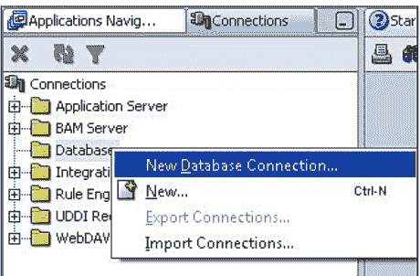

在 Create Database Connection Wizard 中单击 Next。在 Create Database Connection Type 窗口中，指定一个 Connection Name ——例如 MySQLConnection ——并将 Connection Type 设置为 Third Party JDBC Driver，因为我们将使用 MySQL 数据库，而 MySQL 对于 Oracle JDeveloper 来说是一个第三方数据库，然后单击 Next。如果要使用 Oracle 数据库配置连接，请选择 Oracle (JDBC) 作为 Connection Type，然后单击 Next。

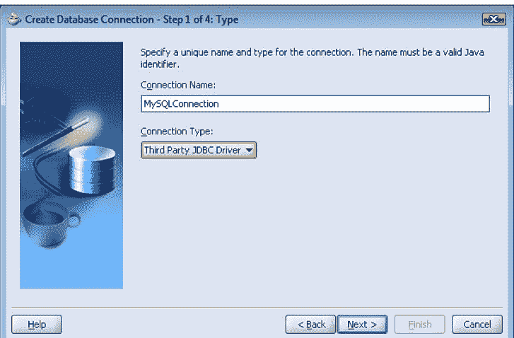

## 在 Oracle JDeveloper 中配置 JDBC

在 **身份验证** 窗口中将 **用户名** 指定为 **root**（**密码** 默认情况下对于 root 用户无需指定），然后单击 **下一步**。在 **连接** 窗口中，我们将指定连接参数，例如驱动程序名称和连接 URL；单击 **新建** 以指定 Driver Class。在 **注册 JDBC 驱动程序** 窗口中，将 Driver Class 指定为 com.mysql.jdbc.Driver，然后单击 **浏览** 以为 Driver Class 选择一个库。在 **选择库** 窗口中，单击 **新建** 为 MySQL Connector/J 5.1 JAR 文件创建一个新库。在 **创建库** 窗口中，将 Library Name 指定为 MySQL，然后单击 **添加条目** 为 MySQL 库添加一个 JAR 文件条目。在 **选择路径条目** 窗口中选择 mysql-connector-java-5.1.3-rc\mysql-connector-java-5.1.3-rc-bin.jar，然后单击 **选择**。在 **创建库** 窗口中，在 Class Path 条目添加到 MySQL 库后，单击 **确定**。在 **选择库** 窗口中，选择 MySQL 库，然后单击 **确定**。在 **注册 JDBC 驱动程序** 窗口中，MySQL 库在 Library 字段中指定，而 mysql-connector-java-5.1.3-rc\mysql-connector-java-5.1.3-rc-bin.jar 在 Classpath 字段中指定。现在，单击 **确定**。Driver Class、Library 和 Classpath 字段在 **连接** 窗口中被指定。将 URL 指定为 jdbc:mysql://localhost:3306/test，然后单击 **下一步**。

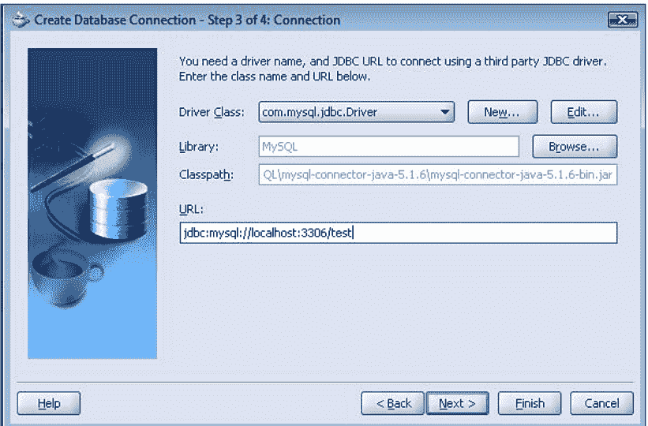

在 **测试** 窗口中单击 **测试连接** 以测试我们配置的连接。建立连接，并在 Status 文本区域输出成功消息。在 **测试** 窗口中单击 **完成**。一个连接配置 **MySQLConnection** 被添加到 **Connections** 导航器中。

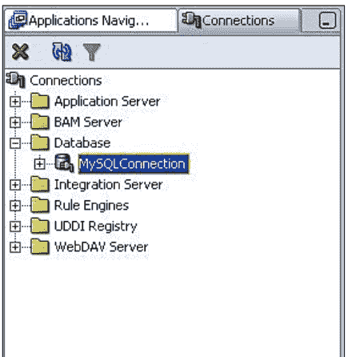

连接参数在结构视图中显示。要修改任何连接设置，请双击 **连接** 节点。**编辑数据库连接** 窗口显示。连接的 Username、Password、Driver Class 和 URL 可以在 Edit 窗口中修改。

## 在 Oracle JDeveloper 中配置 JDBC

在 Connections 导航器中配置的数据库连接在 OC4J 提供的 JNDI 命名服务中具有 JNDI 名称绑定。使用 JNDI 名称绑定，可以在 J2EE 应用程序中创建 DataSource 对象。要查看或修改 JDBC 连接的配置设置，请在 JDeveloper 中选择 Tools | Embedded OC4J Server Preferences。在显示的窗口中，选择 Global | Data Sources 节点，并为使用 Connections 导航器中定义的连接更新 data-sources.xml 文件，请单击 Refresh Now 按钮。可以选择复选框以在未定义时创建 data-source 元素，并更新现有 data-source 元素。

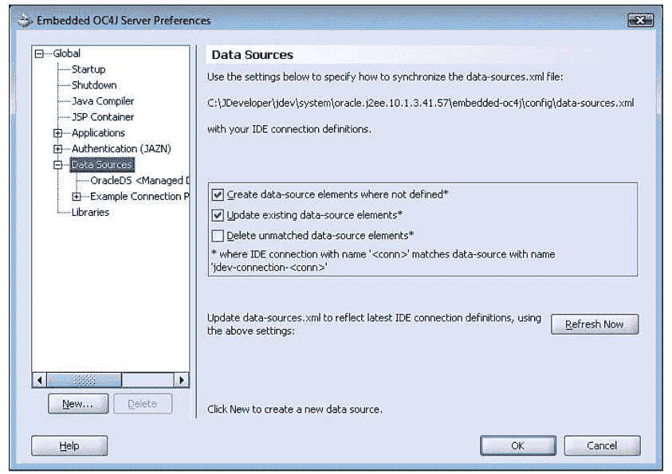

在 **Connections** 导航器中配置的连接关联的连接池和数据源被列出。选择 **jdev-connection-pool-MySQLConnection** 节点以将连接池属性列为 **属性集 A** 和 **属性集 B**。

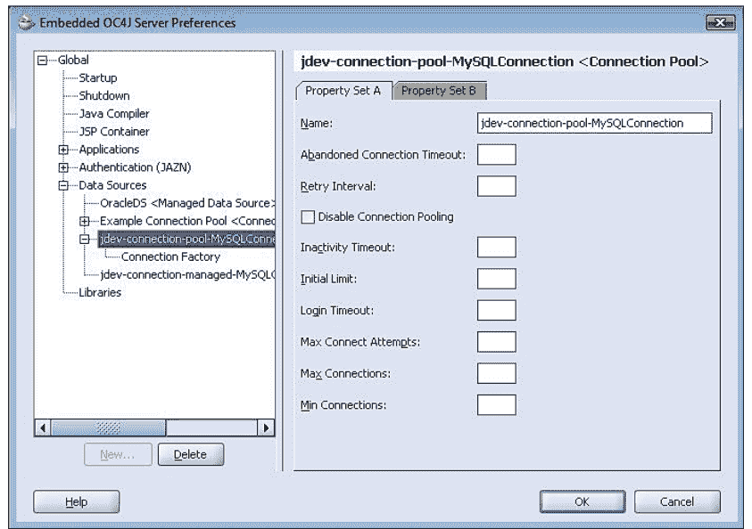

JDBC 连接池的调优属性可以在 **连接池** 窗口中设置。不同的调优属性列在下表中：

| 调优属性 | 属性描述 | 默认值 |
|---|---|---|
| Abandoned Connection Timeout | 用户获取的连接在非活动状态后经过的时间间隔（秒），之后该连接将被返回到缓存。 | -1 表示该功能未生效。 |
| Retry Interval | 失败的连接尝试在经过的时间间隔（秒）后重试。与 Max Connect Attempts 配合使用。 | 1 |
| Disable Connection Pooling | 指定是否禁用应用程序服务器的连接池。该属性可用，因为某些驱动程序在驱动程序内部提供连接池。 | False |
| Inactivity Timeout | 未使用的连接在非活动状态后被从池中移除的秒数。 | 非活动超时 |
| Initial Limit | 连接池中的初始连接数。如果值大于 0，则指定数量的连接会被预先创建并在连接缓存中可用，从而减少构建缓存到其最佳大小所需的时间。 | 0 |
| Login Timeout | 登录尝试在经过的秒数后超时。0 表示使用系统超时值。如果未定义系统超时，则登录尝试不会超时。 | 0 |
| Max Connect Attempts | 对数据库的最大连接尝试次数。与重试间隔配合使用。 | 3 |
| Max Connections | 连接池中可用的数据库连接的最大数量。0 或更小的值表示没有最大限制。 | 0 |
| Min Connections | 连接池中的数据库连接的最小数量。 | 0 |


Select **Property Set B** to specify additional connection pool properties.

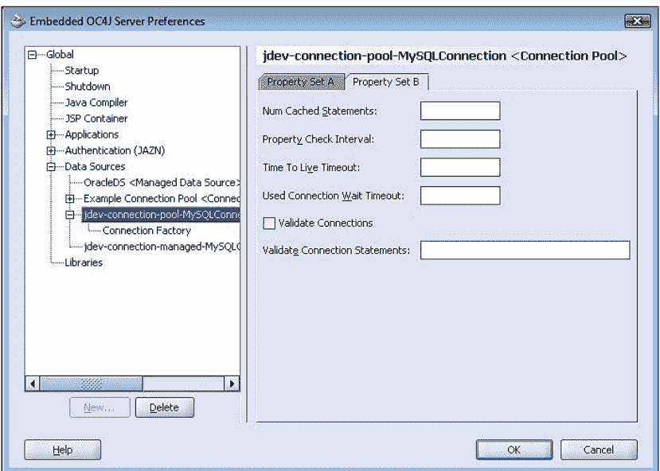

The connection pool properties in **Property Set B** are discussed in the following table:

| 属性 | 描述 | 默认值 |
|---|---|---|
| 缓存语句数 | Specifies the maximum number of prepared and callable statements that should be cached for each connection in each connection pool. Statement caching increases system performance. A value greater than 0 enables statement caching. | 0 |
| 属性检查间隔 | Specifies the time interval (seconds) after which property values are checked for new values, and time out limits are implemented. | 900 |
| 存活时间超时 | Specifies the maximum number of seconds a used connection may be active, after which it is closed and returned to the connection pool. -1 indicates that the feature is not enabled. | -1 |

## 在 Oracle JDeveloper 中配置 JDBC

| 属性 | 描述 | 默认值 |
|---|---|---|
| 已使用连接等待超时 | Number of seconds for which a used connection remains unused before being returned to the connection pool. Only applies if the maximum numbers of connections that a connection pool may cache have been acquired by clients, and a client requests a connection. | 60 |
| 验证连接 | Specifies if connections are to be validated, when given to a client. Used in conjunction with Validate Connection Statements. | False |
| 验证连接语句 | Specifies the SQL statements used to validate connections before being acquired by a client. | None |

The **Connection Factory** node specifies the Factory Class, User name, Password, Login Timeout, and connection URL. The factory class must implement one of the following interfaces: `java.sql.Driver`, `javax.sql.DataSource`, `javax.sql.ConnectionPoolDataSource`, `javax.sql.XADataSource`.

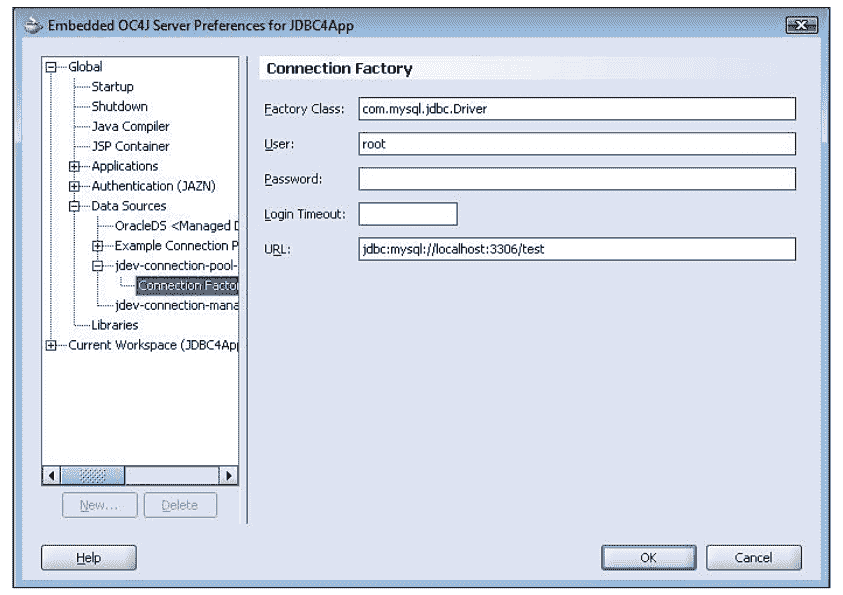

The **Managed DataSource** node specifies the managed data sources associated with the connection, and which are data sources managed by the OC4J. A managed data source is an OC4J implementation of the `javax.sql.DataSource` interface that wraps a JDBC driver class, or data source class. Even if the factory class does not implement the `javax.sql.DataSource` interface, the OC4J implementation of the factory class implements the `javax.sql.DataSource` interface. A managed data source supports connection caching, global transaction management, and error handling, all provided by the OC4J. A managed data source is associated with a connection pool, and thus has the advantage of being able to specify the tuning parameters. The **JNDI Name** of the data source is specified in the managed data source window. The **JNDI Name** is in the jdbc/MySQLConnectionDS format, with MySQLConnection being the connection name configured in the **Connections** navigator.

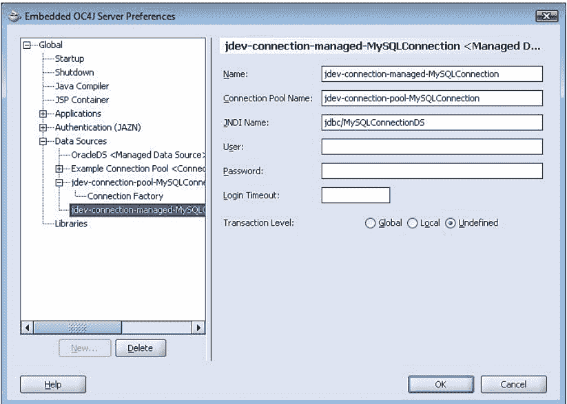

A connection MySQLConnection in the Connections navigator is available as a data source with the JNDI Name binding jdbc/MySQLConnectionDS. To obtain a connection from the data source, add a resource-ref element to the web application in which a connection is to be obtained. In a Servlet or JSP application, a connection may be obtained with the data source JNDI Name.

```
InitialContext initialContext = new InitialContext();
javax.sql.DataSource ds = (javax.sql.DataSource)
initialContext.lookup("java:comp/env/jdbc/MySQLConnectionDS");
java.sql.Connection conn = ds.getConnection();
```

JavaEE 5 defines annotations to support resource injection. Resource injection is the injection of external resources, such as a data source in a JEE 5 application using the javax.annotation.Resource annotation. JDeveloper 11 will support resource injection with annotations to obtain a handle of a data source. For example, define a catalogDS resource of the javax.sql.DataSource type, as shown below:

```
private @Resource DataSource catalogDS;
```

The catalogDS field of type javax.sql.DataSource is annotated with the @Resource annotation. JNDI lookup is not required with resource injection, and the DataSource resource is also not defined in the web.xml deployment descriptor.

## JDBC 配置错误

You might get errors while configuring a JDBC connection. If you are using MySQL, and the connection URL is incorrect, or the MySQL database is not running, the following error message is generated:

```
Communications link failure
```

If you are using Oracle database, some possible connection configuration errors are listed below:

```
IO exception: The Network Adapter could not establish the connection
IO exception: Connection refused
```

The Network Adapter could not establish the connection exception is caused by one or more of the following configuration errors:

- 1. The database host name, port number, or database instance name is wrong.
- 2. The database TNSListener has not been started. The TNSListener may be started with the lsnrctl utility.

```
C:\>lsnrctl start
```

The *Connection refused* exception is caused by one or more of the following configuration errors:

- 1. The database **SID** specified is incorrect.
- 2. The database instance has not been started. To start the database instance connect to SQL*Plus as SYSDBA.

```
C:\>sqlplus SYS/<pwd> AS SYSDBA
```

At the SQL prompt, start the database instance with the startup command.

```
SQL>startup
```

## 创建托管数据源

In the previous section, a JDBC connection was obtained in the **Connections** navigator. A corresponding JNDI managed data source becomes available for the **Connections** navigator connection. A data source object is configured with a JNDI Name binding in the OC4J server integrated with JDeveloper. A data source may also be configured in the **Embedded OC4J Server Preferences** window directly, or may be configured declaratively by modifying the `data-sources.xml` file. We will discuss each of these methods for creating a data source. A data source may be configured at the **Global** level or the Current Workspace level. A **Global** data source is available to all applications while a Current Workspace data source is available only in the current workspace. To create a new **Global** data source, select **Tools | Embedded OC4J Preferences** and select the **Global | Data Sources** node, and click on the **New** button.

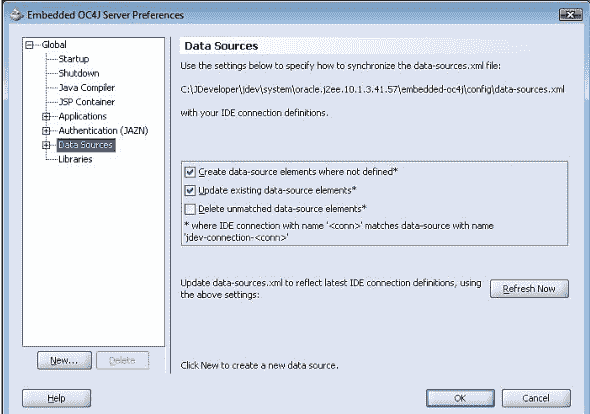

Before we are able to configure a managed data source, we need to configure a connection pool. In the **Create Data Source** window select **Transaction Level** as Connection Pool, specify a connection pool name, and click on the **OK** button.

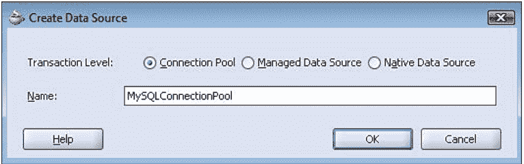

A new connection pool gets created and its tuning properties may be set, as required. In the **Connection Factory** window, specify a Factory Class, User name, Password, Login Timeout, and connection URL. The Factory Class is required to implement one of the following interfaces: `java.sql.Driver`, `javax.sql.DataSource`, `javax.sql.ConnectionPoolDataSource`, `javax.sql.XADataSource`. The **Factory Class** for a MySQL managed data source can be a MySQL class that implements the `javax.sql.DataSource` interface, for example the `com.mysql.jdbc.jdbc2.optional.MysqlDataSource` and `com.mysql.jdbc.jdbc2.optional.MysqlConnectionPoolDataSource` classes, or it can be a class that implements the `java.sql.Driver` interface, for example the `com.mysql.jdbc.Driver` class. Whether a class implementing the `java.sql.Driver` interface is used, or a class implementing the `javax.sql.DataSource` interface is used, the OC4J server wraps the class and provides an implementation of the `javax.sql.DataSource` interface. We will use the data source class **com.mysql.jdbc.jdbc2.optional.MysqlConnectionPoolDataSource**. A **Password** is not required for a root user, by default. Specify the connection **URL** as `jdbc:mysql://localhost:3306/test`. Click on **OK** to configure the connection pool.


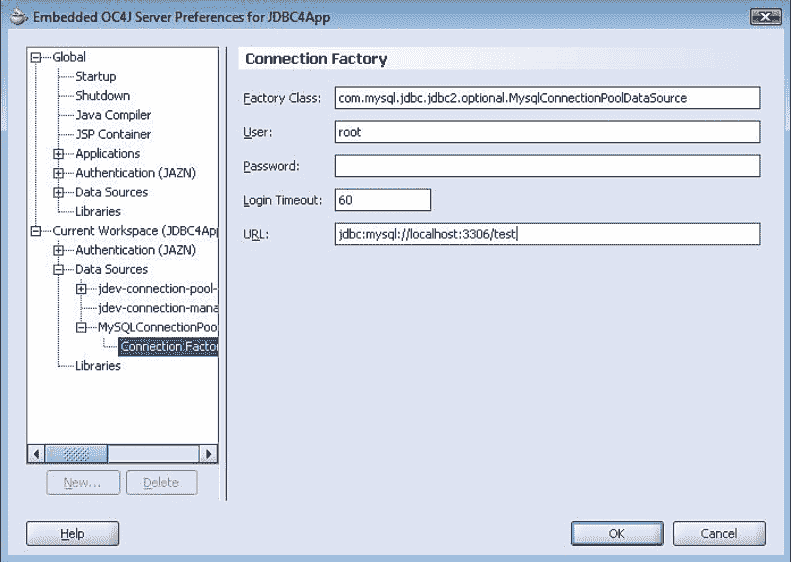

创建数据源，方法是选择 **全局 | 数据源** 节点，然后单击 **新建**，就像我们为创建连接池所做的那样。在 **创建数据源** 窗口中，将事务级别选择为受管数据源，指定数据源 **名称** 并单击 **确定**。数据源也可以配置为 **原生数据源**。受管数据源与原生数据源之间的区别在于 OC4J 服务器不会包装原生数据源。OC4J 服务器不会为原生数据源提供连接缓存。原生数据源不支持全局/分布式事务。分布式事务是指跨多个数据库服务器的事务。如果要配置原生数据源，请指定实现 `javax.sql.DataSource` 接口的数据源类。**连接池** 不应为原生数据源配置。

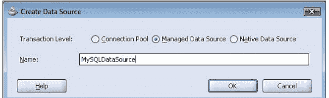

## 在 Oracle JDeveloper 中配置 JDBC

添加一个新的 **受管数据源**。指定数据源要关联的连接池名称为我们之前配置的 **连接池**。指定 JNDI 名称、用户名、密码、登录超时、事务级别，然后单击 **确定**。

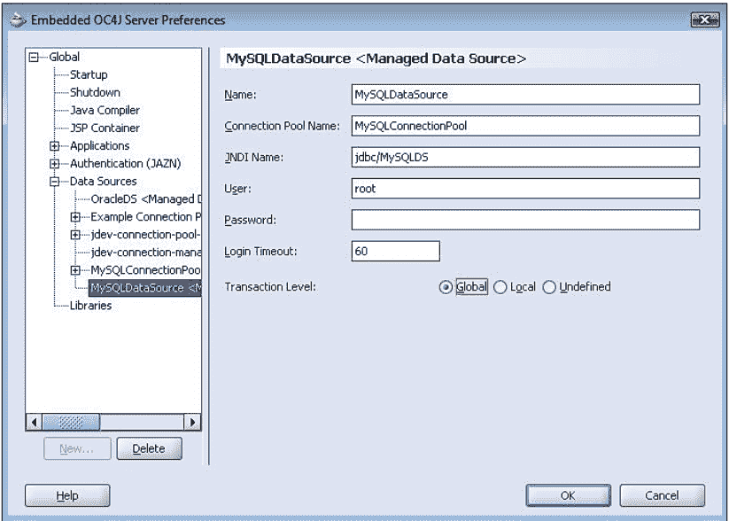

受管数据源 gets configured and updates the `data-sources.xml` file using the **刷新** button. 受管数据源也可以通过直接修改目录 `C:\JDeveloper\jdev\system\oracle.j2ee.10.1.3.nn.nn\embedded-oc4j\config` 中的 `data-sources.xml` 配置文件以声明方式创建。`<JDeveloper10.1.3>` 是 JDeveloper 安装的目录。向 `data-sources.xml` 文件添加一个 `managed-data-source` 元素以指定 `DataSource` 对象的配置。`managed-data-source` 元素包括用于获取 `DataSource` 对象的数据源类。用于配置数据源 `MySQLDataSource`、使用 `MySQL` 数据库、使用 `jndi-name jdbc/MySQLDataSource` 的 `managed-data-source` 元素如下所示：

```
<managed-data-source name='MySQLDataSource'
connection-pool-name='MySQL Connection Pool'
jndi-name='jdbc/MySQLDataSource'/>
<connection-pool name='MySQL Connection Pool'>
<connection-factory factory-class='com.mysql.jdbc.jdbc2.optional.MysqlConnectionPoolDataSource'
user='root'
password=''
url="jdbc:mysql://localhost:3306/test">
</connection-factory>
</connection-pool>
```

`data-sources.xml` 文件中的元素基于 XML Schema http://www.oracle.com/technology/oracleas/schema/data-sources-10_1.xsd。根元素是 data-sources，data-sources 元素有一个或多个 managed-data-source、connection-pool 和 native-data-source 元素。managed-data-source 元素具有以下属性：name、user、password、login-timeout、tx-level、schema、connection-pool-name 和 jndi-name。每个 managed-data-source 元素都与一个连接池关联，该连接池在 connection-pool 元素中指定。connection-pool 元素具有 connection-factory 子元素和属性，这些属性在以下表格中讨论：

| 元素 | 描述 | 默认值 |
|---|---|---|
| name | 连接池名称。 | -1 |
| min-connections | 连接池中的最小连接数。 | 0 |
| max-connections | 连接池中打开连接的最大数量。值为 0 或更小表示没有最大限制。 | 0 |
| initial-limit | 创建或重新初始化连接池时的初始连接数。指定连接池的初始大小可减少达到最佳大小的启动时间。 | 0 |
| used-connection-wait-timeout | 当连接池达到最大连接数且池中所有连接都在使用时，连接池会等待指定时间以供客户端释放连接回连接池。 | 60 |
| inactivity-timeout | 当连接池中的连接非活动时间达到非活动超时期限（以秒为单位）时，该连接将被移除。 | 60 |
| login-timeout | 指定数据源等待建立与数据库连接的时间（以秒为单位）。值为 0 表示默认系统超时。 | 0 |
| connection-retry-interval | 指定在重试与数据库连接之前等待的时间间隔（以秒为单位）。 | 1 |
| max-connect-attempts | 指定重试连接到数据库的次数。 | 3 |
| validate-connection | 如果设置为 true，则在将连接提供给客户端时，使用 validate-connection-statement 属性指定的 SQL 语句验证与数据库的连接。 | False |
| validate-connection-statement | 当连接从连接池提供给客户端时运行的语句。 | None |
| num-cached-statements | 指定为连接缓存的语句的最大数量。值大于 0 可启用语句缓存。 | 0 |
| time-to-live-timeout | 默认情况下未启用，此元素指定已使用连接在关闭并返回连接池之前可保持活动状态的最长时间（以秒为单位）。当连接关闭时，语句句柄也会关闭。 | -1 |
| abandoned-connection-timeout | 仅在 Oracle 数据库中受支持且默认情况下未启用，此元素指定已使用连接的非活动超时。 | -1 |
| disable-server-connection-pooling | 禁用应用服务器的连接池。该元素与在驱动程序内部支持连接池的 JDBC 驱动程序一起使用。使用隐式连接缓存的 Oracle JDBC 驱动程序时，其值不使用。 | False |
| property-check-interval | 仅与 Oracle 数据库一起使用。此元素指定在应用超时之前的时间间隔（以秒为单位）。 | 900 |
| lower-threshold-limit | 连接限制的下限阈值。默认为 20%。 | 20% |

如果使用原生数据源，则连接缓存主要以编程方式执行。OracleDataSource 使用方法 getConnectionCacheName()、setConnectionCacheName(String cacheName)、getConnectionCacheProperties() 和 setConnectionCacheProperties(java.util.Properties cp) 提供连接缓存。或者，可以使用连接缓存管理器类 OracleConnectionCacheManager 来指定连接缓存。OracleConnectionCacheManager 类提供 getCacheManagerInstance()、createCache(String cacheName, javax.sql.DataSource ds, Properties cacheProperties)、

`createCache(javax.sql.DataSource ds, Properties cacheProperties)`、`removeCache(String cacheName, int mode)`、`refreshCache(String cacheName, int mode)` 和 `getCacheProperties(String cacheName)` 方法来配置连接缓存。对于原生数据源，还可以在 `data-sources.xml` 文件中的 `native-data-source` 元素中使用 `property` 元素以声明方式指定连接缓存。可以在原生数据源中指定的连接缓存属性在以下表格中讨论：

| 连接缓存属性 | 类型 | 描述 |
|---|---|---|
| connectionCacheName | String | 缓存名称。 |
| connectionCachingEnabled | Boolean | 指定是否启用隐式连接缓存。 |
| fastConnectionFailoverEnabled | Boolean | 指定是否启用快速连接故障转移。要启用快速连接故障转移，还应启用隐式连接缓存。快速连接故障转移提供连接缓存中可用连接的负载均衡。此外，使用快速连接故障转移时，无效连接将被关闭。 |

受管数据源是首选数据源，因为连接池由 OC4J 服务器实现，开发人员无需实现连接池。在下一节中，我们将开发一个 Web 应用程序以从 MySQL 数据库检索数据。删除本节中配置的受管数据源 MySQLDataSource 和连接池 MySQLConnectionPool，方法是选择 **工具 | 嵌入式 OC4J 服务器首选项** 窗口中的受管数据源/连接池，然后选择 **删除** 按钮。使用 **立即刷新** 按钮更新 `data-sources.xml` 配置文件

## 从 Web 应用程序连接数据库

如果使用 Java 应用程序连接数据库，可以使用 `DriverManager` 类的 `getConnection()` 方法获取 JDBC 连接。如果要在 Web 应用程序中获取 JDBC 连接，则必须在应用程序服务器中配置具有 JNDI 命名服务绑定的数据源，例如嵌入在 JDeveloper IDE 中的 OC4J。配置在 `data-sources.xml` 中的数据源对象可在 JDeveloper 中的 Servlet 或 JSP 中使用。在本节中，我们将使用上一节中配置的受管数据源连接到 MySQL 数据库。首先，我们需要在 JDeveloper 中使用 **文件 | 新建** 创建一个项目。在 **新建库** 窗口中，在类别中选择 **常规 | 应用程序**，并在


项目并点击 **确定**。在 **创建应用程序** 窗口中指定应用程序名称并点击 **确定** 按钮。在 **创建项目** 窗口中指定项目名称并点击 **确定** 按钮。一个新项目将被添加到应用程序导航器中。

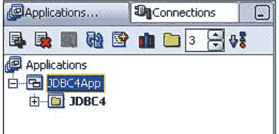

在 **应用程序导航器** 窗口中右键单击项目节点并选择 **新建**。在 **新建库** 窗口中，在类别中选择 **Web Tier | JSP**，在项目中选择 **JSP**，然后点击 **确定**。

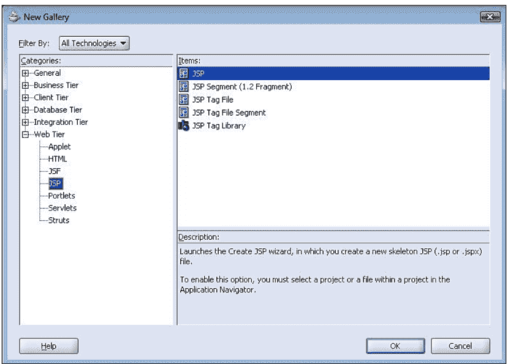

**创建 JSP 向导** 开始。在 **Web 应用程序** 窗口中，选择 J2EE 1.4 作为 J2EE 版本并点击 **下一步**。在 **JSP 文件** 窗口中，指定文件名并点击 **下一步**。

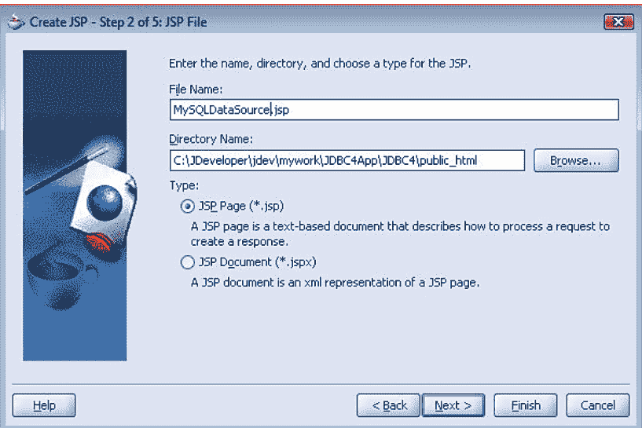

如果不使用错误页面来处理未处理的异常，请在 **错误页面选项** 窗口中选择默认设置。如果要使用错误页面来处理未处理的异常，请选择 **使用错误页面** 并点击 **下一步** 按钮。由于本章中不会使用任何标记库，请在 **标记库** 窗口中选择默认设置，然后点击 **下一步**。在 **HTML 选项** 窗口中选择默认设置，HTML 版本为 4.0.1 Transitional，然后点击 **下一步**。

## Configuring JDBC in Oracle JDeveloper

在完成窗口中点击完成后，一个 JSP 将被添加到项目中。在 web.xml 文件中，为托管数据源添加 resource-ref 元素。

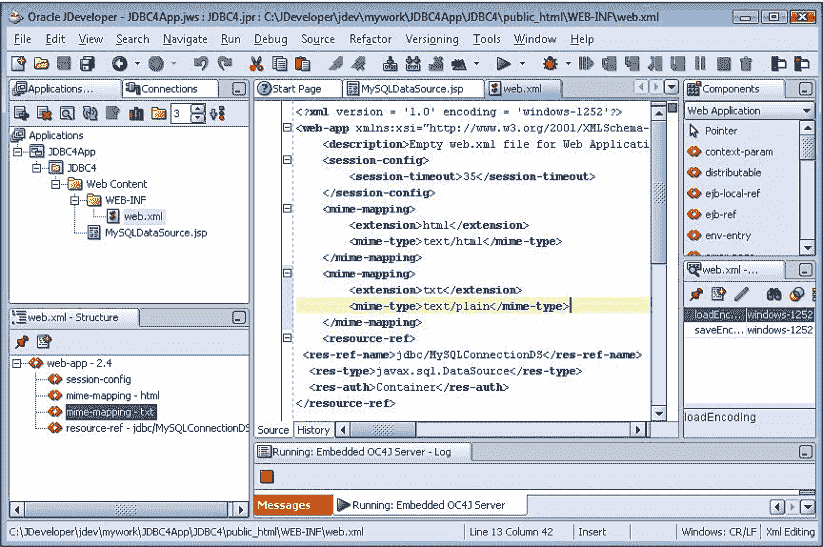

res-ref-name 指定托管数据源的 JNDI 名称。resource-ref 元素如下所示：

```
<resource-ref>
  <res-ref-name>jdbc/MySQLConnectionDS</res-ref-name>
  <res-type>javax.sql.DataSource</res-type>
  <res-auth>Container</res-auth>
</resource-ref>
```

我们还需要将 mysql-connector-java-5.1.3-rc-bin.jar 复制到 C:\JDeveloper\j2ee\home\applib 目录，这将把 MySQL Connector/J JDBC 4.0 驱动程序添加到 Web 应用程序的运行时类路径中。

## Setting J2SE Version to JDK 6.0

JDBC 4.0 驱动程序需要 JDK 6.0。因此，我们必须将 JDBC4 项目的 J2SE 版本设置为 J2SE 6.0。在应用程序导航器中选择项目节点并选择 Tools | Project Properties。在项目属性窗口中，选择库节点。点击 J2SE 版本字段的更改按钮。在编辑 J2SE 定义窗口中，点击新建。

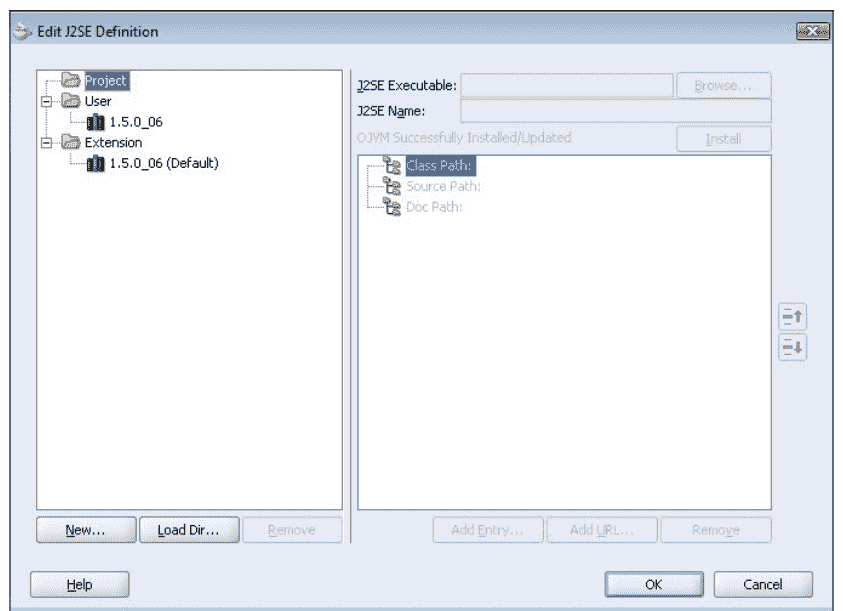

在创建 J2SE 窗口中，点击浏览以选择 JDK 6.0 java.exe 可执行文件。指定 J2SE 名称，然后点击确定。一个新的 J2SE 定义将在编辑 J2SE 定义窗口中创建。选择 J2SE6.0 定义并点击确定。

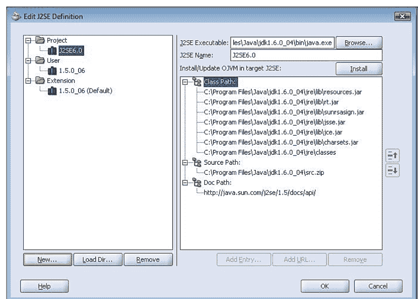

在项目属性窗口中点击确定。

## Developing and Running JSP

接下来，我们将使用上一节中配置的托管数据源，在 MySQLDataSource JSP 中获取 JDBC 连接。嵌入在 JDeveloper 10.1.3 中的 OC4J 服务器不支持 JDBC 4.0。因此，我们将无法在 Web 应用程序中使用 JDBC 4.0 功能。大多数 J2EE 应用服务器，如 WebLogic 服务器、JBoss 服务器和 WebSphere 服务器都不支持 JDBC 4.0。Sun Java System Application Server 9.1 是唯一支持 JDBC 4.0 的应用服务器。

然而，我们将使用 JDBC 4.0 驱动程序，并且 JDBC 4.0 功能可与支持 JDBC 4.0 的应用服务器一起使用。将 MySQL JDBC 4.0 JAR 文件复制到 <JDeveloper>\j2ee\home\applib 目录，<JDeveloper> 为
JDeveloper 安装目录。开发人员使用 JDBC 4.0 所需的全部条件是一个支持 JDBC 4.0 驱动程序的应用服务器。在 MySQLDataSource JSP 中，从我们之前配置的托管数据源创建 DataSource 对象。首先，我们必须创建一个 InitialContext 对象，然后使用 lookup() 方法创建一个 javax.sql.DataSource 对象，以查找数据源资源，该资源在 web.xml 文件中作为外部资源使用 resource-ref 元素指定。我们必须将 JNDI 名称 jdbc/MySQLDS 前缀为 JNDI 上下文 java:comp/env。有关 JNDI 命名教程，请参阅 JNDI 教程：http://java.sun.com/products/jndi/tutorial/。

```
InitialContext initialContext = new InitialContext();
javax.sql.DataSource ds = (javax.sql.DataSource) initialContext.
lookup("java:comp/env/jdbc/MySQLConnectionDS");
```

使用 getConnection() 方法从 DataSource 对象获取 JDBC 连接。

```
java.sql.Connection connection = ds.getConnection();
```

运行 SQL 查询并从查询的结果集创建 HTML 表格。使用 createStatement() 方法从 Connection 对象创建 Statement 对象。使用 Statement 对象的 executeQuery() 方法运行 SQL 查询。遍历结果集并从结果集行中检索列值，以创建 HTML 表格。使用 close() 方法关闭 ResultSet 对象、Statement 对象和 Connection 对象，该方法为这些接口中的每一个定义。MySQLDataSource.jsp 如下所示：

```
<%@ page contentType="text/html;charset=windows-1252"%>
<%@ page language="java" import="java.sql.*, javax.naming.*, javax.sql.*" %>
<%
InitialContext initialContext = new InitialContext();
javax.sql.DataSource ds = (javax.sql.DataSource)
initialContext.lookup("java:comp/env/jdbc/MySQLDS");
java.sql.Connection connection = ds.getConnection();
Statement stmt=connection.createStatement();
ResultSet resultSet=stmt.executeQuery("Select * from Catalog");
%>
<table border="1" cellspacing="0">
<tr>
<th>CatalogId</th>
<th>Journal</th>
<th>Publisher</th>
<th>Edition</th>
<th>Title</th>
<th>Author</th>
</tr>
<%
while (resultSet.next())
{
%>
<tr>
<td><%=out.println(resultSet.getString(1));%></td>
<td><%=out.println(resultSet.getString(2));%></td>
<td><%=out.println(resultSet.getString(3));%></td>
<td><%=out.println(resultSet.getString(4));%></td>
<td><%=out.println(resultSet.getString(5));%></td>
<td><%=out.println(resultSet.getString(6));%></td>
</tr>
<%
}
%>
</table>
<%
resultSet.close();
stmt.close();
if(!connection.isClosed())
connection.close();
%>
```

通过在 **应用程序导航器** 中右键单击 JSP 节点并选择 **运行** 来运行 JSP。

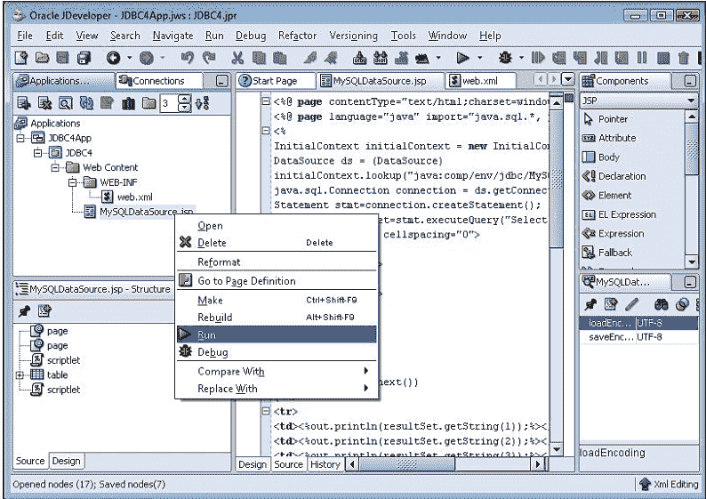

JSP 的输出在默认浏览器中显示：

| CatalogId | Journal | Publisher | Edition | Title | Author |
|---|---|---|---|---|---|
| catalog1 | Oracle Magazine | Oracle Publishing | Nov-Dec 2004 | Database Resource Manager | Kimberly Floss |
| catalog2 | Oracle Magazine | Oracle Publishing | Nov-Dec 2004 | From ADF UIX to JSF | Jonas Jacobi |

## JDBC 4.0 Version

嵌入在 JDeveloper 10g 中的 OC4J 不支持 JDBC 4.0。当为 JDBC 4.0 添加支持时，JDBC 4.0 的功能可以添加到我们在上一节中开发的 JSP Web 应用程序中。在 Connection 对象上设置客户端信息属性的能力是 JDBC 4.0 中的新功能。客户端信息属性可以使用 Connection 对象的 setClientInfoProperty() 方法设置。按如下方式设置客户端信息属性 ApplicationName、ClientUser 和 ClientHostname：

```
connection.setClientInfo("ApplicationName","DataDirectApp");
connection.setClientInfo("ClientUser","DataDirect");
connection.setClientInfo("ClientHostname","DataDirectHost");
```

如果数据库支持语句缓存，我们可以将语句池设置为 true。要了解数据库是否支持语句池，请创建 DatabaseMetaData 对象。使用 supportsStatementPooling() 方法测试数据库是否支持语句池。如果数据库支持语句池，请使用 isPoolable() 方法检查 Statement 是否可池化。如果 Statement 对象可池化，请使用 setPoolable() 方法将 Statement 对象设置为可池化：

```
DatabaseMetaData metaData=connection.getMetaData();
if(metaData.supportsStatementPooling())
{
    if(stmt.isPoolable())
    stmt.setPoolable(true);
}
```


我们可以使用对包装器模式的支持，其中使用了 `Wrapper` 接口，而 `Statement` 接口扩展了它。Oracle 对 JDBC API 的扩展提供了 `OracleStatement` 接口，该接口扩展了 `Statement` 接口。使用包装器模式创建一个 `OracleStatement` 类型的对象。首先，我们需要使用 `isWrapperFor()` 方法检查 `Statement` 对象是否为 `oracle.jdbc.OracleStatement` 的包装器。随后，使用 `unwrap()` 方法创建一个 `OracleStatement` 类型的对象：

```
OracleStatement oracleStmt=null;
Class class = Class.forName("oracle.jdbc.OracleStatement");
if(stmt.isWrapperFor(class))
{
    oracleStmt = (OracleStatement)stmt.unwrap(class);
}
```

`OracleStatement` 对象可用于使用 `defineColumnType()` 方法为从数据库获取的不同列设置列类型。此外，还可以使用 `setRowPrefetch()` 方法设置预取的行数。

如果数据库支持 SQL 类型的 `ROWID`，我们可以在结果集中为行的 `ROWID` 值添加一列。`ROWID` 列值可使用 `getRowId()` 方法作为 `java.sql.RowId` 对象检索。Oracle 数据库 10g 支持 `ROWID` 数据类型。因此，修改 `SELECT` 查询以添加 `ROWID` 伪列的列。

```
ResultSet resultSet= oracleStmt.executeQuery("Select ROWID, CATALOGID, JOURNAL, PUBLISHER, EDITION, TITLE, AUTHOR from Catalog");
```

我们还必须向从结果集创建的 HTML 表格添加一个类型为 `ROWID` 的列。`ROWID` 列值可使用 `getRowId()` 方法从 `ResultSet` 对象检索。`RowId` 对象可使用 `toString()` 方法转换为 `String` 值：

```
<%out.println(resultSet.getRowId("ROWID").toString());%>
```

JSP Web 应用程序中可以使用 `SQLException` 接口中对链式异常的增强支持。我们需要在 `input.jsp` 中指定 `errorPage` 以进行错误处理：

```
<%@ page errorPage="errorpage.jsp" %>
```

在 `errorpage.jsp` 中，使用增强的 **for-each 循环** 来检索链式异常和链式原因。

```
<%@ page isErrorPage="true" %>
<%
    for( Throwable e : exception )
{
    out.println("Error encountered: " + e);
}
%>
```

下面列出了 input.jsp 的 JDBC 4.0 版本，当在 OC4J 服务器中添加对 JDBC 4.0 的支持时，该版本可在 JDeveloper 中运行：

```
<%@ page contentType="text/html;charset=windows-1252"%>
<%@ page language="java" import="java.sql.*, javax.naming.*, javax.sql.*,oracle.jdbc.*" %>
<%@ page errorPage="errorpage.jsp" %>
<%
InitialContext initialContext = new InitialContext();
DataSource ds = (DataSource)
initialContext.lookup("java:comp/env/jdbc/OracleDS");
java.sql.Connection connection = ds.getConnection();
connection.setClientInfo("ApplicationName","DataDirectApp");
connection.setClientInfo("ClientUser","DataDirect");
connection.setClientInfo("ClientHostname","DataDirectHost");
Statement stmt=connection.createStatement();
DatabaseMetaData metaData=connection.getMetaData();
if(metaData.supportsStatementPooling())
{
    if(stmt.isPoolable())
    stmt.setPoolable(true);
}
OracleStatement oracleStmt=null;
Class class = Class.forName("oracle.jdbc.OracleStatement");
if(stmt.isWrapperFor(class))
{
    oracleStmt = (OracleStatement)stmt.unwrap(class);
    oracleStmt.defineColumnType(1, OracleTypes.VARCHAR);
    oracleStmt.defineColumnType(2, OracleTypes.VARCHAR);
    oracleStmt.defineColumnType(3, OracleTypes.VARCHAR);
    oracleStmt.defineColumnType(4, OracleTypes.VARCHAR);
    oracleStmt.defineColumnType(5, OracleTypes.VARCHAR);
    oracleStmt.defineColumnType(6, OracleTypes.VARCHAR);
    oracleStmt.defineColumnType(7, OracleTypes.VARCHAR);
    oracleStmt.setRowPrefetch(2);
}
ResultSet resultSet=oracleStmt.executeQuery("Select ROWID, CATALOGID, JOURNAL, PUBLISHER, EDITION, TITLE, AUTHOR from Catalog");
%>
<table border="1" cellspacing="0">
<tr>
<th>Row Id</th>
<th>Catalog Id</th>
<th>Journal</th>
<th>Publisher</th>
<th>Edition</th>
<th>Title</th>
<th>Author</th>
</tr>
<%
while (resultSet.next())
{
%>
<tr>
<td><%=out.println(resultSet.getRowId("ROWID").toString());%></td>
<td><%=out.println(resultSet.getString(1));%></td>
<td><%=out.println(resultSet.getString(2));%></td>
<td><%=out.println(resultSet.getString(3));%></td>
<td><%=out.println(resultSet.getString(4));%></td>
<td><%=out.println(resultSet.getString(5));%></td>
<td><%=out.println(resultSet.getString(6));%></td>
</tr>
<%
}
%>
</table>
<%
resultSet.close();
oracleStmt.close();
if(!connection.isClosed())
connection.close();
%>
```

## 摘要

JDeveloper IDE 提供了内置的 **Connections** 导航器，用于配置与任何可用 JDBC 驱动程序的关系数据库的连接。在 **Connections** 导航器中配置的连接也可作为数据源使用。在本章中，我们使用 MySQL Connector/J 5.1 JDBC 4.0 驱动程序在 JDeveloper 中配置了与 MySQL 数据库的 JDBC 连接。我们还在嵌入 JDeveloper 的 OC4J 中创建了一个托管数据源，并在 Web 应用程序中使用了该数据源。随后，我们讨论了 Web 应用程序的 JDBC 4.0 版本。
