## 3 使用 JSTL SQL 标签库连接数据库

JSP 1.1 和之后的 JSP 版本支持称为自定义操作的<|message|> 可重用模块。自定义操作在 JSP 页面中通过自定义标签调用。自定义标签的集合称为标签库。用于访问数据库的各种 SQL 标签库可用。JavaServer Pages 标准标签库（JSTL）是一个标签库，提供用于访问数据库的 SQL 标签。JSTL 1.1 要求 JSP 容器支持 Servlet 规范 2.4 和 JSP 规范 2.0。在本章中，我们将讨论 JSTL SQL 标签库，并在支持 Servlet 2.4 和 JSP 2.0 规范的嵌入式 OC4J 的 JDeveloper 10.1.3 中开发 JSTL SQL 标签库应用程序。JSTL SQL 标签库是在 JDBC 4.0 规范可用之前创建的。如果您使用 JDK 6.0 中的 JDBC 4.0 驱动程序，您仍然可以使用 JSTL SQL 标签库。我们将使用 JDBC 4.0 和 JDK 6.0 使用 JSTL SQL 标签库访问 Oracle 数据库。首先，让我们讨论 JSTL SQL 标签库标签。

## JSTL SQL 和核心标签概述

JSTL SQL 标签库提供各种用于访问数据库、创建数据库表、更新、删除和查询数据库的标签。SQL 标签库 URI 为：http://java.sun.com/jsp/jstl/sql。在 JSP 页面中包含 JSTL SQL 标签库的语法如下所示的 taglib 指令。URI 用于为标签库定义命名空间，这避免了如果在同一 JSP 页面上使用具有相似标签名称的另一个标签库可能发生的冲突。

```
<%@ taglib prefix="sql" uri=" http://java.sun.com/jsp/jstl/sql" %>
```

JSTL SQL 标签库中的不同标签在下表中讨论。表中所有标签属性的类型均为 java.lang.String，除非指定为其他类型。属性不是必需的，除非指定为必需。

| 标签名称 | 描述 | 属性 |
|---|---|---|
| transaction | 创建一个事务，在其中运行一组 SQL 语句。为 sql:query 和 sql:update 子标签建立事务上下文。sql:transaction 标签内的 sql:query 和 sql:update 标签不得指定 dataSource 属性。sql:transaction 标签通过调用 commit() 或 rollback() 方法提交或回滚（如果发生事务）事务。 | dataSource- 指定数据源，可以是 JNDI 资源的相关路径，或 DriverManager 类的 JDBC 参数。JDBC 参数为驱动类、连接 URL、用户名和密码。isolation- 指定事务隔离级别。隔离级别值可以是 "read_committed"、"read_uncommitted"、"repeatable_read" 或 "serializable"。隔离级别值已在第 1 章中讨论。默认值为数据源的隔离级别。 |
| query | 运行 SQL 查询。SQL 查询可在 sql 属性中指定，或在 query 元素中指定。如果指定了 dataSource，则 query 标签不应位于 transaction 标签内。查询结果存储在作用域变量 var 中。如果查询未产生结果，则返回空的 Result 对象。查询语句可能包含参数标记 ("?")，用于标识 PreparedStatement 参数。结果集中行的顺序可能因 RDBMS 实现而异，除非指定了 ORDER BY 子句。如果在 transaction 标签中指定了 query 标签，则 Connection 对象从 transaction 标签获取。 | var(required)- 查询的作用域变量。Var 的类型为 javax.servlet.jsp.jstl.sql.Result。scope- 变量的作用域。作用域可以是 "page"、"request"、"session" 或 "application"。sql- SQL 查询语句 dataSource- 与查询关联的数据源。数据源可以是 JNDI 资源的相关路径，或 DriverManager 类的 JDBC 参数。startRow- 指定查询返回的 Result 的起始行。默认值为 '0'，也是原始结果集起始行的索引。maxRows- 查询结果集中的最大行数。默认包含所有行。值应为 >-1。值为 -1 也包含所有行。 |


| 标签名称 | 描述 | 属性 |
|---|---|---|
| update | 运行一条 SQL 语句。SQL 语句可在 sql 属性中指定或在 update 元素标签内指定。SQL 语句可以是 CREATE、UPDATE、INSERT 或 DELETE 语句。也可以运行 SQL DDL 语句。update 语句可能包含参数标记（"?"），用于标识 PreparedStatement 参数，其值使用包含的 sql:param 或 sql:dataParam 标签指定。如果指定了 scope，则也必须指定 var。如果指定了 dataSource，则 sql:update 标签不应在 sql:transaction 标签内指定。如果 sql:update 标签在 sql:transaction 标签中指定，则 Connection 对象从 sql:transaction 标签获取。 | var- SQL 语句结果的范围变量，即 UPDATE、DELETE、INSERT 语句的更新计数。var 属性为 Integer 类型。 scope- 变量的作用域。 sql- SQL 语句，可以是 CREATE、UPDATE、INSERT 或 DELETE 语句。 dataSource- 与更新语句关联的数据源。数据源是 JNDI 资源的相关路径或 DriverManager 类的 JDBC 参数。 |
| param | 使用 sql:query 和 sql:update 标签的子标签指定 SQL 语句中参数标记（"?"）的值。参数按指定的顺序替换。如果值为 null，则参数设置为 SQL NULL 值。 | value- 参数值。 |
| dateParam | 使用 sql:query 或 sql:update 标签的子标签为 java.util.Date 类型参数设置 SQL 语句中参数标记（"?"）的值。 | value- DATE、TIME 或 TIMESTAMP 数据库的参数值。 type- "date"、"time" 或 "timestamp"。如果值为 null，则值设置为 SQL NULL。 |

| 标签名称 | 描述 | 属性 |
|---|---|---|
| setDataSource | 创建并导出数据源作为范围变量以在 JSP 页面中使用。 | var- 数据源的范围变量，可以是 JNDI 资源的相关路径，或 DriverManager 类的 JDBC 参数。var 为 String 或 DataSource 类型。 scope- 变量的作用域。 dataSource- 数据源。JNDI 资源的相关路径，或 DriverManager 的 JDBC 参数 url- 数据库连接 URL。 user- 用户名。 password- 密码。 |

我们还将使用一些 JSTL Core 1.1 标签库标签。JSTL Core 1.1 标签库提供用于表达式求值、循环、条件求值、导入基于 URL 的资源以及输出表达式求值结果的标签。使用 JSTL Core 1.1 标签需要对表达式语言（EL- http://www.oracle.com/technology/sample_code/tutorials/jsp20/simpleel.html）有一定的熟悉程度。JSTL Core 1.1 标签库标签在下表中讨论。属性不是必需的，除非指定为必需。

| 标签 | 描述 | 属性 |
|---|---|---|
| catch | 捕获由其任何包含操作抛出的 java.lang. Throwable。 | var (String)- 表示被包含操作抛出的异常的范围变量。 |
| choose | 指定由 <when> 和 <otherwise> 标记的操作的互斥条件执行的上下文。 | 无。 |
| forEach | 遍历对象集合。 | test (boolean)- 指定内容求值测试条件的必需属性。 var (java.lang.String)- 测试条件结果值的导出的变量名。 scope (java.lang.String)- 变量的作用域。 |

| 标签 | 描述 | 属性 |
|---|---|---|
| forTokens | 遍历标记。 | items (java.lang.String)- 指定要遍历的标记的必需属性。 delims (java.lang.String)- 指定分隔标记的分隔符的必需属性。 begin (int)- 指定迭代开始的索引。第一个标记的索引为 0。 end (int)- 指定迭代结束的索引。 step (int)- 获取下一个标记的步长值。 var (String)- 当前迭代项的导出的范围变量名。 varStatus (String)- 迭代状态的导出的范围变量名。 |
| if | 如果表达式求值为 true 则求值内容。 | test (Boolean)- 指定测试条件的必需属性。 var (String)- 测试条件下结果值的导出的范围变量名。 scope (String)- 变量的作用域。 |
| import | 导入基于 URL 的资源的内容。 | 所有属性均为 String 类型。 url- 指定要导入的资源 URL 的必需属性。 var- 资源内容的导出的范围变量名。 scope- 变量的作用域。 varReader- 与 var 相同，但为 Reader 类型。 context- 相对 URL 的上下文名称。 charEncoding- URL 资源内容的字符编码。 |

| 标签 | 描述 | 属性 |
|---|---|---|
| otherwise | 指定 <c:choose> 操作中的最后一种替代方案。 | 无。 |
| out | 求值表达式并输出结果。 | 所有属性均为 String 类型。 value- 指定要求值的表达式的必需属性。 default- 结果值为 null 时的默认值。 escapeXml- 指定结果字符串中的字符 <、>、&、'、" 是否应转换为对应的字符实体代码。 |
| param | 向包含 URL 的 import 标签添加参数。 | name- 指定查询字符串参数名称的必需属性。 value- 参数值。 |
| redirect | 重定向到新的 URL。 | 所有属性均为 String 类型。 url- 重定向到资源的 URL。 context- 重定向到相对 URL 时的上下文名称。 |
| remove | 删除范围变量。 | 所有属性均为 String 类型。 var- 指定要删除的范围变量名称的必需属性。 scope- 变量的作用域。 |
| set | 将表达式求值的结果设置为目标对象的属性。 | 所有属性均为 String 类型。 var- 包含表达式求值结果值的导出的范围变量名。 value- 要求值的表达式。 target- 其值将被设置的目标对象。 property- 要设置的目标对象中的属性。 scope- 变量的作用域。 |

| 标签 | 描述 | 属性 |
|---|---|---|
| url | 使用可选查询参数创建 URL。 | 所有属性均为 String 类型。 var- 处理后 URL 的导出的范围变量名。 scope- 变量的作用域。 value- 要处理的 URL。 context- 相对 URL 的上下文。 |
| when | 如果测试条件求值为 true，则会被求值的子标签。 | test (boolean)- 指定测试条件的必需属性。 |

## 设置环境

从以下地址下载 JDeveloper 10.1.3：http://www.oracle.com/technology/software/products/jdev/index.html。将 JDeveloper zip 文件解压到一个目录，该目录安装 JDeveloper IDE。下载 Oracle 数据库。安装 Oracle 数据库包括示例模式。我们需要将 Oracle 数据库 11g JDBC 驱动程序 JAR 文件 ojdbc6.jar（用于 JDBC 4.0）复制到 C:\JDeveloper\j2ee\home\applib 目录。保留 JDBC JAR 文件的副本并将其从 C:\JDeveloper\jdbc\lib 目录中删除。运行 JSTL 应用程序后，将已删除的 JDBC JAR 文件复制回目录。我们还需要将 J2SE 版本设置为 JDK 6.0，如第 2 章所述。在 JDeveloper 中，为 JSTL SQL 标签库创建一个项目。选择 File | New，并在 New Gallery 窗口中，在 Categories 列表中选择 General，在 Items 列表中选择 Application。单击 OK 按钮。在 Create Application 窗口中，指定应用程序名称 JSTLApp，然后单击 OK。在 Create Project 窗口中指定项目名称 JSTLSQL，然后单击 OK。应用程序和项目节点将被添加到 Applications Navigator。

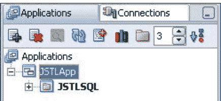

## 使用 JSTL SQL 标签库连接数据库

选择项目节点并选择 File | New。在 Categories 中，选择 Web Tier | JSP 并在列出的 Items 中选择 JSP，然后单击 OK。在 Create JSP Wizard 中，单击 next 按钮。在 Web Application 窗口中，选择 J2EE 1.4（JSTL 1.1 所需），然后单击 Next。在 JSP File 窗口中，指定文件名为 catalog.jsp，然后单击 Next。在 Error Page Options 窗口中，选择默认设置 Do Not Use an Error Page to Handle Uncaught Exceptions in This File，然后单击 next。在 Tag Libraries 窗口中，选择库 JSTL Core 1.1 和 JSTL SQL 1.1，然后单击 Next 按钮。

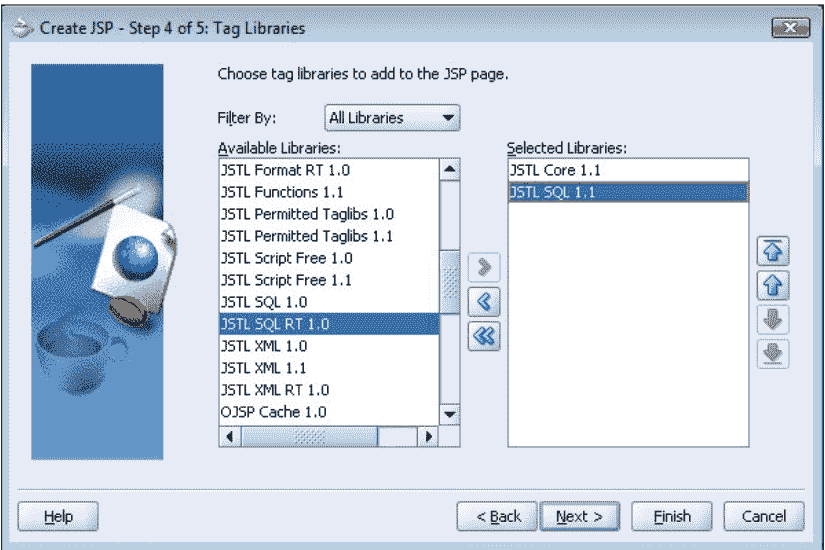

在 HTML Options 窗口中选择默认设置，然后单击 Next。单击 Finish 窗口中的 Finish 后，JSP 和 web.xml 将被添加到项目中。

在 Applications-Navigator 中在 JDeveloper 中创建项目后，选择项目节点并选择 Tools | Project Properties。在 Project Properties 窗口中选择 Libraries 节点。库应列在项目库中。如果这些库中任何一个不在项目库中，请使用 Add Library 按钮添加库。例如，要添加 JSTL 1.1 库，请单击 Add Library，选择 JSTL 1.1 库，然后单击 OK

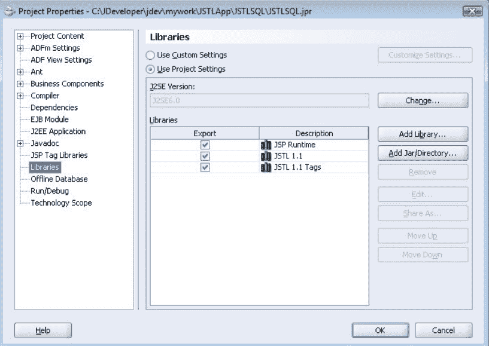

## 创建数据库表

在本节中，我们将使用 JDeveloper 10.1.3 IDE 中的 JSTL 1.1 SQL 标签在 Oracle 数据库中创建数据库表。数据库表将使用 catalog.jsp JSP 创建，该 JSP 在“设置环境”部分中创建。下面所示的 JSTL SQL taglib 和 JSTL Core taglib 的 taglib 指令被添加到 catalog.jsp 中，因为在创建 JSP 时选择了 JSTL SQL 1.1 和 JSTL Core 1.1 taglib。

```
<%@ taglib uri="http://java.sun.com/jsp/jstl/sql" prefix="sql"%>
<%@ taglib uri="http://java.sun.com/jsp/jstl/core" prefix="c"%>
```

## 使用 JSTL SQL 标签库连接数据库

要访问 Oracle 数据库，请使用 SQL 标签 setDataSource 创建数据源。JDeveloper 提供了一个组件调色板，用于向 JSP 页面添加 JSTL SQL 标签。选择 JSTL 1.1 SQL 组件调色板。将光标定位在 JSP 页面中，并在 JSTL SQL 组件调色板中选择 SetDataSource 标签。

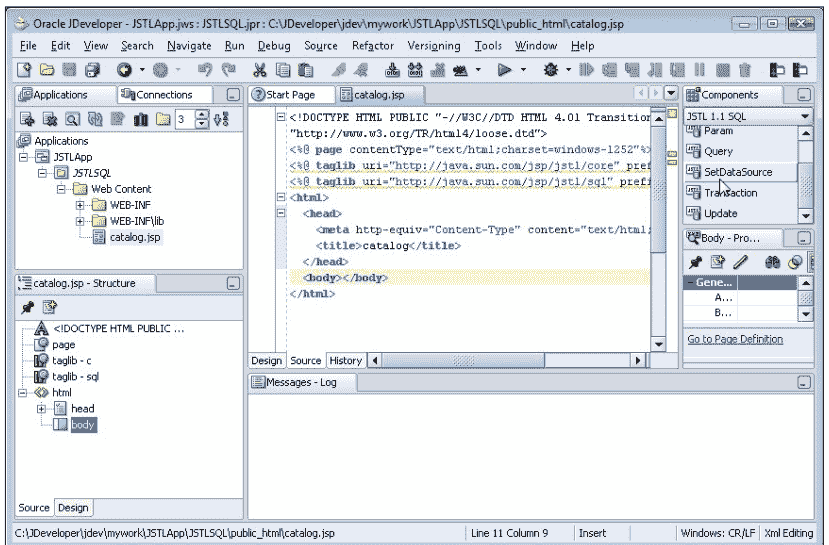

在 setDataSource 标签中，在 driver 属性中指定 JDBC 驱动程序 oracle.jdbc.OracleDriver 用于 Oracle 数据库。将连接 URL 指定为：jdbc:oracle:thin:@localhost:1521:ORCL 用于 Oracle 数据库。还请指定用户名为 OE，以及密码。要添加标签属性，请在 setDataSource 标签中按空格键并双击该属性。

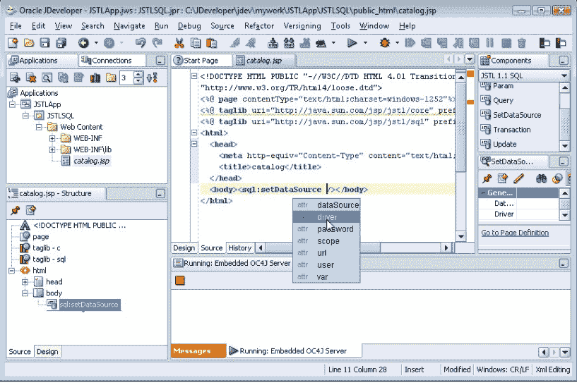

添加了属性的 sql:setDataSource 标签如下所示：

```
<sql:setDataSource driver="oracle.jdbc.OracleDriver" url="jdbc:oracle:
thin:@localhost:1521:ORCL" user="OE" password="pw" />
```

## 使用 JSTL SQL 标签库连接数据库

接下来，使用 sql:transaction 标签创建一个事务以运行 SQL 语句、创建数据库表并向数据库表添加行。将光标定位在 JSP 页面中，并在 JSTL 1.1 SQL 组件调色板中选择 Transaction。

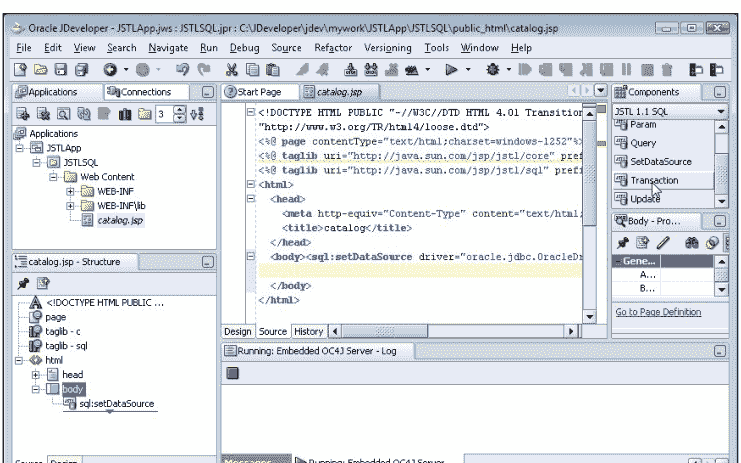

sql:transaction 标签提供 dataSource 和 isolation 属性，可以像 setDataSource 标签属性一样添加。将以下 sql:transaction 标签添加到 JSP 页面。

```
<sql:transaction>
</sql:transaction>
```

`sql:update` 标签用于创建数据库表并向数据库表添加行。`sql:update` 标签添加到 `sql:transaction` 标签内。将光标定位在打开的 `sql:transaction` 标签和关闭的 `sql:transaction` 标签之间，并在 JSTL 1.1 SQL 组件调色板中选择 Update 标签。

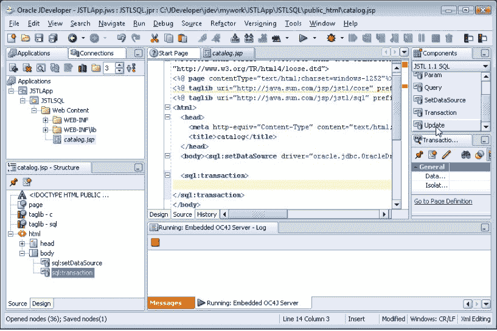

## 使用 JSTL SQL 标签库连接数据库

sql:update 可能包含 sql、dataSource、var 和 scope 属性。首先，使用 JSTL SQL 标签创建数据库表。SQL CREATE 语句在 sql:update 标签的 sql 属性中指定。要添加 sql 属性，请在 sql:update 标签中按空格键并在列出的属性中双击 sql 属性：

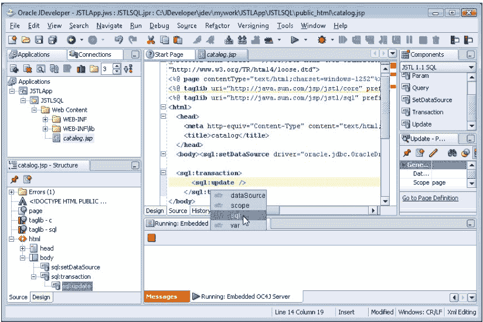

创建数据库表的 sql:update 标签如下：

```
<sql:update sql="CREATE TABLE OE.Catalog(CatalogId VARCHAR(25) PRIMARY KEY, Journal VARCHAR(25), Publisher VARCHAR(25), Edition VARCHAR(25), Title Varchar(45), Author Varchar(25))">
</sql:update>
```

接下来，使用 sql:update 标签向数据库表添加行。INSERT 语句在 sql:update 标签的 sql 属性中指定。

```
<sql:update sql="INSERT INTO OE.Catalog VALUES('catalog1', 'Oracle Magazine', 'Oracle Publishing', 'Nov-Dec 2004', 'Database Resource Manager', 'Kimberly Floss')">
</sql:update>
```

用于创建数据库表并向数据库表中插入行的 **catalog.jsp** 页面在以下列表中显示：

```
<!DOCTYPE HTML PUBLIC "-//W3C//DTD HTML 4.01 Transitional//EN"
"http://www.w3.org/TR/html4/loose.dtd">
<%@ page contentType="text/html;charset=windows-1252"%>
<%@ taglib uri="http://java.sun.com/jsp/jstl/sql" prefix="sql"%>
<%@ taglib uri="http://java.sun.com/jsp/jstl/core" prefix="c"%>
<html>
<head>
<meta http-equiv="Content-Type" content="text/html;
charset=windows-1252"/>
<title>catalog</title>
</head>
<body><sql:setDataSource driver="oracle.jdbc.OracleDriver"
url="jdbc:oracle:thin:@localhost:1521:ORCL" user="OE" password="pw"/>
<sql:transaction>
<sql:update sql="CREATE TABLE OE.Catalog(CatalogId VARCHAR(25)
PRIMARY KEY, Journal VARCHAR(25), Publisher VARCHAR(25),
Edition VARCHAR(25), Title Varchar(45), Author Varchar(25))">
</sql:update>
<sql:update sql="INSERT INTO OE.Catalog VALUES('catalog1', 'Oracle
Magazine', 'Oracle Publishing', 'Nov-Dec 2004', 'Database Resource
Manager', 'Kimberly
Floss')">
</sql:update>
<sql:update sql="INSERT INTO OE.Catalog VALUES('catalog2', 'Oracle
Magazine', 'Oracle Publishing', 'Nov-Dec 2004', 'From ADF UIX to JSF',
'Jonas Jacobi')">
</sql:update>
<sql:update sql="INSERT INTO OE.Catalog VALUES('catalog3', 'Oracle
Magazine',
'Oracle Publishing','March-April 2005','Starting with Oracle ADF',
'Steve Muench')">
</sql:update>
</sql:transaction>
<%out.println("Database Table Created");%>
</body>
</html>
```

## 使用 JSTL SQL 标签库连接数据库

通过在应用程序导航器中右键单击 JSP 节点并选择 Run 来运行 JSP。

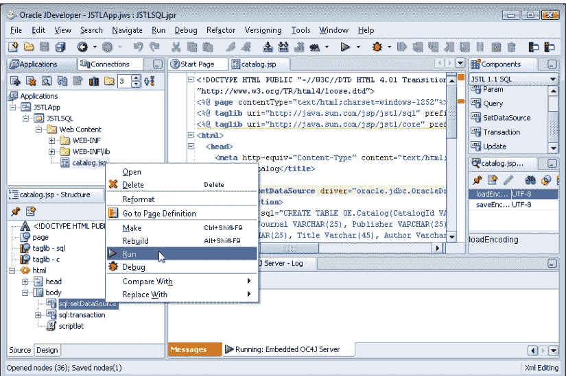

数据库表被创建，并且行被添加到数据库表中。

## 更新数据库表

在本节中，将更新数据库表行。在 JSTLSQL 项目中创建一个 JSP catalogUpdate.jsp。如前一节所述，使用 setDataSource 标签为 JSP 页面设置数据源。UPDATE SQL 语句使用 sql:update 标签运行。从组件调色板向 JSP 页面添加一个 Update 标签。SQL 语句具有用于指定 UPDATE 语句的 IN 参数的占位符。将 UPDATE SQL 语句添加到 sql:update 标签的 sql 属性中。

```
<sql:update sql="UPDATE OE.CATALOG SET TITLE=?, AUTHOR=?
WHERE CATALOGID=?">
</sql:update>
```

IN 参数的值使用 `sql:param` 标签指定。将光标定位在 `sql:update` 语句中，并在 JSTL 1.1 SQL 组件调色板中选择 Param 标签。

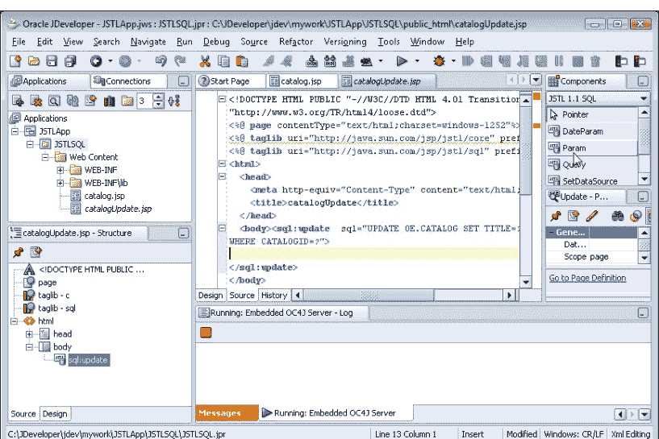

## 使用 JSTL SQL 标签库连接数据库

param 值使用 sql:param 标签中的 value 属性设置。要添加 value 属性，请在 sql:param 标签中按空格键并双击 value 属性。

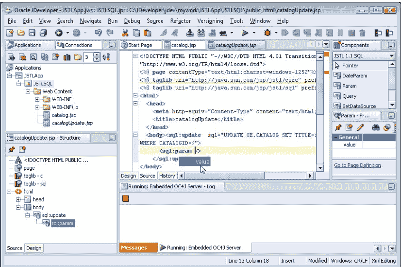

指定 param 值并类似地添加 sql:param 标签以指定与 UPDATE SQL 语句中 IN 参数对应的 param 值，如下所示：

```
<sql:param value="Introduction to ADF"/>
<sql:param value="Muench, Steve"/>
<sql:param value="catalog3"/>
```

catalogUpdate.jsp 如下所示：

```
<!DOCTYPE HTML PUBLIC "-//W3C//DTD HTML 4.01 Transitional//EN"
"http://www.w3.org/TR/html4/loose.dtd">
<%@ page contentType="text/html;charset=windows-1252"%>
<%@ taglib uri="http://java.sun.com/jsp/jstl/sql" prefix="sql"%>
<%@ taglib uri="http://java.sun.com/jsp/jstl/core" prefix="c"%>
<html>
  <head>
    <meta http-equiv="Content-Type" content="text/html;
charset=windows-1252"/>
    <title>catalogUpdate</title>
    </head>
    <body>
    <sql:setDataSource driver="oracle.jdbc.OracleDriver"
url="jdbc:oracle:thin:@localhost:1521:ORCL" user="oe"
password="pw"/>
    <sql:update sql="UPDATE OE.CATALOG SET TITLE=?, AUTHOR=?
WHERE CATALOGID=?">
    <sql:param value="Introduction to ADF"/>
    <sql:param value="Muench, Steve"/>
    <sql:param value="catalog3"/>
    </sql:update>
    </body>
    </html>
```

通过右键单击 JSP 并选择 Run 来运行 catalogUpdate.jsp。

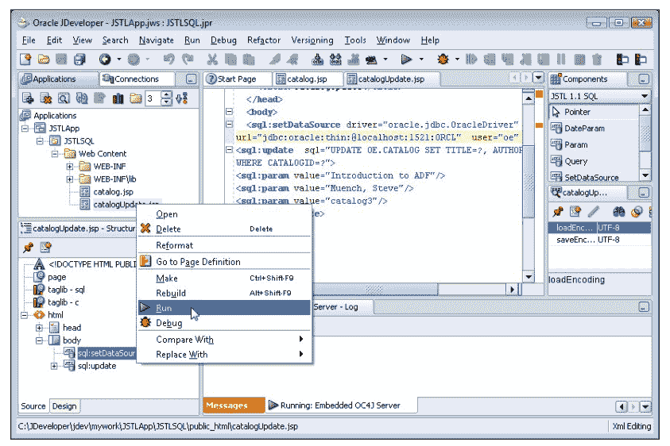

数据库表已更新。


## 查询数据库表

在本节中，将查询在前几节中创建和修改的数据库表，并将结果显示在 HTML 表格中。创建一个 JSP，catalogQuery.jsp。为 JSP 选择 JSTL Core 1.1 和 JSTL SQL 1.1 标签库。如前几节所述，添加一个 setDataSource 标签以获取与 Oracle 数据库的连接。用于查询数据库的 SQL 标签库标签是 sql:query。在 JSP 页面中定位光标，并在 SQL 组件调色板中选择 Query 标签。

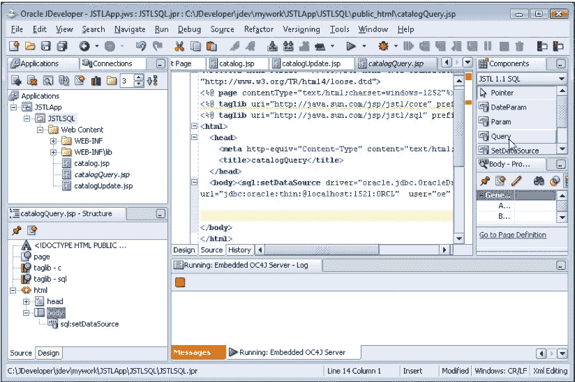

在“插入查询”窗口中，指定 var 属性，该属性是必需属性。var 属性指定 Query 标签返回的结果集的变量。选择“高级属性”选项卡。

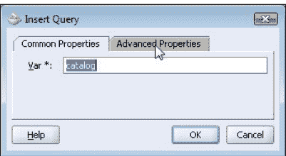

在 sql 属性字段中指定 SQL 查询，然后单击“确定”按钮。

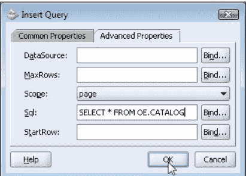

sql:query 标签被添加到 JSP 页面：

```
<sql:query  var="catalog" sql="SELECT * FROM CATALOG"/>
```

添加一个 <table> 来显示 Query 标签的结果集。添加表头。结果集中每一行都将对应添加一行。选择 JSTL 1.1 Core 组件库并向 <table> 添加 ForEach 标签。

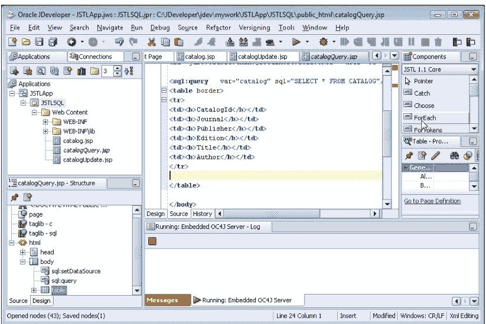

## 使用 JSTL SQL 标签库连接数据库

c:forEach 标签的 var 属性指定与结果集中的一行相对应的变量。items 属性指定用于遍历 Query 标签返回的结果集中的行的 EL 绑定。sql:query 标签返回的结果集中的行是通过 ${catalog.rows} EL 表达式获取的。catalogQuery.jsp JSP 中的 c:forEach 标签如下：

```
<c:forEach var="journal" items="${catalog.rows}">
</c:forEach>
```

接下来，将行中每个列对应的值输出到 JSP 表格。JSP 表格值通过 c:out 标签添加。从 JSTL 1.1 Core 组件调色板为 c:forEach 标签添加每个列的 c:out 标签。

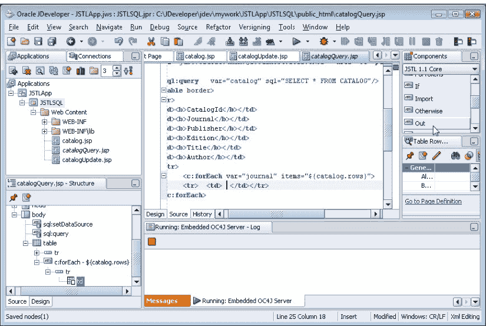

在“插入输出”窗口中，指定用于绑定列值的 EL 表达式。列值绑定通过结果集中的列名获取。要绑定列值，请单击“绑定”按钮。journal 是与结果集中的一行相对应的变量。例如，绑定 CatalogId 列的 EL 表达式是 ${journal.CatalogId}。在“绑定到数据”窗口的表达式文本区域中指定 EL 表达式，然后单击“确定”按钮。

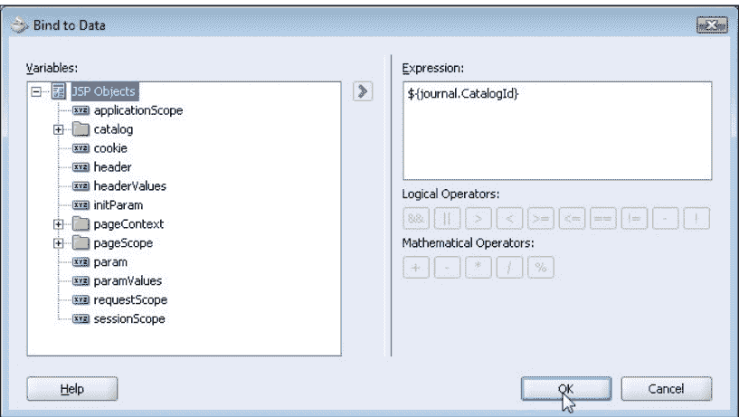

在“插入输出”窗口中单击“确定”按钮。

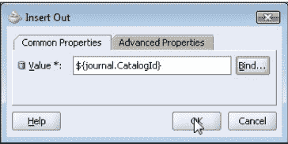

类似地为结果集中的其他列添加 c:out 标签。下面列出了 catalogQuery.jsp：

```
<!DOCTYPE HTML PUBLIC "-//W3C//DTD HTML 4.01 Transitional//EN"
"http://www.w3.org/TR/html4/loose.dtd">
<%@ page contentType="text/html;charset=windows-1252"%>
<%@ taglib uri="http://java.sun.com/jsp/jstl/core" prefix="c"%>
<%@ taglib uri="http://java.sun.com/jsp/jstl/sql" prefix="sql"%>
<html>
<head>
<meta http-equiv="Content-Type" content="text/html;
charset=windows-1252"/>
<title>catalogQuery</title>
</head>
<body><sql:setDataSource driver="oracle.jdbc.OracleDriver"
url="jdbc:oracle:thin:@localhost:1521:ORCL" user="oe"
password="pw"/><sql:query var="catalog" sql="SELECT * FROM
OE.CATALOG"/>
<table border>
<tr>
    <td><b>CatalogId</b></td>
    <td><b>Journal</b></td>
    <td><b>Publisher</b></td>
    <td><b>Edition</b></td>
    <td><b>Title</b></td>
    <td><b>Author</b></td>
</tr>
<c:forEach var="journal" items="${catalog.rows}">
<tr>
    <td>
        <c:out value="${journal.CatalogId}"/>
    </td>
    <td><c:out value="${journal.Journal}"/></td>
    <td><c:out value="${journal.Publisher}"/></td>
    <td><c:out value="${journal.Edition}"/></td>
    <td><c:out value="${journal.Title}"/></td>
    <td><c:out value="${journal.Author}"/></td>
</tr>
</c:forEach>
</table>
</body>
</html>
```

要运行 **catalogQuery.jsp**，右键单击 JSP 并选择 **Run**：

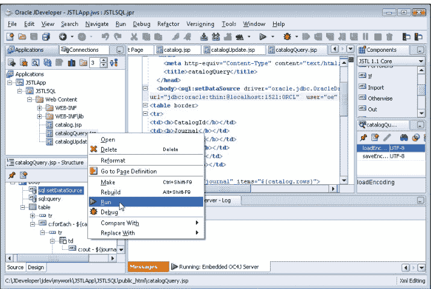

通过 Query 标签获取的结果集会显示在 HTML 表格中。

| 目录ID | 期刊 | 出版社 | 版本 | 标题 | 作者 |
|---|---|---|---|---|---|
| catalog1 | Oracle Magazine | Oracle Publishing | Nov-Dec 2004 | Database Resource Manager | Kimberly Floss |
| catalog2 | Oracle Magazine | Oracle Publishing | Nov-Dec 2004 | From ADF UIX to JSF | Jonas Jacobi |
| catalog3 | Oracle Magazine | Oracle Publishing | March-April 2005 | Introduction to ADF | Muench, Steve |

## 摘要

JSTL SQL 标签库提供对数据库的访问。JDeveloper 10.1.3 通过为 JSTL SQL 1.1 标签提供的组件调色板来促进 JSTL SQL 应用程序的开发，可从中将标签库标签添加到 JSP 应用程序。在本章中，您已学习如何在 JDeveloper 10.1.3 中使用 JSTL SQL 1.1 标签创建 Oracle 数据库表。您还学习了如何使用 JSTL SQL 1.1 标签更新数据库表和查询数据库表。
