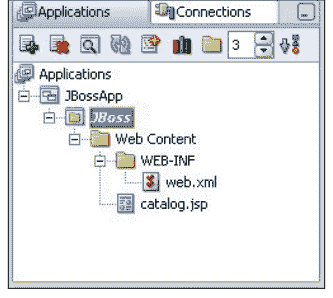
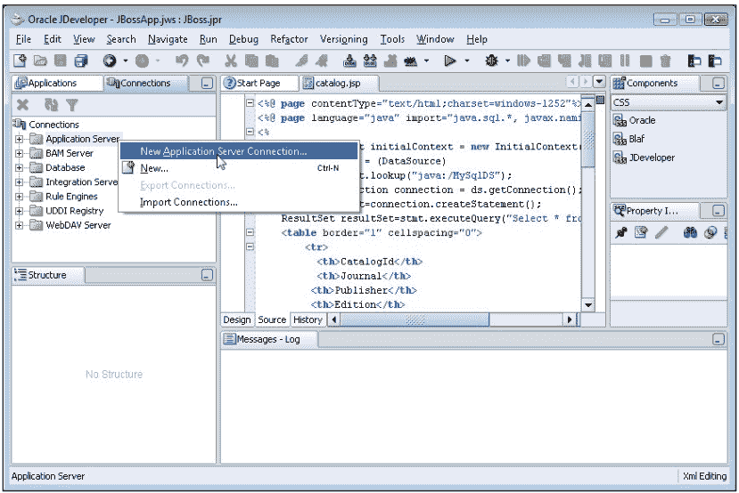
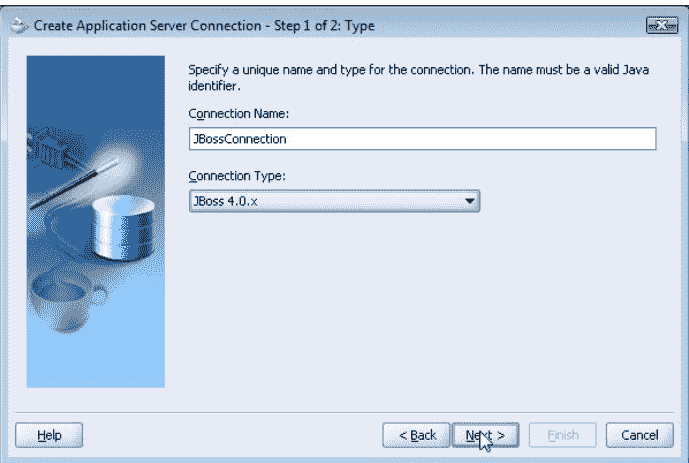
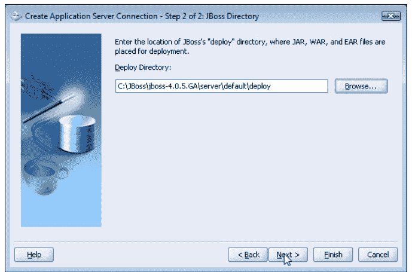
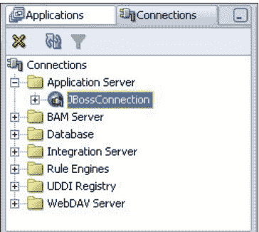
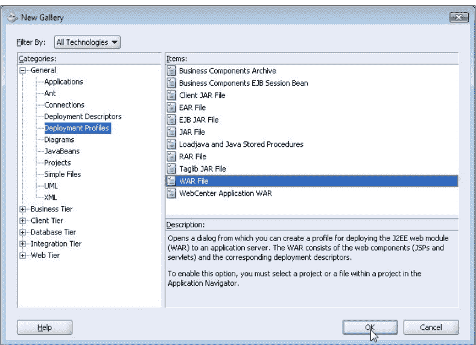
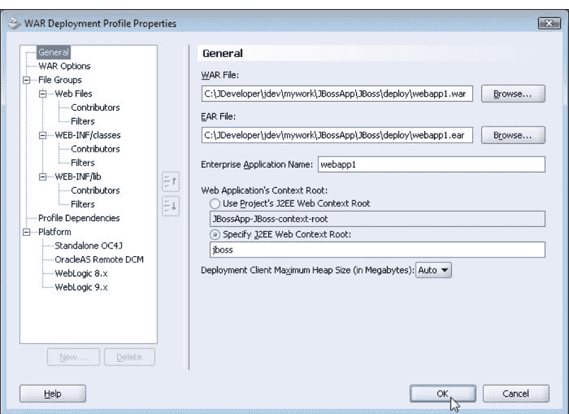
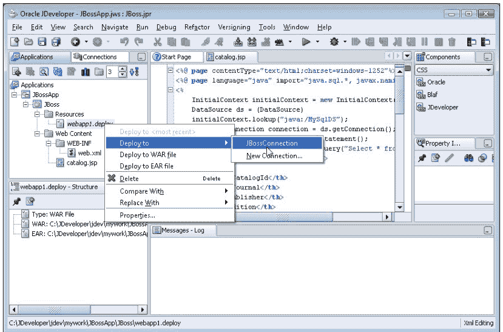

## 4 在 JBoss 应用服务器中配置 JDBC

JBoss 4.0 是一个开源应用服务器，默认配置为使用 **Hypersonic Database**（HSQLDB）。然而，一些 **Java 2 Platform Enterprise Edition**（J2EE）开发人员希望使用除 Hypersonic Database 之外的数据库来开发和部署应用程序。JBoss 应用服务器为 **Enterprise Java Beans**（EJB）持久化和 J2EE 应用程序提供数据源访问。在本章中，我们将了解如何配置 JBoss 以使用其他数据库。

JBoss 4.0 服务器使用 Java 数据库连接（JDBC）配置文件和数据源文件来将服务器配置为使用数据库。要使用除默认数据库 Hypersonic 之外的数据库，JDBC 配置文件必须进行修改，并且数据库的数据源文件必须提供给服务器。从 `http://labs.jboss.com/jbossas/downloads` 下载 JBoss 4.0 应用服务器 ZIP 文件，并通过将 ZIP 文件解压到目录中来安装 JBoss 服务器。在本章中，您将学习如何执行以下操作：

- 从 JDeveloper 部署 Web 应用程序到 JBoss 应用服务器
- 部署 JDBC 4.0 版本的 Web 应用程序到 JBoss 服务器
- 使用 JDBC 4.0 驱动程序配置 JBoss 服务器以使用 Oracle 数据库 10g
- 使用 JDBC 4.0 驱动程序配置 JBoss 服务器以使用 MySQL 数据库
- 使用 JDBC 4.0 驱动程序配置 JBoss 服务器以使用 PostgreSQL 数据库服务器
- 使用 JDBC 4.0 驱动程序配置 JBoss 服务器以使用 DB2 UDB 数据库
- 使用 JDBC 4.0 驱动程序配置 JBoss 服务器以使用 MS SQL Server

## 从 JDeveloper 部署 Web 应用程序到 JBoss

在本节中，我们将从 JDeveloper IDE 创建 Web 应用程序并将其部署到 JBoss 应用服务器。JDeveloper 具有内置功能，可配置与 JBoss 应用服务器的连接，并将 Web 应用程序部署到服务器。首先，通过选择 文件 | 新建 在 JDeveloper 中创建应用程序。在“新建库”窗口中，在“类别”中选择“常规”，在“项目”中选择“应用程序”，然后单击“确定”。在“创建应用程序”窗口中，指定应用程序名称，然后单击“确定”按钮。在“创建项目”窗口中，指定项目名称，然后单击“确定”。应用程序和项目将被添加到应用程序导航器。接下来，要添加 JSP，请在应用程序导航器中选择项目节点，然后选择 文件 | 新建。在“新建库”窗口中，在“类别”中选择“Web 层 | JSP”，在“项目”中选择“JSP”，然后单击“确定”。“创建 JSP 向导”启动。现在，单击“下一步”。在“Web 应用程序”窗口中选择 J2EE 1.4，然后单击“确定”。在 JSP 文件窗口中指定文件名，然后单击“下一步”按钮。在“错误页面选项”窗口中选择默认设置，然后单击“下一步”。在“标签库”窗口中单击“下一步”。在“HTML 选项”窗口中选择默认设置，然后单击“下一步”。在“完成”窗口中单击“完成”。现在，JSP 和 web.xml 将被添加到应用程序导航器。



接下来，使用以下 SQL 脚本在 MySQL 数据库中创建数据库表：

```
```sql
CREATE TABLE Catalog( CatalogId VARCHAR(25)
PRIMARY KEY, Journal VARCHAR(25), Publisher VARCHAR(25),
    Edition VARCHAR(25), Title Varchar(45), Author Varchar(25));
INSERT INTO Catalog VALUES('catalog1', 'Oracle Magazine',
'Oracle Publishing', 'Nov-Dec 2004', 'Database Resource Manager',
'Kimberly Floss');
INSERT INTO Catalog VALUES('catalog2', 'Oracle Magazine', 'Oracle
Publishing', 'Nov-Dec 2004', 'From ADF UIX to JSP', 'Jonas Jacobi');
```
```


按照《Configuring JBoss Server with MySQL Database》部分所述，在 JBoss 应用服务器中配置与 MySQL 数据库的连接。我们将在 catalog.jsp 中获取与 MySQL 数据库的连接。创建 InitialContext 对象，并使用 JNDI 查找在 JBoss 应用服务器中配置的 MySQL 数据源创建 DataSource 对象。

```
InitialContext initialContext = new InitialContext();
DataSource ds = (DataSource)
initialContext.lookup("java:/MySqlDS");
```

使用 getConnection() 方法从 DataSource 对象创建 Connection 对象，并使用 createStatement() 方法从 Connection 对象创建 Statement 对象。使用 Statement 接口的 executeQuery() 方法在 Catalog 表上运行 SQL 查询。遍历 ResultSet 并创建 HTML 表格。catalog.jsp 文件如下所示：

```
<%@ page contentType="text/html;charset=windows-1252"%>
<%@ page language="java" import="java.sql.*, javax.naming.*, javax.sql.*" %>
<%
InitialContext initialContext = new InitialContext();
DataSource ds = (DataSource)
initialContext.lookup("java:/MySqlDS");
java.sql.Connection connection = ds.getConnection();
Statement stmt=connection.createStatement();
ResultSet resultSet=stmt.executeQuery("Select * from Catalog");
%>
<table border="1" cellspacing="0">
<tr>
<th>CatalogId</th>
<th>Journal</th>
<th>Publisher</th>
<th>Edition</th>
<th>Title</th>
<th>Author</th>
</tr>
<%
while (resultSet.next())
{
%>
<tr>
<td><%=out.println(resultSet.getString(1));%></td>
<td><%=out.println(resultSet.getString(2));%></td>
<td><%=out.println(resultSet.getString(3));%></td>
<td><%=out.println(resultSet.getString(4));%></td>
<td><%=out.println(resultSet.getString(5));%></td>
<td><%=out.println(resultSet.getString(6));%></td>
</tr>
<%
}
%>
</table>
<%
resultSet.close();
stmt.close();
if(!connection.isClosed())
    connection.close();
%>
```

## 在 JBoss 应用服务器中配置 JDBC

我们将在 JDeveloper 中配置与 JBoss 应用服务器的连接。选择 **连接** 选项卡，在 Connections 导航器中，右键单击 **应用服务器** 节点并选择 **新建应用服务器连接**。



在创建应用服务器连接向导中，单击 Next 按钮。在 Type 窗口中指定连接名称，将连接类型选择为 JBoss 4.0.x，然后单击 Next。



在 JBoss 目录窗口中，指定 JBoss 应用服务器的部署目录，然后单击 Next。



## 在 JBoss 应用服务器中配置 JDBC

在 Finish 窗口中单击 Finish。JBossConnection 节点将被添加到 Connections 导航器中的 Application Server 节点。



我们将把创建的 Web 应用程序部署到 JBoss 应用服务器。首先，为了为 Web 应用程序创建部署配置文件，选择 File | New。在 New Gallery 窗口中，在 Categories 中选择 General | Deployment Profiles，在 Items 中选择 WAR File，然后单击 OK。



在 **创建部署配置文件** 窗口中指定部署配置文件名称并单击 **确定**。在 **WAR 部署配置文件属性** 窗口中指定 J2EE Web 上下文根并单击 **确定**。



## 在 JBoss 应用服务器中配置 JDBC

Web 应用程序的部署配置文件将被添加到 **应用程序导航器**。我们之前已配置了与 JBoss 应用服务器的连接。因此，接下来将部署配置文件部署到 JBoss 应用服务器。右键单击部署配置文件，选择 **部署到 | JBossConnection**。



Web 应用程序将被部署到 JBoss 应用服务器。如果尚未执行，请使用 `C:\JBoss\jboss-4.0.5.GA\bin\run` 批处理脚本启动 JBoss 应用服务器。使用 URL `http://localhost:8080/jboss/catalog.jsp` 运行 `catalog.jsp`。使用 JBoss 应用服务器中配置的 JNDI 数据源建立与 MySQL 数据库的连接，并为 `catalog.jsp` 显示 HTML 表格：

| 目录ID | 期刊 | 出版社 | 版本 | 标题 | 作者 |
|---|---|---|---|---|---|
| catalog1 | Oracle Magazine | Oracle Publishing | Nov-Dec 2004 | Database Resource Manager | Kimberly Floss |
| catalog2 | Oracle Magazine | Oracle Publishing | Nov-Dec 2004 | From ADF UIX to JSF | Jonas Jacobi |

## JDBC 4.0 版本

JBoss 应用服务器 4 不支持 JDBC 4.0。当为 JDBC 4.0 添加支持时，我们将能够使用 JDBC 4.0 中的新功能。JDBC 4.0 支持连接跟踪以关闭不可用的连接。连接跟踪由连接池管理器使用 Connection 接口的 isValid() 方法实现。如果连接池管理器检测到连接无效，则关闭该连接，从而减少不可用连接的积累，这些连接会阻碍连接池性能。对于 Connection 对象 conn，连接跟踪实现如下：

```
if (!connection.isValid())
    connection.close();
```

MySQL Connector/J 5.1 驱动程序支持包装器模式，该模式在 Wrapper 接口中实现。MySQL 特定的 JDBC API 扩展包含供应商特定的方法，可以使用包装器模式访问。MySQL 对 JDBC API 的扩展位于 com.mysql.jdbc 包中。它提供了 com.mysql.jdbc.Connection 接口作为 java.sql.Connection 接口的扩展。使用 isWrapperFor() 方法检查 java.sql.Connection 对象是否为 com.mysql.jdbc.Connection 接口的包装器，以解包 com.mysql.jdbc.Connection 资源并获取实现该接口的对象。如果 java.sql.Connection 对象是包装器，则使用 unwrap() 方法解包 Connection 接口的 MySQL 扩展，并创建 com.mysql.jdbc.Connection 类型的对象。

```
Class clazz = Class.forName("com.mysql.jdbc.Connection");
if (connection.isWrapperFor(clazz)) {
com.mysql.jdbc.Connection conn= (com.mysql.jdbc.Connection)connection.unwrap(clazz);
}
```

JDBC 4.0 中用于连接管理的另一个新功能是能够在 Connection 对象上设置客户端信息属性。因此，如果连接池由于某些连接过度使用 CPU 而导致性能下降，连接池管理器能够识别出导致 CPU 过度使用的连接并关闭这些连接。为了设置和获取客户端信息属性，Connection 接口提供了 setClientInfo() 和 getClientInfo() 方法。例如，设置 ApplicationName、ClientUser 和 ClientHostname 客户端信息属性：

```
conn.setClientInfo("ApplicationName","JBossApp");
conn.setClientInfo("ClientUser","JBossUser");
conn.setClientInfo("ClientHostname","JBossHost");
```

MySQL 对 Connection 接口的扩展提供了 clientPrepareStatement() 方法，可用于创建客户端预编译语句并运行 SQL 查询。

```
String sql="SELECT CATALOGID, JOURNAL, PUBLISHER, EDITION, TITLE,
    AUTHOR from Catalog WHERE CATALOGID=?";
PreparedStatement pstmt=conn.clientPrepareStatement(sql);
```

预编译语句是可使用不同参数值运行的预编译 SQL 语句。预编译语句由于逻辑和数据的分离而降低了 SQL 注入的风险，并且还提高了性能。预编译语句分为服务器端预编译语句或客户端预编译语句。对于服务器端预编译语句，在接收到 SQL 语句时，数据库会解析该语句，检查语法错误，为语句准备执行计划并运行语句。当数据库再次接收到同一语句时，它会使用之前准备好的语句和相同的执行计划来运行语句。如果要使用不同的参数多次运行语句，使用预编译语句是有利的。预编译语句仅由数据库服务器编译一次，并使用不同的参数值多次运行。

预编译语句的优点是由于速度提高和 CPU 负载降低而性能更好。此外，数据库服务器使用相同的编译语句和执行计划。如果数据库服务器不支持服务器端预编译语句，与 MySQL 数据库（4.1 之前的版本）相同，则预编译语句可以由驱动程序模拟。这些称为客户端预编译语句。

MySQL 的 Connector/J 5.1 驱动程序提供增强的链式异常支持。可以使用 J2SE 6.0 中引入的 For-Each 循环检索链接到 SQLException 的异常和异常的原因。在 catalog.jsp 中指定错误页面：

```
<%@ page errorPage="errorpage.jsp" %>
```

在错误页面中使用 For-Each 循环输出链式异常和链式原因。

```
<%@ page isErrorPage="true" %>
<%
for( Throwable e : exception )
{
    out.println("Error encountered: " + e);
}
%>
```

部署到 JBoss 的 catalog.jsp 的 JDBC 4.0 版本如下所示：

```
<%@ page contentType="text/html;charset=windows-1252"%>
<%@ page language="java" import="java.sql.*, javax.naming.*, javax.sql.*,oracle.jdbc.*" %>
<%@ page errorPage="errorpage.jsp" %>
<%
InitialContext initialContext = new InitialContext();
DataSource ds = (DataSource)
initialContext.lookup("java:/MySqlDS");
java.sql.Connection connection = ds.getConnection();
connection.setClientInfo("ApplicationName","JBossApp");
connection.setClientInfo("ClientUser","JBossUser");
connection.setClientInfo("ClientHostname","JBossHost");
Class clazz = Class.forName("com.mysql.jdbc.Connection");
if(connection.isWrapperFor(clazz))
{
com.mysql.jdbc.Connection conn=
(com.mysql.jdbc.Connection)connection.unwrap(clazz);
conn.setClientInfo("ApplicationName","JBossApp");
conn.setClientInfo("ClientUser","JBossUser");
conn.setClientInfo("ClientHostname","JBossHost");
String sql="SELECT CATALOGID, JOURNAL, PUBLISHER, EDITION, TITLE,
AUTHOR from Catalog WHERE CATALOGID=?";
PreparedStatement pstmt=conn.clientPrepareStatement(sql);
pstmt.setString(1, "catalog1");
ResultSet rs=pstmt.executeQuery();
%>
<table border="1" cellspacing="0">
<tr>
<th>Catalog Id</th>
<th>Journal</th>
<th>Publisher</th>
<th>Edition</th>
<th>Title</th>
<th>Author</th>
</tr>
<%
while (rs.next())
{
%>
<tr>
<td><%= rs.getString(1) %></td>
<td><%= rs.getString(2) %></td>
<td><%= rs.getString(3) %></td>
<td><%= rs.getString(4) %></td>
<td><%= rs.getString(5) %></td>
<td><%= rs.getString(6) %></td>
</tr>
<%
}
%>
</table>
<%
rs.close();
pstmt.close();
if(!connection.isClosed())
  connection.close();
}
%>
```

## 用于 EJB 的 JBoss 部署描述符

我们需要配置一些 EJB 配置文件，以便在 EJB 中使用 JBoss 应用服务器数据源。standardjaws.xml 配置文件代表 JBossCMP 引擎。它包含默认数据源的 JNDI 名称、jdbc-sql 映射以及 CMP 实体 Bean 设置。改用 jaws.xml 文件以使用自定义配置来映射容器托管持久性 (CMP) 实体 EJB。在这两种情况下，文件都会复制到 EJB.jar 文件的 META-INF 目录中。standardjaws.xml 和 jaws.xml 配置文件执行以下操作：

- 1. 指定数据源及其类型映射
- 2. 指定表的构建或使用方式
- 3. 定义用于访问实体 Bean 的查找方法
- 4. 定义类型映射

数据源是 Java 命名和目录接口 (JNDI) 对象，用于从连接池获取到数据库的连接。Hypersonic Database 是 JBoss 4.0 配置的默认数据源。您需要修改 jaws.xml 或 standardjaws.xml 以使用 CMP 实体 EJB 的其他数据库。

standardjbosscmp-jdbc.xml 配置文件是配置 JBoss CMP 容器的标准部署描述符。它可以用名为 jboss cmp-jdbc.xml 的自定义配置版本替换，并放置在 EJB.jar 文件的 META-INF 目录中。JBoss 4.0 默认设置为 Hypersonic Database。我们需要编辑此文件以使用其他数据库。以下各节中的文件路径如果为相对路径，则相对于 JBoss 安装目录。

## 配置 JBoss 服务器以使用 Oracle 数据库

Oracle 是一款领先的企业数据库，以其性能和可靠性著称。要将 JBoss 4.0 与 Oracle 集成，我们需要将 Oracle 的驱动类放入 JBoss 应用服务器的运行时类路径中。将 Oracle 数据库 11g JDBC 4.0 驱动的 JAR 文件 ojdbc6.jar 复制到 C:\JBoss\jboss-4.0.5.GA\server\default\lib 目录。我们还需要将 JAVA_HOME 环境变量设置为 JDK 6.0。

要使用 Oracle 的事务性 (XA) 数据源，请将 /docs/examples/jca/oracle-xa-ds.xml 复制到 /server/default/deploy 目录。目录路径相对于 JBoss 应用服务器安装目录。要使用非 XA 数据源进行配置，请将 /docs/examples/jca/oracle-ds.xml 复制到 /server/default/deploy 目录并修改 oracle-ds.xml 配置文件。Oracle 的 <driver-class/> 和 <connection-url/> 设置会因所使用的驱动类型而异。Oracle 的 <driver-class/> 和 <connection-url/> 设置列在下表中：

| 驱动类型 | 驱动类 | 连接 URL |
|---|---|---|
| Oracle OCI 类型 2 驱动 | oracle.jdbc.OracleDriver | jdbc:oracle:oci:@<database> |
| Oracle Thin 类型 4 驱动 | oracle.jdbc.OracleDriver | jdbc:oracle:thin:@<host>:<port>:<database> |
| Oracle OCI XA 类型 4 驱动 | oracle.jdbc.xa.client.OracleXADatasource | jdbc:oracle:oci:@<database> |
| Oracle Thin XA 类型 4 驱动 | oracle.jdbc.xa.client.OracleXADatasource | jdbc:oracle:thin:@<host>:<port>:<database> |


> 在连接 URL 设置中，<host> 是在 <Oracle10g>/network/ADMIN/tnsnames.ora 文件中指定的 HOST 值，<port> 是在 tnsnames.ora 文件中指定的 PORT 值，而 <database> 是数据库名称。<Oracle10g> 是 Oracle 数据库安装的目录。

最后，我们需要修改 \server\default\conf\login-config.xml 以使用 Oracle。将以下 <application-policy> 元素添加到 login-config.xml 中：

```
<application-policy name = "OracleDbRealm">
    <authentication>
        <login-module code = "org.jboss.resource.security.ConfiguredIdentityLoginModule" flag = "required">
            <module-option name = "principal"></module-option>
            <module-option name = "userName">OE</module-option>
            <module-option name = "password">pw</module-option>
            <module-option name = "managedConnectionFactoryName">jboss.jca:service=LocalTxCM,name=OracleDS</module-option>
        </login-module>
    </authentication>
</application-policy>
```

这将 JBoss 应用服务器配置为使用 Oracle 数据库。要使用 Oracle 数据源的 CMP 实体 EJB，需要进行一些额外的修改。修改 standardjbosscmp-jdbc.xml 或 jboss cmp-jdbc.xml 配置文件，设置 <datasource> 和 <datasource-mapping> 元素以使用 Oracle。

```
<jboss cmp-jdbc>
<defaults>
<datasource>java:/OracleDS</datasource>
<datasource-mapping>Oracle9i</datasource-mapping>
</defaults>
</jboss cmp-jdbc>
```

修改 standardjaws.xml 或 jaws.xml 配置文件，设置 <datasource> 和 <type-mapping> 元素：

```
<jaws>
<datasource>java:/OracleDS</datasource>
<type-mapping>Oracle9i</type-mapping>
</jaws>
```

修改 oracle-ds.xml、standardjaws.xml、standardjboss cmp-jdbc.xml 和 login-config.xml 文件可将 JBoss 4.0 服务器配置为与 Oracle 数据库一起使用。

## 配置 JBoss 服务器以使用 MySQL 数据库

MySQL 是一款开源数据库，被许多开源项目和小型组织使用。要使用 JBoss 4.0 与 MySQL，我们必须将 MySQL 驱动类放入 JBoss 应用服务器的运行时类路径中，并将 MySQL Connector/J 5.1 驱动 JAR 文件复制到 C:\JBoss\jboss-4.0.5.GA\server\default\lib 目录。MySQL Connector/J 5.1 驱动支持 JDBC 4.0，可从 http://dev.mysql.com/downloads/connector/j/5.1.html 获取。我们还需要将 JAVA_HOME 环境变量设置为 JDK 6.0。

要使用 MySQL 数据源，请将 /docs/examples/jca/mysql-ds.xml 复制到 /server/default/deploy 目录。通过将 <driver-class/> 设置为 com.mysql.jdbc.Driver 并将 <connection-url/> 设置为 jdbc:mysql://localhost:3306/test 来修改 mysql-ds.xml 配置文件。

最后，使用 MySQL 数据库设置修改 server/default/conf/login-config.xml 并将以下 <application-policy/> 元素添加到 \server\default\conf\login-config.xml：

```
<application-policy name = "MySqlDbRealm">
    <authentication>
        <login-module code = "org.jboss.resource.security.ConfiguredIdentityLoginModule" flag = "required">
            <module-option name ="principal"></module-option>
            <module-option name ="userName">root</module-option>
            <module-option name ="password"></module-option>
            <module-option name ="managedConnectionFactoryName">jboss.jca:service=LocalTxCM,name=MySqlDS</module-option>
        </login-module>
    </authentication>
</application-policy>
```

上述 <application-policy/> 元素将 JBoss 服务器配置为使用 MySQL 数据库。本章示例应用程序不需要以下使用 MySQL 数据库的 JBoss 配置。要使用 MySQL 数据源的 CMP 实体 EJB，需要进行一些额外的修改。在 standardjbosscmp-jdbc.xml 或 jboss cmp-jdbc.xml 文件中设置 <datasource> 和 <datasource-mapping> 元素。

```
<jboss cmp-jdbc>
    <defaults>
        <datasource>java:/MySqlDS</datasource>
        <datasource-mapping>mySQL</datasource-mapping>
    </defaults>
</jboss cmp-jdbc>
```

我们还必须在 standardjaws.xml 或 jaws.xml 文件中设置 <datasource> 和 <type-mapping> 元素。

```
<jaws>
    <datasource>java:/MySqlDS</datasource>
    <type-mapping>mySQL</type-mapping>
</jaws>
```

修改 mysql-ds.xml、standardjaws.xml、standardjboss cmp-jdbc.xml 和 login-config.xml 文件可将 JBoss 4.0 服务器配置为与 MySQL 数据库一起使用。


## 配置 JBoss 服务器以使用 PostgreSQL 数据库

PostgreSQL 数据库是最常用的开源关系型数据库之一。第一步是将数据库驱动类放入 JBoss 应用服务器的运行时类路径中。PostgreSQL 数据库的 JDBC 4.0 驱动程序可从 http://jdbc.postgresql.org/download.html 获取。将 PostgreSQL 驱动 JAR 文件 postgresql-8.2-507.jdbc4.jar 复制到 JBoss 安装的 /server/default/lib 目录。我们还需要将 JAVA_HOME 环境变量设置为 JDK 6.0，然后通过将 /docs/examples/jca/postgres-ds.xml 复制到 /server/default/deploy 目录来使用其数据源。

通过将 <driver-class/> 设置为 org.postgresql.Driver 并将 <connection-url/> 设置为 jdbc:postgresql://localhost:5432/postgres 来修改 postgres-ds.xml 配置文件。

最后，修改 \server\default\conf\login-config.xml 以使用 PostgreSQL 数据库，并将以下 <application-policy/> 元素添加到文件中：

```
<application-policy name = "PostgreSQLDbRealm">
    <authentication>
        <login-module code = "org.jboss.resource.security.ConfiguredIdentityLoginModule"
        flag = "required">
            <module-option name ="principal"></module-option>
            <module-option name = "userName">sac</module-option>
            <module-option name = "password">pw</module-option>
            <module-option name = "managedConnectionFactoryName">
            jboss.jca.service=LocalTxCM,name=PostgreSQLDS</module-option>
        </login-module>
    </authentication>
</application-policy>
```

上面的 <application-policy/> 元素将 JBoss 应用服务器配置为使用 PostgreSQL 数据库。如果 CMP 实体 EJB 需要访问 PostgreSQL 数据源，则需要进行一些额外的修改。修改 standardjbosscmp-jdbc.xml 或 jbosscmp-jdbc.xml 以设置 <datasource> 和 <datasource-mapping> 元素。

```
<jboss-cmp-jdbc>
    <defaults>
        <datasource>java:/PostgreSQLDS</datasource>
        <datasource-mapping>PostgreSQL</datasource-mapping>
    </defaults>
</jboss-cmp-jdbc>
```

我们还必须修改 standardjaws.xml 或 jaws.xml 以设置 <datasource> 和 <type-mapping> 元素。

```
<jaws>
    <datasource>java:/PostgreSQLDS</datasource>
    <type-mapping>PostgreSQL</type-mapping>
</jaws>
```

通过修改 postgres-ds.xml、standardjaws.xml、standardjbosscmp-jdbc.xml 和 login-config.xml，JBoss 4.0 服务器被配置为与 PostgreSQL 数据库一起使用。

## 配置 JBoss 服务器以使用 DB2 数据库

IBM 的 DB2 Universal Database 是一款功能齐全、健壮、可扩展且易于使用的数据库服务器，可在 Linux、UNIX 和 Windows 平台上使用。首先将其驱动程序添加到 JBoss 应用服务器的运行时类路径中。IBM Data Server Driver for JDBC and SQLJ 版本 4.0 支持 JDBC 4.0，可从 https://www14.software.ibm.com/webapp/iwm/web/reg/download.do?source=swg-informixfpd&S_PKG=dl&lang=en_US&cp=UTF-8# 下载。为了实现 JDBC 4.0 功能，将 db2jcc4.jar 添加到 JBoss 安装的 /server/default/lib 目录。要使用 JDBC 4.0 功能，将 JAVA_HOME 环境变量设置为 JDK 6.0。将 /docs/examples/jca/db2-ds.xml 复制到 /server/default/deploy 目录以配置 JBoss 服务器使用 DB2 数据源。

接下来，通过将 <driver-class/> 设置为 com.ibm.db2.jcc.DB2Driver 并将 <connection-url/> 设置为 jdbc:db2://localhost:50000/database 来修改 db2-ds.xml 配置文件，其中 DB2 为数据库名称。最后，将以下 <application-policy/> 元素添加到 \server\default\conf\login-config.xml：

```
<application-policy name = "DB2DbRealm">
    <authentication>
        <login-module code = "org.jboss.resource.security.ConfiguredIdentityLoginModule" flag = "required">
            <module-option name = "principal">sa</module-option>
            <module-option name = "userName">sa</module-option>
            <module-option name = "password">pw</module-option>
            <module-option name = "managedConnectionFactoryName">jboss.jca:service=LocalTxCM,name=DB2DS</module-option>
        </login-module>
    </authentication>
</application-policy>
```

此 <application-policy/> 元素将 JBoss 应用服务器配置为使用 DB2 数据库。如果需要从 CMP 实体 EJB 访问 DB2 数据库，则需要进行额外的修改。按如下方式修改 standardjbosscmp-jdbc.xml 或 jbosscmp-jdbc.xml：

```
<jboss-cmp-jdbc>
    <defaults>
        <datasource>java:/DB2DS</datasource>
        <datasource-mapping>DB2</datasource-mapping>
    </defaults>
</jboss-cmp-jdbc>
```

我们还必须修改 standardjaws.xml 或 jaws.xml 以设置 <datasource> 和 <type-mapping>。

```
<jaws>
    <datasource>java:/DB2DS</datasource>
    <type-mapping>DB2</type-mapping>
</jaws>
```

上述配置更改使我们能够将 DB2 与 JBoss 一起使用。

## 配置 JBoss 服务器以使用 SQL Server

SQL Server 是构建、部署和管理企业应用程序的综合数据管理和分析解决方案。在本节中，我们将配置 JBoss 应用服务器以使用 SQL Server 2000 和 SQL Server 2005。像对其他数据库一样，将 SQL Server JDBC 4.0 JAR 文件复制到 JBoss 服务器。I-net 软件的 Merlia JDBC 驱动程序支持 JDBC 4.0，其中 Merlia 驱动程序 ZIP 文件 Merlia_Trial_7.02.zip 可从 http://www.inetsoftware.de/products/jdbc/mssql/merlia/ 获取。将 Merlia ZIP 文件解压到一个目录，将 Merlia.jar 添加到 JBoss 安装的 /server/default/lib 目录，并将 JAVA_HOME 环境变量设置为 JDK 6.0。我们还必须将 SQL Server 数据源文件复制到 JBoss 服务器部署目录。将 docs\examples\jca\mssql-ds.xml 用于非事务性数据源，或将 \docs\examples\jca\mssql-xa-ds.xml 用于事务性数据源复制到 \server\default\deploy 目录。

修改 mssql-ds.xml 配置文件以设置驱动程序类和连接 URL，并将 <driver-class/> 指定为 com.inet.tds.TdsDriver。对于 SQL Server 2000，将 <connection-url/> 指定为 jdbc:inetdae7:localhost:1433；对于 SQL Server 2005，将 <connection-url/> 指定为 jdbc:inetdae7:localhost:port。SQL Server 2005 的可变端口号可从 SQL Server 配置管理器获得。在 **the SQL Server Configuration Manager** 中选择 SQLEXPRESS 节点的 **SQL Server 2005 Network Configuration | Protocols**。右键单击 **TCP/IP** 节点，选择属性，然后选择 **IP Addresses** 选项卡。在 **IP ALL** 中，TCP 动态端口指定 SQL Server 2005 的端口。SQL Server 2005 的端口号在服务器重新启动时会发生变化。

最后，我们必须将以下 `<application-policy/>` 元素添加到 `\server\default\conf\login-config.xml`：

```
<application-policy name = "SQLServerRealm">
    <authentication>
        <login-module code = "org.jboss.resource.security.ConfiguredIdentityLoginModule" flag = "required">
            <module-option name = "principal"></module-option>
            <module-option name = "userName">sa</module-option>
            <module-option name = "password">pw</module-option>
            <module-option name = "managedConnectionFactoryName">jboss.jca:service=LocalTxCM,name=MSSQLDS</module-option>
        </login-module>
    </authentication>
</application-policy>
```

上面的 `<application-policy/>` 元素将 SQL Server 数据库配置为与 JBoss 应用服务器一起使用。如果将 CMP 实体 EJB 部署到 JBoss 并访问 SQL Server，则必须修改 standardjbosscmp-jdbc.xml 或 jbosscmp-jdbc.xml 以及 standardjaws.xml 或 jaws.xml 配置文件。按如下方式设置 standardjbosscmp-jdbc.xml 或 jbosscmp-jdbc.xml 的 `<datasource>` 和 `<datasource-mapping>` 元素：

```
<jboss-cmp-jdbc>
    <defaults>
        <datasource>java:/MSSQLDS</datasource>
        <datasource-mapping>MS SQLSERVER</datasource-mapping>
    </defaults>
</jboss-cmp-jdbc>
```

按如下方式设置 standardjaws.xml 或 jaws.xml 中的 `<datasource>` 和 `<type-mapping>` 元素：

```
<jaws>
    <datasource>java:/MSSQLDS</datasource>
    <type-mapping>MS SQLSERVER</type-mapping>
</jaws>
```


对于 SQL Server 2000，将数据源映射或类型映射设置为 MS SQLSERVER2000。这些配置更改允许将 JBoss 与 SQL Server 数据库进行配置。

## 摘要

JBoss 4.0 服务器默认配置为使用 Hypersonic 数据库。然而，只需更改几个配置文件即可使用多种流行数据库中的任意一种。在本章中，我们已将 JBoss 应用服务器配置为使用 Oracle 数据库、MySQL 数据库服务器、PostgreSQL 数据库服务器、MS SQL Server 数据库和 DB2 UDB 数据库。
