## 5 在 WebLogic Server 中配置 JDBC

WebLogic Server 使用数据源提供数据库连接。**数据源**是一个数据库连接池，可以从中获取连接。数据源可以单独配置或与其他数据源组合，例如多数据源。**多数据源**就像一个数据源池，配置为在数据库管理系统之间提供**故障转移**和**负载均衡**。数据源使用 JNDI 绑定进行配置。`DataSource` 对象表示一个数据源，可使用 JNDI 查找获得。可使用 `DataSource` 对象的 `getConnection()` 方法获得 `Connection` 对象。WebLogic Server 提供管理控制台来配置数据源。WebLogic Server 9.x 和 10.x 包含 Type 4 JDBC 驱动程序，它们是 DataDirect 驱动程序的 OEM 品牌版本，适用于 DB2、Informix、MS SQL Server、Sybase 和 Oracle 数据库。它还包含来自 Sybase 和 Oracle 的 DBMS 厂商驱动程序。通过将 JAR 文件包含在服务器类路径中，可将其他数据库的 JDBC 驱动程序合并到服务器中。

WebLogic Server 9.0 中的新 JDBC 功能包括对 JDBC 3.0 的支持、数据源的多个 JNDI 名称以及 **Logging Last Resource 事务**选项。SQL 语句超时已添加到连接池配置中。`SecondsToTrustAnIdlePoolConnection` 和 `PinnedToThread` 连接池属性已添加以提高数据源性能，这将在本章后面讨论。多数据源故障转移功能已得到改进。已为其性能诊断向不同连接参数添加了统计信息收集。在 WebLogic Server 9.1 中，已向 WebLogic Type 4 JDBC 驱动程序添加了新功能，并且还添加了基于身份的连接池。已向管理添加了事务、诊断和安全选项卡以配置数据源。WebLogic Server 9.2 已添加对 BEA WebLogic Type 4 JDBC MS SQL Server 驱动程序的支持。WebLogic Server 10.3 支持 JDBC 4.0，但它是技术预览版，不支持 JDBC 4.0 的所有功能。

在本章中，您将学习如何：

- 在 WebLogic Server 中创建数据源。
- 为数据源配置连接池属性。
- 在 WebLogic Server 中创建多数据源。
- 性能调优 WebLogic Server 连接。
- 从 JDeveloper 部署 Web 应用程序到 WebLogic Server。
- Web 应用程序的 JDBC 4.0 版本。

### 设置环境

安装需要 JDBC 连接的数据库。安装数据库的步骤在第 1 章中讨论。如果 WebLogic 没有 DBMS 的驱动程序，请下载该数据库的 JDBC 驱动程序。我们将使用 Oracle 数据库 10g 配置 JDBC 连接。将 Oracle 数据库 JDBC 驱动程序 JAR 文件 `ojdbc14.jar` 从 `<Oracle>\jdbc\lib` 目录复制到 `<weblogic91>\samples\domains\wl_server\lib` 目录，`<Oracle>` 为 Oracle 数据库 10g 安装目录，`<weblogic91>` 为 WebLogic Server 9.1 安装目录。服务器 `lib` 目录中的 JAR 文件在服务器启动时会自动添加到类路径中。如果需要更高版本，请在 `lib` 目录中替换它。或者，您可以编辑 `<weblogic91>\samples\domains\wl_server\bin\startWebLogic` 脚本，通过向脚本构建的类路径参数添加驱动程序 JAR 文件。将 JAR 文件放在类路径中 `weblogic.jar` 之前。双击 `<weblogic91>\samples\domains\wl_server\startWebLogicEx` 命令脚本以启动 WebLogic 示例服务器。

### 创建数据源

数据源是一个 JDBC 连接池，可以使用 `DataSource` 对象的 `getConnection()` 方法从中获取连接。在本节中，我们将在 WebLogic Server 管理控制台中创建一个数据源。使用 URL `http://localhost:7001/console` 访问管理控制台，并在管理控制台中选择节点 **服务 | JDBC | 数据源**。

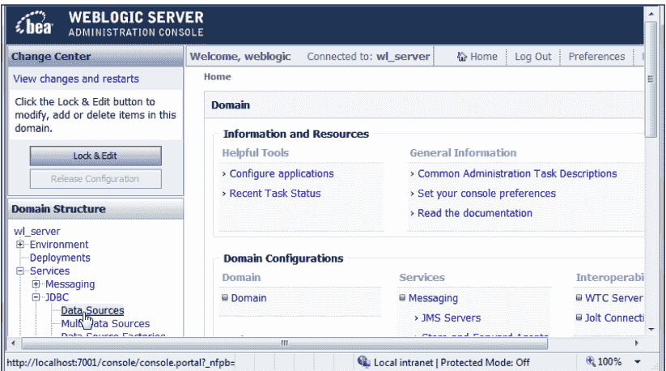

单击 Lock & Edit 以激活数据源页面按钮。要创建新的 JDBC 数据源，请在数据源表中单击 New。

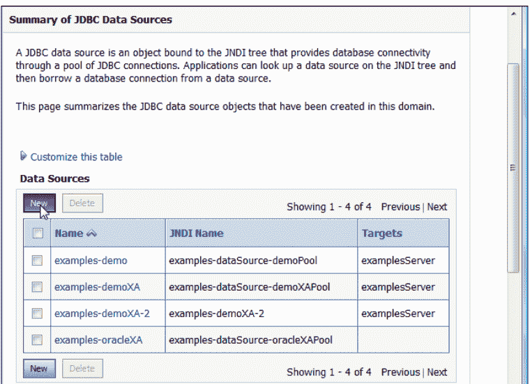

在 **创建新的 JDBC 数据源** 窗口中，指定数据源名称和数据源的 **JNDI 名称**。数据源使用 JNDI 名称绑定到 JNDI 命名服务。选择 **数据库类型**，并使用 Oracle 数据库创建数据源。选择 Oracle 作为数据库类型，并选择 Oracle 的驱动程序（精简版）作为 **数据库驱动程序**，然后单击下一步。

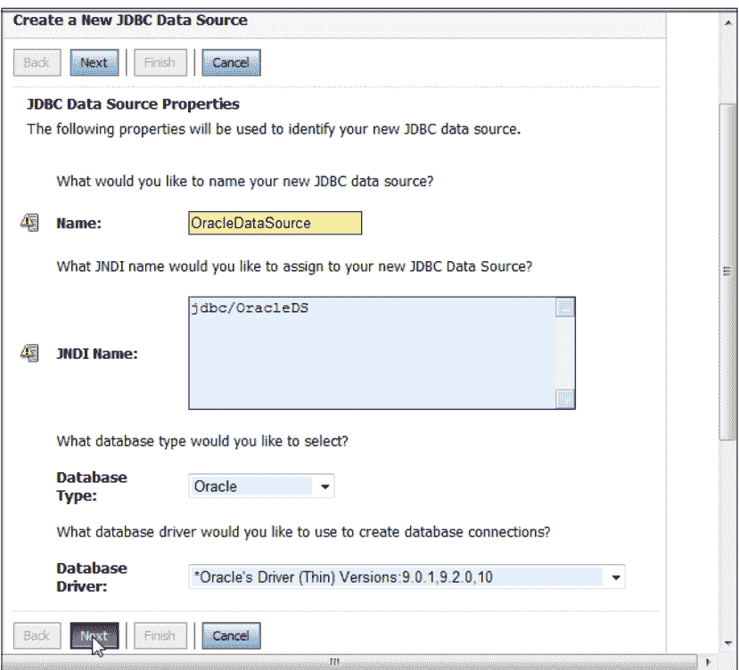

数据源可以配置为使用任何常用数据库。
WebLogic Server 为 DB2、Informix、Oracle、SQL Server 和 Sybase 提供来自 DataDirect 的 Type 4 JDBC 驱动程序。BEA 品牌的 DataDirect、Sybase jConnect 和 Oracle 精简驱动程序已安装在 <weblogic9.1>/server/lib 目录中。
WebLogic Server 提供的不同 JDBC Type 4 驱动程序列在下表中：

| 支持的数据库版本 | 驱动程序类 | 连接 URL |
|---|---|---|
| DB2 UDB 7.x、8.1 和 8.2 在 Linux、Unix 和 Windows 上。 | XA-weblogic.jdbcx.DB2DataSource.<br>非 XA- weblogic.jdbc.db2.DB2Driver. | jdbc:bea:db2://db2_server_name:port;<br>DatabaseName= database |
| Informix 9.4 及更高版本。 | XA- weblogic.jdbcx.informix.InformixDataSource.<br>非 XA- weblogic.jdbc.informix.InformixDriver. | jdbc:bea:informix://dserver1:1543;<br>informixServer= dserver1;<br>databaseName= dbname |
| MS SQL Server 7.0、SQL Server 2000(SP1、SP2 和 SP3a) 和 SQL Server 2005。 | XA- weblogic.jdbcx.sqlserver.SQLServerDataSource.<br>非 XA- weblogic.jdbc.sqlserver.SQLServerDriver. | jdbc:bea:sqlserver://dserver:port |
| Oracle 9i（R1 和 R2）Oracle 10g。 | XA- weblogic.jdbcx.oracle.OracleDataSource.<br>非 XA- weblogic.jdbc.oracle.OracleDriver. | jdbc:bea:oracle://dserver:port |
| Sybase Adaptive Server 11.5、11.9、12.0、12.5、15。 | XA- weblogic.jdbcx.sybase.SybaseDataSource.<br>非 XA- weblogic.jdbc.Sybase.SybaseDriver. | jdbc:bea:sybase://dserver:port |

可以选中不包含 JDBC 驱动程序的数据库。如果选中此类驱动程序，请将驱动程序 zip 或 JAR 文件添加到 `startWebLogic` 脚本中的 `CLASSPATH` 变量；否则将 JAR 或 zip 文件添加到服务器 `lib` 目录。通过指定“其他”，并手动将驱动程序类名输入到控制台，可以使用对 DBMS 的 JDBC 驱动程序。任何 Type 4 JDBC 驱动程序都可以手动添加到 start-weblogic 脚本的类路径中，而无需放入服务器或 lib 目录：

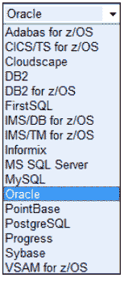

在 **事务选项** 窗口中，指定数据源的事务属性。如果选择 XA 驱动程序，将自动使用两阶段提交事务协议支持全局事务。全局、分布式或 XA 事务是指涉及多个 DBMS 或资源并且需要 2 阶段提交协议以确保事务全部成功或全部失败的事务。全局事务由使用 JTA 的事务管理器管理。对于非 XA 数据源要支持全局事务，请选中 **全局事务** 复选框。选择支持全局事务的协议。不同的事务协议列在下表中：

| 事务协议 | 描述 |
|---|---|
| Logging Last Resource (LLR)。 | LLR 优化与 XA JDBC 驱动程序相比，对于插入、更新和删除操作提供了更好的性能。XA 驱动程序对于读取操作提供了更好的性能。推荐使用两阶段提交。 |
| 两阶段提交。 | 使用 JTA 模拟对全局事务的参与。 |
| 一阶段提交。 | 这是默认设置。使用一阶段提交时，只能有一个资源参与全局事务。 |


在“事务选项”页面中，单击下一步。在“连接属性”窗口中，将数据库名称指定为 ORCL。主机名为 localhost，端口为 1521，用户名为 OE。指定 OE 用户名的密码并单击下一步按钮：

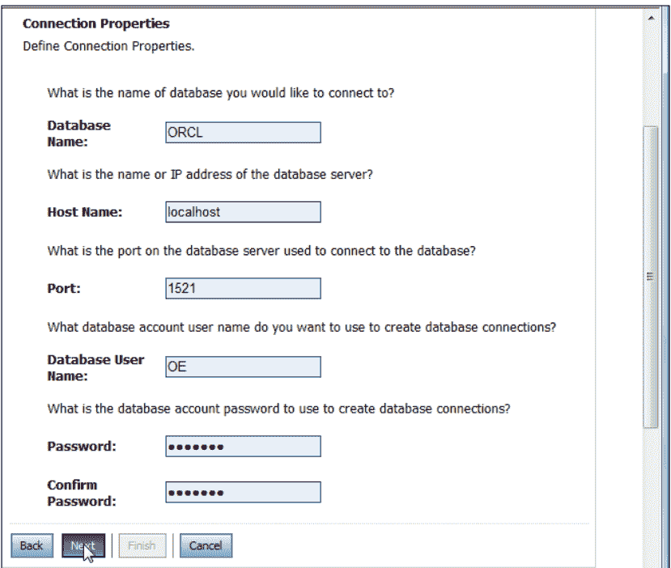

在 **测试数据库连接** 窗口中，指定了 Oracle 数据库的驱动程序类名、连接 URL 和用户名。单击 **测试数据库配置** 以测试与数据库的连接：

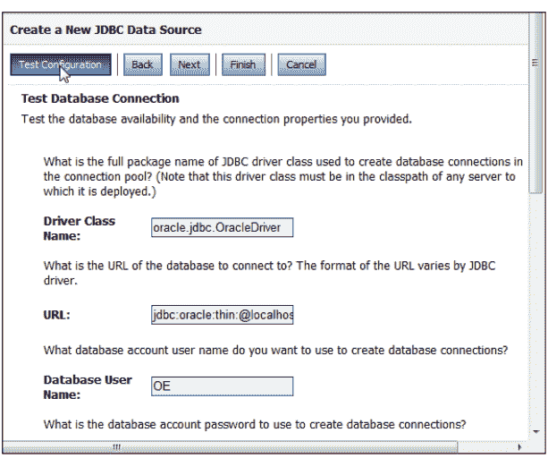

显示一条消息，表明已建立连接。如果数据库未连接并显示错误消息，则单击 **下一步** 按钮。在 **选择目标** 窗口中，选择要部署数据源的服务器。要部署到示例服务器，请选择 `examplesServer`，然后单击 **完成**。

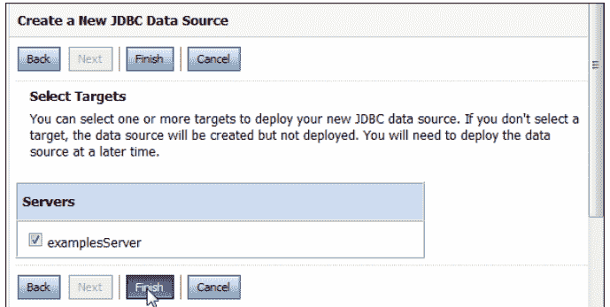

数据源已配置并添加到 **数据源** 表中。数据源使用命名服务和目标服务器注册了 JNDI 名称，该数据源已部署并也在数据源表中列出：

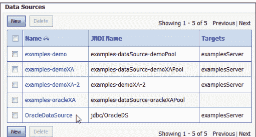

通过单击 **激活更改** 按钮，使数据源可供服务器中的应用程序使用。在未选择 **激活更改** 或 **撤消所有更改** 按钮之前，Web 应用程序不会部署到 WebLogic 服务器。

## 配置数据源

将在上一节中创建的数据源进行配置。在数据源表中选择要配置的数据源，并选择 **配置** 选项卡，这是默认设置。在 **配置** 窗口中，可以修改数据源 JNDI 名称：

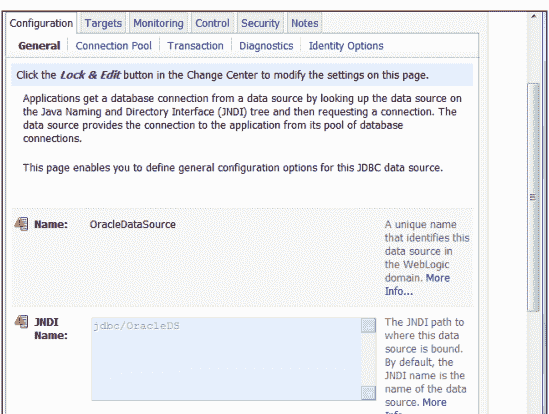

数据源的其他配置选项列在下表中：

| 数据源设置 | 描述 |
|---|---|
| 行预取 | 行预取在一次服务器访问中从服务器向客户端获取多行，从而提高其性能。 |
| 行预取大小 | 如果启用了行预取，请指定要获取的行数。要获取的行的最佳大小取决于查询。 |
| 流块大小 | 指定用于流式传输数据类型的的数据块大小。 |

选择 **连接池** 链接以配置与数据源关联的连接池。初始容量、最大容量和容量增量可在连接池配置中设置。**高级** 链接用于设置高级连接池属性。一些连接池设置列在下表中：

| 连接池设置 | 描述 |
|---|---|
| 初始容量 | 指定连接池中的初始连接数。它还指定连接池中可用连接的最小数量。 |
| 最大容量 | 指定连接池中的最大连接数。 |
| 容量增量 | 指定在一次连接增量中添加到连接池的连接数。 |
| 语句缓存类型 | 指定用于缓存预编译语句的算法。如果值为 LRU，并且创建了新语句，则缓存中 **最近最少使用** 的语句将被替换。如果值为 FIXED，则首先填充缓存的语句将永久保留。 |
| 测试保留时连接。 | 如果选中测试保留时连接复选框，则在将连接提供给客户端之前会对其进行测试。对于使用故障转移算法创建的多数据源中的连接池，需要进行测试。如果选择了测试保留时连接，则应指定测试表名。 |
| 测试频率 | 指定以秒为单位测试连接池中未使用连接的间隔。如果测试失败，则关闭并重新打开连接。再次，如果测试失败，则关闭连接。如果指定测试频率大于 0，则应指定测试表名。 |

| 连接池设置 | 描述 |
|---|---|
| 测试表名 | 指定用于测试连接的数据库表。为提高测试效果，请指定一个没有行或只有几行的表。用于测试连接的 SQL 查询可以用以下方式指定：SQL <query>。 <query> 是用于测试数据库连接的查询。 |
| 初始化 SQL | 指定用于初始化与数据库连接的 SQL 语句。SQL 语句的指定方式为：SQL <sql statement>。 <sql statement> 是用于测试连接的 SQL 语句。可以不指定字段开头的 'SQL' 来指定数据库表。如果指定了数据库表，则使用 SQL 语句："SELECT count(*) from InitSQL" 测试数据库连接。 |
| 收缩频率 | 指定使用预增量值减少连接池大小的等待时间。 |
| 连接创建重试频率。 | 指定每次尝试与数据库建立连接之间的秒数。 |
| 非活动连接超时。 | 指定未使用的连接返回到连接池的秒数。 |
| 登录延迟。 | 指定建立与数据库连接的延迟秒数。它用于无法处理连续连接请求的数据库服务器。 |
| 最大等待连接数 | 指定等待从连接池获取连接的连接请求的最大数量。 |
| 连接保留超时 | 指定连接请求超时后的秒数。 |
| 语句超时 | 指定语句超时后的秒数。 |

可以使用 **事务** 链接配置事务协议设置。可以使用 **诊断** 链接收集监控统计信息。可以收集概要信息。一些数据源概要列在下表中：

| 配置文件 | 描述 |
|---|---|
| 配置文件连接使用 | 收集有关当前使用连接池中连接的线程的概要信息。 |
| 配置文件连接保留等待 | 收集有关当前等待从连接池保留连接的线程的概要信息。 |
| 配置文件连接泄漏 | 收集有关从连接池保留连接并发生连接泄漏的线程的概要信息。 |

| 配置文件 | 描述 |
|---|---|
| 配置文件连接使用。 | 收集有关当前使用连接池中连接的线程的概要信息。 |
| 配置文件连接保留失败。 | 收集有关未能从连接池保留连接的线程的概要信息。 |
| 配置文件语句缓存条目。 | 收集有关添加到语句缓存的可调用语句和预编译语句以及创建这些语句的线程的概要信息。 |
| 配置文件语句使用 | 收集有关当前执行语句缓存中语句的线程的概要信息。 |
| 配置文件连接最后使用 | 收集有关最后使用连接池中连接的上一个线程的概要信息。 |
| 配置文件连接多线程使用 | 收集有关错误使用先前由不同线程获取的连接的线程的概要信息。 |
| 配置文件收获频率 | WebLogic Server 收获概要数据的线程之间的间隔，以秒为单位。 |

选择 **监控** 选项卡以监控数据源。选择 **控制** 选项卡以管理由数据源部署的 WebLogic Server 实例。在已部署的服务器实例中，可以清除语句缓存，并可以挂起或关闭服务器。

## 创建多数据源

多数据源是一个提供故障转移和负载均衡的抽象数据源组。多数据源具有与数据源类似的 JNDI 绑定。要创建多数据源，请在管理控制台中单击 **服务** | **JDBC** | **多数据源** 链接：

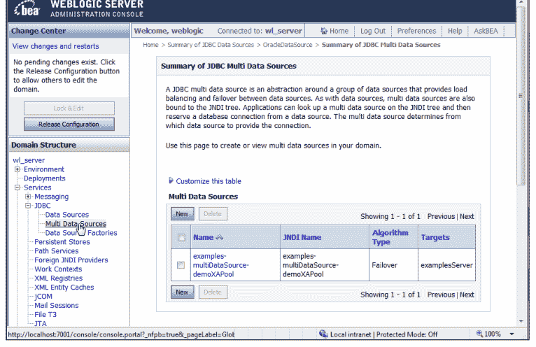

在“多数据源”表中，单击“新建”按钮以创建新的多数据源。在“配置多数据源”窗口中，指定数据源名称和 JNDI 名称。选择算法类型为故障转移或负载均衡，然后单击“下一步”。

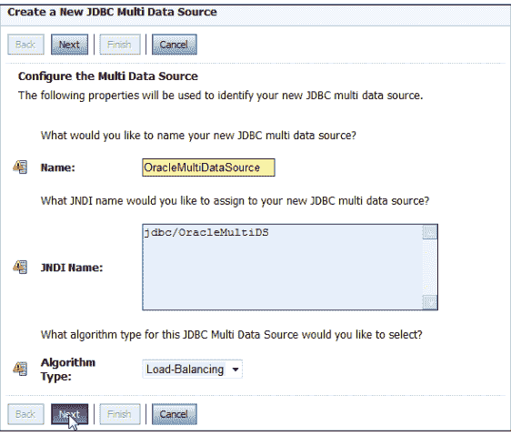

在“**选择目标**”窗口中，通过将多数据源部署到其上，选择 **examplesServer** 或其他任何服务器，然后单击“下一步”。

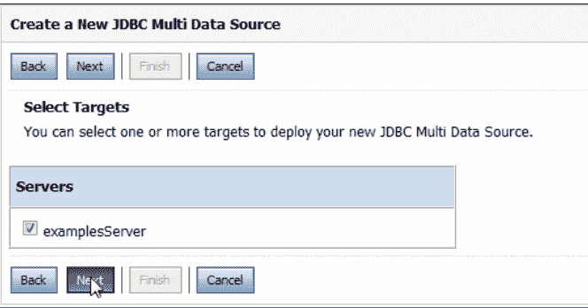

在“**选择数据源类型**”窗口中，为 XA 数据源选择 XA 驱动程序，或为非 XA 数据源选择非 XA 驱动程序，然后单击“**下一步**”。由于我们使用非 XA JDBC 驱动程序创建了 Oracle 数据源，请选择非 XA 驱动程序。在“**添加数据源**”窗口中，将数据源从“**可用**”列表添加到“**已选**”列表。如果需要新的数据源，请单击“**创建新的数据源**”按钮，然后单击“**完成**”。

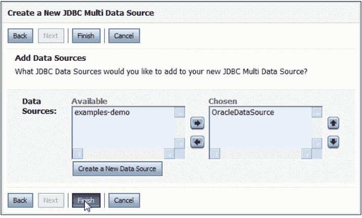

新数据源已配置并添加到“**多数据源**”表。单击“**激活更改**”按钮以使数据源可供应用程序使用。

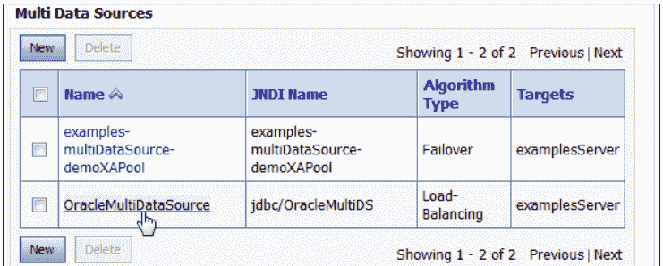

可以通过选择多数据源链接来配置多数据源。部署多数据源的目标可以通过“**目标**”选项卡进行配置。多数据源中的数据源可以通过“**配置**”选项卡中的数据源链接进行配置。多数据源 JNDI 名称可以在“**配置 | 通用**”窗口中修改。“**算法类型**”指定用于选择获取连接的数据源的算法。如果算法类型为“**故障转移**”，连接请求始终发送到列表中的第一个数据源。如果第一个数据源与 DBMS 失去连接，则连接请求将依次发送到列表中的下一个数据源，直到获得连接或到达数据源列表末尾。如果算法类型为“**负载均衡**”，连接请求的负载将在列表中的数据源之间平均分配。如果选择负载均衡，则连接请求也提供连接故障转移。这些连接请求将被发送到列表中的不同数据源，直到建立连接或到达数据源列表末尾。

多数据源还提供“**繁忙时故障转移请求**”、“**故障转移回调处理程序**”和“**测试频率**”设置。对于使用故障转移算法的多数据源，当选择“**繁忙时故障转移请求**”时，如果数据源中的所有连接都忙，则连接请求将发送到数据源池中的下一个数据源。“**故障转移回调处理程序**”指定用于处理回调的应用程序类，该回调在多数据源准备向另一个数据源发送故障转移连接请求时发送。“**测试频率**”指定测试连接的间隔（以秒为单位）。如果连接失败，则关闭并重新打开连接。如果连接再次失败，则关闭连接。

WebLogic Server 9.x 还支持数据源工厂。应用程序范围的连接池使用 JDBC 数据源工厂提供默认连接池值。通过单击“服务 | JDBC | 数据源工厂”链接来配置数据源工厂。在“数据源工厂”表中单击“新建”。在“创建新的 JDBC 数据源工厂”窗口中，指定数据源工厂名称、用户名和密码。这些用于登录数据库、连接 URL、驱动程序类名称和工厂名称，然后单击“确定”。数据源工厂已创建，可以部署到目标服务器节点。数据源工厂名称在管理控制台和配置文件 config.xml 中使用。工厂名称在部署描述符中使用。

## JDBC 性能调优

为了获得最佳稳定性和性能，请配置池在启动期间创建所需的所有连接，并无限期保留它们。因此，将初始容量设置为等于最大容量，这对于每个执行线程都是相同的。WebLogic Server 数据源提供的连接池通过为 JDBC 应用程序提供连接池来提高性能。无需为每个客户端打开和关闭连接。

“保留时测试连接”会在将连接提供给客户端之前测试连接，并可能降低性能。为防止频繁的连接测试，请设置连接池属性“Seconds to Trust an Idle Pool Connection”。此属性指定已知已成功使用的连接不使用 SQL 查询进行测试的秒数。当在外部客户端 JVM 中使用 RMI 通过 WebLogic 执行 JDBC 到 DBMS 时，通过在配置数据源时选择“启用行预取”并设置最佳预取大小，可以提高数据源性能。行预取通过从服务器向外部客户端预取多行来提高性能。不建议通过 WebLogic 在外部客户端中使用行预取。在 WebLogic JVM、JSP、servlet、EJB 等中执行 JDBC 要快得多。语句缓存通过重用语句而不是创建新语句来提高连接测试的性能。语句缓存在连接池配置中指定。

以下是无风险 WebLogic JDBC 编码风格的理想标准。池化速度很快，最好以快速的每次调用方式使用：

```
/* This is how you should make any of your top-level methods that will produce JDBC, work for any of your applications. */
```

```
public void myTopLevelJDBCMethod()
{
    Connection c = null;

    /* All JDBC objects would be method level objects that ensure thread-safety and
    prevent connection leaking. Define the connection object before the JDBC 'try'
    block.*/
    try
    {
        /* The above is the JDBC try block for the method. All the JDBCs' for this method in
        the block is connected directly from the DataSource in the try block. Do not connect
        it from any method that has kept a connection, and is sharing it for repeated use.*/
        c = myDataSource.getConnection();

        /* You can pass the connection or sub-objects to sub-methods but none of these
        methods must expect to keep or use the objects they receive after their method call
        completes (eg).*/
        DoSomethingFancyWith(c);

        /* Use Prepared or Callable Statements. They are usually faster, because we cache
        them transparently with the pool.*/
        PreparedStatement p = c.prepareStatement(...);
        ResultSet rs = p.executeQuery();
        ProcessResult(rs);

        /* Close JDBC objects in the proper order: first resultset,; then statement; and then
        connection.*/
        rs.close();

        /* Always close result sets as soon as possible (ASAP) at the levels they were
        created*/
        p.close();

        /* Always close statements ASAP at the levels they were created. When the JDBC is
        processed in the try-block, close the connection:*/
        c.close();

        /* Always close connection-ASAP in the same method and the block that was used
        to create or obtain it.*/
        c = null;

        /* Set the connection to null, so that the finally block below knows that it has been taken care of.*/
    }
    catch (Exception e )
    {
        /* Do whatever, according to your needs. You would not have a catch block, if it is not needed.*/
    }
    finally
    {
        /* Always have the above finally block. A finally block is crucial to ensure that the connection is closed and returned to the pool, and is not leaked.*/
        /* Failsafe: Do every individual thing you want to do in the finally block in it's own try block-catch-ignore so everything is attempted.*/
        try
        {
            if (c != null) c.close();
        }
        catch (Exception ignore)
        {
        }
    }
}
```

## 从 JDeveloper 部署 Web 应用程序到 WebLogic Server

我们将开发一个 Web 应用程序，从“配置数据源”部分中配置的数据源检索 Oracle 数据库表中的数据。在 Oracle 数据库中创建一个示例数据库表。使用 SQL*Plus 等 SQL 客户端工具或命令行实用程序，使用以下 SQL 脚本创建表 Catalog：

```
CREATE TABLE Catalog (CatalogId INTEGER PRIMARY KEY, Journal VARCHAR(25), Publisher VARCHAR(25), Edition VARCHAR(25), Title Varchar(45), Author Varchar(25));
INSERT INTO Catalog VALUES ('1', 'Oracle Magazine', 'Oracle Publishing', 'Nov-Dec 2004', 'Database Resource Manager', 'Kimberly Floss');
INSERT INTO Catalog VALUES ('2', 'Oracle Magazine', 'Oracle Publishing', 'Nov-Dec 2004', 'From ADF UIX to JSF', 'Jonas Jacobi');
INSERT INTO Catalog VALUES ('3', 'Oracle Magazine', 'Oracle Publishing', 'March-April 2005', 'Starting with Oracle ADF ', 'Steve Muench');
```


我们将在 JDeveloper 中创建一个 Web 应用程序以访问 Oracle 数据库。在启动 JDeveloper 之前，我们需要将 <Weblogic91>\server\lib\weblogic.jar 复制到 <JDeveloper>\jdev\lib\ext 目录。<WebLogic91> 是安装 WebLogic Server 9.1 的目录。<JDeveloper> 是安装 JDeveloper 的目录。选择 File | New 创建新的应用程序和项目。在 New Gallery 窗口中，在 Categories 中选择 General，在 Items 中选择 Application，然后单击 OK。在 Create Application 窗口中，指定应用程序名称并单击 OK。在 Create Project 窗口中，指定项目名称并单击 OK。在 Applications Navigator 中添加了一个应用程序和一个项目，并创建了一个 JSP，catalog.jsp。选择 File | New，并在 New Gallery 窗口中在 Categories 中选择 Web Tier | JSP。在 Items 中选择 JSP 并单击 OK。一个 JSP 已添加到 Applications Navigator。

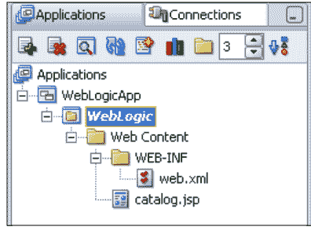

在 JSP 中导入 java.sql、javax.sql 和 javax.naming 包。我们必须创建一个 InitialContext 对象，该对象是 JNDI 命名操作所必需的：

```
InitialContext ctx=new InitialContext();
```

之前，我们已创建了一个 JNDI 名称为 jdbc/OracleDS 的数据源。使用 lookup() 方法从 JNDI 名称创建 DataSource 对象：

```
DataSource ds=(DataSource)ctx.lookup("jdbc/OracleDS");
```

从 DataSource 对象获取 JDBC 连接。使用 DataSource 对象的 getConnection() 方法创建 Connection 对象：

```
Connection connection=ds.getConnection();
```

使用 createStatement() 方法从 Connection 对象创建 Statement 对象：

```
Statement stmt=connection.createStatement();
```

使用 executeQuery() 方法运行 SQL 查询以返回 ResultSet 对象。指定一个 SQL 查询，该查询选择示例数据库表 Catalog 的所有列：

```
ResultSet resultSet=stmt.executeQuery("Select * from Catalog");
```

创建一个 HTML 表格，其中每一行对应结果集中的每一行，每一列对应结果集中的每一列。向 html 表格添加标题行。遍历结果集，并将行值添加到 html 表格中：

```
while (resultSet.next())
{
<tr>
<td><%=out.println(resultSet.getString(1));%></td>
</tr>
}
```

用于从配置在 WebLogic 服务器中的数据源的示例数据库表中生成 HTML 表格的 JSP 页面 catalog.jsp 如下所示：

```
<%@ page contentType="text/html"%>
<%@ page import="java.sql.*,javax.sql.*,javax.naming.*"%>
<html>
<head>
<meta http-equiv="Content-Type" content="text/html">
<title>WebLogic Application</title>
</head>
<body>
<%
InitialContext ctx=new InitialContext();
DataSource ds=(DataSource)ctx.lookup("jdbc/OracleDS");
Connection connection=ds.getConnection();
Statement stmt=connection.createStatement();
ResultSet resultSet=stmt.executeQuery("Select * from Catalog");
%>
<table border="1" cellspacing="0">
<tr>
<th>CatalogId</th>
<th>Journal</th>
<th>Publisher</th>
<th>Edition</th>
<th>Title</th>
<th>Author</th>
</tr>
<%
    while (resultSet.next())
    {
%>
<tr>
    <td><%=out.println(resultSet.getString(1));%></td>
    <td><%=out.println(resultSet.getString(2));%></td>
    <td><%=out.println(resultSet.getString(3));%></td>
    <td><%=out.println(resultSet.getString(4));%></td>
    <td><%=out.println(resultSet.getString(5));%></td>
    <td><%=out.println(resultSet.getString(6));%></td>
</tr>
<%
    }
    resultSet.close();
    stmt.close();
    connection.close();
%>
</table>
</body>
</html>
```

我们将把 Web 应用程序部署到 WebLogic 服务器。<JDeveloper> 是安装 JDeveloper 的目录。要将 Web 应用程序部署到 WebLogic 服务器，我们必须执行以下操作：

- 1. 创建到 WebLogic Server 的连接。
- 2. 为 Web 应用程序创建部署配置文件。
- 3. 使用到服务器的连接将部署配置文件部署到 WebLogic Server。

## 在 WebLogic Server 中配置 JDBC

我们必须启动 WebLogic 服务器以建立与服务器的连接。要创建到 WebLogic Server 的连接，请在 **Connections** 导航器中右键单击 **Application Server** 节点，并选择 **New Application Server Connection**。

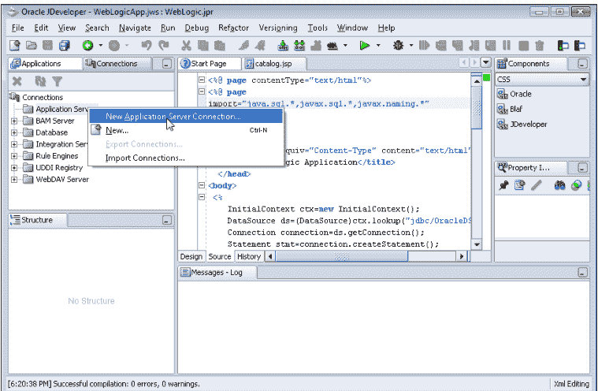

在 **Create Application Server Connection Wizard** 中单击 **Next**。在 **Type** 窗口中，指定 Connection Name 并将 Connection Type 选择为 WebLogic Server 9.x，然后单击 **Next**。

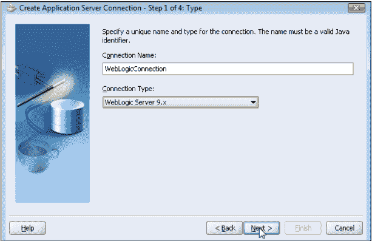

在 Authentication 窗口中指定用户名（默认为 'weblogic'）和密码（默认为 'weblogic'），这些是在安装 WebLogic 服务器时指定的。在 Connection 窗口中，将 Host Name 指定为 localhost，Port 指定为 1521，Target Node 指定为 examplesServer，并指定 weblogic.jar 的路径。

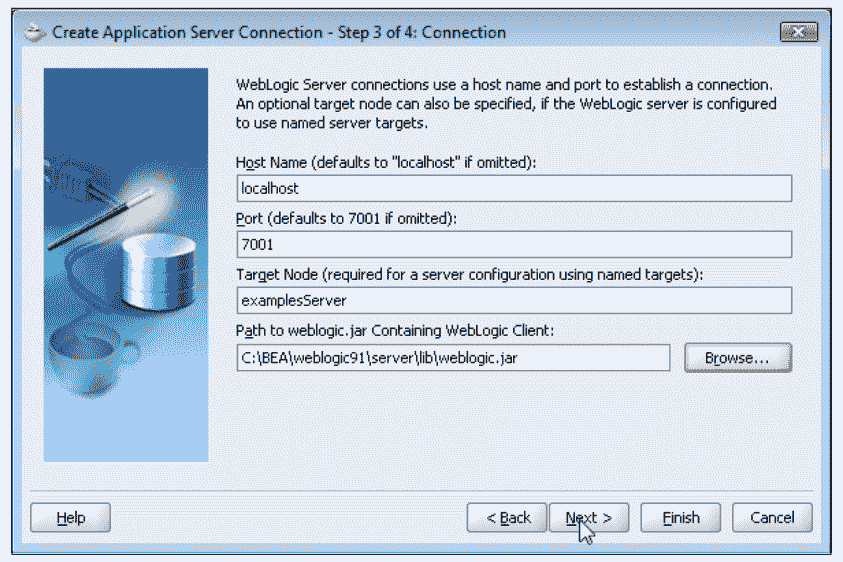

在 Test 窗口中，单击 Test Connection 按钮以测试与 WebLogic 服务器的连接。如果建立了连接，则会显示 "Success" 消息。如果未建立连接，则会生成错误消息。例如，如果在测试与服务器的连接之前未启动 WebLogic 服务器，则会生成错误。应用程序服务器连接节点已添加到 Connections 导航器中。

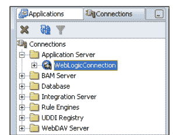

我们将从 Web 应用程序创建部署配置文件。选择 **File | New**，并在 **New Gallery** 窗口中选择 **General | Deployment Profiles**。在 **Items** 中选择 **WAR File** 并单击 **OK**。

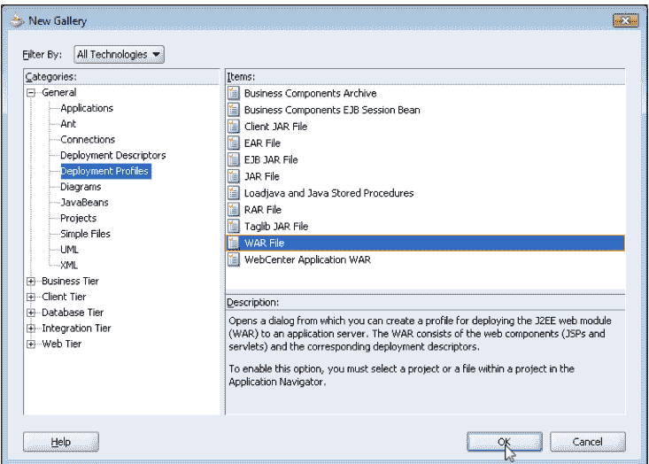

在 **Create Deployment Profile** 窗口中，指定部署配置文件名称 `webapp1`，这是默认值，然后单击 **OK**。在 WAR Deployment Profile Properties 窗口中将 J2EE web context root 指定为 '`weblogic`'。我们与 WebLogic 服务器创建的连接是 `t3` 协议连接。默认情况下，部署配置文件使用 `http` 协议部署到 WebLogic 服务器。因此，我们必须将部署配置文件协议修改为 `t3`。选择 **Platform | WebLogic 9.x** 节点，将 **adminurl** 选项从 `http://${hostname}:${port}` 修改为 `t3://${hostname}:${port}` 并单击 **OK**。

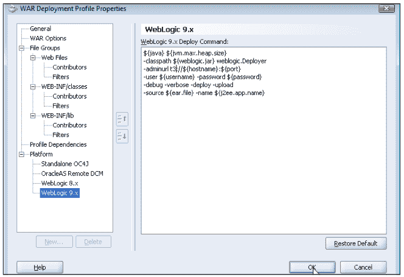

在 J2EE 应用程序部署到 WebLogic Server 之前，WebLogic Server 必须不处于 Lock & Edit 模式。通过右键单击部署配置文件并选择 Deploy to | WebLogicConnection 链接来部署部署配置文件到 WebLogic Server。

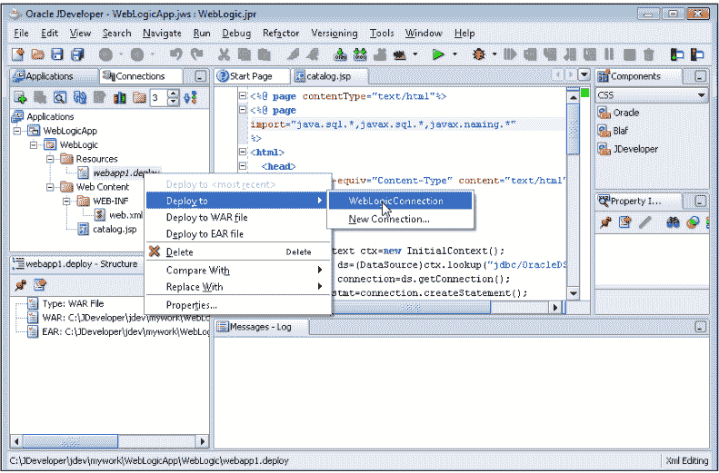

Web 应用程序已部署到 WebLogic Server，JDeveloper 中的输出如下所示：

```
Deployment started.
Target platform is WebLogic Server 9.x (WebLogicConnection).
Checking weblogic.xml for completeness...
Wrote WAR file to C:\JDeveloper\jdev\mywork\WebLogicApp\WebLogic\deploy\webapp1.war
Wrote EAR file to C:\JDeveloper\jdev\mywork\WebLogicApp\WebLogic\deploy\webapp1.ear
C:\JDeveloper\jdk\jre\bin\javaw.exe -classpath
C:\wls\weblogic91\server\lib\weblogic.jar weblogic.Deployer -adminurl t3://localhost:7001 -user weblogic -password **** -debug -verbose -deploy -upload -source
C:\JDeveloper\jdev\mywork\WebLogicApp\WebLogic\deploy\webapp1.ear -name webapp1
weblogic.Deployer invoked with options: -adminurl t3://localhost:7001 -user weblogic -debug -verbose -deploy -upload -source
C:\JDeveloper\jdev\mywork\WebLogicApp\WebLogic\deploy\webapp1.ear -name webapp1
[WebLogicDeploymentManagerImpl.<init>():103] : Constructing DeploymentManager for J2EE version V1_4 deployments
[WebLogicDeploymentManagerImpl.getNewConnection():146] : Connecting to admin server at localhost:7001, as user weblogic
[ServerConnectionImpl.getEnvironment():282] : setting environment
[ServerConnectionImpl.getEnvironment():285] : getting context using t3://localhost:7001
[ServerConnectionImpl.getMBeanServer():237] : Connecting to MBeanServer at service:jmx:t3://localhost:7001/jndi/weblogic.management.mbeanservers.domainruntime
[ServerConnectionImpl.getMBeanServer():237] : Connecting to MBeanServer at service:jmx:t3://localhost:7001/jndi/weblogic.management.mbeanservers.runtime
[DomainManager.resetDomain():36] : Getting new domain
[DomainManager.resetDomain():39] : Using pending domain: false
[MBeanCache.addNotificationListener():96] : Adding notification listener for weblogic.deploy.api.spi.deploy.mbeans.TargetCache@1827d1
[MBeanCache.addNotificationListener():103] : Added notification listener for weblogic.deploy.api.spi.deploy.mbeans.TargetCache@1827d1
[MBeanCache.addNotificationListener():96] : Adding notification listener for weblogic.deploy.api.spi.deploy.mbeans.ModuleCache@8f9a32
[MBeanCache.addNotificationListener():103] : Added notification listener for weblogic.deploy.api.spi.deploy.mbeans.ModuleCache@8f9a32
[ServerConnectionImpl.initialize():170] : Connected to WLS domain: wl_server
```

[ServerConnectionImpl.setRemote():463] : 运行于远程模式
[ServerConnectionImpl.init():160] : 初始化 ServerConnection :
weblogic.deploy.api.spi.deploy.internal.ServerConnectionImpl@111bfbc
[BasicOperation.dumpTmids():744] : 传入的 tmids:
[BasicOperation.deriveAppName():139] : 应用名称已确定为: webapp1
<Info> <J2EE Deployment SPI> <BEA-260121> <启动针对应用程序 webapp1 的部署操作 [archive: C:\JDeveloper\jdev\mywork\WebLogicApp\WebLogic\deploy\webapp1.ear,] 到已配置的目标。>
[ServerConnectionImpl.upload():639] : 已将应用上传到 C:\wls\weblogic91\samples\domains\wl_server\.\servers\examplesServer\upload\webapp1
[BasicOperation.hasJMSModules():489] : 检查 jms 是否存在: META-INF/application.xml
[BasicOperation.hasJMSModules():489] : 检查 jms 是否存在: webapp1.war
[BasicOperation.dumpTmids():744] : 传入的 tmids:
[BasicOperation.dumpTmids():746] : {Target=examplesServer, WebLogicTargetType=server, Name=webapp1}, targeted=true
[BasicOperation.loadGeneralOptions():661] : 删除文件:false
超时 :3600000
目标: examplesServer
模块目标={}
子模块目标={}
}
文件: null
部署计划: null
应用根目录: C:\wls\weblogic91\samples\domains\wl_server\.\servers\examplesServer\upload\webapp1
应用配置: C:\wls\weblogic91\samples\domains\wl_server\.\servers\examplesServer\upload\webapp1\plan
部署选项:
{isRetireGracefully=true,isGracefulProductionToAdmin=false,isGracefulIgnoreSessions=false,retireTimeoutSecs= 1,undeployAllVersions=false,archiveVersion=null,planVersion=null,isLibrary=false,libSpecVersion=null,libImplVersion=null,stageMode=null,clusterTimeout=3600000,altDD=null,altWlsDD=null,name=webapp1,securityModel=null,securityValidationEnabled=false,versionIdentifier=null,isTestMode=false,forceUndeployTimeout=0,defaultSubmoduleTargets=true,timeout=0}
[BasicOperation.execute():401] : 启动针对应用 webapp1 的部署操作，目标为：
任务 1 已启动: [Deployer:149026]deploy application webapp1 on examplesServer.
任务 1 已完成: [Deployer:149026]deploy application webapp1 on examplesServer.
目标状态: deploy completed on Server examplesServer
[ServerConnectionImpl.close():328] : 关闭 DM 连接
[ServerConnectionImpl.close():348] : 注销所有监听器
[ServerConnectionImpl.closeJMX():368] : 已关闭 JMX 连接
[ServerConnectionImpl.closeJMX():380] : 已关闭 Runtime JMX 连接
部署耗时: 2 分钟, 10 秒
----  部署完成。

使用 URL http://localhost:7001/weblogic/catalog.jsp 调用 JSP。
JSP 在 WebLogic 服务器中运行并生成一个 html 表格：

| 目录ID | 期刊 | 出版社 | 版本 | 标题 | 作者 |
|---|---|---|---|---|---|
| 1 | Oracle Magazine | Oracle Publishing | Nov-Dec 2004 | Database Resource Manager | Kimberly Floss |
| 2 | Oracle Magazine | Oracle Publishing | Nov-Dec 2004 | From ADF UIX to JSF | Jonas Jacobi |
| 3 | Oracle Magazine | Oracle Publishing | March-April 2005 | Starting with Oracle ADF | Steve Muench |

## JDBC 4.0 版本

WebLogic Server 9.x 也不支持 JDBC 4.0，10.x 也不支持。在 WebLogic Server 的后续版本中，我们可以使用 JDBC 4.0 中的新功能。为使用 JDBC 4.0 驱动程序，我们将修改 catalog.jsp 以从 WebLogic Server 连接到 Oracle 数据库。Oracle 数据库 11g JDBC 驱动程序支持 JDBC 4.0，可从以下位置下载： http://www.oracle.com/technology/software/tech/java/sqlj_jdbc/htdocs/jdbc_111060.html。可以通过将 JDBC 4.0 JAR 文件 ojdbc6.jar 添加到服务器 lib 目录，或添加到 startWebLogic 脚本的 classpath 变量中来使用 JDBC 4.0 功能。JDBC 4.0 已添加对在 Connection 对象上设置客户端信息属性的支持，以标识可能拖慢应用程序的连接。标准客户端信息属性为 ApplicationName、ClientUser 和 ClientHostname。在 Web 应用程序的 JDBC 4.0 版本中，在 Connection 对象上设置标准客户端信息属性：

```
connection.setClientInfo("ApplicationName","OracleApp");
connection.setClientInfo("ClientUser","OracleUser");
connection.setClientInfo("ClientHostname","OracleHost");
```

Connection state tracking 是 JDBC 4.0 中添加的连接管理功能。Connection state tracking 用于标识不可用的连接并关闭这些连接。Connection state tracking 由 WebLogic 连接池管理器使用 Connection 对象的 isValid() 方法实现：

```
if(!connection.isValid())
connection.close();
```

PreparedStatements 在连接池中默认会被池化，前提是数据库支持语句池化。语句池化减少了频繁使用的语句的打开、初始化和关闭开销。JDBC 4.0 还添加了对 Statement 对象池化的支持。默认情况下，WebLogic Server 对所有 DBMS 或驱动程序池化语句。在 JDBC 4.0 中，语句池化的支持与 WebLogic JDBC 应用程序无关。

Oracle JDBC 提供了对 JDBC API 的一些扩展，具有额外的方法。JDBC 4.0 添加了一个名为 wrapper pattern 的新功能，可用于访问特定于厂商的 JDBC 资源。wrapper pattern 在 Wrapper 接口中实现，该接口由以下接口扩展：

- java.sql.Connection
- java.sql.Statement
- java.sql.DatabaseMetaData
- java.sql.ParameterMetaData
- java.sql.ResultSetMetaData
- java.sql.ResultSet
- javax.sql.DataSource

Oracle JDBC API 提供了 oracle.jdbc.OracleStatement 接口作为 java.sql.Statement 接口的扩展。OracleStatement 接口可以被解包以创建其类型的对象。要创建 OracleStatement 对象，请使用 isWrapperFor() 方法测试 Statement 对象是否为 OracleStatement 接口的包装器。如果 Statement 对象是包装器，则使用下面给出的 unwrap() 方法解包 OracleStatement 接口：

```
Class class = Class.forName("oracle.jdbc.OracleStatement");
if(stmt.isWrapperFor(class))
{
OracleStatement oracleStmt = (OracleStatement)stmt.unwrap(class);
}
```

OracleStatement 对象可使用 defineColumnType() 方法设置列类型。定义列类型用于性能优化和数据类型转换。如果同一个语句对象用于运行不同的查询，则使用 clearDefines() 方法清除先前定义的列类型。将第一列的列类型设置为 OracleTypes.Number，第二列设置为 OracleTypes.VARCHAR：

```
oracleStmt.clearDefines();
oracleStmt.defineColumnType(1, OracleTypes.NUMBER);
oracleStmt.defineColumnType(2, OracleTypes.VARCHAR);
```

JDBC 4.0 还支持诸如 ROWID、NCLOB 和 NBLOB 等数据类型。Oracle 数据库支持 ROWID 数据类型。Oracle 数据库表中的 ROWID 伪列标识表中的唯一行。将 ROWID 列添加到 SELECT 查询中：

```
ResultSet resultSet=oracleStmt.executeQuery("Select ROWID, CATALOGID, JOURNAL, PUBLISHER, EDITION, TITLE, AUTHOR from Catalog");
```

在 HTML 表格中添加 ROWID 列的列，并使用 ResultSet 接口中的 getRowId() 方法向其添加值：

```
<td><%=out.println(resultSet.getRowId("ROWID").toString());%></td>
```

JDBC 4.0 已增强对链式 SQLException 的支持。链式异常和链式原因可以使用 JDK 6.0 中引入的 FOR-EACH 循环检索。在错误 JSP 页面中，FOR-EACH 循环用于输出链式异常和链式原因。以前，getNextException() 和 getCause() 方法被迭代调用以检索链式异常和链式原因：

```
<%@ page isErrorPage="true" %>
<%
for( Throwable e : exception )
{
out.println("Error encountered: " + e);
}
%>
```

catalog.jsp 的 JDBC 4.0 版本如下所示：

```
<%@ page contentType="text/html"%>
<%@ page import="java.sql.*,javax.sql.*,java.util.*,javax.naming.*, oracle.jdbc.OracleStatement"%>
<html>
<head>
<meta http-equiv="Content-Type" content="text/html">
<title>WebLogic Application</title>
</head>
<body>
<%
InitialContext ctx=new InitialContext();
DataSource ds=(DataSource)ctx.lookup("jdbc/OracleDS");
Connection connection=ds.getConnection();
connection.setClientInfo("ApplicationName","OracleApp");
connection.setClientInfo("ClientUser","OracleUser");
connection.setClientInfo("ClientHostname","OracleHost");
Statement stmt=connection.createStatement();
```

DatabaseMetaData metaData=connection.getMetaData();
if(metaData.supportsStatementPooling())
{
    if(stmt.isPoolable())
    stmt.setPoolable(true);
}
Class class = Class.forName("oracle.jdbc.OracleStatement");
if(stmt.isWrapperFor(class))
{
    OracleStatement oracleStmt = (OracleStatement)stmt.unwrap(class);
    oracleStmt.clearDefines();
    oracleStmt.defineColumnType(1, OracleTypes.NUMBER);
    oracleStmt.defineColumnType(2, OracleTypes.VARCHAR);
    oracleStmt.defineColumnType(3, OracleTypes.VARCHAR);
    oracleStmt.defineColumnType(4, OracleTypes.VARCHAR);
    oracleStmt.defineColumnType(5, OracleTypes.VARCHAR);
    oracleStmt.defineColumnType(6, OracleTypes.VARCHAR);
    oracleStmt.defineColumnType(7, OracleTypes.VARCHAR);
    ResultSet resultSet=oracleStmt.executeQuery("Select ROWID,
CATALOGID, JOURNAL, PUBLISHER, EDITION, TITLE, AUTHOR from Catalog");
%>
<table border="1" cellspacing="0">
    <tr>
        <th>CatalogId</th>
        <th>Journal</th>
        <th>Publisher</th>
        <th>Edition</th>
        <th>Title</th>
        <th>Author</th>
    </tr>
    <%
    while (resultSet.next())
    {
%>
<tr>
    <td><%=out.println(resultSet.getRowId("ROWID").toString());%></td>
    <td><%=out.println(resultSet.getString(1));%></td>
    <td><%=out.println(resultSet.getString(2));%></td>
    <td><%=out.println(resultSet.getString(3));%></td>
    <td><%=out.println(resultSet.getString(4));%></td>
    <td><%=out.println(resultSet.getString(5));%></td>
    <td><%=out.println(resultSet.getString(6));%></td>
</tr>
<%
}
resultSet.close();
stmt.close();
connection.close();
}
%>
</table>
</body>
</html>

## 摘要

WebLogic Server 9.x 引入了一个新功能，多数据源，即一组具有 JNDI 名称绑定的数据源。多数据源可最大化可用数据源。WebLogic Server 8.1 也具有名为 MultiPools 的多数据源。任何池或多池都通过 DataSource 访问。对于 9.0 及更高版本，用于访问池或多池概念的 DataSource 已合并。在 WebLogic Server 9.x 中，WebLogic Server 8.1 中使用的连接池配置已被移除。WebLogic Server 9.x 中的数据源配置提供了增强的连接请求故障转移和数据源之间的负载均衡。在支持 JDBC 4.0 的 WebLogic Server 版本中，可以使用 JDBC 4.0 的新功能，例如连接状态跟踪、Java SE 链式设施以及用于访问非标准资源的包装器模式。
