## 6 在 WebSphere Application Server 中配置 JDBC

WebSphere Application Server 6.1 是一个基于 J2EE 和 Web 服务技术的应用服务器，用于开发 J2EE 应用程序。WebSphere Application Server 用于开发 JDBC 应用程序。IBM DB2 9 提供了一些新功能，适用于开发 JDBC 4.0 应用程序。DB2 9 已添加对 SQL XML 数据类型的支持，可与 SQLXML Java 数据类型结合使用。它是 JDBC 4.0 中的一种新型数据类型，用于存储和检索 XML 文档。DB2 数据库服务器通过配置 JDBC Provider 从 WebSphere Application Server 提供访问，该术语是应用服务器中的 WebSphere 专有术语。

在本章中，我们将在 WebSphere Application Server 6.1 中配置数据源以连接到 DB2 9 数据库。我们将部署一个 Web 应用程序到 WebSphere Application Server，该应用程序包含一个 JSP，用于使用服务器中配置的数据源生成 HTML 表。我们将使用 DB2 JDBC Type 4 驱动程序创建到 DB2 9 数据库的 JDBC 连接。Type 4 驱动程序相对于 Type 2 驱动程序具有优势：它提供对 DB2 数据库的直接访问。本章中您将了解以下内容：

- 在 WebSphere Application Server 6.1 中使用 DB2 9 数据库创建 JDBC Provider。
- 在 WebSphere Application Server 6.1 中使用 DB2 9 数据库创建数据源。
- 从 JDeveloper 10g 部署 Web 应用程序到 WebSphere Application Server 6.1 以连接 DB2 数据库 9。
- Web 应用程序的 JDBC 4.0 版本。

## 设置环境

在从 WebSphere Application Server 6.1 配置与 DB2 9 数据库的 JDBC 连接之前，需要进行以下初步设置：

1. 从 http://www.ibm.com/developerworks/downloads/im/udb/?S_TACT=105AGX28&S_CMP=TRIALS 下载并安装 DB2 9 数据库。
2. 在 DB2 9 数据库服务器中创建示例数据库 SAMPLE。
3. 在数据库中创建包含期刊文章目录的示例表。创建示例表的 SQL 脚本如下所示：
4. 从 http://www14.software.ibm.com/webapp/download/preconfig.jsp?id=2005-01-19+10%3A47%3A53.647228&S_TACT=104CBW71&S_CMP= 下载 WebSphere Application Server 6.1 并安装 WebSphere Application Server。

```sql
CREATE TABLE DB2ADMIN.Catalog(CatalogId VARCHAR(25) PRIMARY KEY NOT NULL, Journal VARCHAR(25), Section VARCHAR(25), Edition VARCHAR(25), Title VARCHAR(75), Author VARCHAR(25))

INSERT INTO DB2ADMIN.Catalog VALUES('catalog1', 'developerWorks', 'Java Technology', 'Nov 2004', 'Getting started with enumerated types', 'Brett McLaughlin');

INSERT INTO DB2ADMIN.Catalog VALUES('catalog2', 'developerWorks', 'XML', 'Apr 2005', 'Transform Eclipse navigation files to DITA navigation files', 'Loretta Hicks');
```

## 配置 JDBC Provider

在本节中，我们将从 WebSphere Application Server 6.1 配置与 DB2 9 数据库的 JDBC 连接。从 First steps 控制台启动 WebSphere Application Server。从 First steps 控制台访问 WebSphere Administration 控制台，或使用 URL https://localhost:9043/ibm/console/logon.jsp。

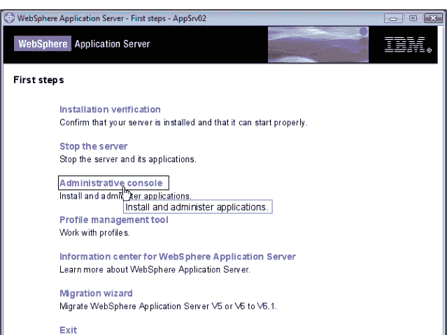

在登录页面，指定 **用户 ID** 和 **密码**，然后单击 **登录**。管理控制台页面显示。管理控制台页面提供配置 JDBC、部署应用程序、设置环境变量和定义登录配置的功能。

选择 **资源 | JDBC | JDBC 提供程序** 节点以配置新的 JDBC 提供程序。JDBC 提供程序用于访问数据库。它包含数据库、JDBC 驱动程序类型和驱动程序类的设置。

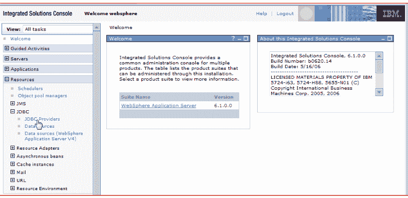

## 配置 JDBC in WebSphere Application Server

选择范围 Scope，Server 以定义新的 JDBC 提供程序。范围定义 JDBC 提供程序可用的级别。WebSphere 架构包含三个级别：单元、节点和服务器。单元是包含一组节点的行政域。节点是一组管理服务器进程的 WebSphere Application Server。应用服务器是 WebSphere Application Server 配置中的主要运行时组件。如果要使 JDBC Provider 可用于节点中的所有应用服务器，请选择节点作为范围。如果要使 JDBC Provider 可用于单元中的所有节点，请选择单元作为范围。选择新建以配置新的 JDBC 提供程序。

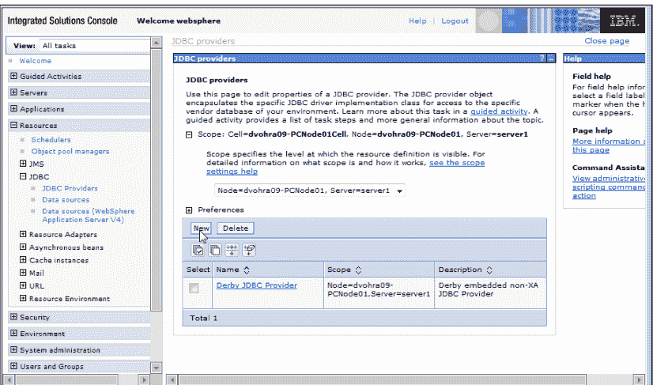

在创建新的 JDBC 提供程序窗口中，选择 DB2 作为数据库类型。如果要配置连接的数据库未列出，请为数据库类型选择用户定义。选择提供程序类型为 DB2 Universal JDBC Driver Provider。对于 Windows 上的 DB2 数据库类型，提供程序类型 DB2 Universal JDBC Provider (XA) 用于分布式事务。如果选择的数据库类型为用户定义，则指定提供程序类型用户定义 JDBC Provider。选择实现类型，连接池数据源。如果选择用户定义数据库类型作为实现类型，则也指定用户定义。如果选择提供程序类型 DB2 Universal JDBC Provider (XA)，则选择实现类型 XA DataSource 并单击下一步。


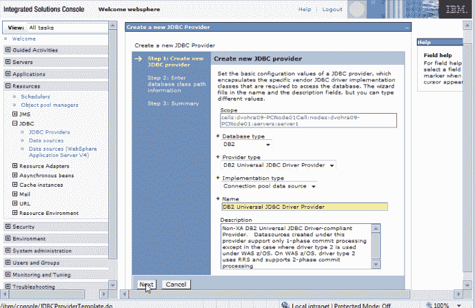

**类路径** 字段指定类路径中的 JAR 文件。`db2jcc.jar`，其中包含 DB2 JDBC Type 4 驱动程序，以及 `db2jcc_license_cu.jar`，它是 DB2 数据库服务器的许可证文件，都包含在类路径设置中。**类路径** 字段还包括一些环境变量。指定保存为环境变量 `DB2UNIVERSAL_JDBC_DRIVER_PATH` 的目录位置，用于 JDBC JAR 文件，然后单击 **下一步**。

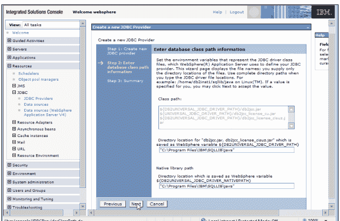

## 在 WebSphere Application Server 中配置 JDBC

在“摘要”页面中，显示 JDBC 提供程序配置的摘要。现在，单击“完成”按钮。

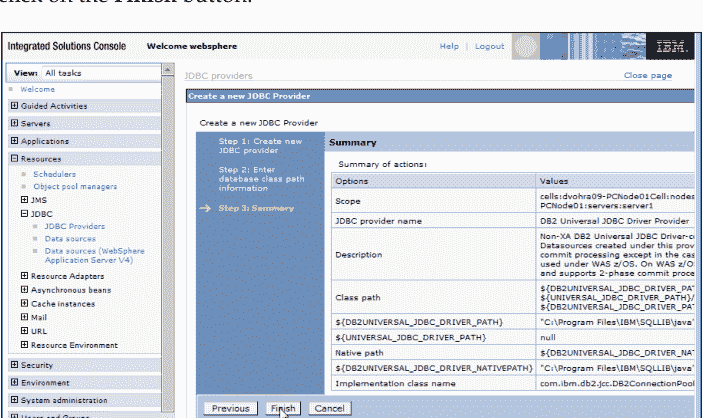

指定的设置应用于本地配置。单击“消息”框架中的“保存”链接后，更改将应用于主配置。

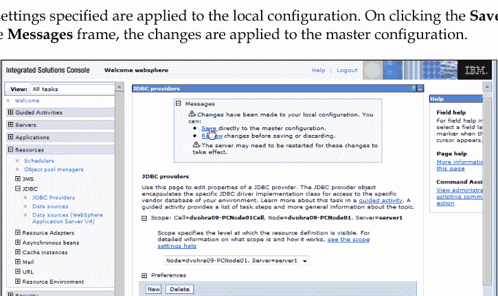

已配置 DB2 数据库的 JDBC 提供程序，并将其添加到 JDBC 提供程序列表中。

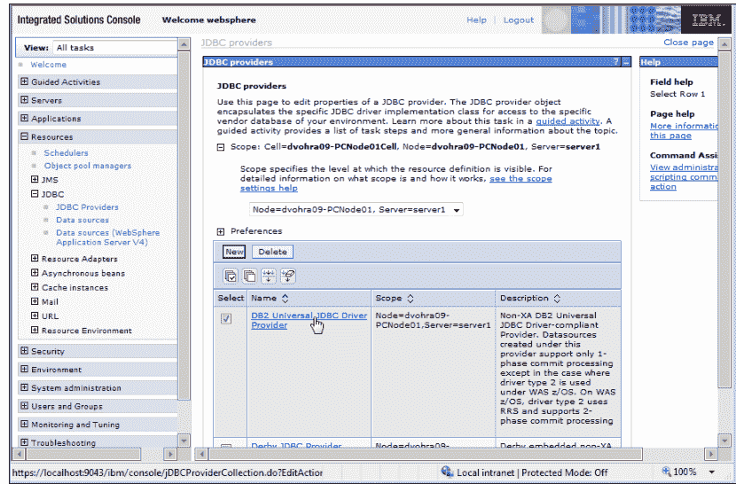

## 配置数据源

我们将配置一个 JDBC 数据源，以从 DB2 数据库检索数据。我们已配置的 JDBC 提供程序为数据源提供驱动程序类。默认驱动程序类名为 `com.ibm.db2.jcc.DB2ConnectionPoolDataSource`。也可以指定另一个驱动程序类来代替默认值。要配置新的数据源，请选择 JDBC 提供程序 DB2 Universal JDBC Driver Provider。

## 在 WebSphere Application Server 中配置 JDBC

在 **附加属性** 标题中单击 **数据源** 链接。

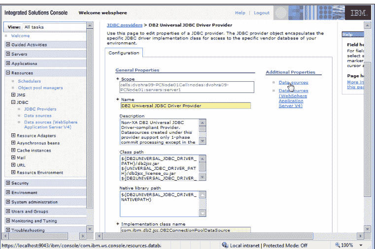

显示数据源表。现在，单击 **新建** 以添加新的数据源。

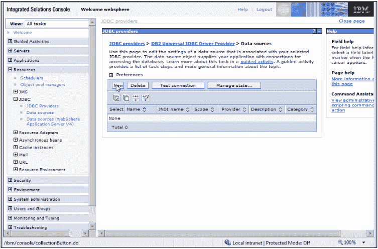

在 **创建数据源** 窗口中，指定数据源名称和 **JNDI 名称**。J2EE 连接器身份验证数据条目由 JDBC 数据源用于登录数据库。连接器身份验证数据条目定义数据库访问凭据。单击 **创建新的 J2C 认证别名** 链接以创建组件管理的身份验证别名。

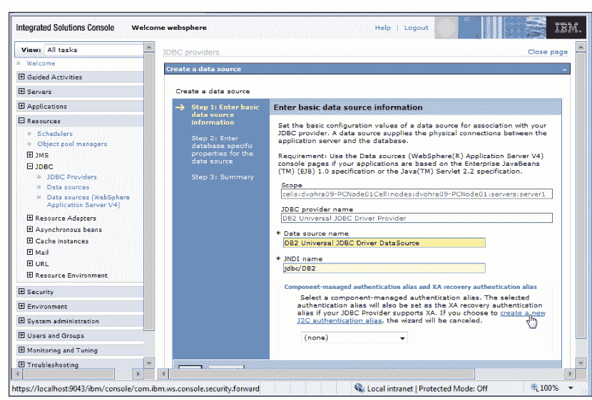

## 在 WebSphere Application Server 中配置 JDBC

显示 J2C 身份验证数据条目表。单击 **新建** 以添加 J2C 身份验证数据条目。

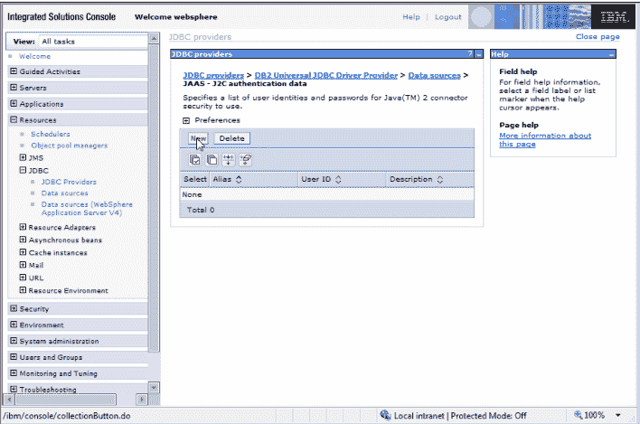

在 J2C 身份验证数据条目配置框架中，为该条目指定别名。还指定用于登录 DB2 数据库的 user id 和密码，然后单击 **应用**。

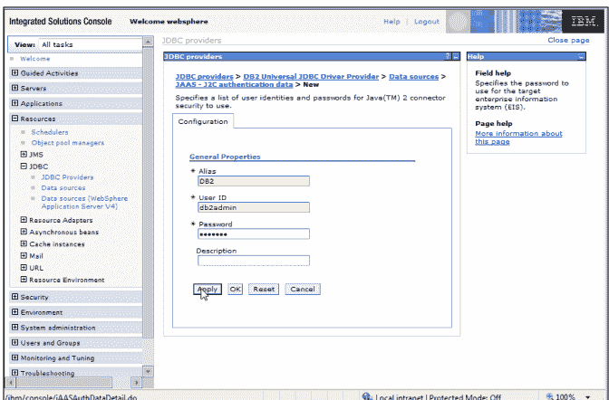

单击 **保存** 将工作区更改保存到主配置。

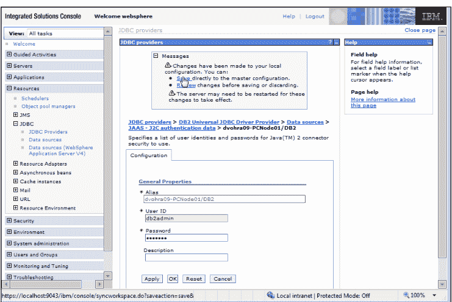

添加了新的 J2C 身份验证数据条目。单击 **数据源** 链接以配置新的数据源。

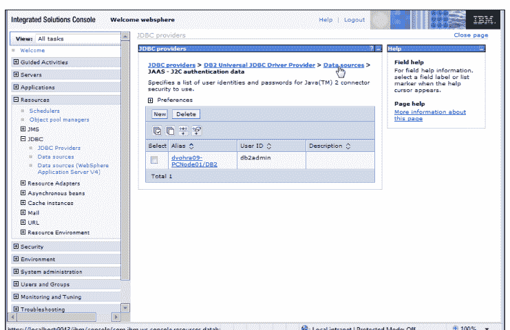

## 在 WebSphere Application Server 中配置 JDBC

在“数据源”表中单击“新建”以创建新的数据源。

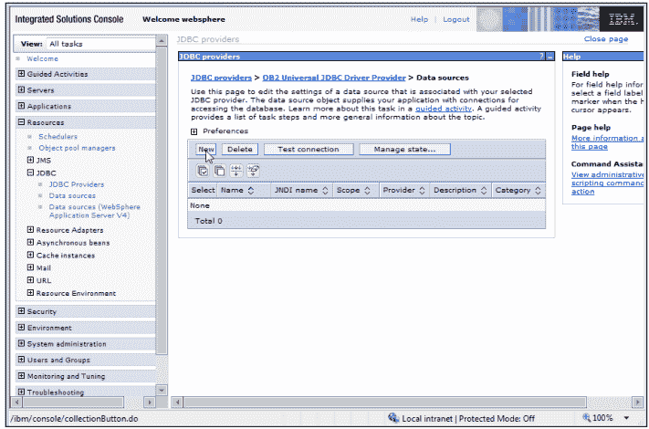

为数据源指定 JNDI 名称。在“组件管理身份验证别名”字段中，选择我们之前配置的 J2C 身份验证别名，然后单击“下一步”。

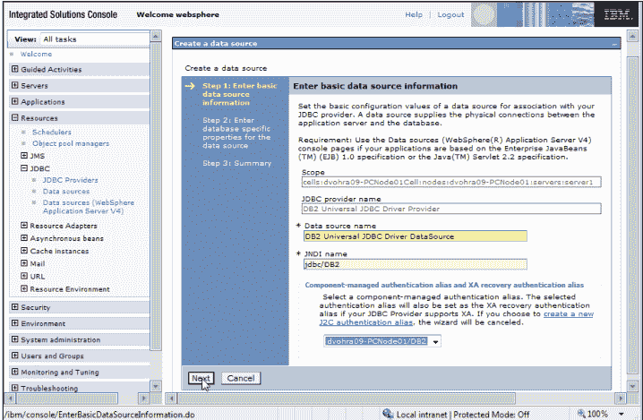

在数据源属性窗口中，指定数据库名称（SAMPLE）、驱动程序类型（type 4）、服务器名称（localhost）和端口号（50000），然后单击“下一步”。

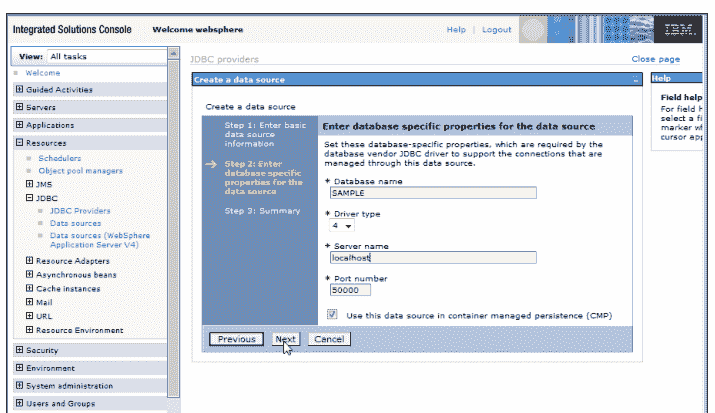

在“摘要”页面中，显示数据源配置的摘要。现在，单击“完成”。

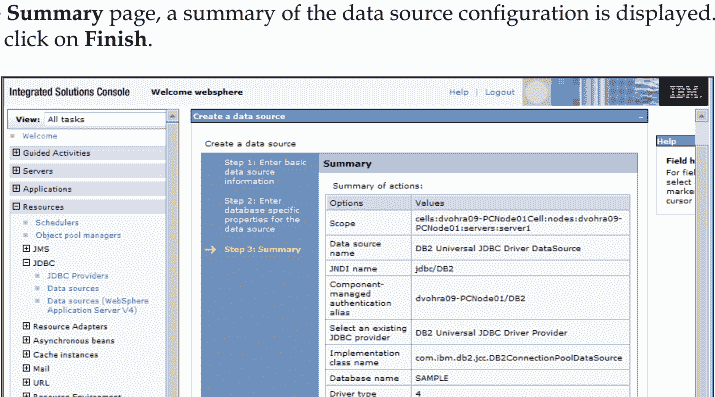

## 在 WebSphere Application Server 中配置 JDBC

新数据源已添加到数据源表中。单击“保存”将数据源保存到主配置。

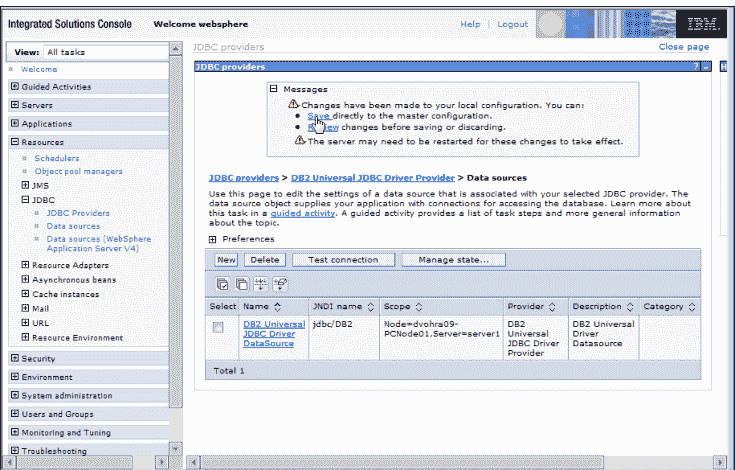

选择数据源复选框，然后单击“测试连接”以测试与 DB2 数据库的 JDBC 连接。

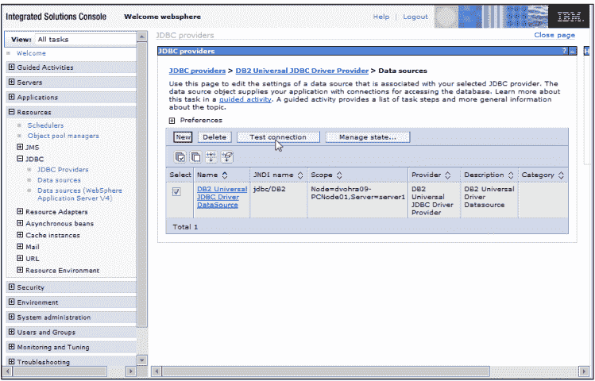

显示一条消息，表明与 DB2 数据库的 JDBC 连接成功。

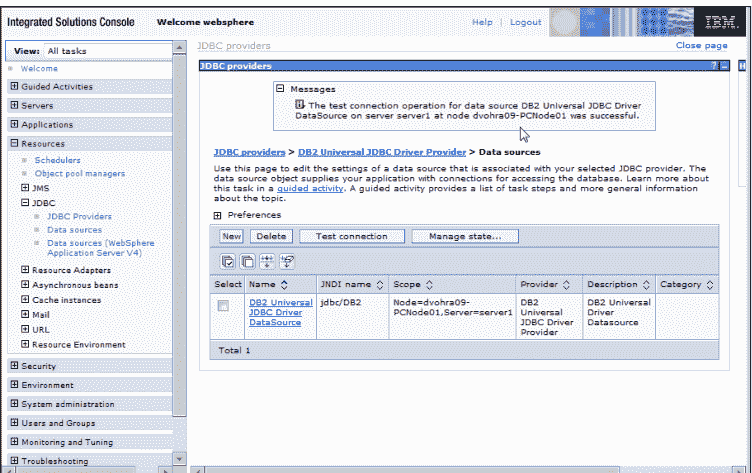

通过在“附加属性”标题中选择“数据源”链接和“连接池属性”链接来配置其他连接池属性。

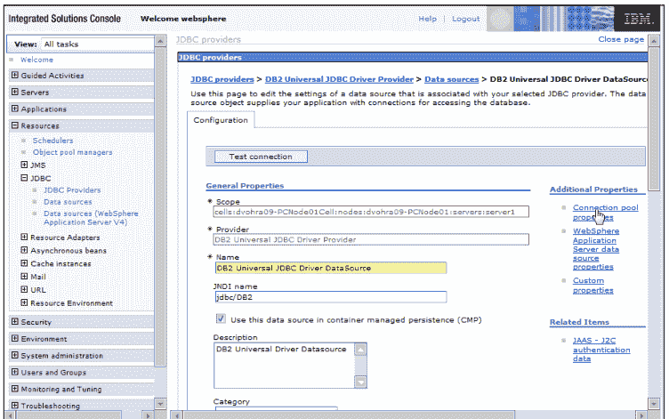

## 在 WebSphere Application Server 中配置 JDBC

指定连接池属性。连接超时是应用程序在超时之前等待从连接池获取连接的最大秒数。最大连接数是连接池中的最大连接数。最小连接数是连接池中的最小连接数。

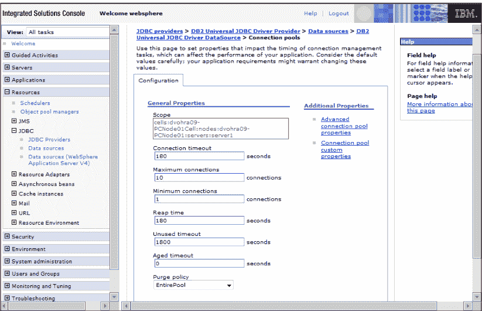

## 从 JDeveloper 部署 Web 应用程序到 WebSphere

我们将开发一个 JSP 应用程序以从 DB2 数据库检索数据并在浏览器中显示数据。JDeveloper 没有连接到 WebSphere 应用服务器或将应用程序部署到 WebSphere 的功能。JDeveloper 可用于创建可部署到 WebSphere 的 JSP。通过选择“文件 | 新建”创建应用程序。在“新建库”窗口中，在“类别”中选择“常规”，在“项目”中选择“应用程序”，然后单击“确定”。在“创建应用程序”窗口中指定应用程序名称，将应用程序模板选择为“无模板”，然后单击“确定”。在“创建项目”窗口中，指定项目名称并单击“确定”。应用程序和项目已添加到 JDeveloper。向项目添加 JSP。选择“文件 | 新建”，在“新建库”窗口中选择“Web 层 | JSP”。在“项目”中选择 JSP 并单击“确定”。在“创建 JSP 向导”中单击“下一步”。在 **Web 应用程序** 窗口中选择 J2EE 1.4，然后单击“下一步”。在 **JSP 文件** 窗口中指定文件名，然后单击“下一步”。由于未使用错误页面，请在 **错误页面选项** 中选择默认设置，然后单击“下一步”。在 **标记库** 窗口中单击“下一步”，因为我们不会使用任何标记库。在 **HTML 选项** 窗口中单击“下一步”。在 **完成** 窗口中单击“完成”。JSP 和 `web.xml` 已添加到 WebSphere 应用程序。

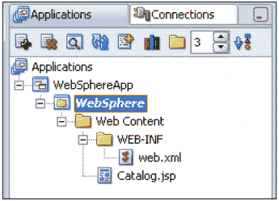

在 JSP 中，创建 `InitialContext` 对象用于 JNDI 命名操作。使用 `lookup()` 方法在我们本章前面创建的数据源 JNDI 名称上创建 `DataSource` 对象。使用 `getConnection()` 方法从 `DataSource` 对象创建 `Connection` 对象：

```
InitialContext initialContext = new InitialContext();
javax.sql.DataSource ds = (javax.sql.DataSource) initialContext.
lookup("jdbc/DB2");
java.sql.Connection conn = ds.getConnection();
```

使用 `createStatement()` 方法从 `Connection` 对象创建 `Statement` 对象。使用 `Statement` 对象的 `executeQuery()` 方法运行 SQL 查询以从 DB2 数据库检索数据。查询运行并生成 `ResultSet` 对象：

```
java.sql.Statement stmt = conn.createStatement();
ResultSet resultSet=stmt.executeQuery("Select * from Catalog");
```

使用 `next()` 方法遍历结果集，并在 HTML 表格中显示数据。JSP 页面 `Catalog.jsp` 如下所示：

```
<%@ page contentType="text/html"%>
<%@ page import="java.sql.*,javax.naming.*" %>
<html>
<head>
<meta http-equiv="Content-Type" content="text/html">
<title>WebSphere JSP Application</title>
</head>
<body>
<%
InitialContext initialContext = new InitialContext();
javax.sql.DataSource ds = (javax.sql.DataSource)
initialContext.lookup("jdbc/DB2");
java.sql.Connection conn = ds.getConnection();
java.sql.Statement stmt = conn.createStatement();
ResultSet resultSet=stmt.executeQuery("Select * from Catalog");%>
<table border="1" cellspacing="0">
<tr>
<th>CatalogId</th>
<th>Journal</th>
<th>Section</th>
<th>Edition</th>
<th>Title</th>
<th>Author</th>
</tr>
<%
while (resultSet.next())
{
%>
<tr>
<td><%=out.println(resultSet.getString(1));%></td>
<td><%=out.println(resultSet.getString(2));%></td>
<td><%=out.println(resultSet.getString(3));%></td>
<td><%=out.println(resultSet.getString(4));%></td>
<td><%=out.println(resultSet.getString(5));%></td>
<td><%=out.println(resultSet.getString(6));%></td>
</tr>
<%
}
resultSet.close();stmt.close();conn.close();
%>
</table>
</body>
</html>
```


创建 Web 应用程序部署配置文件时，选择 **文件 | 新建**，在 **新建库** 窗口中，在类别中选择 **常规 | 部署配置文件**。在项目中，选择 **WAR 文件** 并单击确定。

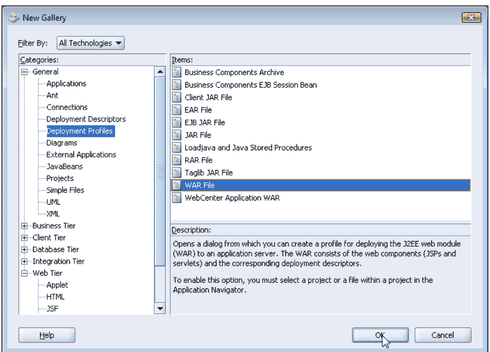

## 在 WebSphere Application Server 中配置 JDBC

在 **创建部署配置文件** 窗口中，指定部署配置文件名称 webapp1，然后单击确定。在 **WAR 部署配置文件属性** 窗口中，选择 **常规** 节点。指定 J2EE Web 上下文根 websphere（例如）并单击确定。

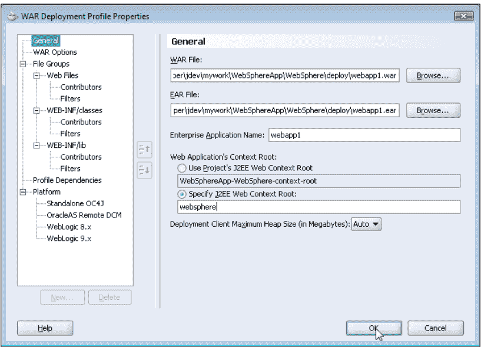

创建 Web 应用程序部署配置文件。右键单击部署配置文件并选择 **部署到 EAR 文件**。

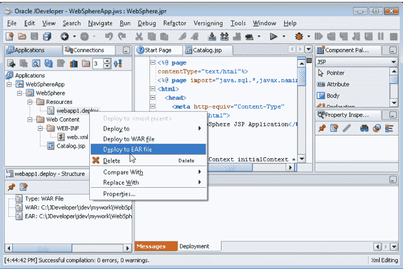

## 在 WebSphere Application Server 中配置 JDBC

在项目部署目录中创建 webapp1.ear 文件。将 webapp1.ear 文件复制到 `C:\Program Files\IBM\WebSphere\AppServer\installableApps` 目录。向 WebSphere 服务器安装 webapp1 Web 应用程序。在 WebSphere 管理控制台中选择 **应用程序 | 安装新应用程序** 节点，并选择 webapp1.ear 文件作为要安装的应用程序。单击 **下一步** 按钮。

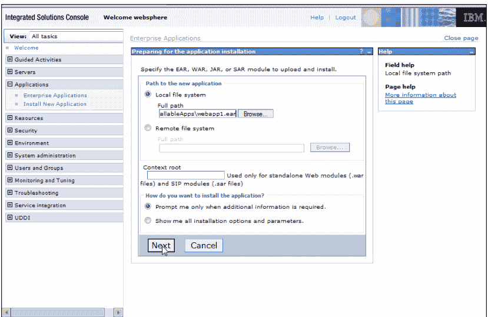

选择默认安装选项，然后单击 **下一步**。webapp1 企业应用程序有一个 Web 模块 webapp1.war。在 **将模块映射到服务器** 窗口中，指定要部署 Web 模块到的服务器。选择 webapp1.war 模块，选择 WebSphere 服务器节点并单击 **应用**，然后单击下一步。

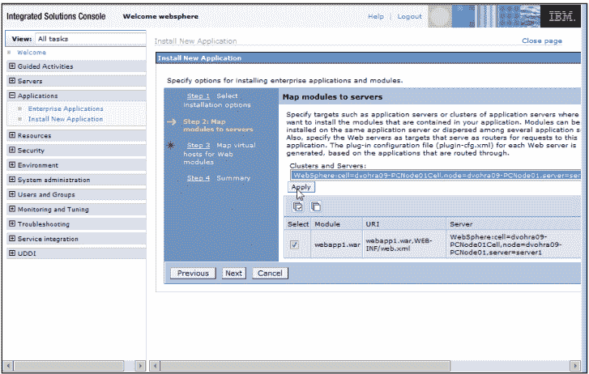

在 **为 Web 模块映射虚拟主机** 框架中，选择 webapp1.war 文件旁边的复选框，并选择 default_host 作为虚拟主机。单击 **下一步** 按钮。

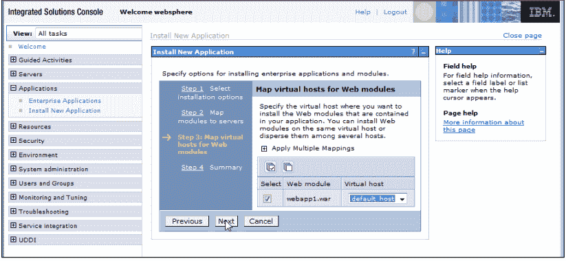

## 在 WebSphere Application Server 中配置 JDBC

在摘要页面中单击完成以创建 Web 应用程序部署配置。

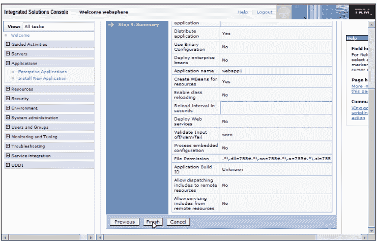

Web 应用程序已安装在 WebSphere 应用程序服务器中，并且部署更改已保存到本地配置。单击保存以将更改保存到主配置。

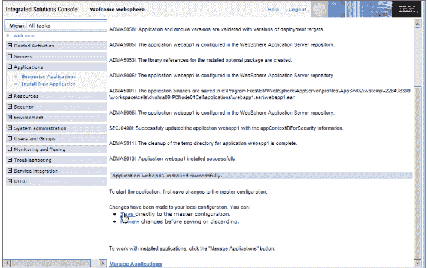

选择 **应用程序 | 企业应用程序** 链接以显示已安装的应用程序。webapp1 Web 应用程序列在已安装企业应用程序表中。选择 webapp1 Web 应用程序旁边的复选框，然后单击 **启动**。

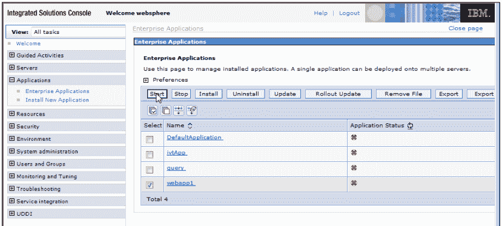

Web 应用程序 webapp1 已在 WebSphere 应用程序服务器上启动。

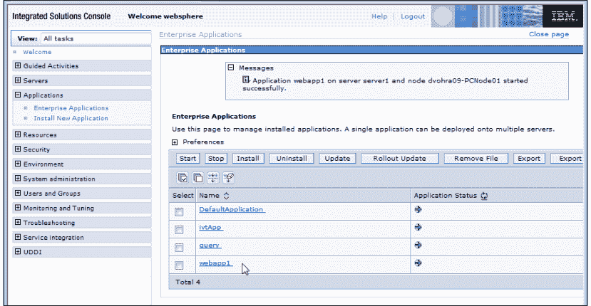

使用 URL `http://localhost:9080/websphere/Catalog.jsp` 在服务器中运行 `Catalog.jsp`。JSP 应用程序在服务器中运行，DB2 数据库中的数据在浏览器中显示。

| 目录 ID | 期刊 | 部分 | 版本 | 标题 | 作者 |
|---|---|---|---|---|---|
| catalog1 | developerWorks | Java Technology | Nov 2004 | Getting started with enumerated types | Brett McLaughlin |
| catalog2 | developerWorks | XML | Apr 2005 | Transform Eclipse navigation files to DITA navigation files | Loretta Hicks |

## JDBC 4.0 版本

WebSphere 应用程序服务器 6 不支持 JDBC 4.0 规范，但 IBM 提供了支持 JDBC 4.0 的 JDBC 驱动程序。IBM Data Server Driver 和 SQLJ 版本 4.0 支持 JDBC 4.0。它们可以从 `https://www14.software.ibm.com/webapp/iwm/web/preLogin.do?lang=en_US&source=swg-idsjs11` 获取。支持 JDBC 4.0 的 WebSphere 应用程序服务器版本会将 IBM Data Server Driver for JDBC 和 SQLJ 中的 `db2jcc4.jar` 添加到服务器类路径中。此外，WebSphere 服务器必须在 JDK 6.0 上运行才能使用 JDBC 4.0 功能。

JDBC 4.0 已添加对连接管理的支持，其中包括跟踪连接状态并根据客户端信息属性识别连接的功能。连接状态跟踪可用于跟踪不可用但仍处于打开状态并在连接池中可用的连接。不可用的连接会导致性能下降。在 JDBC 4.0 的新功能之前，如果连接池中积累了不可用的连接，则必须重新初始化连接池。借助连接池管理器实现的连接状态跟踪功能，可以使用 `Connection` 接口的 `isValid()` 方法获取连接状态。如果 `Connection` 对象不可用，则 `Connection` 对象将被关闭。

```
if (!connection.isValid())
    connection.close();
```

JDBC 4.0 中添加的另一个新的连接管理功能是连接跟踪，这与连接状态跟踪不同。在连接跟踪中，会在 `Connection` 对象上设置一些客户端信息属性。如果某些连接降低了应用程序性能，则会使用客户端信息属性跟踪这些连接。客户端信息属性使用 `setClientInfo()` 方法设置在 `Connection` 对象上，并使用 `getClientInfo()` 方法检索。在 `catalog.jsp` 中，按如下方式设置客户端信息属性 `ApplicationName`、`ClientUser` 和 `ClientHostname`：

```
connection.setClientInfo("ApplicationName","WebSphereApp");
connection.setClientInfo("ClientUser","WebSphereUser");
connection.setClientInfo("ClientHostname","WebSphereHost");
```

PreparedStatement 默认情况下会被池化，并提供 PreparedStatement 对象的回收，而不是创建新的 PreparedStatement 对象。频繁使用的 PreparedStatement 对象无需为每个客户端请求打开、初始化和关闭。JDBC 4.0 还引入了 Statement 池化，其中频繁使用的 Statement 对象不会被关闭，而是返回到语句池，供其他客户端使用。要向连接池添加语句池化：首先，使用 DatabaseMetaData 接口的 supportsStatementPooling() 方法测试数据库是否支持语句池化。其次，使用 isPoolable() 方法测试 Statement 对象是否可池化。如果可池化，则可以使用 setPoolable(true) 方法对 Statement 对象进行池化：

```
java.sql.Statement stmt = conn.createStatement();
DatabaseMetaData metaData=connection.getMetaData();
if(metaData.supportsStatementPooling())
{
if(stmt.isPoolable())
stmt.setPoolable(true);
}
```

JDBC 4.0 已引入对包装器模式的支持，可通过该模式访问非标准厂商特定的 JDBC 资源。包装器模式在 Wrapper 接口中实现。应作为 JDBC API 扩展提供的 JDBC 接口应扩展 Wrapper 接口。在 IBM Data Server Driver for JDBC 和 SQLJ 中，Wrapper 接口由 com.ibm.db2.jcc 包中的以下接口扩展：

- DB2Connection.
- DB2BaseDataSource.
- DB2SimpleDataSource.
- DB2Statement.
- DB2ResultSet.
- DB2DatabaseMetaData.

厂商特定接口在 JDBC API 中提供额外的方法。例如，使用包装器模式创建 DB2Statement 对象以使用 setDB2ClientProgramId() 方法，该方法在 DB2Statement 接口中设置来自连接的程序 ID。使用 isWrapperFor() 方法测试 Statement 对象是否为 DB2Statement 接口的包装器。如果 Statement 对象是包装器，则使用 unwrap() 方法解包 DB2Statement 接口以创建 DB2Statement 对象。此外，调用 DB2Statement 对象的 setDB2ClientProgramId() 方法：

```
Class class = Class.forName("com.ibm.db2.jcc.DB2Statement");
if(stmt.isWrapperFor(class))
{
com.ibm.db2.jcc.DB2Statement db2Stmt = (com.ibm.db2.jcc.
DB2Statement) stmt.unwrap(class);
db2Stmt.setDB2ClientProgramId("WebSphereprogram");
}
```

JDBC 4.0 已引入对 SQL ROWID 数据类型的支持。ROWID 类型列值可以使用 getRowId() 方法检索。ROWID 在数据库表中唯一标识一行，是访问行的最快方法。由于 DB2 数据库支持 ROWID 数据类型，因此在 SELECT 查询中添加 ROWID 列：

```
ResultSet resultSet=db2Stmt.executeQuery("Select ROWID, CATALOGID,
JOURNAL, PUBLISHER, EDITION, TITLE, AUTHOR from Catalog");
```

使用 ResultSet 接口的 getRowId() 方法检索 ROWID 列值：

```
<td><%=out.println(resultSet.getRowId("ROWID").toString());%></td>
```

在 JDK 5.0 之前，集合必须使用迭代器和索引变量进行迭代。JDK 5.0 引入了增强的 FOR 循环，可在没有迭代器和索引变量的情况下迭代集合。例如，如果要迭代 java.util.Collection 中的 String 对象，则需要检索 Collection 中的 String 对象。迭代器将使用 for 循环创建。Collection 中的 String 对象使用 next() 方法检索：

```
for(Iterator i = c.iterator(); i.hasNext(); )
{
String str = (String) i.next();
}
```

在 JDK 5.0 中引入的增强 for 循环可用于检索字符串集合中的 String 对象：

```
for(String string : c)
{
String str =string
}
```


SQLException 可能具有链式异常，并且 SQLException 的原因也可能具有链式原因。使用增强 for 循环处理链式异常，SQLException 的链式原因可以按如下方式输出：

```
for(Throwable e : exception)
{
    out.println("Error encountered: " + e);
}
```

下面列出了用于检索 DB2 UDB 数据库数据并在 HTML 表格中显示的 Web 应用程序 JSP catalog.jsp 的 JDBC 4.0 版本：

```
<%@ page contentType="text/html"%>
<%@ page import="java.sql.*, javax.naming.*, com.ibm.db2.jcc.DB2Statement" %>
<html>
<head>
<meta http-equiv="Content-Type" content="text/html">
<title>WebSphere JSP Application</title>
</head>
<body>
<%
    InitialContext initialContext = new InitialContext();
    javax.sql.DataSource ds = (javax.sql.DataSource)
    initialContext.lookup("jdbc/DB2DataSource");
    java.sql.Connection conn = ds.getConnection();
    conn.setClientInfo("ApplicationName","WebSphereApp");
    conn.setClientInfo("ClientUser","WebSphereUser");
    conn.setClientInfo("ClientHostname","WebSphereHost");
    java.sql.Statement stmt = conn.createStatement();
    DatabaseMetaData metaData=conn.getMetaData();
    if(metaData.supportsStatementPooling())
    {
        if(stmt.isPoolable())
        stmt.setPoolable(true);
    }
    Class cls = Class.forName("com.ibm.db2.jcc.DB2Statement");
    if(stmt.isWrapperFor(cls))
    {
        com.ibm.db2.jcc.DB2Statement db2Stmt = (com.ibm.db2.jcc.DB2Statement) stmt.unwrap(cls);
        db2Stmt.setDB2ClientProgramId("WebSphereprogram");
        ResultSet resultSet=db2Stmt.executeQuery("Select ROWID, CATALOGID, JOURNAL, PUBLISHER, EDITION, TITLE, AUTHOR from Catalog");
%>
```

```
<table border="1" cellspacing="0">
<tr>
<th>RowId</th>
<th>CatalogId</th>
<th>Journal</th>
<th>Section</th>
<th>Edition</th>
<th>Title</th>
<th>Author</th>
</tr>
<%
while (resultSet.next())
{
%>
<tr>
<td><%=out.println(resultSet.getRowId("ROWID").toString());%></td>
<td><%=out.println(resultSet.getString(1));%></td>
<td><%=out.println(resultSet.getString(2));%></td>
<td><%=out.println(resultSet.getString(3));%></td>
<td><%=out.println(resultSet.getString(4));%></td>
<td><%=out.println(resultSet.getString(5));%></td>
<td><%=out.println(resultSet.getString(6));%></td>
</tr>
<%
}
resultSet.close();
stmt.close();
conn.close();
}
%>
</table>
</body>
</html>
```

## 摘要

WebSphere 6.1 应用服务器具备创建 JDBC 提供程序和具有关系数据源的 JDBC 数据源的功能。本章中，我们在 WebSphere 中配置了与 DB2 9 数据库的 JDBC 连接。IBM 的 DB2 数据库与 IBM 的 WebSphere 应用服务器的组合适合于 JDBC 应用程序的开发。DB2 V9 支持 SQL XML 数据类型，该数据类型可与 JDBC 4.0 中的一种新的 Java 数据类型 SQLXML 一起使用。IBM Data Server Driver for JDBC and SQLJ 版本 4.0 支持 JDBC 4.0 规范。
