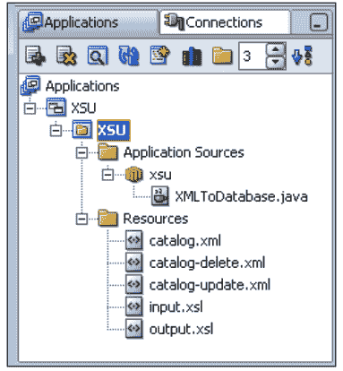
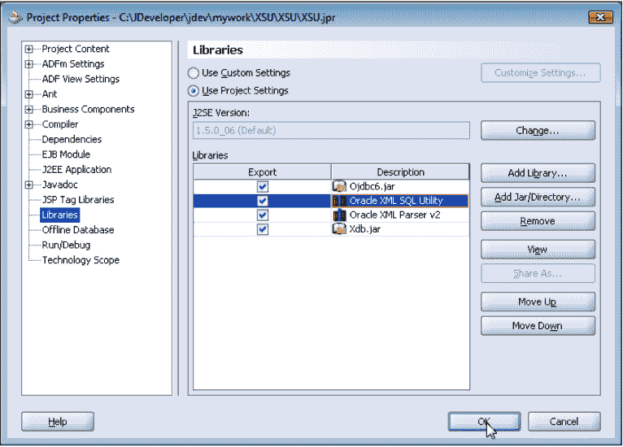
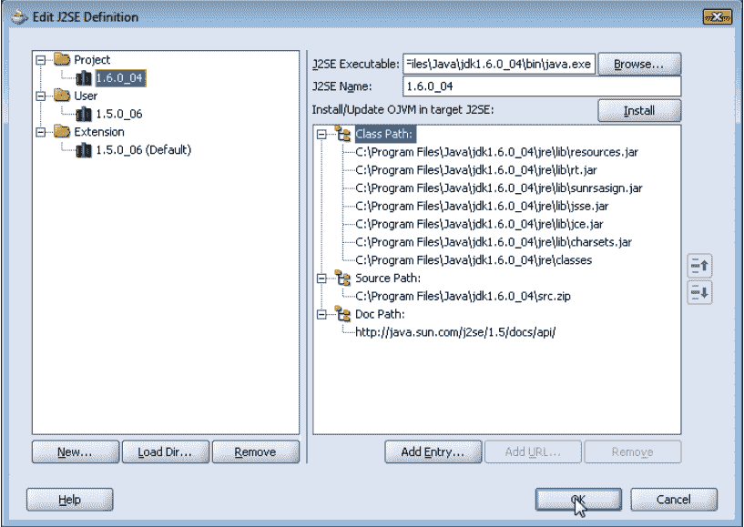
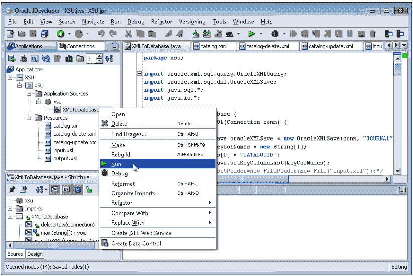
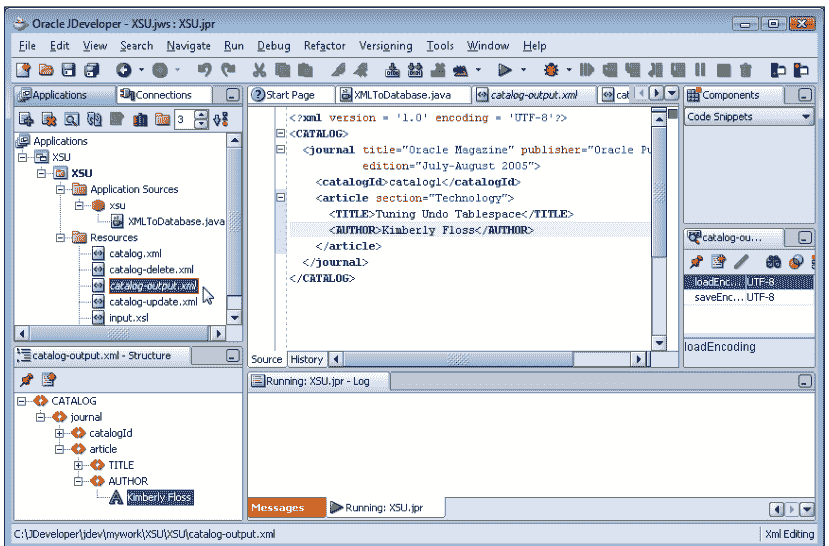

## 7 XML SQL 实用程序

**可扩展标记语言** (XML) 是 Web 上数据交换的标准媒介。XML 数据交换的示例是网络订阅源（RSS 订阅源和 Atom 订阅源）以及 Web 服务。使用 XML 文档交换的数据可能需要存储在关系数据库中，或者可能需要从数据库表生成 XML 文档。XML 文档是一种层次化数据结构，其中各种元素可以映射到数据库表中的列。因此，通过将各种元素映射到表，您可以将 XML 存储在关系数据库中，此映射过程称为 XML 到 SQL 映射技术。Oracle 创建了 **XML SQL 实用程序** (XSU) Java API 以将 XML 映射到 SQL 并将 SQL 映射到 XML。将 XML 文档映射到的表必须在将 XML 文档映射到数据库之前创建。使用 XSU，XML 元素映射到数据库表列。使用 XSU 将 XML 文档映射到数据库表不会存储文档的属性。在存储之前，可以通过对 XML 文档应用 **可扩展样式表语言转换** (XSLT) 来存储属性，将要存储的属性转换为元素，这些元素可以映射到列。使用 XSU，可以更新、删除和检索数据库中的数据。使用 XSU 生成的 XML 文档不包含属性。可以通过对使用 XSU 获得的文档应用 XSLT 来向 XML 文档添加属性。

JDBC 4.0 引入了 SQLXML Java 数据类型，我们在第 1 章中讨论过它，用于在 SQL XML 数据类型的列中存储和访问 XML 文档。但某些数据库驱动程序，例如 Oracle 数据库 11g JDBC 驱动程序，尚未支持 SQLXML 数据类型。此外，XSU 具有将 XSLT 样式表应用于从数据库表映射到 XML 文档的数据的优势。我们将使用 Oracle 数据库 11g JDBC 4.0 驱动程序用于 XML SQL 实用程序，以利用 JDBC 4.0 的某些功能，例如自动驱动程序加载和增强的链式异常支持。

JDeveloper 10.1.3 包含一个 XSU 实用程序库，用于将 XML 文档存储在 SQL 数据库中并从数据库中检索它。类 `OracleXMLSave` 用于将 XML 文档存储在数据库表中，并且元素标签映射到数据库列。类 `OracleXMLQuery` 用于从数据库表生成 XML 文档。数据库表列作为元素标签映射到 XML 文档。使用 `OracleXMLSave` 类将 XML 文档映射到数据库表不包括 XML 文档元素属性的映射；我们可以通过将属性转换为元素来存储元素属性。本章以示例形式讨论了将包含元素和属性的 XML 文档映射到 Oracle 数据库 10g 表，以及将数据库列映射到包含属性的 XML 文档的步骤。您不受限于使用 Oracle 通过 XSU 存储 XML 文档。您也可以轻松使用 MySQL 等其他关系数据库。XML 文档 `catalog.xml` 用作映射到数据库表的示例，并列于下方：

```xml
<?xml version="1.0" encoding="utf-8"?>
<catalog>
    <journal title="Oracle Magazine" publisher="Oracle Publishing" edition="July-August 2005">
        <catalogId>catalog1</catalogId>
        <article section="Technology">
            <title> Tuning Undo Tablespace </title>
            <author> Kimberly Floss </author>
        </article>
    </journal>
    <journal title="Oracle Magazine" publisher="Oracle Publishing" edition="Nov-Dec 2003">
        <catalogId>catalog2</catalogId>
        <article section="DEVELOPER">
            <title>Starting with Oracle ADF</title>
            <author>Steve Muench</author>
        </article>
    </journal>
</catalog>
```

在本章中，您将学习如何：
- 使用 XSU 将 XML 文档映射到数据库表
- 使用 XSU 从 XML 文档更新数据库表
- 使用 XSU 从 XML 文档删除数据库表行
- 使用 XSU 将数据库表映射到 XML 文档

## 设置环境

我们需要创建一个 JDeveloper 项目来使用 XML SQL 实用程序存储 XML 文档。在 JDeveloper 项目中，通过选择 File | New 创建 XML 文档 catalog.xml。在 New Gallery 窗口中，在 Categories 中选择 General | XML，在 Items 中选择 XML Document。还添加 XML 文件 catalog-update.xml 和 catalog-delete.xml。通过选择 File | New 在 JDeveloper 项目中创建 XSL 样式表 input.xsl 和 output.xsl。本章还列出了上述提到的 XML 文件和 XSL 样式表。XML 文档 catalog-update.xml 和 catalog-delete.xml，以及 XSLT 样式表 input.xsl 和 output.xsl 在本章后面列出。将 catalog.xml、catalog-delete.xml、catalog-update.xml、input.xsl 和 output.xsl 的列表复制到 JDeveloper XSU 项目中。在 New Gallery 窗口中，在 Categories 中选择 General | XML，在 Items 中选择 XSL Style Sheet。通过选择 File | New 在 JDeveloper 项目中创建一个 Java 应用程序 XMLToDatabase.java。在 New Gallery 窗口中，在 Categories 中选择 General，在 Items 中选择 Java Class。XSU 应用程序的目录结构如下所示：




## XML SQL Utility

我们需要向项目中添加一些库和 JAR 文件。由于我们使用的是 JDBC 4.0 驱动程序，因此需要将 JDBC 4.0 驱动程序 JAR 文件添加到项目库中。从 http://www.oracle.com/technology/software/tech/java/sqlj_jdbc/htdocs/jdbc_111060.html 下载 Oracle Database 11g JDBC 驱动程序的 JAR 文件 ojdbc6.jar。选择 Tools | Project Properties，并在 Project Properties 窗口中选择 Libraries。选择 Add Library 按钮以添加 Oracle XML SQL Utility 和 Oracle XML Parser v2 库。选择 Add Jar/Directory 按钮以添加 <JDeveloper>/rdbms/jlib/xdb.jar 和 ojdbc6.jar，其中 <JDeveloper> 为 JDeveloper 安装目录。下面显示了 XML SQL Utility 所需的 JAR 文件和库：



Oracle 数据库 11g JDBC 4.0 驱动程序需要 JDK 6.0。我们需要将 J2SE 版本设置为 JDK 6.0，然后从 http://java.sun.com/javase/downloads/index.jsp 下载并安装 JDK 6.0。选择 Tools | Project Properties 将 J2SE 版本设置为 JDK 6.0，并在 Project Properties 窗口中选择 Libraries。J2SE Version 字段指定 JDeveloper 中 Java 应用程序使用的 J2SE 版本。在 J2SE Version 中单击 Change 按钮，并在 Edit J2SE Definition 窗口中单击 New 以定义新的 J2SE 版本定义。在 Create J2SE 窗口中选择 JDK 6.0 的 J2SE 可执行文件并单击 OK。JDK 6.0 的 J2SE 定义将被添加到 Edit J2SE Definition 窗口中。选择 J2SE 6.0 定义并在 Edit J2SE Definition 窗口中单击 OK。



JDK 6.0 J2SE 定义将被添加到 Project Properties 窗口中的 J2SE Version 字段中。现在，单击 OK。

同时安装包含示例模式的 Oracle 数据库 10g。Oracle 数据库 11g JDBC 驱动程序可与 Oracle 数据库 10g 配合使用，如果使用支持 JDBC 4.0 的应用服务器，则所有 JDBC 4.0 功能都可能带来优势。在数据库中创建一个数据库实例和一个数据库表 JOURNAL。示例 XML 文档将映射到数据库表。下面说明了用于在示例模式 OE 中创建数据库表的 SQL 脚本：

```
CREATE TABLE OE.JOURNAL (CATALOGID VARCHAR(255) PRIMARY KEY, JOURNAL_TITLE VARCHAR(255), PUBLISHER VARCHAR(255), EDITION VARCHAR(255), ARTICLE_SECTION VARCHAR(255), TITLE VARCHAR(255), AUTHOR VARCHAR(255));
```

## XML Document to SQL Database Mapping

如果 XML 文档已使用 XSU 存储，则只会存储 XML 文档中的元素标签。XML 文档中的属性不会被存储。XML 文档中的属性可以通过映射到元素来存储。可以通过对 XML 文档应用 XSLT 样式表将属性转换为元素。本节讨论将包含属性的 XML 文档存储到数据库表中的过程。XML 文档使用 OracleXMLSave 类存储到数据库表中，该类在 XMLToDatabase.java 应用程序中导入。

创建与数据库的连接。如果我们使用的是 JDBC 3.0 驱动程序，我们将使用 registerDriver(Driver) 方法通过 DriverManager 注册 Oracle JDBC 驱动程序。JDBC 4.0 使用 Java SE 服务提供者机制添加了自动驱动程序注册支持。Oracle 数据库 11g JDBC 4.0 驱动程序 JAR 文件 ojdbc6.jar 包含 META-INF/services/java.sql.Driver 文件。对于 Oracle JDBC 驱动程序，该文件包含：

```
oracle.jdbc.OracleDriver
```

当使用 getConnection() 方法从 DriverManager 请求连接时，java.sql.Driver 文件中指定的所有驱动程序类都可供 DriverManager 使用。因此，我们将不会通过 DriverManager 注册 Oracle JDBC 驱动程序。使用 getConnection(String url, String user, String password) 方法从 DriverManager 获取连接：

```
Connection conn =
DriverManager.getConnection("jdbc:oracle:thin:@<host>:<port>:<SID>",
"<user>","<password>");
```


<host> 是数据库主机。
<port> 是数据库端口。
<SID> 是数据库 SID。
<user> 是登录数据库的用户名。
<password> 是登录数据库的密码。
<host>、<port> 和 <SID> 的值可以从 <Oracle 10g>/NETWORK/ADMIN/tnsnames.ora 文件中获取。

在获取 Oracle 数据库连接时可能会生成 SQLException。生成的 SQLException 可能包含链式异常和链式原因。JDBC 4.0 已添加对 Java SE 链式异常设施的支持，该设施也称为原因设施。在 JDBC 4.0 之前，必须递归调用 getNextException() 和 getCause() 方法来检索链式异常和原因。JDBC 4.0 使用 J2SE 6.0 中引入的 for 循环增强了对这些链式异常的支持。SQLException 接口实现了 Iterable 接口。链式异常可以使用下面的增强 for-each 循环输出：

```
catch(SQLException exception)
{
    for(Throwable e : exception )
    {
        System.out.println("Error encountered: " + e);
    }
}
```

我们需要创建一个 OracleXMLSave 类对象以将 XML 文档保存到数据库表 JOURNAL 中。

```
OracleXMLSave oracleXMLSave =new OracleXMLSave(conn, "JOURNAL");
```

JOURNAL 是在 Setting the Environment 部分创建的数据库表。将给定示例 XML 文档中的属性转换为元素标签。通过对 XML 文档应用 XSLT 将属性转换为元素标签。使用 setXSLT(Reader, String) 方法在 OracleXMLSave 对象上设置 XSLT。String 参数指定用于包含导入和外部实体的 URL。

```
Reader xsltReader=new FileReader(new File("input.xsl"));
oracleXMLSave.setXSLT(xsltReader, null);
```

XSLT input.xslt 用于将给定 XML 文档中的属性转换为元素，作为示例：

```
<?xml version="1.0" encoding="UTF-8"?>
<xsl:stylesheet version="1.0" xmlns:xsl="http://www.w3.org/1999/XSL/Transform">
<xsl:output method="xml/text" omit-xml-declaration="no"/>
<xsl:template match="/">
<xsl:element name="catalog">
<xsl:apply-templates select="catalog/journal"/>
</xsl:element>
</xsl:template>
<xsl:template match="journal">
<xsl:element name="journal">
<xsl:element name="journal_title">
<xsl:value-of select="@title"/>
</xsl:element>
<xsl:element name="catalogId">
<xsl:value-of select="catalogId"/>
</xsl:element>
<xsl:element name="publisher">
<xsl:value-of select="@publisher"/>
</xsl:element>
<xsl:element name="edition">
<xsl:value-of select="@edition"/>
</xsl:element>
<xsl:apply-templates select="article"/>
</xsl:element>
</xsl:template>
<xsl:template match="article">
<xsl:element name="article_section">
<xsl:value-of select="@section"/>
</xsl:element>
<xsl:copy-of select="title"/>
<xsl:copy-of select="author"/>
</xsl:template>
</xsl:stylesheet>
```

input.xslt 转换将 XML 文档中的属性 title 和 section 转换为元素 journal_title 和 article_title。设置行封闭元素的标签。将行标签设置为 null 意味着未定义行标签，文档的顶级元素对应于数据库表行。行标签设置为 journal。示例 XML 文档中的每个 journal 标签对应于数据库表中的一行。表中的每一行代表一个期刊条目；期刊条目是行封闭元素。

```
oracleXMLSave.setRowTag("journal");
```

使用 setKeyColumnList(String[] keyColNames) 方法设置数据库表中包含主键的列。将 CATALOGID 设置为主键列：

```
String [] keyColNames = new String[1];
keyColNames[0] = "CATALOGID";
oracleXMLSave.setKeyColumnList(keyColNames);
```

XSU 根据元素标签名称将 XML 文档元素映射到数据库表列。要匹配不区分大小写的元素标签，请将忽略大小写设置为 true。

```
oracleXMLSave.setIgnoreCase(true);
```

从 XML 文档 catalog.xml 创建一个 InputStream。

```
InputStream input=new FileInputStream(new File("catalog.xml"));
```

使用 insertXML(InputStream) 方法将示例 XML 文档映射到数据库表。insertXML() 方法被重载，输入可以指定为 Document 对象、InputStream 对象、Reader 对象、String 对象或 URL 对象：

```
oracleXMLSave.insertXML(input);
```

XSLT input.xslt 会应用于 XML 文档。XML 文档（其属性已转换为元素）会被存储到数据库中。使用 close() 方法关闭 OracleXMLSave 对象：

```
oracleXMLSave.close();
```

XMLToDatabase 应用程序在章节后面完整列出。可以通过注释掉不需要的方法来运行选定的操作。例如，要将 XML 文档映射到数据库表，请注释掉除 xmlToSQL() 方法之外的所有方法的调用。要运行 XMLToDatabase.java 应用程序，在 JDeveloper 中右键单击应用程序节点并选择 Run。



XML 文档 input.xml 被映射到 Oracle 数据库表 JOURNAL。

## 从 XML 文档更新数据库

在本节中，我们将使用 OracleXMLSave 类从 XML 文档更新数据库表，并使用 Connection 对象创建一个 OracleXMLSave 对象。JOURNAL 是需要修改的数据库表。

```
OracleXMLSave oracleXMLSave =new OracleXMLSave(conn, "JOURNAL");
```

使用 setRowTag(String) 方法设置行包围元素标签，并将行标签设置为 journal。还将忽略大小写设置为 true。

```
oracleXMLSave.setRowTag("journal");
oracleXMLSave.setIgnoreCase(true);
```

使用 setKeyColumnList(String[]) 方法设置键列，并将 CATALOGID 设置为键列。

```
String [] keyColNames = new String[1];
keyColNames[0] = "CATALOGID";
oracleXMLSave.setKeyColumnList(keyColNames);
```

指定要更新的列数组，并使用 setUpdateColumnList(String[]) 方法指定要更新的列。我们将使用 XML 文档修改 EDITION 列和 TITLE 列。

```
String[] updateColNames = new String[2];
updateColNames[0] = "EDITION";
updateColNames[1] = "TITLE";
oracleXMLSave.setUpdateColumnList(updateColNames);
```

数据库表中要更新的数据在 XML 文档中指定。XML 文档 catalog-update.xml 指定了一个 catalogId 为 "catalog2" 的 journal 元素。仅当表 JOURNAL 中行 catalogId 包含 catalog2 时，才会修改 EDITION 和 TITLE 列。catalog-update.xml 如下所示：

```
<?xml version="1.0" encoding="utf-8"?>
<catalog>
<journal>
<catalogId>catalog2</catalogId>
<journal_title>Oracle Magazine</journal_title>
<publisher>Oracle Publishing</publisher>
<edition>September-October 2005</edition>
<article_section>Developer</article_section>
<title>Creating Search Pages</title>
<author>Steve Muench</author>
</journal>
</catalog>
```

从 catalog-update.xml 创建一个 InputStream 对象。

```
InputStream input=new FileInputStream(new File("catalog-update.xml"));
```

使用 updateXML(InputStream) 方法更新数据库表 JOURNAL。
updateXML() 方法被重载，数据库表行可以从以下之一更新：Document 对象、InputStream 对象、Reader 对象、String 对象或 URL 对象。使用 close() 方法关闭 OracleXMLSave 对象。

```
oracleXMLSave.updateXML(input);
oracleXMLSave.close();
```

要更新数据库表 JOURNAL，请在 XMLToDatabase.java 应用程序中注释掉除 updateDatabase() 方法之外的所有方法调用。结果，数据库表 JOURNAL 得到更新。

## 在数据库中删除一行

我们将使用 XML SQL 实用程序删除数据库表行。可以通过在 XML 文档中指定对应于键列的元素标签来删除数据库表行。示例 XML 文档 catalog-delete.xml 指定了 catalogId 为 "catalog2"。我们将从表 JOURNAL 中删除主键列 CATALOGID 的值为 "catalog2" 的行，如 catalog-delete.xml 所示：

```
<?xml version="1.0" encoding="utf-8"?>
<catalog>
<journal>
<catalogId>catalog2</catalogId>
</journal>
</catalog>
```

我们必须创建一个 OracleXMLSave 对象，设置行包围标签并将忽略大小写设置为 true，如上一节所述。

```
OracleXMLSave oracleXMLSave =new OracleXMLSave(conn, "JOURNAL");
oracleXMLSave.setRowTag("journal");
oracleXMLSave.setIgnoreCase(true);
```

使用 setKeyColumnList(String[] keyColumns) 方法设置键列，并将 CATALOGID 设置为键列。

```
String [] keyColNames = new String[1];
keyColNames[0] = "CATALOGID";
oracleXMLSave.setKeyColumnList(keyColNames);
```

从 catalog-delete.xml 文档创建 InputStream。

```
InputStream input=new FileInputStream(new File("catalog-delete.xml"));
```

使用 deleteXML(InputStream) 方法删除数据库表行。deleteXML() 方法被重载，数据库表行可以使用以下之一删除：Document 对象、InputStream 对象、Reader 对象、String 对象或 URL 对象。使用 close() 方法关闭 OracleXMLSave 对象。

```
oracleXMLSave.deleteXML(input);
oracleXMLSave.close();
```

注释掉 XMLToDatabase.java 应用程序中除 deleteRow() 方法之外的所有方法调用，以使用 catalog-delete.xml 从 JOURNAL 表中删除一行。结果，catalog-delete.xml 中指定的数据库表行将被从 JOURNAL 表中删除。

## SQL 数据库到 XML 文档映射

我们将使用 XML SQL 实用程序将数据库表 JOURNAL 映射到 XML 文档。OracleXMLQuery 类用于将数据库表转换为 XML 文档。在生成的 XML 文档中，会为数据库表的每一列创建相应的 XML 元素。元素属性不会被创建，若要创建它们，请对使用 OracleXMLQuery 类从数据库表创建的 XML 文档应用 XSLT。

本节讨论创建包含元素和元素属性的 XML 文档的步骤。导入 OracleXMLQuery 类并创建 OracleXMLQuery 类对象：

```
OracleXMLQuery query = new OracleXMLQuery(conn, "SELECT CATALOGID, JOURNAL_TITLE, PUBLISHER, EDITION, ARTICLE_SECTION, TITLE, AUTHOR FROM JOURNAL");
```

变量 conn 是用于查询数据库的 JDBC 连接。SELECT SQL 语句指定了从数据库表 JOURNAL 选择数据的查询。对 OracleXMLQuery 对象应用 XSLT 以生成包含元素属性的 XML 文档。使用 setXSLT(Reader, String) 方法在 OracleXMLQuery 对象上设置 XSLT。String 参数指定外部实体的 URL。

```
Reader xsltReader=new FileReader(new File("output.xsl"));
query.setXSLT(xsltReader, null);
```

XSLT output.xsl 如下所示：

```
<?xml version="1.0" encoding="UTF-8"?>
<xsl:stylesheet version="1.0"
                xmlns:xsl="http://www.w3.org/1999/XSL/Transform">
    <xsl:output method="xml"/>
    <xsl:template match="/ROWSET">
        <xsl:element name="CATALOG">
            <xsl:apply-templates select="journal"/>
        </xsl:element>
    </xsl:template>
    <xsl:template match="journal">
        <xsl:element name="journal">
            <xsl:attribute name="title">
                <xsl:value-of select="JOURNAL_TITLE"/>
            </xsl:attribute>
            <xsl:attribute name="publisher">
                <xsl:value-of select="PUBLISHER"/>
            </xsl:attribute>
            <xsl:attribute name="edition">
                <xsl:value-of select="EDITION"/>
            </xsl:attribute>
            <xsl:element name="catalogId">
                <xsl:value-of select="CATALOGID"/>
            </xsl:element>
            <xsl:element name="article">
                <xsl:attribute name="section">
                    <xsl:value-of select="ARTICLE_SECTION"/>
                </xsl:attribute>
                <xsl:copy-of select="TITLE"/>
                <xsl:copy-of select="AUTHOR"/>
            </xsl:element>
        </xsl:element>
    </xsl:template>
</xsl:stylesheet>
```

将行包围标签，即在生成的 XML 文档中对应数据库表行的元素标签，设置为 journal：

```
query.setRowTag("journal");
```

使用 getXMLString() 方法从数据库表 JOURNAL 生成 XML 文档：

```
String xmlString=query.getXMLString();
```

使用 PrintWriter 将 XML 字符串输出到 catalog-output.xml 文件：

```
OutputStream output=new FileOutputStream(new File("catalog-output.xml"));
PrintWriter printWriter=new PrintWriter(output);
printWriter.print(xmlString);
printWriter.flush();
```

使用 XSU 生成的 XML 文档会应用 XSLT output.xslt。存储在数据库中的 XML 文档被生成。在 XSU 版本 2.1.0（包含在 XDK 10g 中）中，可以通过自定义 SQL SELECT 语句将数据库列映射到属性。要将列映射到属性，请为列创建别名并在别名前加上 @ 符号。要将 CATALOGID 列映射到 catalogId 属性，SELECT 查询如下：

```
SELECT CATALOGID "@catalogId", JOURNAL_TITLE, PUBLISHER, EDITION, ARTICLE_SECTION, TITLE, AUTHOR FROM JOURNAL;
```

XMLToDatabase.java，即用于将 XML 文档存储到数据库中并从数据库中检索 XML 文档的 Java 程序，列出如下：

```
package xsu;
import oracle.xml.sql.query.OracleXMLQuery;
import oracle.xml.sql.dml.OracleXMLSave;
import java.sql.*;
import java.io.*;
public class XMLToDatabase
{
public void xmlToSQL(Connection conn)
{
try
{
OracleXMLSave oracleXMLSave = new OracleXMLSave(conn, "JOURNAL");
String[] keyColNames = new String[1];
keyColNames[0] = "CATALOGID";
oracleXMLSave.setKeyColumnList(keyColNames);
/*Reader xsltReader=new FileReader(new File("input.xsl"));*/
oracleXMLSave.setXSLT("input.xsl", null);
oracleXMLSave.setIgnoreCase(true);
oracleXMLSave.setRowTag("journal");
InputStream input = new FileInputStream(new File("catalog.xml"));
oracleXMLSave.insertXML(input);
oracleXMLSave.close();
}
catch (IOException e)
{
System.out.println("IOException" + e.getMessage());
}
}
public void updateDatabase(Connection conn)
{
try
{
OracleXMLSave oracleXMLSave = new OracleXMLSave(conn, "JOURNAL");
oracleXMLSave.setRowTag("journal");
oracleXMLSave.setIgnoreCase(true);
String[] keyColNames = new String[1];
keyColNames[0] = "CATALOGID";
oracleXMLSave.setKeyColumnList(keyColNames);
String[] updateColNames = new String[2];
updateColNames[0] = "EDITION";
updateColNames[1] = "TITLE";
oracleXMLSave.setUpdateColumnList(updateColNames);
InputStream input = new FileInputStream(new File(
"catalog-update.xml"));
oracleXMLSave.updateXML(input);
oracleXMLSave.close();
}
catch (IOException e)
{
System.out.println("IOException" + e.getMessage());
}
}
public void deleteRow(Connection conn)
{
try
{
OracleXMLSave oracleXMLSave = new OracleXMLSave(conn, "JOURNAL");
oracleXMLSave.setRowTag("journal");
oracleXMLSave.setIgnoreCase(true);
String[] keyColNames = new String[1];
keyColNames[0] = "CATALOGID";
oracleXMLSave.setKeyColumnList(keyColNames);
InputStream input = new FileInputStream(
new File("catalog-delete.xml"));
oracleXMLSave.deleteXML(input);
oracleXMLSave.close();
}
catch (IOException e)
{
    System.out.println("IOException" + e.getMessage());
}
}
public void sqlToXML(Connection conn)
{
try
{
    OracleXMLQuery query = new OracleXMLQuery(conn, "SELECT CATALOGID,
        JOURNAL_TITLE, PUBLISHER, EDITION, ARTICLE_SECTION, TITLE,
        AUTHOR FROM JOURNAL");
    Reader xsltReader = new FileReader(new File("output.xsl"));
    query.setXSLT(xsltReader, null);
    query.setRowTag("journal");
    String xmlString = query.getXMLString();
    OutputStream output = new FileOutputStream(
        new File("catalog-output.xml"));
    PrintWriter printWriter = new PrintWriter(output);
    printWriter.print(xmlString);
    printWriter.flush();
}
catch (IOException e)
{
    System.out.println("IOException" + e.getMessage());
}
}
public static void main(String[] args)
{
try
{
    Connection conn = DriverManager.getConnection(
        "jdbc:oracle:thin:@localhost:1521:ORCL", "OE", "calgary");
    XMLToDatabase xmlToDB = new XMLToDatabase();
    /* xmlToDB.xmlToSQL(conn);
    xmlToDB.updateDatabase(conn);
    xmlToDB.deleteRow(conn);*/
    xmlToDB.sqlToXML(conn);
    conn.close();
}
catch (SQLException exception)
{
    for (Throwable e: exception)
    {
        System.out.println("Error encountered: " + e);
    }
}
}
}
```

可以通过注释掉不需要的方法来运行所选操作。要将数据库表 JOURNAL 映射到 XML 文档，请注释掉除 sqlToXML() 方法之外的所有方法的调用。要运行 XMLToDatabase.java 应用程序，在 JDeveloper 中右键单击应用程序节点，然后选择 Run。

应用程序的输出生成 XML 文档 catalog-output.xml，其中已删除一个 journal 元素。要将 catalog-output.xml 添加到 XSU 项目，请单击项目节点并选择 View | Refresh。



JDBC 4.0 在 SQLException 中引入了新功能，即 SQLException 的分类。SQLException 被分为 SQLNonTransientException、SQLRecoverableException 和 SQLTransientException。停止 Oracle 数据库 10g 的 TNSListener，并使用除 sqlToXML() 方法之外的所有已注释的方法调用运行 XMLToDatabase.java 应用程序。显示以下异常：

```
Error encountered: java.sql.SQLRecoverableException: Io exception: The Network Adapter could not establish the connection
```

该异常表明 `SQLException` 是一个 `SQLRecoverableException`。这意味着如果执行恢复操作，JDBC 操作将成功。如果启动 `TNSListener`，则 `SQLException` 将消失。在异常消息中，`SQLException` 未链接到另一个 `SQLException`。

## 摘要

Oracle XML SQL 实用程序用于在 XML 文档与关系数据库之间进行映射，反之亦然。XML SQL 实用程序（XSU）不会存储 XML 文档中的属性。可以通过对 XML 文档应用 XSLT 来存储属性。在本章中，使用 Oracle 数据库存储 XML 文档。我们也可以使用开源 MySQL 数据库执行相同的操作。我们使用 Oracle 数据库 11g JDBC 4.0 驱动程序将 XML 文档映射到 Oracle 数据库表，并将 Oracle 数据库表映射到 XML 文档。我们使用了 JDBC 4.0 中的一些新功能，例如自动驱动程序加载和增强的链式 `SQLExceptions` 支持。
