## 8 XSQL

在第 7 章中，我们讨论了 XML 到 SQL 和 SQL 到 XML 的映射。XML SQL Utility 是一个 Java API。但是，使用 JDBC 驱动程序也可以通过 XSQL 在没有任何 Java 代码的情况下进行 SQL 到 XML 的映射。包含在 Oracle JDeveloper 10g 中的 Oracle XSQL Pages Publishing Framework 支持处理 SQL 查询以生成 XML。XSQL 还可用于运行除 SQL `SELECT` 之外的 SQL DML（数据操作语言）语句，例如 `INSERT`、`UPDATE` 和 `DELETE`。XSQL 页面由 `urn:oracle-xsql` 命名空间中的 XSQL 标签组成。XSQL 页面请求发送到 XSQL Servlet，后者调用 XSQL Page Processor。

XSQL Pages Publishing Framework 集成 XML、SQL 和 XSLT。XSQL Page Processor 处理 XSQL 页面模板。XSQL Page Processor 使用 Oracle XML Parser 解析 XSQL 页面模板，并使用 XSLT 样式表转换 XSQL 页面处理输出。XSQL Pages Framework 使用 XML SQL Utility（XSU）查询数据库并从 SQL 查询生成 XML。JDBC 连接用于访问数据库以处理 SQL 查询。使用 XSQL 生成的 XML 输出可能需要不同的格式或需要修改，为此 XSQL Pages Framework 支持 XSLT 转换。

一个 XSQL 应用程序由客户端 XSQL 页面、`XSQLConfig.xml` 配置文件、服务器端 XSQL Servlet 和数据库组成。XSQL 页面（`.xsql` 文件）由 `<xsql:query></xsql:query>` 标签中定义的 SQL 查询语句组成。XSQL 还可使用 `<xsql:dml></xsql:dml>` 标签根据 XML 文档中的数据创建和更新数据库表。XSQL 支持使用 XSQL 查询检索的 XML 数据的 XSLT 转换。要转换 XML 数据的 XSLT 样式表在 XSQL 页面中指定。当在 JDeveloper 中运行 XSQL 页面时，处理 XSQL 页面的过程如下：

- 1. XSQL 页面请求从浏览器发送到 XSQL Servlet。
- 2. XSQL Servlet 将请求转发给 XSQL Page Processor 以处理 `.xsql` 页面。


3. XSQL 页面处理器使用 Oracle XML 解析器解析 XSQL 页面并缓存该页面。
4. XSQL 页面处理器使用 XSQL 页面中的 connection 属性连接到数据库。
5. XSQL 页面处理器使用 XML SQL 实用程序 (XSU) 从 SQL 查询生成 XML。
6. XSQL 页面处理器通过用其操作处理程序返回的 XML 结果替换每个 XSQL 操作元素（如 xsql:query）来生成 XML 数据报。
7. 如果指定了 XSLT 样式表，XSQL 页面处理器将解析样式表并缓存它。
8. XSQL 页面处理器使用 Oracle XSLT 处理器应用 XSLT 样式表来转换 XML 数据报。
9. XSQL 页面处理器将 XSLT 转换的 XML/HTML 输出返回给 XSQL Servlet 以在浏览器中显示。

本章中，我们将使用 XSQL 查询包含目录的示例数据库表。随后，我们将通过 XSLT 转换将 XML 输出显示为 HTML 表格。本章您将学习以下内容：

- 创建 XSQL 页面以运行 SQL 查询并生成 XML
- 在 SQL 查询中使用绑定参数
- 应用 XSQL 查询属性来自定义 XML 输出
- 对 XML 输出应用 XSLT 转换

## XSQL 标签概述

本节中，我们将讨论可在 XSQL 页面中指定的不同 XSQL 标签。XSQL 页面中的根元素是 <page>。以下表格中讨论了一些 XSQL 标签。XSQL 标签属性是可选的，除非在表格中指定为必需。

| XSQL 标签 | 描述 | 属性 |
|---|---|---|
| xsql:query | 运行 SQL 查询并将结果集作为 XML 包含在内。 | 参见第二张表 |
| xsql:dml | 运行 DML SQL 语句或 PL/SQL 匿名块。 | name (required): 页面级参数的名称。ignore-empty-value: 指定是否应忽略空值 ("")。默认为 'no'。value: 参数值。 |
| xsql:set-page-param | 设置页面级参数。 | name (required): 页面级参数的名称。ignore-empty-value: 指定是否应忽略空值 ("")。默认为 'no'。value: 参数值。 |
| xsql:set-session-param | 设置会话级参数。 | 同 xsql:set-page-param。 |
| xsql:set-stylesheet-param | 设置 XSLT 样式表参数。 | 同 xsql:set-page-param。 |
| xsql:include-param | 包含表示页面参数名称和值的 XML。例如，如果页面参数定义为：<xsql:set-page-param name="param1" value="paramValue"/> 定义为 <xsql:include-param name="param1"/> 的 include-param 在 XML 输出中包含以下 XML：<param1>paramValue</param1> | Name (required): 要包含的参数的名称。 |
| xsql:query | 运行 SQL 查询并将结果集作为 XML 包含在内 | 参见第二张表 |

| XSQL 标签 | 描述 | 属性 |
|---|---|---|
| xsql:include-request-params | 包含表示所有 HTTP 参数、Cookie 和会话变量的名称和值的 XML 片段。例如，如果指定了 `<xsql:include-request-params/>`，则会包含以下 XML 片段：`<request><parameters><param1>value1</param1></parameters><session><var1>value1</var1></session><cookies><cookiename1>cookieValue</cookiename1></cookies></request>` |  |
| xsql:include-xml | 包含来自绝对、相对或参数化 URL 的外部 XML 内容。 | href (required): 可能为静态文件或动态源的绝对、相对或参数化 URL。 |
| xsql:include-xsql | 包含另一个 XSQL 页面的 XML 输出。 | href (required): XSQL 资源的绝对、相对或参数化 URL。reparse: 指定是否应重新解析包含的 XSQL 页面。默认值是 'no'。 |

| XSQL 标签 | 描述 | 属性 |
|---|---|---|
| xsql:insert-request | 将请求中已发布的 XML 文档或 HTML 表单插入到数据库表或视图中。XML 文档可以用 XSLT 转换。如果发布了 HTML 表单，则包含请求参数、会话变量和 Cookie 的 XML 文档。示例 XML 文档：`<request><parameters><param1>value1</param1></parameters><session><var1>varValue</var1></session><cookies><cookiename1>cookieValue</cookiename1></cookies></request>` | table (required): 表、视图或同义词的名称。transform: 用于转换 XML 文档的 XSLT 的相对或绝对 URL。columns: 列的空格或逗号分隔列表 date-format: 数据字段值的日期格式。 |
| xsql:update-request | 更新已发布 XML 文档中表示的行。 | 除 xsql: insert-request 的属性外：key-columns: 用于标识表行的列值的空格或逗号分隔列表。 |
| xsql:delete-request | 删除已发布 XML 文档中表示的行。 | 同 xsql:update-request，只是 columns 不是属性。 |
| xsql:insert-param | 将参数的值插入到数据库表或视图中。 | name (required): 参数名称。table (required): 表名称。date-format: 数据字段值的日期格式。transform: XSLT 的相对、绝对或参数化 URL。 |

| XSQL 标签 | 描述 | 属性 |
|---|---|---|
| xsql:set-cookie | 设置 HTTP Cookie 的值。 | name (required): HTTP Cookie 的名称。domain: Cookie 有效且可读的域。默认值是创建 Cookie 的文档的完整域。ignore-empty-value: 指定是否忽略空值。默认值是 'no'。max-age: Cookie 的最大生存时间（以秒为单位）。默认生存时间是用户当前浏览器会话。only-if-unset: 指定是否仅在 Cookie 当前未定义时设置 Cookie。默认值是 'no'。path: Cookie 有效且可读的域内的相对 URL。默认值是创建 Cookie 的文档的 URL 路径。value: Cookie 值。 |

## 设置环境

本节中，我们将讨论创建 XSQL 应用程序所需的前期设置，这并不多，因为 XSQLServlet 已在 web.xml 中指定，并且在创建 XSQL 页面时 XSQL 库已添加到项目中。Oracle 数据库 11g JDBC 驱动程序可与任何 Oracle 数据库 9i 及更高版本一起使用。我们将使用 Oracle 数据库 10g。我们需要安装 Oracle 数据库 10g 包括示例模式。我们需要创建并启动 Oracle 数据库实例。使用订单录入 (OE) 示例模式（用户名）连接到数据库。

```
CONNECT OE/<password>
```

运行以下 SQL 脚本来创建一个由示例目录组成的数据库表：

```
CREATE TABLE Catalog(Journal VARCHAR(25), Publisher
    Varchar(25),Edition VARCHAR(25), Title Varchar(45), Author
    Varchar(25));
INSERT INTO Catalog VALUES('Oracle Magazine', 'Oracle
    Publishing','July-August 2005', 'Tuning Undo Tablespace', 'Kimberly
    Floss');
INSERT INTO Catalog VALUES('Oracle Magazine',   'Oracle
    Publishing','September-October 2005', 'Creating Search Pages',
    'Steve Muench');
```

我们需要为 XSQL 应用程序创建一个 JDeveloper 项目：

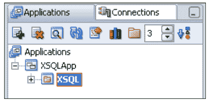

## 配置连接

我们还需要创建一个数据库连接来运行 XSQL 查询。默认情况下，Oracle XSQL 页面使用在 J2EE Web 应用程序环境中配置的 Oracle JDBC 数据源。XSQLConfig.xml 中 connection-manager 元素中的 factory 元素设置 XSQL 页面使用 JDBC 数据源。

```
<connection-manager>
    ...
    <factory>
        oracle.xml.xsql.XSQLOracleDatasourceConnectionManager
    </factory>
</connection-manager>
```

XSQL 页面还可以通过在 XSQLConfig.xml 中按如下方式设置 connection-manager 工厂类来使用基于 XSQLConfig.xml 的命名连接：

```
<factory>oracle.xml.xsql.XSQLConnectionManagerFactoryImpl</factory>
```

## XSQL

如果要在 XSQL 页面中使用第三方 JDBC 数据源，请在 XSQLConfig.xml 中按如下方式设置 connection-manager 工厂类：

```
<factory> oracle.xml.xsql.XSQLDatasourceConnectionManager</factory>
```

JDeveloper 10.1.3.3 提供了三种不同的方法从 XSQL 页面创建数据库连接：

- **连接导航器** 中的 JDBC 连接。**连接导航器** 连接具有相应的数据源，并提供 JNDI 名称绑定。
- 在 **Embedded OC4J 首选项窗口** 或 `data-sources.xml` 中配置的数据源。
- 在 `XSQLConfig.xml` 文件中指定的连接。

要在 **连接导航器** 中创建数据库连接，请在 **连接导航器** 中选择 **数据库 | 新建数据库连接** 节点。Create Connection Wizard 将启动。单击 **下一步**。在 **类型** 框架中，指定 **连接名称** 并将 **连接类型** 选择为 Oracle (JDBC)。在 **身份验证** 框架中，指定 **用户名** 和 **密码** 并单击 **下一步**。在 **连接** 框架中指定 **JDBC 驱动程序**、**主机名**、**JDBC 端口** 和数据库 **SID** 并单击 **下一步**。

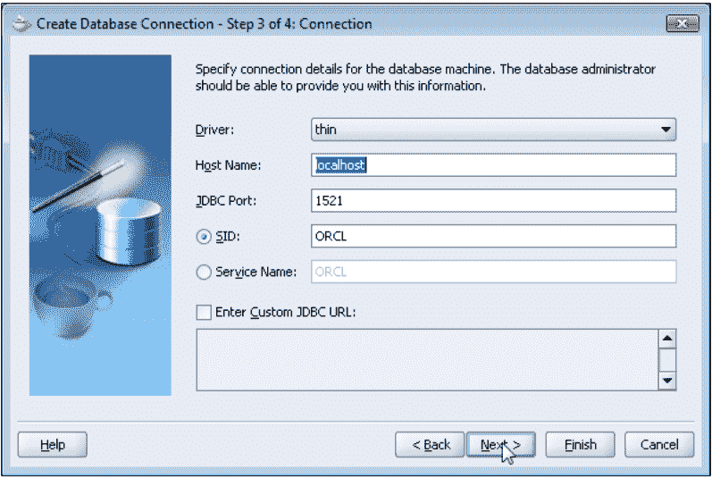


在测试框架中，单击“测试连接”按钮以测试 JDBC 连接。单击“完成”按钮以配置数据库连接。连接节点将被添加到应用程序导航器中的 Connections | Database 节点。xsqlConnection 可作为 jdbc/xsqlConnectionDS JNDI 资源使用。

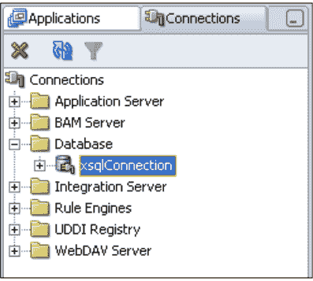

连接也可以在嵌入式 OC4J 服务器的 data-sources.xml 配置文件中配置，<JDeveloper10.1.3>\jdev\system\oracle.j2ee.10.1.3.34.12\embedded-oc4j\config\data-sources.xml，方式为声明式或使用 Tools | Embedded OC4J Preferences | Global | Data Sources，如第 2 章所述。<JDeveloper10.1.3> 是安装 JDeveloper 的目录。将 managed-data-source 元素添加到 data-sources.xml 文件中，指定数据源的连接配置。managed-data-source 元素包含用于获取数据源对象的数据源类。managed-data-source 元素如下所示：

```
<managed-data-source name='XSQLDataSource' connection-pool-name='Oracle Connection Pool' jndi-name='jdbc/XSQLDataSource'/>
<connection-pool name='Oracle Connection Pool'>  <connection-factory
factory-class='oracle.jdbc.pool.OracleDataSource'      user='OE'
password='pw'  url="jdbc:oracle:thin:@<host>:<port>:<SID>"   </
connection-factory>  </connection-pool>
```

<host> 是数据库主机，默认为 localhost。
<port> 是端口号，默认为 1521。
<SID> 是数据库 SID，默认为 ORCL。
<host>、<port> 和 <SID> 值可以从 tnsnames.ora 文件中获取。

要在 XSQL 页面中使用 JDBC 数据源连接到数据库，请在 `page` 元素的 `connection` 属性中指定 JDBC 数据源的 JNDI 名称。例如，如果 JDBC 数据源的 JNDI 名称为 `jdbc/XSQLDataSource`，则按如下方式指定 `connection` 属性。

```
<page xmlns:xsql="urn:oracle-xsql" connection="jdbc/XSQLDataSource">
</page>
```

也可以通过修改 `XSQLConfig.xml` 文件来创建 XSQL 页面与数据库的连接。当创建 XSQL 文件时，会在项目的 `src` 文件夹中添加一个 `XSQLConfig.xml` 文件。首先按如下方式在 `XSQLConfig.xml` 中指定 `connection-manager` 工厂类：

```
<factory>oracle.xml.xsql.XSQLConnectionManagerFactoryImpl</factory>
```

在 `XSQLConfig.xml` 中的 `<connectiondefs>` 元素中，添加一个 `<connection>` 元素以指定要创建的连接。创建具有 OE 架构的连接：

```
<connection name="dbConnection">
    <username>OE</username>
    <password>pw</password>
    <dburl>jdbc:oracle:thin:@<HOST>:<PORT>:<SID></dburl>
    <driver>oracle.jdbc.OracleDriver</driver>
</connection>
```

- 属性 name 是连接名称。
- `<username>` 是用于登录数据库的用户名。
- `<password>` 是用于登录数据库的密码。
- `<dburl>` 是数据库的 URL。
- `<driver>` 是用于连接到数据库的 JDBC 驱动程序。
- `<HOST>` 是 Oracle 10g 生产数据库主机。
- `<PORT>` 是数据库端口。
- `<SID>` 是数据库 SID。

要在 XSQL 页面中使用在 `XSQLConfig.xml` 文件中配置的命名连接，请将 XSQL 页面中 `<page>` 标签的 `connection` 属性值指定为 `dbConnection`。

## 创建 XSQL 查询

在本节中，我们将在 JDeveloper 中创建一个 XSQL 页面（`queryDb.xsql`）。要创建 XSQL 文件，请在 **应用程序导航器** 框架中选择项目节点并选择 **文件 | 新建**。在 **新建库** 窗口中，在 **类别** 中选择 **常规 | XML**。在 **项目** 中，选择 **XSQL 文件** 并单击 **确定**。

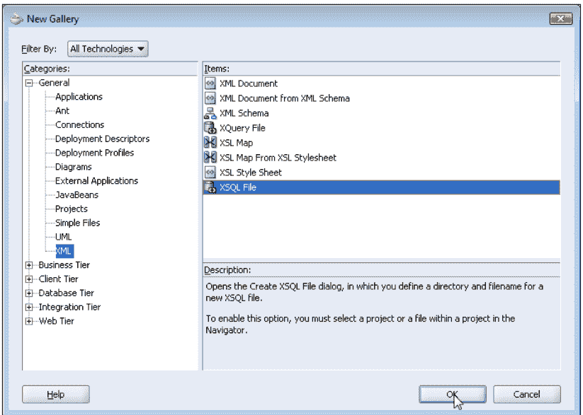

### XSQL

在 **创建 XSQL 文件** 框架中，指定 **文件名** 并单击 **确定**。一个 **XSQL** 页面被添加到 JDeveloper 项目中，其中包含 `XSQLConfig.xml` 配置文件。

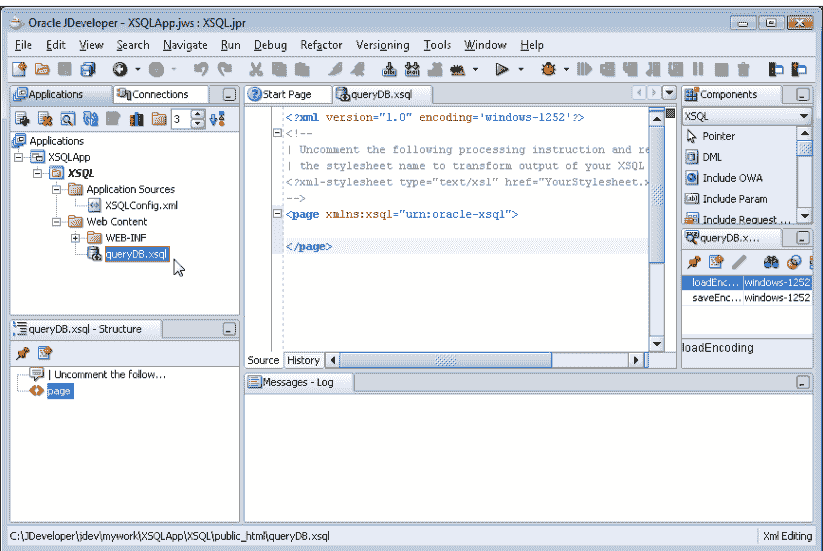

XSQL 应用程序所需的库已添加到项目库中。

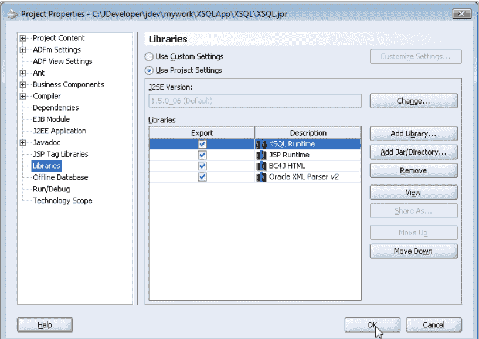

我们将构建一个 XSQL 页面以查询示例数据库表 `Catalog` 并生成 XML 文档。XSQL 组件调色板提供了本章第一表中讨论的不同的 XSQL 组件。接下来我们将向 XSQL 页面添加 `<xsql:query></xsql:query>` 标签以处理 XSQL 查询。XSQL 查询的应用可能需要使用绑定变量，即 SQL 语句中的变量。

### XSQL

绑定变量可以使用 URL 参数、会话变量、Cookie 值或页面参数的值进行设置。在我们的示例中，我们将使用页面参数设置 XSQL 查询绑定变量。绑定变量在 `<xsql:query>` 标签中使用 `bind-params` 属性指定，并在 `<xsql:query>` 标签内的 SQL 语句中使用。绑定变量在 SQL 语句中用 '?' 表示。绑定参数的值使用 `<xsql:set-page-param/>` 标签指定。将光标定位在 XSQL 页面中并在组件调色板中选择 **设置页面参数** 组件。

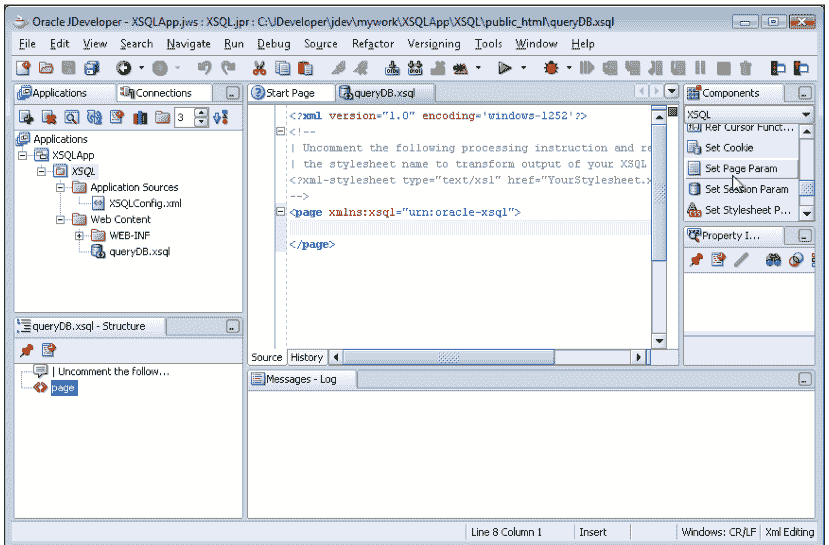

在 **设置页面参数** 框架中，将 **name** 属性值指定为 **JOURNAL**，然后单击 **下一步**。将页面参数的值指定为 SQL 或字符串。选择 **将参数值指定为字符串** 并将 **param** 值指定为 "**Oracle Magazine**"，然后单击 **下一步**。选择 XSQL 页面要使用的数据库连接并选择 **完成**。

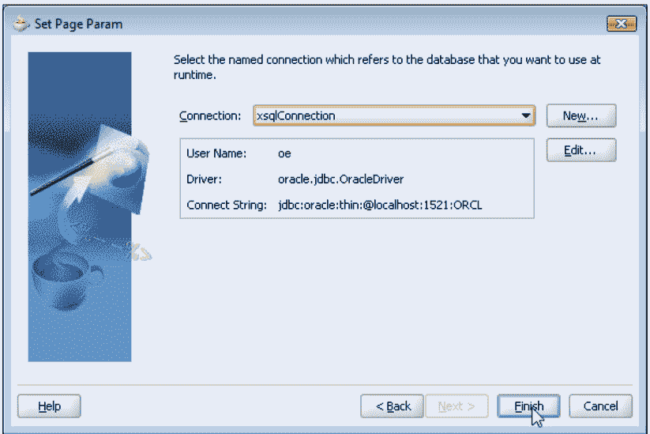

### XSQL

在 XSQL 页面中，可以使用 `page` 标签中的 `connection` 属性将数据库连接指定为全局连接。如果 XSQL 页面中的某些元素使用不同的连接，请使用各个元素中的 `connection` 属性指定连接。元素中的 `connection` 属性会覆盖全局连接。类似地添加另一个页面参数，`PUBLISHER`，值为 "Oracle Publishing"。接下来，添加一个 `xsql:Query` 元素。将光标定位在 XSQL 页面中并在 XSQL 组件调色板中选择 **查询**。

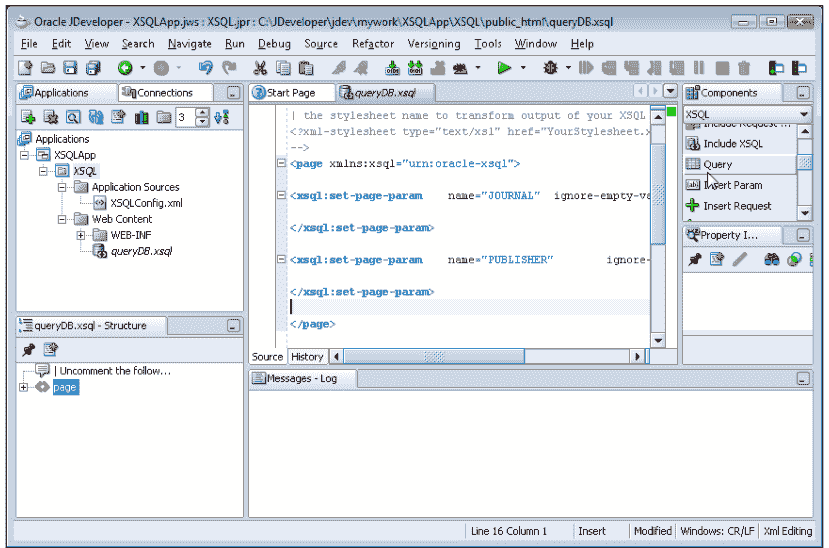

如有需要，指定任何 xsql:query 元素属性，然后单击下一步。

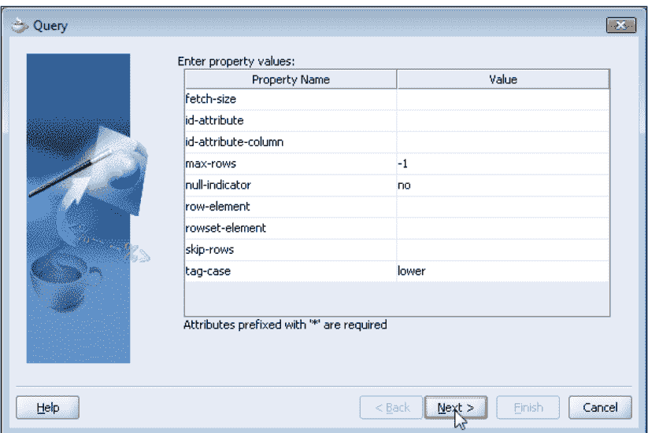

选择 XSQL 查询要使用的数据库连接，然后单击下一步。在查询窗口中，指定定义 SQL 查询的 SQL 语句，然后单击完成。使用以下 SQL 语句从 Catalog 数据库检索数据：

```
SELECT JOURNAL, PUBLISHER, EDITION, TITLE, AUTHOR FROM CATALOG WHERE JOURNAL=? AND PUBLISHER=?
```

### XSQL

xsql:query 标签已添加到 XSQL 页面。指定 JDBC 数据源的 connection 属性已添加到 page 标签。接下来我们将向 xsql:query 元素添加绑定参数。将光标定位在 xsql:query 标签中并从显示的列表中选择 bind-params。

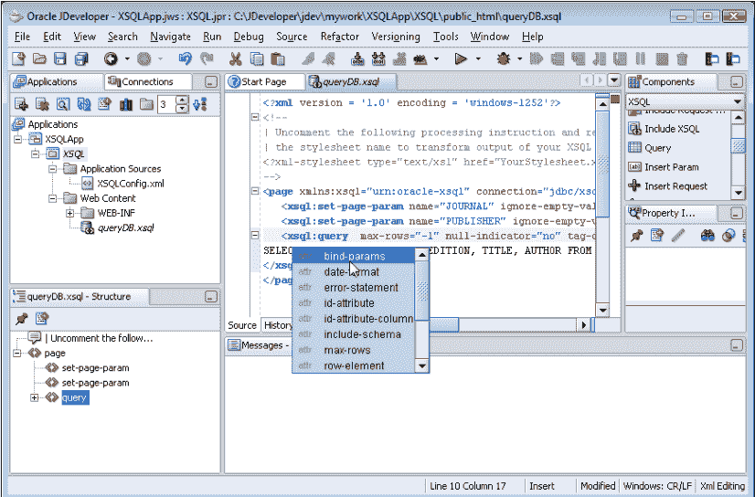

bind-params 属性已添加到 xsql:query 元素。将 "JOURNAL PUBLISHER" 添加到 bind-params 属性。bind-params 属性值是一个字符串列表，参数的值从 set-page-param 标签获取。queryDb.xsql 页面如下所示：

```
<page xmlns:xsql="urn:oracle-xsql"
    connection="jdbc/xsqlConnectionDS">
    <xsql:set-page-param name="JOURNAL" ignore-empty-value="no"
        value="Oracle Magazine"/>
    <xsql:set-page-param name="PUBLISHER" ignore-empty-value="no"
        value="Oracle Publishing"/>
    <xsql:query bind-params="JOURNAL PUBLISHER" max-rows="-1" null-
        indicator="no" tag-case="lower">
        SELECT  JOURNAL, PUBLISHER, EDITION, TITLE, AUTHOR from
            OE.Catalog WHERE JOURNAL=? AND PUBLISHER=?
    </xsql:query>
</page>
```

可在 `xsql:query` 标签中指定的其他一些属性在下表中讨论：

| 属性 | 描述 | 类型 |
|---|---|---|
| bind-params | 有序的、以空格分隔的查询参数列表，包括数组值参数，其值用于 JDBC 绑定变量。 | String |
| date-format | 数据列的日期格式。有效值类型为 java.text.SimpleDateFormat。 | String |
| id-attribute | 用于标识结果集中每一行的属性。默认值为 'num'。 | String |
| error-statement | 如果设置为 true（默认值），则为有错误的 SQL 语句生成 xsql-error 元素。 | boolean |
| id-attribute-column | 指定结果集中列的名称，其值将用作每一行的行 ID 属性值。默认使用行计数值。 | String |
| include-schema | 如果为 yes，则包含结果集结构的内联 XML 模式。默认值是 no。 | boolean |
| max-rows | 在跳过 skip-rows 属性指定的行后要获取的最大行数。默认获取所有行。 | boolean |
| null-indicator | 指定是否要在输出 XML 中包含 null 列值，并为该元素使用 NULL="Y"。默认省略具有 null 值的元素。 | boolean |
| row-element | 指定要使用而不是默认 ROW 的行元素。 | String |
| rowset-element | 指定要使用而不是默认 ROWSET 元素的行集元素。 | String |
| skip-rows | 从结果集获取之前要跳过的行数。 | integer |
| tag-case | 元素名称的大小写。有效值为 lower 和 upper。默认使用查询语句中指定的列名。 | String |


## XSQL

运行 XSQL 页面时，右键单击 queryDb.xsql 节点并选择 **Run**。XSQL 查询运行并生成一个代表 XSQL 查询结果集的 XML 文档。

```xml
<?xml version="1.0" encoding="windows-1252" ?>
<!--
| Uncomment the following processing instruction and replace
| the stylesheet name to transform output of your XSQL Page using XSLT
| <?xml-stylesheet type="text/xsl" href="YourStylesheet.xsl" ?>
-->
<page>
  <rowset>
    <row num="1">
      <journal>Oracle Magazine</journal>
      <publisher>Oracle Publishing</publisher>
      <edition>July-August 2005</edition>
      <title>Tuning Undo Tablespace</title>
      <author>Kimberly Floss</author>
    </row>
    <row num="2">
      <journal>Oracle Magazine</journal>
      <publisher>Oracle Publishing</publisher>
      <edition>September-October 2005</edition>
      <title>Creating Search Pages</title>
      <author>Steve Muench</author>
    </row>
  </rowset>
</page>
```

在下一节中，我们将使用 <xsql:query> 标签在 XSQL 查询中的一些属性。

## Applying XSQL Query Attributes

<xsql:query> 标签提供 XSQL 属性来修改通过 XSQL 查询检索的数据以及修改通过 XSQL 查询生成的 XML 文档。不同的 XSQL 属性及其应用已在本章第二张表中讨论。某些 xsql-query 属性，例如 page-params，仅在 XSQL 页面中可用。

为演示 XSQL 查询属性，删除 queryDB.xsql 并创建一个与上一节类似的 XSQL 页面，只是当从组件调色板添加 XSQL 查询时，指定查询属性，然后单击 **Next**。

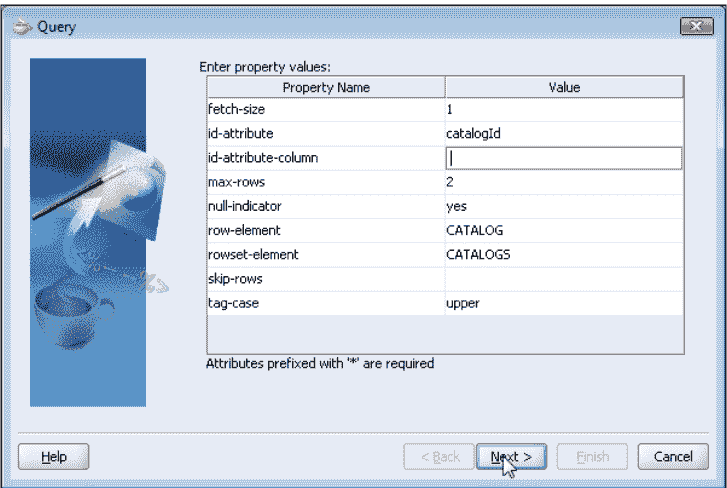

选择数据库连接并单击 Next。在查询窗口中，指定 SQL 语句并单击 Finish。在 SQL 语句中指定参数标记，因为我们将使用绑定参数。

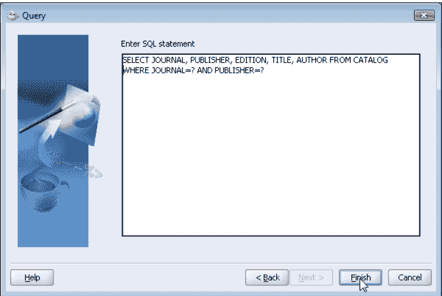

queryDB.xsql 页面如下所示：

```
<?xml version = '1.0' encoding = 'windows-1252'?><page xmlns:xsql="urn:oracle-xsql" connection="jdbc/xsqlConnectionDS">
<xsql:set-page-param name="JOURNAL" ignore-empty-value="no" value="Oracle Magazine"/>
<xsql:set-page-param name="PUBLISHER" ignore-empty-value="no" value="Oracle Publishing"/>
<xsql:query bind-params="JOURNAL PUBLISHER" fetch-size="1" id-attribute="catalogId" max-rows="2" null-indicator="yes" row-element="CATALOG" rowset-element="CATALOGS" tag-case="upper">
SELECT  JOURNAL, PUBLISHER, EDITION, TITLE, AUTHOR from
OE.Catalog WHERE JOURNAL=? AND PUBLISHER=?
</xsql:query>
</page>
```

右键单击 queryDb.xsql XSQL 页面并选择 Run。XSQL 查询运行并显示 XML 文档。

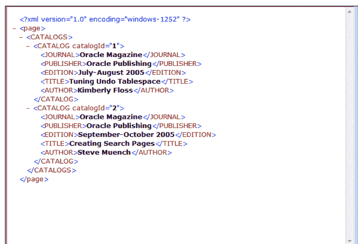

在下一节中，我们将讨论 XSQL 查询输出的 XSLT 转换。

## Transforming XSQL Output

XSQL 页面支持使用 XSLT 转换查询输出。在本节中，我们将向使用 XSQL 查询生成的 XML 文档添加 XSLT 转换。使用 File | New 添加 XSLT 文件。在 New Gallery 窗口中，在 Categories 中选择 General | XML，在 Items 中选择 XSL Style Sheet，然后单击 OK。在 Create XSL File 框架中，指定文件名并单击 OK。XSL 样式表已添加到 XSQL 项目中。

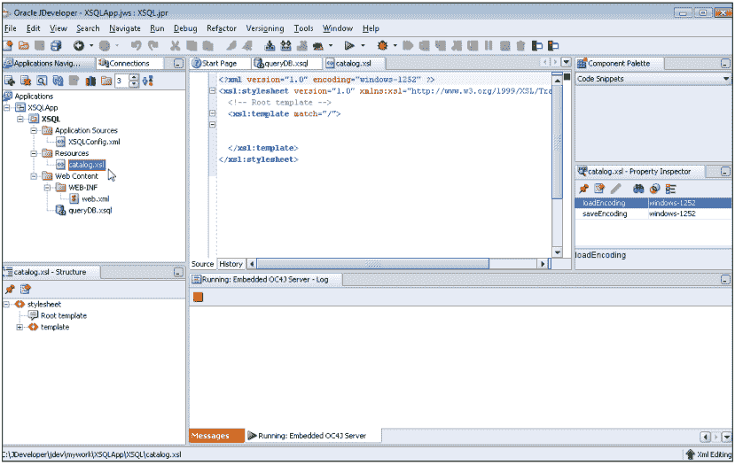

用于从 XSQL 查询 XML 输出生成 HTML 表格的 XSLT，catalog.xsl，列出如下：

```
<?xml version="1.0" encoding="UTF-8"?>
<xsl:stylesheet version="1.0" xmlns:xsl="http://www.w3.org/1999/XSL/Transform">
<xsl:output encoding="ISO-8859-1" method="text/html" />
<xsl:template match="//page">
<html>
<head>
<title>Oracle Catalog</title>
</head>
<body>
<table border="1" cellspacing="0">
<tr>
    <th>Journal</th>
    <th>Publisher</th>
    <th>Edition</th>
    <th>Title</th>
    <th>Author</th>
  </tr>
  <xsl:for-each select="ROWSET/ROW">
    <tr>
      <td><xsl:value-of select="JOURNAL"/></td>
      <td><xsl:value-of select="PUBLISHER"/></td>
      <td><xsl:value-of select="EDITION"/></td>
      <td><xsl:value-of select="TITLE"/></td>
      <td><xsl:value-of select="AUTHOR"/></td>
    </tr>
  </xsl:for-each>
  </table>
  </body>
</html>
</xsl:template>
</xsl:stylesheet>
```

使用 File | Save 将 catalog.xsl 样式表保存到与 queryDB.xsql 相同的目录，即 public_html 目录。用于转换 XSQL 输出的 XSL 样式表在 XSQL 页面中通过 xml-stylesheet 元素指定：

```
<?xml-stylesheet type="text/xsl" href="catalog.xsl"?>
```

带有 xml-stylesheet 元素的 XSQL 页面 queryDb.xsql 如下所示：

```
<?xml version = '1.0' encoding = 'windows-1252'?>
<?xml-stylesheet type="text/xsl" href="catalog.xsl"?>
<page xmlns:xsql="urn:oracle-xsql" connection="jdbc/xsqlConnectionDS">
    <xsql:set-page-param name="JOURNAL"  value="Oracle Magazine"/>
    <xsql:set-page-param name="PUBLISHER"  value="Oracle Publishing"/>
    <xsql:query bind-params="JOURNAL PUBLISHER">
SELECT  JOURNAL, PUBLISHER, EDITION, TITLE, AUTHOR from
    OE.Catalog WHERE JOURNAL=? AND PUBLISHER=?
</xsql:query>
</page>
```

要运行 XSQL 页面，右键单击 queryDb.xsql 节点并选择 Run。

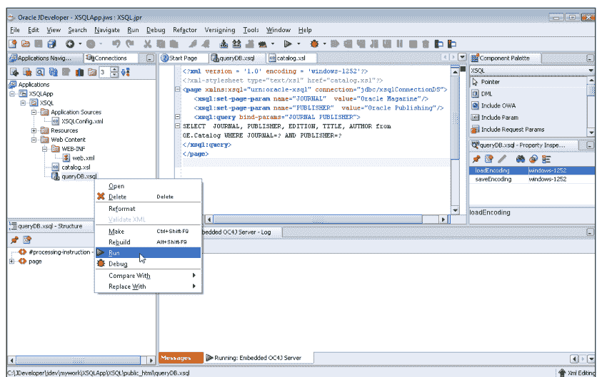

XSQL 查询运行，XML 输出通过 XSLT 转换。

| 期刊 | 出版社 | 版本 | 标题 | 作者 |
|---|---|---|---|---|
| Oracle Magazine | Oracle Publishing | July-August 2005 | Tuning Undo Tablespace | Kimberly Floss |
| Oracle Magazine | Oracle Publishing | September-October 2005 | Creating Search Pages | Steve Muench |

## JDBC 4.0 Version

嵌入在 JDeveloper 10g 或 JDeveloper 11g 中的 OC4J 服务器不支持 JDBC 4.0 规范。在支持 JDBC 4.0 规范的 JDeveloper 的更高版本中，JDBC 4.0 的新功能可与 XSQL 应用程序一起使用。要使用 JDBC 4.0 功能，我们需要使用 Oracle 数据库 11g JDBC 4.0 驱动程序 JAR 文件 ojdbc6.jar 配置与 Oracle 数据库的 JDBC 连接。由于 JDBC 4.0 驱动程序需要 JDK 6.0，请通过选择 Tools | Project Properties 然后选择 Libraries 将 J2SE 版本设置为 JDK 6.0。JDK 版本可在 J2SE Version 字段中设置。使用 JDBC 4.0 驱动程序，我们可以使用连接管理功能，例如连接状态跟踪。连接状态跟踪由连接池管理器使用 Connection 接口的 isValid() 方法实现。连接池管理器通过在连接上调用 isValid() 方法来确定连接池中的连接是否不可用。如果连接无效，连接池管理器将使用 close() 方法关闭连接。

```
if (!connection.isValid())
    connection.close();
```

## 摘要

Oracle XSQL Pages Publishing Framework 用于使用 SQL 查询生成 XML 文档。可将 XSLT 应用于使用 XSQL 生成的 XML 以转换 XML 输出。JDBC 连接用于连接到数据库以运行 SQL 查询语句。Oracle JDeveloper 支持 XSQL 框架。使用 XSQL 生成的 XML 文档可通过指定行元素、行集元素以及 XSQL 查询的其他属性来自定义。在嵌入式 OC4J 支持 JDBC 4.0 的 JDeveloper 版本中，JDBC 4.0 功能例如连接状态跟踪可在 XSQL 应用程序中使用。
