## 9 Oracle Web RowSet

在前两章中，我们使用 XSU 将 XML 文档映射到关系数据库，并使用 XSU 和 XSQL 将关系数据库表映射到 XML 文档。在本章中，我们将使用使用 SQL 查询生成的 result set 的 XML 文档表示来修改关系数据库表。

`ResultSet` 接口需要在数据库上保持持久连接以在数据库表数据上调用插入、更新和删除行操作。`RowSet` 接口扩展了 `ResultSet` 接口，是一个可无需连接到数据源即可操作的表格数据容器。因此，`RowSet` 接口减少了与数据库保持持久连接的开销。

在 J2SE 5.0 中，引入了五种新的 RowSet 实现——`JdbcRowSet`、`CachedRowSet`、`WebRowSet`、`FilteredRowSet` 和 `JoinRowSet`。`WebRowSet` 接口扩展了 `RowSet` 接口，是 `RowSet` 对象的 XML 文档表示。`WebRowSet` 对象表示一组获取的数据库表行，可在不连接到数据库的情况下进行修改。

Oracle Web RowSet 支持是 Oracle Database 10g 驱动程序中的新功能。Oracle Web RowSet 省去了与数据库保持持久连接的要求。连接仅在需要使用 `SELECT` 查询从数据库检索数据以及在对检索到的数据执行所有必需的行操作后更新数据库中的数据时才需要。Oracle Web RowSet 用于对从数据库检索的数据进行查询和修改。Oracle Web RowSet 作为 `RowSet` 的 XML 文档表示，便于数据传输。

在 Oracle Database 10g 和 11g JDBC 驱动程序中，Oracle Web RowSet 实现在 `oracle.jdbc.rowset` 包中。`OracleWebRowSet` 类表示 Oracle Web RowSet。Web RowSet 中的数据可在不连接到数据库的情况下进行修改。修改 Web RowSet 后，可使用 `OracleWebRowSet` 类更新数据库表。数据库 JDBC 连接仅在需要从数据库检索数据和用于更新时才需要

数据库。通过 Web RowSet 中的数据可以获得用于数据交换的 XML 文档表示形式。本章在 JDeveloper 10g 中实现了 Oracle 10g 数据库 JDBC 驱动程序中的 Web RowSet 功能。将从数据库创建一个示例 Web RowSet。Web RowSet 将被修改并存储在数据库表中。

在本章中我们将学习以下内容：

- 创建 Oracle Web RowSet 对象
- 向 Oracle Web RowSet 添加一行
- 从 Oracle Web RowSet 读取一行
- 更新 Oracle Web RowSet 中的一行
- 从 Oracle Web RowSet 删除一行
- 使用修改后的 Oracle Web RowSet 更新数据库表

## 设置环境

我们将使用 Oracle 数据库生成可更新的 OracleWebRowSet 对象。因此，安装包含示例模式的 Oracle 数据库 10g。使用 OE 模式连接到数据库：

```
SQL> CONNECT OE/<password>
```

使用以下 SQL 脚本创建示例数据库表 Catalog：

```
CREATE TABLE OE.Catalog(Journal VARCHAR(25), Publisher Varchar(25), Edition VARCHAR(25), Title Varchar(45), Author Varchar(25));
INSERT INTO OE.Catalog VALUES('Oracle Magazine', 'Oracle Publishing', 'July-August 2005', 'Tuning Undo Tablespace', 'Kimberly Floss');
INSERT INTO OE.Catalog VALUES('Oracle Magazine', 'Oracle Publishing', 'March-April 2005', 'Starting with Oracle ADF', 'Steve Muench');
```

为 Web RowSet 实现配置 JDeveloper 10g。在 JDeveloper 中创建项目。选择 文件 | 新建 | 通用 | 应用程序。在“创建应用程序”窗口中指定应用程序名称并单击“下一步”。在“创建项目”窗口中指定项目名称并单击“下一步”。项目已添加到应用程序导航器中。

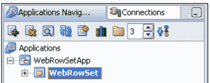

接下来，我们将设置项目库。选择 **工具 | 项目属性** 并在 **项目属性** 窗口中选择 **库 | 添加库** 以添加库。将 **Oracle JDBC** 库添加到项目库中。如果使用早于 Oracle 数据库 10g (R2) JDBC 驱动程序版本的 Oracle JDBC 驱动程序版本，请从 Oracle Web RowSet 实现类 JAR 文件 `C:\JDeveloper10.1.3\jdbc\lib\ocrs12.jar` 创建库。`ocrs12.jar` 仅在 JDBC 驱动程序早于 Oracle 数据库 10g (R2) JDBC 驱动程序时才需要。在 Oracle 数据库 10g (R2) JDBC 驱动程序中，Oracle RowSet 实现类打包在 `ojdbc14.jar` 中。在 Oracle 数据库 11g JDBC 驱动程序中，Oracle RowSet 实现类打包在 `ojdbc5.jar` 和 `ojdbc6.jar` 中。

在 **添加库** 窗口中选择 **用户** 节点并单击 **新建**。在 **创建库** 窗口中指定 **库名称**，选择 **类路径** 节点并单击 **添加条目**。为 `ocrs12.jar` 添加条目。由于 Web RowSet 在 J2SE 5.0 中引入，如果使用 J2SE 1.4，我们还需要为 RowSet 实现 JAR 文件 `rowset.jar` 添加条目。从 `http://java.sun.com/products/jdbc/download.html#rowset1_0_1` 下载 JDBC RowSet 实现 1.0.1 zip 文件 `jdbc_rowset_tiger-1_0_1-mrel-ri.zip` 并将 JDBC RowSet zip 文件解压到目录中。在 **创建库** 窗口中单击 **确定**。在 **添加库** 窗口中单击 **确定**。Web RowSet 应用程序的库已添加。

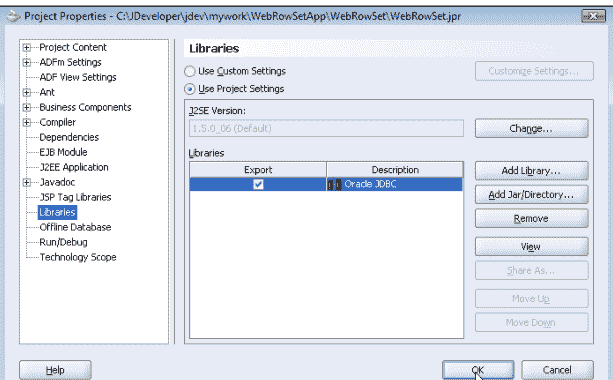

现在配置 OC4J 数据源。选择 工具 | 嵌入式 OC4J 服务器首选项。数据源可以全局配置或为当前工作区配置。如果使用 全局 | 数据源 创建全局数据源，则数据源配置在 C:\JDeveloper10.1.3\jdev\system\oracle.j2ee.10.1.3.36.73\embedded-oc4j\config \data-sources.xml 文件中。如果使用 当前工作区 | 数据源 为当前工作区配置数据源，则数据源配置在 data-sources.xml 文件中。例如，WebRowSetApp 应用程序的数据源文件是 WebRowSetApp-data-sources.xml。在“嵌入式 OC4J 服务器首选项”窗口中，使用第 2 章中讨论的流程配置全局数据源或当前工作区中的数据源。全局数据源定义可供部署在 OC4J 服务器实例中的所有应用程序使用。在 data-sources.xml 文件中添加了 managed-data-source 元素。

```
<managed-data-source name='OracleDataSource' connection-pool-name='Oracle Connection Pool' jndi-name='jdbc/OracleDataSource'/>
<connection-pool name='Oracle Connection Pool'>
  <connection-factory factory-class='oracle.jdbc.pool.OracleDataSource' user='OE' password='pw' url="jdbc:oracle:thin:@localhost:1521:ORCL">
  </connection-factory>
</connection-pool>
```

向 WebRowSet 项目添加一个 JSP，GenerateWebRowSet.jsp。选择 文件 | 新建 | Web 层 | JSP | JSP。单击 确定。在 Web 应用程序窗口中选择 J2EE 1.3 或 J2EE 1.4 并单击 下一步。在 JSP 文件窗口中指定文件名并单击 下一步。在“错误页面选项”页面中选择默认设置并单击 下一步。在“标记库”窗口中选择默认设置并单击 下一步。在“HTML 选项”窗口中选择默认选项并单击 下一步。在“完成”窗口中单击 完成。接下来，配置 web.xml 部署描述符以包含对在 data-sources.xml 文件中配置的数据源资源的引用，如以下列表所示：

```
<resource-ref>
  <res-ref-name>jdbc/OracleDataSource</res-ref-name>
  <res-type>javax.sql.DataSource</res-type>
  <res-auth>Container</res-auth>
</resource-ref>
```

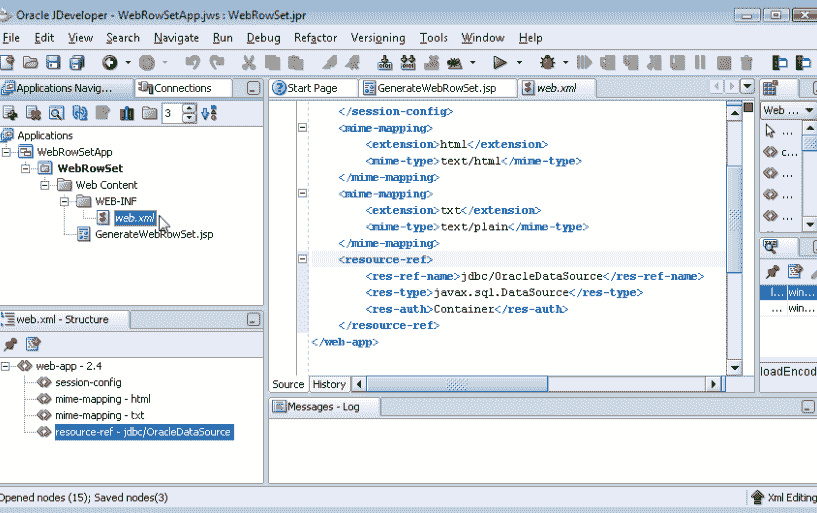

## 创建 Web RowSet

在本节中，我们将从数据库表创建 Web RowSet 并生成 Web RowSet 的 XML 文档表示形式。使用 文件 | 新建 | 通用 | Java 类 在 JDeveloper 中创建 Java 类。在“创建 Java 类”窗口中指定类名 WebRowSetQuery 和包名并单击 确定。Java 类 WebRowSetQuery.java 已添加到 WebRowSet 项目中。在 Java 应用程序中首先导入 oracle.jdbc.rowset 包类。创建 OracleWebRowSet 类对象：

```
OracleWebRowSet webRowSet=new OracleWebRowSet();
```

设置数据源名称以获取与数据库的 JDBC 连接。数据源名称配置在 data-sources.xml 文件中：

```
webRowSet.setDataSourceName("jdbc/OracleDataSource");
```

为 OracleWebRowSet 类对象设置 SQL 查询命令：

```
webRowSet.setCommand(selectQuery);
```

变量 selectQuery 是用于查询数据库的 SQL 语句的字符串值。SQL 语句值从 JSP 中的输入字段获取。设置用户名和密码以获取 JDBC 连接：

```
webRowSet.setUsername("OE");
webRowSet.setPassword("<password>");
```

设置 OracleWebRowSet 对象的只读、获取大小和最大行属性：

```
webRowSet.setReadOnly(false);
webRowSet.setFetchSize(5);
webRowSet.setMaxRows(3);
```

使用 execute() 方法运行 setCommand() 方法中指定的 SQL 命令：

```
webRowSet.execute();
```

使用 SQL 查询从数据库表检索的数据创建了一个 Web RowSet。使用 writeXml() 方法从 Web RowSet 生成 XML 文档；

```
OutputStreamWriter output=new OutputStreamWriter( new
FileOutputStream(new File("c:/output/output.xml")));
webRowSet.writeXml(output);
```

Oracle Web RowSet 还提供 readXml() 方法，使用 Reader 对象或 InputStream 对象以 XML 格式读取 Oracle Web RowSet 对象。如果要使用 readXml() 方法，请设置以下 JAXP 系统属性之一：

- javax.xml.parsers.SAXParserFactory
- javax.xml.parsers.DocumentBuilderFactory

例如，按如下方式设置 SAXParserFactory 属性：

```
System.setProperty("javax.xml.parsers.SAXParserFactory",
"oracle.xml.jaxp.JXSAXParserFactory");
```

WebRowSetQuery.java 还有读取、更新、删除和插入数据库表中的行的 方法，将在后续章节中讨论。WebRowSetQuery.java 应用程序如下所示：

```
package webrowset;
import oracle.jdbc.rowset.*;
import java.io.*;
import java.sql.SQLException;
public class WebRowSetQuery
{
```

public OracleWebRowSet webRowSet;
public String selectQuery;
public WebRowSetQuery()
{
}
public WebRowSetQuery(OracleWebRowSet webRowSet)
{
    this.webRowSet = webRowSet;
}
public void generateWebRowSet(String selectQuery)
{
    try
    {
        webRowSet = new OracleWebRowSet();
        webRowSet.setDataSourceName("jdbc/OracleDataSource");
        webRowSet.setCommand(selectQuery);
        webRowSet.setUsername("oe");
        webRowSet.setPassword("pw");
        webRowSet.setReadOnly(false);
        webRowSet.setFetchSize(5);
        webRowSet.setMaxRows(3);
        webRowSet.execute();
    }
    catch (SQLException e)
    {
        System.out.println(e.getMessage());
    }
}
public void generateXMLDocument()
{
    try
    {
        OutputStreamWriter output = new OutputStreamWriter(
                new FileOutputStream(new File("c:/output/output.xml")));
        webRowSet.writeXml(output);
    }
    catch (SQLException e)
    {
        System.out.println(e.getMessage());
    }
    catch (IOException e)
    {
    }
}
public void deleteRow(int row)
{
    try
    {
        webRowSet.absolute(row);
        webRowSet.deleteRow();
    }
    catch (SQLException e)
    {
        System.out.println(e.getMessage());
    }
}
public void insertRow(String journal, String publisher,
        String edition, String title, String author)
{
    try
    {
        webRowSet.moveToInsertRow();
        webRowSet.updateString(1, journal);
        webRowSet.updateString(2, publisher);
        webRowSet.updateString(3, edition);
        webRowSet.updateString(4, title);
        webRowSet.updateString(5, author);
        webRowSet.insertRow();
    }
    catch (SQLException e)
    {
        System.out.println(e.getMessage());
    }
}
public void updateRow(int rowUpdate, String journal,
        String publisher, String edition, String title, String author)
{
    try
    {
        webRowSet.absolute(rowUpdate);
        webRowSet.updateString(1, journal);
        webRowSet.updateString(2, publisher);
        webRowSet.updateString(3, edition);
        webRowSet.updateString(4, title);
        webRowSet.updateString(5, author);
        webRowSet.updateRow();
    }
    catch (SQLException e)
    {
        System.out.println(e.getMessage());
    }
}
public String[] readRow(int rowRead)
{
    String[] resultSet = null;
    try
    {
        resultSet = new String[5];
        webRowSet.absolute(rowRead);
        resultSet[0] = webRowSet.getString(1);
        resultSet[1] = webRowSet.getString(2);
        resultSet[2] = webRowSet.getString(3);
        resultSet[3] = webRowSet.getString(4);
        resultSet[4] = webRowSet.getString(5);
    }
    catch (SQLException e)
    {
        System.out.println(e.getMessage());
    }
    return resultSet;
}
public void updateDatabase()
{
    try
    {
        webRowSet.acceptChanges();
    }
    catch (java.sql.SQLException e)
    {
        System.out.println(e.getMessage());
    }
}
}

用于创建 Web RowSet 的 SELECT 查询从 GenerateWebRowSet.jsp JSP 输入，该 JSP 已在“设置环境”部分中添加，下面列出：

<%@ page contentType="text/html;charset=windows-1252"%>
<html>
<head>
    <meta http-equiv="Content-Type" content="text/html;
    charset=windows-1252">
    <title>Generate WebRowSet</title>
</head>
<body>
    <form>
    </form>
    <%
    String selectQuery=request.getParameter("selectQuery");
    webrowset.WebRowSetQuery query=new webrowset.WebRowSetQuery();
    if(selectQuery!=null)
    {
        query.generateWebRowSet(selectQuery);
        query.generateXMLDocument();
    }
    %>
    <form name="query" action="GenerateWebRowSet.jsp" method="post">
    <table>
        <tr>
            <td>Select Query:</td>
        </tr><tr><td>
            <textarea name="selectQuery" rows="5"
            cols="50"></textarea>
        </td>
        </tr><tr><td>
            <input class="Submit" type="submit" value="Apply"/>
        </td>
        </tr>
    </table>
    </form>
</body>
</html>

## Oracle Web RowSet

右键单击 GenerateWebRowSet.jsp 并选择 Run 以运行 JSP。

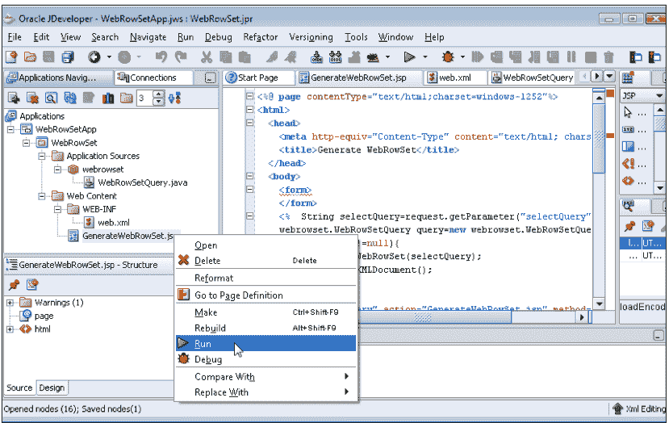

在显示的 JSP 页面中，指定用于生成 Web RowSet 的 SQL 查询。例如，指定 SQL 查询：

```
SELECT JOURNAL, PUBLISHER, EDITION, TITLE, AUTHOR FROM OE.Catalog
```

单击 Apply。

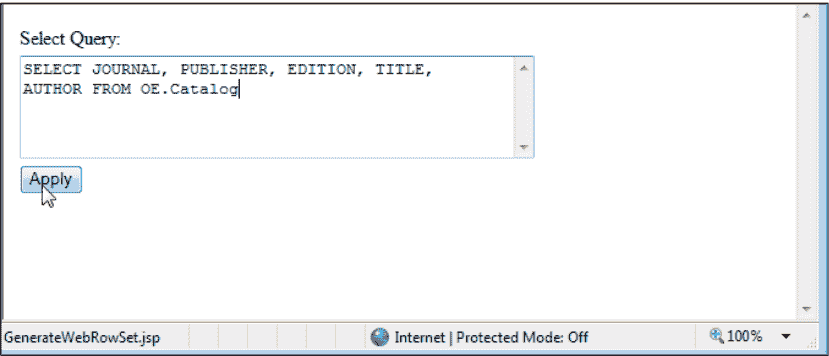

生成了一个 Web RowSet，并从 Web RowSet 生成了一个 XML 文档。Web RowSet 输出的 XML 文档包含 JDBC 数据源、数据库表以及表中的数据的元数据信息；data 元素标签表示数据库表中的数据。从 Web RowSet 生成的 XML 文档基于 DTD (http://java.sun.com/j2ee/dtds/RowSet.dtd)。以下是从示例数据库表 Catalog 生成的 XML 文档：

```
<?xml version="1.0" encoding="UTF-8"?>
<!DOCTYPE RowSet PUBLIC '//Sun Microsystems, Inc.//DTD RowSet//EN'
'http://java.sun.com/j2ee/dtds/RowSet.dtd'>
<RowSet>
  <properties>
    <command>SELECT JOURNAL, PUBLISHER, EDITION, TITLE, AUTHOR FROM
      OE.Catalog</command>
    <concurrency>1007</concurrency>
    <datasource>jdbc/OracleDataSource</datasource>
    <escape-processing>true</escape-processing>
    <fetch-direction>1002</fetch-direction>
    <fetch-size>10</fetch-size>
    <isolation-level>2</isolation-level>
    <key-columns>
    </key-columns>
    <map></map>
    <max-field-size>0</max-field-size>
    <max-rows>3</max-rows>
    <query-timeout>0</query-timeout>
    <read-only>false</read-only>
    <rowset-type>1005</rowset-type>
    <show-deleted>false</show-deleted>
    <url>jdbc:oracle:thin:@localhost:1521:ORCL</url>
  </properties>
  <metadata>
    <column-count>5</column-count>
    <column-definition>
        <column-index>1</column-index>
        <auto-increment>false</auto-increment>
        <case-sensitive>true</case-sensitive>
        <currency>false</currency>
        <nullable>1</nullable>
        <signed>true</signed>
        <searchable>true</searchable>
        <column-display-size>25</column-display-size>
        <column-label>JOURNAL</column-label>
        <column-name>JOURNAL</column-name>
        <schema-name></schema-name>
        <column-precision>0</column-precision>
        <column-scale>0</column-scale>
        <table-name></table-name>
        <catalog-name></catalog-name>
        <column-type>12</column-type>
        <column-type-name>VARCHAR2</column-type-name>
    </column-definition>
    <column-definition>
        <column-index>2</column-index>
        <auto-increment>false</auto-increment>
        <case-sensitive>true</case-sensitive>
        <currency>false</currency>
        <nullable>1</nullable>
        <signed>true</signed>
        <searchable>true</searchable>
        <column-display-size>25</column-display-size>
        <column-label>PUBLISHER</column-label>
        <column-name>PUBLISHER</column-name>
        <schema-name></schema-name>
        <column-precision>0</column-precision>
        <column-scale>0</column-scale>
        <table-name></table-name>
        <catalog-name></catalog-name>
        <column-type>12</column-type>
        <column-type-name>VARCHAR2</column-type-name>
    </column-definition>
    <column-definition>
        <column-index>3</column-index>
        <auto-increment>false</auto-increment>
        <case-sensitive>true</case-sensitive>
        <currency>false</currency>
        <nullable>1</nullable>
        <signed>true</signed>
        <searchable>true</searchable>
        <column-display-size>25</column-display-size>
        <column-label>EDITION</column-label>
        <column-name>EDITION</column-name>
        <schema-name></schema-name>
        <column-precision>0</column-precision>
        <column-scale>0</column-scale>
        <table-name></table-name>
        <catalog-name></catalog-name>
        <column-type>12</column-type>
        <column-type-name>VARCHAR2</column-type-name>
    </column-definition>
    <column-definition>
        <column-index>4</column-index>
        <auto-increment>false</auto-increment>
        <case-sensitive>true</case-sensitive>
        <currency>false</currency>
        <nullable>1</nullable>
        <signed>true</signed>
        <searchable>true</searchable>
        <column-display-size>45</column-display-size>
        <column-label>TITLE</column-label>
        <column-name>TITLE</column-name>
        <schema-name></schema-name>
        <column-precision>0</column-precision>
        <column-scale>0</column-scale>
        <table-name></table-name>
        <catalog-name></catalog-name>
        <column-type>12</column-type>
        <column-type-name>VARCHAR2</column-type-name>
    </column-definition>
    <column-definition>
        <column-index>5</column-index>
        <auto-increment>false</auto-increment>
        <case-sensitive>true</case-sensitive>
        <currency>false</currency>


```
<nullable>1</nullable>
<signed>true</signed>
<searchable>true</searchable>
<column-display-size>25</column-display-size>
<column-label>AUTHOR</column-label>
<column-name>AUTHOR</column-name>
<schema-name></schema-name>
<column-precision>0</column-precision>
<column-scale>0</column-scale>
<table-name></table-name>
<catalog-name></catalog-name>
<column-type>12</column-type>
<column-type-name>VARCHAR2</column-type-name>
</column-definition>
</metadata>
<data>
    <row>
        <col>Oracle Magazine</col>
        <col>Oracle Publishing</col>
        <col>July-August 2005</col>
        <col>Tuning Undo Tablespace</col>
        <col>Kimberly Floss</col>
    </row>
    <row>
        <col>Oracle Magazine</col>
        <col>Oracle Publishing</col>
        <col>March-April 2005</col>
        <col>Starting with Oracle ADF</col>
        <col>Steve Muench</col>
    </row>
</data>
</RowSet>
```

在本节中，解释了从数据库表生成 Web RowSet 的过程。在下一节中，Web RowSet 将被修改，并将修改后的数据存储到数据库表中。

## 使用 Web RowSet 修改数据库表

使用 ResultSet 接口时，要修改数据库中的数据，需要与数据库建立 JDBC 连接才能插入、删除或更新数据库表行。使用 Web RowSet 时，数据可以在 OracleWebRowSet 对象中进行修改，只有在对 Web RowSet 完成所有修改后，才需要连接来使用 Web RowSet 中的数据更新数据库表。本节将修改 Web RowSet 中的数据，并使用修改后的 Web RowSet 更新数据库表。在示例 Web RowSet 中修改数据不需要 JDBC 连接。OracleWebRowSet 对象如前一节所述生成。

创建一个 JSP，ModifyWebRowSet.jsp，用于从 SQL 查询创建和修改 Web RowSet。还添加了稍后在本章中列出的 JSP CreateRow.jsp、ReadRow.jsp、UpdateRow.jsp、DeleteRow.jsp 和 UpdateDatabase.jsp。用于创建和修改 Web RowSet 的 ModifyWebRowSet.jsp 如下所示：

```
<!DOCTYPE HTML PUBLIC "-//W3C//DTD HTML 4.01 Transitional//EN"
"http://www.w3.org/TR/html4/loose.dtd">
<%@ page contentType="text/html;charset=windows-1252"%>
<%@ page session="true"%>
<html>
    <head>
        <title>Modify Database Table with Web RowSet</title>
    </head>
    <body>
        <h3>Modify Database Table with Web RowSet</h3>
        <%webrowset.WebRowSetQuery query=null;%>
        <%String selectQuery=request.getParameter("selectQuery");
        if(selectQuery!=null){
        query=new webrowset.WebRowSetQuery();
        query.generateWebRowSet(selectQuery);
        session.setAttribute("query", query);
        }
        %>
        <form name="query" action="ModifyWebRowSet.jsp" method="post">
            <table>
                <tr>
                    <td>Select Query:</td>
                </tr><tr><td>
                    <textarea name="selectQuery" rows="5"
                    cols="50"></textarea>
```

```
</td></tr><tr><td>
    <input class="Submit" type="submit" value="Apply Query"/>
    </td></tr>
<tr><td><a href="CreateRow.jsp">Create Row</a></td></tr>
<tr><td><a href="ReadRow.jsp">Read Row</a></td></tr>
<tr><td><a href="UpdateRow.jsp">Update Row</a></td></tr>
<tr><td><a href="DeleteRow.jsp">Delete Row</a></td></tr>
<tr><td><a href="UpdateDatabase.jsp">Update Database</a></td></tr>
</table>
</form>
</body>
</html>
```

Web RowSet 应用程序的目录结构在 **Applications Navigator** 中显示。在 JDeveloper 中运行 `ModifyWebRowSet.jsp` JSP。JSP 在浏览器中显示。指定 SQL 查询以生成 Web RowSet。单击 **Apply Query** 随后我们将修改 Web RowSet 并更新数据库。

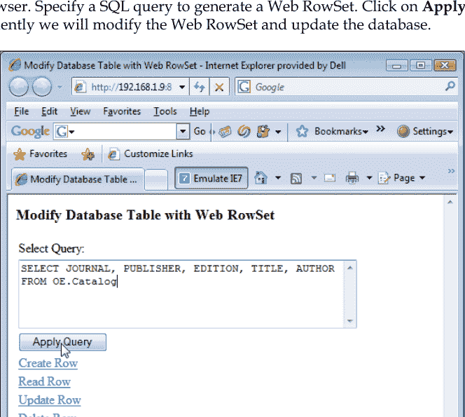

生成了一个 Web RowSet。我们将使用 Web RowSet 对象来创建、读取、更新和删除通过 SQL 查询获得的结果集。在 ModifyWebRowSet.jsp 中，将 WebRowSetQuery 对象设置为会话对象属性：

```
session.setAttribute("query", query);
```

ModifyWebRowSet 对象的 OracleWebRowSet 对象将在 Create、Read、Update 和 Delete JSP 中使用。

## 创建新行

接下来，在 Web RowSet 中创建新行。在 ModifyWebRowSet.jsp JSP 中单击 Create Row 链接。

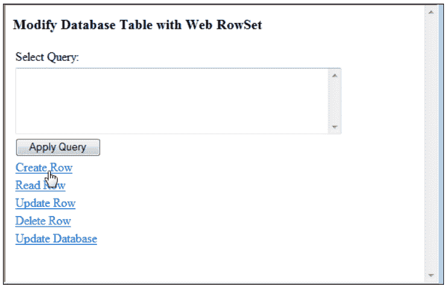

显示 CreateRow.jsp。指定要添加的行值并单击 Apply。

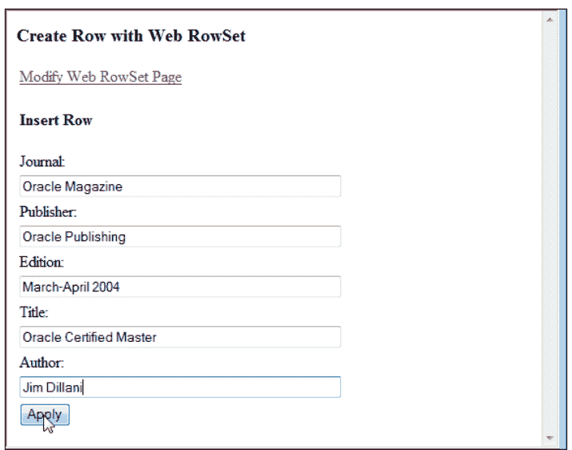

在 CreateRow.jsp 中，从 JSP 检索输入值并调用 WebRowSetQuery 类的 insertRow() 方法。WebRowSetQuery 对象从会话对象中检索：

```
WebRowSetQuery query=( webrowset.WebRowSetQuery)
    session.getAttribute("query");
```

在 insertRow() 方法中，OracleWebRowSet 对象光标移动到插入行：

```
webRowSet.moveToInsertRow();
```

使用 updateString() 方法设置行值：

```
webRowSet.updateString(1, journal);
webRowSet.updateString(2, publisher);
webRowSet.updateString(3, edition);
webRowSet.updateString(4, title);
webRowSet.updateString(5, author);
```

将行添加到 OracleWebRowSet：

```
webRowSet.insertRow();
```

在 OracleWebRowSet 对象中添加了新行。新行尚未添加到数据库中。CreateRow.jsp 如下所示：

```
<%@ page contentType="text/html;charset=windows-1252"%>
<%@ page session="true"%>
<html>
<head>
<meta http-equiv="Content-Type" content="text/html; charset=windows-1252">
<title>Create Row with Web RowSet</title>
</head>
<body>
<form><h3>Create Row with Web RowSet</h3>
<table>
<tr><td><a href="ModifyWebRowSet.jsp">Modify Web RowSet Page</a></td></tr>
</table>
</form>
<%
webrowset.WebRowSetQuery query=null;
query=(webrowset.WebRowSetQuery)
session.getAttribute("query");
String journal=request.getParameter("journal");
String publisher=request.getParameter("publisher");
String edition=request.getParameter("edition");
String title=request.getParameter("title");
String author=request.getParameter("author");
if(journal!=null||publisher!=null||edition!=null||title!=null||author!=null){
query.insertRow(journal, publisher, edition, title, author);
}
%>
<form name="query" action="CreateRow.jsp" method="post">
<table>
<tr>
<td>
<h4>Insert Row</h4>
</td>
</tr>
```

```
<tr>
    <td>Journal:</td>
</tr>
<tr>
    <td>
        <input name="journal" type="text" size="50"
            maxlength="250"/>
    </td>
</tr>
<tr>
    <td>Publisher:</td>
</tr>
<tr>
    <td>
        <input name="publisher" type="text" size="50"
            maxlength="250"/>
    </td>
</tr>
<tr>
    <td>Edition:</td>
</tr>
<tr>
    <td>
        <input name="edition" type="text" size="50"
            maxlength="250"/>
    </td>
</tr>
<tr>
    <td>Title:</td>
</tr>
<tr>
    <td>
        <input name="title" type="text" size="50"
            maxlength="250"/>
    </td>
</tr>
<tr>
    <td>Author:</td>
</tr>
<tr>
    <td>
        <input name="author" type="text" size="50"
            maxlength="250"/>
    </td>
</tr>
```

```
</tr>
<tr>
    <td>
        <input class="Submit" type="submit" value="Apply"/>
    </td>
</tr>
</table></form></body></html>
```

## 读取行

接下来，我们将从 OracleWebRowSet 对象读取一行。在 CreateRow.jsp 中单击 Modify Web RowSet 链接。在 ModifyWebRowSet JSP 中单击 Read Row 链接。显示 ReadRow.jsp JSP。在 ReadRow JSP 中指定要读取的数据库行并单击 Apply。

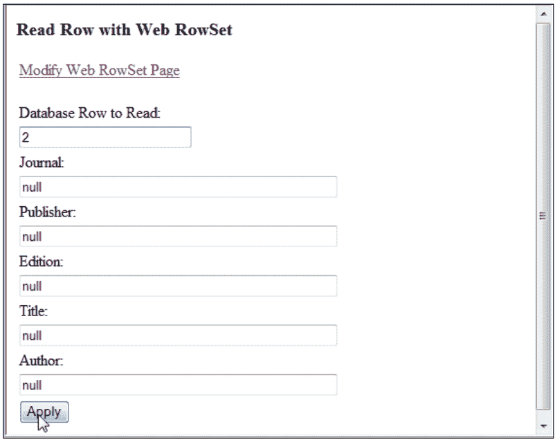

从 Web RowSet 中检索第二行值：

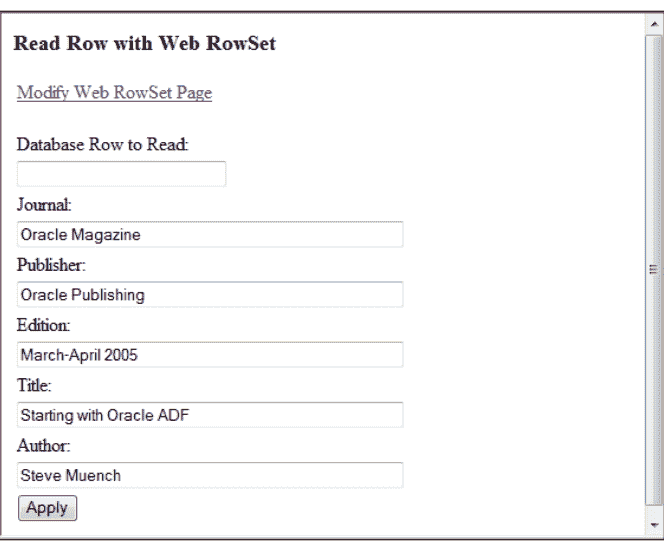

在 ReadRow JSP 中调用 WebRowSetQuery.java 应用程序的 readRow() 方法。WebRowSetQuery 对象从会话对象中检索。

```
WebRowSetQuery query=( webrowset.WebRowSetQuery)
    session.getAttribute("query");
```

readRow() 方法返回的 String[] 值被添加到 ReadRow JSP 字段中。在 readRow() 方法中，OracleWebRowSet 对象光标移动到要读取的行。

```
webRowSet.absolute(rowRead);
```

使用 getString() 方法检索行值并添加到 String[]。返回 String[] 对象。

```
String[] resultSet=new String[5];
resultSet[0]=webRowSet.getString(1);
resultSet[1]=webRowSet.getString(2);
resultSet[2]=webRowSet.getString(3);
resultSet[3]=webRowSet.getString(4);
resultSet[4]=webRowSet.getString(5);
return resultSet;
```


ReadRow.jsp JSP 如下所示：

```
<!DOCTYPE HTML PUBLIC "-//W3C//DTD HTML 4.01 Transitional//EN" "http://www.w3.org/TR/html4/loose.dtd">
<%@ page contentType="text/html;charset=windows-1252"%>
<%@ page session="true"%>
<html>
<head>
<meta http-equiv="Content-Type" content="text/html; charset=windows-1252">
<title>Read Row with Web RowSet</title>
</head>
<body>
<form><h3>Read Row  with Web RowSet</h3>
<table>
<tr>
<td><a href="ModifyWebRowSet.jsp">Modify Web RowSet Page</a></td>
</tr>
</table>
</form>
<%
webrowset.WebRowSetQuery query=null;
query=( webrowset.WebRowSetQuery) session.getAttribute("query");
String rowRead=request.getParameter("rowRead");
String journalUpdate=request.getParameter("journalUpdate");
String publisherUpdate=request.getParameter("publisherUpdate");
String editionUpdate=request.getParameter("editionUpdate");
String titleUpdate=request.getParameter("titleUpdate");
String authorUpdate=request.getParameter("authorUpdate");
if((rowRead!=null))
{
int row_Read=Integer.parseInt(rowRead);
String[] resultSet=query.readRow(row_Read);
journalUpdate=resultSet[0];
publisherUpdate=resultSet[1];
editionUpdate=resultSet[2];
titleUpdate=resultSet[3];
authorUpdate=resultSet[4];
}
%>
<form name="query" action="ReadRow.jsp" method="post">
<table>
<tr>
<td>Database Row to Read:</td>
</tr>
<tr>
<td>
<input name="rowRead" type="text" size="25"
maxlength="50"/>
</td>
</tr>
<tr>
<td>Journal:</td>
</tr>
<tr>
<td>
<input name="journalUpdate" value='<%=journalUpdate%>'
type="text" size="50" maxlength="250"/>
</td>
</tr>
<tr>
<td>Publisher:</td>
</tr>
<tr>
<td>
<input name="publisherUpdate"
value='<%=publisherUpdate%>' type="text" size="50"
maxlength="250"/>
</td>
</tr>
<tr>
<td>Edition:</td>
</tr>
<tr>
<td>
<input name="editionUpdate" value='<%=editionUpdate%>'
type="text" size="50" maxlength="250"/>
</td>
</tr>
<tr>
<td>Title:</td>
</tr>
<tr>
<td>
<input name="titleUpdate" value='<%=titleUpdate%>'
type="text" size="50" maxlength="250"/>
</td>
</tr>
<tr>
<td>Author:</td>
</tr>
<tr>
<td>
<input name="authorUpdate" value='<%=authorUpdate%>'
type="text" size="50" maxlength="250"/>
</td>
</tr><tr>
<td>
<input class="Submit" type="submit" value="Apply"/>
</td>
</tr>
</table>
</form>
</body></html>
```

## 更新一行

接下来，我们将在 OracleWebRowSet 对象中更新一行。在 ReadRow JSP 中点击修改 Web RowSet 页面链接。在 ModifyWebRowSet JSP 中点击 Update Row 链接。在 UpdateRow JSP 中指定要更新的行并指定修改后的值。例如，更新第二行。点击 Apply。

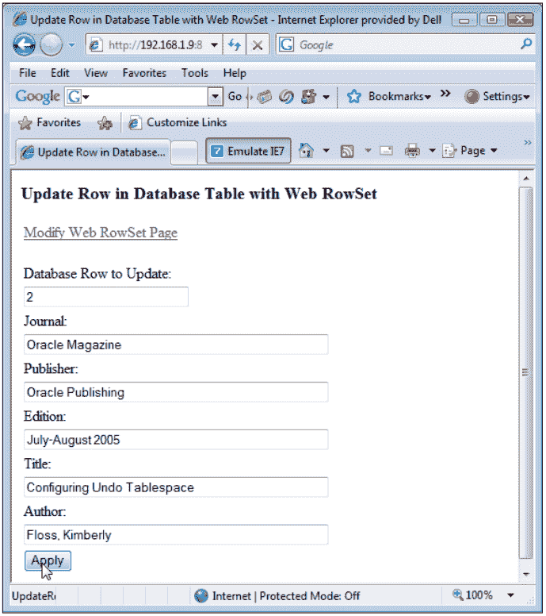

UpdateRow JSP 调用 WebRowSetQuery Java 类的 updateRow() 方法。WebRowSetQuery 对象从 session 对象中检索：

```
WebRowSetQuery query=( webrowset.WebRowSetQuery)
    session.getAttribute("query");
```

在 updateRow() 方法中，OracleWebRowSet 对象光标移动到要更新的行：

```
webRowSet.absolute(rowUpdate);
```

使用 OracleWebRowSet 对象的 updateString() 方法更新行值：

```
webRowSet.updateString(1, journal);
webRowSet.updateString(2, publisher);
webRowSet.updateString(3, edition);
webRowSet.updateString(4, title);
webRowSet.updateString(5, author);
```

使用 updateRow() 方法更新 OracleWebRowSet 对象：

```
webRowSet.updateRow();
```

OracleWebRowSet 对象中的行已更新。数据库表中的行尚未更新。UpdateRow.jsp 如下所示：

```
<!DOCTYPE HTML PUBLIC "-//W3C//DTD HTML 4.01 Transitional//EN"
"http://www.w3.org/TR/html4/loose.dtd">
<%@ page contentType="text/html;charset=windows-1252"%>
<%@ page session="true"%>
<html>
<head>
<meta http-equiv="Content-Type" content="text/html;
charset=windows-1252">
<title>Update Row in Database Table with Web RowSet</title>
</head>
<body>
<form><h3>Update Row in Database Table with Web RowSet</h3>
<table>
<tr>
<td><a href="ModifyWebRowSet.jsp">Modify Web RowSet
Page</a></td>
</tr>
</table>
</form>
<%
webrowset.WebRowSetQuery query=null;
query=( webrowset.WebRowSetQuery)
session.getAttribute("query");
String rowUpdate=request.getParameter("rowUpdate");
String journalUpdate=request.getParameter("journalUpdate");
String publisherUpdate=request.getParameter("publisherUpdate");
String editionUpdate=request.getParameter("editionUpdate");
String titleUpdate=request.getParameter("titleUpdate");
String authorUpdate=request.getParameter("authorUpdate");
    if((rowUpdate!=null))
{
    System.out.println(rowUpdate +"Row to Update");
    int row_Update=Integer.parseInt(rowUpdate);
    query.updateRow(row_Update, journalUpdate, publisherUpdate,
        editionUpdate, titleUpdate, authorUpdate);
}
%>
<form name="query" action="UpdateRow.jsp" method="post">
    <table>
        <tr>
            <td>Database Row to Update:</td>
        </tr>
        <tr>
            <td>
                <input name="rowUpdate" type="text" size="25"
                    maxlength="50"/>
            </td>
        </tr>
        <tr>
            <td>Journal:</td>
        </tr>
        <tr>
            <td>
                <input name="journalUpdate" type="text" size="50"
                    maxlength="250"/>
            </td>
        </tr>
        <tr>
            <td>Publisher:</td>
        </tr>
        <tr>
            <td>
                <input name="publisherUpdate" type="text" size="50"
                    maxlength="250"/>
            </td>
        </tr>
        <tr>
            <td>Edition:</td>
        </tr>
        <tr>
            <td>
                <input name="editionUpdate" type="text" size="50"
                    maxlength="250"/>
            </td>
        </tr>
        <tr>
            <td>Title:</td>
        </tr>
        <tr>
            <td>
                <input name="titleUpdate" type="text" size="50"
            maxlength="250"/>
        </td>
    </tr>
    <tr>
        <td>Author:</td>
    </tr>
    <tr>
        <td>
            <input name="authorUpdate" type="text" size="50"
            maxlength="250"/>
        </td>
    </tr>
    <tr>
        <td>
            <input class="Submit" type="submit" value="Apply"/>
        </td>
    </tr>
    </table>
    </form>
    </body>
</html>
```

## 删除一行

接下来，我们将从 OracleWebRowSet 对象中删除一行。在 UpdateRow JSP 中点击 **修改 Web RowSet** 链接。在 ModifyWebRowSet JSP 中点击 **删除行** 链接。在 **删除行** JSP 中指定要删除的行并点击 **应用**。例如，删除第三行。

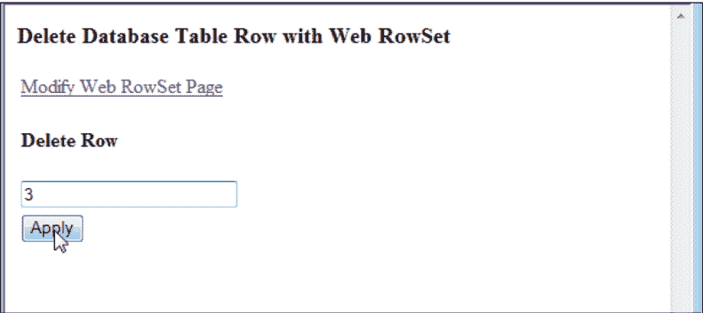

在 DeleteRow JSP 中调用 WebRowSetQuery Java 类的 deleteRow() 方法。WebRowSetQuery 对象从 session 对象中检索：

```
WebRowSetQuery query=( webrowset.WebRowSetQuery)
    session.getAttribute("query");
```

在 deleteRow() 方法中，OracleWebRowSet 对象光标移动到要删除的行：

```
webRowSet.absolute(row);
```

使用 OracleWebRowSet 对象的 deleteRow() 方法删除该行。创建、更新和删除操作是在 OracleWebRowSet 对象上执行，而不是在数据库表上。DeleteRow.jsp 如下所示：

```
<!DOCTYPE HTML PUBLIC "-//W3C//DTD HTML 4.01 Transitional//EN"
"http://www.w3.org/TR/html4/loose.dtd">
<%@ page contentType="text/html;charset=windows-1252"%>
<%@ page session="true"%>
<html>
<head>
<meta http-equiv="Content-Type" content="text/html;
charset=windows-1252">
<title>Delete Database Table Row with Web RowSet</title>
</head>
<body>
<form><h3>Delete Database Table Row with Web RowSet</h3>
<table>
<tr>
<td><a href="ModifyWebRowSet.jsp">Modify Web RowSet
Page</a></td>
    </tr>
</table>
    </form>
    <%
        webrowset.WebRowSetQuery query=null;
        query=(
            webrowset.WebRowSetQuery)session.getAttribute("query");
        String deleteRow=request.getParameter("deleteRow");
        if((deleteRow!=null)){
        int delete_Row=Integer.parseInt(deleteRow);
        query.deleteRow(delete_Row);
        }
    %>
    <form name="query" action="DeleteRow.jsp" method="post">
        <table>
            <tr>
                <td><h4>Delete Row</h4></td>
            </tr>
            <tr>
                <td>
                    <input name="deleteRow" type="text" size="25"
                        maxlength="50"/>
                </td>
            </tr>
            <tr>
                <td>
                    <input class="Submit" type="submit" value="Apply"/>
                </td>
            </tr>
        </table>
    </form>
    </body>
</html>
```

## 更新数据库表

接下来，我们将使用修改后的 OracleWebRowSet 对象更新数据库表。在 DeleteRow JSP 中点击 **修改 Web RowSet** 链接。在 ModifyWebRowSet JSP 中，点击 **更新数据库** 链接。在 UpdateDatabase.jsp 中，点击 **应用**。


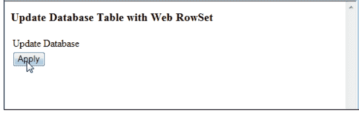

在 UpdateDatabase.jsp 中，WebRowSetQuery 对象从 session 对象中检索出来：

```
WebRowSetQuery query=(WebRowSet.WebRowSetQuery)
    session.getAttribute("query");
```

如果 WebRowSetQuery 对象不为空，则调用 WebRowSetQuery.java 类的 updateDatabase() 方法。还输出表示对 Web RowSet 所做的修改的 XML 文档：

```
if(query!=null){
    query.updateDatabase();
    query.generateXMLDocument();
}
```

在 updateDatabase() 方法中，使用 acceptChanges() 方法更新数据库表：

```
webRowSet.acceptChanges();
```

数据库表 Catalog 使用在 OracleWebRowSet 中所做的修改进行更新。下面的 UpdateDatabase.jsp JSP 如下所示：

```
<!DOCTYPE HTML PUBLIC "-//W3C//DTD HTML 4.01 Transitional//EN"
"http://www.w3.org/TR/html4/loose.dtd">
<%@ page contentType="text/html;charset=windows-1252"%>
<%@ page session="true"%>
<html>
    <head>
        <meta http-equiv="Content-Type" content="text/html;
charset=windows-1252">
        <title>Update Database Table with Web RowSet</title>
    </head>
    <body>
        <h3>Update Database Table with Web RowSet</h3>
        <% webrowset.WebRowSetQuery query=null;%>
<%
    String updateDatabase=request.getParameter("updateDatabase");
    if(updateDatabase!=null)
    query = (webrowset.WebRowSetQuery)session.getAttribute("query");
    if(query!=null)
{
    query.updateDatabase();
query.generateXMLDocument(); }
%>
<form name="query" action="UpdateDatabase.jsp" method="post">
<input type="hidden" name="updateDatabase" value=
    "Update Database"/>
<table>
<tr>
<td>Update Database
</td>
</tr>
<tr>
<td>
<input class="Submit" type="submit" value="Apply"/>
</td>
</tr>
</table>
</form>
</body>
</html>
```

修改完成后，OracleWebRowSet 对象对应的 XML 文档如下所示。与修改前的 XML 文档相比，修改后的 XML 文档中增加了一行、修改了一行并删除了一行。

```
<?xml version="1.0" encoding="UTF-8"?>
<!DOCTYPE RowSet PUBLIC '//Sun Microsystems, Inc.//DTD RowSet//EN'
'http://java.sun.com/j2ee/dtds/RowSet.dtd'>
<RowSet>
    <properties>
        <command>SELECT JOURNAL, PUBLISHER, EDITION, TITLE, AUTHOR FROM
OE.Catalog</command>
        <concurrency>1007</concurrency>
        <datasource>jdbc/OracleDataSource</datasource>
<escape-processing>true</escape-processing>
<fetch-direction>1002</fetch-direction>
<fetch-size>10</fetch-size>
<isolation-level>2</isolation-level>
<key-columns>
</key-columns>
<map></map>
<max-field-size>0</max-field-size>
<max-rows>3</max-rows>
<query-timeout>0</query-timeout>
<read-only>false</read-only>
<rowset-type>1005</rowset-type>
<show-deleted>false</show-deleted>
<url>jdbc:oracle:thin:@localhost:1521:ORCL</url>
</properties>
<metadata>
    <column-count>5</column-count>
    <column-definition>
        <column-index>1</column-index>
        <auto-increment>false</auto-increment>
        <case-sensitive>true</case-sensitive>
        <currency>false</currency>
        <nullable>1</nullable>
        <signed>true</signed>
        <searchable>true</searchable>
        <column-display-size>25</column-display-size>
        <column-label>JOURNAL</column-label>
        <column-name>JOURNAL</column-name>
        <schema-name></schema-name>
        <column-precision>0</column-precision>
        <column-scale>0</column-scale>
        <table-name></table-name>
        <catalog-name></catalog-name>
        <column-type>12</column-type>
        <column-type-name>VARCHAR2</column-type-name>
    </column-definition>
    <column-definition>
        <column-index>2</column-index>
        <auto-increment>false</auto-increment>
        <case-sensitive>true</case-sensitive>
        <currency>false</currency>
        <nullable>1</nullable>
        <signed>true</signed>
        <searchable>true</searchable>
<column-display-size>25</column-display-size>
<column-label>PUBLISHER</column-label>
<column-name>PUBLISHER</column-name>
<schema-name></schema-name>
<column-precision>0</column-precision>
<column-scale>0</column-scale>
<table-name></table-name>
<catalog-name></catalog-name>
<column-type>12</column-type>
<column-type-name>VARCHAR2</column-type-name>
</column-definition>
<column-definition>
<column-index>3</column-index>
<auto-increment>false</auto-increment>
<case-sensitive>true</case-sensitive>
<currency>false</currency>
<nullable>1</nullable>
<signed>true</signed>
<searchable>true</searchable>
<column-display-size>25</column-display-size>
<column-label>EDITION</column-label>
<column-name>EDITION</column-name>
<schema-name></schema-name>
<column-precision>0</column-precision>
<column-scale>0</column-scale>
<table-name></table-name>
<catalog-name></catalog-name>
<column-type>12</column-type>
<column-type-name>VARCHAR2</column-type-name>
</column-definition>
<column-definition>
<column-index>4</column-index>
<auto-increment>false</auto-increment>
<case-sensitive>true</case-sensitive>
<currency>false</currency>
<nullable>1</nullable>
<signed>true</signed>
<searchable>true</searchable>
<column-display-size>45</column-display-size>
<column-label>TITLE</column-label>
<column-name>TITLE</column-name>
<schema-name></schema-name>
<column-precision>0</column-precision>
<column-scale>0</column-scale>
<table-name></table-name>
<catalog-name></catalog-name>
<column-type>12</column-type>
<column-type-name>VARCHAR2</column-type-name>
</column-definition>
<column-definition>
    <column-index>5</column-index>
    <auto-increment>false</auto-increment>
    <case-sensitive>true</case-sensitive>
    <currency>false</currency>
    <nullable>1</nullable>
    <signed>true</signed>
    <searchable>true</searchable>
    <column-display-size>25</column-display-size>
    <column-label>AUTHOR</column-label>
    <column-name>AUTHOR</column-name>
    <schema-name></schema-name>
    <column-precision>0</column-precision>
    <column-scale>0</column-scale>
    <table-name></table-name>
    <catalog-name></catalog-name>
    <column-type>12</column-type>
    <column-type-name>VARCHAR2</column-type-name>
</column-definition>
</metadata>
<data>
    <row>
        <col>Oracle Magazine</col>
        <col>Oracle Publishing</col>
        <col>July-August 2005</col>
        <col>Configuring Undo Tablespace</col>
        <col>Floss, Kimberly</col>
    </row>
    <row>
        <col>Oracle Magazine</col>
        <col>Oracle Publishing</col>
        <col>March-April 2004</col>
        <col>Oracle Certified Master</col>
        <col>Jim Dillani</col>
    </row>
</data>
</RowSet>
```

查询数据库表 Catalog，产生的输出如下。增加了一行新记录，修改了一行并删除了一行。

```
SQL> SELECT * FROM OE.CATALOG;
```

| JOURNAL | PUBLISHER | EDITION | TITLE | AUTHOR |
|---|---|---|---|---|
| Oracle Magazine | Oracle Publishing | July-August 2005 | Configuring Undo Tablespace | Floss, Kimberly |
| Oracle Magazine | Oracle Publishing | March-April 2004 | Oracle Certified Master | Jim Dillani |

在本节中，从数据库表生成了一个 Web RowSet，对 WebRowSet 进行了修改，并使用修改后的 Web RowSet 更新了数据库表。

## JDBC 4.0 版本

嵌入在 JDeveloper 10g 或 JDeveloper 11g 中的 OC4J 未实现 JDBC 4.0 规范。JDBC 4.0 中的新功能可在支持 JDBC 4.0 规范的 JDeveloper 的后续版本中使用。

在 Web 应用程序的 JDBC 4.0 版本中，将 Oracle 数据库 11g JDBC 4.0 驱动 JAR 文件 ojdbc6.jar 添加到 j2ee/home/applib 目录中，该目录位于在 OC4J 服务器中运行的 Web 应用程序的运行时类路径中。还通过选择 Tools | Project Properties 然后选择 Libraries | Add Jar/Directory 将 ojdbc6.jar 添加到项目库中。对于 JDBC 4.0 驱动程序，我们需要将 JDK 版本设置为 JDK 6.0。在 Applications-Navigator 中选择项目节点并选择 Tools | Project Properties。在 Project Properties 窗口中选择 Libraries 节点，然后单击 J2SE Version 字段的 Change 按钮以设置 JDK 版本。在 Edit J2SE Definition 窗口中，单击 New。在 Create J2SE 窗口中，选择一个 JDK 6.0 J2SE Executable 并单击 OK。


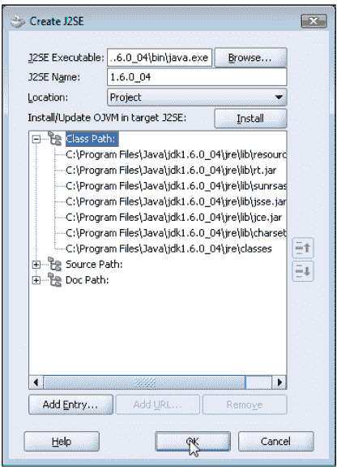

在 **编辑 J2SE 定义** 窗口中，选择 JDK 6.0 **J2SE 定义** 并单击 **确定**。

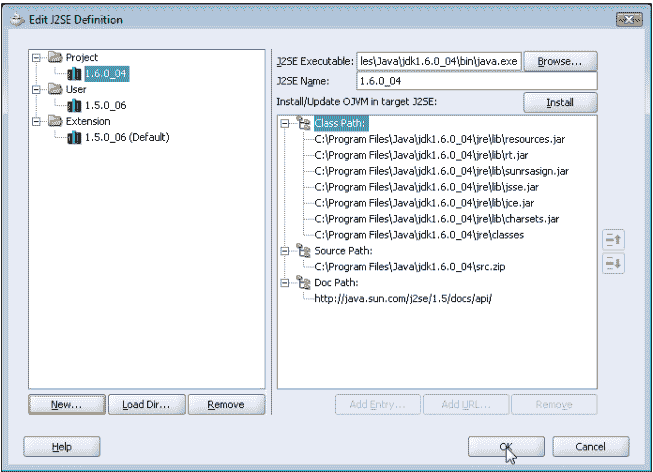

在 **项目属性** 窗口中，**J2SE 版本** 被设置为 JDK 6.0。

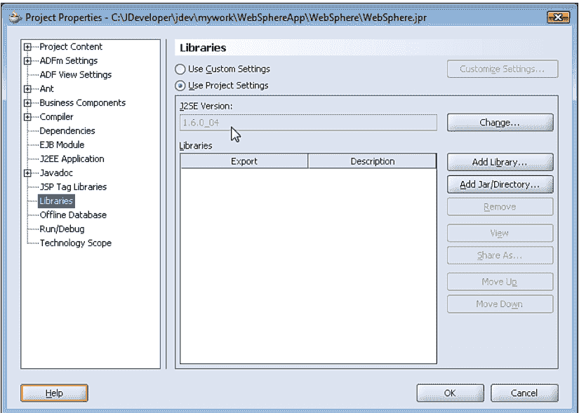

JDBC 4.0 提供了增强的连接管理。JDBC 4.0 已添加对连接状态跟踪的支持，可借此识别并关闭不可用的连接。连接状态跟踪由连接池管理器实现，使用 `Connection` 接口中的新方法 `isValid()`。连接池管理器通过在 `Connection` 对象上调用 `isValid()` 方法来确定 `Connection` 对象是否有效。如果 `Connection` 对象无效，连接池管理器将关闭该连接。在该新功能之前，为了跟踪连接状态，连接池管理器通常必须关闭连接池中的所有连接，并在连接池性能因不可用连接而下降时重新初始化连接池。连接池管理器按如下方式实现连接状态跟踪：

```
if (!connection.isValid())
connection.close();
```

JDBC 应用程序中的 SQLException 可能会链接到其他 SQLException，开发人员可能有兴趣检索这些链接的异常。
在 JDBC 3.0 中，必须通过递归调用 getNextException() 和 getCause() 方法来检索链接的异常和异常的链接原因。

```java
catch(SQLException e)
{
while(e != null)
{
System.out.println("SQLException Message:" + e.getMessage());
Throwable t = e.getCause();
while(t != null)
{
System.out.println("SQLException Cause:" + t);
t = t.getCause();
}
e = e.getNextException();
}
}
```

JDBC 4.0 已添加对 Java SE 链接异常设施的支持，也称为原因设施。对 Java SE 链接异常设施的支持通过以下新功能实现。

- SQLException 类中新增了四个构造函数，其中一个参数为 Throwable cause。
- SQLException 类支持 J2SE 5.0 中引入的增强 for-each 循环，以在不递归调用 getNextException() 和 getCause() 方法的情况下检索链接的异常和链接的原因。
- getCause() 方法支持非 SQLException。

链接的异常和链接的原因可使用增强的 for-each 循环按如下方式检索：

```java
catch(SQLException sqlException)
{
for(Throwable e : sqlException )
{
System.out.println("Error encountered: " + e);
}
}
```

JDBC 4.0 驱动程序还在 RowSet 接口中添加了对 SQL 数据类型 ROWID 和国家字符集数据类型 NCHAR、NVARCHAR、LONGNVARCHAR 和 NCLOB 的支持。

本章中使用的 WebRowSetQuery 类，其中使用增强的 for-each 循环检索链接的异常，列出如下：

```java
package webrowset;
import oracle.jdbc.rowset.*;
import java.io.*;
import java.sql.SQLException;
public class WebRowSetQuery
{
    public OracleWebRowSet webRowSet;
    public String selectQuery;
    public WebRowSetQuery() {
    }
    public WebRowSetQuery(OracleWebRowSet webRowSet)
    {
        this.webRowSet = webRowSet;
    }
    public void generateWebRowSet(String selectQuery)
    {
        try
        {
            webRowSet = new OracleWebRowSet();
            webRowSet.setDataSourceName("jdbc/OracleDataSource");
            webRowSet.setCommand(selectQuery);
            webRowSet.setUsername("oe");
            webRowSet.setPassword("pw");
            webRowSet.setReadOnly(false);
            webRowSet.setFetchSize(5);
            webRowSet.setMaxRows(3);
            webRowSet.execute();
        }
        catch (SQLException sqlException)
        {
            for (Throwable e: sqlException)
            {
                System.out.println("Error encountered: " + e);
            }
        }
    }
    public void generateXMLDocument()
{
    try
{
        OutputStreamWriter output =
            new OutputStreamWriter(new FileOutputStream(new
                File("c:/output/output.xml")));
        webRowSet.writeXml(output);
    } catch (SQLException sqlException)
{
        for (Throwable e: sqlException)
{
            System.out.println("Error encountered: " + e);
        }
    }
    catch (IOException e)
{
    }
}
public void deleteRow(int row)
{
    try
{
        webRowSet.absolute(row);
        webRowSet.deleteRow();
    } catch (SQLException sqlException)
{
        for (Throwable e: sqlException)
{
            System.out.println("Error encountered: " + e);
        }
    }
}
public void insertRow(String journal, String publisher, String
            edition,
                    String title, String author)
{
    try
{
        webRowSet.moveToInsertRow();
        webRowSet.updateString(1, journal);
        webRowSet.updateString(2, publisher);
        webRowSet.updateString(3, edition);
        webRowSet.updateString(4, title);
        webRowSet.updateString(5, author);
webRowSet.insertRow();
} catch (SQLException sqlException)
{
    for (Throwable e: sqlException)
    {
        System.out.println("Error encountered: " + e);
    }
}
public void updateRow(int rowUpdate, String journal, String
    publisher,
    String edition, String title, String author)
{
    try
{
    webRowSet.absolute(rowUpdate);
    webRowSet.updateString(1, journal);
    webRowSet.updateString(2, publisher);
    webRowSet.updateString(3, edition);
    webRowSet.updateString(4, title);
    webRowSet.updateString(5, author);
    webRowSet.updateRow();
} catch (SQLException sqlException)
{
    for (Throwable e: sqlException)
    {
        System.out.println("Error encountered: " + e);
    }
}
}
public String[] readRow(int rowRead)
{
    String[] resultSet = null;
    try
{
    resultSet = new String[5];
    webRowSet.absolute(rowRead);
    resultSet[0] = webRowSet.getString(1);
    resultSet[1] = webRowSet.getString(2);
    resultSet[2] = webRowSet.getString(3);
    resultSet[3] = webRowSet.getString(4);
    resultSet[4] = webRowSet.getString(5);
} catch (SQLException sqlException)
{
for (Throwable e: sqlException)
{
    System.out.println("Error encountered: " + e);
}
}
return resultSet;
}
public void updateDatabase()
{
    try {
        webRowSet.acceptChanges();
    } catch (SQLException sqlException)
{
    for (Throwable e: sqlException)
{
        System.out.println("Error encountered: " + e);
    }
    }
}
}
```

## 摘要

使用 ResultSet 接口更新数据库需要与数据库保持持久连接。RowSet 扩展了 ResultSet 接口。RowSet 的优点是不需要在修改数据时保持持久的 JDBC 数据库连接。WebRowSet 接口进一步扩展了 RowSet 接口，并将 RowSet 对象表示为 XML 文档，从而便于未连接到数据库的远程客户端查询和修改数据的传输。在支持 JDBC 4.0 的服务器中，Web RowSet 应用程序可以使用 JDBC 4.0 功能，例如连接状态跟踪和 Java SE 链接异常设施。
