## 10 创建 JSF 数据表

JavaServer Faces (JSF) 提供了一组用户界面 (UI) 组件，可与 JDBC API 结合使用以显示数据库数据。JDeveloper 10.1.3 版支持 JSF 1.1_02 的参考实现。JSF HTML 标签库在组件调色板中为开发 Web 应用程序提供不同的用户界面组件。Data Table 是 JSF HTML 组件调色板中的一个 UI 组件，表示表格中的数据集合。Data Table 组件可用于使用静态或动态生成的 SQL 查询显示数据库数据。

JDeveloper 10.1.3 提供了创建数据表向导来创建 JSF 数据表。在本章中，我们将通过在创建数据表向导中将数据表绑定到托管 bean (MBean) 并将数据表绑定到创建数据表向导中指定的列数，然后使用 JSF API 创建数据表来创建数据表。JSF 类 javax.faces.component.html.HtmlDataTable 表示数据表。数据表中的列由 javax.faces.component.UIColumn 类表示。托管 bean 是表示某些资源的 Java 对象，由 JSF 框架管理，可用作组件模型。在本章中我们将学习关于：

- 使用创建数据表向导使用 MBean 创建数据表
- 使用创建数据表向导使用 JSF API 创建数据表

### 设置环境

安装 Oracle 数据库 10g，包括示例模式，并创建数据库实例。数据表是从示例数据库表 OE.Catalog 创建的。使用以下 SQL 脚本创建示例表 OE.Catalog：

```
CREATE TABLE OE.Catalog(CatalogId INTEGER PRIMARY KEY, Journal VARCHAR(25), Publisher VARCHAR(25), Edition VARCHAR(25), Title Varchar(45), Author Varchar(25));
```


```
INSERT INTO OE.Catalog VALUES('1', 'Oracle Magazine', 'Oracle
    Publishing', 'Nov-Dec 2004', 'Database Resource Manager',
    'Kimberly Floss');
INSERT INTO OE.Catalog VALUES('2', 'Oracle Magazine', 'Oracle
    Publishing', 'Nov-Dec 2004', 'From ADF UIX to JSF','Jonas Jacobi');
INSERT INTO OE.Catalog VALUES('3', 'Oracle Magazine', 'Oracle
    Publishing', 'March-April 2005', 'Starting with Oracle ADF ',
    'Steve Muench');
```

## 通过绑定 MBean 创建数据表

在本节中，我们将使用创建数据表向导创建数据表，通过将数据表与表示数据表数据源的管理 bean 绑定。 使用 MBean 创建数据表的步骤如下：

- 1. 为 Web 服务创建一个 JavaBean 类。
- 2. 为 Web 服务创建服务端点接口（SEI）。
- 3. 从 JavaBean 类和 SEI 生成 Web 服务。
- 4. 为 Web 服务创建客户端类。在客户端类中，使用 JDBC 连接到 Oracle 数据库并运行 SQL 查询以创建 ResultSet，该 ResultSet 表示我们将绑定到数据表的对象集合。
- 5. 从 Web 服务客户端类创建 MBean。
- 6. 在 JSF 页面中将数据表绑定到 MBean。

首先，如图所示在 JDeveloper 10.1.3 中创建一个应用程序和项目。

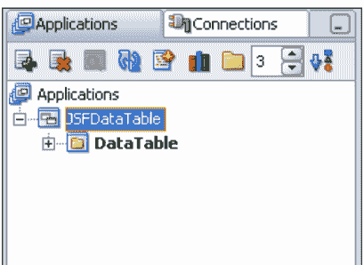

数据表 JSF 应用程序由三个层组成：数据库、中间层 MBean 和 JSF 用户界面。为中间层向项目添加一个 JavaBean 类。Bean 类包含数据表不同列的 getter 和 setter 值。JavaBean 类通过 **File | New** 添加。在 **New Gallery** 窗口中在 **Categories** 中选择 **General | Java Class** 并单击 **OK**。JavaBean 类 `DataTable.java` 如下所示。

```java
package datatable;
public class DataTable
{
    private int catalogId;
    private String journal;
    private String publisher;
    private String edition;
    private String title;
    private String author;
    public DataTable()
    {}
    public int getCatalogId(){
        return this.catalogId;}
    public void setCatalogId(int catalogId){
        this.catalogId=catalogId;}
    public String getJournal(){
        return this.journal;}
    public void setJournal(String journal){
        this.journal=journal;}
    public String getPublisher(){
        return this.publisher;}
    public void setPublisher(String publisher){
        this.publisher=publisher;}
    public String getEdition(){
        return this.edition;}
    public void setEdition(String edition){
        this.edition=edition;}
    public String getTitle(){
        return this.title;}
    public void setTitle(String title){
        this.title=title;}
    public String getAuthor(){
        return this.author;}
    public void setAuthor(String author){
        this.author=author;}
    public static void main(String[] args){
        DataTable dataTable = new DataTable();
    }
}
```

## 创建 JSF 数据表

使用 **File | New** 为 Bean 类添加 MyWebService1SEI.java SEI。在 **New Gallery** 窗口中在 **Categories** 中选择 **General**，在 **Items** 中选择 **Java Interface**。MyWebService1SEI.java 如下所示。

```java
package datatable;
import java.rmi.RemoteException;
public interface MyWebService1SEI extends java.rmi.Remote
{   public java.lang.String getTitle() throws RemoteException;
    public void setTitle(java.lang.String param0) throws RemoteException;
    public int getCatalogId() throws RemoteException;
    public void setCatalogId(int param0) throws RemoteException;
    public java.lang.String getJournal() throws RemoteException;
    public void setJournal(java.lang.String param0) throws RemoteException;
    public java.lang.String getPublisher() throws RemoteException;
    public void setPublisher(java.lang.String param0) throws RemoteException;
    public java.lang.String getEdition() throws RemoteException;
    public void setEdition(java.lang.String param0) throws RemoteException;
    public java.lang.String getAuthor() throws RemoteException;
    public void setAuthor(java.lang.String param0) throws RemoteException;
}
```

接下来，从中间层 JavaBean 类和 SEI 生成 Web 服务。右键单击 DataTable.java Bean 类并选择 **Create J2EE Web Service**。

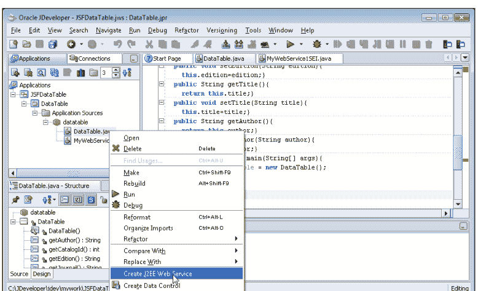

在 **Select J2EE Version** 窗口中，选择 J2EE 1.4 (JAX-RPC) Web 服务。在 **Class** 窗口中选择默认的 **Web Service Name** 并为 **Service Endpoint Interface** 选择默认设置，然后单击 **Next**。在 **Message Format** 窗口中选择 **SOAP Message Format**，其可以设置为 **Wrapped** 或 **Unwrapped**。**SOAP Message Format** 指定 SOAP 绑定文档样式。在 **Wrapped** 样式中，**wsdl:operation** 名称指定为与 XML 文档的根元素相同。选择 **SOAP Message Format** 为 **Document/Wrapped**。**Generate Schema with Qualified Elements** 复选框默认选中，这意味着模式元素带命名空间前缀。Web 服务附件使用 **MIME** 编码处理。

**Multipurpose Internet Mail Extensions (MIME)** 格式用于传输消息，是 HTTP 通信协议的基本组件。MIME 支持非 ASCII 字符集中的文本和头信息，以及非文本附件。要使用 **MIME** 编码，请选中 **Use MIME Encoding** 复选框。单击 **Next**。在 **Specify Custom DataType Serializers** 中，指定 XML 类型与其对应的 Java 类型之间的映射。选择默认设置并单击 **Next**。在 **Mapping** 窗口中，可选地指定 **Java Web Service** 与相应 WSDL 元素之间的映射。选择默认设置并单击 **Next**。**Methods** 窗口显示 Web 服务方法。单击 **Next**。在 **Handler Details** 窗口中，选择默认设置并单击 **Next**。在 **State** 窗口中，选择默认设置并单击 **Next**。在 **Additional Classes** 窗口中，单击 **Next**。中间层的 Web 服务将被添加到项目中。

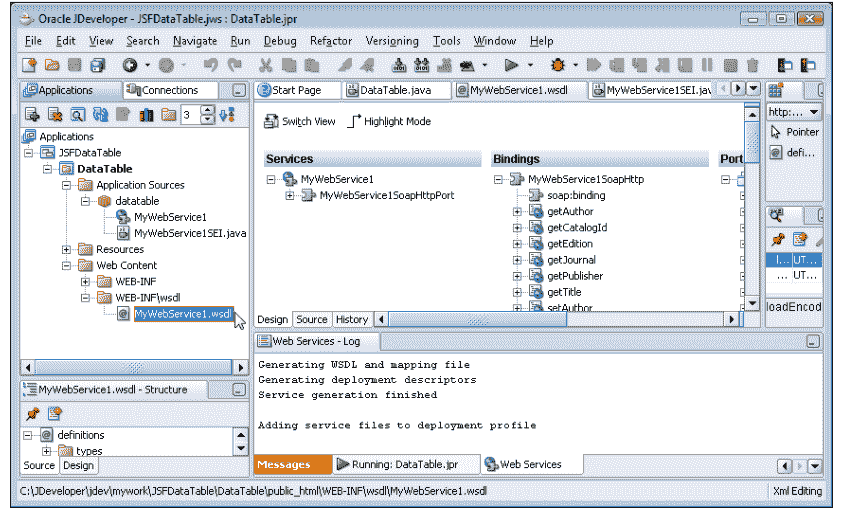

## 创建 JSF 数据表

接下来，为 Web 服务生成客户端类。右键单击 Web 服务节点并选择 **Generate Web Service Proxy**。

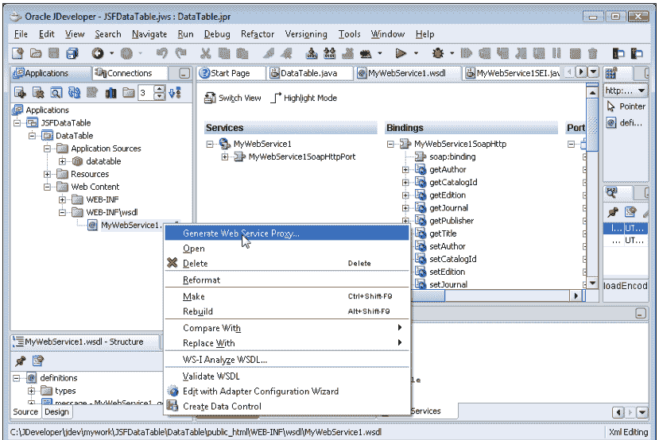

在 **Shared Service Endpoint Interface** 窗口中，单击 **Yes**。在 **Port Endpoints** 窗口中，选中 **Run Against a service deployed to Embedded OC4J** 复选框并单击 **OK**。Web 服务的客户端类将被添加到项目中。

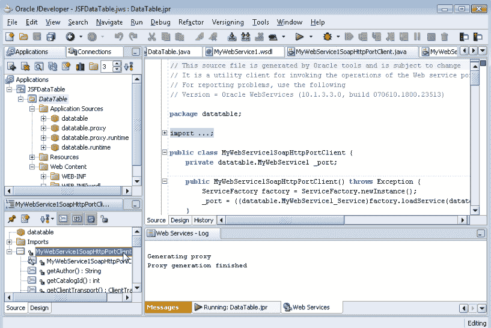

在客户端类中，我们将访问 Oracle 数据库并运行 SQL 查询，从我们之前创建的 catalog 表中创建 ResultSet。为客户端类添加 java.sql.* 包的 import 语句和一个 getDataResultSet 方法，该方法返回从数据库表检索的数据的 ResultSet。在 getDataResultSet 方法中，加载 Oracle JDBC 驱动类 oracle.jdbc.OracleDriver 并使用 DriverManager 类的 getConnection 方法与 Oracle 数据库创建连接。使用 Connection 对象的 createStatement 方法从 Connection 对象创建 Statement 对象。默认情况下，您只能从第一行到最后一行迭代一次 ResultSet。要创建可滚动结果，请将结果集类型指定为 ResultSet.TYPE_SCROLL_INSENSITIVE。对于只读结果集，将结果集并发指定为 ResultSet.CONCUR_READ_ONLY。使用 Statement 对象的 executeQuery 方法运行 SQL 查询。

getDataResultSet 方法如下所示：

```
public ResultSet getDataResultSet(){
    ResultSet rs=null;
    try{
    Class.forName("oracle.jdbc.OracleDriver");
    String url="jdbc:oracle:thin:@localhost:1521:ORCL";
    Connection connection = DriverManager.getConnection(url,
        "OE", "pw");
    Statement stmt=connection.createStatement(ResultSet.
        TYPE_SCROLL_INSENSITIVE, ResultSet.CONCUR_READ_ONLY);
    rs=stmt.executeQuery("SELECT * FROM OE.CATALOG");
    }catch(SQLException e){}
    catch(ClassNotFoundException e){}
    return rs;
}
```

接下来，我们将在 JSF 页面中创建数据表。使用 File | New 向 Applications-Navigator 项目添加一个 JSF 页面。在 New Gallery 窗口中在 Categories 中选择 Web Tier | JSF，在 Items 中选择 JSF JSP。

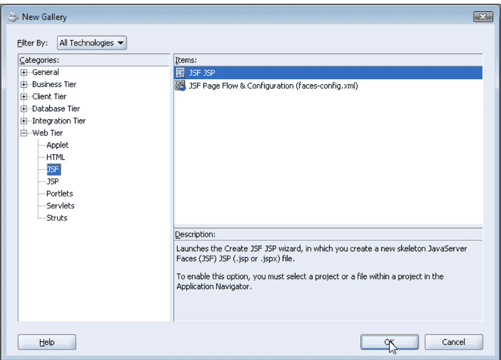


在 **JSP 文件** 窗口中指定 **文件名**，`catalog.jsp`，然后单击 **下一步**。在 **组件绑定** 窗口中选择 **在新的托管 Bean 中自动公开 UI 组件**。

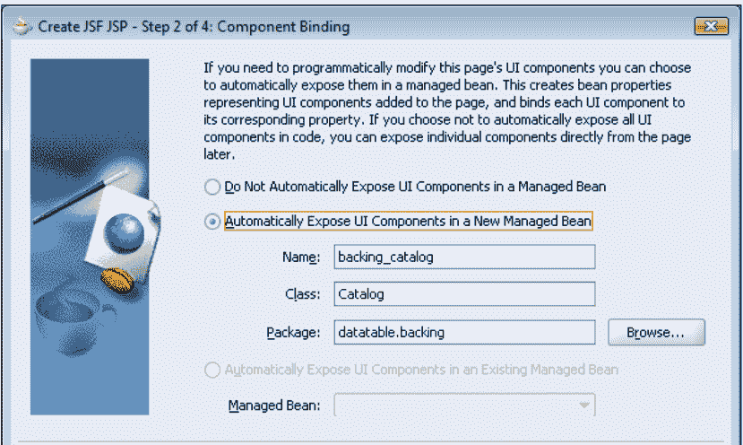

## 创建 JSF 数据表

在“错误页面选项”窗口中，选择默认设置，即不使用错误页面，然后单击“下一步”。在“标签库”窗口中，JSF HTML 和 JSF Core 标签库已被预先选中。Data Table 是 JSF HTML 标签库组件。JSF Core 标签库实现了标准的 JSF 核心标签。单击“下一步”。

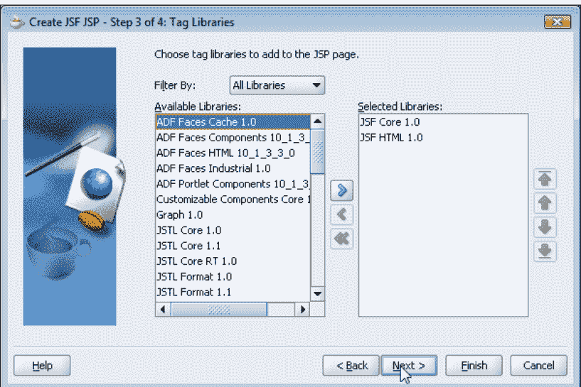

在 **HTML 选项** 窗口中，选择默认设置并单击 **下一步**。在 **完成** 窗口中，单击 **完成**。包含 `faces-config.xml` 配置文件和 JSF 页面的支持 bean 的 JSF 页面被添加到 **Applications-Navigator** 项目节点。接下来我们将添加一个 MBean，它封装了中间层 Web 服务的客户端类。打开 `faces-config.xml` 配置文件，选择 **概述** 选项卡并单击 **新建**。

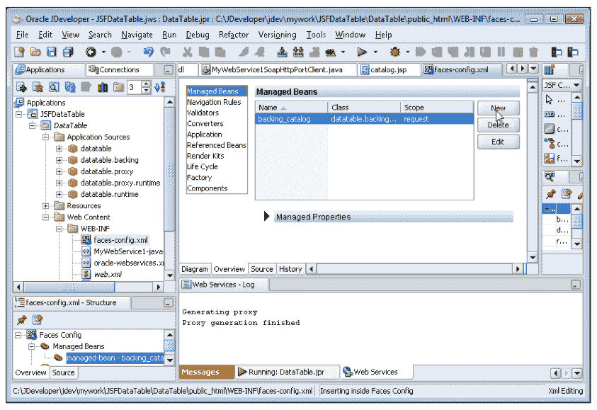

## 创建 JSF 数据表

在“创建托管 Bean”窗口中，指定托管 Bean 名称 CatalogBean，并在“类”字段中指定之前生成的 Web 服务客户端类，并将范围选择为 request。单击“确定”。

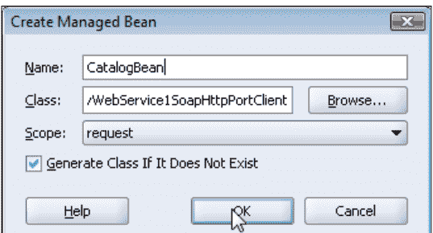

为 Web 服务客户端类添加了一个托管 Bean。

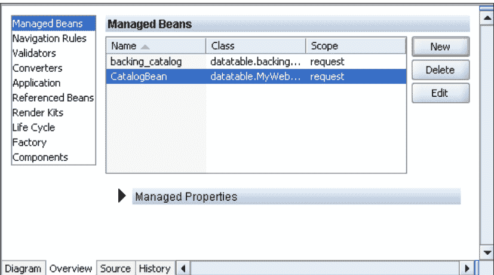

接下来，我们将向 JSF 页面添加一个数据表。选择 JSF HTML 组件调色板。在应用程序导航器中选择 JSF 页面节点，将光标定位在 JSF 页面中，并在 JSF HTML 组件调色板中选择数据表。

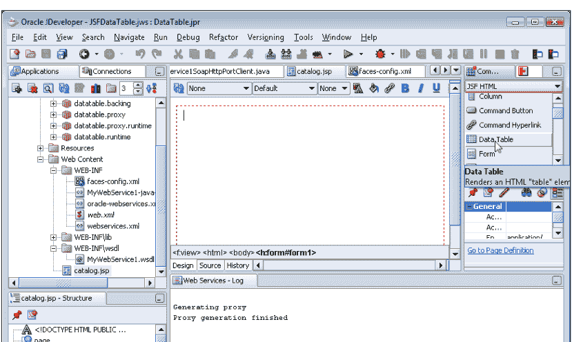

## 创建 JSF 数据表

**创建数据表向导** 启动。在介绍窗口中单击 **下一步**。在 **绑定** 窗口中，选择 **立即绑定数据表** 单选按钮并单击 **下一步**。**列数** 选项用于使用 JSF API 绑定数据表，我们将在下一节讨论。

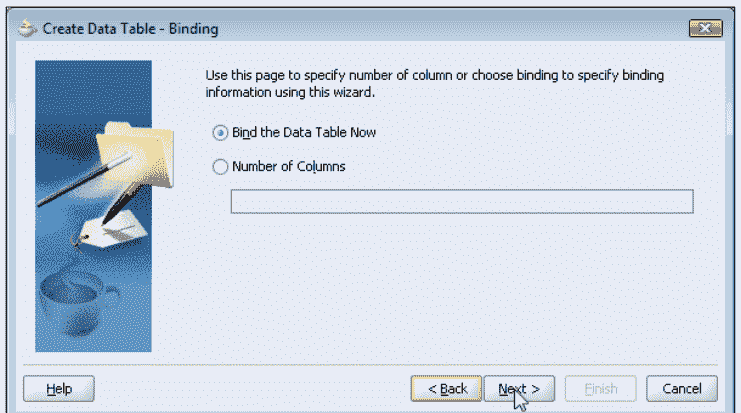

在 **绑定数据表** 窗口中，**值** 字段指定用于生成数据表的数据对象集合。**类** 字段指定数据对象集合的 Bean 类，而 **变量** 字段指定数据对象集合中一行数据的变量。单击 **绑定** 将数据对象集合绑定到数据表。

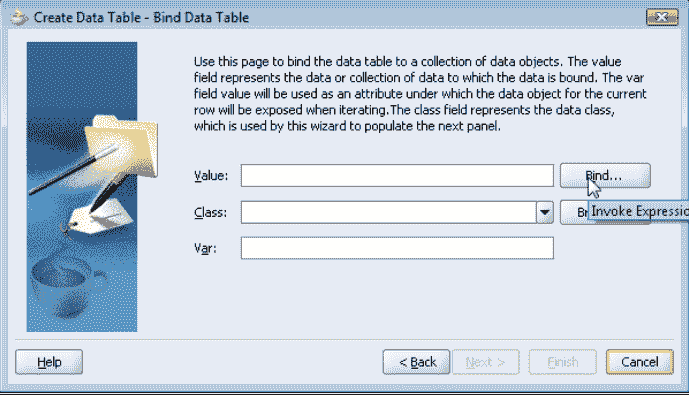

在 **按以下筛选** 选择中选择 **所有类型**。从之前生成的 `CatalogBean` MBean 中选择 `dataResultSet` 变量。使用 > 按钮将所选变量添加到 **表达式** 窗口。单击 **确定**。**表达式** 表示由封装在 `CatalogBean` MBean 中的 Web 服务客户端类的 `dataResultSet` 方法返回的数据对象集合的 EL 表达式。

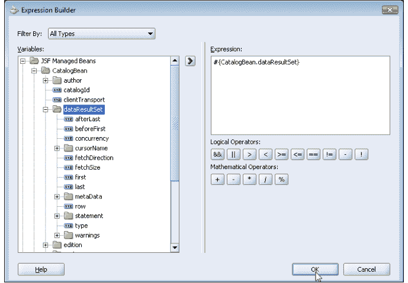

在 **绑定数据表** 窗口中，在 **类** 字段中指定创建 Web 服务的 bean 类 `DataTable`。在 **变量** 字段中，指定数据对象集合中一行数据的变量。单击 **下一步**。

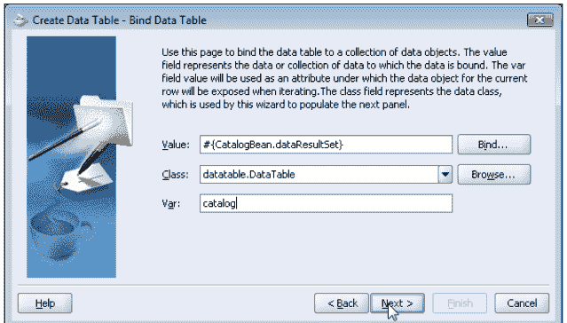

## 创建 JSF 数据表

在 **标题和行数据** 窗口中，指定数据表中的列标题和数据表中列值的 EL 表达式。修改列的顺序以匹配用于生成数据表的数据库表中的列，然后单击 **下一步**。

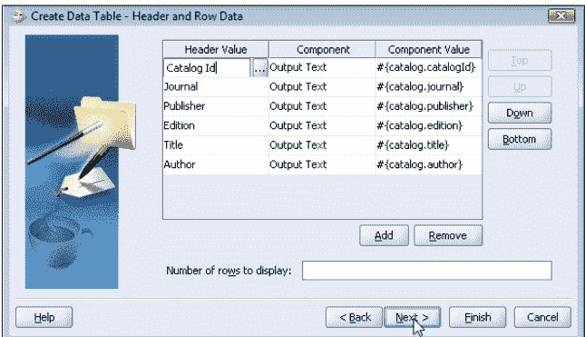

在 **完成** 窗口中，单击 **完成** 按钮。数据表标题和列值的 EL 表达式被添加到 JSF 页面。右键单击 catalog.jsp 节点并选择 **运行** 以生成数据表。

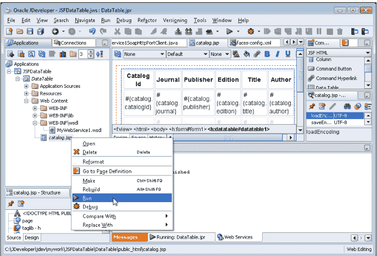

数据表被生成并在默认浏览器中显示。

| 目录 ID | 期刊 | 出版社 | 版本 | 标题 | 作者 |
|---|---|---|---|---|---|
| 1 | Oracle Magazine | Oracle Publishing | Nov-Dec 2004 | Database Resource Manager | Kimberly Floss |
| 2 | Oracle Magazine | Oracle Publishing | Nov-Dec 2004 | From ADF UIX to JSF | Jonas Jacobi |
| 3 | Oracle Magazine | Oracle Publishing | March-April 2005 | Starting with Oracle ADF | Steve Muench |

## 使用 JSF API 创建数据表

在上一节中，我们从 Web 服务客户端类中的静态查询生成了一个数据表。在本节中，我们将从 JSF 页面中指定的动态查询生成数据表。我们将使用 **创建数据表向导** 将数据表绑定到指定数量的列，并在支持 bean 中使用 JSF API 生成数据表。使用 JSF API 从数据库表创建数据表的步骤如下：

- 1. 创建一个 JSF 页面。
- 2. 向 JSF 页面添加 **输入文本** JSF 组件。我们将使用输入文本指定用于生成数据表的 SQL 查询。
- 3. 从组件调色板添加 **命令按钮** 以提交 SQL 查询。我们将命令按钮绑定到用于创建数据表的支持 bean 方法。
- 4. 从组件调色板添加 **数据表**。在创建数据表向导中指定列数以匹配用于创建数据表的数据库表中的列数。
- 5. 在支持 bean 中检索输入文本中指定的 SQL 查询并使用 JSF API 创建数据表。

## 创建 JSF 数据表

删除上一节中创建的 JSFDataTable 应用程序，包括应用程序内容。如同上一节一样，创建一个应用程序和项目。使用 **文件 | 新建** 添加一个 JSF 页面。在 **新建库** 窗口中，在 **类别** 中选择 **Web 层 | JSF**，在 **项目** 中选择 **JSF JSP**。单击 **确定**。向 JSF 页面添加来自 **CSS** 组件调色板的 **JDeveloper** CSS 样式。向 JSF 页面添加一个 **标题 2**。将标题指定为“JSF Data Table”。

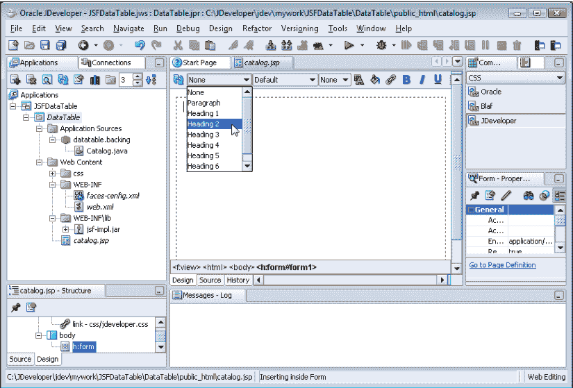

接下来，在 JSF 页面设计视图中将光标定位在标题下方，并从 **JSF HTML 组件调色板** 添加 **输入文本** UI 组件。要从 JSF HTML 组件调色板添加 UI 组件，请单击组件调色板中的组件。我们将在输入文本中指定用于生成数据表的 SQL 查询。

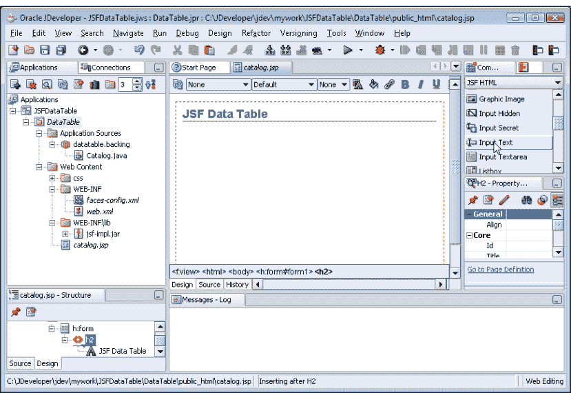

## 创建 JSF 数据表

将光标定位在 JSF 页面输入文本下方，并从 JSF HTML 组件调色板添加 **命令按钮** 组件。我们将使用命令按钮提交 SQL 查询。在 **属性检查器** 中设置命令按钮上的文本。

接下来，将光标定位在 JSF 页面命令按钮下方，并从组件调色板添加 **数据表**。

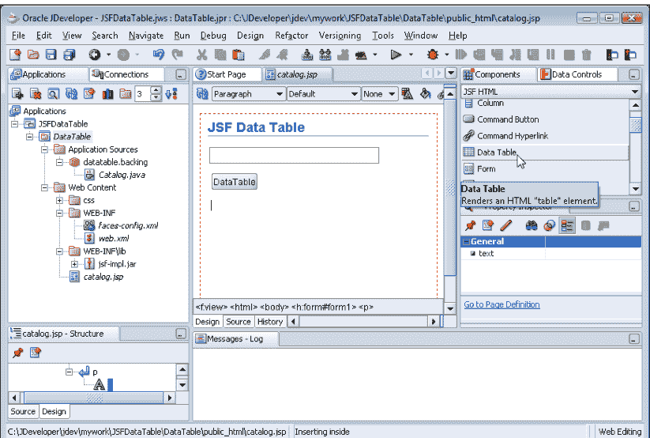

**创建数据表向导** 启动。单击 **下一步**。在 **绑定** 窗口中，选择 **列数** 并指定一个值，将数据表生成的数据库表中的列数指定为 6。单击 **完成**。

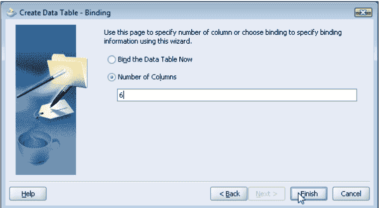

## 创建 JSF 数据表

数据表被添加到 JSF 页面。数据表目前不包含任何列标题或列数据。我们将为数据表列和列标题添加支持 bean 绑定以生成数据表。

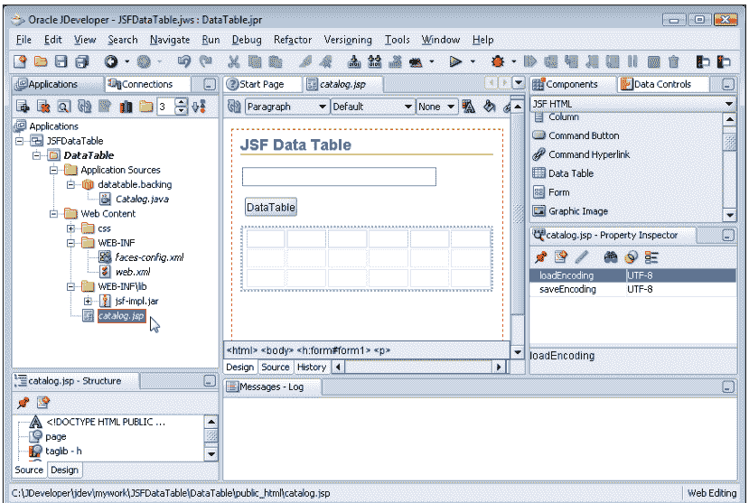

修改 catalog.jsp JSF 页面以指定数据表中不同列的支持 bean 绑定。将以下列表替换为：

```
<h:dataTable binding="#{backing_catalog.dataTable1}" id="dataTable1">
    <h:column/>
    <h:column/>
    <h:column/>
    <h:column/>
    <h:column/>
    <h:column/>
</h:dataTable>
```

以下列表：

```
<h:dataTable rows="5" binding="#{backing_catalog.dataTable1}">
    <h:column binding="#{backing_catalog.column1}"/>
    <h:column binding="#{backing_catalog.column2}"/>
    <h:column binding="#{backing_catalog.column3}"/>
```


```
<h:column binding="#{backing_catalog.column4}"/>
<h:column binding="#{backing_catalog.column5}"/>
<h:column binding="#{backing_catalog.column6}"/>
</h:dataTable>
```

接下来，将命令按钮绑定到将生成数据表的 backing bean 方法。双击命令按钮。在“绑定操作属性”窗口中，选择命令按钮在 backing bean 中的默认操作方法，然后单击“确定”。JSF 页面的 backing bean 类 Catalog.java 将显示出来。为数据表列添加 UIColumn 组件变量，并为 UIColumn 组件添加 getter/setter 方法。修改在单击数据表按钮时调用的 commandButton1_action 方法。在 commandButton1_action 方法中，使用数据库获取 JDBC 连接。使用 Class.forName 方法加载驱动类 oracle.jdbc.OracleDriver。使用 DriverManager 类的 getConnection 方法创建 Connection 对象：

```
Class.forName("oracle.jdbc.driver.OracleDriver");
String url="jdbc:oracle:thin:@<host>:1521:<database>";
Connection connection = DriverManager.getConnection(url,
    "OE", "<password>");
```


> 在连接 URL 中，<host> 是数据库主机，<database> 是数据库实例。

使用 createStatement 方法创建 Statement 对象。将结果集类型指定为可滚动，结果集并发指定为只读。

```
Statement
stmt=connection.createStatement(ResultSet.TYPE_SCROLL_INSENSITIVE,
ResultSet.CONCUR_READ_ONLY);
```

使用 JSF 页面输入文本字段中指定的 SQL Select 语句查询数据库。输入文本值是通过调用输入文本的 backing bean 属性的 getValue 方法检索的。SQL 查询使用 Statement 对象的 executeQuery 方法运行。executeQuery 方法生成 ResultSet 对象。

```
ResultSet rs=stmt.executeQuery((String)inputText1.getValue());
```

使用数据表的 backing bean 属性设置数据表的边框和单元格填充。边框使用 setBorder 方法设置，单元格填充使用 setCellPadding 方法设置：

```
dataTable1.setBorder(5);
dataTable1.setCellPadding("1");
```

使用 setVar 方法设置从数据库检索的 ResultSet 中数据行的变量：

```
dataTable1.setVar("catalog");
```

设置数据表中列的标题值。数据表为数据库表中的每一列都有列。通过创建 HtmlOutputText 标题组件并使用 setHeader 方法将标题设置在 UIColumn 组件上来添加列标题。HtmlOutputText 值使用 setValue 方法设置。例如，CatalogId 列的列标题添加如下：

```
HtmlOutputText headerComponent = new HtmlOutputText();
headerComponent.setValue("CatalogId");
column1.setHeader(headerComponent);
```

对于数据表中的每一列，为 HtmlOutputText 组件指定值绑定并将组件添加到列中。HtmlOutputText 组件的值绑定使用 setValueBinding 方法设置。通过调用 getChildren 方法然后调用 add 方法将 HtmlOutputText 组件添加到 UIColumn 组件。例如，对于 CatalogId 列，HtmlOutputText 组件添加如下：

```
HtmlOutputText column1Text=new HtmlOutputText();
ValueBinding vb =
FacesContext.getCurrentInstance().getApplication().createValueBinding(
"#{catalog.catalogid}");
column1Text.setValueBinding("value", vb);
column1.getChildren().add(column1Text);
```

创建 ResultSetDataModel 对象。ResultSetDataModel 对象用于包装 ResultSet 对象，后者需要可滚动。使用 setWrappedData 方法将通过 SQL 查询检索的 ResultSet 设置为 ResultSetDataModel 的数据：

```
ResultSetDataModel dataModel=new ResultSetDataModel();
dataModel.setWrappedData(rs);
```

使用 setValue 方法将数据表与 ResultSetDataModel 对象绑定。

```
dataTable1.setValue(dataModel);
```

下面列出了修改后的 backing bean 类 Catalog.java：

```
package datatable.backing;
import javax.faces.component.html.HtmlCommandButton;
import javax.faces.component.html.HtmlDataTable;
```

```java
import javax.faces.component.html.HtmlForm;
import javax.faces.component.html.HtmlInputText;
import javax.faces.component.UIColumn;
import javax.faces.component.html.HtmlOutputText;
import javax.faces.context.FacesContext;
import javax.faces.el.ValueBinding;
import javax.faces.model.ResultSetDataModel;
import java.sql.*;
public class Catalog {
    private HtmlForm form1;
    private HtmlInputText inputText1;
    private HtmlCommandButton commandButton1;
    private HtmlDataTable dataTable1;
    private UIColumn column1;
    private UIColumn column2;
    private UIColumn column3;
    private UIColumn column4;
    private UIColumn column5;
    private UIColumn column6;
    public void setForm1(HtmlForm form1) {
        this.form1 = form1;
    }
    public HtmlForm getForm1() {
        return form1;
    }
    public void setInputText1(HtmlInputText inputText1) {
        this.inputText1 = inputText1;
    }
    public HtmlInputText getInputText1() {
        return inputText1;
    }
    public void setCommandButton1(HtmlCommandButton commandButton1) {
        this.commandButton1 = commandButton1;
    }
    public HtmlCommandButton getCommandButton1() {
        return commandButton1;
    }
    public void setDataTable1(HtmlDataTable dataTable1) {
        this.dataTable1 = dataTable1;
    }
    public HtmlDataTable getDataTable1() {
        return dataTable1;
    }
    public void setColumn1(UIColumn column1) {
        this.column1 = column1;
    }
    public UIColumn getColumn1() {
        return column1;
    }
    public void setColumn2(UIColumn column2) {
        this.column2 = column2;
    }
    public UIColumn getColumn2() {
        return column2;
    }
    public void setColumn3(UIColumn column3) {
        this.column3 = column3;
    }
    public UIColumn getColumn3() {
        return column3;
    }
    public void setColumn4(UIColumn column4) {
        this.column4 = column4;
    }
    public UIColumn getColumn4() {
        return column4;
    }
    public void setColumn5(UIColumn column5) {
        this.column5 = column5;
    }
    public UIColumn getColumn5() {
        return column5;
    }
    public void setColumn6(UIColumn column6) {
        this.column6 = column6;
    }
    public UIColumn getColumn6() {
        return column6;
    }
    public String commandButton1_action()
    {
        // Add event code here...
        ResultSet rs=null;
        try{
            Class.forName("oracle.jdbc.OracleDriver");
            String url="jdbc:oracle:thin:@localhost:1521:ORCL";
            Connection connection = DriverManager.getConnection(url,
                        "OE", "pw");
            Statement stmt=connection.createStatement(ResultSet.
            TYPE_SCROLL_INSENSITIVE, ResultSet.CONCUR_READ_ONLY);
            rs=stmt.executeQuery((String)inputText1.getValue());
            dataTable1.setBorder(5);
            dataTable1.setCellPadding("1");
            dataTable1.setVar("catalog");
```

```
HtmlOutputText headerComponent = new HtmlOutputText();
    headerComponent.setValue("CatalogId");
    column1.setHeader(headerComponent);
headerComponent = new HtmlOutputText();
    headerComponent.setValue("Journal");
    column2.setHeader(headerComponent);
headerComponent = new HtmlOutputText();
    headerComponent.setValue("Publisher");
    column3.setHeader(headerComponent);
    headerComponent = new HtmlOutputText();
    headerComponent.setValue("Edition");
    column4.setHeader(headerComponent);
headerComponent = new HtmlOutputText();
    headerComponent.setValue("Title");
    column5.setHeader(headerComponent);
headerComponent = new HtmlOutputText();
    headerComponent.setValue("Author");
    column6.setHeader(headerComponent);
HtmlOutputText column1Text=new HtmlOutputText();
    ValueBinding vb =
FacesContext.getCurrentInstance().getApplication().createValueBinding(
"#{catalog.catalogid}");
    column1Text.setValueBinding("value", vb);
    column1.getChildren().add(column1Text);
    HtmlOutputText column2Text=new HtmlOutputText();
    vb =
FacesContext.getCurrentInstance().getApplication().createValueBinding(
"#{catalog.journal}");
    column2Text.setValueBinding("value", vb);
    column2.getChildren().add(column2Text);
    HtmlOutputText column3Text=new HtmlOutputText();
    vb =
FacesContext.getCurrentInstance().getApplication().createValueBinding(
"#{catalog.publisher}");
    column3Text.setValueBinding("value", vb);
    column3.getChildren().add(column3Text);
    HtmlOutputText column4Text=new HtmlOutputText();
    vb =
FacesContext.getCurrentInstance().getApplication().createValueBinding(
"#{catalog.edition}");
    column4Text.setValueBinding("value", vb);
    column4.getChildren().add(column4Text);
    HtmlOutputText column5Text=new HtmlOutputText();
    vb = FacesContext.getCurrentInstance().getApplication().createValueBinding("#{catalog.title}");
    column5Text.setValueBinding("value", vb);
    column5.getChildren().add(column5Text);
```


```java
HtmlOutputText column6Text=new HtmlOutputText();
  vb = FacesContext.getCurrentInstance().getApplication().
      createValueBinding("#{catalog.author}");
column6Text.setValueBinding("value", vb);
column6.getChildren().add(column6Text);
ResultSetDataModel dataModel=new ResultSetDataModel();
dataModel.setWrappedData(rs);
dataTable1.setValue(dataModel);
rs.close();
stmt.close();
connection.close();
}
  catch(SQLException e){System.out.println(e.getMessage());}
  catch(ClassNotFoundException e){ System.out.println(e.
getMessage());}
    return null;
  }}
```

右键单击 JSF JSP 页面节点并选择 **Run**。JSF 页面将被显示。在输入字段中指定一个 SQL 查询（例如，`SELECT * FROM OE.CATALOG`）并选择 **Data Table** 按钮。

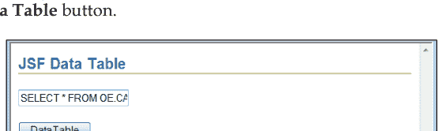

指定 `SELECT` SQL 查询的数据表将被生成。

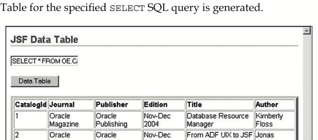

## JDBC 4.0 版本

嵌入 JDeveloper 10g 或 11g 的 OC4J 服务器不支持 JDBC 4.0 规范；但在支持 JDBC 4.0 的 JDeveloper 后续版本中，可将 JDBC 4.0 功能添加到用于创建 Data Table 的 JSF 应用程序中。JDBC 4.0 提供了诸如增强的连接管理、自动驱动程序加载、对包装器模式的支持、语句池、SQLException 分类以及对 Java SE 链式异常设施的增强支持等新功能。要使用 JDBC 4.0 功能，您需要从 http://www.oracle.com/technology/software/tech/java/sqlj_jdbc/htdocs/jdbc_111060.html 下载 Oracle 数据库 11g JDBC 4.0 驱动程序 JAR 文件 ojdbc6.jar。将 ojdbc6.jar 复制到 j2ee/home/lib 目录，该目录位于在 OC4J 服务器中运行的 Web 应用程序的运行时类路径中。由于 JDBC 4.0 驱动程序需要 JDK 6.0，我们还需要将 J2SE 版本设置为 JDK 6.0。要设置 JDK 版本，请选择 Tools | Project Properties 并在 Project Properties 窗口中选择 Libraries。为 J2SE Version 字段选择 Change 按钮以将 JDK 设置为 6.0。

您无需修改 JSF 应用程序即可向应用程序添加连接状态跟踪。连接状态跟踪由连接池管理器实现，用于跟踪连接池中的不可用连接。不可用连接可能会影响连接池性能。在 JDBC 4.0 的新功能之前，如果连接池中的某些连接变得不可用，连接池管理器必须关闭所有连接并重新初始化连接池。JDBC 4.0 中的 Connection 接口提供了一个新的方法 isValid()，连接池管理器可使用它来测试连接是否仍然有效，如果连接变得不可用则关闭连接。

```
if (!connection.isValid())
    connection.close();
```

我们使用了两种不同的方法来创建 Data Table。在每种方法中，我们都使用 Class.forName 方法加载 Oracle JDBC 驱动程序来获取与数据库的连接。JDBC 4.0 使用 Java SE 服务提供者机制提供自动驱动程序加载。要使用 Java SE 服务提供者机制，请在 META-INF/services 目录中创建 java.sql.Driver 文件并指定要用于自动加载的不同 JDBC 驱动程序。Oracle 数据库 11g 驱动程序 JAR 文件 ojdbc6.jar 包含一个 META-INF/services/java.sql.Driver 文件，其中指定了 oracle.jdbc.OracleDriver 类。有了自动驱动程序加载功能，我们就不需要调用 Class.forName 方法。

与连接状态跟踪不同，如果您想使用 JDBC 4.0 中的连接标识功能，则必须修改 JSF 应用程序。JDBC 4.0 中的 Connection 接口有两个新方法 setClientInfo 和 getClientInfo，用于设置和获取客户端信息属性。有时一个或多个连接会因使用过多的 CPU 而拖慢整个应用程序。使用客户端信息属性，JDBC 驱动程序能够识别可能导致性能下降的连接客户端。JDBC 4.0 支持的标准客户端信息属性是 ApplicationName、ClientUser 和 ClientHostname。在用于创建 MBean 随后创建 Data Table 的 Web Service 客户端类中的 getDataResultSet 方法中，按如下方式设置客户端信息属性：

```
connection.setClientInfo("ApplicationName","OracleApp");
connection.setClientInfo("ClientUser","OracleUser");
connection.setClientInfo("ClientHostname","OracleHost");
```

同样，在用于使用输入文本字段中指定的 SQL 查询创建 Data Table 的 backing bean 方法 commandButton1_action 中设置客户端信息属性。数据库支持的客户端信息属性的 ResultSet 可使用 DatabaseMetaData 接口的 getClientInfoProperties() 方法获取：

```
DatabaseMetaData metaData=connection.getMetaData();
ResultSet clientInfo=metaData.getClientInfoProperties();
```

如果数据库支持语句池，则 PreparedStatements 默认情况下会被池化。为了高效使用 Statement 对象，JDBC 4.0 提供了 Statement 对象池。可使用 setPoolable 方法对频繁使用的 Statement 对象进行池化。首先使用 isPoolable 方法测试 Statement 对象是否可池化，然后将 Statement 对象设置为可池化。

```
if(stmt.isPoolable())
    stmt.setPoolable(true);
```

JDBC 4.0 支持包装器模式，用于访问 JDBC API 厂商特定扩展中的非标准方法。例如，扩展 Statement 接口的 oracle.jdbc.OracleStatement 接口提供了 Statement 接口中没有的一些方法。Statement 接口在 JDK 6.0 中扩展了 Wrapper 接口。要使用包装器模式访问 OracleStatement 接口，请使用 isWrapperFor 方法测试 Statement 对象是否为 OracleStatement 接口的包装器。如果是包装器，请使用 unwrap 方法创建 OracleStatement 类型的对象。随后可以调用 OracleStatement 接口的 defineColumnType 方法来指定列的列 SQL 类型。数据库表数据以指定的列类型获取到 ResultSet 中。预定义列类型可节省 JDBC 驱动程序往返数据库以查找列的列类型。如果要使用 defineColumnType 指定列类型，则必须设置所有列的列类型。如果仅设置了少数列或设置的列数多于 SQL 查询中的列数，则会生成 SQLException。例如，使用 Data Table 创建的 SQL 查询中不同列的列类型设置如下：

```
Class class = Class.forName("oracle.jdbc.OracleStatement");
if(stmt.isWrapperFor(class)) {
OracleStatement oracleStmt = (OracleStatement)stmt.unwrap(class);
oracleStmt.defineColumnType(1, OracleTypes.VARCHAR);
oracleStmt.defineColumnType(2, OracleTypes.VARCHAR);
oracleStmt.defineColumnType(3, OracleTypes.VARCHAR);
oracleStmt.defineColumnType(4, OracleTypes.VARCHAR);
oracleStmt.defineColumnType(5, OracleTypes.VARCHAR);
oracleStmt.defineColumnType(6, OracleTypes.VARCHAR);
oracleStmt.defineColumnType(7, OracleTypes.VARCHAR);
}
```

JDBC 4.0 提供的另一个新功能是对 for-each 循环的支持，用于遍历链式异常和链式原因。链式异常是指链接到异常的异常。在 JDBC 3.0 中，只能通过递归调用 getNextException 方法来检索链式异常。使用 JDBC 4.0 中的 Java SE 链式异常设施，可以按如下方式检索链式异常和链式原因：

```
catch(SQLException e){
for(Throwable e : exception ) {
out.println("Error encountered: " + e);
}
}
```

添加了 JDBC 4.0 功能的 getDataResultSet 方法列出如下：

```
public ResultSet getDataResultSet(){
    ResultSet rs=null;
    try{
    String url="jdbc:oracle:thin:@localhost:1521:ORCL";
    Connection connection = DriverManager.getConnection(url,
                "OE", "pw");
connection.setClientInfo("ApplicationName","OracleApp");
connection.setClientInfo("ClientUser","OracleUser");
connection.setClientInfo("ClientHostname","OracleHost");
    Statement stmt=connection.createStatement(ResultSet.TYPE_SCROLL_INSENSITIVE, ResultSet.CONCUR_READ_ONLY);
DatabaseMetaData metaData=connection.getMetaData();
if(metaData.supportsStatementPooling()){
if(stmt.isPoolable())
stmt.setPoolable(true);
}
```


```
Class clazz = Class.forName("oracle.jdbc.OracleStatement");
if(stmt.isWrapperFor(clazz)) {
OracleStatement oracleStmt = (OracleStatement)stmt.unwrap(clazz);
oracleStmt.defineColumnType(1, OracleTypes.VARCHAR);
oracleStmt.defineColumnType(2, OracleTypes.VARCHAR);
oracleStmt.defineColumnType(3, OracleTypes.VARCHAR);
oracleStmt.defineColumnType(4, OracleTypes.VARCHAR);
oracleStmt.defineColumnType(5, OracleTypes.VARCHAR);
oracleStmt.defineColumnType(6, OracleTypes.VARCHAR);
oracleStmt.defineColumnType(7, OracleTypes.VARCHAR);
rs=stmt.executeQuery("SELECT * FROM OE.CATALOG");
}
} catch(SQLException e){for(Throwable e : exceptions ) {
out.println("Error encountered: " + e);
}
    return rs;
}
```

同样地，修改 JSF 后台 bean 中的 commandButton1_action 方法。

## 摘要

JSF UI 组件数据表可用于显示通过静态 SQL 查询或动态生成的 SQL 查询检索的数据库数据。JDeveloper 提供了 Create Data Table Wizard 来创建数据表。数据表可以通过将数据表绑定到 MBean 或使用 JSF API 生成。在支持 JDBC 4.0 的 JDeveloper 版本中，可以使用 JDBC 4.0 的新功能，例如连接状态跟踪、语句池、连接标识、对包装器模式的支持以及 Java SE 链式异常设施。
