## 11 创建 JSF 面板网格

## 创建 JSF 面板网格

在上一章中，我们使用 JSF 数据表组件显示数据库数据。在本章中，我们将讨论 JSF 面板网格，以使用 JDBC API 从数据库添加和检索数据。我们还将在数据添加到数据库时验证数据。面板网格是一个 UI 面板组件，由 `javax.faces.HtmlPanelGrid` 类和 `h:panelGrid` 标签表示。JDeveloper 提供了 Create PanelGrid Wizard 来创建面板网格。

面板网格以指定的列数显示一组组件。生成面板网格时只需指定列数；行数不是必需的。行数基于网格中的组件数和网格中的列数。面板网格中的组件被添加到指定的列数中。在为一行分配了指定数量的列后，将开始新的面板网格行。例如，如果面板网格中指定的列数为三，且要添加到面板网格的组件数为十。前三个组件添加到第一行，接下来的三个添加到第二行。另三个组件添加到第三行，一个添加到第四行。

在本章中，将使用 Create PanelGrid Wizard 从数据库表生成面板网格。Create PanelGrid Wizard 提供了两种创建面板网格的方法。面板网格可以通过先创建空面板网格然后向其添加组件，或通过将托管 bean 绑定到面板网格来创建。我们将讨论这两种创建面板网格的方法。面板网格的数据将使用 JSF 后台 bean 中的 JDBC 进行检索/添加。在本章中，我们将学习以下内容：

- 使用 Create JSF Panel Grid Wizard 创建空面板网格并向面板网格添加 JSF UI 组件。
- 使用 Create JSF Panel Grid Wizard 通过绑定托管 bean 到面板网格来创建面板网格。
- 向面板网格添加 JSF 验证器。
- 向面板网格添加 JSF 转换器。

## 设置环境

安装 JDeveloper 10.1.3 IDE。安装包括示例模式的 Oracle 10g 数据库。在 SQL Plus 中，创建一个示例数据库表，将从该表生成面板网格。生成示例数据库表的 SQL 脚本如下：

```
CREATE TABLE OE.Catalog(CatalogId INTEGER PRIMARY KEY, Journal VARCHAR(25), Publisher VARCHAR(25), Edition VARCHAR(25), Title Varchar(45), Author Varchar(25), HREF VARCHAR(125));
INSERT INTO OE.Catalog VALUES('1', 'Oracle Magazine', 'Oracle Publishing', 'Nov-Dec 2004', 'Database Resource Manager', 'Kimberly Floss', 'http://www.oracle.com/technology/oramag/oracle/04-nov/o64tuning.html');
INSERT INTO OE.Catalog VALUES('2', 'Oracle Magazine', 'Oracle Publishing', 'Nov-Dec 2004', 'From ADF UIX to JSF', 'Jonas Jacobi','http://www.oracle.com/technology/oramag/oracle/04-nov/o64jsf.html');
INSERT INTO OE.Catalog VALUES('3', 'Oracle Magazine', 'Oracle Publishing', 'March-April 2005', 'Starting with Oracle ADF ', 'Steve Muench', 'http://www.oracle.com/technology/oramag/oracle/05-mar/o25window.html');
```

## 通过绑定行创建面板网格

在本节中，我们将通过将行绑定到面板网格来创建面板网格。首先，我们将通过指定面板网格中的列数来创建空面板网格。随后，我们将从 JSF HTML 组件调色板向空面板网格添加 JSF UI 组件。添加到空面板网格的组件会自动按指定的列数添加。要创建 JSF 面板网格，只需指定列数即可。

在本节中，我们将生成输出标签、输入文本字段、输出文本字段和命令按钮的面板网格。我们将向 JSF 页面添加面板网格，并从组件调色板向面板网格添加 UI 组件。我们将从期刊目录的字段创建面板网格。Catalog 表中的示例期刊目录具有目录 id、期刊、出版商、版次、标题、作者和 url href 字段。在 JSF 应用程序中，各种输出文本字段的值是从 Oracle 数据库为指定的输入目录 id 检索的。首先，创建一个用于创建面板网格的项目。

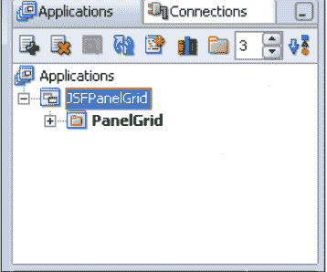

接下来，使用 文件 | 新建 向项目添加 JSF 页面。在 新画廊 窗口中，在 类别 中选择 Web Tier | JSF，在 项目 中选择 JSF JSP。在 Create JSF JSP 向导中，在 Web 应用程序窗口中选择 J2EE 1.4 并单击 下一步。在 JSP 文件窗口中指定 文件名 并单击 下一步。在 组件绑定 窗口中选择 自动地在新的托管 bean 中公开 UI 组件。后台 bean 名称、类和包已预先指定。单击 下一步。

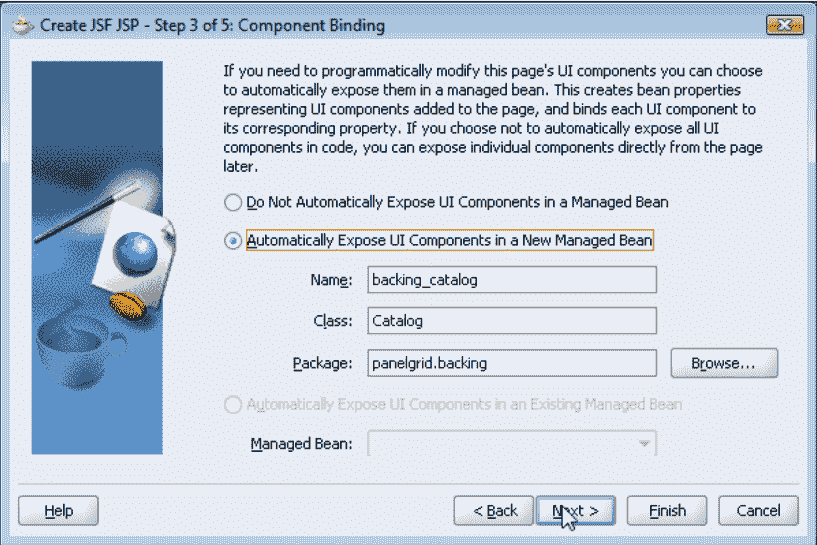

## 创建 JSF 面板网格

在 **Error Page Options** 窗口中，选择默认设置，即不使用错误页面，然后单击 **Next**。在 **Tag Libraries** 窗口中，默认库（JSF Core 1.0 和 JSF HTML 1.0）默认被选中。单击 **Next**。在 **HTML Options** 窗口中，选择默认设置并单击 **Next**。在 **Finish** 窗口中，单击 **Finish**。JSF 页面被添加到项目中。向 JSF JSP 页面添加 **JDeveloper** CSS 样式表。添加一个 **Heading 2** 标题 **JSF Panel Grid**。接下来，向 JSF 页面添加面板网格。将光标定位在 JSF 页面标题下方并在 JSF HTML 组件调色板中选择 Panel Grid。

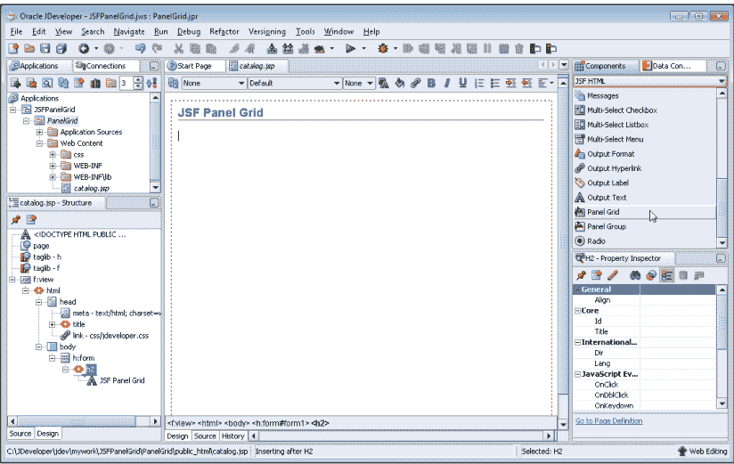

在 **Create PanelGrid Wizard** 中，单击 **Next**。在 **PanelGrid Options** 窗口中选择 **Create empty panel grid** 单选按钮并指定面板网格中的 **Number of Columns**，示例 JSF 应用程序中为 2。单击 **Finish.**

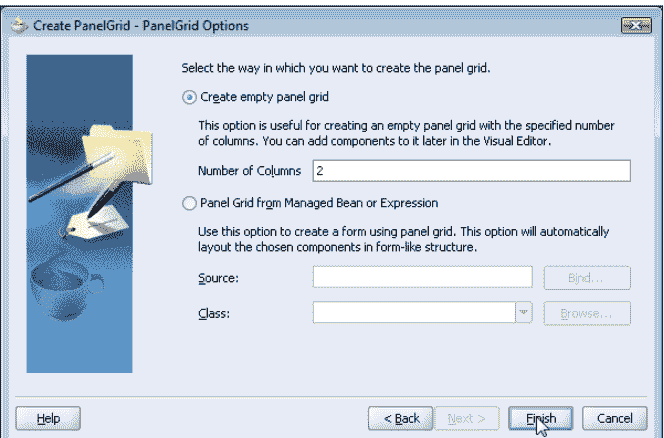

空 JSF 面板网格被添加到 JSF 页面。接下来，我们将从组件调色板向面板网格添加组件。添加到空面板网格的组件按两列排列。将光标定位在面板网格中并在组件调色板中选择 Output Label。

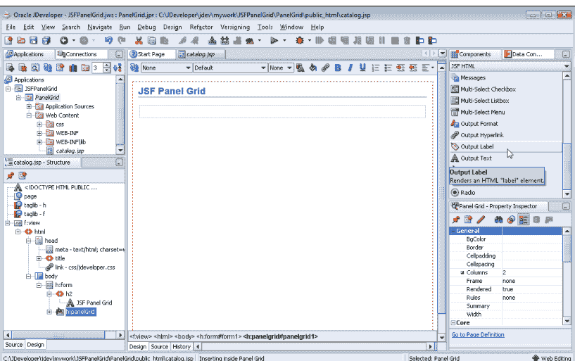

## 创建 JSF 面板网格

向 JSF 页面添加了输出标签。使用右箭头键将光标定位到输出标签右侧并在组件调色板中选择 Input Text。

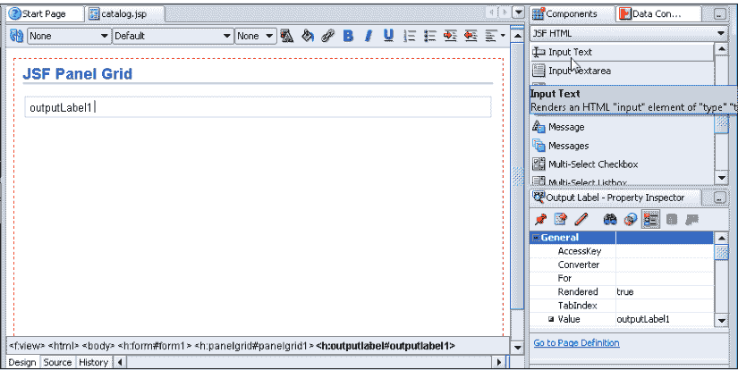

输入文本字段被添加到 JSF 页面。要向 JSF 页面添加另一个组件，使用右箭头键将光标定位到前一个组件右侧。接下来，添加一个输出标签。由于面板网格只有两列，输出标签被添加到新行中。

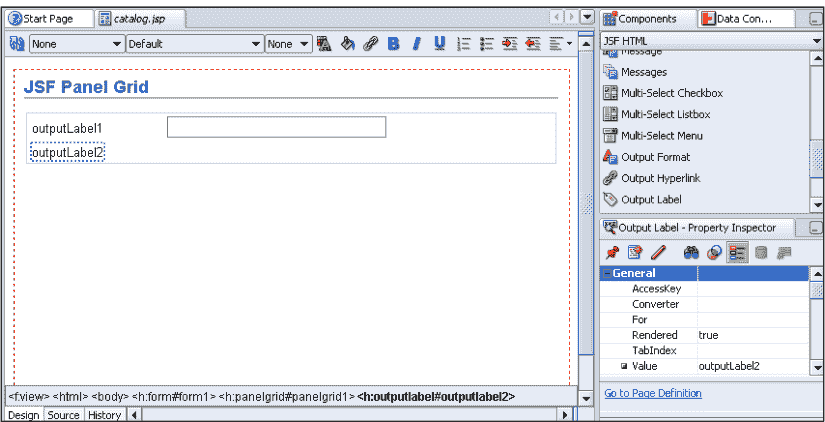


Add **输出文本** fields and **输出标签** to the panel grid to four rows. In the fifth row add a **输出标签** and a **输出超链接.**

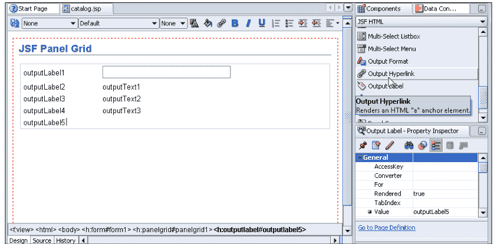

Next, we will add an **输出文本** component to the **输出超链接** component. Select the **输出超链接** component in the JSF page and select **输出文本** in the Component Palette. An output text field gets added to the output hyperlink component. An output hyperlink is a UI component that is similar to a <a/> component in a HTML page. The output text in the output link is text that gets displayed in the hyperlink.

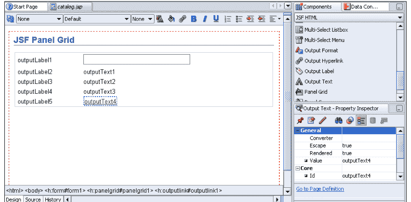

## 创建 JSF 面板网格

Add another row of **输出标签** and **输出文本** components. Next, add a row of command buttons to the panel grid.

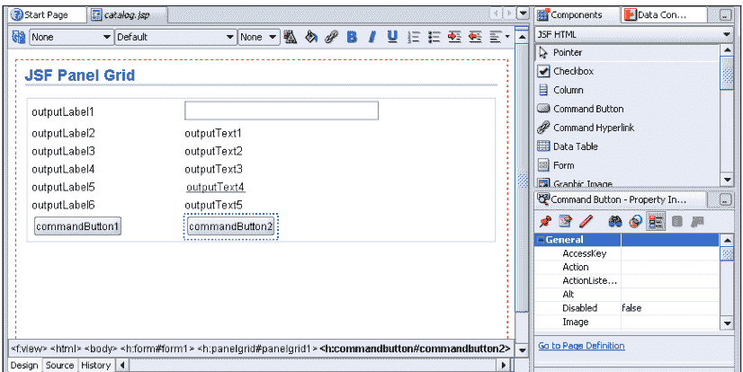

In the **属性检查器**, set the text on the **输出标签** and the command buttons. To specify the text value for a component, click on the component and specify the text value in the **值** property in the **属性检查器**.

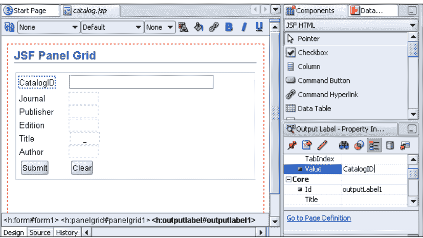

The example JSF application also demonstrates the data conversion and validation provided by the JSF specification. By specifying a Validator for a component the component value may be validated to be within a specified range, and by specifying a Converter for a component, the component value may be converted to the specified converter type. Specify the validateLongRange validator for the Catalog ID input text field:

```
<f:validateLongRange minimum="1" maximum="3"/>
```

If the value in the Catalog ID input field is not within the specified range of 1 and 3 a validation error gets generated. The different types of validators provided by the JSF are listed in the following table:

| 验证器 | 描述 |
|---|---|
| validateLongRange | Validates a long value to be within a specified range. |
| validateLength | Validates the length of a String value to be within a specified range. |
| validateDoubleRange | Validates a double value to be within the specified range. |

Register an Integer data type converter with the Catalog ID input text field:

```
<f:converter converterId="javax.faces.Integer" />
```

The value specified in the input text field gets converted to java.lang.Integer type. Next, add a message component to display an error message by the Catalog ID input text field. Add the input text and message components to a panel group component. Select the catalog.jsp node in the Applications Navigator and select the Source tab in the editor window. Replace the <h:inputText binding="#{backing_catalog.inputText1}" id="inputText1"/> component with the following h:panelGroup component.

```
<h:panelGroup>
    <h:inputText binding="#{backing_catalog.inputText1}" id="inputText1">
        <f:converter converterId="javax.faces.Integer" />
        <f:validateLongRange minimum="1" maximum="3"/>
    </h:inputText>
    <h:message for="inputText1"/>
</h:panelGroup>
```

We have added the h:panelGroup component declaratively. JDeveloper also has the provision to add the panelGroup component when adding the inputText component using the surround with option. Next, add a action method for the command buttons. Select the catalog.jsp node in Applications Navigator and select the Design tab. Double click on the Submit command button. In the Bind Action Property window, select the managed Bean backing_catalog and backing bean method as commandButton1_action. Add an import statement for the java.sql package to the backing bean class panelgrid.backing.Catalog.java.

In the command button action method query the example database table OE.CATALOG with the Catalog ID specified in the input field. Load the Oracle JDBC driver oracle.jdbc.OracleDriver using the Class.forName method. Create a Connection object using the getConnection method of the DriverManager class. Create a Statement object from the Connection object using the createStatement method. Specify the result set type as scrollable and result set concurrency as read-only. Retrieve the Catalog ID input in the JSF page in the Input Text field by invoking the getValue method on the backing bean attribute for the Input Text. Run an SQL query using the executeQuery method to generate a ResultSet. Set the values retrieved in the result set in the output text fields and the output hyperlink using the setValue method. The following listing shows the commandButton1_action method:

```
public String commandButton1_action() {
    // Add event code here...
    ResultSet rs=null;
    try{
        Class.forName("oracle.jdbc.OracleDriver");
        String url="jdbc:oracle:thin:@localhost:1521:ORCL";
        Connection connection =
            DriverManager.getConnection(url,"OE", "pw");
        Statement stmt=connection.createStatement(ResultSet.
            TYPE_SCROLL_INSENSITIVE, ResultSet.CONCUR_READ_ONLY);
        String query="SELECT * FROM OE.CATALOG WHERE CATALOGID=
            "+inputText1.getValue();
        rs=stmt.executeQuery(query);
        rs.next();
        outputText1.setValue(rs.getString("Journal"));
        outputText2.setValue(rs.getString("Publisher"));
        outputText3.setValue(rs.getString("Edition"));
        outputText4.setValue(rs.getString("Href"));
        outputText4.setValue(rs.getString("Title"));
        outputText5.setValue(rs.getString("Author"));
        rs.close();
        stmt.close();
        connection.close();
    }catch(SQLException e){
    }catch(ClassNotFoundException e){
}
    return null;
}
```

The SQL query handling may also be specified in a server-side helper class instead of directly in the managed bean. The **清除** button clears the fields in the JSF page. Double click on the **清除** command button in the **设计** mode. In the **绑定操作属性** window, select the `backing_catalog` managed bean and the `commandButton2_action` method. Modify the `commandButton2_action` method to set the output text field values to an empty string. The `commandButton2_action` method is listed below:

```
public String commandButton2_action() {
    // Add event code here...
    outputText1.setValue("");
    outputText2.setValue("");
    outputText3.setValue("");
    outputText4.setValue("");
    outputLink1.setValue("");
    outputText5.setValue("");
    return null;
}
```

Right-click on the JSF JSP page `catalog.jsp` in the **应用程序导航器** and select **运行**. The JSF Panel Grid gets displayed. The output labels and input text field/ output text fields are displayed in two columns.

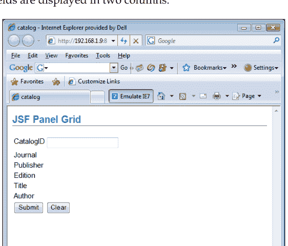

## 创建 JSF 面板网格

Specify a Catalog ID in the input field and select the Submit button. The database table column values corresponding to the specified catalog id are displayed in the panel grid. The title is displayed as a hyperlink, which may be selected to display the referred document.

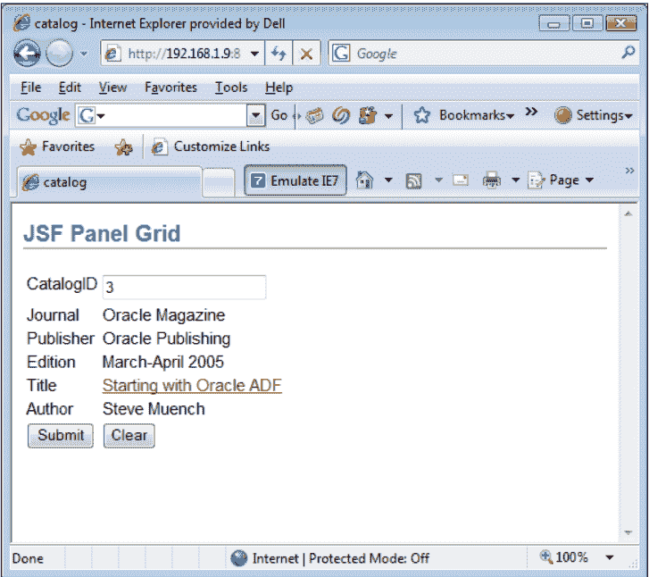

The output text fields may be reset to empty text fields by selecting the **清除** button. Next, we will demonstrate the validation of the input text value. Specify a Catalog Id input text value that is not within the validator range of 1 and 3 and click on the **提交** button:

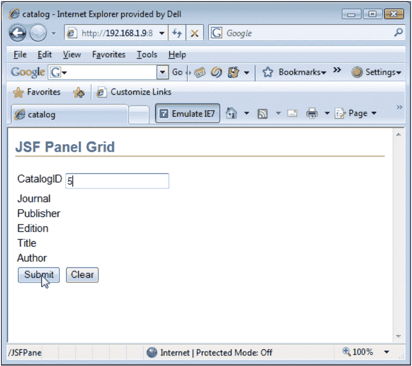

A validation error is generated to indicate that the specified Catalog ID is not in the range specified in the validator.

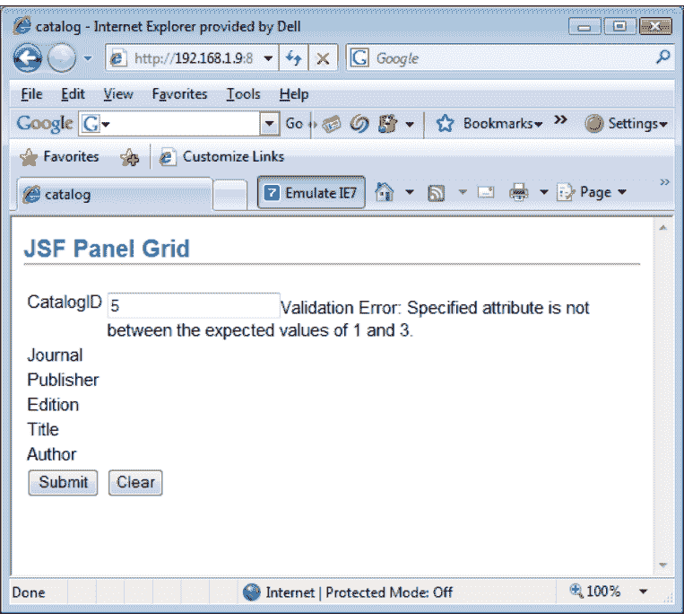

In this section, we created a JSF panel grid by binding two columns to the panel grid and subsequently adding JSF components to the empty panel grid from the Component Palette.

## 通过绑定托管 Bean 创建面板网格

In this section, we will create a panel grid by binding a managed bean to the panel grid in the Create PanelGrid Wizard. We had used a similar managed bean binding to create a Data Table in the previous chapter. A managed bean is a Java object that represents a resource. The example panel grid is an input form to update a

Oracle 数据库中的期刊目录。通过绑定托管 bean 创建面板网格的步骤如下。

- 1. 创建一个 Java Bean 类来表示期刊目录中的不同字段。
- 2. 从 Java Bean 类创建托管 bean。
- 3. 将托管 bean 绑定到 JSF 页面中的面板网格。

删除上一节中创建的 JSFPanelGrid 应用程序，并在 Applications-Navigator 中为面板网格创建类似的应用程序和项目。从 JavaBean 类生成托管 bean。托管 bean 实现了一个资源，即示例应用程序中的 JavaBean 类。JavaBean 类具有属性以及对应于示例数据库表中不同列的属性的 getter/setter 方法。使用 File | New 向项目添加一个 Java 类。在 New Gallery 窗口中，在 Categories 中选择 General，在 Items 中选择 Java Class。在 Create Java Class 窗口中指定类名 PanelGridBean 和包名 example.panelgrid。将以下列表复制到 PanelGridBean。

```java
package example.panelgrid;
public class PanelGridBean
{
    private int catalogId;
    private String journal;
    private String publisher;
    private String edition;
    private String title;
    private String author;
    private String href;
    public PanelGridBean() {
    }
    public int getCatalogId() {
        return this.catalogId;
    }
    public void setCatalogId(int catalogId) {
        this.catalogId=catalogId;
    }
    public String getJournal() {
        return this.journal;
    }
    public void setJournal(String journal) {
        this.journal=journal;
    }
    public String getPublisher() {
        return this.publisher;
    }
    public void setPublisher(String publisher) {
        this.publisher=publisher;
    }
    public String getEdition() {
return this.edition;
}
public void setEdition(String edition){
    this.edition=edition;
}
public String getTitle(){
    return this.title;
}
public void setTitle(String title){
    this.title=title;
}
public String getAuthor(){
    return this.author;
}
public void setAuthor(String author){
    this.author=author;
}
public String getHref(){
    return this.href;
}
public void setHref(String href){
    this.href=href;
}
}
```

接下来，使用 File | New 向项目添加一个 JSF JSP 页面 catalog.jsp。在 New Gallery 窗口中，在 Categories 中选择 Web Tier | JSF，并在 Items 中选择 JSF JSP。单击 OK。接下来，我们将从 Java Bean 类创建托管 bean。在 Applications Navigator 中打开 faces-config.xml 配置文件节点，并在编辑器窗口中选择 Overview 选项卡。选择 Managed Beans 节点（如果尚未选择）。单击 New 添加新的托管 bean。

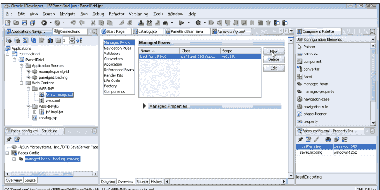

在 Create Managed Bean 窗口中，指定托管 bean 名称 PanelGridMBean，并选择 JavaBean 类 PanelGridBean 作为托管 bean 的 Class。选择 request 作为 Scope 并单击 OK。托管 bean PanelGridMBean 被创建。

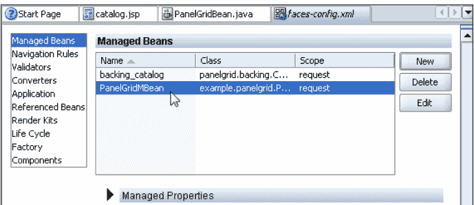

JSF 面板网格也可用于指定输入表单中输入文本字段的初始值。在 faces-config.xml 文件中指定托管 bean 属性的初始值。选择 faces-config.xml 文件节点和 Source 选项卡。使用 <managed-property/> 元素为 PanelGridMBean 添加托管 bean 属性的初始值。指定了托管 bean 属性的 faces-config.xml 中的 managed-bean 元素如下所示：

```
<managed-bean>
    <managed-bean-name>backing_catalog</managed-bean-name>
    <managed-bean-class>panelgrid.backing.Catalog</managed-bean-class>
    <managed-bean-scope>request</managed-bean-scope>
    <!--oracle-jdev-comment:managed-bean-jsp-link:1catalog.jsp-->
</managed-bean>
<managed-bean>
    <managed-bean-name>PanelGridMBean</managed-bean-name>
    <managed-bean-class>example.panelgrid.PanelGridBean</managed-bean-class>
    <managed-bean-scope>request</managed-bean-scope>
    <managed-property>
    <property-name>catalogId</property-name>
    <value>1</value>
    </managed-property>
    <managed-property>
    <property-name>journal</property-name>
    <value>Oracle Magazine</value>
    </managed-property>
    <managed-property>
    <property-name>publisher</property-name>
```

向 JSF 页面 catalog.jsp 添加一个面板网格。在 JSF 页面中定位光标，并在 Component Palette 中选择 Panel Grid。

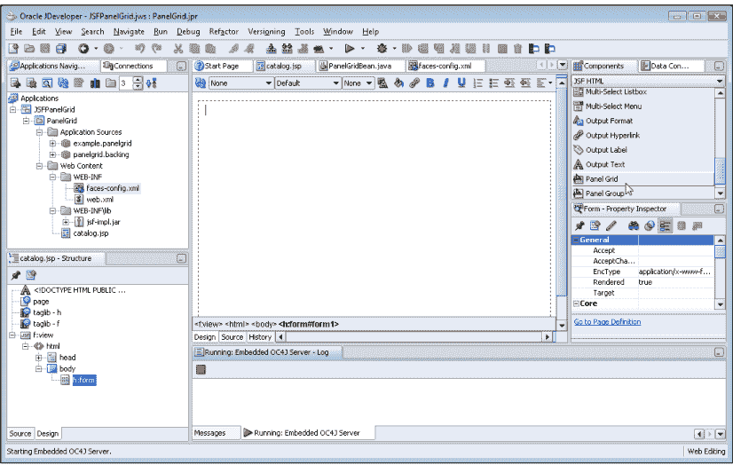

**创建 PanelGrid 向导** 开始运行。单击 **下一步**。在 **面板网格选项** 窗口中选择 **从托管 Bean 或表达式创建面板网格** 单选按钮。单击 **绑定** 将面板网格与托管 bean 绑定。


在 **表达式生成器** 窗口中，选择 **JSF 托管 Bean | PanelGridMBean** 节点，并使用 > 按钮将 **PanelGridMBean** 添加到 **表达式** 字段。

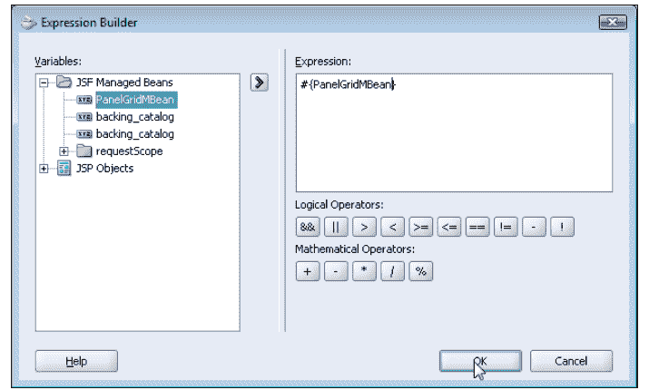

## 创建 JSF 面板网格

在 **面板网格选项** 窗口中，在 **类** 字段中选择 JavaBean 类 **PanelGridBean** 并单击 **下一步**。

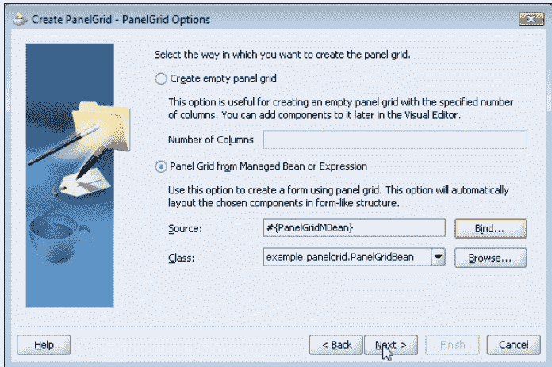

在 **字段选择** 窗口中对所选字段的顺序进行排序，使其对应于 **OE.CATALOG** 数据库表列。单击 **下一步**。

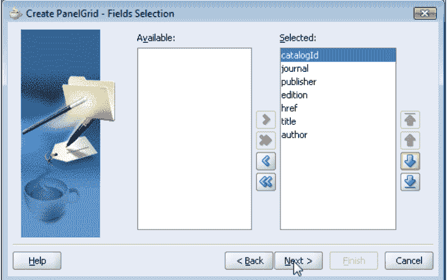

在 **组件详细信息** 中选择 `<header>` 行并在 **标签** 字段中指定一个标题。选择 `Catalog Id` 行并将 **类型** 选择为 **输入文本**。通过选择 **必填** 复选框将 `Catalog Id` 字段指定为必填字段。选择 **关联消息** 复选框以向面板网格添加消息组件列。错误消息将在消息组件中显示。单击 **高级** 按钮为 Catalog Id 输入文本字段注册验证器和转换器。JSF 验证器用于验证输入字段值，JSF 转换器用于转换输入字段值。

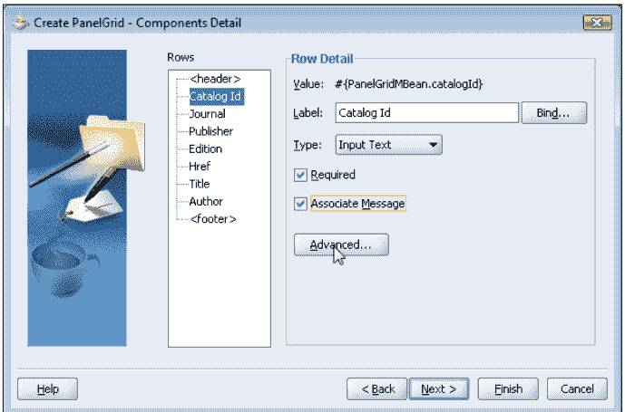

在 **高级属性** 窗口中，选择 **整数** 转换器。Catalog Id 输入文本字段的值将通过转换器转换为 `Integer` 类型。

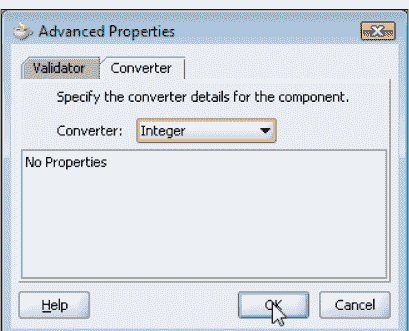

## 创建 JSF 面板网格

接下来，选择 Validator 选项卡并选择 Validate Long Range 验证器。为验证器指定 Minimum 和 Maximum 值。验证器验证 Catalog Id 输入字段值是否在指定范围内。

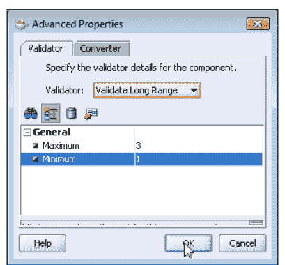

在 Components Detail 窗口中，为其他字段将 Type 指定为 Input Text 并单击 Next。在 Finish 窗口中单击 Finish。一个 JSF 面板网格已添加到 JSF 页面 catalog.jsp。向 JSF 页面添加一个命令按钮 Submit。

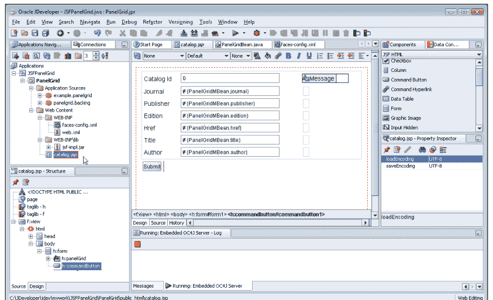

接下来，我们将修改 backing bean 中的命令按钮 action 方法。在 Design 选项卡中双击命令按钮。在 Bind Action 属性窗口中为 Managed Bean 和 Method 选择默认设置并单击 OK。在命令按钮 action 方法中检索输入字段值并更新指定 catalog id 的数据库表。在 backing bean 类中为 java.sql 包添加 import 语句。在 commandButton1_action 方法中使用 Class.forName 方法加载 Oracle JDBC 驱动程序 oracle.jdbc.OracleDriver。

使用 DriverManager 类的 getConnection 方法创建 Connection 对象。使用 createStatement 方法从 Connection 对象创建 Statement 对象。将结果集类型指定为可滚动，结果集并发指定为只读。使用 getValue 方法检索 Input Text 字段值。通过使用 executeQuery 方法运行 UPDATE SQL 语句来更新数据库表 Catalog。commandButton1_action 方法如下所示：

```java
public String commandButton1_action() {
    // Add event code here...
    ResultSet rs=null;
    try{Class.forName("oracle.jdbc.OracleDriver");
        String url="jdbc:oracle:thin:@localhost:1521:ORCL";
        Connection connection =
        DriverManager.getConnection(url,"OE", "pw");
    Statement
    stmt=connection.createStatement(ResultSet.TYPE_SCROLL_INSENSITIVE,
    ResultSet.CONCUR_READ_ONLY);
        int catalogId=((Integer)(inputText0.getValue())).
intValue();
        String journal=(String)inputText1.getValue();
        String publisher=(String)inputText2.getValue();
        String edition=(String)inputText3.getValue();
        String title=(String)inputText4.getValue();
        String author=(String)inputText5.getValue();
        String href=(String)inputText6.getValue();
    String query="UPDATE OE.CATALOG SET
    JOURNAL="+"'"+journal+"'"+","+"PUBLISHER="+"'"+publisher+"'"+
    ","+"EDITION="+"'"+edition+"'"+","+"  TITLE=" +"'"+title+"'"+","+"AUTHOR="+"'"+author+"'"+"," + " HREF="+"'"+href+"'"+"WHERE
    CATALOGID="+"'"+catalogId+"'";
    stmt.executeUpdate(query);stmt.close();connection.close();}
    catch(SQLException e){System.out.println(e.getMessage());}
    catch(ClassNotFoundException e)
    {System.out.println(e.getMessage());}return null;}
```


## 创建 JSF 面板网格

右键单击 **catalog.jsp** 节点并选择 **运行**。输入字段中指定的初始值的面板网格显示如下：

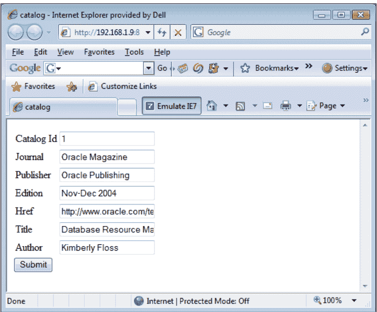

要更新数据库表行，请指定该行的 Catalog Id 和输入字段值，然后单击 **提交** 按钮。输入字段 **Catalog Id** 被指定为 **必填** 字段。如果在 **Catalog Id** 字段中未指定输入值，则会生成验证错误。验证错误会显示在消息组件列中。

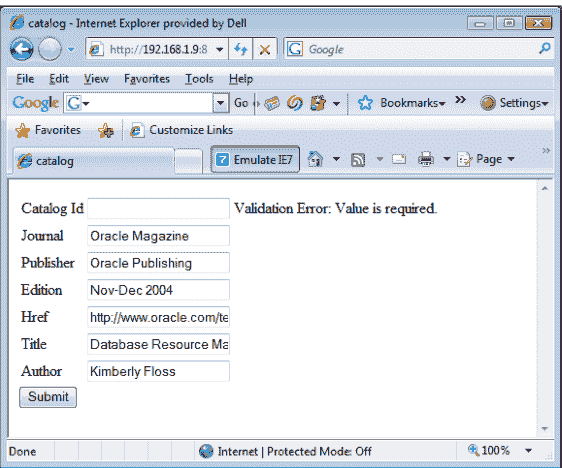

接下来，我们将演示与 Catalog Id 输入字段注册的验证器。指定不在 1 到 3 范围内的 Catalog Id 输入值并单击提交按钮。消息列中会生成验证错误。

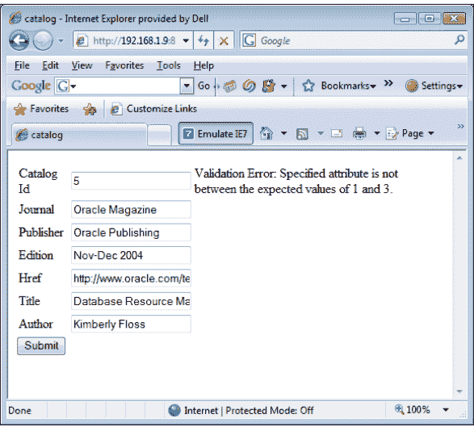

## JDBC 4.0 版本

在其嵌入式 OC4J 服务器支持 JDBC 4.0 的 JDeveloper 版本中，我们可以将 JDBC 4.0 功能添加到 JSF 面板网格应用程序中。JDBC 4.0 提供了诸如增强的连接管理、使用 Java SE 服务提供者机制自动加载驱动程序、支持包装器模式以访问 JDBC API 的供应商特定扩展、语句池以及对 Java SE 链式异常设施和异常分类的支持等新功能。

对于 JSF 面板网格应用程序的 JDBC 4.0 版本，我们需要从 http://www.oracle.com/technology/software/tech/java/sqlj_jdbc/htdocs/jdbc_111060.html 下载 Oracle 数据库 11g JDBC 4.0 驱动程序 JAR 文件 ojdbc6.jar。JDBC 4.0 驱动程序需要 JDK 6.0。因此，我们需要在 JDeveloper 中将 J2SE 版本设置为 JDK 6.0。要设置 JDK 版本，请选择 工具 | 项目属性。在项目属性窗口中选择 库，并在 J2SE 版本 字段中指定 JDK 6.0 版本。

JDBC 4.0 驱动程序 JAR 文件 ojdbc6.jar 包含一个 META-INF/services/java.sql.Driver 文件，该文件指定了 Oracle JDBC 驱动程序类 oracle.jdbc.OracleDriver。java.sql.Driver 字段包含在 ojdbc6.jar 中，以便 Java SE 服务提供者机制加载 JDBC 驱动程序。在 backing bean 类中 commandButton1_action() 方法的 JDBC 4.0 版本中，删除使用 Class.forName() 方法加载 Oracle JDBC 驱动程序的那一行。

JDBC 4.0 使用 Connection 接口中的 isValid() 方法提供连接状态跟踪。连接池管理器使用 isValid 方法测试连接是否变得不可用。如果连接变得不可用，连接池管理器将使用 close() 方法关闭连接。连接状态跟踪减少了在连接池中的某些连接变得不可用时关闭连接池中的所有连接并重新初始化连接池的开销。

JDBC 4.0 提供的另一个连接管理功能是连接客户端标识。有时某些客户端连接会因消耗过多的 CPU 而拖慢应用程序。JDBC 的早期版本没有识别此类客户端连接的 provision。JDBC 4.0 中的 Connection 接口有两个新方法 setClientInfo 和 getClientInfo，用于设置和获取客户端信息属性。因此，Connection 对象由其客户端信息属性标识。数据库支持的不同客户端信息属性可以使用 DatabaseMetaData 接口的 getClientInfoProperties 方法获得。标准客户端信息属性是 ApplicationName、ClientUser 和 Hostname。

除了 PreparedStatements 池化之外，JDBC 4.0 还提供 Statement 池化。经常使用的 Statements 可以使用 setPoolable() 方法进行池化。isPoolable() 方法用于测试 Statement 对象是否可池化。

JDBC 4.0 在 Wrapper 接口中支持包装器模式，以访问 JDBC API 的供应商特定扩展。Oracle JDBC 扩展可在 oracle.jdbc.package 中获得。例如，要访问扩展 Statement 接口的 OracleStatement 接口中的非标准方法，请使用 isWrapperFor 方法测试 Statement 对象是否为 OracleStatement 接口的包装器。如果 Statement 对象是包装器，请使用 unwrap() 方法解包 OracleStatement 接口以创建 OracleStatement 对象。随后，可以调用 OracleStatement 对象的 defineColumnType 方法来定义列类型。定义列类型可节省 JDBC 驱动程序往返数据库查找列类型的开销。当运行 SQL 查询时，数据库表数据会被提取到 ResultSet 中的已定义列类型中。

JDBC 4.0 提供了对 Java SE 链式异常设施的支持，也称为 cause 设施，用于检索链式异常。JDBC 4.0 还检索非 SQLException 链式异常。在面板网格应用程序的 JDBC 4.0 版本中，链式异常和链式原因使用 J2SE 5.0 中引入的增强 for-each 循环检索。

用于检索指定 Catalog ID 的字段值的 commandButton1_action() 方法的 JDBC 4.0 版本如下所示：

```
public String commandButton1_action() {
    // Add event code here...
    ResultSet rs=null;
    try{
        String url="jdbc:oracle:thin:@localhost:1521:ORCL";
        Connection connection =
        DriverManager.getConnection(url,"OE", "pw");
    connection.setClientInfo("ApplicationName","OracleApp");
    connection.setClientInfo("ClientUser","OracleUser");
    connection.setClientInfo("ClientHostname","OracleHost");
    Statement stmt=connection.createStatement(ResultSet.TYPE_SCROLL_INSENSITIVE, ResultSet.CONCUR_READ_ONLY);
    DatabaseMetaData metaData=connection.getMetaData();
    if(metaData.supportsStatementPooling()){
    if(stmt.isPoolable())
    stmt.setPoolable(true);
    }
    Class clazz = Class.forName("oracle.jdbc.OracleStatement");
    if(stmt.isWrapperFor(clazz)) {
    OracleStatement oracleStmt = (OracleStatement)stmt.unwrap(clazz);
    oracleStmt.defineColumnType(1, OracleTypes.VARCHAR);
```

```
oracleStmt.defineColumnType(2, OracleTypes.VARCHAR);
oracleStmt.defineColumnType(3, OracleTypes.VARCHAR);
oracleStmt.defineColumnType(4, OracleTypes.VARCHAR);
oracleStmt.defineColumnType(5, OracleTypes.VARCHAR);
oracleStmt.defineColumnType(6, OracleTypes.VARCHAR);
oracleStmt.defineColumnType(7, OracleTypes.VARCHAR);
String query="SELECT * FROM OE.CATALOG WHERE CATALOGID="+inputText1.getValue();
        rs=stmt.executeQuery(query);
rs=stmt.executeQuery("SELECT * FROM OE.CATALOG");
outputText1.setValue(rs.getString("Journal"));
        outputText2.setValue(rs.getString("Publisher"));
        outputText3.setValue(rs.getString("Edition"));
        outputLink1.setValue(rs.getString("HRef"));
        outputText4.setValue(rs.getString("Title"));
        outputText5.setValue(rs.getString("Author"));
} rs.close();
stmt.close();
connection.close();
    }catch(SQLException e){for(Throwable e : e.getCause()) {
out.println("Error encountered: " + e);
}
        return null;
    }
```

## 摘要

JSF 面板网格是用于以网格布局在指定数量的列中显示一组 UI 组件的 UI 组件。在本章中，面板网格用于显示从数据库检索的目录数据。面板网格还用于转换和验证输入字段值。面板网格可以在 Create PanelGrid Wizard 中通过绑定行或绑定托管 bean 来创建。在面板网格应用程序的 JDBC 4.0 版本中，我们添加了 JDBC 4.0 功能自动驱动程序加载、客户端信息属性、语句池和包装器模式。
