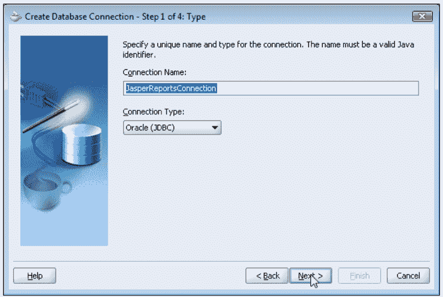
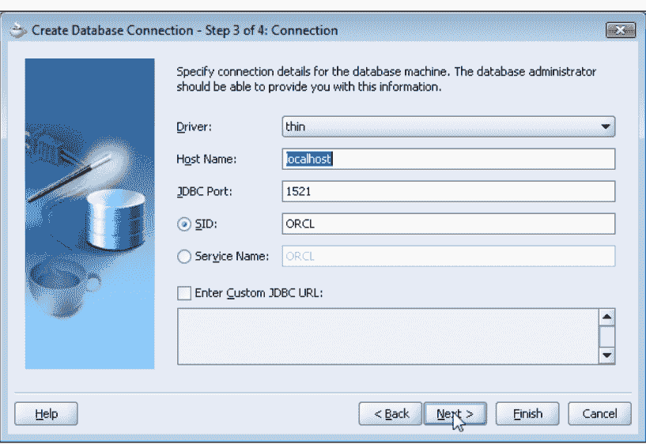
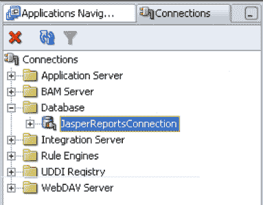
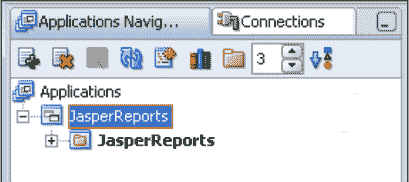
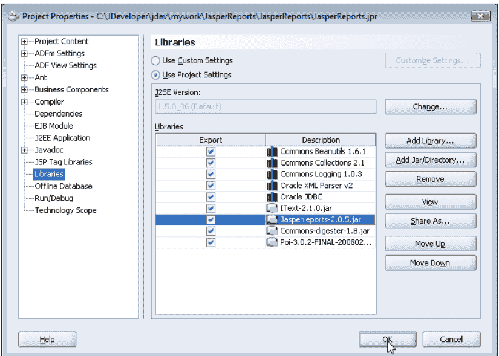
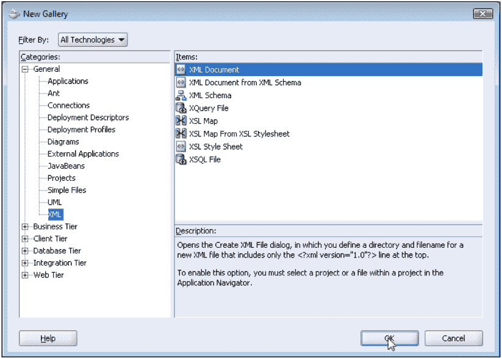
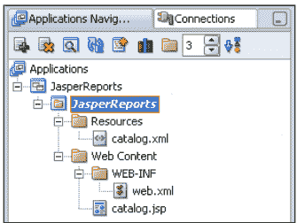
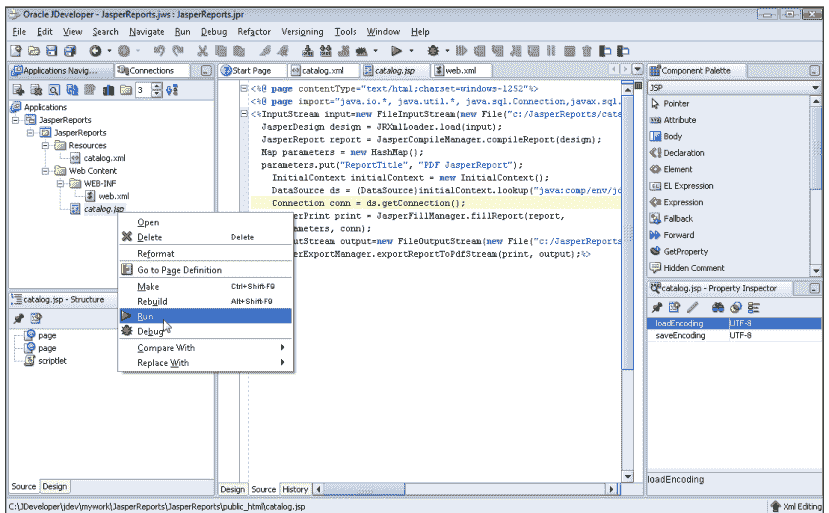
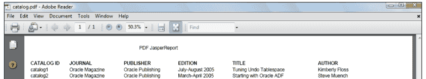
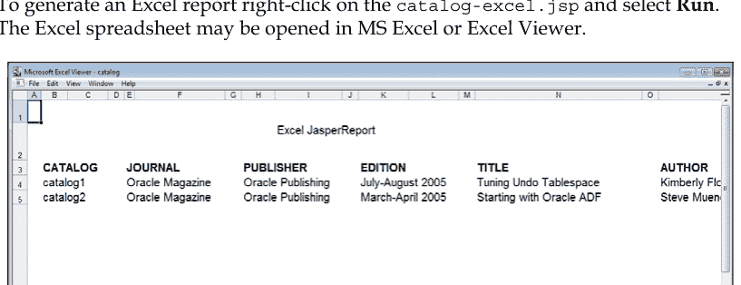

## 12 使用 JasperReports 创建报告

JasperReports 是一个用于准备演示报告的 Java 报告工具。JasperReports 报告是 HTML、PDF、Excel XLS、CSV 或 XML 报告。JasperReports 报告的数据是静态数据，或是通过 SQL 查询从数据库表检索的数据。JasperReports 设计用于包含在 Java/J2EE 应用程序中以生成动态演示报告。

在本章中，我们将在 JDeveloper 中创建 JasperReports 报告。JasperReports 使用 JDBC 连接到数据库并检索 JasperReports 报告的数据。在 JasperReports 配置文件（.xml 文件）中建立了与 Oracle 数据库 10g 的 JDBC 连接。我们将使用 JasperReports 创建 PDF 报告和 Excel 电子表格报告。在本章中我们将学习以下内容：

- 使用 JasperReports 创建 PDF 报告
- 使用 JasperReports 创建 Excel 电子表格

## 设置环境

下载开源 JasperReports 工具 JAR 文件 `jasperreports-2.0.5.jar`。下载 iText Java-PDF 库 `itext-2.1.0.jar`。下载 Jakarta-POI ZIP 文件 `poi-bin-3.0.2-FINAL-20080204.zip`。下载 `Commons Digester 1.8` 并将 ZIP 文件解压到一个目录中。安装 JDeveloper 10g IDE Studio Edition 完整安装。从以下位置下载并安装 Oracle 数据库：http://www.oracle.com/database/index.html 10g。

创建一个示例数据库表 `Catalog`，从中将生成 JasperReports PDF 报告和 Excel 报告。在 Oracle SQL *Plus 中创建数据库表。创建示例表的 SQL 脚本如下所示。


```
CREATE TABLE OE.Catalog(CatalogId VARCHAR(25), Journal VARCHAR(25),
    Publisher Varchar(25),Edition VARCHAR(25), Title Varchar(45),
    Author Varchar(25));
INSERT INTO OE.Catalog VALUES('catalog1', 'Oracle Magazine', 'Oracle
    Publishing', 'July-August 2005', 'Tuning Undo Tablespace',
    'Kimberly Floss');
INSERT INTO OE.Catalog VALUES('catalog2', 'Oracle Magazine', 'Oracle
    Publishing','March-April 2005', 'Starting with Oracle ADF ', 'Steve
    Muench');
```

从 JDeveloper IDE 创建到 Oracle 数据库的 JDBC 连接。要创建连接，请选择 Connections 选项卡，在 Connections Navigator 中选择 Database 节点，右键单击 Database 节点，然后选择 New Database Connection。在显示的 Create Database Connection (Type) 窗口中，指定 Connection Name 并将 Connection Type 设置为 Oracle(JDBC)。



单击 Next。在 Authentication 窗口中，指定 Username 和 Password 并单击 Next。在 Connection 窗口中，指定 Driver type、Host Name、JDBC Port、SID 并单击 Next。



在 **Test** 窗口中，单击 **Test Connection**。如果与数据库的连接已建立，则会显示成功消息。单击 **Finish** 完成连接配置。连接节点将被添加到 **Connections Navigator** 中。JDBC 连接 `JasperReportsConnection` 可作为 JNDI 资源 `jdbc/JasperReportsConnectionDS` 使用。该数据源将用于从数据库检索数据以生成 JasperReports 报表。



我们还需要下载并安装 Adobe Acrobat Reader 用于 PDF 报表，以及 MS Excel 用于 Excel 报表。

## 安装 JasperReports

在本节中，在 JDeveloper IDE 中创建 JasperReports 项目并创建 JasperReports 报表所需的库。首先，在 JDeveloper IDE 中选择 File | New。在 New Gallery 窗口中，在列出的 Categories 中选择 General，并在列出的 Items 中选择 Application。单击 OK 按钮。在 Create Application 窗口中指定 Application Name。单击 OK 按钮。在 Create Project 窗口中指定 Project Name 并单击 OK 按钮。JasperReports 应用程序和项目将被添加到 Applications-Navigator 中。



接下来，将生成 JasperReports 报表所需的库添加到项目中。在 Applications-Navigator 中选择 JasperReports 项目节点并选择 Tools | Project Properties。在 Project Properties 窗口中选择 Libraries 节点。使用 Add Library 按钮添加库，并使用 Add Jar/Directory 按钮添加 JAR/目录。添加以下表格中列出的库/JAR 文件。

| 库/Jar/Zip | 描述 |
|---|---|
| jasperreports-2.0.5.jar | JasperReports API. |
| Commons BeanUtils | JavaBeans 实用程序类 |
| Commons Collections | 集合框架扩展类 |
| Commons Digester 1.8 jar | 用于处理 XML 文档的类 |
| Commons Logging | 日志类 |
| poi-bin-3.0.2-FINAL-20080204.jar | 用于生成 Excel 文档的 Jakarta POI API |
| itext-2.1.0 | PDF 库 |
| Oracle XML Parser v2 | XML 解析器 API |

创建的库列在 **Libraries** 窗口中。在 **Project Properties** 窗口中单击 **OK** 按钮。



## 配置 JasperReports 配置文件

JasperReports 报表设计在 XML 配置文件中指定。本节中，XML 配置文件 `catalog.xml` 被配置为 PDF 报表。JasperReports 配置文件是基于 `jasperreport.dtd` DTD 的 XML 文件。配置文件的根元素是 `jasperReport`。JasperReports XML 文件中其他一些元素（带常用子元素和属性）在以下表格中列出：

| XML 元素 | 描述 | 子元素 | 属性 |
|---|---|---|---|
| jasperReport | 根元素 | reportFont, parameter, queryString, field, variable, group, title, pageHeader, columnHeader, detail, columnFooter, pageFooter. | name, columnCount, pageWidth, pageHeight, orientation, columnWidth, columnSpacing, leftMargin, rightMargin, topMargin, bottomMargin. |
| reportFont | 报表级字体定义。 | Report level font definitions. | name, isDefault, fontName,size, isBold, isItalic, isUnderline, isStrikeThrough, pdfFontName, pdfEncoding, isPdfEmbedded |
| parameter | 用于生成报表时引用的对象引用。引用格式为 P${name} | parameterDescription, defaultValueExpression. | name,class |
| queryString | 指定用于从数据库检索数据的 SQL 查询。 | - | - |
| field | 包含在报表中的数据库表列。引用格式为 F${name} | fieldDescription | name,class |
| variable | 报表 XML 文件中使用的变量。引用格式为 V${name} | variableExpression, initialValueExpression | name,class |
| title | 报表标题。 | band | - |
| pageHeader | 页眉 | band | - |
| columnHeader | 指定报表中的不同列。 | band | - |
| detail | 指定列值。 | band | - |
| columnFooter | 列页脚 | band | - |
| pageFooter | 页脚。 | band | - |

报表中的 band 代表报表的一个区段。`band` 元素包含 `staticText` 和 `textElement` 元素。`staticText` 元素用于向报表添加静态文本，例如列标题。`textElement` 元素用于向报表添加动态生成的文本，例如从数据库表检索的列值。在 *生成 PDF 报表* 部分，从示例 `Catalog` 表生成 JasperReports PDF 报表。示例 JasperReports 配置 XML 文件 `catalog.xml` 的 `queryString` 指定了用于检索报表数据的 SQL 查询。

```
<queryString><![CDATA[SELECT CatalogId, Journal, Publisher, Edition, Title, Author FROM OE.Catalog]]></queryString>
```

`reportElement` 元素指定报表中使用的 `ARIAL_NORMAL`、`ARIAL_BOLD` 和 `ARIAL_ITALIC` 字体。PDF 报表具有列 `CatalogId`、`Journal`、`Publisher`、`Edition`、`Title`、`Author`。JasperReports 配置文件 `catalog.xml` 如下所示。

```
<?xml version='1.0' encoding='utf-8'?>
<!DOCTYPE jasperReport PUBLIC "-//JasperReports//DTD Report Design//EN"
"http://jasperreports.sourceforge.net/dtds/jasperreport.dtd">
<jasperReport name="PDFReport" pageWidth="1250">
<!-- Specify report fonts. -->
<reportFont name="Arial_Normal" isDefault="true" fontName="Arial" size="15" isBold="false" isItalic="false" isUnderline="false" isStrikeThrough="false" pdfFontName="Helvetica" pdfEncoding="Cp1252" isPdfEmbedded="false"/>
<reportFont name="Arial_Bold" isDefault="false" fontName="Arial" size="15" isBold="true" isItalic="false" isUnderline="false" isStrikeThrough="false" pdfFontName="Helvetica-Bold" pdfEncoding="Cp1252" isPdfEmbedded="false"/>
<reportFont name="Arial_Italic" isDefault="false" fontName="Arial" size="12" isBold="false" isItalic="true" isUnderline="false" isStrikeThrough="false" pdfFontName="Helvetica-Oblique" pdfEncoding="Cp1252" isPdfEmbedded="false"/>
<!-- Specify report parameters. -->
<parameter name="ReportTitle" class="java.lang.String"/>
<!-- Specify SQL Query -->
<queryString><![CDATA[SELECT CatalogId, Journal, Publisher, Edition, Title, Author FROM Catalog]]></queryString>
<field name="CatalogId" class="java.lang.String"/>
<field name="Journal" class="java.lang.String"/>
<field name="Publisher" class="java.lang.String"/>
<field name="Edition" class="java.lang.String"/>
<field name="Title" class="java.lang.String"/>
```

```
<field name="Author" class="java.lang.String"/>
<!-- Specify report title.-->
<title>
    <band height="50">
        <textField>
            <reportElement x="350" y="0" width="200" height="50" />
            <textFieldExpression
                class="java.lang.String">$P{ReportTitle}
            </textFieldExpression>
        </textField>
    </band>
</title>
<!-- Specify page header.-->
<pageHeader>
    <band>
    </band>
</pageHeader>
<!-- Specify column headers.-->
<columnHeader>
    <band height="20">
        <staticText>
            <reportElement x="0" y="0" width="100" height="20"/>
            <textElement>
                <font isUnderline="false" reportFont="Arial_Bold"/>
            </textElement>
            <text><![CDATA[CATALOG ID]]></text>
        </staticText>
        <staticText>
            <reportElement x="125" y="0" width="150" height="20"/>
            <textElement>
                <font isUnderline="false" reportFont="Arial_Bold"/>
            </textElement>
            <text><![CDATA[JOURNAL]]></text>
        </staticText>
        <staticText>
            <reportElement x="300" y="0" width="150" height="20"/>
            <textElement>
                <font isUnderline="false" reportFont="Arial_Bold"/>
            </textElement>
            <text><![CDATA[PUBLISHER]]></text>
        </staticText>
        <staticText>
            <reportElement x="475" y="0" width="150" height="20"/>
            <textElement>
                <font isUnderline="false" reportFont="Arial_Bold"/>
            </textElement>
            <text><![CDATA[PUBLISHER]]></text>
        </staticText>
```

<font isUnderline="false" reportFont="Arial_Bold"/>
</textElement>
<text><![CDATA[EDITION]]></text>
</staticText>
<staticText>
    <reportElement x="650" y="0" width="250" height="20"/>
    <textElement>
        <font isUnderline="false" reportFont="Arial_Bold"/>
    </textElement>
    <text><![CDATA[TITLE]]></text>
</staticText>
    <staticText>
        <reportElement x="925" y="0" width="200" height="20"/>
        <textElement>
            <font isUnderline="false" reportFont="Arial_Bold"/>
        </textElement>
        <text><![CDATA[AUTHOR]]></text>
    </staticText>
</band>
</columnHeader>
<!-- Specify column data binding.-->
<detail>
    <band height="20">
        <textField>
            <reportElement x="0" y="0" width="100" height="20"/>
            <textFieldExpression
                class="java.lang.String"><![CDATA[${CatalogId}]]>
            </textFieldExpression>
        </textField>
        <textField pattern="0.00">
            <reportElement x="125" y="0" width="150" height="20"/>
            <textFieldExpression
                class="java.lang.String"><![CDATA[${Journal}]]>
            </textFieldExpression>
        </textField>
        <textField pattern="0.00">
            <reportElement x="300" y="0" width="150" height="20"/>
            <textFieldExpression
                class="java.lang.String"><![CDATA[${Publisher}]]>
            </textFieldExpression>
        </textField>
<textField>
    <reportElement x="475" y="0" width="150" height="20"/>
    <textFieldExpression
class="java.lang.String"><![CDATA[$F{Edition}]]>
</textFieldExpression>
</textField>
<textField pattern="0.00">
    <reportElement x="650" y="0" width="250" height="20"/>
    <textFieldExpression
        class="java.lang.String"><![CDATA[$F{Title}]]>
    </textFieldExpression>
</textField>
<textField>
    <reportElement x="925" y="0" width="200" height="20"/>
    <textFieldExpression
        class="java.lang.String"><![CDATA[$F{Author}]]>
    </textFieldExpression>
</textField>
</band>
</detail>
<columnFooter>
    <band>
    </band>
</columnFooter>
<pageFooter>
    <band height="15">
        <staticText>
            <reportElement x="0" y="0" width="40" height="15"/>
            <textElement>
                <font isUnderline="false" reportFont="Arial_Italic"/>
            </textElement>
            <text><![CDATA[Page #]]></text>
        </staticText>
        <textField>
            <reportElement x="40" y="0" width="100" height="15"/>
            <textElement>
                <font isUnderline="false" reportFont="Arial_Italic"/>
            </textElement>
            <textFieldExpression
                class="java.lang.Integer"><![CDATA[$V{PAGE_NUMBER}]]>
            </textFieldExpression>
        </textField>
    </band>
</pageFooter>
<summary>
    <band>
    </band>
</summary>
</jasperReport>

## 生成 PDF 报告

我们将使用 JasperReports 类和接口从 catalog.xml 文件生成 PDF 文件。使用 **File | New** 向 JasperReports 项目添加一个 XML 文件。在 **New Gallery** 窗口中，在列出的 **Categories** 中选择 **General | XML**，在列出的 **Items** 中选择 **XML Document**。点击 **OK** 按钮。在 **Create XML File** 窗口中指定 **File Name** 为 catalog.xml，然后点击 **OK** 按钮。



XML 文档已添加到 JasperReports 项目中。将上一节中的 catalog.xml 列表复制到 XML 文档 catalog.xml 中。使用 File | Save As 将 catalog.xml 保存到 C:/JasperReports 目录。创建一个 JSP 来生成 JasperReports 报表。右键单击 JasperReports 项目节点并选择 New。在 New Gallery 窗口中，在列出的 Categories 中选择 Web Tier | JSP，在列出的 Items 中选择 JSP。点击 OK 按钮。在 Create JSP Wizard 中，点击 Next。在 Web Application 窗口中，选择 Servlet 2.4/JSP 2.0 并点击 Next。在 JSP File 窗口中，将 File Name 指定为 catalog.jsp 并选择默认的 Directory Name。点击 Next。在 Error Page Options 窗口中选择默认选项并点击 Next。在 Tag Libraries 窗口中，点击 Next。在 HTML Options 页面中，点击 Next。在 Finish 窗口中，点击 Finish。JSP catalog.jsp 已添加到 JasperReports 项目中。



JDBC 数据源 jdbc/JasperReportsConnectionDS 必须在 JSP web.xml 配置文件中进行配置。在 web.xml 文件中添加以下 resource-ref 元素：

```
<resource-ref>
<res-ref-name>jdbc/JasperReportsConnectionDS</res-ref-name>
<res-type>javax.sql.DataSource</res-type>
<res-auth>Container</res-auth>
</resource-ref>
```

在 catalog.jsp 中，首先导入 JasperReports 类和接口：

```
<%@ page import="java.io.*, java.util.*, java.sql.Connection, javax.sql.DataSource, javax.naming.InitialContext, net.sf.jasperreports.engine.*, net.sf.jasperreports.engine.design.JasperDesign, net.sf.jasperreports.engine.xml.JRXmlLoader" %>
```

接下来，为 JasperReports 配置文件 catalog.xml 创建一个 InputStream。接下来，使用 JRXmlLoader 类的静态方法 load() 加载 XML 文件。load() 方法被重载，XML 配置文件可以从 File 对象、InputStream 对象或 String 对象加载。load() 方法返回一个 JasperDesign 对象。

```
InputStream input=new FileInputStream(new File("c:/JasperReports/
 catalog.xml"));
JasperDesign design = JRXmlLoader.load(input);
```

JasperDesign 对象表示报表设计。使用 JasperCompileManager 的 compileReport() 方法编译报表设计文件。编译报表设计文件会使用 jasperreports.dtd DTD 验证 JasperReports XML 文件（catalog.xml），并将报表表达式转换为可求值形式。compileReport() 方法返回一个 JasperReport 对象，表示已编译的报表。

```
JasperReport report = JasperCompileManager.compileReport(design);
```

创建一个 Connection 对象以从数据库检索数据来创建 PDF 文件。创建一个 InitialContext 对象，使用 lookup() 方法查找数据源 JNDI。使用 getConnection() 方法从数据源获取 JDBC 连接。

```
InitialContext initialContext = new InitialContext();
DataSource ds = (DataSource)initialContext.lookup
("java:comp/env/jdbc/JasperReportsConnectionDS");
Connection conn = ds.getConnection();
```

从已编译的报表生成 JasperReports 报表。使用 JasperFillManager 类的 fillReport() 方法用数据库中的数据填充已编译的报表。fillReport() 方法返回一个 JasperPrint 对象，表示可查看、打印或导出到其他格式的报表文档：

```
JasperPrint print =JasperFillManager.fillReport(report,parameters,
    conn);
```

fillReport() 方法中的参数由 XML 配置文件中 <parameter/> 元素指定的参数值组成。Catalog.xml 有参数 ReportTitle，因此为 ReportTitle 参数指定一个值。

```
Map parameters = new HashMap();
parameters.put("ReportTitle", "PDF JasperReport");
```

JasperReports 报表可以导出为 XML 文件、PDF 文件、HTML 文件、CSV 文件或 Excel XLS 文件。使用 JasperExportManager 类的 exportReportToPdfStream() 方法将生成的 JasperReports 导出为 PDF 文件：

```
OutputStream output=new FileOutputStream(new File("c:/JasperReports/
 catalog.pdf"));
JasperExportManager.exportReportToPdfStream(print, output);
```

JSP 文件 catalog.jsp 如下所示：

```
<%@ page contentType="text/html;charset=windows-1252"%>
<%@ page import="java.io.*, java.util.*, java.sql.Connection, javax.sql.DataSource, javax.naming.InitialContext, net.sf.jasperreports.engine.*, net.sf.jasperreports.engine.design.JasperDesign,net.sf.jasperreports.engine.xml.JRXmlLoader" %>
<%InputStream input=new FileInputStream(new
File("c:/JasperReports/catalog.xml"));
JasperDesign design = JRXmlLoader.load(input);
JasperReport report = JasperCompileManager.compileReport(design);
Map parameters = new HashMap();
parameters.put("ReportTitle", "PDF JasperReport");
InitialContext initialContext = new InitialContext();
DataSource ds = (DataSource)initialContext.lookup
("java:comp/env/jdbc/JasperReportsConnectionDS");
Connection conn = ds.getConnection();
JasperPrint print = JasperFillManager.fillReport(report,
parameters, conn);
OutputStream output=new FileOutputStream
(new File("c:/JasperReports/catalog.pdf"));
JasperExportManager.exportReportToPdfStream(print, output);%>
```

将 catalog.jsp 列表中的代码复制到 JasperReports 应用程序中的 catalog.jsp。要运行 catalog.jsp JSP，右键单击 catalog.jsp 节点并选择 Run。




生成 catalog.pdf PDF 文件。PDF 文件可以在 Adobe Acrobat Reader 中打开。



## 创建 Excel 电子表格

在 JDeveloper 中的 JasperReports 项目中创建 catalog-excel.jsp 以创建 Excel 电子表格。如果需要 Excel 报表，请使用 JRXlsExporter 对象将 JasperReports 文档导出到 Excel 电子表格。指定 OutputStream 以输出 Excel 电子表格。为 JRXlsExporter 对象的输出指定 ByteArrayOutputStream：

```
OutputStream outputStream=new FileOutputStream
(new File("c:/JasperReports/catalog.xls"));
ByteArrayOutputStream byteArrayOutputStream = new
ByteArrayOutputStream();
```

创建 JRXlsExporter 对象并设置要生成的报表来源的 JasperPrint 对象以及用于输出报表的 OutputStream。

```
JRXlsExporter exporterXLS = new JRXlsExporter();
exporterXLS.setParameter(JRXlsExporterParameter.JASPER_PRINT, print);
exporterXLS.setParameter
(JRXlsExporterParameter.OUTPUT_STREAM,byteArrayOutputStream);
```

使用 exportReport() 方法导出 JasperReport 文档：

```
exporterXLS.exportReport();
```

将 JasperReports excel 报表输出到 catalog.xls 文件：

```
outputStream.write(byteArrayOutputStream.toByteArray());
outputStream.flush();
outputStream.close();
```

以下是 catalog-excel.jsp 的内容：

```
<%@ page contentType="text/html;charset=windows-1252"%>
<%@ page import="java.io.*, java.util.*, java.sql.Connection, javax.
sql.DataSource, javax.naming.InitialContext,
net.sf.jasperreports.engine.*, net.sf.jasperreports.engine.design.
JasperDesign,net.sf.jasperreports.engine.xml.JRXmlLoader,
net.sf.jasperreports.engine.export.*"
%>
<%
    InputStream input=new FileInputStream
        (new File("c:/JasperReports/catalog.xml"));
    JasperDesign design = JRXmlLoader.load(input);
    JasperReport report = JasperCompileManager.compileReport(design);
    Map parameters = new HashMap();
    parameters.put("ReportTitle", "Excel JasperReport");
    InitialContext initialContext = new InitialContext();
    DataSource ds = (DataSource)initialContext.lookup
        ("java:comp/env/jdbc/JasperReportsConnectionDS");
    Connection conn = ds.getConnection();
    JasperPrint print = JasperFillManager.fillReport
        (report, parameters, conn);
        OutputStream outputStream=new FileOutputStream
            (new File("c:/JasperReports/catalog.xls"));
        ByteArrayOutputStream byteArrayOutputStream = new
            ByteArrayOutputStream();
        JRXlsExporter exporterXLS = new JRXlsExporter();
        exporterXLS.setParameter(
            JRXlsExporterParameter.JASPER_PRINT, print);
        exporterXLS.setParameter(JRXlsExporterParameter.
            OUTPUT_STREAM, byteArrayOutputStream);
        exporterXLS.exportReport();
        outputStream.write(byteArrayOutputStream.toByteArray());
        outputStream.flush();
        outputStream.close();
%>
```

要生成 Excel 报表，请右键单击 catalog-excel.jsp 并选择 Run。
Excel 电子表格可在 MS Excel 或 Excel Viewer 中打开。



## JDBC 4.0 版本

在 JasperReports 应用的 JDBC 4.0 版本中，要生成 PDF 报表，请使用 Oracle 数据库 11g JDBC 4.0 驱动 JAR 文件 ojdbc6.jar 代替 Oracle JDBC 库。JDBC 4.0 驱动程序需要 JDK 6.0。因此，在 Project Properties 窗口中将 J2SE Version 设置为 JDK 6.0。要修改 J2SE Version，请在 Project Properties 窗口中选择 Libraries 节点。单击 J2SE Version 字段的 Change 按钮。在 Edit J2SE Definition 窗口中，单击 New 以创建 JDK 6.0 的 J2SE 定义。在 Create J2SE 窗口中，选择一个 JDK 6.0 Java Executable 并单击 OK。在 Edit J2SE Definition 窗口中选择 JDK 6.0 定义并单击 OK。Project Properties 窗口中的 J2SE Version 将被设置为 JDK 6.0。在 Project Properties 中单击 OK。

可以在支持嵌入式 OC4J 中 JDBC 4.0 的 JDeveloper 版本中使用 JDBC 4.0 功能。JDBC 4.0 提供了增强的连接管理，具有连接状态跟踪和连接客户端标识。连接状态跟踪由连接池管理器实现。如果连接池中的某些连接变得不可用，连接池管理器会关闭这些连接。在连接状态跟踪功能之前，如果某些连接变得不可用，连接池管理器通常会关闭所有连接并重新初始化连接池。关闭连接并打开新连接会产生开销。支持 JDBC 4.0 的 JDK 6.0 中的 Connection 接口具有 isValid() 方法来测试连接的有效性。连接池管理器在连接上调用 isValid 方法，如果连接返回 false，则连接池管理器使用 close() 方法关闭连接，如下所示：

```
if(!connection.isValid())
    connection.close();
```

连接客户端标识由 JDBC 驱动程序实现。连接客户端标识用于识别因 CPU 使用过度而可能拖慢应用的连接。JDK 6.0 Connection 接口提供了两个用于连接客户端标识的新方法；setClientInfo() 和 getClientInfo()。Connection 对象可通过使用 setClientInfo() 设置在 Connection 上的客户端信息属性来标识。数据库支持的不同客户端信息属性可通过 DatabaseMetaData 接口的 getClientInfoProperties 方法从数据库元数据中获取。

```
DatabaseMetaData metaData=connection.getMetaData();
ResultSet clientInfo=metaData.getClientInfoProperties();
```

标准客户端信息属性为 ApplicationName、ClientUser 和 ClientHostname。在 JasperReports 应用的 JDBC 4.0 版本中，按如下方式设置标准客户端信息属性：

```
connection.setClientInfo("ApplicationName","OracleApp");
connection.setClientInfo("ClientUser","OracleUser");
connection.setClientInfo("ClientHostname","OracleHost");
```

在 JasperReports 应用的 JDBC 4.0 版本中，我们还可以利用 Java SE 链式异常设施的支持。在 JasperReports JSP 中指定一个错误页面，并在错误页面中，使用 J2SE 5.0 中引入的增强 for-each 循环检索链式异常和链式原因，如下所示：

```
for(Throwable e : exception ) {
    out.println("Error encountered: " + e);
}
```

以下是生成 PDF 报表的 JasperReports 应用的 JDBC 4.0 版本：

```
<%@ page contentType="text/html;charset=windows-1252"%>
<%@ page import="java.io.*, java.util.*, java.sql.Connection, javax.sql.DataSource, javax.naming.InitialContext, net.sf.jasperreports.engine.*, net.sf.jasperreports.engine.design.JasperDesign,net.sf.jasperreports.engine.xml.JRXmlLoader" %>
<%
    InputStream input=new FileInputStream
    (new File("c:/JasperReports/catalog.xml"));
    JasperDesign design = JRXmlLoader.load(input);
    JasperReport report = JasperCompileManager.compileReport(design);
    Map parameters = new HashMap();
    parameters.put("ReportTitle", "PDF JasperReport");
    InitialContext initialContext = new InitialContext();
    DataSource ds = (DataSource)initialContext.lookup
    ("java:comp/env/jdbc/JasperReportsConnectionDS");
    Connection conn = ds.getConnection();
    connection.setClientInfo("ApplicationName","OracleApp");
    connection.setClientInfo("ClientUser","OracleUser");
    connection.setClientInfo("ClientHostname","OracleHost");

    JasperPrint print = JasperFillManager.fillReport(report, parameters, conn);
    OutputStream output=new FileOutputStream(new File("c:/JasperReports/catalog.pdf"));
    JasperExportManager.exportReportToPdfStream(print, output);
%>
```

相同的修改也适用于生成 Excel 电子表格的 JasperReports 应用。

## 摘要

JasperReports 是一个 Java 报表工具，用于生成 HTML、XML、PDF、CSV 或 XLS 报表。在本章中，我们学习了如何使用 JDBC 连接数据库并运行 SQL 查询，从数据库表中创建 PDF 和 Excel 电子表格报表。我们在 JasperReports 应用的 JDBC 4.0 版本中添加了 JDBC 4.0 功能连接状态跟踪和连接客户端标识。


