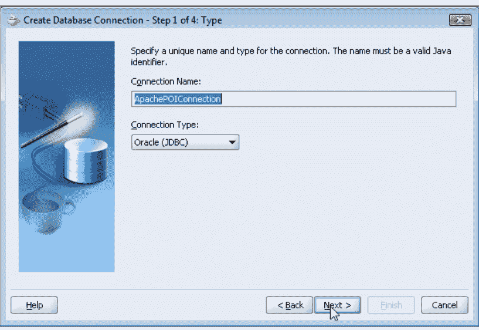
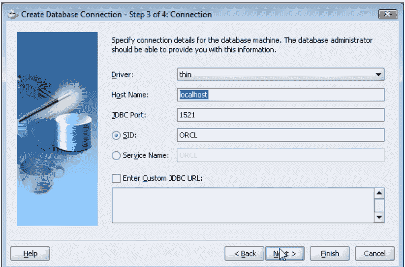
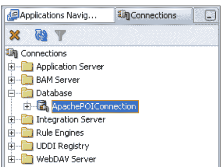
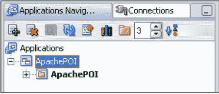
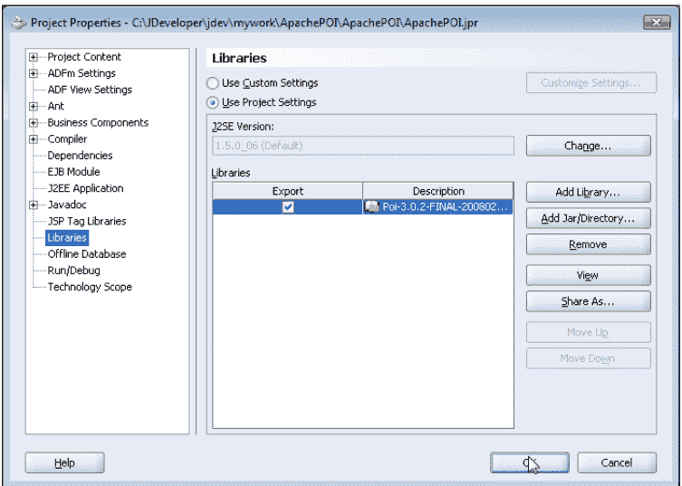
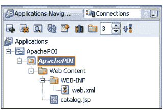
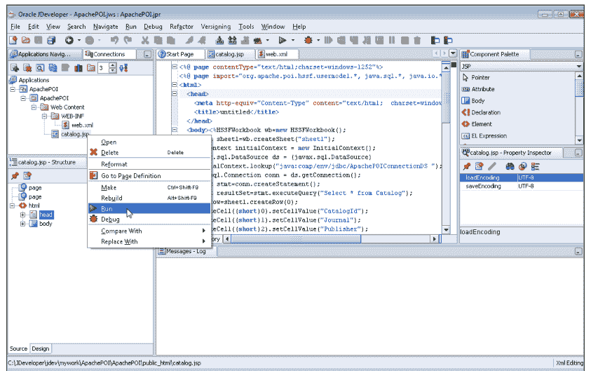
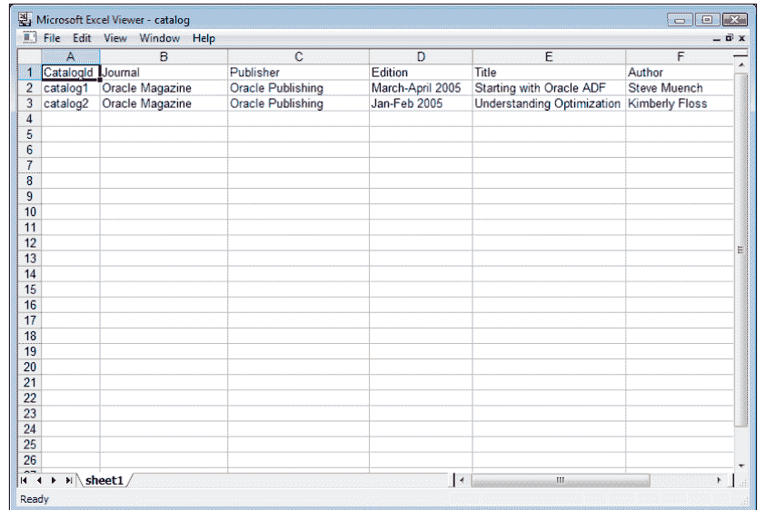

## 13 使用 Apache POI 创建电子表格

## 使用 Apache POI 创建电子表格

数据库表数据通常需要以 Excel 电子表格的形式呈现。Apache POI 项目提供了用于处理 Microsoft OLE 2 复合文档格式文件的 Java API，其中包括 XLS 和 DOC 文件。Apache POI 项目的 **Apache POI HSSF** 组件是一个用于访问和生成 Excel 工作簿和 Excel 电子表格的 Java API。Apache POI HSSF 不支持新的 Excel 2007 .xlsx OOXML 文件格式，该格式不是基于 OLE2 的。Excel 工作簿由电子表格组成，而 Excel 电子表格由行和单元格组成。电子表格的布局和字体也可以通过 Apache POI HSSF Java API 设置。

Apache POI HSSF 项目是用于创建 Excel 工作簿和 Excel 电子表格的 Java API。Apache POI HSSF 项目的实现在 `org.apache.poi.hssf.usermodel` 包中提供。使用 POI HSSF 项目生成的 Excel 电子表格中的数据可能是静态数据，也可能是从数据库动态检索的数据。本章将讨论从 Oracle 数据库表创建 Excel 电子表格的步骤。Excel 电子表格在 JDeveloper IDE 中生成。

## 设置环境

生成 Excel 电子表格需要 `org.apache.poi.hssf.usermodel` 包中的类。从 `http://www.apache.org/dyn/closer.cgi/poi/` 下载 Apache POI 库的 `poi-bin-3.0.2-FINAL-20080204.zip` 文件并将其解压到安装目录。安装 JDeveloper 10g (10.1.3)。安装包含示例模式的 Oracle 数据库 10g。创建数据库实例。创建一个示例数据库表，将从中生成 Excel 电子表格。创建示例表 `catalog` 的 SQL 脚本如下所示：

```sql
CREATE TABLE OE.Catalog(CatalogId VARCHAR(25), Journal VARCHAR(25),
    Publisher Varchar(25),Edition VARCHAR(25), Title Varchar(255),
    Author Varchar(25));

INSERT INTO OE.Catalog VALUES('catalog1', 'Oracle Magazine',
    'Oracle Publishing', 'March-April 2005', 'Starting with Oracle ADF'
    , 'Steve Muench');

INSERT INTO OE.Catalog VALUES('catalog2', 'Oracle Magazine',
    'Oracle Publishing','Jan-Feb 2005', 'Understanding Optimization',
    'Kimberly Floss');
```

接下来，我们将创建一个用于生成 Excel 电子表格的 JDeveloper 项目，并向项目中添加 Apache POI JAR 文件的库。此外，我们将使用 Oracle 数据库创建 JDBC 连接以检索用于 Excel 电子表格的数据。

首先，从 JDeveloper IDE 创建到 Oracle 数据库的 JDBC 连接。要创建连接，请选择 Connections 选项卡，在 Connections Navigator 中选择 Database 节点，右键单击 Database 节点，然后选择 New Database Connection。在显示的 Create Database Connection (Type) 窗口中，指定 Connection Name 并将 Connection Type 设置为 Oracle(JDBC)。



单击 **Next**。在 **Authentication** 窗口中，指定 **Username** 和 **Password**，然后单击 **Next**。在 **Connection** 窗口中，指定 **Driver type**、**Host Name**、**JDBC Port**、**SID**，然后单击 **Next**。



在 **Test** 窗口中，单击 **Test Connection**。如果与数据库的连接已建立，则会显示成功消息。单击 **Finish** 完成连接配置。连接节点将被添加到 **Connections Navigator**。



JDBC 连接 `ApachePOIConnection` 可作为数据源 `jdbc/ApachePOIConnectionDS` 使用。该数据源用于从数据库检索数据以生成 Excel 电子表格。接下来，创建一个用于生成 Excel 电子表格的 JDeveloper 项目。在 JDeveloper IDE 中选择 **File | New**。在 **New Gallery** 窗口中，在列出的 **Categories** 中选择 **General | Applications**，并在列出的 **Items** 中选择 **Application**。单击 **OK** 按钮。在 **Create Application** 窗口中，指定 **Application Name**，选择 **No Template Application Template**，然后单击 **OK** 按钮。在 **Create Project** 窗口中，指定 **Project Name** 并单击 **OK** 按钮。应用程序和项目将被添加到 **Applications Navigator.**



接下来，向项目添加 Apache POI JAR 文件的库。在 **Applications Navigator** 中选择 Apache POI 项目节点。选择 **Tools | Project Properties**。在 **Project Properties** 窗口中，选择 **Libraries** 节点。单击 **Add Library** 按钮创建新库。在 **Add Library** 窗口中单击 **New** 按钮添加新库。在 **Create Library** 窗口中指定 **Library Name** 并单击 **Add Entry** 按钮。

在 **Select Path Entry** 窗口中选择 `poi-3.0.2-FINAL-20080204.jar` 文件并单击 **Select** 按钮。所选 JAR 文件将被添加到 **Create Library** 窗口中的 **Class Path** 节点。在 **Create Library** 窗口中单击 **OK** 按钮。Apache POI 库被添加到 **Add Library** 窗口。在 **Add Library** 窗口中单击 **OK** 按钮。Apache POI 库已创建并添加到 **Libraries**。`poi-3.0.2-FINAL-20080204.jar` 文件也可以使用 **Add Jar/Directory** 按钮添加到 ApachePOI 项目。



## 创建 Excel 电子表格

在本节中，将从示例数据库表生成 Excel 电子表格。首先，创建一个 JSP 应用程序以生成 Excel 电子表格。在 **Applications Navigator** 中右键单击 ApachePOI 项目节点并选择 **New**。在 **New Gallery** 窗口中选择 **Web Tier | Java Server Pages**。在列出的 **Items** 中，选择 **JSP Page** 并单击 **OK** 按钮。在 **Create JSP Wizard** 中选择 **Web Application** 版本并单击 **Next** 按钮。在 **JSP File** 窗口中指定文件名并单击 **Next**。在 **Tag Libraries** 窗口中单击 **Next** 按钮。在 **HTML Options** 页面中选择默认选项并单击 **Next** 按钮。在 **Finish** 窗口中，单击 **Finish**。JSP 被添加到 **Applications Navigator** 中的 Apache POI 项目。



向 JSP `web.xml` 配置文件添加 JDBC 数据源 `jdbc/ApachePOIConnectionDS` 的资源引用，该数据源已在上一节中配置。向 `web.xml` 文件添加 `resource-ref` 元素。

```
<resource-ref>
    <res-ref-name>jdbc/ApachePOIConnectionDS</res-ref-name>
    <res-type>javax.sql.DataSource</res-type>
    <res-auth>Container</res-auth>
</resource-ref>
```

在 `catalog.jsp` 中，将从 Oracle 数据库表创建 Excel 电子表格。使用 Apache POI HSSF 项目生成 Excel 电子表格。Apache POI HSSF 包具有用于 Excel 电子表格不同组件的类。Apache POI HSSF 包中一些常用的类列在下表中。

| 类名 | 描述 |
|---|---|
| HSSFWorkbook | 表示 Excel 电子表格工作簿。 |
| HSSFSheet | 表示 Excel 电子表格。 |
| HSSFHeader | 指定电子表格页眉。 |
| HSSFRow | 指定电子表格行。 |
| HSSFCell | 指定电子表格单元格 |
| HSSFCellStyle | 指定单元格样式 |
| HSSFFont | 指定电子表格的字体 |
| HSSFChart | 表示图表 |
| HSSFDateUtil | 指定 Excel 日期 |
| HSSFPrintSetup | 指定 Excel 文档的打印设置 |

在 JSP 应用程序中，首先导入 Apache POI HSSF 包：

```
<%@ page import="org.apache.poi.hssf.usermodel.*, java.sql.*, java.io.*,javax.naming.InitialContext"%>
```

使用 `HSSFWorkbook` 类创建 Excel 电子表格工作簿：

```
HSSFWorkbook wb=new HSSFWorkbook();
```

接下来，使用 `createSheet()` 方法从 `HSSFWorkbook` 对象创建 Excel 电子表格：

```
HSSFSheet sheet1=wb.createSheet("sheet1");
```


样式表的数据从 Oracle 数据库表中检索。 从数据库获取 JDBC 连接。 首先，创建一个 InitialContext 对象。 随后，使用 InitialContext 类的 lookup() 方法创建 DataSource 对象以查找数据源 JNDI。 使用 getConnection() 方法从 DataSource 对象获取连接：

```
InitialContext initialContext = new InitialContext();
javax.sql.DataSource ds = (javax.sql.DataSource)
initialContext.lookup("java:comp/env/jdbc/ApachePOIConnectionDS");
java.sql.Connection conn = ds.getConnection();
```

使用 Connection 接口的 createStatement() 方法创建 Statement 对象。 使用 Statement 接口的 executeQuery() 方法在 Catalog 表上运行 SQL 查询以生成 ResultSet 对象。

```
Statement stmt=conn.createStatement();
ResultSet resultSet=stmt.executeQuery("Select * from Catalog");
```

使用 HSSFRow 类的 createRow() 方法为 Excel 电子表格创建标题行。 Excel 电子表格中的行以 '0' 为基数。

```
HSSFRow row=sheet1.createRow(0);
```

设置标题行单元格值以对应表列。 使用 HSSFRow 类的 createCell() 方法创建单元格并使用 setCellValue() 方法设置单元格值。 例如，行中第一个单元格的值设置为 CatalogId 如下：

```
row.createCell((short)0).setCellValue("CatalogId");
```

要向电子表格添加行，请遍历结果集并为每个表行添加一行。 从 ResultSet 检索列值并将值设置在行单元格中：

```
for (int i=1;resultSet.next(); i++){
    row=sheet1.createRow(i);
    row.createCell((short)0).setCellValue(resultSet.getString(1));
    row.createCell((short)1).setCellValue(resultSet.getString(2));
    row.createCell((short)2).setCellValue(resultSet.getString(3));
    row.createCell((short)3).setCellValue(resultSet.getString(4));
    row.createCell((short)4).setCellValue(resultSet.getString(5));
}
```

创建目录 C:/excel。 创建 FileOutputStream 将 Excel 电子表格输出到 XLS 文件。 XLS 文件表示 excel 电子表格。

```
FileOutputStream output=new FileOutputStream(new File("c:/excel/catalog.xls"));
```

使用 HSSFWorkbook 类的 write() 方法将 Excel 电子表格输出到 XLS 文件。

```
wb.write(output);
```

下面列出了用于生成 Excel 电子表格的 catalog.jsp。

```jsp
<%@ page contentType="text/html;charset=windows-1252"%>
<%@ page import="org.apache.poi.hssf.usermodel.*, java.sql.*, java.io.*,javax.naming.InitialContext"%>
<html>
<head>
<meta http-equiv="Content-Type" content="text/html; charset=windows-1252">
<title>untitled</title>
</head>
<body><%HSSFWorkbook wb=new HSSFWorkbook();
HSSFSheet sheet1=wb.createSheet("sheet1");
InitialContext initialContext = new InitialContext();
javax.sql.DataSource ds = (javax.sql.DataSource)
initialContext.lookup("java:comp/env/jdbc/ApachePOIConnectionDS");
java.sql.Connection conn = ds.getConnection();
Statement stmt=conn.createStatement();
ResultSet resultSet=stmt.executeQuery("Select * from Catalog");
HSSFRow row=sheet1.createRow(0);
row.createCell((short)0).setCellValue("CatalogId");
row.createCell((short)1).setCellValue("Journal");
row.createCell((short)2).setCellValue("Publisher");
row.createCell((short)3).setCellValue("Edition");
row.createCell((short)4).setCellValue("Title");
row.createCell((short)5).setCellValue("Author");
for (int i=1;resultSet.next(); i++)
{
row=sheet1.createRow(i);
row.createCell((short)0).setCellValue(resultSet.getString(1));
row.createCell((short)1).setCellValue(resultSet.getString(2));
row.createCell((short)2).setCellValue(resultSet.getString(3));
row.createCell((short)3).setCellValue(resultSet.getString(4));
row.createCell((short)4).setCellValue(resultSet.getString(5));
row.createCell((short)5).setCellValue(resultSet.getString(6));
}
FileOutputStream output=new FileOutputStream(new File("c:/excel/catalog.xls"));
wb.write(output);
output.close();
resultSet.close();
stmt.close();
conn.close();
%>
</body>
</html>
```

要在 JDeveloper 嵌入式 OC4J 服务器中运行 catalog.jsp JSP，请在 Applications-Navigator 中右键单击 JSP 节点并选择 Run。



## Creating a Spreadsheet with Apache POI

生成了一个可在 MS Excel 或 Excel Viewer 工具中打开的 Excel 电子表格：



## JDBC 4.0 Version

在 Apache POI 应用程序的 JDBC 4.0 版本中，我们需要使用 Oracle 数据库 11g JDBC 4.0 驱动程序创建与 Oracle 数据库的 JDBC 连接，该驱动程序可从以下位置获取： http://www.oracle.com/technology/software/tech/java/sqlj_jdbc/htdocs/jdbc_111060.html。 使用 ojdbc6.jar JDBC JAR 文件配置与 Oracle 数据源的 JDBC 连接和数据源。 由于 JDBC 4.0 驱动程序需要 JDK 6.0，请通过选择 Tools | Project Properties 将 J2SE 版本设置为 JDK 6.0。 在 Project Properties 窗口中，选择 Libraries 节点并在 J2SE Version 字段中选择 JDK 6.0 Java 可执行文件。

我们将向 Apache POI 应用程序添加以下 JDBC 4.0 功能：

- Connection state tracking
- Connection client identification using client info properties
- Statement pooling
- Wrapper pattern
- Java SE chained exception facility

连接状态跟踪由连接池管理器实现，用于识别连接池中变得不可用的连接。 JDBC 4.0 在 Connection 接口中提供 isValid() 方法用于连接状态跟踪。 如果 isValid() 方法返回 false，连接池管理器将关闭连接。

```
if (!connection.isValid())
connection.close();
```

连接客户端标识用于识别可能因 CPU 使用过多而导致性能下降的连接。 连接使用客户端信息属性与应用程序客户端关联。 JDBC 4.0 中的 Connection 接口包括两个新方法 setClientInfo() 和 getClientInfo()，用于设置和获取客户端信息属性。 数据库支持的客户端信息属性可使用 DatabaseMetaData 接口的 getClientInfoProperties() 方法检索，如下所示：

```
DatabaseMetaData metaData=connection.getMetaData();
ResultSet rsClientInfo=metaData.getClientInfoProperties();
```

标准客户端信息属性 ApplicationName、ClientUser 和 ClientHostname 可按如下方式设置在 Connection 对象上：

```
conn.setClientInfo("ApplicationName","OracleApp");
conn.setClientInfo("ClientUser","OracleUser");
conn.setClientInfo("ClientHostname","OracleHost");
```

如果数据库支持语句池，则 PreparedStatement 对象默认会被池化。 JDBC 4.0 还增加了池化 Statement 对象的功能。 建议对频繁使用的 Statement 对象进行池化，以避免关闭和打开新 Statement 对象的开销。 Statement 池化使用 Statement 对象的 isPoolable() 和 setPoolable() 方法实现，如下所示：

```
if (stmt.isPoolable())
stmt.setPoolable(true);
```

JDBC 4.0 中的 Wrapper 接口使用包装器模式提供对 JDBC API 供应商特定扩展中的非标准 JDBC 方法的访问。 Wrapper 接口由以下 JDBC 接口扩展：

- CachedRowSet
- CallableStatement
- Connection
- DatabaseMetaData
- DataSource
- FilteredRowSet
- JdbcRowSet
- JoinRowSet
- ParameterMetaData
- PreparedStatement
- ResultSet
- ResultSetMetaData
- RowSet
- RowSetMetaData
- Statement
- WebRowSet

任何扩展这些接口的供应商特定接口都实现了包装器模式，因为它也扩展了 Wrapper 接口。 例如，Oracle 对 JDBC API 的扩展中的 OracleStatement 接口扩展了 Statement 接口，从而扩展了 Wrapper 接口。 OracleStatement 接口提供了 Statement 接口中未定义的方法。 我们将使用 OracleStatement 接口而不是 Statement 接口来运行 SQL 查询。 要创建 OracleStatement 对象，首先使用 isWrapperFor() 方法确定 Statement 对象是否为 OracleStatement 接口的包装器。 如果是包装器，则使用 Wrapper 接口中的 unwrap() 方法解包 OracleStatement 接口以创建 OracleStatement 对象。随后调用 OracleStatement 对象的 defineColumnType() 方法来设置列类型。

JDBC 4.0 支持 Java SE 链式异常设施以检索链式异常和链式原因。 链式异常是链接到异常的异常。 JDBC 4.0 支持在 J2SE 5.0 中引入的增强 for 循环来遍历链式异常，如下所示：

```
for(Throwable e : exception ) {
    out.println("Error encountered: " + e);
}
```

Apache POI 应用程序的 JDBC 4.0 版本列如下。

```
<%@ page contentType="text/html;charset=windows-1252"%>
<%@ page import="org.apache.poi.hssf.usermodel.*, java.sql.*, java.io.*,javax.naming.InitialContext, oracle.jdbc.OracleStatement"%>
```

<html>
    <head>
        <meta http-equiv="Content-Type" content="text/html;
charset=windows-1252">
        <title>untitled</title>
    </head>
    <body><%
ResultSet resultSet;
HSSFWorkbook wb=new HSSFWorkbook();
HSSFSheet sheet1=wb.createSheet("sheet1");
InitialContext initialContext = new InitialContext();
    javax.sql.DataSource ds = (javax.sql.DataSource)
    initialContext.lookup("java:comp/env/jdbc/ApachePOIConnectionDS
");
    java.sql.Connection conn = ds.getConnection();

conn.setClientInfo("ApplicationName","OracleApp");
conn.setClientInfo("ClientUser","OracleUser");
conn.setClientInfo("ClientHostname","OracleHost");

Statement stmt=conn.createStatement();
DatabaseMetaData metaData=conn.getMetaData();
if(metaData.supportsStatementPooling()){
if(stmt.isPoolable())
stmt.setPoolable(true);
}

Class clazz = Class.forName("oracle.jdbc.OracleStatement");
if(stmt.isWrapperFor(clazz)) {
OracleStatement oracleStmt = (OracleStatement)stmt.unwrap(clazz);
oracleStmt.defineColumnType(1, OracleTypes.VARCHAR);
oracleStmt.defineColumnType(2, OracleTypes.VARCHAR);
oracleStmt.defineColumnType(3, OracleTypes.VARCHAR);
oracleStmt.defineColumnType(4, OracleTypes.VARCHAR);
oracleStmt.defineColumnType(5, OracleTypes.VARCHAR);
oracleStmt.defineColumnType(6, OracleTypes.VARCHAR);

resultSet=oracleStmt.executeQuery("SELECT * FROM OE.CATALOG");
}
HSSFRow row=sheet1.createRow(0);
row.createCell((short)0).setCellValue("CatalogId");
row.createCell((short)1).setCellValue("Journal");
row.createCell((short)2).setCellValue("Publisher");
row.createCell((short)3).setCellValue("Edition");
row.createCell((short)4).setCellValue("Title");
row.createCell((short)5).setCellValue("Author");
    for (int i=1;resultSet.next(); i++)
    {
row=sheet1.createRow(i);
row.createCell((short)0).setCellValue(resultSet.getString(1));
row.createCell((short)1).setCellValue(resultSet.getString(2));
row.createCell((short)2).setCellValue(resultSet.getString(3));
row.createCell((short)3).setCellValue(resultSet.getString(4));
row.createCell((short)4).setCellValue(resultSet.getString(5));
row.createCell((short)5).setCellValue(resultSet.getString(6));
    }
FileOutputStream output=new FileOutputStream(new File("c:/excel/catalog.xls"));
wb.write(output);
output.close();
resultSet.close();
stmt.close();
conn.close();
%>
    </body>
</html>

## 摘要

在本章中，使用 Apache POI HSSF API 从 Oracle 数据库表中生成了一个 Excel 电子表格。Apache POI HSSF API 也可以用于解析 Excel 电子表格并随后将电子表格存储到数据库中。在 Apache POI 应用的 JDBC 4.0 版本中，我们添加了 JDBC 4.0 功能，包括连接状态跟踪、设置客户端信息属性、语句缓存、使用 Wrapper 接口访问非标准 JDBC 方法，以及 Java SE 链式异常机制。
