## 14 创建 Oracle ADF 业务组件

Oracle **Application Development Framework**（ADF）是一个简化 J2EE 开发的 J2EE 框架，而 Oracle JDeveloper 为其提供了一个声明式开发环境。ADF 的 **Business Components for Java**（BC4J）层是一个基于 JDBC 的编程框架，用于在 Java 中开发以数据库为中心的业务服务。ADF 业务组件使用 JDBC 查询数据库。业务组件应用程序由实体对象、视图对象和应用程序模块组成，另外还包括关联和视图链接。ADF 业务组件可与 JavaServer 页面、UIX 和 Swing 等不同的视图层一起使用。

ADF 业务组件中的实体对象执行所有数据库交互和验证，也是业务逻辑定义的位置。实体对象基于数据库表，并将表列映射到 Java 中的属性。实体对象封装业务逻辑、定义验证规则，并缓存数据。通常，视图对象由 SQL 查询组成，用于呈现由实体对象建模的业务数据（视图）的子集。视图对象可能基于实体对象，也可能不基于实体对象。

视图对象为客户端提供可由客户端修改的数据行集；视图对象基本上是行集迭代器，允许程序在数据集合上导航。一个实体对象可以从不同的视图对象访问。应用程序中可以使用多个视图对象的实例。ADF 业务组件视图对象通过应用程序模块暴露给视图层，应用程序模块表示逻辑数据模型并管理数据事务。业务组件关联表示实体对象之间的关联，而视图链接表示不同视图对象中查询之间的链接。关联和视图链接不是业务组件应用程序的必需功能。

ADF 的 BC4J 层用于为数据库表开发视图对象和实体对象。由视图对象组成的应用程序模块连接到数据库并检索数据以创建视图对象。应用程序模块可在 **Connections Navigator** 中用于连接到数据库，或使用业务组件 Java API 与客户端/视图 Web 应用程序集成。客户端/视图 Web 应用程序可能是 Java/JSP 应用程序，具有 `oracle.jbo` 包中的类和接口，可用于将应用程序模块连接到数据库并创建视图对象。在本章中，从 Oracle 数据库表创建业务组件。随后，创建一个 Web 应用程序以将业务组件应用程序模块连接到数据库并创建视图对象。

## 设置环境

业务组件在 JDeveloper 10g 中开发。安装 JDeveloper 10g IDE。安装 Oracle 10g 数据库。创建数据库实例。在数据库中创建一个示例表，业务组件将从该表生成。创建示例表 Catalog 的 SQL 脚本如下所示。

```
CREATE TABLE OE.Catalog(CatalogId VARCHAR(25) PRIMARY KEY, Journal VARCHAR(25), Publisher Varchar(25),Edition VARCHAR(25), Section VARCHAR(25), Title Varchar(75), Author Varchar(25));
INSERT INTO OE.Catalog VALUES('catalog1', 'Oracle Magazine', 'Oracle Publishing', 'Nov-Dec 2004','ORACLE DEVELOPER', 'From ADF UIX to JSF', 'Jonas Jacobi');
INSERT INTO OE.Catalog VALUES('catalog2', 'Oracle Magazine', 'Oracle Publishing', 'Nov-Dec 2004', 'TECHNOLOGY', 'Database Resource Manager', 'Kimberly Floss');
INSERT INTO OE.Catalog VALUES('catalog3', 'Oracle Magazine','Oracle Publishing','March-April 2005','ORACLE DEVELOPER','Starting with Oracle ADF', 'Steve Muench');
```

接下来，使用 Oracle 10g 数据库创建 JDBC 连接。在 **Connections Navigator** 中，右键单击 **Database** 节点并选择 **New Database Connection**。在 **Create Database Connection Type** 窗口中，指定连接名称并选择 **Oracle JDBC** 作为 **Connection Type**。在 **Authentication** 窗口中，指定 **Username** 和 **Password** 并单击 **Next**。在 **Connection** 窗口中，选择 **thin** 或 **oci** 作为 Driver。在 **Host Name** 字段中，指定 Oracle 数据库主机名。主机在数据库的 `tnsnames.ora` 文件中指定。指定 **JDBC Port** 和 **SID**，它们也在 `tnsnames.ora` 文件中指定。单击 **Next** 以显示 **Test** 窗口。在 Test 窗口中单击 **Test Connection** 按钮以测试 JDBC 连接。如果与数据库的连接已建立，则会显示 Success 消息。单击 **Finish** 完成连接配置。

在 **Connections Navigator** 中添加了一个连接节点。连接节点的 OE 模式显示了在数据库中创建的 **Catalog** 表。

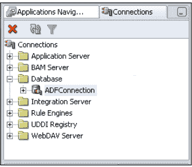

## 配置 BC4J 项目

在本节中，创建业务组件工作区和项目，从 Oracle 数据库表创建业务组件，并在 JDeveloper 中测试业务组件项目。首先，创建一个应用程序工作区。在 JDeveloper 中选择 **File | New**。在 **New Gallery** 窗口中，在列出的项目中选择 **General** 和 **Application**。在 **Create Application** 窗口中指定 **Application Name**、应用程序的 **Directory Name**，并选择 **Application Template**。选择 **Web Application [JSP, Struts ADF BC]** 模板。

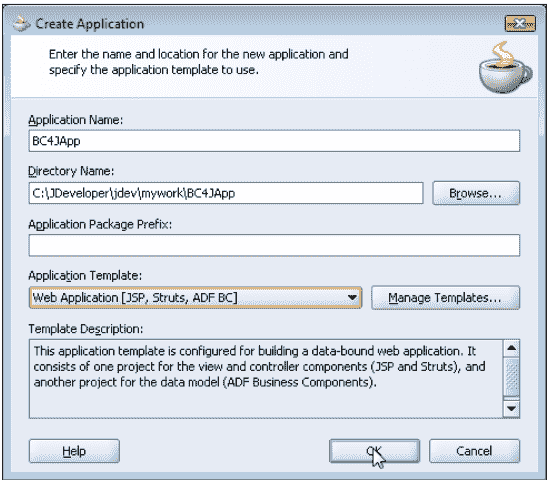


一个应用程序工作区 **BC4JApp** 被添加到 **Applications-Navigator** 中。该应用程序包含一个 **Model** 节点和一个 **ViewController** 节点。

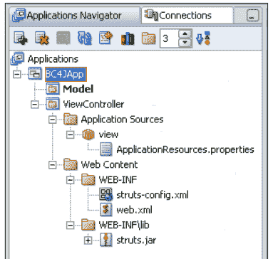

## 创建业务组件

在本节中，业务组件将从上一节中创建的 Oracle 数据库表 Catalog 创建。从该表创建的默认业务组件将在 JDeveloper 中进行修改。右键单击 **Model** 节点并选择 **New**。

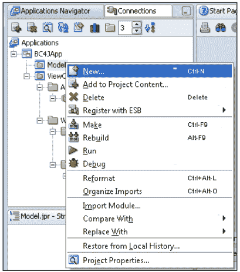

在 New Gallery 窗口中，在 Filter By 中选择 Project Technologies。在 Categories 中选择 Business Tier | ADF Business Components，并在列出的 Items 中选择 Business Components from Tables。

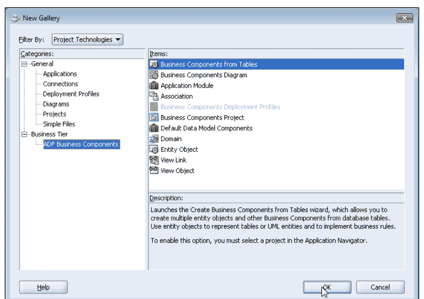

## 创建 Oracle ADF 业务组件

在 Initialize Business Components Project 窗口中，在 Connection 列表中选择数据库连接以从数据库表创建业务组件。

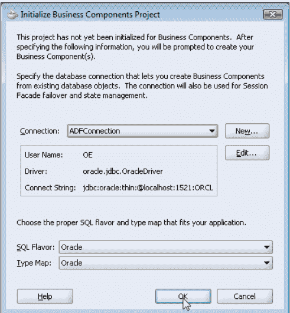

在 Login 窗口中，指定 User Name 和 Password 并单击 OK。Create Business Components from Tables 向导开始。单击 Next。

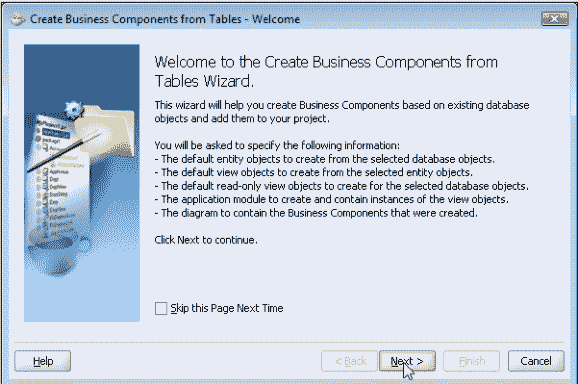

显示 **Entity Objects** 窗口。指定要从数据库表创建的实体对象。首先，在 **Schema** 列表中选择包含用于创建业务组件的数据库表的模式。`catalog` 表位于 `OE` 模式中，因此选择 `OE` 模式。单击 **Query** 按钮。`OE` 模式中的数据库表列在 **Available** 显示区中。在 **Available** 列表中选择 `OE.CATALOG` 表，并使用 **Copy (>)** 按钮或使用 *Alt+C* 将所选表传输到 **Selected** 区。实体对象 `Catalog` 被指定。单击 **Next**。

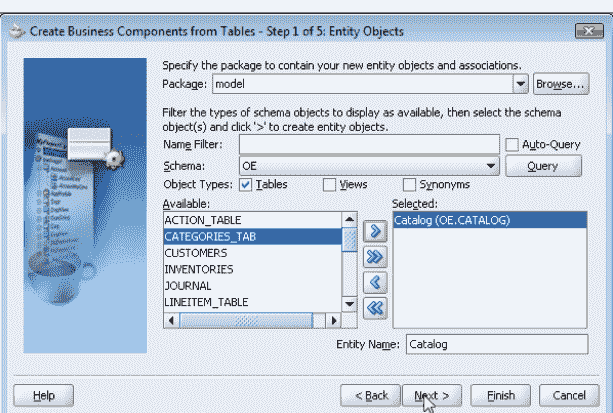

显示 **View Objects** 窗口。可用于生成默认可更新视图对象的实体对象列在 **Available** 区中。从 **Available** 区选择实体对象，并使用 **Copy (>)** 按钮或使用 *Alt+C* 将其传输到 **Selected** 区。在 **Available** 列表中选择 `Catalog` 实体对象并将其复制到 **Selected** 列表。视图对象 **CatalogView** 被指定。**CatalogView** 是所选实体对象的默认视图对象。

默认视图对象包含实体对象中的所有属性，并且 SELECT 查询选择所有数据库列。单击 Next。

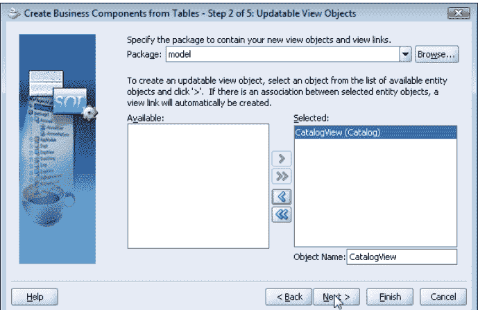

显示 Read-Only View Objects 窗口。可用于视图对象的表的数据库 Schema 列在 Schema 字段中。Object Types 复选框 Tables 默认被选中。可用表列在 Available 选择列表中。选择要为其生成只读视图对象的表并将其移至 Selected 列表。作为示例，选择 Catalog 表用于只读视图对象并单击 Next。

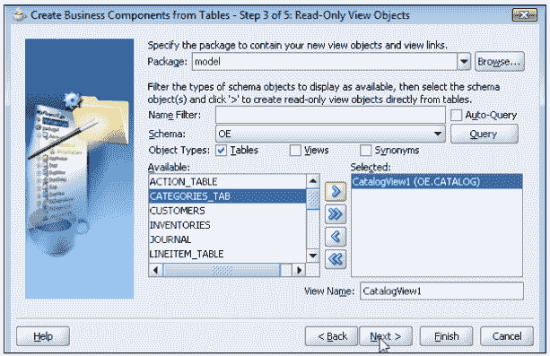

显示 Application Module 窗口。指定应用程序模块名称并单击 Next。

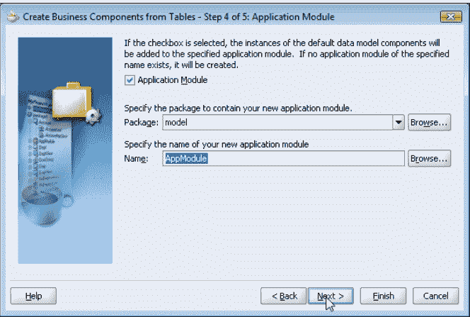

在 Diagram 窗口中，如果需要创建图表，请选择 Business Components Diagram 复选框并单击 Next。在 Finish 窗口中，列出业务组件。对于 Oracle 数据库表 Catalog，业务组件为实体对象 Catalog、可更新视图对象 CatalogView、只读视图对象 CatalogView1 和应用程序模块 AppModule。如果所选实体对象具有关联关系，则还会生成视图链接。单击 Finish 以生成业务组件。

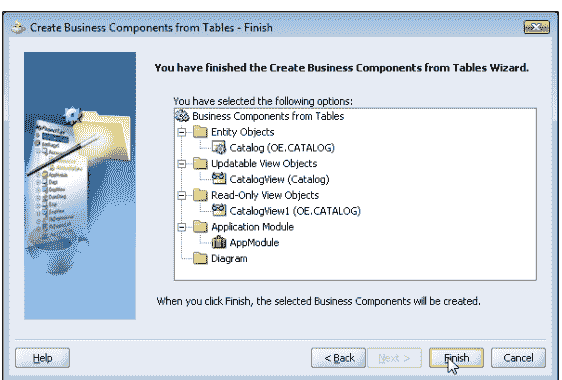

为 `Catalog` 表生成的业务组件已添加到 **Applications-Navigator** 中。生成视图对象实例 **CatalogView1** 和 **CatalogView1_1**。**CatalogView1** 是对应于可更新视图对象 **CatalogView** 的视图对象实例。**CatalogView1_1** 是对应于只读视图对象 **CatalogView1** 的视图对象实例。

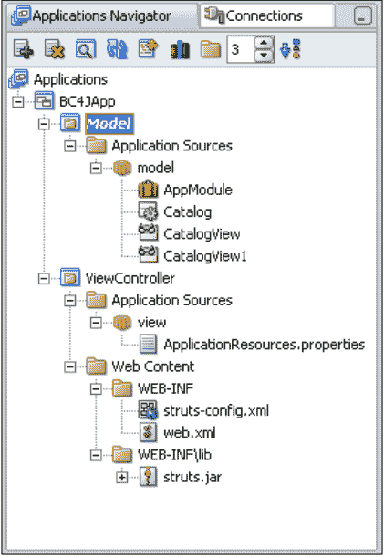

从数据库表 `Catalog` 创建的业务组件是默认业务组件。实体对象、视图对象和应用程序模块可在 JDeveloper 中进行修改。要修改实体对象 `Catalog`，右键单击 `Catalog` 实体对象节点并选择 **Edit Catalog**。

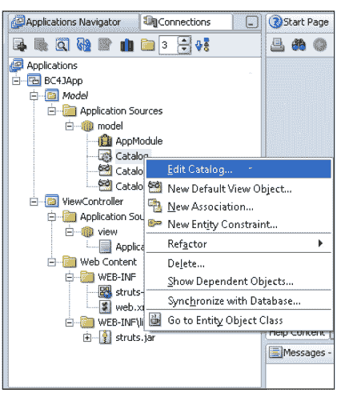

在 **Entity Object Editor** 中，单击 **Attributes** 节点。实体对象的属性被列出。实体对象属性对应于 `Catalog` 表中的数据库列。要删除属性，请在 **Entity Attributes** 列表中选择该属性并单击 **Remove** 按钮。要从未映射的表列添加属性，请单击 **New from Table** 按钮。要添加没有对应表列的属性，请单击 **New** 按钮。作为示例，添加一个没有对应表列的新属性。

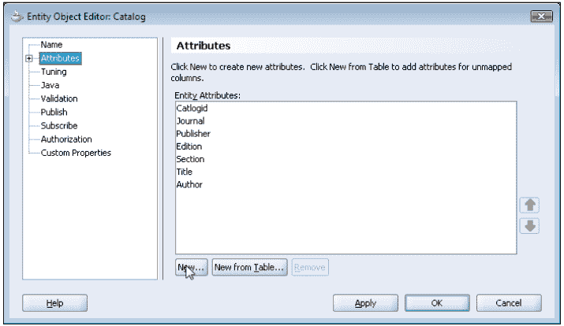

在 New Entity Attribute 窗口中指定属性 Name、Type 和 Default value。对于持久字段，选择 Persistent 复选框并单击 OK。

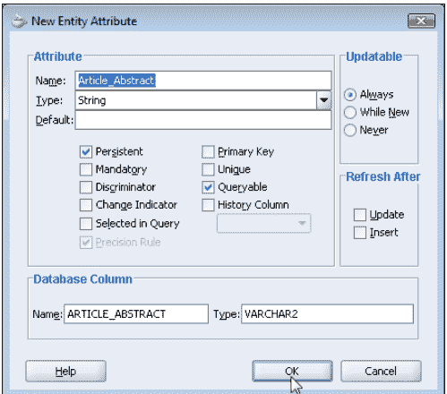

新属性 ArticleAbstract 已添加到实体对象 Catalog。要从实体对象中删除属性，首先从视图对象中删除该属性。单击 Apply 按钮以应用属性的添加/删除。单击 OK 按钮。

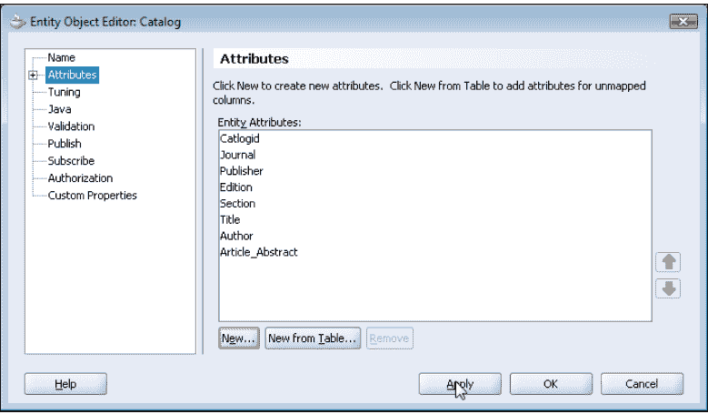

要将对 Catalog 实体对象所做的属性添加与 Oracle 数据库表同步，右键单击实体对象节点并选择 **Synchronize with Database**。**Synchronize with Database** 窗口显示同步数据库与实体对象所需的修改。如果向实体对象添加新的 `persistent` 属性，则在创建 `persistent` 属性之前，表中也需要新的表列。如果未添加新的表列，则 `persistent` 实体对象将被修改为 `transient` 属性。选择 **Entity: Catalog** 并单击 **Synchronize** 按钮以将实体对象与数据库同步。窗口显示消息 **The following Synchronization Actions were performed successfully**。由于未为 `ArticleAbstract` 列创建数据库表列，因此 `ArticleAbstract` 属性被设置为 `transient` 属性。

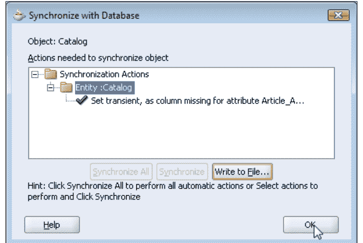

要修改可更新视图对象 CatalogView，右键单击视图对象节点并选择 **Edit CatalogView**。**View Object Editor** 显示视图对象的属性和 SQL 查询。选择 **Attributes** 节点以编辑视图对象属性。选择 **SQL Statement** 节点以编辑视图对象的 SELECT 查询。

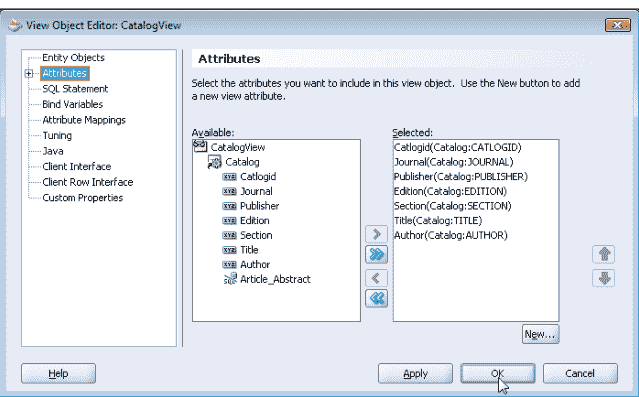

接下来，我们将测试业务组件应用程序。要测试业务组件应用程序，右键单击应用程序模块节点并选择 **Test**。显示 **Connect** 窗口。在 **Connect** 窗口中，选择用于连接数据库的 JDBC 连接。选择 **Connection Type**（JDBC URL 或 Datasource）和 **Connection Name** 并单击 **Connect** 按钮。

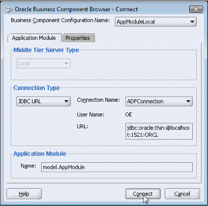

业务组件应用程序已连接到数据库并显示 **Local** 窗口。**Local** 窗口包含一个应用程序模块节点和视图对象实例结果节点。**CatalogView1** 是可更新视图对象 **CatalogView** 的视图对象实例，而 **CatalogView1_1** 是只读视图对象 **CatalogView1** 的视图对象实例。双击可更新视图对象实例 **CatalogView1** 节点以显示视图对象查询的结果。

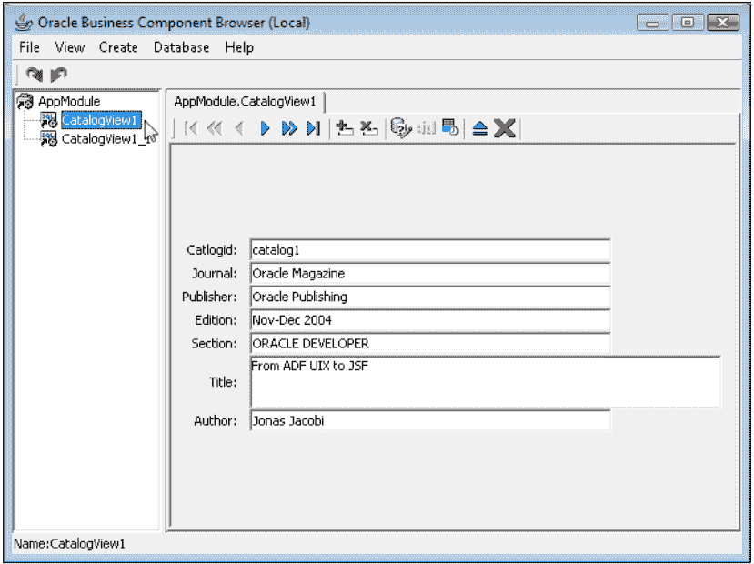


The **转到下一条/上一条记录**, **转到下一页/上一页**, and **转到最后一条/第一条记录** links may be used to navigate through the view object query results. To add a new record, select the **插入新记录** link.

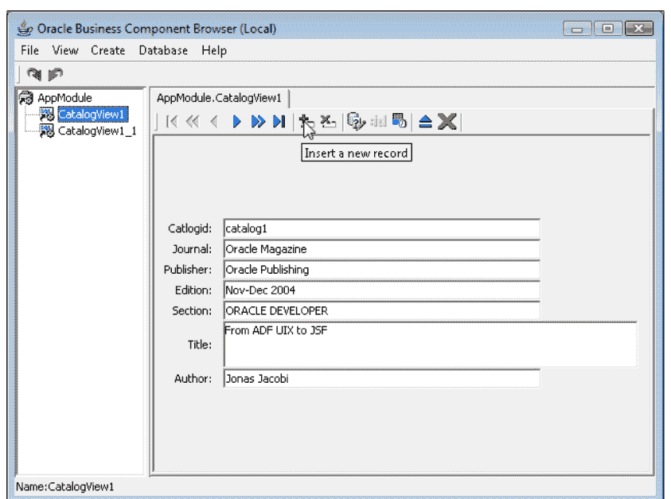

As an example, delete a record with the **删除当前记录** link. To commit the changes to a transaction, select **数据库 | 提交**.

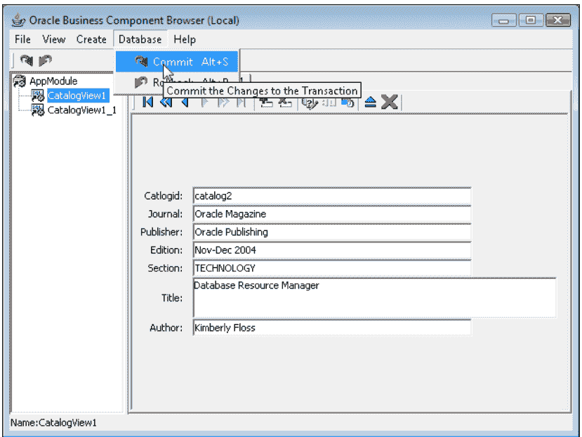

To view the data represented by a view object as XML select **视图 | 数据为 XML**. A window for the view object XML data is displayed

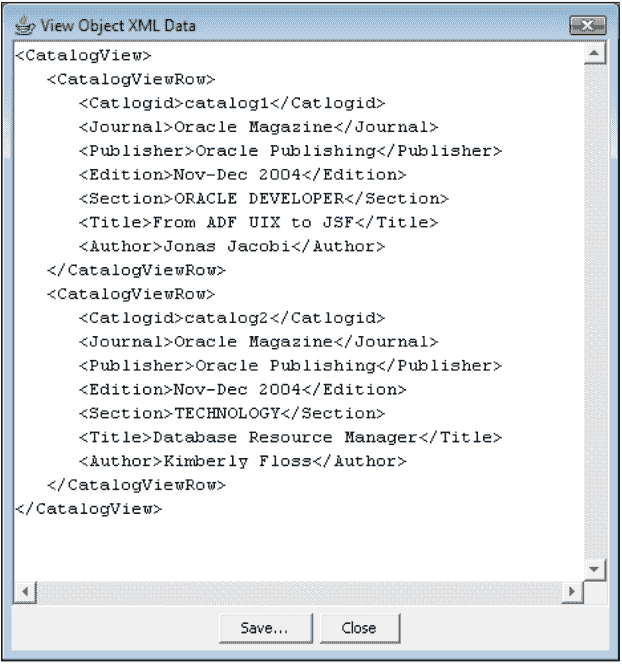

The SQL query used to create a view object may be modified in the **视图对象编辑器**. Right-click on the view object node and select **编辑 CatalogView**. In the **视图对象编辑器** window select the **SQL 语句** node. By default the `SELECT` list and the `FROM` clause of the SQL query are automatically defined. To override the default setting of the `SELECT` list and the `FROM` clause, check the **专家模式** checkbox. As an example, specify a `WHERE` clause for the SQL query. Click on the **应用** button to apply the changes to the SQL query.

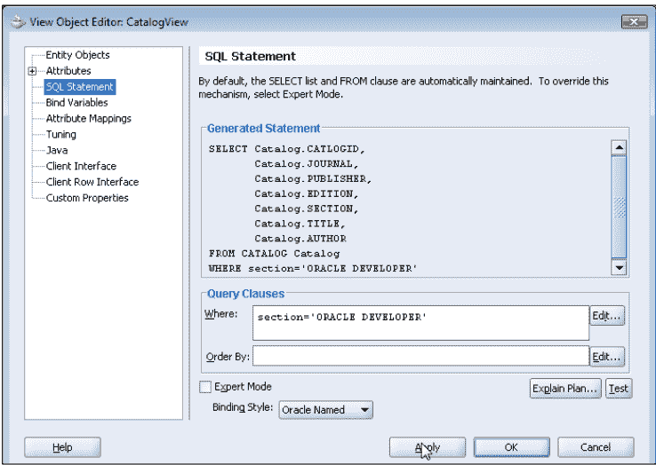

A window pops up to test the SQL query syntax. If the query syntax is correct, a **查询有效消息** is displayed. Click on **确定** in the **视图对象编辑器** window. Right-click on the application module node and select **测试** to test the modified business components application. Click on Connect in the Connect window. In the **Oracle 业务组件浏览器**, the results of the filtered query are displayed. With the WHERE clause set to `section='ORACLE DEVELOPER'`, only the results with the section column value `'ORACLE DEVELOPER'` are displayed.

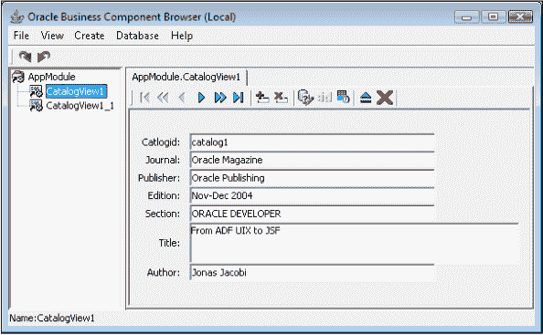

A new attribute may also be added/removed to the view object in the **视图对象编辑器**. For example, select the transient attribute `ArticleAbstract` and add it to the `CatalogView` view object. Click on the **应用** button to apply the attribute additions or removals. Click on **确定**.

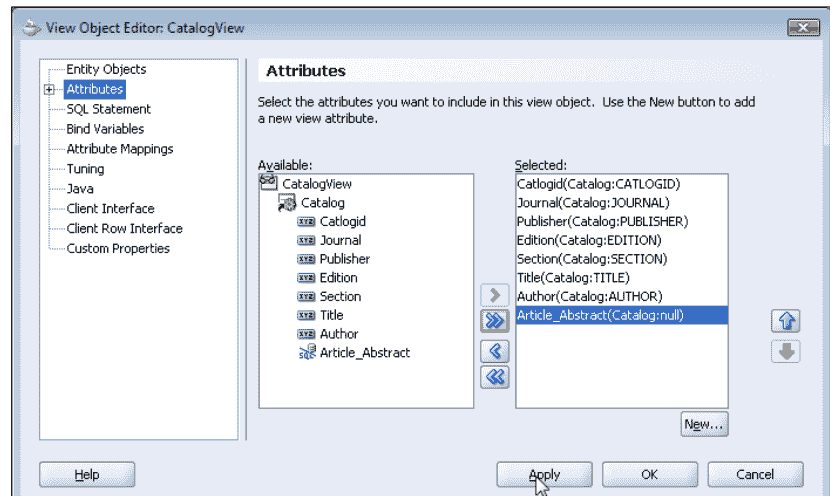

Right-click on the application module node and select **测试** to test the modified business components application. A new field **ArticleAbstract** is added to the results of the view object query. If the added attribute is a `transient` attribute, it does not get persisted to the database with the **数据库 | 提交** selection; only a `persistent` attribute is added to the database. A `transient` attribute does get displayed in the **视图对象 XML 数据** window with **视图 | 数据为 XML** selection if a value is specified for the attribute.

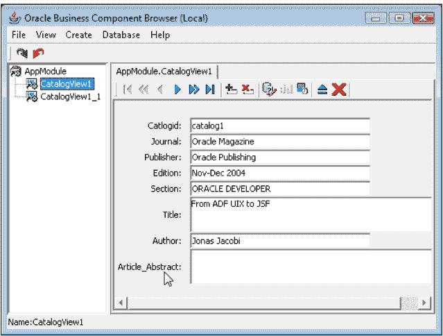

The updatable view object, CatalogView1, is updatable as explained in the previous section. Next, select the read-only view object instance node CatalogView1_1. The read-only view object instance only displays the results; the results from the view object query are not modifiable.

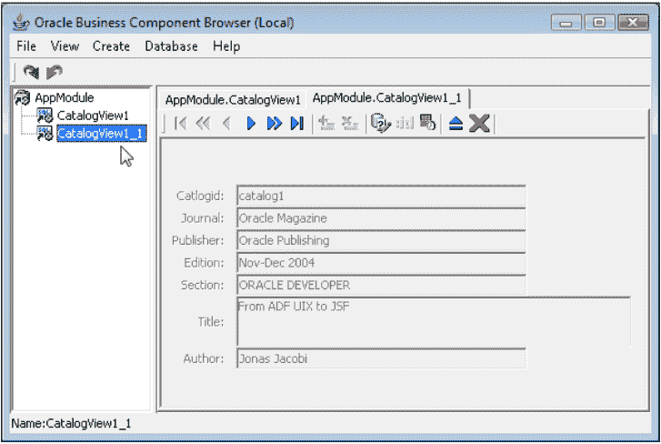

In this section, a business components application module was created and tested with the Oracle database. In the next section, we will create a web application for the business components.

## 开发 BC4J Web 应用程序

In this section a web application is created in the ViewController project of the Model-View-Controller application. A web application JSP will invoke the business components in the Model project. Add the Model project business components to the classpath of the ViewController project. Select the ViewController project in the Applications Navigator. Select Tools | Project Properties in the JDeveloper IDE. In the Project Properties window, select the Common | Dependencies node. In the Project Dependencies window, click in the Model.jpr checkbox. Click on the OK button. The Model project gets added to the classpath of the View project.

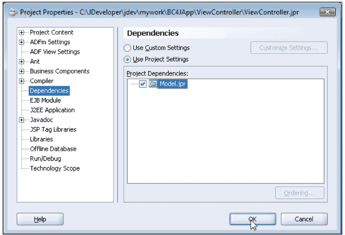

The JSP application will be integrated with the BC4J components in the Model project. To create a JSP right-click on the ViewController project and select New. In the New Gallery window, select Web Tier | Java Server Pages. Select JSP Page in the Items listed. In the Create JSP page, specify TestClient as the File Name and a Directory Name for the JSP page. The JSP page TestClient.jsp is added to the ViewController project of the BC4J application workspace. JDeveloper provides integrated support for the Oracle JDBC driver. For ADF/BC4J applications with a database other than Oracle database copy JDBC JAR file to BC4J/lib directory.

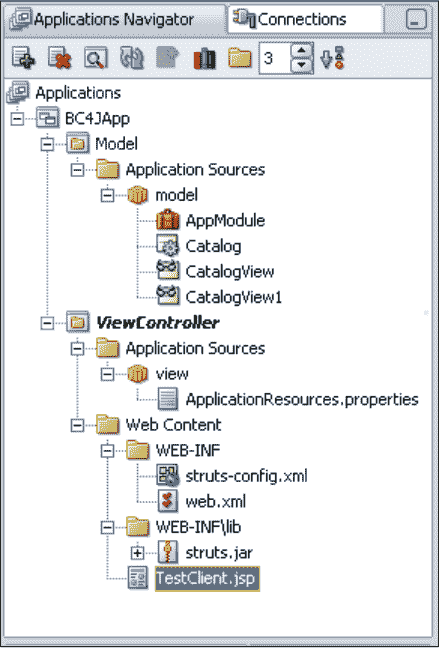

In the TestClient.jsp, import the oracle.jbo package and the oracle.jbo.client.Configuration class:

```
<%@page import="oracle.jbo.*, oracle.jbo.client.Configuration"%>
```

Create an application module name variable:

```
String appModule = "model.AppModule";
```

The application module name is specified in the AppModuleJndiName, element in the <BC4JApp>\Model\src\model\common\bc4j.xcfg configuration file. <BC4JApp> is the application workspace directory:

```
<AppModuleJndiName>model.AppModule</AppModuleJndiName>
```

Create an application module config name variable:

```
String cfg="AppModuleLocal";
```

The application module config name is specified in the name attribute of the AppModuleConfig element in the bc4j.xcfg file:

```
<AppModuleConfig name="AppModuleLocal"> </AppModuleConfig>
```

Create a view object instance variable:

```
String viewObject = "CatalogView1";
```

The view object instance is listed in the View Object Instances node in the application module Structure window in the JDeveloper. Create an ApplicationModule object from the BC4J application module using the createRootApplicationModule() static method of the Configuration class:

```
ApplicationModule applicationModule = (ApplicationModule)
    Configuration.createRootApplicationModule(appModule, cfg);
```

Obtain a Transaction object from the ApplicationModule object using the getTransaction() method. If the application module is not connected to the database connect to the database with the connect method.

```
Transaction transaction=applicationModule.getTransaction();
    if(transaction.isConnected()==false)
    transaction.connect("jdbc:oracle:thin:@<HOST>:<PORT>:<SID>", "OE",
        "<password>");
```

- <HOST> is the database host name.
- <PORT> is the database port.
- <SID> is the database instance.
- <password> is the password for the OE schema.

Obtain the view object instance from the application module using the findViewObject() method:

```
ViewObject vo = applicationModule.findViewObject(viewObject);
```

Iterate over the view object to output the attributes of the view object rows to the browser. A row in a view object is represented with the oracle.jbo.Row interface. Obtain the first row with the first() method of the ViewObject interface.

```
Row row = vo.first();
```

A row attribute is obtained using the getAttribute() method of the Row interface:

```
<% out.println(row.getAttribute(i++).toString());%>
```

Obtain the next row in the view object using the next() method:

```
row = vo.next();
```

Release and remove the application module using the releaseRootApplicationModule() method of the Configuration class:

```
Configuration.releaseRootApplicationModule(applicationModule, true);
```

TestClient.jsp JSP is listed below.

```
<%@ page
contentType="text/html;charset=windows-1252"%>
<%@ page import="oracle.jbo.*,
oracle.jbo.client.Configuration" %>
<html>
<head>
<meta http-equiv="Content-Type"
content="text/html; charset=windows-1252">
<title>BC4J Web Application</title>
</head>
<body>
<%
String appModule = "model.AppModule"; //App Module name
String cfg="AppModuleLocal";//Config Name
String viewObject = "CatalogView1"; //name of view object
ApplicationModule applicationModule =(ApplicationModule)
Configuration.createRootApplicationModule(appModule, cfg);
//Establish connection with database
Transaction
transaction=applicationModule.getTransaction();
if(transaction.isConnected()==false)
transaction.connect("jdbc:oracle:thin:@localhost:1521:ORCL", "OE",
"pw");
// Find the viewobject included in the appmodule
ViewObject vo = applicationModule.findViewObject(viewObject);
%>
<table border="1" cellspacing="0">
<tr>
<th>CatalogId</th>
<th>Journal</th>
<th>Publisher</th>
<th>Edition</th>
<th>Section</th>
<th>Title</th>
<th>Author</th>
</tr>
<% Row row = vo.first();
while (row != null)
{ int i=0;
```

```
%> <tr>
<td><%= out.println(row.getAttribute(i++).toString()); %></td>
<td><%=out.println(row.getAttribute(i++).toString()); %></td>
<td><%=out.println(row.getAttribute(i++).toString()); %></td>
<td><%=out.println(row.getAttribute(i++).toString()); %></td>
<td><%=out.println(row.getAttribute(i++).toString()); %></td>
<td><%= out.println(row.getAttribute(i++).toString()); %></td>
<td><%=out.println(row.getAttribute(i).toString()); %></td>
</tr>
<%
    row = vo.next();
} %>
</table>
<%
    Configuration.releaseRootApplicationModule(applicationModule,
        true);
%>
</body>
</html>
```

在 JSP TestClient.jsp 中，应用程序模块使用 JDBC URL 连接数据库。应用程序模块也可以通过数据源连接到数据库。对于 Connections-Navigator 中的 JDBC 连接 DBConnection1，可使用 JNDI 名称为 jdbc/DBConnection1DS 的数据源。应用程序模块通过 Transaction 接口的 connectToDataSource 方法使用数据源连接到数据库：

```
transaction.connectToDataSource(null,"jdbc/DBConnection1DS","OE",
    "<password>", false);
```

要运行 TestClient.jsp，请在 Applications Navigator 中右键单击 JSP 节点并选择 Run。JSP 的输出将在默认浏览器中显示。

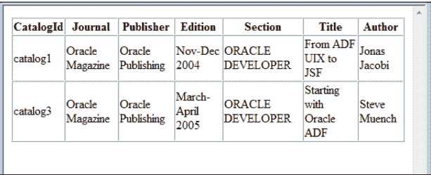

## JDBC 4.0 版本

ADF Business Components 使用 JDBC 访问数据库。嵌入 JDeveloper 10g 或 JDeveloper 中的 OC4J 服务器不支持 JDBC 4.0。JDBC 4.0 的新功能可在支持 JDBC 4.0 的 JDeveloper 版本中使用。要在 ADF Business Components 中使用 JDBC 4.0，请使用 Oracle 数据库 11g JDBC 4.0 驱动程序 JAR 文件 ojdbc6.jar 配置数据库连接。我们还需要将 JDK 版本设置为 JDK 6.0。要设置 JDK 版本，请选择 Tools | Project Properties。在 Project Properties 窗口中，选择 Libraries。在 J2SE Version 字段中，单击 Change 以选择 JDK 6.0 Java 可执行文件。

我们能够使用由 OC4J 服务器实现的那部分 JDBC 4.0 功能。连接状态跟踪由连接池管理器实现，用于跟踪不可用的连接。在引入连接状态跟踪新功能之前，连接池管理器通常会在连接池中的某些连接变得不可用时关闭所有连接并重新初始化连接池。使用 JDBC 4.0 中 Connection 接口的 isValid() 方法，连接池管理器能够判断连接是否仍然有效。如果连接无效，连接池管理器将关闭该连接。

```
if (!connection.isValid())
connection.close();
```

## 摘要

ADF Business Components 是一个基于 JDBC 的框架。正如本章所述，JDeveloper 中的 ADF Business Components 可以配置为使用 Oracle 数据库，或通过为数据库配置 JDBC 驱动程序库来使用第三方数据库。可以使用 oracle.jbo 包中的类和接口，使用 ADF business components 创建 Web 应用程序。在支持 JDBC 4.0 的 JDeveloper 版本中，我们还可以添加 JDBC 4.0 功能。
